# 广东省2021年度选调生和急需紧缺专业公务员招录笔试 综合行政能力测验（网友回忆版）

<!-- gwy:overview:start -->
> **广东 · 2021 · 行测 · 选调生** ｜ 100 题 · 图片 19 处 · 答案随题折叠

| 题型模块 | 题量 | 题号 |
| --- | ---: | ---: |
| 常识判断 | 40 | 1–40 |
| 言语理解与表达 | 35 | 41–75 |
| 科学推理 | 10 | 76–85 |
| 资料分析 | 15 | 86–100 |
| **合计** | **100** | |

导航：[题型与作答说明](#题型与作答说明) · [题目](#题目) · [材料 1](#材料-1)
<!-- gwy:overview:end -->

> 候选采集稿。参考答案及解析来自粉笔页面，不代表官方答案或真实高分答卷；来源使用许可与原卷对应关系仍需人工核实。

## 题型与作答说明

常识判断

（40题）

请运用基本常识理解分析，从4个备选项中选出最符合题干要求的1项。

言语理解与表达

（35题）

本部分包括表达与理解两方面的内容。请根据题目要求，在四个选项中选出一个最恰当的答案。

科学推理

（10题）

每题给出了文字或图表信息，请运用基本科学知识推理判断，从4个备选项中选出最合理的1项。

资料分析

（15题）

请根据资料所提供的信息分析、比较、计算，从4个备选项中选出符合题意的1项。

## 题目

### 第 1 题

《中共中央关于制定国民经济和社会发展第十四个五年规划和二〇三五年远景目标的建议》提出协调推进（ ）、全面深化改革、全面依法治国、全面从严治党的战略布局。

A. 全面对外开放

B. 全面实现乡村振兴

C. 全面建成小康社会

D. 全面建设社会主义现代化国家

第 1 题 · 答案与解析

**参考答案（粉笔题库参考内容）**

D

**解析**

本题考查政治常识。

2020年10月29日，中国共产党第十九届中央委员会第五次全体会议通过《中共中央关于制定国民经济和社会发展第十四个五年规划和二〇三五年远景目标的建议》。《建议》指出：高举中国特色社会主义伟大旗帜，深入贯彻党的十九大和十九届二中、三中、四中、五中全会精神，坚持以马克思列宁主义、毛泽东思想、邓小平理论、“三个代表”重要思想、科学发展观、习近平新时代中国特色社会主义思想为指导，全面贯彻党的基本理论、基本路线、基本方略，统筹推进经济建设、政治建设、文化建设、社会建设、生态文明建设的总体布局，协调推进全面建设社会主义现代化国家、全面深化改革、全面依法治国、全面从严治党的战略布局。

故正确答案为D。

**考点**：新思想总论、重要文件

**来源**：广东省2021年度选调生和急需紧缺专业公务员招录笔试 综合行政能力测验（网友回忆版）第1题

### 第 2 题

党的十九届五中全会提出了到2035年的远景目标，其中包括建成（ ）、健康中国，国民素质和社会文明程度达到新高度，国家文化软实力显著增强。

①文化强国②教育强国③人才强国④体育强国⑤科技强国

A. ①②④

B. ①②③④

C. ①②④⑤

D. ①②③④⑤

第 2 题 · 答案与解析

**参考答案（粉笔题库参考内容）**

B

**解析**

本题考查政治常识。

2020年10月29日，中国共产党第十九届中央委员会第五次全体会议通过《中共中央关于制定国民经济和社会发展第十四个五年规划和二〇三五年远景目标的建议》。《建议》指出：展望二〇三五年，我国经济实力、科技实力、综合国力将大幅跃升，经济总量和城乡居民人均收入将再迈上新的大台阶，关键核心技术实现重大突破，进入创新型国家前列；基本实现新型工业化、信息化、城镇化、农业现代化，建成现代化经济体系；基本实现国家治理体系和治理能力现代化，人民平等参与、平等发展权利得到充分保障，基本建成法治国家、法治政府、法治社会；建成文化强国、教育强国、人才强国、体育强国、健康中国，国民素质和社会文明程度达到新高度，国家文化软实力显著增强。因此①②③④正确。

故正确答案为B。

**考点**：其他建设、重要文件

**来源**：广东省2021年度选调生和急需紧缺专业公务员招录笔试 综合行政能力测验（网友回忆版）第2题

### 第 3 题

习近平总书记指出：“中华民族要实现伟大复兴，必须与时俱进、不断前进，也就是我们古人说的苟日新、日日新、又日新！”下列选项中，最符合该讲话精神的是：

A. 尺有所短，寸有所长

B. 以史为镜，可以知兴替

C. 明者因时而变，知者随事而制

D. 事者，生于虑，成于务，失于傲

第 3 题 · 答案与解析

**参考答案（粉笔题库参考内容）**

C

**解析**

本题考查人文常识。“苟日新，日日新，又日新”出自《礼记·大学》，意为如果能每天除旧更新，就要天天除旧更新，不断地更新再更新。强调及时反省和不断革新，不因循守旧。

A项错误，“尺有所短，寸有所长”出自屈原的《卜居》，意为尺虽比寸长，但也会有它的短处；寸虽比尺短，但也有它的长处，比喻人或事物各有其长处和短处。与讲话精神不符。

B项错误，“以史为镜，可以知兴替”典出《旧唐书·魏徵传》：“夫以铜为镜，可以正衣冠；以史为镜，可以知兴替；以人为镜，可以明得失。”意为对照铜镜可以整理好衣帽，借鉴历史能够预知世代兴衰，听取他人教训才能明了自身得失对错。与讲话精神不符。

C项正确，“明者因时而变，知者随事而制”出自汉代桓宽的著作《盐铁论》卷二之忧边第十二篇。意为聪明的人会根据时期的不同而改变行事策略，智慧的人会随着事情的不同而改变处理问题的方法。体现了处事要因时制宜、因地制宜，根据情境、形势的不同而灵活变通。与讲话精神相符。

D项错误，“事者，生于虑，成于务，失于傲”出自《管子·乘马》，意为事情总是产生于谋虑，成功于努力，失败于骄傲轻心。习近平总书记在庆祝改革开放40周年大会上引用这句古语，告诫人们要用深谋远虑的眼光、真抓实干的精神和自我警醒的忧患意识来干事创业，将改革开放进行到底。

故正确答案为C。

**考点**：文学常识

**来源**：广东省2021年度选调生和急需紧缺专业公务员招录笔试 综合行政能力测验（网友回忆版）第3题

### 第 4 题

全面依法治国是中国特色社会主义的本质要求和重要保障，是国家治理的一场深刻革命。关于全面推进依法治国的基本原则，下列说法不准确的是：

A. 坚持中国共产党的领导

B. 坚持人民主体地位，以保障人民根本利益为出发点

C. 坚持依法治国和以德治国相结合，要将所有的传统道德转化为法律

D. 坚持从中国实际和我国基本国情出发，同改革开放不断深化相适应

第 4 题 · 答案与解析

**参考答案（粉笔题库参考内容）**

C

**解析**

本题考查政治常识。

全面推进依法治国的基本原则包括如下内容：坚持中国共产党的领导、坚持人民主体地位、坚持法律面前人人平等、坚持依法治国和以德治国相结合、坚持从中国实际出发。

A项正确，坚持中国共产党的领导是全面推进依法治国的基本原则之一，党的领导是中国特色社会主义最本质的特征，是社会主义法治最根本的保证。

B项正确，坚持人民主体地位是全面推进依法治国的基本原则之一，人民是依法治国的主体和力量源泉，人民代表大会制度是保证人民当家作主的根本政治制度。

C项错误，坚持依法治国和以德治国相结合是全面推进依法治国的基本原则之一，国家和社会治理需要法律和道德共同发挥作用。将所有的传统道德转化为法律过于绝对，也是不现实的。

D项正确，坚持从中国实际出发是全面推进依法治国的基本原则之一，中国特色社会主义道路、理论体系、制度是全面推进依法治国的根本遵循。

本题为选非题，故正确答案为C。

**考点**：其他建设

**来源**：广东省2021年度选调生和急需紧缺专业公务员招录笔试 综合行政能力测验（网友回忆版）第4题

### 第 5 题

没有网络安全就没有国家安全，就没有经济社会稳定运行，广大群众利益也难以得到保障。当前，为保障网络安全应采取的举措不包括：

A. 加快推动信息领域技术全面领先

B. 不断增强网络安全防御能力和威慑能力

C. 依法加强网络空间治理，净化网络环境

D. 共同构建网络命运共同体

第 5 题 · 答案与解析

**参考答案（粉笔题库参考内容）**

A

**解析**

本题考查政治常识。

A项错误，全国网络安全和信息化工作会议于2018年4月20日至21日在北京召开。习近平主席出席会议并发表重要讲话。习近平指出，核心技术是国之重器。要下定决心、保持恒心、找准重心，加速推动信息领域核心技术突破，而不是全面领先。

B项正确，习近平于2016年4月19日上午在京主持召开网络安全和信息化工作座谈会并发表重要讲话中指出：“安全是发展的前提，发展是安全的保障，安全和发展要同步推进。要树立正确的网络安全观，加快构建关键信息基础设施安全保障体系，全天候全方位感知网络安全态势，增强网络安全防御能力和威慑能力。”

C项正确，习近平同志在党的新闻舆论工作座谈会上指出：“随着形势发展，党的新闻舆论工作必须创新理念、内容、体裁、形式、方法、手段、业态、体制、机制，增强针对性和实效性。”他在其他重要讲话中还强调：“把握好网上舆论引导的时、度、效，使网络空间清朗起来”。

D项正确，在2015年世界互联网大会习近平总书记指出：“网络空间是人类共同的活动空间，网络空间前途命运应由世界各国共同掌握。各国应该加强沟通、扩大共识、深化合作，共同构建网络空间命运共同体。”共同构建网络命运共同体有助于全球携手共商应对数据安全风险之策，共谋全球数字治理。

本题为选非题，故正确答案为A。

**考点**：文化建设、重要会议讲话

**来源**：广东省2021年度选调生和急需紧缺专业公务员招录笔试 综合行政能力测验（网友回忆版）第5题

### 第 6 题

以下选项中，符合我国推动共建“一带一路”高质量发展思路的有：

①坚持共商共建共享原则

②秉持绿色、开放、廉洁理念

③加强政策、规则、标准联通

④坚持以企业为导向，政府为主体

A. ①②③

B. ①②④

C. ①③④

D. ②③④

第 6 题 · 答案与解析

**参考答案（粉笔题库参考内容）**

A

**解析**

本题考查政治常识。

①②正确，2019年4月26日，国家主席习近平在第二届“一带一路”国际合作高峰论坛开幕式上发表主旨演讲《齐心开创共建“一带一路”美好未来》，讲话中指出：“我们要秉持共商共建共享原则，倡导多边主义，大家的事大家商量着办，推动各方各施所长、各尽所能，通过双边合作、三方合作、多边合作等各种形式，把大家的优势和潜能充分发挥出来，聚沙成塔、积水成渊。我们要坚持开放、绿色、廉洁理念，不搞封闭排他的小圈子，把绿色作为底色，推动绿色基础设施建设、绿色投资、绿色金融，保护好我们赖以生存的共同家园，坚持一切合作都在阳光下运作，共同以零容忍态度打击腐败。”

③项正确，2017年5月14日，国家主席习近平在“一带一路”国际合作高峰论坛开幕式上发表演讲《携手推进“一带一路”建设》，讲话中指出：“我们也要促进政策、规则、标准三位一体的联通，为互联互通提供机制保障。”

④项错误，坚持以企业为导向，政府为主体并非是我国推动共建“一带一路”高质量发展思路的有关内容。

所以①②③正确，④错误。

故正确答案为A。

**考点**：经济建设、重要会议讲话

**来源**：广东省2021年度选调生和急需紧缺专业公务员招录笔试 综合行政能力测验（网友回忆版）第6题

### 第 7 题

实践没有止境，理论创新也没有止境。世界每时每刻都在发生变化，中国也每时每刻都在发生变化，我们必须在理论上跟上时代，不断认识规律，不断推进理论创新、实践创新、制度创新、文化创新以及其他方面创新。这段话体现了：

A. 运动和静止的辩证关系

B. 实践和认识的辩证关系

C. 真理和价值的辩证关系

D. 感性认识和理性认识的辩证关系

第 7 题 · 答案与解析

**参考答案（粉笔题库参考内容）**

B

**解析**

本题考查政治常识。

A项错误，辩证唯物主义认为，运动是无条件的、绝对的、永恒的；静止是有条件的、相对的和暂时的。物质世界是绝对运动和相对静止的统一。题干未体现运动和静止的辩证关系。

B项正确，实践是认识的基础，实践是认识的来源，实践是认识发展的动力，实践是检验认识的真理性的唯一标准，实践是认识的最终目的。实践决定认识，认识对实践有反作用，正确的认识、科学的理论对实践有指导作用。错误的认识、不科学的理论对实践有阻碍作用。题干中提到理论要跟上时代的变化，体现了实践的变化决定认识的变化。

C项错误，真理与价值的关系是指成功的实践必然是以真理和价值的统一为前提的，价值的形成和实现以坚持真理为前提，而真理又必然是具有价值的，真理和价值在实践和认识活动中是相互制约、相互引导、相互促进的。题干未体现真理和价值的辩证关系。

D项错误，感性认识和理性认识的辩证关系体现在理性认识依赖于感性认识、感性认识有待于发展为理性认识、感性认识和理性认识相互渗透。题干未体现感性认识和理性认识的辩证关系。

故正确答案为B。

**考点**：认识论

**来源**：广东省2021年度选调生和急需紧缺专业公务员招录笔试 综合行政能力测验（网友回忆版）第7题

### 第 8 题

中国特色社会主义开创于改革开放新时期，建立在我们党九十多年长期奋斗基础上。而其思想、理论和实践的源头，则可追溯到更远。下列选项与上述说法最为相符的是：

A. 千磨万击还坚韧，任尔东南西北风

B. 江河万里总有源，树高千尺也有根

C. 万物得其本者生，百事得其道者成

D. 绳短不能汲深井，浅水难以负大舟

第 8 题 · 答案与解析

**参考答案（粉笔题库参考内容）**

B

**解析**

本题考查人文常识。

A项错误，“千磨万击还坚韧，任尔东南西北风”出自郑燮的《竹石》，意思是竹子经历无数磨难和打击身骨仍坚劲，任凭你刮酷暑的东南风，还是严冬的西北风。体现的是坚韧不拔的顽强精神。与题意不符。

B项正确，“江河万里总有源，树高千尺也有根”意思是江河奔腾万里也有源头，树长到千尺高也有深扎在土里的根。体现的是人不能忘本，要坚守本我。要了解中国特色社会主义形成和发展的脉络，更加充分地认识其历史必然性和科学真理性，应该拉长时间尺度，放在世界社会主义演进的历程中去把握。

C项错误，“万物得其本者生，百事得其道者成”出自汉代刘向《说苑》，意思是世间万物只有保住根本才能生长，一切事情只有遵循规律才能成功。强调要遵循客观规律。与题意不符。

D项错误，“绳短不能汲深井，浅水难以负大舟”出自《庄子·至乐》，意思是水桶上的绳子短了就不可能汲取深井里的水，江河里的水太浅了就不可能承载大型的船只。比喻能力薄弱，难以担任艰巨的任务。与题意不符。

故正确答案为B。

**考点**：文学常识

**来源**：广东省2021年度选调生和急需紧缺专业公务员招录笔试 综合行政能力测验（网友回忆版）第8题

### 第 9 题

习近平总书记指出：“干部特别是年轻干部要提高政治能力，调查研究能力、科学决策能力、改革攻坚能力、应急处突能力、群众工作能力、抓落实能力。”

下列工作最能体现干部改革攻坚能力的是：

A. 通过网络直播销售本地农产品

B. 到农民家里了解脱贫情况

C. 在社区宣传新冠肺炎疫情防控知识

D. 到街道调解街坊内部矛盾

第 9 题 · 答案与解析

**参考答案（粉笔题库参考内容）**

A

**解析**

本题考查政治常识。

A项正确，改革攻坚能力是指要有正确方法，坚持创新思维，跟着问题走、奔着问题去，准确识变、科学应变、主动求变，在把握规律的基础上实现变革创新。通过网络直播销售本地农产品改变了原来的传统销售模式，扩大了销路，体现了改革攻坚能力。

B项错误，到农民家里了解脱贫情况能够深入群众，从群众中来，通过深入调查了解群众所思所想，为解决工作中的问题提供科学的方法指引，属于调查研究能力。

C项错误，在社区宣传新冠肺炎疫情防控知识能够让群众尽快了解掌握应对疫情的相关知识，有效促进疫情防控，属于抓落实能力。

D项错误，到街道调解街坊内部矛盾能够化解街坊内部冲突，属于应急处突能力。

故正确答案为A。

**考点**：其他建设

**来源**：广东省2021年度选调生和急需紧缺专业公务员招录笔试 综合行政能力测验（网友回忆版）第9题

### 第 10 题

《中共中央关于制定国民经济和社会发展第十四个五年规划和二〇三五年远景目标的建议》指出，全面推进健康中国建设。以下措施属于健康中国建设的是：

①推广远程医疗

②大力发展中医药事业

③深入开展爱国卫生运动

④坚持基本医疗卫生事业公益属性

A. ①②

B. ③④

C. ①②③

D. ①②③④

第 10 题 · 答案与解析

**参考答案（粉笔题库参考内容）**

D

**解析**

本题考查政治常识。

①正确，《中共中央关于制定国民经济和社会发展第十四个五年规划和二〇三五年远景目标的建议》（以下简称《建议》）指出：深化医药卫生体制改革，加快建设分级诊疗体系，推广远程医疗，优化医疗卫生资源布局。

②正确，《建议》指出：促进中医药传承创新发展，大力发展中医药事业。

③正确，《建议》指出：构建强大的公共卫生体系，深入开展爱国卫生运动，促进全民养成文明健康生活方式。

④正确，《建议》指出：坚持基本医疗卫生事业公益属性。各地各部门要切实担负起卫生健康事业发展的领导、保障、管理和监督责任，同时充分发挥市场机制的作用，鼓励社会力量增加产品和服务供给，更好满足群众多元化卫生健康需求。

故正确答案为D。

**考点**：重要文件、社会建设

**来源**：广东省2021年度选调生和急需紧缺专业公务员招录笔试 综合行政能力测验（网友回忆版）第10题

### 第 11 题

在抗击新冠肺炎疫情斗争中，中国人民和中华民族以敢于斗争、敢于胜利的大无畏气概，铸就了（ ）的伟大抗疫精神。

①生命至上②举国同心③舍生忘死④尊重科学⑤命运与共

A. ①②③

B. ①③④

C. ①②③④

D. ①②③④⑤

第 11 题 · 答案与解析

**参考答案（粉笔题库参考内容）**

D

**解析**

本题考查政治常识。

2020年9月8日上午，习近平总书记在全国抗击新冠肺炎疫情表彰大会上从5个方面概括了伟大抗疫精神——生命至上、举国同心、舍生忘死、尊重科学、命运与共。

生命至上集中体现了中国人民深厚的仁爱传统和中国共产党人以人民为中心的价值追求；

举国同心集中体现了中国人民万众一心、同甘共苦的团结伟力；

舍生忘死集中体现了中国人民敢于压倒一切困难而不被任何困难所压倒的顽强意志；

尊重科学集中体现了中国人民求真务实、开拓创新的实践品格；

命运与共集中体现了中国人民和衷共济、爱好和平的道义担当。

故正确答案为D。

**考点**：重要会议讲话、其他建设

**来源**：广东省2021年度选调生和急需紧缺专业公务员招录笔试 综合行政能力测验（网友回忆版）第11题

### 第 12 题

改革是一场全面深刻的社会变革，也是一项复杂的系统工程，必须坚持正确方法，关于全面深化改革要坚持的正确方法，以下说法错误的是：

A. 坚持以问题为导向深化改革

B. 坚持以法治思维和方法推进改革

C. 坚持改革的系统性、整体性、协同性

D. 坚持顶层设计指导基层探索

第 12 题 · 答案与解析

**参考答案（粉笔题库参考内容）**

D

**解析**

本题考查政治常识。

改革是一场全面而深刻的社会变革，也是一项复杂的系统工程，必须坚持正确方法论。即要坚持问题导向，把能否解决问题作为衡量改革成效的重要标准；坚持法治思维和法治方式，推动全面深化改革行稳致远；坚持改革的系统性、整体性、协同性，不断提高改革的整体效益；坚持顶层设计与基层探索有机结合，实现自上而下与自下而上的协调联动；坚持蹄疾步稳推进，既胆大心细、稳步有序、又奋发有为、敢于担当。D项仅体现出了顶层设计对基层探索的单方面的指导，未体现顶层设计与基层探索有机结合与协调联动，表述有误。

本题为选非题，故正确答案为D。

**考点**：新思想总论、重要会议讲话

**来源**：广东省2021年度选调生和急需紧缺专业公务员招录笔试 综合行政能力测验（网友回忆版）第12题

### 第 13 题

习近平总书记在深圳特区成立40周年大会上指出，新发展格局不是封闭的国内循环，而是国内国际开放的双循环，下列举措不属于新发展格局的是：

A. 增加优质产品进口

B. 加强文物古籍保护

C. 扩大节假日消费

D. 实施星际探测

第 13 题 · 答案与解析

**参考答案（粉笔题库参考内容）**

B

**解析**

本题考查政治常识。

A项正确，形成强大国内市场，构建新发展格局，要求促进国内国际双循环。优化国内国际市场布局、商品结构、贸易方式，提升出口质量，增加优质产品进口，实施贸易投资融合工程，构建现代物流体系。

B项错误，繁荣发展文化事业和文化产业，提高国家文化软实力，要求提升公共文化服务水平。传承弘扬中华优秀传统文化，要加强文物古籍保护、研究、利用，强化重要文化和自然遗产、非物质文化遗产系统性保护，加强各民族优秀传统手工艺保护和传承，建设长城、大运河、长征、黄河等国家文化公园。加强文物古籍保护不属于新发展格局。

C项正确，形成强大国内市场，构建新发展格局。要求坚持扩大内需这个战略基点，加快培育完整内需体系，把实施扩大内需战略同深化供给侧结构性改革有机结合起来，以创新驱动、高质量供给引领和创造新需求。要完善节假日制度，落实带薪休假制度，扩大节假日消费。

D项正确，形成强大国内市场，构建新发展格局，要求拓展投资空间。实施川藏铁路、西部陆海新通道、星际探测等重大工程，推进重大科研设施、重大生态系统保护修复、公共卫生应急保障等一批强基础、增功能、利长远的重大项目建设。

本题为选非题，故正确答案为B。

**考点**：经济建设、重要会议讲话

**来源**：广东省2021年度选调生和急需紧缺专业公务员招录笔试 综合行政能力测验（网友回忆版）第13题

### 第 14 题

2020年11月，随着（ ）省紫云县、威宁县、从江县等9个县退出贫困县序列，标志着全国832个贫困县全部脱贫摘帽。

A. 云南

B. 四川

C. 贵州

D. 青海

第 14 题 · 答案与解析

**参考答案（粉笔题库参考内容）**

C

**解析**

本题考查政治常识。

2020年11月23日，贵州省政府新闻办召开新闻发布会，会上省政府宣布同意紫云自治县、纳雍县、威宁自治县、赫章县、沿河自治县、榕江县、从江县、晴隆县、望谟县等9个贫困县退出贫困县序列。标志着全国832个贫困县全部脱贫摘帽。

故正确答案为C。

**考点**：重要会议讲话、社会建设

**来源**：广东省2021年度选调生和急需紧缺专业公务员招录笔试 综合行政能力测验（网友回忆版）第14题

### 第 15 题

2020年12月17日凌晨，（ ）返回器搭载着珍贵的月球样品成功返回，标志着我国探月工程“绕、落、回”三步走规划顺利完成。

A. 神舟九号

B. 天宫一号

C. 玉兔二号

D. 嫦娥五号

第 15 题 · 答案与解析

**参考答案（粉笔题库参考内容）**

D

**解析**

本题考查科技常识。

A项错误，神舟九号，简称“神九”，于2012年6月16日发射升空，为中国载人航天工程发射的第九艘飞船，是中国的第四次载人航天飞行任务，也是中国首次载人交会对接任务。

B项错误，天宫一号于2011年9月29日发射升空，为中国载人航天工程发射第一个目标飞行器，是中国第一个空间实验室，也是中国迈入航天“三步走”战略的第二步第二阶段。

C项错误，玉兔二号，嫦娥四号任务月球车，于2019年1月3日22时22分完成与嫦娥四号着陆器的分离，驶抵月球背面。首次实现月球背面着陆，成为中国航天事业发展的又一座里程碑。

D项正确，2020年12月17日1时59分，探月工程嫦娥五号返回器在内蒙古四子王旗预定区域成功着陆，标志着我国首次地外天体采样返回任务圆满完成。国家航天局专家表示，嫦娥五号探测器在一次任务中，连续实现我国航天史上首次月面采样、月面起飞、月球轨道交会对接、带样返回等多个重大突破，为我国探月工程“绕、落、回”三步走发展规划画上了圆满句号。

故正确答案为D。

**考点**：科技理论与成就

**来源**：广东省2021年度选调生和急需紧缺专业公务员招录笔试 综合行政能力测验（网友回忆版）第15题

### 第 16 题

习近平总书记强调，要坚决杜绝形形色色的形式主义、官僚主义，持续为基层松绑减负，让干部有更多时间和精力抓落实，以下做法不符合这一要求的是（ ）。

A. 进一步改进督查检查考核方式方法，从重结果向重过程转变，从以暗访为主向以明查为主转变

B. 加快制定赋权清单，推动更多社会资源、管理权限和民生服务下放到基层，人力物力财力投放到基层

C. 守住精文减会的硬杠杠，对各地区各部门发文开会情况实施动态监测，对出现超发超开苗头的及时预警

D. 精准审慎实施谈话、函询和问责，规范实施问责的工作程序，及时纠正滥用问责、不当问责及以问责代替整改等问题

第 16 题 · 答案与解析

**参考答案（粉笔题库参考内容）**

A

**解析**

本题考查政治常识。

A项错误，2020年4月14日，中共中央办公厅印发的《关于持续解决困扰基层的形式主义问题为决胜全面建成小康社会提供坚强作风保证的通知》中，四、进一步改进督查检查考核方式方法。从重过程向重结果转变，从以明查为主向明查暗访相结合转变。

B项正确，根据《关于持续解决困扰基层的形式主义问题为决胜全面建成小康社会提供坚强作风保证的通知》中，七、深化治理改革为基层放权赋能。总结一些地方的新鲜经验，进一步向基层放权赋能，加快制定赋权清单，推动更多社会资源、管理权限和民生服务下放到基层，人力物力财力投放到基层。

C项正确，根据《关于持续解决困扰基层的形式主义问题为决胜全面建成小康社会提供坚强作风保证的通知》中，三、切实防止文山会海反弹回潮。中央层面继续发挥示范带动作用，守住精文减会的硬杠杠，对各地区各部门发文开会情况实施动态监测，对出现超发超开苗头的及时预警，确保比2019年只减不增。

D项正确，根据《关于持续解决困扰基层的形式主义问题为决胜全面建成小康社会提供坚强作风保证的通知》中，六、完善干部担当作为的激励机制。精准审慎实施谈话函询和问责，规范实施问责的工作程序，及时纠正滥用问责、不当问责及以问责代替整改等问题。

本题为选非题，故正确答案为A。

**考点**：政治建设、重要会议讲话

**来源**：广东省2021年度选调生和急需紧缺专业公务员招录笔试 综合行政能力测验（网友回忆版）第16题

### 第 17 题

2020年11月15日，中国、新加坡、日本等国共同签署区域全面经济伙伴关系协定（RCEP），世界上人口数量最多、成员结构最多元、发展潜力最大的自贸区就此诞生。这是（ ）区域经济一体化进程的重大里程碑，为推动区域乃至世界经济复苏注入了新的动力。

A. 东亚

B. 东北亚

C. 东南亚

D. 亚太

第 17 题 · 答案与解析

**参考答案（粉笔题库参考内容）**

A

**解析**

本题考查政治常识。

2020年11月15日，第四次区域全面经济伙伴关系协定（RCEP）领导人会议以视频方式举行，中国、新加坡、日本等国正式签署该协定，世界上人口数量最多、成员结构最多元、发展潜力最大的自贸区就此诞生。区域全面经济伙伴关系协定（RCEP）的正式签署，是东亚区域经济一体化进程的重大里程碑，为推动区域乃至世界经济复苏注入了新的动力。

故正确答案为A。

**考点**：经济建设、重要会议讲话

**来源**：广东省2021年度选调生和急需紧缺专业公务员招录笔试 综合行政能力测验（网友回忆版）第17题

### 第 18 题

习近平总书记在全国劳动模范和先进工作者表彰大会上强调，社会主义是干出来的，新时代是奋斗出来的，立足新发展阶段，贯彻新发展理念，构建新发展格局，推动高质量发展，必须紧紧依靠：

A. 技能型人才

B. 科技创新人才

C. 劳动模范和先进工作者

D. 工人阶级和广大劳动群众

第 18 题 · 答案与解析

**参考答案（粉笔题库参考内容）**

D

**解析**

本题考查政治常识。

习近平总书记在全国劳动模范和先进工作者表彰大会上指出，社会主义是干出来的，新时代是奋斗出来的。要发扬优良传统，自觉把人生理想、家庭幸福融入国家富强、民族复兴的伟业之中，辛勤劳动、诚实劳动、创造性劳动，做新时代的追梦人。进入“十四五”时期，立足新发展阶段，贯彻新发展理念，构建新发展格局，推动高质量发展，必须紧紧依靠工人阶级和广大劳动群众。

故正确答案为D。

**考点**：经济建设、重要会议讲话

**来源**：广东省2021年度选调生和急需紧缺专业公务员招录笔试 综合行政能力测验（网友回忆版）第18题

### 第 19 题

关于粤港澳大湾区的自然环境，下列表述正确的是（ ）。

A. 地形以平原为主

B. 濒临南海

C. 雨季、旱季分明

D. 金属矿藏资源丰富

第 19 题 · 答案与解析

**参考答案（粉笔题库参考内容）**

B

**解析**

本题考查地理国情。

A项错误，粤港澳大湾区地势北高南低，西部、北部和东部为丘陵山地环绕，中部、南部以冲积平原为主，呈相对闭合的“三面环山、一面临海，三江汇流、八口出海” 的独特地形地貌。

B项正确，粤港澳大湾区濒临南海，背靠中国大陆、面向东南亚，是我国唯一地处南海的主要经济核心区 ，交通位置最为便利。

C项错误，粤港澳大湾区气候类型为亚热带季风气候，其气候特点为夏热冬温，四季分明，雨热同期，季风发达，不存在雨季、旱季分明现象。

D项错误，粤港澳大湾区金属矿藏资源缺乏，区内产业主要以轻工业为主。

故正确答案为B。

**考点**：中国地理

**来源**：广东省2021年度选调生和急需紧缺专业公务员招录笔试 综合行政能力测验（网友回忆版）第19题

### 第 20 题

确保国家粮食安全，既要严守耕地红线，又要提高农业生产能力。下列不属于提高农业生产能力做法的是（ ）

A. 保护永久基本农田

B. 推进高标准农田建设

C. 推进农村土地整治

D. 保护地理标志农产品

第 20 题 · 答案与解析

**参考答案（粉笔题库参考内容）**

A

**解析**

本题考查政治常识。

A项错误，基本农田是指我国按照一定时期人口和社会经济发展对农产品的需求，依据土地利用总体规划确定的不得占用的耕地，这是在人多地少、人均耕地资源少、耕地后备资源不足的基本国情下节约耕地资源的表现，是守住耕地红线和基本农田红线的体现，与提高农业生产能力无关。

B项正确，推进高标准农田建设是确保耕地数量基础，提高耕地质量的重要手段，对于提升农业生产能力具有重要意义。

C项正确，推进农村土地整治对于确保耕地总量动态平衡和建设占用耕地占补平衡有着积极作用，可以进一步提高农业生产能力。

D项正确，地理标志保护产品是指产自特定地域，所具有的质量、声誉或其他特性取决于该产地的自然因素和人文因素，经审核批准以地理名称进行命名的产品。保护地理标志农产品可以提升农产品质量和声誉、竞争力，增加生产者收入，激发生产热情，从而提高农业生产能力。

本题为选非题，故正确答案为A。

**考点**：经济建设

**来源**：广东省2021年度选调生和急需紧缺专业公务员招录笔试 综合行政能力测验（网友回忆版）第20题

### 第 21 题

影响满足人民美好生活需要的因素很多，但主要是发展不平衡不充分问题，关于发展不平衡不充分，下列表述准确的是：

A. 发展是动态过程，不平衡不充分是永远存在的，平衡是相对的

B. 我国已解决了收入分配差距较大的问题

C. 我国消灭了大量传统的、相对落后甚至原始的生产力

D. 我国人均国民收入在世界上处在中等偏下行列

第 21 题 · 答案与解析

**参考答案（粉笔题库参考内容）**

A

**解析**

本题考查政治常识。

A项正确，发展是动态过程，不平衡不充分是永远存在的，发展的不平衡不充分问题具有逻辑必然性。但当发展到了一定阶段后不平衡不充分成为社会主要矛盾的主要方面时，就必须下功夫去认识它、解决它。事物从量变到质变，需要越过一个“度”，也就是达到一个节点。只有达到了节点，才会发生质变。现在发展不平衡不充分是一个量变的过程、积累的过程。因此，不能因为社会主要矛盾发生了转化，就超越社会发展阶段。

B项错误，党的十九大报告提出，“坚持按劳分配原则，完善按要素分配的体制机制，促进收入分配更合理、更有序”，这为当前我国收入分配改革做出了方向性指引。改革开放40年来，我国在经济社会发展方面取得了巨大成就，但同时收入差距过大等发展不平衡和不充分问题也日益突出。据国家统计局数据显示，近些年我国居民收入差距扩大趋势虽有所缓和，但基尼系数仍保持在0.46以上，仍属于收入差距较大的国家。

C项错误，从社会生产力来看，我国既有世界先进甚至世界领先的生产力，也有大量传统的、相对落后甚至原始的生产力，而且不同地区、不同领域的生产力水平和布局很不均衡。从“五位一体”总体布局来看，经济社会发展取得重大成就，但各个领域仍然存在许多的短板，有些方面还面临不少突出问题。

D项错误，2019年我国实现了一个巨大的跨越，人均国民收入已经达到10410美元的水平。按世界银行公布的数据，2018年的最新收入分组标准为：人均国民总收入低于995美元为低收入国家，在996至3895美元之间为中等偏下收入国家，在3896至12055元之间为中等偏上收入国家，高于12055美元为高收入国家。10410美元的人均收入表示着我国已经迈入了中等偏上水平国家的行列，而不是中等偏下水平。

故正确答案为A。

**考点**：经济建设

**来源**：广东省2021年度选调生和急需紧缺专业公务员招录笔试 综合行政能力测验（网友回忆版）第21题

### 第 22 题

国有土地使用权有一定的使用年限，按照土地用途不同，使用期限也不相同。下列关于我国国有土地使用期限表述正确的是：

A. 居住用地使用期限为70年

B. 商业用地使用期限为30年

C. 旅游用地使用期限为30年

D. 教育用地使用期限为60年

第 22 题 · 答案与解析

**参考答案（粉笔题库参考内容）**

A

**解析**

本题考查法律常识。

根据《中华人民共和国城镇国有土地使用权出让和转让暂行条例》第十二条规定：“土地使用权出让最高年限按下列用途确定：（一）居住用地七十年；（二）工业用地五十年；（三）教育、科技、文化、卫生、体育用地五十年；（四）商业、旅游、娱乐用地四十年；（五）综合或者其他用地五十年。”

A项正确，居住用地使用期限为70年。

B项错误，商业用地使用期限为40年，而非30年。

C项错误，旅游用地使用期限为40年，而非30年。

D项错误，教育用地使用期限为50年，而非60年。

故正确答案为A。

**考点**：民法典

**来源**：广东省2021年度选调生和急需紧缺专业公务员招录笔试 综合行政能力测验（网友回忆版）第22题

### 第 23 题

承租人应当按照约定的方法使用租赁物。对租赁物的使用方式没有约定或者约定不明的，依照租赁物的性质进行使用。在没有事先约定使用方式的前提下，下列选项中属于正当使用租赁物的是：

A. 小明将租来的礼服重新裁剪

B. 小红将租来的手机赠予他人

C. 小张将租来的汽车拿去抵押

D. 小李将租来的房屋用作宿舍

第 23 题 · 答案与解析

**参考答案（粉笔题库参考内容）**

D

**解析**

本题考查法律常识。

《民法典》第七百零九条规定：“承租人应当按照约定的方法使用租赁物。对租赁物的使用方法没有约定或者约定不明确，依据本法第五百一十条的规定仍不能确定的，应当根据租赁物的性质使用。”第五百一十条规定：“合同生效后，当事人就质量、价款或者报酬、履行地点等内容没有约定或者约定不明确的，可以协议补充；不能达成补充协议的，按照合同相关条款或者交易习惯确定。”

A项错误，重新裁剪租来的礼服不符合交易习惯，不属于正当使用租赁物。

B项错误，将租来的手机赠予他人不符合交易习惯，不能随意处分租赁物，不属于正当使用租赁物。

C项错误，将租来的汽车拿去抵押不符合交易习惯，不属于正当使用租赁物。

D项正确，将租来的房屋用作宿舍属于正当使用租赁物。

故正确答案为D。

**考点**：民法典

**来源**：广东省2021年度选调生和急需紧缺专业公务员招录笔试 综合行政能力测验（网友回忆版）第23题

### 第 24 题

根据我国宪法，下列关于我国行政区域划分的说法中，不正确的是：

A. 国家在必要时得设立特别行政区

B. 省、自治区分为自治州、县、自治县、市

C. 直辖市和较大的市分为区、县

D. 县、自治县分为乡、民族乡、镇、村

第 24 题 · 答案与解析

**参考答案（粉笔题库参考内容）**

D

**解析**

本题考查法律常识。

A项正确，《宪法》第三十一条规定：“国家在必要时得设立特别行政区。在特别行政区内实行的制度按照具体情况由全国人民代表大会以法律规定”。

B项正确，D项错误，《宪法》第三十条第一款规定：“中华人民共和国的行政区域划分如下：（一）全国分为省、自治区、直辖市；（二）省、自治区分为自治州、县、自治县、市；（三）县、自治县分为乡、民族乡、镇。”

C项正确，《宪法》第三十条第二款规定“直辖市和较大的市分为区、县。自治州分为县、自治县、市”。

本题为选非题，故正确答案为D。

**考点**：宪法

**来源**：广东省2021年度选调生和急需紧缺专业公务员招录笔试 综合行政能力测验（网友回忆版）第24题

### 第 25 题

企业社会责任，是指企业在创造利润，对股东和员工承担法律责任的同时，还要承担对消费者、社区和环境的责任。下列选项体现了企业社会责任的有：

①某航空公司以创建节能型企业为目标，推行“绿色飞行”

②某面粉企业为改善食物营养，在产品中添加微量营养素

③某企业实施贫困大学生成材计划，为贫困大学生提供助学金

A. ①

B. ①②

C. ②③

D. ①②③

第 25 题 · 答案与解析

**参考答案（粉笔题库参考内容）**

D

**解析**

本题考查经济常识。企业社会责任主要表现在明礼诚信、科学发展、可持续发展、保护环境、文化建设、发展慈善事业、保护职工健康、发展科技等八个方面。

①正确，某航空公司以创建节能型企业为目标，推行“绿色飞行”，属于企业承担可持续发展、保护环境等社会责任。

②正确，某面粉企业为改善食物营养，在产品中添加微量营养素，承担了保护群众健康的社会责任，是改善群众健康状况，坚持以人为本的重要体现。

③正确，某企业实施贫困大学生成材计划，为贫困大学生提供助学金，承担了发展慈善事业的社会责任。

综上所述，①②③均正确。

故正确答案为D。

**考点**：市场经济

**来源**：广东省2021年度选调生和急需紧缺专业公务员招录笔试 综合行政能力测验（网友回忆版）第25题

### 第 26 题

根据民法典，当未成年人的父母没有监护能力时，下列有监护能力的人中，应优先担任监护人的是：

A. 兄、姐

B. 其他近亲属

C. 祖父母、外祖父母

D. 其他愿意担任监护人的个人或组织

第 26 题 · 答案与解析

**参考答案（粉笔题库参考内容）**

C

**解析**

本题考查法律常识。

《民法典》第二十七条第二款规定：“未成年人的父母已经死亡或者没有监护能力的，由下列有监护能力的人按顺序担任监护人：（一）祖父母、外祖父母；（二）兄、姐；（三）其他愿意担任监护人的个人或者组织，但是须经未成年人住所地的居民委员会、村民委员会或者民政部门同意。”因此，C项符合题意，A、B、D三项均不符合题意。

故正确答案为C。

**考点**：民法典

**来源**：广东省2021年度选调生和急需紧缺专业公务员招录笔试 综合行政能力测验（网友回忆版）第26题

### 第 27 题

以下关于我国中小微企业和个体户的说法，不正确的是：

A. 中小微企业是我国数量最大、最具活力的企业群体

B. 中小微企业和个体户是吸纳就业的“主力军”

C. 中小微企业是带动投资、促进消费的主要力量

D. 传统劳动密集型中小企业比“专精特新”中小企业抗风险能力弱

第 27 题 · 答案与解析

**参考答案（粉笔题库参考内容）**

C

**解析**

本题考查经济常识。

A项正确，中小微企业是数量最大、最具活力的企业群体，是社会主义市场经济的重要组成部分，是我国实体经济的重要基础。

B项正确，中小微企业和个体工商户是吸纳就业的主力军，发展小微企业可以吸收大量社会闲散劳动力，缓解社会就业压力。

C项错误，中小微企业作为吸纳就业的主力军，是激励创新、带动投资、促进消费的生力军，“主要力量”表述错误。

D项正确，2020年2月27日，工信部副部长张克俭在国务院联防联控机制举行新闻发布会表示，同样是面对疫情的冲击，部分传统劳动密集型中小企业受的影响是比较大的，而一些“专精特新”的中小企业抗风险能力相对较强，复工复产的速度也比较快。

本题为选非题，故正确答案为C。

**考点**：市场经济

**来源**：广东省2021年度选调生和急需紧缺专业公务员招录笔试 综合行政能力测验（网友回忆版）第27题

### 第 28 题

小吴是刚毕业的大学生，入职前与企业签订劳动合同。该合同的内容中，符合我国相关法律规定的是：

A. 小吴的试用期为一年

B. 试用期期间，小吴的工资是合同约定工资的百分之五十

C. 小吴和企业共同协定入职后不购买社会保险

D. 在职期间，小吴要保守该企业的商业秘密

第 28 题 · 答案与解析

**参考答案（粉笔题库参考内容）**

D

**解析**

本题考查法律常识。

A项错误，《劳动合同法》第十九条第一款规定：“劳动合同期限三个月以上不满一年的，试用期不得超过一个月；劳动合同期限一年以上不满三年的，试用期不得超过二个月；三年以上固定期限和无固定期限的劳动合同，试用期不得超过六个月。”因此，根据法律规定，试用期不得超过六个月。

B项错误，《劳动合同法》第二十条规定：“劳动者在试用期的工资不得低于本单位相同岗位最低档工资或者劳动合同约定工资的百分之八十，并不得低于用人单位所在地的最低工资标准。”因此，试用期期间的工资为百分之五十不符合规定，不得低于百分之八十。

C项错误，《劳动法》第七十二条第二款规定：“用人单位和劳动者必须依法参加社会保险，缴纳社会保险费。”因此，用人单位为劳动者缴纳社会保险是国家和法律赋予的法定义务，具有强制性，不因用人单位与劳动者的约定而无效。

D项正确，《劳动合同法》第二十三条第一款规定：“用人单位与劳动者可以在劳动合同中约定保守用人单位的商业秘密和与知识产权相关的保密事项。”因此，小吴与企业签订的合同中规定在职期间保守商业秘密符合法律规定。

故正确答案为D。

**考点**：劳动法和经济法

**来源**：广东省2021年度选调生和急需紧缺专业公务员招录笔试 综合行政能力测验（网友回忆版）第28题

### 第 29 题

国民生产总值是一个重要的综合性统计指标，它反映了一国（或地区）的经济实力和市场规模。下列选项中，可以计入当年国民生产总值的是：

A. 某企业当年生产的全部产品

B. 某人在二手平台上出售旧平板电脑所得

C. 某人的股票分红

D. 某机构持有的国债利息

第 29 题 · 答案与解析

**参考答案（粉笔题库参考内容）**

A

**解析**

本题考查经济常识。

国民生产总值（GNP）是一个国家（或地区）所有国民一定时期内新生产的产品和服务价值的总和。GNP是按照国民原则核算的，只要是本国（或地区）居民，无论是否在本国境内（或地区）居住，其生产和经营活动新创造的增加值都应该计算在内。

A项正确，某企业当年生产的全部产品属于新生产的产品，计入当年国民生产总值。

B项错误，旧平板电脑在刚生产时已经计入GNP，其在二手平台上再次销售时不计入当年国民生产总值。

C项错误，股票分红是投资收益的派生，与生产值无关，不需要单独计入国民生产总值。

D项错误，国债利息可以看作是政府用从纳税人身上取得的收入来加以支付的，其本质是一种转移支付，不计入国民生产总值。

故正确答案为A。

**考点**：宏观经济与调控政策

**来源**：广东省2021年度选调生和急需紧缺专业公务员招录笔试 综合行政能力测验（网友回忆版）第29题

### 第 30 题

“河洛古国”是距今5300年前后的仰韶文化中晚期巨型聚落遗址，是目前发现的中国农桑文明发展史上时代最早的代表，填补了中华文明起源关键时期、关键地区的关键材料，成为探寻（ ）文明起源过程的一把关键钥匙。

A. 黄河流域

B. 长江流域

C. 辽河流域

D. 珠江流域

第 30 题 · 答案与解析

**参考答案（粉笔题库参考内容）**

A

**解析**

本题考查人文常识。

2020年5月，郑州市文物考古研究院公布双槐树古国时代都邑遗址阶段性重大考古成果，确认位于巩义市河洛镇的双槐树遗址是距今5300年前后的仰韶文化中晚期巨型聚落遗址。该遗址是迄今为止在黄河流域仰韶文化中晚期这一中华文明形成的初期，发现的规格最高的具有都邑性质的中心聚落。

故正确答案为A。

**考点**：中国历史

**来源**：广东省2021年度选调生和急需紧缺专业公务员招录笔试 综合行政能力测验（网友回忆版）第30题

### 第 31 题

世界上有部分国家横跨两大洲，下列城市所在国家没有横跨两大洲的是：

A. 开罗

B. 莫斯科

C. 多伦多

D. 伊斯坦布尔

第 31 题 · 答案与解析

**参考答案（粉笔题库参考内容）**

C

**解析**

本题考查地理国情。

A项正确，开罗横跨尼罗河，是埃及首都及最大城市，位于埃及的东北部，是非洲及阿拉伯世界最大城市。埃及境内的苏伊士运河为亚洲和非洲两大洲的分界线。

B项正确，莫斯科是俄罗斯首都，是俄罗斯的政治、经济、文化、金融、交通中心以及最大的综合性城市。俄罗斯境内的乌拉尔山脉、乌拉尔河等是亚洲和欧洲的分界线之一。

C项错误，多伦多位于加拿大安大略湖的西北沿岸，是加拿大最大城市，也是加拿大政治、经济、文化和交通中心。多伦多是加拿大城市，而加拿大位于北美洲境内，不处在横跨两大洲之间。

D项正确，伊斯坦布尔位于巴尔干半岛东端、博斯普鲁斯海峡南口西岸，扼黑海入口，是土耳其经济、文化、交通中心，为欧亚交通要冲，成为地跨欧亚两洲的现代化城市。

本题为选非题，故正确答案为C。

**考点**：世界地理

**来源**：广东省2021年度选调生和急需紧缺专业公务员招录笔试 综合行政能力测验（网友回忆版）第31题

### 第 32 题

纪传体、编年体、国别体是史书的重要体裁。下列关于史学著作的体裁描述正确的是：

A. 《二十四史》是中国古代24部史书的统称，属于纪传体史书

B. 《左传》是一部记叙了春秋时期鲁国历史的国别体史书

C. 《战国策》记叙了战国时期谋士们的政治主张，属于编年体史书

D. 《资治通鉴》是宋朝司马光编写的我国第一部国别体史书

第 32 题 · 答案与解析

**参考答案（粉笔题库参考内容）**

A

**解析**

本题考查人文常识。

A项正确，《二十四史》是我国古代各朝撰写的二十四部史书的总称，由于《史记》的写法被历来朝代纳为正式历史写作手法，故将和《史记》一样用纪传体写作的史书称“正史”，《二十四史》属于纪传体史书。

B项错误，《左传》，原名为《左氏春秋》，相传为左丘明著，是我国古代一部记述春秋时期具体史实的叙事完备的编年体史书，不属于国别体史书。

C项错误，《战国策》是西汉刘向编订的国别体史书，主要记叙了战国时期谋士们的政治主张，不属于编年体史书。

D项错误，《资治通鉴》由北宋政治家、史学家司马光等人历时19年编辑而成，是我国历史上规模最大、成就最高的编年体通史，不属于国别体史书。

故正确答案为A。

**考点**：文学常识

**来源**：广东省2021年度选调生和急需紧缺专业公务员招录笔试 综合行政能力测验（网友回忆版）第32题

### 第 33 题

“挫其锐，解其纷，和其光，同其尘”出自《道德经》，反映了道家的处事主张。下列选项最符合该思想主张的是：

A. 有教无类

B. 天道好还

C. 无为而治

D. 与世无争

第 33 题 · 答案与解析

**参考答案（粉笔题库参考内容）**

C

**解析**

本题考查人文常识。

“挫其锐，解其纷，和其光，同其尘”出自老子的《道德经》，意思是消磨它的锋锐，消除它的纷扰，调和它的光辉，混同于尘垢。一个人若能做到以上，在解决矛盾和纷争的时候，便能处之泰然，不与之争斗，顺其自然，充分反映了道家的处事主张“无为而治”。

A项错误，“有教无类”出自《论语·卫灵公》：“子曰：‘有教无类。’”是孔子提出的。他提倡“有教无类”，创办私学，广招学生，打破了奴隶主贵族对学校教育的垄断，把受教育的范围扩大到平民，顺应了当时社会发展的趋势。反映了儒家的处事主张思想。

B项错误，“天道好还”出自《老子》：“以道佐人主者，不以兵强天下，其事好还。”意思是天可主持公道，善恶终有报应。正如佛说：善恶终有报，天道好轮回。

C项正确，“无为而治”出自《道德经》，是道家的治国理念。“无为而治”并不是什么也不做，而是不过多地干预、充分发挥万民的创造力，做到自我实现，走向崇高与辉煌。

D项错误，“与世无争”出自《战国策·楚策四》：“自以为无患，与人无争也。”反映了一种回避矛盾的处世态度，不符合道家的处事主张。

故正确答案为C。

**考点**：文学常识

**来源**：广东省2021年度选调生和急需紧缺专业公务员招录笔试 综合行政能力测验（网友回忆版）第33题

### 第 34 题

日出、日落时常出现红色霞光，这是因为：

A. 太阳光线中红色光线穿透力弱，散射在大气层中

B. 日出、日落时太阳内部化学反应减弱，散发的能量减少

C. 日出、日落时温度降低，大气中水分减少，太阳光线散射减少

D. 太阳光线照射在空气中水汽和其他杂质上时，短波光线大量散射

第 34 题 · 答案与解析

**参考答案（粉笔题库参考内容）**

D

**解析**

本题考查科技常识。

日出、日落时，太阳处于地平线以下，相比白天，阳光需穿过更长的距离才能到达地面。大气对波长较短的光有较强的散射作用，可见光中波长较短的光（橙、黄、绿、蓝、靛、紫色光）在穿越大气层的“长途跋涉”中都被大气散射掉了，只有波长较长的红色光因不易被散射而可以较多地到达地面（即红色光穿透能力强）。因此，日出、日落时人们能够看到红色的霞光。

A项错误，太阳光线中红色光穿透能力强，不易被散射在大气层中。

B项错误，在相当长的时间内，太阳内部的反应是恒定的，散发的能量不变。

C项错误，如太阳光线散射减少，各色光的散射都会减少，不会出现红色霞光。

D项正确，太阳光线照射在空气中水汽和其他杂质上时，短波光线大量散射，只有长波光线（红色光）不易被散射而到达地面，形成红色的霞光。

故正确答案为D。

**考点**：物理常识

**来源**：广东省2021年度选调生和急需紧缺专业公务员招录笔试 综合行政能力测验（网友回忆版）第34题

### 第 35 题

天气寒冷的时候，汽车挡风玻璃的内表面会出现一层水雾，阻挡驾驶员的视线。关于这一现象，下列说法正确的是：

A. 水雾是水从液态转化为气态后附在挡风玻璃上

B. 水雾是由于车内温度比车外高，水蒸气遇热液化而成

C. 水雾的形成过程是一个吸热的过程

D. 挡风玻璃出现水雾时，可以通过打开窗户或开空调等方式来缓解

第 35 题 · 答案与解析

**参考答案（粉笔题库参考内容）**

D

**解析**

本题考查科技常识。

A、B、C三项均错误，天气寒冷的时候，汽车内温度较高，车窗因与外界寒冷空气接触而温度较低，车内空气中的水蒸气在车窗上遇冷凝结成无数小水滴，即形成一层水雾，本质上是液化现象（物质由气态变为液态），液化会放热。

D项正确，打开车窗后，经过热量交换，车内外温度趋于一致（空气与车窗温度一致），空气中水蒸气不会在车窗上遇冷凝结；打开空调（如开暖风）后，车内空气和车窗都被加热，空气中的水蒸气不会在车窗上遇冷凝结。

故正确答案为D。

**考点**：物理常识

**来源**：广东省2021年度选调生和急需紧缺专业公务员招录笔试 综合行政能力测验（网友回忆版）第35题

### 第 36 题

在自然界中，植物通过各种方式传播自己的种子。下列植物传播种子的方式与其他三者不一样的是（ ）。

A. 蒲公英

B. 板栗

C. 木棉

D. 柳树

第 36 题 · 答案与解析

**参考答案（粉笔题库参考内容）**

B

**解析**

本题考查科技常识。

植物传播种子有多种方式，主要有水流传播、风力传播、粘附传播、动物传播、弹射传播等方法。

A项正确，蒲公英是菊科植物，成熟时冠毛展开，像一把降落伞，随风飞散，把种子传向远方，为风力传播。

B项错误，板栗成熟时，经太阳暴晒，外壳裂开，里面的种子（板栗可食用的部分便是其种子）掉落地面，以此传播种子，传播方式为自然掉落。

C项正确，木棉能结出椭圆形的果实，等到成熟时，果子便会开裂，从中飘出比较轻的棉絮，棉絮里面包裹着种子。棉絮随风飞散，以此传播种子，为风力传播。

D项正确，柳树的种子上面长着棉絮般白色绒毛，即柳絮，柳絮能随风飞散，以此传播种子，为风力传播。

本题为选非题，故正确答案为B。

**考点**：生物常识

**来源**：广东省2021年度选调生和急需紧缺专业公务员招录笔试 综合行政能力测验（网友回忆版）第36题

### 第 37 题

我国四大高原中，分布的少数民族种类数量最多的是：

A. 青藏高原

B. 云贵高原

C. 内蒙古高原

D. 黄土高原

第 37 题 · 答案与解析

**参考答案（粉笔题库参考内容）**

B

**解析**

本题考查地理国情。

A项错误，青藏高原包括中国西藏全部和青海、新疆、甘肃、四川、云南的部分，居民以藏族为主，形成了以藏族文化为主的高原文化体系。

B项正确，云贵高原包括云南省东部，贵州全省，广西壮族自治区西北部和四川、湖北、湖南等省边境。中国55个少数民族，有30余个生活在云贵高原，是中国少数民族种类最多的地区，是南方四大族系——氐羌、百越、苗瑶和濮人分布相对密集的地区，同时也是汉族移民较多的两个省区。

C项错误，内蒙古高原是中国重要的牧场，为蒙古族、达斡尔族、鄂温克族、鄂伦春族和汉族等各族人民长期从事畜牧业生产活动的地区。

D项错误，黄土高原汉族、回族分布较多，其孕育了黄土地独特的文化，产生了以“窑洞”为代表的民居和以信天游、安塞腰鼓为代表的民间文艺。

故正确答案为B。

**考点**：中国地理

**来源**：广东省2021年度选调生和急需紧缺专业公务员招录笔试 综合行政能力测验（网友回忆版）第37题

### 第 38 题

2020年初的新冠肺炎疫情，让全国的目光投向这座素有“九省通衢”之称的城市——武汉。以下诗句与武汉不相关的是：

A. 楚塞三湘接，荆门九派通

B. 晴川历历汉阳树，芳草萋萋鹦鹉洲

C. 吴楚东南坼，乾坤日夜浮

D. 江城如画里，山晚望晴空

第 38 题 · 答案与解析

**参考答案（粉笔题库参考内容）**

D

**解析**

本题考查人文常识。

A项正确，“楚塞三湘接，荆门九派通”出自王维的《汉江临眺》，意为汉江流经楚塞又折入三湘，西起荆门往东与九江相通。该句中“楚塞”指汉水流域，此地古为楚国辖区；“荆门”指荆门山，在今湖北宜都县西北的长江南岸。

B项正确，“晴川历历汉阳树，芳草萋萋鹦鹉洲”出自崔颢的《黄鹤楼》，意为阳光照耀下的汉阳树木清晰可见，鹦鹉洲上有一片碧绿的芳草覆盖。黄鹤楼位于湖北省武汉市武昌区。

C项正确，“吴楚东南坼，乾坤日夜浮”出自杜甫的《登岳阳楼》，意为浩瀚的湖水把吴楚两地撕裂，似乎日月星辰都漂浮在水中。“吴楚”是春秋时二国名（吴国和楚国），其地略在今湖南、湖北、江西、安徽、江苏、浙江一带，武汉为湖北省会，包含在吴楚大地之中。

D项错误，“江城如画里，山晚望晴空”出自李白的《秋登宣城谢脁北楼》，意为江边的城池好像在画中一样美丽，山色渐晚，我登上谢朓楼远眺晴空。谢朓北楼即谢朓楼，为南朝齐人谢朓任宣城太守时所建，故址在陵阳山顶，是安徽省宣城的登览胜地。

本题为选非题，故正确答案为D。

**考点**：文学常识

**来源**：广东省2021年度选调生和急需紧缺专业公务员招录笔试 综合行政能力测验（网友回忆版）第38题

### 第 39 题

2020年是中国人民志愿军抗美援朝出国作战70周年。关于抗美援朝战争，下列说法正确的是：

A. 抗美援朝战争是第二次世界大战的组成部分

B. 抗美援朝战争历经3年零9个月

C. 上甘岭战役发生在抗美援朝战争期间

D. 中国人民志愿军的总司令是叶剑英

第 39 题 · 答案与解析

**参考答案（粉笔题库参考内容）**

C

**解析**

本题考查人文常识。

A项错误，抗美援朝战争是20世纪50年代初爆发的朝鲜战争的一部分，仅指中国人民志愿军参战的阶段，也包括中国人民支援朝鲜人民抗击美国侵略的群众性运动。第二次世界大战发生时间为1939年9月1日—1945年9月2日。

B项错误，抗美援朝战争发生时间在1950年10月—1953年7月，历经2年零9个月。

C项正确，上甘岭战役，美军方面称之为三角山战役，是1952年10月14日至11月25日中国人民志愿军与“联合国军”在上甘岭及其附近地区展开的一场著名的战役，发生在抗美援朝战争期间。

D项错误，中国人民志愿军的总司令兼总政委是彭德怀，邓华、洪学智、韩先楚、宋时轮、陈赓为副总司令，解方任总参谋长。

故正确答案为C。

**考点**：中国历史

**来源**：广东省2021年度选调生和急需紧缺专业公务员招录笔试 综合行政能力测验（网友回忆版）第39题

### 第 40 题

中华民族自古以来就有重家教、守家训、正家风的文化传统。下列属于中国古代出版的“家训”的是：

①夏敬渠《野叟曝言》

②颜之推《颜氏家训》

③司马光《家范》

④荀悦《申鉴》

⑤诸葛亮《诫子书》

A. ①③④

B. ②③⑤

C. ②③④⑤

D. ①②③④⑤

第 40 题 · 答案与解析

**参考答案（粉笔题库参考内容）**

B

**解析**

本题考查人文常识。

①《野叟曝言》是我国清代乾隆年间产生的一部长篇小说，以明代成化、弘治两朝为背景，叙写文白(字素臣)一生的英雄业绩，不属于“家训”；

②《颜氏家训》是南北朝时期颜之推创作的家训，记述了颜之推个人经历、思想、学识以告诫子孙的著作，属于“家训”；

③《家范》是北宋司马光创作的家教课本，系统地阐述了封建家庭的伦理关系、治家原则，以及修身养性和为人处世之道，属于“家训”；

④《申鉴》是中国东汉末思想家荀悦的政治、哲学论著，意为重申历史经验，供皇帝借鉴，不属于“家训”；

⑤《诫子书》是诸葛亮临终前写给他儿子诸葛瞻的一封家书，从文中可以看出诸葛亮是一位品格高洁、才学渊博的父亲，对儿子的殷殷教诲与无限期望尽在此书中，属于“家训”。

综上，②③⑤属于中国古代出版的“家训”。

故正确答案为B。

**考点**：文学常识

**来源**：广东省2021年度选调生和急需紧缺专业公务员招录笔试 综合行政能力测验（网友回忆版）第40题

### 第 41 题

审美教育是一种            的动态教育，应当把道德教育通过审美意象和艺术形象的情感感染，贯穿到家庭教育、学校教育、社会教育全过程。

填入画横线部分最恰当的一项是：

A. 谆谆不倦

B. 春风化雨

C. 潜移默化

D. 耳濡目染

第 41 题 · 答案与解析

**参考答案（粉笔题库参考内容）**

C

**解析**

横线处词语修饰审美教育，根据后文“通过······的情感感染”以及“贯穿到······全过程”可知，横线处表达“审美教育”是长时间受到情感感染的“动态教育”之意，C项“潜移默化”指人的思想或性格不知不觉受到感染、影响而发生了变化，符合文意，当选。

A项“谆谆不倦”指恳切耐心地教诲，不知疲倦，B项“春风化雨”比喻良好的熏陶和教育，二者均不能体现受到长时间的情感感染，与文意不符，排除；D项“耳濡目染”指经常听到看到，不知不觉地受到影响，情感感染无法听到看到，与文意不符，排除。

故正确答案为C。

【文段出处】《以审美教育促进公民道德建设》

**考点**：对应关系-前后呼应、成语填空

**来源**：广东省2021年度选调生和急需紧缺专业公务员招录笔试 综合行政能力测验（网友回忆版）第41题

### 第 42 题

当前，中国粮食安全形势持续稳定好转，但也要            。粮食事关国计民生，粮食安全这根弦片刻不能放松。

填入画横线部分最恰当的一项是：

A. 严阵以待

B. 居安思危

C. 持之以恒

D. 高瞻远瞩

第 42 题 · 答案与解析

**参考答案（粉笔题库参考内容）**

B

**解析**

根据转折词“但”以及“粮食安全这根弦片刻不能放松”可知，横线处所填词语应表达即便当前中国粮食安全形势好转，也不能放松警惕之意。B项“居安思危”指虽然处在平安的环境里，也想到有出现危险的可能，指随时有应付意外事件的思想准备，符合语境，当选。

A项“严阵以待”指摆好严整的阵势，等待来犯的敌人，文段并无“来犯的敌人”的语境，排除；

C项“持之以恒”指长久地坚持下去，强调坚持，与语境无关，排除；

D项“高瞻远瞩”形容眼光远大，与“不能放松警惕”的语义不符，排除。

故正确答案为B。

【文段出处】《人民网评：中国的饭碗要端在自己手中》

**考点**：对应关系-前后呼应、成语填空、关联关系-转折关系

**来源**：广东省2021年度选调生和急需紧缺专业公务员招录笔试 综合行政能力测验（网友回忆版）第42题

### 第 43 题

制度建设要增强前瞻性、把握主动权，既积极应对当今世界百年未有之大变局，又研判思考我国改革发展中不断出现的新问题，多一些            。

填入画横线部分最恰当的一项是：

A. 未卜先知

B. 当机立断

C. 未雨绸缪

D. 亡羊补牢

第 43 题 · 答案与解析

**参考答案（粉笔题库参考内容）**

C

**解析**

根据前文“增强前瞻性、把握主动权”可知，横线处所填词语应体现提前做好准备的语义，C项“未雨绸缪”指事先做好准备工作，符合文意，当选。

A项“未卜先知”指事情发生之前不用占卜就能知道，形容有预见，仅对应“前瞻性”，无法体现“把握主动权”，排除；

B项“当机立断”形容抓住时机、立刻决断，文段未体现抓住时机的意思，排除；

D项“亡羊补牢”比喻失误后及时补救，与文意不符，排除。

故正确答案为C。

【文段出处】人民日报《辩证把握“制”与“治”（大家手笔）》

**考点**：对应关系-前后呼应、成语填空

**来源**：广东省2021年度选调生和急需紧缺专业公务员招录笔试 综合行政能力测验（网友回忆版）第43题

### 第 44 题

正因为要依靠人民，所以更要         人民的力量，这一点，恰恰也是改革开放取得成功的         所在。

依次填入画横线部分最恰当的一项是：

A. 激发 源泉

B. 引领 原因

C. 配合 关键

D. 发挥 精髓

第 44 题 · 答案与解析

**参考答案（粉笔题库参考内容）**

A

**解析**

第一空，搭配“人民的力量”且根据“要依靠人民”可知，横线处表达“使用”人民力量的意思，A项“激发”指激励使奋起，D项“发挥”指把内在的性质或能力表现出来，均与文意相符，保留。B项“引领”指引导，带领，C项“配合”指为一共同任务分工合作，协调一致地行动，均不能体现出“使用”的意思，排除。

第二空，“这一点”指代前文，根据文意可知，横线处表达人民的力量是改革开放最根本的东西，A项“源泉”比喻事物的根源，符合文意，当选。D项“精髓”比喻事物的精华，无法体现根本之意，与文意不符，排除。

故正确答案为A。

【文段出处】《坚持以人民为中心，不断把改革开放推向前进》

**考点**：词的辨析-搭配对象、实词填空、对应关系-前后呼应、关联关系-因果关系

**来源**：广东省2021年度选调生和急需紧缺专业公务员招录笔试 综合行政能力测验（网友回忆版）第44题

### 第 45 题

对中国的企业来说，探索建立具有自身特色的现代企业制度模式，既要        国际上成熟先进的现代企业制度，又要        自身经济、文化等特点，与我国企业的具体实际相结合。

依次填入画横线部分最恰当的一项是：

A. 超越 兼顾

B. 学习 立足

C. 借助 考虑

D. 借鉴 根据

第 45 题 · 答案与解析

**参考答案（粉笔题库参考内容）**

D

**解析**

第一空，搭配“制度”，且根据“探索建立具有自身特色的现代企业制度模式”可知，横线处需表达参照国际上成熟的现代企业制度来建立适合我国实际情况的企业模式。D项“借鉴”指跟别的人或事相对照，以便取长补短或吸取教训，符合文意，保留。A项“超越”指超出，C项“借助”指靠别的人或事物的帮助，均不能搭配制度，排除；B项“学习”指从阅读、听讲、研究中获得知识或技能，只强调“获得”，不能体现参照别人从而建立符合自己特点的制度模式之意，排除。

第二空，代入验证，“根据自身经济、文化等特点”搭配恰当，D项当选。

故正确答案为D。

【文段出处】《完善中国特色现代企业制度》

**考点**：词的辨析-词义侧重、词的辨析-搭配对象、实词填空、对应关系-前后呼应

**来源**：广东省2021年度选调生和急需紧缺专业公务员招录笔试 综合行政能力测验（网友回忆版）第45题

### 第 46 题

党中央从全局高度进行战略        ，发挥中国特色社会主义集中力量办大事的制度优势，聚全国之力、汇全民之智、集各方之志，党政军民学总动员，东西南北中齐发动，形成了全社会参与扶贫的强大        。

依次填入画横线部分最恰当的一项是：

A. 勾画 支撑

B. 规划 动力

C. 擘画 合力

D. 谋划 助力

第 46 题 · 答案与解析

**参考答案（粉笔题库参考内容）**

C

**解析**

第一空，横线处所填词语搭配“战略”，B项“规划”指做规划，C项“擘画”指筹划；布置，D项“谋划”指筹划；想办法，三项均搭配恰当，保留。A项“勾画”指勾勒描绘；用简短的文字描写，常搭配“蓝图”“愿景”等，与“战略”搭配不恰当，排除。

第二空，由“发挥中国特色社会主义集中力量办大事的制度优势，聚全国之力、汇全民之智、集各方之志，······”可知，横线处所填词语应体现出“汇集各方力量，一起扶贫”的意思，C项“合力”指一起出力，符合文意，当选。B项“动力”比喻推动工作、事业等前进和发展力量，D项“助力”指帮助的力量，均体现不出各方力量合作之意，与文意不符，排除。

故正确答案为C。

【文段出处】《中国纪检监察杂志社论：决胜脱贫攻坚擦亮“人民至上”鲜明底色》

**考点**：词的辨析-搭配对象、实词填空、对应关系-前后呼应

**来源**：广东省2021年度选调生和急需紧缺专业公务员招录笔试 综合行政能力测验（网友回忆版）第46题

### 第 47 题

转型，必须用新的理念、新的视野、新的方法、新的标准（ ）部队建设，推进战斗力提升。装备好不等于战斗力强，只有在近似实战的环境中（ ），才能脱毛换羽、涅槃重生。

填入括号中最恰当的一项是：

A. 审查 锻炼

B. 审视 淬炼

C. 检视 历练

D. 检查 磨练

第 47 题 · 答案与解析

**参考答案（粉笔题库参考内容）**

B

**解析**

第一空，搭配“部队建设”，A项“审查”即对某项情况的核实，B项“审视”即仔细地看，反复分析，均可搭配“部队建设”，保留；C项“检视”、D项“检查”意思均为检验查看，常与“现场”“工作”等搭配，均与“部队建设”搭配不当，排除；

第二空，根据后文“脱毛换羽、涅槃重生”可知，文段表述程度较重，A项“锻炼”比喻通过实践，提高工作能力和思想水平，程度较轻，排除；B项“淬炼”即反复经受考验，磨练，程度重，当选。

故正确答案为B。

【文段出处】《战斗力跃升，铸就“陆战铁拳”第78集团军某合成旅一营转型建设纪实》

**考点**：词的辨析-搭配对象、词的辨析-程度轻重、实词填空

**来源**：广东省2021年度选调生和急需紧缺专业公务员招录笔试 综合行政能力测验（网友回忆版）第47题

### 第 48 题

公筷公勺倡议贵在付诸行动，这（ ）需要餐饮企业积极响应，（ ）需要我们每个人都行动起来，才能让这种更加卫生健康的“新餐桌文明”成为社会自觉。

填入括号中最恰当的一项是：

A. 虽然 但是

B. 当然 也

C. 不仅 更

D. 既 又

第 48 题 · 答案与解析

**参考答案（粉笔题库参考内容）**

C

**解析**

根据文段“需要餐饮企业积极响应”“需要我们每个人都行动起来”可知，第二个括号前后主体从企业上升至全体个人，程度加重，C项“不仅、更”表递进，符合文意，当选。

A项，“虽然、但是”表转折，文段前后没有体现出转折关系，排除；

B项，“当然、也”无法构成关联关系，属于关联词误用，排除；

D项，“既、又”表并列，文段前后体现出的主体程度有所上升，并不是并列关系，排除。

故正确答案为C。

【文段出处】《公筷公勺用起来，守住舌尖上的健康》

**考点**：关联关系-并列关系

**来源**：广东省2021年度选调生和急需紧缺专业公务员招录笔试 综合行政能力测验（网友回忆版）第48题

### 第 49 题

中国在国家治理上的探索与完善，生动诠释了中国特色社会主义制度的            ，这也是中国打赢这场没有硝烟的战争所        的制度保障，并为世界打赢疫情防控阻击战提供了宝贵经验。

依次填入画横线部分最恰当的一项是：

A. 出类拔萃 依赖

B. 与众不同 凭借

C. 日新月异 依托

D. 与时俱进 倚重

第 49 题 · 答案与解析

**参考答案（粉笔题库参考内容）**

D

**解析**

第一空，根据横线前“探索与完善”可知，横线处所填词语应表达中国特色社会主义制度不断发展、进步之意，D项“与时俱进”指随着时代的发展而不断发展、前进，符合文意，当选。A项“出类拔萃”形容超出同类，多指人的品德才能，与“中国特色社会主义制度”搭配不当，排除；B项“与众不同”表示与其他人不一样，文段并非强调不同，故与文意不符，排除；C项“日新月异”指每天每月都有新的变化，形容进步、发展很快，文段并非强调变化快，与文意不符，排除。

第二空，代入验证，D项“倚重”指依靠，器重，与“制度保障”搭配得当，当选。

故正确答案为D。

【文段出处】《人民日报和音：完善治理，中国探索提供重要启示》

**考点**：对应关系-前后呼应、混搭填空

**来源**：广东省2021年度选调生和急需紧缺专业公务员招录笔试 综合行政能力测验（网友回忆版）第49题

### 第 50 题

一些戏曲剧目是            的经典之作，深受群众喜爱。这既是因为其艺术价值高，更是因为其中蕴含着深沉的家国情怀，        着追求正义与美好的理想。

依次填入画横线部分最恰当的一项是：

A. 风靡一时 肩负

B. 交口称赞 怀揣

C. 喜闻乐见 秉持

D. 脍炙人口 承载

第 50 题 · 答案与解析

**参考答案（粉笔题库参考内容）**

D

**解析**

第一空，根据“经典之作”“深受群众喜爱”，以及“因为”引导的解释性内容可知，横线处应体现出“一些戏剧曲目”具有持久的生命力，很受群众欢迎。D项“脍炙人口”比喻好的诗文为人们赞美和传诵，可体现出群众的喜爱之情，符合文意，保留。A项“风靡一时”形容一种事物在一个时期内非常风行，与“经典”意思相悖，排除；B项“交口称赞”指异口同声地称赞，C项“喜闻乐见”形容很受欢迎，常以“让人交口称赞”“令人喜闻乐见”的搭配形式出现，即通常修饰的主体为“人”，但文段的主体为“戏曲剧目”，此处搭配不当，均排除。

第二空，代入验证，搭配“理想”，D项“承载理想”为常见搭配，当选。

故正确答案为D。

【文段出处】《让传统戏曲绽放时代光华》

**考点**：词的辨析-搭配对象、对应关系-前后呼应、混搭填空

**来源**：广东省2021年度选调生和急需紧缺专业公务员招录笔试 综合行政能力测验（网友回忆版）第50题

### 第 51 题

人类面临的共同风险挑战越来越突出，各国命运                ，彼此相互依存，没有国家能够置身其外，国际社会只有                、患难与共，才能共克时艰、破浪前行。

依次填入画横线部分最恰当的一项是：

A. 风雨同舟 齐心协力

B. 息息相关 众志成城

C. 一脉相承 万众一心

D. 休戚与共 勠力同心

第 51 题 · 答案与解析

**参考答案（粉笔题库参考内容）**

D

**解析**

第一空，由前文“人类面临的共同风险挑战”以及后文“彼此相互依存，没有国家能够置身其外”可知，横线处应表示各国在面对风险时命运紧密相连、福祸相依之意。D项“休戚与共”形容关系紧密，利害相同，表示各国共同面对风险、共担祸福，符合文意，保留。A项“风雨同舟”比喻在艰难困苦的条件下，互相帮助，齐心协力，战胜困难，与“各国命运”搭配不当，排除；B项“息息相关”仅形容彼此关系非常密切，程度较轻，无法体现出各国命运福祸相依之意，不如“休戚与共”填入文段准确恰当，排除；C项“一脉相承”比喻某种思想、行为或学说之间有继承关系，各国命运之间没有“继承”关系，与文意不符，排除。

第二空，代入验证，由“、”可知，横线与“患难与共”形成近义并列，表示同心协力之意。D项“勠力同心”表示齐心合力，与“患难与共”可形成近义并列，表达国际社会面对风险时共同努力，符合文意，当选。

故正确答案为D。

【文段出处】人民网《携手构建人类命运共同体》

**考点**：词的辨析-搭配对象、词的辨析-程度轻重、对应关系-前后呼应、成语填空、关联关系-并列关系

**来源**：广东省2021年度选调生和急需紧缺专业公务员招录笔试 综合行政能力测验（网友回忆版）第51题

### 第 52 题

砥砺复兴之志，是一个古老民族            的动力源泉。永葆赤子之心，是一个人民政党            的制胜法宝。

依次填入画横线部分最恰当的一项是：

A. 生生不息 薪火相传

B. 自强不息 日积月累

C. 源远流长 历久弥新

D. 延绵不绝 锲而不舍

第 52 题 · 答案与解析

**参考答案（粉笔题库参考内容）**

A

**解析**

第一空，所填成语搭配“动力源泉”，横线处要体现“砥砺复兴之志”对“古老民族”的作用，让古老民族一直延续没有中断，A项“生生不息”指不断地生长、繁殖，没有终止，B项“自强不息”指自己努力向上，不松懈，D项“延绵不绝”指连续不断，一直延续，均符合文意，保留。C项“源远流长”比喻历史悠久，根底深厚，与“动力源泉”搭配不当，排除。

第二空，所填成语搭配“制胜法宝”，横线处要体现“永葆赤子之心”对“人民政党”的作用，“永葆”体现时间上的延续和传承，A项“薪火相传”比喻学问和技艺代代相传，符合文意，且与“制胜法宝”搭配恰当，当选。B项“日积月累”形容长时间的积累，D项“锲而不舍”比喻有恒心有毅力，文段并非强调长期的积累和有毅力，且与“制胜法宝”均搭配不当，排除。

故正确答案为A。

【文段出处】《人民日报：砥砺复兴之志 永葆赤子之心》

**考点**：词的辨析-搭配对象、对应关系-前后呼应、成语填空

**来源**：广东省2021年度选调生和急需紧缺专业公务员招录笔试 综合行政能力测验（网友回忆版）第52题

### 第 53 题

对于地方决策者来说，在生态环境保护中避免            ，才能把具体政策转化为老百姓实实在在的获得感。在这个意义上，绿色发展绝不能以            的景观效果代替真正着眼于长远的生态环境保护政策和治理手段。

依次填入画横线部分最恰当的一项是：

A. 好高骛远 屡见不鲜

B. 急功近利 昙花一现

C. 因循守旧 稍纵即逝

D. 固步自封 浮光掠影

第 53 题 · 答案与解析

**参考答案（粉笔题库参考内容）**

B

**解析**

第一空，根据“把具体政策转化为老百姓实实在在的获得感”“代替真正着眼于长远的生态环境保护政策和治理手段”可知，横线处应表示政策只追求眼前效果不考虑长远利益，老百姓获得感不强。B项“急功近利”指急于求成，贪图眼前的成效和利益，没有长远打算，符合文意，保留；A项“好高骛远”指不切实际地追求过高过远的目标，侧重不切实际，C项“因循守旧”指死守老一套，缺乏创新的精神，D项“固步自封”比喻守着老一套，不求进步，均不符合文意，排除。

第二空，代入验证，B项“昙花一现”指美好的事物出现的时间很短，与后文“代替真正着眼于长远的生态环境保护政策和治理手段”对应恰当，表示绿色发展不能只顾眼前不顾将来，符合文意，当选。

故正确答案为B。

【文段出处】《搞绿化工程不能急功近利》

**考点**：对应关系-前后呼应、成语填空

**来源**：广东省2021年度选调生和急需紧缺专业公务员招录笔试 综合行政能力测验（网友回忆版）第53题

### 第 54 题

好的经济体制和法律制度，会带动一国的经济腾飞和社会进步，增进人民的福祉，        有效实现“富国裕民”的目标；反之，        经济体制和法律制度欠佳，缺少良法善治，        会严重影响经济社会发展和人民幸福。

依次填入画横线部分最恰当的一项是：

A. 才能 一旦 必然

B. 就能 只要 就

C. 从而 如果 则

D. 进而 即使 也

第 54 题 · 答案与解析

**参考答案（粉笔题库参考内容）**

C

**解析**

第一空，分析上下文可知，“好的经济体制和法律制度”带来了的是“一国的经济腾飞和社会进步，增进人民的福祉”，之后进一步实现“富国裕民”的目标，C项“从而”连接前后表示因果关系，可用来引出结果、目的等，D项“进而”表示在前一个行动的基础上进一步的行动，表递进关系，均符合文意，保留。A项“才能”表示的是“只有······才”的条件关系，B项“就能”表示的是“只要······就”的条件关系，均不符合文意，排除。

第二空，根据横线后“经济体制和法律制度欠佳”和首句“好的经济体制和法律制度”可知，前后属于两种相反的情况，所以下文应该是假设的另一种情况，C项“如果”表假设，符合文意，保留；D项“即使”表示让步关系，与文意不符，排除。

第三空，代入验证，根据文意可知，“严重影响经济社会发展和人民幸福”正是“经济体制和法律制度欠佳，缺少良法善治”的结果，C项“则”连接前后文，逻辑通顺，当选。

故正确答案为C。

【文段出处】《回望70年：经济法制度的沉浮变迁》

**来源**：广东省2021年度选调生和急需紧缺专业公务员招录笔试 综合行政能力测验（网友回忆版）第54题

### 第 55 题

千年小康梦，百年奋斗圆。在即将迎来中国共产党成立100周年之际，        夺取脱贫攻坚全面胜利，历史性地解决        中华民族几千年的绝对贫困问题，是人类历史上的伟大壮举，是我们党执政为民的生动        。

依次填入画横线部分最恰当的一项是：

A. 如期 困扰 写照

B. 行将 干扰 刻画

C. 及时 阻挠 描绘

D. 按期 阻碍 记载

第 55 题 · 答案与解析

**参考答案（粉笔题库参考内容）**

A

**解析**

第一空，根据横线后文“解决绝对贫困问题”可知，横线处的词语表示在中国共产党成立100周年之际实现脱贫攻坚的目标。A项“如期”、C项“及时”、D项“按期”均符合文意，保留；B项“行将”是指不久就要、将要，体现不出按期完成目标之意，排除。

第二空，横线处的词用来形容绝对贫困问题对中华民族的影响，搭配主体为“绝对贫困问题”。A项“困扰”指纷扰不安，D项“阻碍”指使不能顺利通过或发展，均符合文意，保留；C项“阻挠”指阻止或暗中破坏使不能发展或成功，搭配的主语多具有主观能动性，常用搭配为“某人阻挠某事发展”，用在此处搭配不当，排除。

第三空，由文意可知，脱贫攻坚充分体现了中国共产党执政为民的宗旨。A项“写照”是指对事物的刻画、描写，与文意相符，且“生动写照”为常用搭配，当选；D项“记载”是指把事情记录下来，也指记录事情的文字，文段并未提及“文字记录”，与文意不符，排除。

故正确答案为A。

【文段出处】《决胜脱贫攻坚擦亮“人民至上”鲜明底色》

**考点**：词的辨析-词义侧重、词的辨析-搭配对象、实词填空、对应关系-前后呼应

**来源**：广东省2021年度选调生和急需紧缺专业公务员招录笔试 综合行政能力测验（网友回忆版）第55题

### 第 56 题

劳动教育是中国特色社会主义教育制度的重要内容，直接决定社会主义建设者和接班人的劳动精神面貌、劳动价值取向和劳动技能水平。长期以来，各地区和学校坚持教育与生产劳动相结合，在实践育人方面取得了一定成效，同时也要看到，近年来一些青少年中出现了不珍惜劳动成果、不想劳动、不会劳动的现象，劳动的独特育人价值在一定程度上被忽视，劳动教育正被淡化、弱化。对此，全党全社会必须高度重视，采取有效措施切实加强劳动教育。

这段文字主要说明了：

A. 开展劳动教育的原因

B. 劳动教育的重要作用

C. 现阶段劳动教育的不足

D. 加强劳动教育的必要性

第 56 题 · 答案与解析

**参考答案（粉笔题库参考内容）**

D

**解析**

文段开篇指出劳动教育的作用，即劳动教育是中国特色社会主义教育制度的重要内容，直接决定社会主义建设者和接班人的劳动精神面貌、劳动价值取向和劳动技能水平。接下来从正反两方面对劳动教育的现状进行解释说明，最后提出对策，要切实加强劳动教育。故文段重在强调要切实加强劳动教育，对应D项。

A项，文段强调的是要切实加强劳动教育，而非开展劳动教育的“原因”，排除；

B项，文段强调的是尾句的对策，即要切实加强劳动教育，而非劳动教育的作用，排除；

C项，文段强调的是尾句的对策，即要切实加强劳动教育，而非“不足”，排除。

故正确答案为D。

【文段出处】《中共中央国务院关于全面加强新时代大中小学劳动教育的意见》

**考点**：关联词-因果、关联词-对策

**来源**：广东省2021年度选调生和急需紧缺专业公务员招录笔试 综合行政能力测验（网友回忆版）第56题

### 第 57 题

今后一个时期是中国实现绿色转型的攻坚期。加快推进绿色转型，才能实现生态环境根本好转，为美丽中国建设目标的实现创造条件。与此同时，中国绿色转型的成功探索，也将为广大发展中国家提供绿色发展模式的新选择，为构建可持续发展的人类命运共同体贡献中国智慧和中国方案。

上述文段主要说明的是：

A. 我国实现绿色转型的主要目标

B. 我国实现绿色转型的重要意义

C. 我国实现绿色转型的主要内容

D. 我国实现绿色转型的基本途径

第 57 题 · 答案与解析

**参考答案（粉笔题库参考内容）**

B

**解析**

文段开篇引出“绿色转型”的话题，接下来通过“加快推进绿色转型，才能能······”突出实现绿色转型对生态环境好转、实现美丽中国的促进作用。“与此同时”表示并列，后文“也将为······贡献中国智慧和中国方案”体现我国绿色转型对广大发展中国家、对世界的重要贡献，故文段通过并列关联词“与此同时”连接前后两部分，均强调我国实现绿色转型的好处，对应B项。

A项“主要目标”、C项“主要内容”、D项“基本途径”，均无中生有，排除。

故正确答案为B。

【文段出处】《王一鸣：要把污染物排放和经济增长脱钩》

**考点**：关联词-并列

**来源**：广东省2021年度选调生和急需紧缺专业公务员招录笔试 综合行政能力测验（网友回忆版）第57题

### 第 58 题

古人云：“道不同而不相悖，万物并育而不相害。”建设文化强国，必不能抛弃传统文化，更不能盲目沉溺在对外来事物迷离含混的幻想之中。相反，我们首先要坚守自己的长处，同时要懂得交流、借鉴、分殊和辨别异质文明和他者文化的“表象”与“根质”。只有这样，我们才能最终实现中华民族伟大复兴的“中国梦”。

这段文字的主旨是：

A. 对待传统的旧有文化，我们应该去粗取精

B. 对待异质文明和他者文化，我们应该兼容并包

C. 我国建设文化强国，应吸收和借鉴中外文明成果

D. 建设文化强国有助于实现中华民族伟大复兴

第 58 题 · 答案与解析

**参考答案（粉笔题库参考内容）**

C

**解析**

文段开篇引用诗句，并提出建设文化强国不应抛弃传统文化，也不应盲目沉溺外来文化。接着通过“要”提出建设文化强国的对策，即坚守传统文化的长处，并通过并列关联词“同时”提出另一对策即要吸收借鉴其他文化。尾句通过必要条件关联词“只有······才······”再次强调上文的对策很重要。故文段主旨为我国建设文化强国，应坚守自我并博采众长，对应C项。

A项，“对传统的旧有文化去粗取精”对应对策中的“坚守自己的长处”部分，表述片面，排除；

B项，“异质文明和他者文化”对应对策中的后半部分，表述片面，排除；

D项，文段重点强调建设文化强国的重要途径，而非“实现中华民族伟大复兴”的重要意义，排除。

故正确答案为C。

【文段出处】《文化自信与中国梦》

**考点**：关联词-对策、关联词-并列

**来源**：广东省2021年度选调生和急需紧缺专业公务员招录笔试 综合行政能力测验（网友回忆版）第58题

### 第 59 题

公元前111年设立敦煌郡以后，不少内地的世家大族迁入敦煌定居。这些世家大族带来的中原文化，与当地和西域、中亚千丝万缕联系的文化因素，共同构成了坚实的汉晋敦煌文化土壤。另一方面，敦煌地区的居民以移民为主体，他们和居于少数的原居民共同开发敦煌，使得他们较少拘泥于区域的异同，而更富于相互理解和包容，终于形成这一地区自觉的包容并蓄的文化基因。因此，汉族与月氏、匈奴遗绪，以及后来与吐蕃、蒙古等少数民族能够和平相处。

对这段文字理解有误的是：

A. 敦煌文化的主体是世家大族带来的中原文化

B. 敦煌文化的形成过程决定了其包容并蓄的特点

C. 敦煌文化促成了汉族与月氏等少数民族和平相处

D. 中原文化与西域、中亚文化的交流是敦煌文化形成的基础

第 59 题 · 答案与解析

**参考答案（粉笔题库参考内容）**

A

**解析**

A项，根据“这些世家大族带来的中原文化，与当地和西域、中亚千丝万缕联系的文化因素，共同构成了坚实的汉晋敦煌文化土壤”可知，文段强调敦煌文化是由中原文化与当地和西域、中亚文化共同组成，并无明显主次之分，“主体”一词表述不够准确，当选；

B项，根据“另一方面······终于形成这一地区自觉的包容并蓄的文化基因”可知，敦煌文化的形成过程决定了敦煌文化包容并蓄的特点，表述正确，排除；

C项，根据“因此，汉族与月氏、匈奴遗绪，以及后来与吐蕃、蒙古等少数民族能够和平相处”可知，敦煌文化促进了汉族与少数民族和平相处，表述正确，排除；

D项，根据“这些世家大族带来的中原文化，与当地和西域、中亚千丝万缕联系的文化因素，共同构成了坚实的汉晋敦煌文化土壤”可知，敦煌文化的形成基础是中原文化与西域、中亚文化的交流，表述正确，排除。

本题为选非题，故正确答案为A。

【文段出处】《“敦煌女儿”樊锦诗：敦煌文化是各种文明长期交流融汇的结晶》

**考点**：细节判断题

**来源**：广东省2021年度选调生和急需紧缺专业公务员招录笔试 综合行政能力测验（网友回忆版）第59题

### 第 60 题

通常情况下，蝙蝠其实是一种极为低调的动物。蝙蝠主要以昆虫和植物果实为食，许多植物的授粉、播种、施肥也有赖于蝙蝠。作为生态链的重要一环，蝙蝠在农业生产和森林生态平衡等方面发挥着不可替代的作用。一些致命病毒之所以从蝙蝠转移到人类身上，与人类破坏野生动物生态环境、甚至直接捕食野生动物脱不了干系，因此，\_\_\_\_\_\_\_\_\_\_\_\_\_\_\_。

最适合填入横线处的句子是：

A. 为避免破坏生态系统，我们应该防止过度猎杀蝙蝠等野生动物

B. 我们没有必要妖魔化蝙蝠，真正需要反思的还是人类自身

C. 因口腹之欲而让自己陷入危机，人类不应该如此没有智慧

D. 人类要与自然和谐共生，大力保护野生动物及其生存环境

第 60 题 · 答案与解析

**参考答案（粉笔题库参考内容）**

B

**解析**

横线出现在文段结尾，且根据横线前面出现“因此”可判断，横线为全文的概括总结，故需要分析前文内容。文段开篇指出“通常情况下”蝙蝠极为低调，主要以昆虫和植物果实为食，在农业生产和森林生态平衡等方面发挥着不可替代的作用，即论述“蝙蝠”对人类的重要作用。随后分析了“一些致命病毒”从蝙蝠转移到人类身上的原因，即“人类自身”的问题。故上文重在强调“蝙蝠”本身对人类并无害处，是因为“人类自身”的问题导致“致命病毒”转移到人类身上，B项“需要反思的还是人类自身”为针对上文问题提出的对策，当选。

A项，“应该防止过度猎杀”是针对“生态系统被破坏”这一问题提出对策，而文段强调问题的根源在于“人类自身”而非“蝙蝠”，旨在为蝙蝠“正名”，与B项相比，未体现出为蝙蝠“正名”，排除；

C项，“不应该”表述不明确，且未提及核心话题“蝙蝠”，排除；

D项，“野生动物”概念扩大，文段讨论的核心话题是“蝙蝠”，排除。

故正确答案为B。

【文段出处】《蝙蝠曾代表“福气”，但现在没人这么说了》

**考点**：横线在结尾

**来源**：广东省2021年度选调生和急需紧缺专业公务员招录笔试 综合行政能力测验（网友回忆版）第60题

### 第 61 题

对孩童而言，在自然中嬉戏，不但能有效减轻压力，促进认知和免疫系统的发展，而且探索自然、观察自然万物的变化，本身就是重要的学习过程。著名物理学家费曼晚年回忆自己的成长道路，特别提到了父亲带自己在林间散步的意义。正是在观察动物的繁衍、树木的生死、生命的更迭中，他学到了最基本的科学观察方法和思维方式。

这段文字意在说明：

A. 如何学习科学的观察方法和思维方式

B. 儿童应该学会探索自然和观察自然

C. 在自然中嬉戏有利于身心健康

D. 亲近自然有助于儿童的学习

第 61 题 · 答案与解析

**参考答案（粉笔题库参考内容）**

D

**解析**

文段开篇提出观点，对于孩童而言，在自然中嬉戏是非常有益的，本身就是一种重要的学习过程，即亲近自然对于学习很重要。随后通过著名物理学家费曼的例子进一步论证前文观点，故文段重在强调亲近自然对于学习的重要作用，对应D项。

A项，“科学的观察方法和思维方式”对应例子内容，非重点，且“如何”表述不明确，排除；

B、C两项，文段强调的是亲近自然对于孩童学习的重要性，均缺少核心话题“学习”，排除。

故正确答案为D。

【文段出处】《孩子与大自然关系断裂会有诸多问题！绿色治疗包含哪些教育理念？》

**考点**：分述句特征-举例子、主题词

**来源**：广东省2021年度选调生和急需紧缺专业公务员招录笔试 综合行政能力测验（网友回忆版）第61题

### 第 62 题

科学家对200纳米至3纳米的金属镍进行了高压下的形变对比研究，发现金属镍的压缩强度随着晶粒尺寸的减小而持续增加，3纳米镍样品的强度可达到传统镍强度的10倍之多。进一步的研究表明，20纳米以下的样品中出现的偏位错以及高压对晶界塑性形变的极大抑制是小尺寸样品强化的关键，科学家在金和钯中也观测到了类似的细晶强化现象。对此，科学家认为，压缩是一种获得高强度纳米金属材料的普适途径。

这段文字主要说明了:

A. 金属细晶的强化现象

B. 获得高强度金属的新途径

C. 金属高压形变的实验过程

D. 小尺寸金属样品强化的关键

第 62 题 · 答案与解析

**参考答案（粉笔题库参考内容）**

B

**解析**

文段先介绍了一项实验，发现金属镍的压缩强度随晶粒尺寸减小而增加，随后通过“进一步的研究”，指出在其他金属中也存在强度随尺寸减小而增加的情况。尾句通过“对此”总结前文，指出根据以上研究可以发现，“压缩是一种获得高强度纳米金属材料的普适途径”。故文段意在介绍一种获得高强度纳米金属的途径，对应B项。

A项，“强化现象”对应总结前的内容，是实验过程中发现的具体现象，而文段重在通过现象引出获得高强度纳米金属材料的途径，现象本身非重点，排除；

C项，文段介绍实验过程的目的是为了介绍获得高强度纳米金属材料的普适途径，实验本身非重点，排除；

D项，文段介绍的是获得高强度纳米金属材料的途径，而非小尺寸金属样品强化的关键，排除。

故正确答案为B。

【文段出处】《科学家发现制备高强度金属新途径》

**考点**：关联词-因果、关联词-对策

**来源**：广东省2021年度选调生和急需紧缺专业公务员招录笔试 综合行政能力测验（网友回忆版）第62题

### 第 63 题

人工智能技术擅长许多人类视为畏途的工作，\_\_\_\_\_\_\_\_\_\_\_\_\_\_\_\_。比如，人类从小数据中迅速归纳出规律的直觉，心领神会的社交能力，对日常概念和场景的识别等。人类看似简单的一些能力，实际上是由人脑60亿个神经元和500万亿个连接所支撑。一个人的大脑容量相当于2的50次方字节，等同于目前整个互联网的容量。不敢妄言计算机永远不能模拟人类的全部功能，但至少在十年之内，人工智能的能力还是有限的。

填入该文段横线处最合适的是:

A. 而人们的某些能力也将被人工智能替代

B. 但人类的一些能力却成为人工智能技术的短板

C. 仍有业内人士认为人工智能无法完全替代人类

D. 未来需要模拟更多人类的特殊能力

第 63 题 · 答案与解析

**参考答案（粉笔题库参考内容）**

B

**解析**

横线出现在文段首句，根据横线后“比如”可知，后文为举例论证，论证首句观点。根据后文可知，人类看似简单的一些能力是由人的大脑支撑的，而人的大脑容量相当于目前整个互联网的容量，并通过比较指出人工智能的能力是有限的。故横线处应表达人工智能的能力有限之意，B项与后文衔接紧密，符合文意，当选。

A项，与文意相悖，并未体现出人工智能的能力有限之意，排除；

C项，选项与尾句“不敢妄言计算机永远不能模拟人类的全部功能”语义相悖，排除；

D项，后文并未涉及关于“未来”的论述，且后文重点围绕人工智能的能力有限展开论述，与文意不符，排除。

故正确答案为B。

【文段出处】《下一个十年，Al会淘汰掉目前一半的工作吗？》

**考点**：横线在开头

**来源**：广东省2021年度选调生和急需紧缺专业公务员招录笔试 综合行政能力测验（网友回忆版）第63题

### 第 64 题

中国大多数城市早期的快速发展，主要依靠生产要素价格相对低廉的成本优势。随着经济发展进入稳定期，这样的优势已被逐渐削弱。眼下，许多城市愈来愈重视营商环境建设，而市场化、法治化，正是优化营商环境的根本方向。事实上，我们也看到，凡是坚持市场化和法治化方向的城市，经济社会发展成效显著，一直保持着出色的城市竞争力。

上述文段意在指出：

A. 营商环境建设水平代表了城市的竞争力

B. 建设良好的营商环境是现阶段城市发展的重要工作

C. 低廉的生产要素价格为城市发展带来的优势终将消失

D. 保持城市竞争力应当注重市场化、法治化建设

第 64 题 · 答案与解析

**参考答案（粉笔题库参考内容）**

D

**解析**

文段开篇提到中国很多城市早期的快速发展依靠生产要素价格相对低廉的成本优势，而该优势目前已被削弱，现在城市越来越重视营商环境建设，并说明市场化、法治化对营商环境建设的重要作用，尾句用“事实上”进一步说明，凡是坚持市场化和法治化方向的城市，竞争力一直较为出色。故文段重在强调保持城市竞争力应当注重市场化、法治化，对应D项。

A项，偏离文段核心话题，文段重在强调城市发展中市场化、法治化的重要性，排除；

B项，“建设良好的营商环境”表述不明确，文段已指出市场化、法治化是优化营商环境的根本方向，排除；

C项，“优势终将消失”表述过于绝对，文中只是提到“优势已被逐渐削弱”，且并非文段重点，文段重在强调城市发展中市场化、法治化的重要性，排除。

故正确答案为D。

【文段出处】《“一手市场，一手法治”应是城市标配》

**考点**：关联词-转折

**来源**：广东省2021年度选调生和急需紧缺专业公务员招录笔试 综合行政能力测验（网友回忆版）第64题

### 第 65 题

近年来，大数据、云计算、人工智能等新技术应用到城市治理领域，为智慧城市打开了更多发展空间。但是，城市治理的精细化不能简单等同于对科技的依赖。相反，针对新技术应用带来的新问题，如人脸识别技术引发的隐私保护问题，不同收入阶层的“数字鸿沟”问题，以及网络信息安全等，还需要我们主动顺应城市治理智能化趋势的同时，规避可能存在的风险，消除技术背后的隐患。

这段文字意在说明：

A. 新技术在城市治理领域的应用尚未成熟

B. 新技术为智慧城市的发展提供了技术保障

C. 在城市治理领域应用新技术要有风险防范意识

D. 信息安全是科技发展过程中面临最主要的问题

第 65 题 · 答案与解析

**参考答案（粉笔题库参考内容）**

C

**解析**

文段开篇提到近年来新技术应用为智慧城市打开了更多发展空间，紧接着通过转折指出城市治理的精细化不能简单等同于对科技的依赖，尾句通过“需要”引出对策，针对新技术应用要规避风险消除技术隐患，对应C项。

A项，“尚未成熟”无中生有，文中并未提到，排除；

B项，“技术保障”可对应文段首句，为背景引入，并非文段重点，排除；

D项，选项为问题表述，非重点，且“最主要的问题”表述过于绝对，排除。

故正确答案为C。

【文段出处】《城市治理，下足“绣花”功夫》

**考点**：关联词-对策

**来源**：广东省2021年度选调生和急需紧缺专业公务员招录笔试 综合行政能力测验（网友回忆版）第65题

### 第 66 题

孩子的学习任务较重，如果近距离用眼程度过强，持续用眼时间过长，就会造成眼睛睫状肌过度收缩且长期处于痉挛状态，导致看远处时不能很快放松、调节，产生头晕、眼胀、视力下降等疲劳症状，这种表现被称为假性近视。出现假性近视时，可通过充分休息缓解睫状肌麻痹，使视力恢复。但若长此以往，假性近视会因为眼轴增长而发展为真性近视。

上述文段主要说明了:

A. 预防假性近视的方法

B. 假性近视的症状及后果

C. 假性近视的原因及其种类

D. 假性近视与真性近视的关系

第 66 题 · 答案与解析

**参考答案（粉笔题库参考内容）**

B

**解析**

文段首先介绍“近距离用眼程度过强，持续用眼时间过长”会造成“假性近视”，接着说明出现假性近视时可采取充分休息作为缓解睫状肌麻痹的措施。最后通过“但”转折后指出长期假性近视会造成真性近视的后果，对应B项。

A项，文段仅提及出现假性近视之后的缓解措施，“预防假性近视的方法”表述无中生有，排除；

C项，“假性近视的种类”表述无中生有，排除；

D项，“假性近视与真性近视的关系”无法体现假性近视会带来的消极影响，感情倾向与文段不符，排除。

故正确答案为B。

【文段出处】《孩子的近视眼镜还能摘掉吗？这十个问题一定要了解》

**考点**：关联词-转折

**来源**：广东省2021年度选调生和急需紧缺专业公务员招录笔试 综合行政能力测验（网友回忆版）第66题

### 第 67 题

当前，城市越来越像一台精密的仪器，任何一个没有拧紧的螺丝钉，都可能引发系统性问题，可谓“牵一发而动全身”。没有城市规划、设计、建设、运行等各个环节强化标准，没有城市管理各个部门之间统筹协调，安全的目标就难以真正实现。然而，少数地方还停留在头痛医头、脚痛医脚阶段，往往是“按下葫芦浮起瓢”；有的在治理实践中条块分割、各自为政，“各人自扫门前雪”。

下列选项中最符合作者观点的是:

A. 当代城市要讲求治理的精细化

B. 城市安全管理需要系统性思维

C. 城市管理需要多部门通力协作

D. 城市治理需要多环节统筹监管

第 67 题 · 答案与解析

**参考答案（粉笔题库参考内容）**

B

**解析**

文段首先说明城市中的任何一个地方出现疏漏，都可能引发系统性问题。接着文段通过反面提出对策进一步阐述没有各个环节强化标准、没有各个部门统筹协调，就难以真正实现安全的目标。最后，文段通过“然而”转折后强调现在少数地方仍存在着管理单一、没有协调的问题。可知，文段意在表明城市安全需要关注每一个环节、协调配合，对应B项，“系统性思维”对两个方面进行了概括。

A项，“治理的精细化”非文段论述重点，文段意在解决系统性问题，排除；

C、D两项，“多部门通力协作”、“多环节统筹监管”仅为对策中的一方面内容，概括不全面，排除。

故正确答案为B。

【文段出处】《筑牢美好生活的安全底线》

**考点**：关联词-对策

**来源**：广东省2021年度选调生和急需紧缺专业公务员招录笔试 综合行政能力测验（网友回忆版）第67题

### 第 68 题

甲骨文，又叫契文和甲骨卜辞。前者源于文字的产生过程——用锐器在龟甲上契刻；后者则与其功用有关——记录占卜内容。“卜以决疑”，三千多年前，商代的先民对天地神明充满敬畏，不管是能不能打胜仗、近日有无灾祸等大事，还是能不能顺利分娩等日常事务，都需要率民事神以求天启。当年在龟甲上刻下卜辞的人或许难以想象，这些文字将在后世成为解密当时社会、文化、军事、宗教甚至天文气象的重要钥匙。

对这段文字理解不准确的是：

A. 甲骨文最早被刻在龟甲之上

B. 甲骨文主要由王室贵族使用

C. 甲骨文是商朝人占卜的重要工具

D. 甲骨文记载了国家要事和日常生活

第 68 题 · 答案与解析

**参考答案（粉笔题库参考内容）**

B

**解析**

本题为细节理解题中的选非题，需要选择与文段不符的内容，B项“主要由王室贵族使用”文段中未体现，无中生有，当选。

A项“最早被刻在龟甲之上”对应文段“文字的产生过程——用锐器在龟甲上契刻”，符合文意，排除。

C项“占卜的重要工具”对应文段“与其功用有关——记录占卜内容”，符合文意，排除。

D项“记载了国家要事和日常生活”对应文段中“不管是能不能打胜仗、近日有无灾祸等大事，还是能不能顺利分娩等日常事务”，符合文意，排除。

本题为选非题，故正确答案为B。

【文段出处】《在甲骨文中触摸厚重历史》

**考点**：细节判断题

**来源**：广东省2021年度选调生和急需紧缺专业公务员招录笔试 综合行政能力测验（网友回忆版）第68题

### 第 69 题

关于人类睡眠的最新研究成果表明，当人类睡着后，血液会周期性地流出大脑，脑脊液随即进入，对大脑里β淀粉样蛋白等代谢副产品进行清除。这样的过程在睡着后才能实现，因为在人醒着的时候，神经元不会同开同关，让大脑血量下降到足够低的水平。只有睡着之后，大脑里没有那么多血液，脑脊液才能自如地循环开来。这也能解释，为什么人一觉醒来，会感到头脑清爽，而熬夜、失眠则让人头脑昏沉。

对本段文字理解最为准确的是：

A. 人类只有在睡着后大脑才会分泌脑脊液

B. 人类在清醒时大脑中的血液含量无法降低

C. 大脑血液含量不足会导致人醒来后头脑昏沉

D. 大脑中β淀粉样蛋白会影响人的精神状态

第 69 题 · 答案与解析

**参考答案（粉笔题库参考内容）**

D

**解析**

由提问方式可知，本题为细节判断题。

A项，“只有在睡着后大脑才会分泌脑脊液”无中生有，文段只是提到“当人类睡着后，血液会周期性地流出大脑，脑脊液随即进入”，并未提及大脑在什么情况下分泌脑脊液，排除。

B项，“清醒时大脑中的血液含量无法降低”表述绝对，文段中为“因为在人醒着的时候，神经元不会同开同关，让大脑血量下降到足够低的水平”，与文意不符，排除。

C项，“血液含量不足”与文意相悖，文段中为血液含量降低，脑脊液才能循环开来，醒来后才能感到头脑清爽，选项与文意不符，排除。

D项，根据文意，脑脊液在人类睡着后对大脑里β淀粉样蛋白等代谢副产品进行清除，人一觉醒来，会感到头脑清爽。所以大脑里β淀粉样蛋白会影响人的精神状态，符合文意，当选。

故正确答案为D。

【文段出处】《好睡眠是健康基石》

**考点**：细节判断题

**来源**：广东省2021年度选调生和急需紧缺专业公务员招录笔试 综合行政能力测验（网友回忆版）第69题

### 第 70 题

①随着时间推移，原来分散在不同地区的文明之间的交往越来越多。

②一方面，它通过内聚力来维系自身的特质，使自身得以传承和延续。

③在这种背景下，一种文明的开放程度和借鉴能力就成为影响其发展的重要因素。

④文明往往是内聚力和外引力的统一体。

⑤在这个过程中，不同文明的差异性逐渐表现出来，其互补性也会越来越强。

⑥另一方面，它通过外引力将外部资源转化成自身养分，使自身得以开放发展。

将以上句子重新排列，顺序最恰当的一组是：

A. ①②⑥⑤③④

B. ①⑤③④②⑥

C. ④②⑥①⑤③

D. ④②⑤⑥③①

第 70 题 · 答案与解析

**参考答案（粉笔题库参考内容）**

C

**解析**

观察选项，判断首句。①句论述分散在不同地区的文明之间交往越来越多，④句是对文明下定义，对比后可发现，④句更适合作首句，排除A、B两项。再判断句子间的逻辑顺序，⑤句出现指代词“在这个过程中”，并指出文明的差异性和互补性都会明显体现出来，可知指代的是文明两方面发展的过程，②句论述维系自身特质使得差异性增强，⑥句强调对外开放使得互补性增强，说明⑤句是对二者的总结，故②⑥两句应在⑤句之前，排除D项。

故正确答案为C。

【文段出处】《交流互鉴是文明发展的本质要求》

**考点**：确定首句-首句特征、确定捆绑

**来源**：广东省2021年度选调生和急需紧缺专业公务员招录笔试 综合行政能力测验（网友回忆版）第70题

### 第 71 题

目前，我国住房刚性和改善性需求群体主要为工薪阶层。一些地方房贷政策“无差别”“一刀切”，存在错位、越位的倾向，不能够满足工薪阶层的住房信贷需求，比如，有的银行对改善性需求不分青红皂白收紧乃至拒贷；有的银行因为自身信贷额度或投放节奏的偏差，人为拖延审批时间。如今，大数据时代完全可以做到详尽评估，做到精准施策，提供个性化的高质量金融服务。

这段文字意在强调：

A. 一些地方的房贷政策存在错位、越位的倾向

B. 金融服务要贯彻“以人民为中心”的发展思想

C. 银行应提供差别化、精准化的高质量服务

D. 目前我国工薪阶层的刚性和改善性需求得不到满足

第 71 题 · 答案与解析

**参考答案（粉笔题库参考内容）**

C

**解析**

文段开篇指出我国住房刚性和改善性需求群体主要为工薪阶层，一些地方房贷政策无法满足他们的住房信贷需求，并举例说明，即提出问题。后文指出在大数据时代的今天，可以做到精准施策，提供个性化的高质量金融服务，即银行贷款可以实现精准施策，提供个性化的高质量金融服务。故文段为提出问题——解决问题的结构，对策为文段的重点，对应C项。

A项“存在错位、越位的倾向”、D项“刚性和改善性需求得不到满足”均为问题表述，非重点，排除；

B项“‘以人民为中心’的发展思想”文段并未提及，无中生有，排除。

故正确答案为C。

【文段出处】《房贷改革有利于精准调控（人民时评）》

**考点**：关联词-对策

**来源**：广东省2021年度选调生和急需紧缺专业公务员招录笔试 综合行政能力测验（网友回忆版）第71题

### 第 72 题

文化是现代制度扎根的内在土壤，任何一种社会制度的创建、发展和变迁，都有其特定的社会历史文化背景和一定的现实文化条件。制度的文化功能在于约束人规范人，文化的制度作用在于塑造人教化人。因此，制度建构本身就是蕴涵着某种文化的内在特征，也就离不开一定的文化背景、文化底蕴与文化氛围。

这段文字主要说明了：

A. 制度在一定程度上反映某种文化底蕴

B. 制度的变迁可以衍生出新的文化特质

C. 制度能够影响和改变文化的内在本质

D. 任何制度建构都有其必然的文化根基

第 72 题 · 答案与解析

**参考答案（粉笔题库参考内容）**

D

**解析**

文段开篇阐述文化对制度很重要，后分别解释了“制度的文化功能”和“文化的制度作用”，最后通过“因此”总结上文强调的制度建构本身就包含着文化特征，无法离开文化，即制度建构必须具有相应文化，对应D项。

A项：根据“制度建构本身······离不开一定的文化背景、文化底蕴与文化氛围”可知，“文化底蕴”表述片面，文段末尾还阐述了“文化背景与文化氛围”，排除；

B项：“衍生出新的文化特质”无中生有，且“制度的变迁”也仅对应前文“任何一种社会制度的创建、发展和变迁”其中之一，表述片面，排除；

C项：文段“因此”之后强调制度构建缺少不了文化，而非“制度能够影响和改变文化的内在本质”，故偏离文段中心，排除。

故正确答案为D。

【文段出处】《制度建构的文化根基》

**考点**：关联词-因果

**来源**：广东省2021年度选调生和急需紧缺专业公务员招录笔试 综合行政能力测验（网友回忆版）第72题

### 第 73 题

从技术上看，采集人脸信息很简单，只要有摄像头就可以不间断采集。收集并使用人脸数据的工具和场景，正在变得越来越多，除了少数获得用户同意的软件或场景，大量场景下的人脸信息采集，悄无声息。随着越来越多的人脸数据被上传到云端，数据泄露或违规使用的可能性大大增加。因为人脸信息泄露后无法再更改，所以其潜在的安全风险，远比手机号与账户信息的泄露更为严重。

根据上文，下列说法正确的是：

A. 采集的人脸数据都会被上传到云端

B. 未来使用人脸数据的工具和场景会更多

C. 大部分人脸信息采集都是在不知情的情况下进行的

D. 人脸信息泄露的后果比手机号和账户信息泄露的后果更严重

第 73 题 · 答案与解析

**参考答案（粉笔题库参考内容）**

C

**解析**

A项：根据“随着越来越多的人脸数据被上传到云端”可知，“都”表述过于绝对，文段并未阐述采集的人脸数据都会被上传到云端，表述错误，排除；

B项：根据“收集并使用人脸数据的工具和场景，正在变得越来越多”可知，文段只是强调目前使用人脸数据的工具和场景越来越多，并未提及未来会如何，无中生有，排除；

C项：根据“除了少数获得用户同意的软件或场景，大量场景下的人脸信息采集，悄无声息”可知，少数人脸信息采集会征询用户同意，多数是不会征询同意，即在用户不知情下，悄无声息地进行，表述正确，当选；

D项：根据尾句“因为人脸信息泄露后无法再更改，所以其潜在的安全风险，远比手机号与账户信息的泄露更为严重”可知，比较的是“潜在安全风险”的大小，即产生危害可能性的大小，而非“后果”，偷换话题，排除。

故正确答案为C。

【文段出处】《10亿张人脸数据被抓取，我们正面对无处不在的“偷脸”》

**考点**：细节判断题

**来源**：广东省2021年度选调生和急需紧缺专业公务员招录笔试 综合行政能力测验（网友回忆版）第73题

### 第 74 题

①类胡萝卜素是一种辅助光合色素，在叶绿素被降解回收的阶段，可以防止叶片因无法进行光合作用而被光灼伤。

②这期间，叶绿素将降解殆尽，同时叶子中的蛋白质也会被回收近三分之二。

③在感到长期低温后，树木开始准备落叶，但是在这之前需要对叶子中的营养物质进行回收。

④随着叶绿素的降解，叶子中的类胡萝卜素开始充当起这个调色盘的主角，使叶片呈现出从橙色到金黄色的变化。

⑤一般认为，落叶是乔木对所处环境气候的季节变换做出的响应。

⑥叶片中的叶绿素含有丰富的氮，这对树木来说是紧俏的营养元素。

将以上句子重新排列，顺序最恰当的一组是：

A. ⑤③⑥②④①

B. ⑤③⑥④①②

C. ⑤③②⑥①④

D. ⑤③⑥①②④

第 74 题 · 答案与解析

**参考答案（粉笔题库参考内容）**

A

**解析**

四个选项前两句均为⑤③句，需判断③句之后接②句还是⑥句。③句论述了树木要对叶子中的营养物质进行回收；②句论述了叶绿素降解殆尽时，蛋白质也会被大量回收；⑥句介绍了叶绿素中的氮是叶子中重要的营养元素，③⑥两句均论述叶子中的营养物质，且应先提出叶绿素的概念再讨论其被降解殆尽，故③⑥两句相连，②句应在⑥句之后，排除C项。

且观察其它语句，①④两句均围绕“类胡萝卜素”讨论，③⑥②三句谈论的均是“营养物质回收”的内容，故应③句后应先谈论“营养物质回收”再谈论“类胡萝卜素”，排除B、D两项。

故正确答案为A。

【文段出处】《秋天叶子变黄落下来的原因——落叶是为了开源节流，变色是树木的生存策略》

**考点**：确定顺序

**来源**：广东省2021年度选调生和急需紧缺专业公务员招录笔试 综合行政能力测验（网友回忆版）第74题

### 第 75 题

在新冠肺炎疫情防控期间，无论是大数据在追踪疫情传播中的应用，还是无人机测量体温等新科技的出现，抑或是线上办公、线上娱乐等新产业、新模式的生长，数字经济都展现出了巨大的生机与活力。事实上，数字化趋势早已存在，疫情防控只是加速了数字时代的到来。据测算，我国数字经济总量在国民生产总值中的占比超过三分之一，就业岗位约占就业总人数的四分之一，数字经济对我国经济的带动引领作用持续增强。

对这段文字理解准确的是：

A. 没有新冠肺炎疫情，就没有数字经济的发展

B. 数字经济在我国经济发展中的作用日益重要

C. 数字经济对我国国民生产总值的增长贡献最大

D. 发展数字经济可以解决结构性失业问题

第 75 题 · 答案与解析

**参考答案（粉笔题库参考内容）**

B

**解析**

A项，根据“数字化趋势早已存在，疫情防控只是加速了数字时代的到来”可知，数字经济的发展早已存在，并非必须要有新冠疫情，故表述有误，排除；

B项，根据“数字经济对我国经济的带动引领作用持续增强”可知，数字经济对经济发展的作用越来越大，符合文意，当选；

C项，“最大”文段没有提及，故无中生有，排除；

D项，“结构性失业问题”文段没有提及，故无中生有，排除。

故正确答案为B。

【文段出处】《数字化，激扬发展新优势》

**考点**：细节判断题

**来源**：广东省2021年度选调生和急需紧缺专业公务员招录笔试 综合行政能力测验（网友回忆版）第75题

### 第 76 题

如图所示，用绳子将塑料瓶固定在支架上，塑料瓶内装了半瓶水，将点燃的蜡烛放在塑料瓶下，已知塑料熔点高于100℃，则下列说法正确的是：

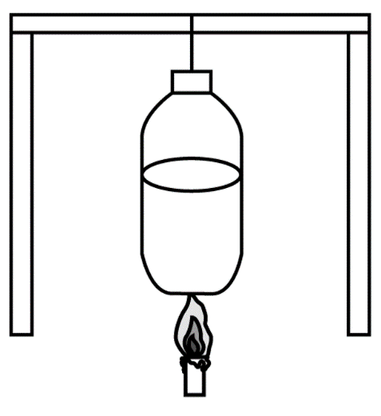

A. 塑料瓶会在瓶内的水沸腾后因温度升高而熔化

B. 塑料瓶会在水沸腾前因温度升高而熔化

C. 塑料瓶在瓶内的水沸腾后也不会熔化

D. 塑料瓶熔化时水温可能超过100℃

第 76 题 · 答案与解析

**参考答案（粉笔题库参考内容）**

C

**解析**

水是热的良导体，当温度低于100℃时，瓶子受到的温度会迅速传到水里，使得水的温度升高，从而瓶子达不到它的熔点；当水的温度逐渐升高到100℃时，水会沸腾，塑料瓶的内表面的温度始终和水的温度保持100℃。

故正确答案为C。

**来源**：广东省2021年度选调生和急需紧缺专业公务员招录笔试 综合行政能力测验（网友回忆版）第76题

### 第 77 题

如图所示，物体M在斜向上拉力F的作用下，在粗糙的地面上从静止开始向右移动当物体M的速度为V时，下列说法正确的是：

A. 物体的动能等于拉力F所做的功

B. 摩擦力的方向与物体移动的方向相同

C. 物体的重力始终不做功

D. 物体的移动只受到拉力在水平方向分力的作用

第 77 题 · 答案与解析

**参考答案（粉笔题库参考内容）**

C

**解析**

对物体M受力分析，受到沿斜面向上的拉力F、水平向左的摩擦力f和物体的重力。因为物体沿水平方向运动，把拉力F分解为沿水平方向的分力F1和竖直方向的分力F2。

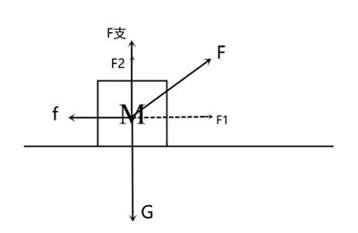

A项，根据能量的转化，拉力F做的功转化为物体的动能以及摩擦力所做的功，错误；

B项，物体相对地面往右移动，摩擦力的方向与相对运动方向相反，故物体受到的摩擦力沿水平往左，与物体运动方向相反，错误；

C项，功的大小等于力与物体在力的方向上通过的距离的乘积。物体受到的重力竖直向下，物体在竖直方向没有位移，故重力始终不做功，正确；

D项，物体在水平方向上受到拉力在水平方向的分力以及摩擦力的作用，错误。

故正确答案为C。

**来源**：广东省2021年度选调生和急需紧缺专业公务员招录笔试 综合行政能力测验（网友回忆版）第77题

### 第 78 题

两个质量不同的小球被相同的力F同时从同一平台往水平方向扔出。假设忽略空气阻力，则以下说法正确的是：

A. 两球在下落过程中离地面的高度始终一致

B. 质量小的球扔出的距离会更短

C. 两球在下落过程中的加速度不同

D. 两球在下落过程中的速度相同

第 78 题 · 答案与解析

**参考答案（粉笔题库参考内容）**

A

**解析**

两个质量不同的小球被相同的力F同时从同一平台往水平方向扔出，同样的力F对于不同质量的小球来说，质量越小的小球获得的初速度V_0越大，对抛出后的小球进行受力分析，由于抛出后，作用在小球上的力F已经消失，所以此时小球只受重力，仅在重力的作用下做平抛运动，平抛运动可看作是水平方向的初速度为V_0的匀速直线运动与竖直方向的自由落体运动；

A项：由自由落体运动的位移公式y = 1/2 g t^2可知，下落位移仅与重力加速度g与时间t有关，两球同时抛出，重力加速度g一致，运动时间一致，故下落过程中离地面的高度始终一致，正确；

B项：同理可知，从同一高度抛出小球，两球的运动时间相同，而质量较小的小球初速度V_0较大，则扔出的距离会更远，错误；

C项：根据运动公式由牛顿第二定律F=ma，此时小球仅受到重力作用，合力G=mg=ma，所以两球的加速度均为重力加速度g，与球的质量无关，错误；

D项：两球在下落过程中的速度是小球竖直方向速度v_y=gt与水平速度V_0的合速度，质量较小的小球初速度V_0较大，所以两球的速度不相同，错误。

故正确答案为A。

**来源**：广东省2021年度选调生和急需紧缺专业公务员招录笔试 综合行政能力测验（网友回忆版）第78题

### 第 79 题

如图所示，轻质弹簧一端固定在墙体，另一端连接着一木块静止在O点，此时，弹簧的长度为原长。现将木块静止在M点释放，在粗糙程度均匀的水平面向右滑动，最远到达N点，则木块在M点滑动到N点的过程中：

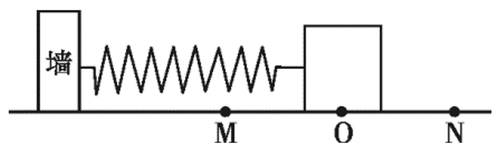

A. 木块的速度先增大再减小

B. 木块在O点的加速度最大

C. 木块受到的摩擦力逐渐增大

D. 弹簧弹力在O-N点做正功

第 79 题 · 答案与解析

**参考答案（粉笔题库参考内容）**

A

**解析**

滑块刚开始运动时，木块受到向右的弹力以及向左的摩擦力f，且弹力大于摩擦力，F合 = F弹 − f，合力方向向右，加速度方向向右，因为木块向右运动，所以速度增大。当弹簧的弹力大小等于摩擦力的大小时，木块的速度达到最大，随着木块继续向右运动，弹力进一步减小，此时弹力小于摩擦力，木块所受合力向左，物体开始减速运动，经过O点后，弹力方向转为向左且不断增大，则向左的合力越来越大，物块继续减速运动，最终速度减小到0，达到最远点N。

A项：结合上述分析可知，物块先做加速运动，再做减速运动，速度先增大再减小，正确；

B项：木块在O点时，因为弹簧的长度达到原长，此时只受到向左的摩擦力作用，合力仅由摩擦力提供，当物块从O点向N点运动时，受到弹簧向左的拉力和地面对物块向左的摩擦力，这个过程加速度在增大，错误；

C项：木块整个运动过程中，都受到滑动摩擦力作用，由滑动摩擦力公式f=μN可知，木块对地面的压力不变，所以滑动摩擦力不变，错误；

D项：由受力分析可知O-N点，木块受到的弹力方向向左，而木块向右运动，所以弹力做负功，错误。

故正确答案为A。

**来源**：广东省2021年度选调生和急需紧缺专业公务员招录笔试 综合行政能力测验（网友回忆版）第79题

### 第 80 题

如图所示，黑色小球从一个固定的光滑斜槽轨道顶端从静止开始下滑，v表示小球沿轨道下滑的速度，t表示时间.小球下滑至底部的过程中，下列图示正确的是：

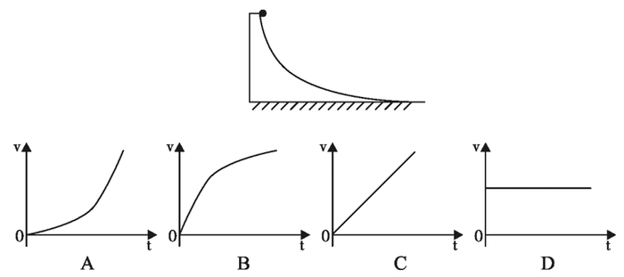

A. A

B. B

C. C

D. D

第 80 题 · 答案与解析

**参考答案（粉笔题库参考内容）**

B

**解析**

小球从光滑的轨道从下滑，在下滑的过程中没有能量的损失，小球所受的弹力方向与速度方向始终垂直，弹力对小球不做功，小球的重力势能转化为动能，小球的速度会越来越快，排除D项。小球刚开始下落时轨道接近竖直，加速度接近g，当小球下滑到底部时，加速度接近0，v-t图像的斜率表示小球的加速度，排除A、C两项。

故正确答案为B。

**来源**：广东省2021年度选调生和急需紧缺专业公务员招录笔试 综合行政能力测验（网友回忆版）第80题

### 第 81 题

左图为某天太阳直射地球的情况。则6个月后，北京时间上午8点太阳直射地球的情况最可能是：

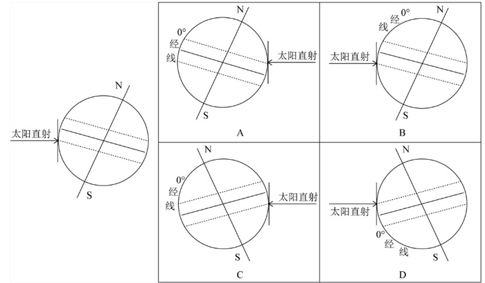

A. A

B. B

C. C

D. D

第 81 题 · 答案与解析

**参考答案（粉笔题库参考内容）**

A

**解析**

由题干给出的图可以看出一开始太阳直射在南半球的南回归线附近，那么经过6个月后，太阳应该会直射到北半球的北回归线附近，所以B、C可以排除，因为问的是北京时间早上8点的太阳，那么太阳应该是刚好升起，由于北京是处于120°E，所以太阳不可能直射0°经线，所以排除D项。

故正确答案为A。

**来源**：广东省2021年度选调生和急需紧缺专业公务员招录笔试 综合行政能力测验（网友回忆版）第81题

### 第 82 题

如图所示，船员在岸上用绳子通过岸边的定滑轮以均匀的速度V将静止湖面上的木船拉回岸边。下列说法正确的是：

A. 船的速度始终为V

B. 船的速度始终小于V

C. 船的速度始终大于V

D. 船的速度先大于V，后小于V

第 82 题 · 答案与解析

**参考答案（粉笔题库参考内容）**

C

**解析**

根据题意可知，人的速度为V，则拉小船的斜向上的速度为V。设绳子与水面的夹角是θ，船在运动过程中，船的速度是人拉绳子的速度V与垂直于绳子速度的合速度，根据平行四边形定则可知，V船cosθ=V，V船 = V/cosθ，由运动图可知， 0°＜θ＜90°，则1 ＞ cosθ ＞ 0，V船 = V/cosθ的速度始终大于人拉绳子的速度V。

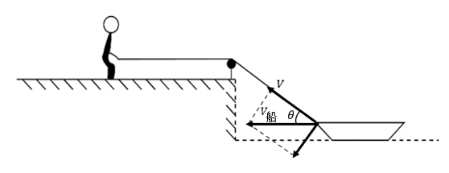

故正确答案为C。

**来源**：广东省2021年度选调生和急需紧缺专业公务员招录笔试 综合行政能力测验（网友回忆版）第82题

### 第 83 题

如图所示，初速度为零的物体A从光滑的斜坡上直线滑下，A到达坡底的最后3秒内的路程为6米。则全过程的平均速度不可能是：

A. 0.5米/秒

B. 1.5米/秒

C. 2.0米/秒

D. 2.5米/秒

第 83 题 · 答案与解析

**参考答案（粉笔题库参考内容）**

D

**解析**

物体在光滑的斜面上，受到重力以及斜面的支持力，在合外力的作用下，在斜面上做初速度为0的匀加速直线运动。物体做匀加速运动，速度匀速增加。

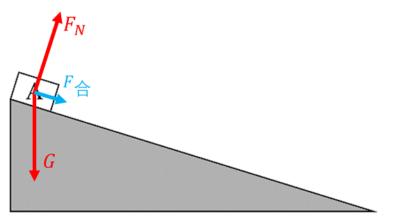

若整个斜坡的长度超过6米，则A到达坡底的最后3秒内的路程为6米，即最后3秒内的平均速度v=2m/s，物体A在整个斜坡的平均速度会小于2m/s。若整个斜面的长度恰好为6米，则A在整个斜坡的平均速度为2m/s，故全程的平均速度不可能超过2m/s。

故正确答案为D。

**来源**：广东省2021年度选调生和急需紧缺专业公务员招录笔试 综合行政能力测验（网友回忆版）第83题

### 第 84 题

如图所示的电路上，L1、L2、L3为相同的灯泡，当开关S闭合时，电流表A1、A2、A3的示数分别为I1、I2、I3，那么：

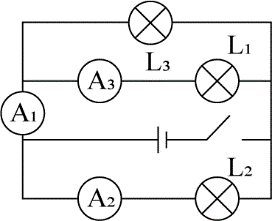

A. I1+I2=I3

B. I1=I2=I3

C. I1=I2+I3

D. I1＞I2+I3

第 84 题 · 答案与解析

**参考答案（粉笔题库参考内容）**

C

**解析**

当开关S闭合时，根据电路图连接可以看出这是三个灯泡L1、L2、L3并联接入电路，两端电压均为电源电压，电流表A1测的是L1、L3两条支路的电流之和，电流表A2测的是L2支路的电流，A3测的是L1支路的电流，那么根据欧姆定律I=U/R，三个灯泡电阻是相同的，两端的电压也都是电源电压，所以三条支路的电流也是相等的，那么I1是等于两条支路电流之和，所以I1=I2+I3，C项正确。

故正确答案为C。

**来源**：广东省2021年度选调生和急需紧缺专业公务员招录笔试 综合行政能力测验（网友回忆版）第84题

### 第 85 题

甲、乙两个烧杯内分别装有等量的热水和冷水，现在往两个烧杯内滴入红色墨水，并观察墨水的扩散速度。下列说法正确的是：

A. 甲烧杯内的墨水扩散速度更快，因为温度高时分子移动速度更快

B. 乙烧杯内的墨水扩散速度更快，因为温度高时会抑制分子活性

C. 甲、乙烧杯内的墨水扩散速度相同，因为墨水分子间斥力相同

D. 甲烧杯内的墨水扩散速度更快，因为温度高时分子间的张力更大

第 85 题 · 答案与解析

**参考答案（粉笔题库参考内容）**

A

**解析**

分子的热运动指的是：一切物质的分子都在不停地运动，且是无规则的运动。分子的热运动跟物体的温度有关（0℃的情况下也会做热运动，内能就以热运动为基础），物体的温度越高，其分子的运动越快。

故正确答案为A。

**来源**：广东省2021年度选调生和急需紧缺专业公务员招录笔试 综合行政能力测验（网友回忆版）第85题

## 材料 1

受新冠肺炎疫情影响，全国大中小学开学推迟，教学活动改至线上，推动在线教育用户规模快速增长。据统计，截至2020年3月，我国在线教育用户规模达4.23亿，占网民整体的46.8%；手机在线教育用户规模达4.20亿，占手机网民的46.9%。

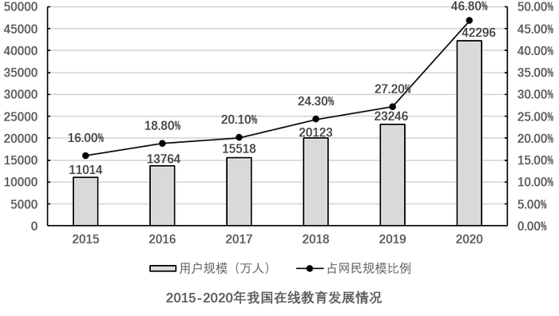

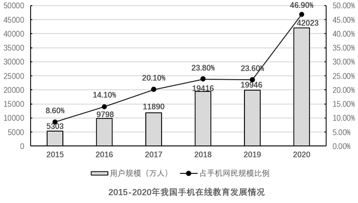

### 第 86 题

截至2020年3月，我国网民数量约为（ ）亿。

A. 9

B. 10

C. 11

D. 12

第 86 题 · 答案与解析

**参考答案（粉笔题库参考内容）**

A

**解析**

根据题干“截至2020年3月，我国网民数量约为······亿”，结合材料时间为2020年3月，同时给出我国在线教育用户占网民比重，判定本题为现期比重问题。定位文字材料“截至2020年3月，我国在线教育用户规模达4.23亿，占网民整体的46.8%”。根据公式：总量= 部分量/比重可得，截至2020年3月，我国网民数量为4.23/46.8% ≈ 9亿，对应A项。

故正确答案为A。

**考点**：现期比重、综合资料

**来源**：广东省2021年度选调生和急需紧缺专业公务员招录笔试 综合行政能力测验（网友回忆版）第86题

### 第 87 题

2016—2019年，我国在线教育用户规模增长速度最快的年份是（ ）。

A. 2016年

B. 2017年

C. 2018年

D. 2019年

第 87 题 · 答案与解析

**参考答案（粉笔题库参考内容）**

C

**解析**

根据题干“2016—2019年······增长速度最快的年份是”，判定本题为增长率比较问题。定位第一个柱状图，根据公式：增长率= (现期量 - 基期量)/基期量可得，2016—2019年，我国在线教育用户规模增长速度分别约为：

2016年：(13764 − 11014)/11014 ≈ 2750/11000 = 20%^+；

2017年：(15518−13764)/13764 ≈ 1754/13800 = 10%^+；

2018年：(20123 − 15518)/15518 ≈ 4605/15500 ≈ 30%；

2019年：(23246-20123)/20123≈3123/20100=15%^+。

则增长速度最快的年份是2018年。

故正确答案为C。

**考点**：一般增长率、综合资料

**来源**：广东省2021年度选调生和急需紧缺专业公务员招录笔试 综合行政能力测验（网友回忆版）第87题

### 第 88 题

2020年3月，我国在线教育用户规模比2019年增加约（ ）亿。

A. 1.5

B. 1.9

C. 2.5

D. 2.9

第 88 题 · 答案与解析

**参考答案（粉笔题库参考内容）**

B

**解析**

根据题干“2020年3月，······比2019年增加······亿”，可判定本题为增长量计算问题。定位第一个柱状图，2019年及2020年3月，我国在线教育用户规模分别为23246万人、42296万人。根据公式：增长量=现期量-基期量可得，2020年3月，我国在线教育用户规模比2019年增加约42296-23246≈19000万人=1.9亿人。

故正确答案为B。

**考点**：增长量计算、综合资料

**来源**：广东省2021年度选调生和急需紧缺专业公务员招录笔试 综合行政能力测验（网友回忆版）第88题

### 第 89 题

2016—2019年，我国手机在线教育用户规模占在线教育用户规模比例最大的年份是（ ）。

A. 2016年

B. 2017年

C. 2018年

D. 2019年

第 89 题 · 答案与解析

**参考答案（粉笔题库参考内容）**

C

**解析**

根据题干“我国手机在线教育用户规模占在线教育用户规模比例最大的年份”，可判定本题为比重比较问题。根据两图中柱状图数据，结合公式：比重= 部分量/总量，2016-2019年我国手机在线教育用户规模占在线教育用户规模比例分别为：

2016年：9798/13764 ≈ 9800/14000 = 0.70；

2017年：11890/15518 ≈ 12000/16000 = 0.75；

2018年：19416/20123≈19000/20000=0.95；

2019年：19946/23246 ≈ 20000/23000 ≈ 0.87。

则2018年我国手机在线教育用户规模占在线教育用户规模比例最大。

故正确答案为C。

**考点**：现期比重、综合资料

**来源**：广东省2021年度选调生和急需紧缺专业公务员招录笔试 综合行政能力测验（网友回忆版）第89题

### 第 90 题

关于2015—2019年我国在线教育用户规模说法正确的是（ ）。

A. 在线教育用户规模占网民规模比例增长最快的一年是2018年

B. 手机在线教育用户规模始终超过在线教育用户规模的一半

C. 手机在线教育用户规模占手机网民规模比例逐年提高

D. 手机在线教育用户规模占手机网民规模比例随着用户规模增大而提高

第 90 题 · 答案与解析

**参考答案（粉笔题库参考内容）**

A

**解析**

A项：定位图形材料一，2015—2019年我国在线教育用户规模占网民规模比例分别为16.00%、18.80%、20.10%、24.30%、27.20%，2016-2019年的比例分别同比上升了2.8个百分点、1.3个百分点、4.2个百分点、2.9个百分点。2018年比例增长最快，正确；

B项：定位两个图形材料，2015年我国手机在线教育用户规模为5303万人，在线教育用户规模11014万人，手机在线教育用户规模占在线教育用户规模的比例= 5303/11014 ＜ 5303/10606 = 1/2，不足一半，错误；

C项：定位图形材料二，2018年、2019年手机在线教育用户规模占手机网民规模比例分别为23.80%、23.60%，比例下降，错误；

D项：定位图形材料二，2018年、2019年手机在线教育用户规模分别为19416万人、19946万人，用户规模增大，占手机网民规模比例分别为23.80%、23.60%，比例下降，手机在线教育用户规模占手机网民规模比例没有随着用户规模增大而提高，错误。

故正确答案为A。

**考点**：综合分析、综合资料

**来源**：广东省2021年度选调生和急需紧缺专业公务员招录笔试 综合行政能力测验（网友回忆版）第90题

## 材料 2

改革开放之初，国家在广东的深圳、珠海、汕头设立经济特区。40年间，广东经济特区经济建设取得巨大成就，对全省经济的影响逐渐扩大。1980年，广东经济特区地区生产总值共16.10亿元，占全省的比重仅为6.4%；到2019年，生产总值达33057.06亿元，占全省的比重提高到30.7%。1980年，经济特区人均地区生产总值443元，2019年达15.86万元，是全省平均水平的1.7倍。地方一般公共预算收入由1980年的1.83亿元增长到2019年的4256.12亿元，占全省比重由4.8%增加到33.6%。

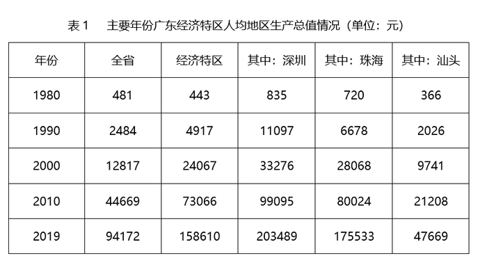

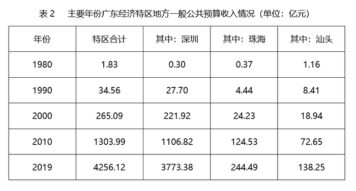

### 第 91 题

2019年，广东地区生产总值达到（ ）万亿元。

A. 10.77

B. 15.86

C. 20.54

D. 24.72

第 91 题 · 答案与解析

**参考答案（粉笔题库参考内容）**

A

**解析**

由题干“2019年，广东地区生产总值······”，结合材料时间为2019年和广东经济特区的生产总值占全省的比重，可判定本题为现期比重问题。定位文字材料“到2019年，生产总值达33057.06亿元，占全省的比重提高到30.7%。”根据总体=部分/比重，则2019年，广东地区生产总值= 33057.06/30.7% ≈= 33057.06/0.31 ≈ 107000亿元=10.7万亿元，与A项最接近。

故正确答案为A。

**考点**：现期比重、综合资料

**来源**：广东省2021年度选调生和急需紧缺专业公务员招录笔试 综合行政能力测验（网友回忆版）第91题

### 第 92 题

下列年份中，与上一个主要年份相比，汕头人均地区生产总值增长速度最快的是：

A. 1990年

B. 2000年

C. 2010年

D. 2019年

第 92 题 · 答案与解析

**参考答案（粉笔题库参考内容）**

A

**解析**

由题干“······汕头人均地区生产总值增长速度最快的是”，可判定本题为一般增长率问题。根据增长率公式：r = (现期量 − 基期量)/基期量。定位表1可得：

A项：1990年：2026/366 − 1≈5.5−1=4.5；

B项：2000年：9741/2026 - 1≈ 4.8 − 1 = 3.8；

C项：2010年：21208/9741−1≈ 2.2 - 1 = 1.2；

D项：2019年：47669/21208 - 1≈ 2.2 - 1 = 1.2。

因此与上一个主要年份相比，汕头人均地区生产总值增长速度最快的是1990年。

故正确答案为A。

**考点**：一般增长率、综合资料

**来源**：广东省2021年度选调生和急需紧缺专业公务员招录笔试 综合行政能力测验（网友回忆版）第92题

### 第 93 题

2019年，深圳一般公共预算收入占全省的比重约为：

A. 20%

B. 30%

C. 40%

D. 50%

第 93 题 · 答案与解析

**参考答案（粉笔题库参考内容）**

B

**解析**

由题干“2019年，······占······比重约为”，结合材料时间为2019年，可判定本题为现期比重问题。定位文字材料，“地方一般公共预算收入由1980年的1.83亿元增长到2019年的4256.12亿元，占全省比重由4.8%增加到33.6%”，根据总体=部分/比重，可得2019年全省公共预算收入为4256.12/33.6%≈4256.12/0.34=12518亿元。定位表2“2019年······深圳一般公共预算收入为3773.38亿元。”根据比重=部分/总体，推出2019年，深圳一般公共预算收入占全省的比重= 3773.38/12518 ≈3773.38/13000 ≈ 29%，与B项最接近。

故正确答案为B。

**考点**：现期比重、综合资料

**来源**：广东省2021年度选调生和急需紧缺专业公务员招录笔试 综合行政能力测验（网友回忆版）第93题

### 第 94 题

2019年，珠海人均地区生产总值大约是1980年的（ ）倍。

A. 112

B. 132

C. 244

D. 294

第 94 题 · 答案与解析

**参考答案（粉笔题库参考内容）**

C

**解析**

根据题干“2019年，······是······的多少倍”，结合材料时间为2019年，可判定本题为现期倍数问题。定位统计表1：“2019年珠海人均地区生产总值为175533元，1980年珠海人均地区生产总值为720元”，可得，2019年，珠海人均地区生产总值大约是1980年的175533/720≈244倍，C项符合。

故正确答案为C。

**考点**：现期倍数、综合资料

**来源**：广东省2021年度选调生和急需紧缺专业公务员招录笔试 综合行政能力测验（网友回忆版）第94题

### 第 95 题

下列说法正确的是：

A. 各主要年份中，深圳一般公共预算收入一直位居广东经济特区之首

B. 汕头一般公共预算收入比珠海高的主要年份，人均地区生产总值也更高

C. 相比2010年，2019年广东3个经济特区人均地区生产总值均翻了一番

D. 深圳主要年份一般公共预算收入的增长率一直比珠海高

第 95 题 · 答案与解析

**参考答案（粉笔题库参考内容）**

C

**解析**

A项：定位统计表2：“1980年深圳一般公共预算收入为0.30亿元，珠海一般公共预算收入为0.37亿元，汕头一般公共预算收入为1.16亿元”，可得，1980年，一般公共预算收入位居广东经济特区之首的是汕头，故各主要年份中，深圳一般公共预算收入并非一直位居广东经济特区之首，错误；

B项：定位统计表2，可得，汕头一般公共预算收入比珠海高的年份为1980年；定位统计表1：“1980年汕头人均地区生产总值为366元，珠海人均地区生产总值为720元”，可得，汕头一般公共预算收入比珠海高的主要年份，人均地区生产总值并非也更高，错误；

C项：定位统计表1，根据相关数据可得，2019年深圳人均地区生产总值是2010年的203489/99095 ≈ 203489/99100 ≈ 2倍；2019年珠海人均地区生产总值是2010年的175533/80024 ≈ 175533/80000 ≈ 2.2倍；2019年汕头人均地区生产总值是2010年的47669/21208 ≈ 47669/21200 ≈ 2.2倍，故相比2010年，2019年广东3个经济特区人均地区生产总值均翻了一番，正确；

D项：定位统计表2，根据相关数据可得，2010年深圳一般公共预算收入的增长率= (1106.82 - 221.92)/221.92≈ 884.9/220 ≈ 4，珠海一般公共预算收入的增长率= (124.53 − 24.23)/24.23≈100.3/24≈4.2，故2010年深圳一般公共预算收入的增长率比珠海低，错误；

故正确答案为C。

**考点**：综合分析、综合资料

**来源**：广东省2021年度选调生和急需紧缺专业公务员招录笔试 综合行政能力测验（网友回忆版）第95题

## 材料 3

2019年，G省完成邮政业务总量4403.44亿元，占全国的27.1%，比上年增长36.9%，增幅比上年提高10.9个百分点，增幅高于全国平均水平5.4个百分点。

2019年，G省快递业务发展态势良好，全年实现快递业务量168.06亿件，占全国的26.5%，增长29.7%，增幅比上年提高2.1个百分点；快递业务收入1847.91亿元，增长30.9%，增幅比上年提高7.8个百分点，传统邮政业务有所萎缩，函件、订销报刊累计数分别为45592.89万件和72363.62万份，比上年分别下降13.8%和3.8%。

2019年，G省电信业务总量增幅相比前两年的高增长有所回落，全年完成业务总量12049.51亿元，比上年增长54.7%，比前三季度回落12.9个百分点。

截至2019年12月底，G省移动电话期末用户1.65亿户，下降1.7%；4G期末用户1.43亿户，增长2.3%。互联网宽带接入期末用户3802万户，增长2.7%；移动互联网期末用户1.42亿户，下降8.2%。

### 第 96 题

2018年，G省邮政业务总量约占全国的：

A. 26%

B. 36%

C. 46%

D. 56%

第 96 题 · 答案与解析

**参考答案（粉笔题库参考内容）**

A

**解析**

根据题干“2018年···约占···的”，结合材料时间为2019年，选项为百分数，可判定本题为基期比重计算问题。定位材料第一段可得，2019年，G省完成邮政业务总量4403.44亿元，占全国的27.1%，比上年增长（a）36.9%，增幅高于全国平均水平5.4个百分点。则2019年全国邮政业务总量同比增速b=36.9%-5.4%=31.5%，2018年G省邮政业务总量占全国的比重为A/B × (1+b)/(1+a)= 27.1% × (1 + 31.5%)/(1 + 36.9%)≈ 27.1% × 0.96 ≈ 26%。

故正确答案为A。

**考点**：文字资料、基期比重

**来源**：广东省2021年度选调生和急需紧缺专业公务员招录笔试 综合行政能力测验（网友回忆版）第96题

### 第 97 题

2019年，全国快递业务量约为（ ）亿件。

A. 555

B. 635

C. 725

D. 815

第 97 题 · 答案与解析

**参考答案（粉笔题库参考内容）**

B

**解析**

根据题干“2019年，全国快递业务量约为······”，结合材料给出G省快递业务量及占比，可判定本题为现期比重计算问题。定位材料第二段可得，2019年，G省快递业务发展态势良好，全年实现快递业务量168.06亿件，占全国的26.5%。则2019年全国快递业务量=168.06/26.5%≈168.06/0.27≈620亿件，与B项最接近。

故正确答案为B。

**考点**：文字资料、现期比重

**来源**：广东省2021年度选调生和急需紧缺专业公务员招录笔试 综合行政能力测验（网友回忆版）第97题

### 第 98 题

2018年末，下列G省的电信业务用户数量最多的是：

A. 移动电话期末用户

B. 4G期末用户

C. 互联网宽带接入期末用户

D. 移动互联网期末用户

第 98 题 · 答案与解析

**参考答案（粉笔题库参考内容）**

A

**解析**

根据题干“2018年末，下列···最多的是”，结合材料时间为2019年，可判定本题为基期比较问题。定位材料第四段可得，截至2019年12月底，G省移动电话期末用户1.65亿户，下降1.7%；4G期末用户1.43亿户，增长2.3%。互联网宽带接入期末用户3802万户，增长2.7%；移动互联网期末用户1.42亿户，下降8.2%。根据基期量= 现期量/(1+r)计算各选项，进行比较即可。移动电话期末用户：1.65/(1 − 1.7%) ≈ 1.68亿户；4G期末用户：1.43/(1+2.3%) ＜ 1.43亿户；互联网宽带接入期末用户：3802/(1+2.7%) ＜ 3802万户；移动互联网期末用户：1.42/(1 − 8.2%) ≈ 1.55亿户。比较可知，2018年末G省的电信业务用户数量最多的为移动电话期末用户。

故正确答案为A。

**考点**：文字资料、基期比较

**来源**：广东省2021年度选调生和急需紧缺专业公务员招录笔试 综合行政能力测验（网友回忆版）第98题

### 第 99 题

根据以上资料，以下说法不正确的是：

A. 2018年和2019年，G省快递业务收入增幅均低于邮政业务总量增幅

B. 2019年第四季度，G省电信业务总量增幅低于前三季度

C. 相比2018年，G省2019年4G期末用户占移动电话用户比例有所提高

D. 相比2018年，G省2019年函件减少量低于订销报刊减少量

第 99 题 · 答案与解析

**参考答案（粉笔题库参考内容）**

D

**解析**

A项：定位材料第一段：“2019年，G省完成邮政业务总量4403.44亿元，占全国的27.1%，比上年增长36.9%，增幅比上年提高10.9个百分点”则2019年邮政业务总量增幅为36.9%，2018年增幅为36.9%-10.9%=26%；定位材料第二段：“（2019年）快递业务收入1847.91亿元，增长30.9%，增幅比上年提高7.8个百分点”则2019年快递业务收入增幅为30.9%，2018年增幅为30.9%-7.8%=23.1%。2018年和2019年快递业务收入增幅均低于邮政业务总量增幅，正确。

B项：定位材料第三段：“2019年全年完成业务总量12049.51亿元，比上年增长54.7%，比前三季度回落12.9个百分点。”则前三季度的增幅为54.7%+12.9%=67.6%。全年的增长率为前三季度和第四季度的混合增长率，根据增长率混合后居中可得，第四季度增长率＜全年增长率＜前三季度增长率。故第四季度电信业务总量增幅低于前三季度，正确。

C项：定位材料第四段：“截至2019年12月底，G省移动电话期末用户1.65亿户，下降1.7%；4G期末用户1.43亿户，增长2.3%。”2019年4G期末用户增长率为2.3%，即a；2019年移动电话增长率为-1.7%，即b。2.3%＞(-1.7%)，根据两期比重的结论，当a＞b时，比重上升。故与2018年相比，2019年4G期末用户占移动电话用户比例有所提高，正确。

D项：定位材料第二段：“函件、订销报刊累计数分别为45592.89万件和72363.62万份，比上年分别下降13.8%和3.8%。”根据增长量= 现期量/(1+r) × r，可得2019年函件的增长量= 45592.89/(1−13.8%) × (−13.8%)≈ 45600/(1−1/7)×(−1/7)= −45600/(7 − 1) = −7600，即函件减少量为7600万件；2019年订销报刊的增长量= 72363.62/(1−3.8%)×(−3.8%)≈72400/(1−1/25)×(−1/25)= -72400/(25-1) ≈ -3017，即订销报刊减少量为3017万件。故2019年函件减少量高于订销报刊减少量，错误。

本题为选非题，故正确答案为D。

**考点**：文字资料、综合分析

**来源**：广东省2021年度选调生和急需紧缺专业公务员招录笔试 综合行政能力测验（网友回忆版）第99题

### 第 100 题

下列图表最能准确反映G省邮政电信业有关数据的是：

A. 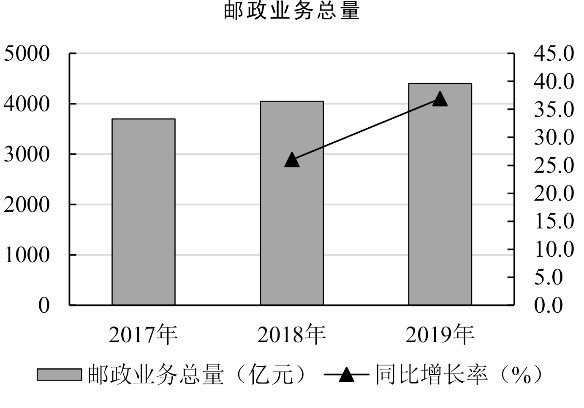

B. 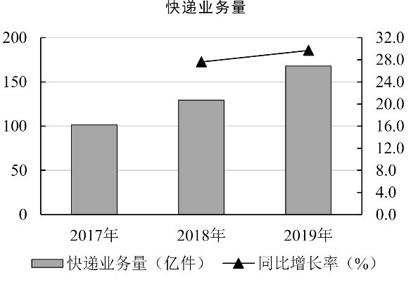

C. 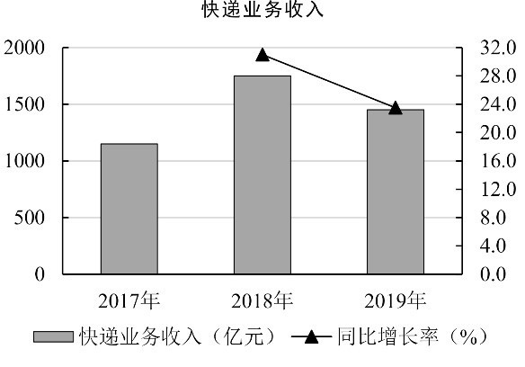

D. 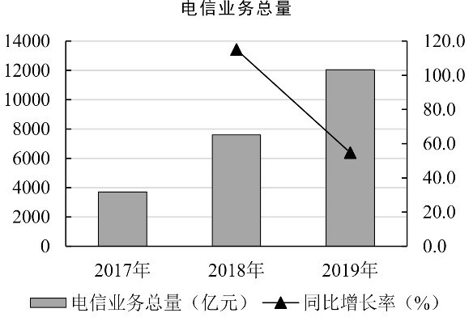

第 100 题 · 答案与解析

**参考答案（粉笔题库参考内容）**

B

**解析**

A项：定位材料第一段：“2019年，G省完成邮政业务总量4403.44亿元，占全国的27.1%，比上年增长36.9%，增幅比上年提高10.9个百分点，”根据基期量= 现期量/(1+r)，2018年邮政业务总量= 4403.44/(1 + 36.9%) ≈ 4400/1.4 ≈ 3140亿元。柱状图中2018年邮政业务总量为4000亿元左右，故错误。

B项：定位材料第二段：“2019年快递业务量168.06亿件，占全国的26.5%，增长29.7%，增幅比上年提高2.1个百分点；”根据基期量= 现期量/(1+r)，2018年快递业务总量= 168.08/(1+29.7%) ≈ 170/1.3 ≈ 131，增长率=29.7%-2.1%=27.6%。2017年快递业务总量= 131/(1 + 27.6%) ≈ 130/1.3 = 100。结合柱状图的数字，B项完全符合，正确。

C项：定位材料第二段：“快递业务收入1847.91亿元，增长30.9%，增幅比上年提高7.8个百分点，”2019年快递业务增长率比上年提高，柱状图中显示2019年增长率降低，故错误。

D项：定位材料第三段：“2019年，G省电信业务总量增幅相比前两年的高增长有所回落，全年完成业务总量12049.51亿元，比上年增长54.7%，比前三季度回落12.9个百分点。”材料只给出2019年电信业务总量的增幅为54.7%，没有给出2018年的增长率，故错误。

故正确答案为B。

**考点**：综合分析、综合资料

**来源**：广东省2021年度选调生和急需紧缺专业公务员招录笔试 综合行政能力测验（网友回忆版）第100题

