# 广东省2021年度选调生和急需紧缺专业公务员招录笔试 思维能力测验（网友回忆版）

<!-- gwy:overview:start -->
> **广东 · 2021 · 行测 · 选调生** ｜ 100 题 · 图片 131 处 · 答案随题折叠

| 题型模块 | 题量 | 题号 |
| --- | ---: | ---: |
| 思维能力测验 | 100 | 1–100 |
| **合计** | **100** | |

导航：[题型与作答说明](#题型与作答说明) · [题目](#题目)
<!-- gwy:overview:end -->

> 候选采集稿。参考答案及解析来自粉笔页面，不代表官方答案或真实高分答卷；来源使用许可与原卷对应关系仍需人工核实。

## 题型与作答说明

思维能力测验

（100题）

在这项测验中，可能有一些试题很容易，但也有一些试题有一定的难度，建议不要在一道试题上思考太长时间，遇到不会的试题，可先跳过去，待完成较容易的试题后，有时间再去思考，试题答错不倒扣分，可根据猜测来解答那些没有把握的试题。

## 题目

### 第 1 题

近年来，在共建“一带一路”的框架下，越来越多的中非合作项目落地生根。中资企业在非洲深化投资合作的同时，积极履行和承担社会责任，助力当地经济社会可持续发展，推动共建“一带一路”不断走深走实，非洲某国的农业部门负责人提出：“农业发展需要人才，因此中资企业对当地种植增收意义重大。”

下列选项中属于该负责人话中隐含的前提的是（ ）。

A. 只要人才和技术到位，该国的农业就将拥有巨大的发展潜力

B. 中资企业对当地农业人才的培养起到了重要作用

C. 发展农业是非洲走可持续发展道路的必然选择

D. 中资企业为非洲各国的社会发展提供了巨大的支持

第 1 题 · 答案与解析

**参考答案（粉笔题库参考内容）**

B

**解析**

第一步：找出论点和论据。

论点：中资企业对当地种植增收意义重大。

论据：农业发展需要人才。

论点说的是中资企业对当地种植增收意义重大，论据说的是农业发展需要人才，论点论据话题不一致，加强考虑搭桥，即在中资企业和人才之间建立联系。

第二步：逐一分析选项。

A项：该项说的是人才和技术对该国农业具有较大作用，但是没有提及中资企业，与论点话题无关，不能加强，排除；

B项：该项指出中资企业能够对当地的农业人才培养起到重要作用，在中资企业与农业人才之间建立联系，搭桥项，当选；

C项：该项指出发展农业是非洲可持续发展的必然道路，但是没有提及中资企业，与论点话题无关，不能加强，排除；

D项：该项指出中资企业为非洲各国的社会发展提供巨大支持，但没有提及是否对农业人才有巨大支持，不明确，不能加强，排除。

故正确答案为B。

### 第 2 题

实现社会主义现代化必须坚持中国特色社会主义道路，创造人民美好生活必须坚持中国特色社会主义道路。所以，中国特色社会主义道路是实现社会主义现代化和创造人民美好生活的必由之路。

以下与上述推论结构最为相似的是（ ）。

A. 领导干部必须有坚定的理想信念，领导干部还必须将理想信念落到实处，因此，理想信念既是我们的奋斗方向，也是行动指南

B. 建设生态文明，必须要坚持金山银山就是绿水青山的理念，必须要落实最严格的生态环境保护制度，所以建设生态文明是一个长期的工程

C. 实现伟大梦想，必须建设伟大工程，实现伟大梦想，必须推进伟大事业。其中起决定性作用的是党的建设新的伟大工程

D. 一名合格的教师，必须掌握学科知识。一名合格的教师，必须掌握育人的方法。因此，作为合格的教师，掌握学科知识和育人方法都是必要的

第 2 题 · 答案与解析

**参考答案（粉笔题库参考内容）**

D

**解析**

第一步：分析题干推理结构。

实现社会主义现代化坚持中国特色社会主义道路，创造人民美好生活坚持中国特色社会主义道路。所以，实现社会主义现代化和创造人民美好生活中国特色社会主义道路。题干推理结构是通过完成某件事需要的必要条件，得出结论中完成事情需要的必要条件，且强调必要条件的同等重要性。

第二步：逐一分析选项。

A项：领导干部坚定理想信念，领导干部理想信念落到实处，因此理想信念是奋斗方向和行动指南，选项提及两个必要条件，结论得出其中一个是重要的，与题干推理形式不一致，排除；

B项：建设生态文明坚持金山银山就是绿水青山理念，建设生态文明落实最严格生态环境保护制度，所以建设生态文明是长期工程，选项结论没有得出必要条件，与题干推理形式不一致，排除；

C项：实现伟大梦想建设伟大工程，实现伟大梦想推进伟大事业，所以伟大工程起决定性的作用，选项提及两个必要条件，得出结论强调一个必要条件的重要性，与题干推理形式不一致，排除；

D项：合格的教师掌握学科知识，合格的教师掌握育人方法，因此，合格教师掌握学科知识和育人方法，通过完成某件事（合格教师）需要的必要条件，得出结论完成事情（合格教师）需要的必要条件，且两个必要条件均重要，与题干推理形式一致，当选。

故正确答案为D。

### 第 3 题

A县的大学生村官中，本科学历的人数多于研究生学历的人数，女性人数多于男性人数。

如果上述论述为真，则下列判断一定正确的有（ ）。

①A县研究生学历的女大学生村官人数多于本科学历的男大学生村官人数

②A县本科学历的男大学生村官人数多于研究生学历的男大学生村官人数

③A县本科学历的女大学生村官人数多于研究生学历的男大学生村官人数

A. ①和②

B. ②和③

C. 只有②

D. 只有③

第 3 题 · 答案与解析

**参考答案（粉笔题库参考内容）**

D

**解析**

第一步：分析题干条件。

（1）本科＞研究生；

（2）女＞男。

第二步：根据题干条件进行推理。

本题题干信息确定，选项信息充分，优先考虑排除法。

根据条件（1）可知，本科（男+女）＞研究生（男+女），即可得条件（3）男本科+女本科＞男研究生+女研究生；

根据条件（2）可知，女（本科+研究生）＞男（本科+研究生），即可得条件（4）女本科+女研究生＞男本科+男研究生；

由条件（3）+条件（4）可得：女本科＞男研究生。根据题干条件，可推出只有③一定正确。

故正确答案为D。

### 第 4 题

11月24日，“嫦娥5号”于文昌卫星发射中心顺利发射，任务是在月球表面收集灰尘和碎片，也就是月壤，并带回地球，以帮助了解月球的演化。同时，有天文学家认为，获得月壤也可以帮助研究人员更准确地确定太阳系其他行星（如火星、水星等）表面物质的年龄。

要使天文学家的观点成立，可以补充的前提是（ ）。

A. 月球表面的灰尘和碎片等物质与太阳系其他行星的表面物质成分相似

B. 月壤由月球岩石在遭受陨石撞击和太阳风轰击等空间风化作用后形成

C. 月球与太阳系其他行星基本形成于同一时期

D. 对月壤的研究还可以为人类未来在其他太空领域的探索打下基础

第 4 题 · 答案与解析

**参考答案（粉笔题库参考内容）**

A

**解析**

第一步：找出论点和论据。

论点：获得月壤也可以帮助研究人员更准确地确定太阳系其他行星（如火星、水星等）表面物质的年龄。

论据：“嫦娥5号”于文昌卫星发射中心顺利发射，任务是在月球表面收集灰尘和碎片，也就是月壤，并带回地球，以帮助了解月球的演化。

本题的论点说的是帮助确定其他行星表面物质的年龄，论据说的是收集月球表面物质了解月球的演化，论点和论据讨论的话题不一致。问的是前提，所以我们考虑用搭桥的方式来加强。

第二步：逐一分析选项。

A项：在月球表面物质和其他行星表面物质之间建立联系，搭桥项，可以加强，当选；

B项：该项说的是月壤的形成，未提到论点中其他行星表面物质的年龄，无关项，无法加强，排除；

C项：该项说的是行星的形成时期，并非论点中的行星表面物质的形成时期，偷换概念，无关项，无法加强，排除；

D项：该项说的是为在其他太空领域的探索打下基础，不明确是否是为论点中的确定行星表面物质的形成打下基础，不明确项，无法加强，排除。

故正确答案为A。

### 第 5 题

在经验交流会上，有多个省份的同类机构都提到了某公司新开发的安全管理系统。他们认为，这套系统运行稳定、操作便捷，对业务帮助很大。小李代表单位参加了本次经验交流会，会后他提出，为了提高本单位的安全管理水平，建议单位也引进这套系统。

以下各项如果为真，最能反驳这一建议的是：

A. 本单位已经拥有一套运行多年的安全管理系统

B. 并不是所有省份的同类机构都使用了这套系统

C. 安全管理水平提升需要管理系统和管理机制双管齐下

D. 本单位的业务运行机制和其他省份有较大差异

第 5 题 · 答案与解析

**参考答案（粉笔题库参考内容）**

D

**解析**

第一步：找出论点和论据。

论点：为了提高本单位的安全管理水平，建议单位也引进这套系统。

论据：多个省份的同类机构认为，这套系统运行稳定、操作便捷，对业务帮助很大。

本题论据讨论的是在经验交流会上多个省份机构都提到了新开发的安全管理系统，该系统非常优秀，论点讨论的是为了提高本单位的安全管理水平，建议引进这套系统，论点论据话题不一致，优先考虑拆桥。

第二步：逐一分析选项。

A项：该项说本单位已经有一套运行多年的安全管理系统，但是没有说明这套系统是否可以提高本单位的安全管理水平，也没有提及是否应该引进新的系统，无关项，无法削弱，排除；

B项：该项指出不是所有省份的同类机构都使用这套系统，但是没有提及本单位是否应该引进这套系统，无关项，无法削弱，排除；

C项：该项说的是想要提升安全管理水平需要管理系统和管理机制并进，但是没有提及是否应该引进该系统，无关项，无法削弱，排除；

D项：该项指出了本单位的业务运行机制和其他省份差异较大，说明了虽然其他省份的同类机构认为该系统对业务帮助很大，但是未必能提高本单位的安全管理水平，拆桥项，可以削弱，当选。

故正确答案为D。

### 第 6 题

某市地铁3号线客量非常大，经常超过运营峰值，为此，相关部门5年内设了4条与3号线重叠或平行的地铁线路，以为其分流，减轻运营负担。但现在3号线的客流量比5年前更大了。以下最能解释这一现象的是（ ）。

A. 有部分增设的地铁线路客流量小，未能起到分流作用

B. 由于交通更加便捷，更多人选择到3号线沿线定居或从事商业活动

C. 3号线沿线的一些写字楼改建成了大型商业中心

D. 该市新建了许多与3号线交汇的地铁线路，交通网越来越发达

第 6 题 · 答案与解析

**参考答案（粉笔题库参考内容）**

B

**解析**

第一步：找出题干矛盾。

相关部门5年内设了4条与3号线重叠或平行的地铁线路，以为其分流，减轻运营负担。但现在3号线的客流量比5年前更大了。

第二步：逐一分析选项。

A项：该项只能说明有部分增设的地铁客流量小，没有起到分流作用，但是没有提及为何3号线的客流量变得更大，不能解释题干矛盾，排除；

B项：该项说的是更多的人选择了在3号线附近定居或从事商业活动，解释了为何3号线客流量变得更大了，可以解释题干矛盾，当选；

C项：该项说的是3号线附近一些写字楼改成了大型商业中心，但是没有提及写字楼与大型商业中心的客流量谁更大，无法解释为何3号线的客流量变得更大，不能解释题干矛盾，排除；

D项：该项说的是该市新建了许多与3号线交汇的地铁线路，交通网变发达了，但是没有提及3号线的客流量是否改变了，不能解释题干矛盾，排除。

故正确答案为B。

### 第 7 题

“老赖”赖账不还，不仅会造成他人的经济利益受损，还严重危害社会风气。对此，某市推出政策，将个人的“老赖”行为纳入诚信档案记录。“老赖”行为纳入诚信档案记录的人，其子女就读私立学校和购买商业保险将受到限制。要想使该项政策取得效果，必须具备的前提是：

A. 一些“老赖”十分重视子女教育和风险保障

B. 就读私立学校和购买商业保险需要花费大量金钱

C. 建立诚信档案有利于打造诚信社会

D. 群众对“老赖”的所作所为深恶痛绝

第 7 题 · 答案与解析

**参考答案（粉笔题库参考内容）**

A

**解析**

第一步：找出论点和论据。

论点：某市推出的政策“将个人的‘老赖’行为纳入诚信档案记录，‘老赖’行为纳入诚信档案记录的人，其子女就读私立学校和购买商业保险将受到限制”取得效果。

论据：无。

本题问题为“必须具备的前提”，没有论据，优先考虑必要条件。

第二步：逐一分析选项。

A项：选项说的是一些“老赖”十分重视子女教育和风险保障，如果“老赖”不重视子女教育和风险保障，那么该政策就起不到作用，否定代入论点不成立，因此该项是论点成立的必要条件，可以加强，当选；

B项：选项说的是就读私立学校和购买商业保险需要花费大量金钱，与论点讨论的“老赖”行为纳入信案记录和限制其子女读私立学校和购买商业保险的政策是否有效无关，话题不一致，无法加强，排除；

C项：选项说的是建立诚信档案对社会的好处，与论点讨论的“老赖”行为纳入诚信档案记录和限制其子女读私立学校和购买商业保险的政策是否有效无关，话题不一致，无法加强，排除；

D项：选项说的是群众厌恶”老赖“行为，与论点讨论的“老赖”行为纳入信案记录和限制其子女读私立学校和购买商业保险的政策是否有效无关，话题不一致，无法加强，排除。

故正确答案为A。

### 第 8 题

在某单位的优秀员工评选中，规定优秀员工应具备以下三个条件：第一，业务能力强；第二，工作认真负责；第三，团队协作能力强。现在有小张、小王、小周、小李四位员工报名参加评选，已知相关情况如下：

①小张、小王团队协作能力相当；

②小王、小周业务水平基本持平；

③小周、小李并非都是业务能力强的人；

④4人均工作认真负责，其中有3人业务能力强、2人团队协作能力强。结果发现，4人中只有1人符合优秀员工的所有条件，则这个人是（ ）。

A. 小张

B. 小王

C. 小周

D. 小李

第 8 题 · 答案与解析

**参考答案（粉笔题库参考内容）**

C

**解析**

分析题干已知信息：

①小张、小王团队协作能力相当；

②小王、小周业务水平基本持平；

③小周、小李并非都是业务能力强的人；

④4人均工作认真负责；

⑤其中3人业务能力强、2人团队协作能力强；

⑥只有1人符合优秀员工的所有条件。

题干涉及的人和信息较多，可列表（表格数字代表符合该条件的人数）如下：根据条件④可知，4人工作均认真负责。

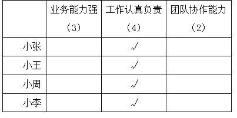

根据条件②和条件⑤可知，小王和小周都具有业务水平能力；又结合条件③可知，小李不具备业务水平能力，根据”3人业务能力强“可知，小王、小周和小张都具备业务能力。

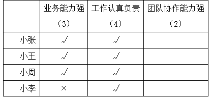

根据条件①和条件⑤可知，小张和小王要么团队协作能力都强，要么都没有团队协作能力，但由上表可知，小张和小王已经都具有了业务能力强和工作认真负责，如果又同时具有团队协作能力，则与条件⑥相违背，因此小张和小王不具备团队协作能力，所以具备团队协作能力的只有小周和小李。如下表所示：

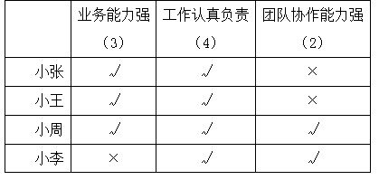

因此满足所有条件的只能是小周。

故正确答案为C。

### 第 9 题

理论创新必“仰望星空、脚踏实地”，理论思维与现实关怀二者缺一不可。因此，要把理论创新置于现实的基础之上，让理论之光照进社会发展现实。

下列选项中，与上述论证在结构上最为相似的是：

A. 当代青年的理想信念不能仅靠自发形成，也不能单靠教育灌输。所以，只有依靠潜移默化的文化影响，青年的理想信念才是坚定的

B. 融媒体既拥有新媒体受众群，又拥有传统媒体受众群。所以，融媒体实现了传统媒体和新媒体的优势互补

C. 大数据不仅是技术的变革，还是思维方式的转变。所以，要利用好大数据，必须首先了解和树立大数据思维

D. 思想建党与制度治党相互补充，对增强全面从严治党起着促进作用。因此，要推动制度治党，就必须用思想建党明确坐标

第 9 题 · 答案与解析

**参考答案（粉笔题库参考内容）**

C

**解析**

第一步：分析题干推理形式。

理论创新（a）→理论思维（b）且现实关怀（c），因此理论创新（a）→现实关怀（c）。

第二步：逐一分析选项。

A项：理想信念（a）→自发形成（b）且教育灌输（c），因此理想信念（a）→潜移默化的文化影响（d），与题干推理结构不同，排除；

B项：融媒体（a）→新媒体受众（b）且传统媒体受众（c），因此融媒体（a）→传统媒体和新媒体的优势互补（d），与题干推理结构不同，排除；

C项：大数据（a）→技术变革（b）且思维方式转变（c），因此大数据（a）→了解和树立大数据思维（c），与题干推理结构相同，当选；

D项：思想建党（a）且制度治党（b）→增强全面从严治党（c），因此制度治党（b）→思想建党（a），与题干推理结构不同，排除。

故正确答案为C。

### 第 10 题

儿童票是社会关爱儿童的一种体现，在现实中，经常以儿童的身高作为能否购买儿童票的标准，这种做法实施起来方便高效，但对个体的差异缺乏尊重。如果孩子年龄小、个子却比较高，就会在出行过程中被要求重新量身高或补票。因此，用身高作为能否购买儿童票的标准是不合理的。

上述推论暗含的前提是（ ）。

A. 准确界定孩子是否为儿童的标准应当是年龄

B. 以身高为标准不符合儿童的权利保护原则

C. 公众普遍反对以身高作为衡量儿童票的标准

D. 相关部门应当着手设定更为合理的儿童衡量标准

第 10 题 · 答案与解析

**参考答案（粉笔题库参考内容）**

A

**解析**

第一步：找出论点和论据。

论点：用身高作为能否购买儿童票的标准是不合理的。

论据：这种做法对个体的差异缺乏尊重。如果孩子年龄小、个子却比较高，就会在出行过程中被要求重新量身高或补票。

本题问题为“前提”，优先考虑搭桥，其次考虑必要条件。

第二步：逐一分析选项。

A项：说的是界定孩子是否为儿童的标准应该是年龄，本题论据其实就是在儿童票是“用年龄衡量”还是“用身高衡量”之间讨论，最后得出论点“不应该用身高”，那暗含的前提就是应该“用年龄衡量”，即A项，当选；

B项：如果以身高为标准是符合儿童的权利保护原则的，那么就不能说该做法对儿童的个体差异缺乏尊重，进而就得不到论点。本题B项也有加强力度，但是没有A项跟题干的论证逻辑更加紧密，力度不及A项，排除；

C项：公众普遍反对以身高作为衡量儿童票的标准，公众是否反对不是本题暗含的前提，排除；

D项：说的是相关部门应探索更为合理的儿童衡量标准，但没有提及为什么用身高作为购票标准不合理，只是提出了一种对策，话题不一致，无关项，排除。

故正确答案为A。

### 第 11 题

2020年上半年，某国政府声称，“今年上半年，本国GDP增长率超过了全球70%的国家。由此可见，今年上半年政府的施政纲领是正确的。”

下列选项如果为真，最能有力地削弱以上论断的是（ ）。

A. 该国政府不重视疫情防控，使该国成为全球疫情最严重的国家之一

B. 去年同期，该国GDP增长率位于全球前十

C. 该国的GDP低于三分之二的国家

D. 该国政府的施政纲领连续几年并未发生变化

第 11 题 · 答案与解析

**参考答案（粉笔题库参考内容）**

B

**解析**

第一步：找出论点与论据。

论点：今年上半年政府的施政纲领是正确的。

论据：今年上半年，本国GDP增长率超过了全球70%的国家。

本题通过今年上半年该国GDP增长率超过全球70%的国家，得出今年上半年该国政府的施政纲领是正确的，论点论据话题不一致。削弱题，可以考虑拆桥、否定论点等方式。

第二步：逐一分析选项。

A项：题干讨论的是GDP增长率和施政纲领之间的关系，该项说的是疫情问题，话题不一致，无法削弱，排除；

B项：该项说的是去年同期，该国GDP增长率位于全球前十，而今年上半年，本国GDP增长率超过全球70%的国家，说明GDP增长率水平较去年同期有所下降，所以今年上半年的施政纲领不正确，可以削弱，当选；

C项：该项说的是该国的GDP低于三分之二的国家，与题干讨论的GDP增长率不属于同一概念，话题不一致，无法削弱，排除；

D项：该项说的是该国政府的施政纲领连续几年并未发生变化，不清楚与GDP的增长率之间是什么关系，为不明确选项，无法削弱，排除。

故正确答案为B。

### 第 12 题

一般而言，大型综合医院的医疗技术水平及救治条件会优于中小型医院。但有媒体在调查了某市所有的医院后发现，大型综合医院住院部中，患者的平均治疗时长为6天，而中小型医院住院部中，患者的平均治疗时长仅为3天。

下列选项如果属实，最有助于解释这一现象的是（ ）。

A. 更多的患者选择前往大型综合医院就医

B. 中小型医院平均为每个患者服务的医务人员多于大型综合医院

C. 相较中小型医院，大型综合医院住院部设有更多的床位

D. 重疾患者所需治疗时间较长，更倾向于前往大型综合医院就医

第 12 题 · 答案与解析

**参考答案（粉笔题库参考内容）**

D

**解析**

第一步：找出题干矛盾。

大型综合医院的医疗技术水平及救治条件优于中小型医院。但有大型综合医院患者的平均治疗时长为6天，而中小型医院患者的平均治疗时长仅为3天。

第二步：逐一分析选项。

A项：该项只能说明去大型综合医院就医的患者多，但是没提到对治疗时间长短的影响，不能解释题干矛盾，排除；

B项：该项只能说明中小型医院的医务人员多，但是没提到对治疗时间长短的影响，不能解释题干矛盾，排除；

C项：该项说的是大型综合医院住院部有更多床位，相对来说能够容纳更多病人，但是没提到对治疗时间长短的影响，不能解释题干矛盾，排除；

D项：该项说的是治疗时间较长的重疾患者，更倾向于前往大型综合医院就医，解释了为什么大型综合医院的住院部中患者的治疗时间更长，可以解释题干矛盾，当选。

故正确答案为D。

### 第 13 题

鉴于“天价宰客”现象不断出现，只要相关职能部门能够加大惩处力度，就能让违法成本高于违法收益，让漠视消费者权益的经营者深刻感受违法违规的惨痛代价。那么，就算是再无良的经营者也不敢以身试法，侵犯消费者的权益。

上述推论最有可能基于的前提是（ ）。

A. 违法成本是所有经营者无法承受的

B. 侵犯消费者权益的行为必然会被惩处

C. 违法收益越高违法成本越高

D. “天价宰客”现象全国各地都有发生

第 13 题 · 答案与解析

**参考答案（粉笔题库参考内容）**

B

**解析**

第一步：找出论点和论据。

论点：就算是再无良的经营者也不敢以身试法，侵犯消费者的权益。

论据：只要相关职能部门能够加大惩处力度，就能让违法成本高于违法收益，让漠视消费者权益的经营者深刻感受违法违规的惨痛代价。

本题的论点和论据讨论话题一致，且提问是“最有可能基于的前提”，优先考虑必要条件，说明经营者确实不敢以身试法，侵犯消费者的权益。

第二步：逐一分析选项。

A项：该项指出违法成本是所有经营者无法承受的，部分无良商家可能不会发生侵犯消费者权益的行为，但如果侵犯行为不被发现，无良商家依旧可以继续侵犯消费者权益，因此虽然具有一定的加强作用，但不是论点成立的前提，排除；

B项：如果侵犯消费者权益的行为不会被惩处，那么就算相关职能部门加大惩处力度，经营者也可能以身试法，侵犯消费者的权益，该项为论点成立的必要条件，当选；

C项：该项讨论的是违法收益和违法成本的关系，与题干论据表述一致，但该项不是论点成立的前提，排除；

D项：该项指出“天价宰客”现象出现在各地，而论点讨论的是经营者会不会侵犯消费者的权益，话题不一致，无法加强，排除。

故正确答案为B。

### 第 14 题

由于竞争对手采取了低价促销策略，某公司近期有不少客户流失。因此，该公司的销售经理建议，为了挽回这些老顾客，公司也有必要采取低价促销策略。

该经理建议中最大的逻辑缺陷在于：

A. 认为低价促销是对公司唯一有效的营销策略

B. 没有对低价促销对公司运营成本造成的压力进行分析

C. 认为对手低价促销是导致自己顾客流失的唯一原因

D. 没有考虑低价促销策略对挖掘新客户可能造成的影响

第 14 题 · 答案与解析

**参考答案（粉笔题库参考内容）**

C

**解析**

第一步：找出论点和论据。

论点：为了挽回这些老顾客，公司也有必要采取低价促销策略。

论据：由于竞争对手采取了低价促销策略，某公司近期有不少客户流失。

论点和论据都在强调低价促销策略和客户流失之间的关系，因此指出论证缺陷需说明通过采取低价促销策略能解决客户流失的问题。

第二步：逐一分析选项。

A项：该项强调低价促销是对公司唯一有效的营销策略，但有效的营销策略是否指的是能够挽回老顾客不明确，无法指出上述论证缺陷，排除；

B项：该项指出没有对低价促销对公司运营成本造成的压力进行分析，说明低价促销策略对公司运营可能造成影响，但与论点讨论的采取低价促销策略能否挽回老顾客无关，无法指出上述论证缺陷，排除；

C项：该项强调对手低价促销是导致自己顾客流失的唯一原因，即说明了通过采取低价促销策略就能解决客户流失的问题，可以指出上述论证缺陷，当选；

D项：该项指出没有考虑低价促销策略对挖掘新客户可能造成的影响，说明了低价促销策略与新客户的关系，但论点讨论的是老顾客，话题不一致，无法指出上述论证缺陷，排除。

故正确答案为C。

### 第 15 题

如果没有对新闻的敏感性以及自己独特的见解，就不可能成为一名优秀的记者。

如果上述断定为真，那么以下选项不可能为真的是：

A. 甲是一名优秀的记者，他具有对新闻的敏感性

B. 甲是一名优秀的记者，他对新闻有自己独特的见解，但欠缺敏感性

C. 甲不是一名优秀的记者，而他有对新闻的敏感性和自己独特的见解

D. 甲不是一名优秀的记者，他缺乏对新闻的敏感性和自己独特的见解

第 15 题 · 答案与解析

**参考答案（粉笔题库参考内容）**

B

**解析**

第一步：翻译题干。

①-（新闻敏感性 且 独特见解）优秀记者。

逆否等价可得：②优秀记者新闻敏感性 且 独特见解。

第二步：逐一分析选项。

A项：翻译为“优秀记者 且 新闻敏感性”，其中“优秀记者”是对②的肯前，肯前必肯后，一定能够推出“新闻敏感性 且 独特见解”，故该项一定为真，排除。

B项：翻译为“优秀记者 且 独特见解 且 -新闻敏感性”，其中“优秀记者”是对②的肯前，肯前必肯后，一定能够推出“独特见解 且 新闻敏感性”，选项与推出结论不符，故该项不可能为真，当选。

C项：翻译为“-优秀记者 且 新闻敏感性 且 独特见解”，其中“-优秀记者”是对②的否前，否前推不出必然结论，故该项可能为真，排除。

D项：翻译为“-优秀记者 且 -（新闻敏感性 且 独特见解）”，其中“-（新闻敏感性 且 独特见解）”是对②的否后，否后必否前，一定能够推出“-优秀记者”，故该项一定为真，排除。

本题为选非题，故正确答案为B。

### 第 16 题

一项研究发现，在潜在顾客不知情的情况下，新型人工智能聊天机器人的销售业绩是缺乏经验的新员工的4倍多，然而，一旦顾客在决定购买前知道自己一直在和人工智能打交道，销售额会立刻下降近80%。

以下最能解释这一现象的是：

A. 顾客喜欢和有经验的真人打交道

B. 与人工智能机器人交流只能获取程序性信息

C. 顾客与人工智能打交道缺少真实感

D. 用人工智能机器人做销售必须公布其人工智能身份

第 16 题 · 答案与解析

**参考答案（粉笔题库参考内容）**

A

**解析**

第一步：找出题干矛盾。

在潜在顾客不知情的情况下，新型人工智能聊天机器人的销售业绩是缺乏经验的新员工的4倍多，但是一旦顾客在决定购买前知道自己一直在和人工智能打交道，销售额会立刻下降近80%。

第二步：逐一分析选项。

A项：该项说明顾客喜欢和有经验的真人打交道，即顾客不喜欢人工智能，解释了为什么顾客不知情时人工智能聊天机器人的销售业绩高于新员工，而顾客一旦知道自己在和人工智能打交道，销售额会立刻下降，可以解释题干矛盾，当选；

B项：该项说明与人工智能机器人交流只能获取程序性信息，没有提到人工智能对于销量的影响，因此没有解释为什么顾客一旦知道自己在和人工智能打交道，销售额会立刻下降，不能解释题干矛盾，排除；

C项：该项说明顾客与人工智能打交道缺少真实感，即意味着顾客体验差，人工智能会对销量产生影响，但只解释了为什么顾客一旦知道自己在和人工智能打交道，销售额会立刻下降，而没有解释为什么在潜在顾客不知情的情况下，新型人工智能聊天机器人的销售业绩是缺乏经验的新员工的4倍多，不能解释题干矛盾，排除；

D项：该项说明用人工智能机器人做销售必须公布其人工智能身份，没有提到人工智能对于销量的影响，因此没有解释为什么顾客知道自己在和人工智能打交道，销售额会立刻下降，不能解释题干矛盾，排除。

故正确答案为A。

### 第 17 题

世界上没有两片相同的树叶。因此，枫叶和桑叶不相同。

以下与上述推理在结构上最为相似的一项是：

A. 人非圣贤孰能无过，这是因为，只有圣贤者才能无过

B. 不能将功补过，这是因为，功是功，过是过

C. 草木皆兵，因此，薰衣草是士兵

D. 燕雀安知鸿鹄之志，因此，鸿鹄的志向是远大的

第 17 题 · 答案与解析

**参考答案（粉笔题库参考内容）**

C

**解析**

第一步：分析题干逻辑关系。

世界上没有两片相同的树叶，即世界上所有的树叶都不相同，而枫叶和桑叶是树叶，因此枫叶和桑叶不相同，由整体具有的特性推出部分也具有同样的特性。

第二步：逐一分析选项。

A项：因为只有圣贤者才能无过，即因为无过是圣贤者，人非圣贤孰能无过，推理形式属于否后否前，与题干推理形式不一致，排除；

B项：功是功，过是过，功过是不同的概念，不能将功补过是不能混淆两个不同概念，不存在由整体具有的特性推出部分也具有同样的特性，与题干推理形式不一致，排除；

C项：草木皆兵即所有草木都是士兵，而薰衣草是草，因此可以推出薰衣草是士兵，由整体具有的特性推出部分也具有同样的特性，与题干推理形式一致，当选；

D项：燕雀安知鸿鹄之志即燕雀不知道鸿鹄的志向，由此推知鸿鹄的志向是远大的，不存在由整体具有的特性推出部分也具有同样的特性，与题干推理形式不一致，排除。

故正确答案为C。

### 第 18 题

中小学生“抬头不看黑板，低头手机平板”的现象屡见不鲜，对学生的学习和成长造成严重影响。因此有专家建议，所有中小学都应当制定校规，禁止中小学生在校园使用智能手机、平板电脑，从而避免这些电子产品影响孩子们在校园中的学习与生活。

以下选项最能质疑该专家建议的是：

A. 许多家长严格限制孩子使用电子产品的时间

B. 中小学生在校外玩手机平板的现象比校内严重

C. 学校将加强对中小学生带电子产品进入校园的检查

D. 学生需要在校内通过平板电脑学习某些课程

第 18 题 · 答案与解析

**参考答案（粉笔题库参考内容）**

D

**解析**

第一步：找出论点和论据。

论点：所有中小学都应当制定校规，禁止中小学生在校园使用智能手机、平板电脑，从而避免这些电子产品影响孩子们在校园中的学习与生活。

论据：中小学生“抬头不看黑板，低头手机平板”的现象屡见不鲜，对学生的学习和成长造成严重影响。

题干论据讨论中小学生在校内使用电子产品会对学习成长造成严重影响，论点讨论应该在校内禁止学生使用电子产品来避免影响，论点和论据话题一致，优先考虑否定论点，即学校不能禁止学生在校园使用电子产品。

第二步：逐一分析选项。

A项：选项讨论许多家长严格限制孩子使用电子产品的时间，与论点讨论的学校禁止中小学生在校园使用电子产品的话题不一致，无关项，不能削弱，排除；

B项：选项讨论中小学生在校外玩手机平板的现象比校内严重，而论点讨论应该在校内禁止中小学生使用电子产品，与论点话题不一致，无关项，不能削弱，排除；

C项：选项讨论学校将加强对中小学生带电子产品进入校园的检查，而论点讨论应该在校内禁止中小学生使用电子产品，与论点话题不一致，无关项，不能削弱，排除；

D项：选项讨论学生需要在校内通过平板电脑学习某些课程，说明在校内禁止学生使用电子产品是不可行的，即学校不能禁止学生在校园使用电子产品，直接否定了题干论点，可以削弱，当选。

故正确答案为D。

### 第 19 题

广交会举办期间，某企业将A—H这8种展品沿直线摆放在所在展区的1—8号展位，其中，A和B分别摆放在展位的两端，C摆放在D旁边，C与E之间隔着1种展品，C与H相邻，D在G的旁边，F在E的旁边，并且与B的距离比与A的距离更近，则6号或7号展位不可能摆放：

A. 展品D

B. 展品E

C. 展品F

D. 展品H

第 19 题 · 答案与解析

**参考答案（粉笔题库参考内容）**

D

**解析**

第一步：找突破口。

（1）A在1号/8号，B在8号/1号；

（2）C和D挨着；

（3）C和E中间隔一个；

（4）C和H挨着；

（5）D和G挨着；

（6）F和E挨着，F与B的距离比A近。

本题突破口为信息量最大者，即C，以及确定信息A和B。因题干涉及内容有顺序，因此采用列表法进行解题。

第二步：根据题干条件分析。

第一种情况：C和D挨着，C在前D在后，则H在C前，G在D后，此时要满足（3）C和E中间隔一个，E只能在H前，F则在E前，一连串的位置为FEHCDG，又因为（6）F和E挨着，F与B的距离比A近，因此B在最前，A在最后，如下图所示：

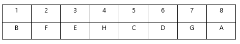

此情况6号和7号展位可以摆放D和G，排除A项。

第二种情况：C和D挨着，D在前C在后，则H在C后，G在D前，此时要满足（3）C和E中间隔一个，E只能在H后，F则在E后，一连串的位置为GDCHEF, 又因为（6）F和E挨着，F与B的距离比A近，因此A在最前，B在最后，如下图所示：

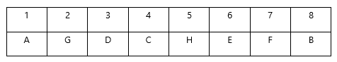

由上可知，6号或7号展位可能摆放D、G、E、F，不可能摆放H。

本题为选非题，故正确答案为D。

### 第 20 题

加拿大物理学家多娜·斯崔克兰是2018年诺贝尔物理学奖的获奖者之一，也是该奖项历史上第三位女性获得者。据统计，从1901年到2017年，只有17位女性获得了科学领域的诺贝尔奖。因此，女科学家在整个科学界里的贡献不高。

下列选项最能指出上述论证缺陷的是：

A. 假设了在科学领域中的贡献是以获得诺贝尔奖来衡量的

B. 暗示了女科学家并没有在科学领域里获得应有的地位

C. 忽视了女科学家在其他科学奖项中的获奖情况

D. 忽视了女科学家在科学研究活动中做出的贡献

第 20 题 · 答案与解析

**参考答案（粉笔题库参考内容）**

A

**解析**

第一步：找出论点和论据。

论点：女科学家在整个科学界里的贡献不高。

论据：从1901年到2017年，只有17位女性获得了科学领域的诺贝尔奖。

题干中论据指出获得诺贝尔奖的女性少，论点在说女性在科学界贡献不高，二者话题不一致，默认了女性在科学领域取得的成就取决于获得诺贝尔奖的人数，指出此论证缺陷即可。

第二步：逐一分析选项。

A项：假设了在科学领域的贡献是以获得诺贝尔奖来衡量的，题干根据女性获得诺贝尔奖人数少得到科学贡献不高的结论，可以指出论证缺陷，当选；

B项：论点所说女科学家在科学界的贡献，与她们是否获得应有的地位无关，无法指出论证缺陷，排除；

C项：女科学家在其他科学奖项的获奖情况与其在科学界的贡献话题不一致，无法指出论证缺陷，排除；

D项：女科学家在科学研究活动的贡献与其在整个科学领域的贡献话题不一致，无法指出论证缺陷，排除。

故正确答案为A。

### 第 21 题

某城市组织开展了一次大型马拉松赛事，排名前25%的参赛者将获得奖励。在比赛结束后，媒体对所有到达终点的参赛者进行了采访，结果有将近一半的受访者都说自己的排名在前25%。

下列情况如果属实，最有可能导致这一结果的是：

A. 赛事组织者设定的奖品有很强的吸引

B. 有大约50%的参赛者没有完成比赛

C. 大多数参赛者并不以获得好的成绩为目标

D. 有部分受访者没有如实报告自己的排名情况

第 21 题 · 答案与解析

**参考答案（粉笔题库参考内容）**

B

**解析**

第一步：找出题干矛盾。

题干矛盾为：前面说“排名前25%的参赛者将获得奖励”，但是后面又说“比赛结束后，媒体对所有到达终点的参赛者进行了采访，结果有将近一半的受访者都说自己的排名在前25%”，前面数据为25%，后面数据接近50%，前后矛盾。

第二步：逐一分析选项。

A项：选项只是说明奖品具有吸引力，但没说明和数据矛盾有什么关系，不能解释题干矛盾，排除；

B项：选项说明到达终点的人数大约为参赛者的50%，题干中说受访者都是到达终点的，将近一半的受访者即占总参赛者的25%，选项数据可以解释题干矛盾，当选；

C项：选项只是说明参赛者是否以取得好成绩为目标，但没说明和数据矛盾有什么关系，不能解释题干矛盾，排除；

D项：选项只是说明部分受访者没有如实报告自己的排名情况，但是没有说明部分是多少，不能解释题干矛盾，排除。

故正确答案为B。

### 第 22 题

孔子是鲁国人，孔子是儒家学派的代表人物，所以，鲁国人是儒家学派的代表人物。

以下与上述推理在结构上最为相似的一项是：

A. 熊猫是动物，熊猫是爱吃竹子的，所以，爱吃竹子的都是动物

B. 劳动是辛苦的，劳动是有价值的，所以，辛勤的劳动是有价值的

C. 太阳是天体，太阳是恒星，所以，天体是恒星

D. 哲学是深奥的，哲学是深刻的，所以，哲学深奥又深刻

第 22 题 · 答案与解析

**参考答案（粉笔题库参考内容）**

C

**解析**

第一步：分析题干推理形式。

题干的推理形式为：a是b，a是c，所以b是c。

第二步：逐一分析选项。

A项：选项的推理形式为：a是b，a是c，所以c是b，与题干不一致，排除；

B项：选项的推理形式为：a是b，a是c，所以d是c，与题干不一致，排除；

C项：选项的推理形式为：a是b，a是c，所以b是c，与题干一致，当选；

D项：选项的推理形式为：a是b，a是c，所以a既b又c，与题干不一致，排除。

故正确答案为C。

### 第 23 题

对于恐龙灭绝的原因，有专家认为是由于以恐龙蛋为食的小型哺乳动物大量出现，使得恐龙无法成功繁衍后代以致灭绝。

以下选项如果为真，最能削弱上述论断的是：

A. 与恐龙同时代的许多卵生动物并未灭绝反而存活至今

B. 小型哺乳动物力量远弱于恐龙，会被恐龙捕杀

C. 小型哺乳动物活动范围有限，无法长途迁徙

D. 并非所有的恐龙都是卵生，也存在胎生的恐龙

第 23 题 · 答案与解析

**参考答案（粉笔题库参考内容）**

D

**解析**

第一步：找出论点和论据。

论点：由于以恐龙蛋为食的小型哺乳动物大量出现，使得恐龙无法成功繁衍后代以致灭绝。

论据：无。

本题只有论点，没有论据，优先考虑削弱论点，即以恐龙蛋为食的小型哺乳动物大量出现不会导致恐龙无法成功繁衍后代以致灭绝。

第二步：逐一分析选项。

A项：指出与恐龙同时代的许多卵生动物并未灭绝，与恐龙灭绝的原因无关，为无关项，无法削弱，排除；

B项：指出小型哺乳动物会被恐龙捕杀，无法判断小型哺乳动物是在食用恐龙蛋之前还是之后被捕杀的，也就无法确定恐龙是否因为小型哺乳动物食用恐龙蛋而灭绝，为不明确项，无法削弱，排除；

C项：指出小型哺乳动物活动范围有限，无法长途迁徙，证明小型哺乳动物的活动受限，但与恐龙灭绝的原因无关，为无关项，无法削弱，排除；

D项：指出并非所有的恐龙都是卵生，也存在胎生的恐龙，说明即使以恐龙蛋为食的小型哺乳动物大量出现，还会有胎生的恐龙存活，即以恐龙蛋为食的小型哺乳动物大量出现不会导致恐龙无法成功繁衍后代以致灭绝，削弱论点，当选。

故正确答案为D。

### 第 24 题

牧民家的狗会看守羊群，当有陌生人接近羊圈时，狗的叫声会引来牧民查看。然而，有人进入了一户养着狗的牧民家，从羊圈里偷走了一只羊，狗却没有叫。

以下选项如果为真，最能解释这一情况的是：

A. 偷走羊的当天，牧民不在家

B. 失窃的羊圈距离狗窝较远

C. 偷走羊的人曾多次到牧民家做客

D. 事发当天羊圈的大门是打开的

第 24 题 · 答案与解析

**参考答案（粉笔题库参考内容）**

C

**解析**

第一步：找出题干矛盾。

狗会看守羊群，当有陌生人接近羊圈时，狗会叫，但有人从养着狗的牧民家中偷走了一只羊，狗却没有叫。

第二步：逐一分析选项。

A项：只说了偷走羊的当天，牧民不在家，与狗会不会叫没有关系，没有说明有人偷羊，狗却不叫的原因，不能解释题干矛盾，排除；

B项：失窃的羊圈距离狗窝较远，羊圈距离狗窝较远不代表狗不会看守羊群，不能成为有人偷羊，狗却不叫的原因，不能解释题干矛盾，排除；

C项：指出偷走羊的人曾多次到牧民家做客，说明偷羊的人不是陌生人，狗不对熟人叫，是有人偷羊，狗却不叫的原因，可以解释题干矛盾，当选；

D项：无论事发当天羊圈的大门是否打开，有陌生人偷羊，狗都是应该叫的，不能解释题干矛盾，排除。

故正确答案为C。

### 第 25 题

著名相声演员的口才大都很好，老李不是著名相声演员，所以他口才可能并不好。

下列选项中，与上述推理结构最为相似的是：

A. 努力使人成功，小王很努力，所以他很可能会收获成功

B. 大多数感冒的人都会头痛，如果小张没有感冒，他可能不会头痛

C. 中国制造的产品大都质量很好，这件产品质量并不好，所以它可能并不是中国制造

D. 绝大多数大学教授都有留学经历，因为老赵有留学经历，所以他可能是大学教授

第 25 题 · 答案与解析

**参考答案（粉笔题库参考内容）**

B

**解析**

第一步：分析题干推理形式。

题干推理形式为：大多著名相声演员口才很好，老李不是著名相声演员可能口才不好，即大多ab，-a可能-b，为否前可能推出否后。

第二步：逐一分析选项。

A项：翻译为：努力成功，小王很努力可能成功，即ab，a可能b，为肯前可能推出肯后，与题干推理结构不一致，排除；

B项：翻译为：大多感冒头痛，小张没有感冒可能不头痛，即ab，-a可能-b，为否前可能推出否后，与题干推理结构一致，当选；

C项：翻译为：大多中国制造质量好，这件产品质量不好可能不是中国制造，即ab，-b可能-a，为否后可能推出否前，与题干推理结构不一致，排除；

D项：翻译为：大多大学教授留学经历，老赵有留学经历可能是大学教授，即ab，b可能a，为肯后可能推出肯前，与题干推理结构不一致，排除。

故正确答案为B。

### 第 26 题

幸福小区只需要满足以下条件：小区自治程度高，拥有专业物业管理服务，优秀的社区文化，物业团队，业主遵循规则和契约精神。某小区居民参与社区治理的程度高，并且已经拥有专业的物业管理服务团队和优秀的社区文化。那么只要建立物业团队与业主之间的规则和契约，该小区就是幸福小区了。

下列选项中，最能指出上述论证缺陷的是：

A. 默认了建立了规则和契约，物业团队和业主就都会遵循

B. 默认了小区业主和物业团队都希望打造幸福小区

C. 默认了所有的小区都有成为幸福小区的可能性

D. 默认了幸福小区的条件没有地区的差异

第 26 题 · 答案与解析

**参考答案（粉笔题库参考内容）**

A

**解析**

第一步：找出论点和论据。

论点：只要建立物业团队与业主之间的规则和契约，该小区就是幸福小区了。

论据：幸福小区只需要满足以下条件：小区自治程度高，拥有专业物业管理服务，优秀的社区文化，物业团队，业主遵循规则和契约精神。某小区居民参与社区治理的程度高，并且已经拥有专业的物业管理服务团队和优秀的社区文化。

题干中论据指出幸福小区需满足的条件以及某小区已经满足的部分条件，论点补充的条件是建立物业团队与业主之间的规则和契约，而论据中缺少的条件是物业团队，业主遵循规则和契约精神，二者话题不一致，题干论证是默认了“建立”与“遵循”之间是存在联系的，指出该默认即指出论证缺陷。

第二步：逐一分析选项。

A项：该项说默认了建立了规则和契约，物业团队和业主就都会遵循，在“建立”与“遵循”之间建立联系，可以指出论证缺陷，当选；

B项：该项说默认了小区业主和物业团队都希望打造幸福小区，希望打造与能不能满足幸福小区的条件无关，无法指出论证缺陷，排除；

C项：该项说默认了所有的小区都有成为幸福小区的可能性，成为幸福小区的可能性与能不能满足幸福小区的条件无关，无法指出论证缺陷，排除；

D项：该项说默认了幸福小区的条件没有地区的差异，题干中并没有提到地区的差异与满足幸福小区条件的关系，无法指出论证缺陷，排除。

故正确答案为A。

### 第 27 题

某培训机构计划推出一项优惠活动：凡是报名参加英语课的学生，均可获赠相同课时的数学课程，在该活动推出后，报名参加英语课的学生数量大幅增加了。

下列选项中，最有可能导致这一结果的是：

A. 数学课的课程单价高，且该培训机构的英语课口碑好

B. 英语课的课时单价高，且该培训机构的英语课口碑好

C. 数学课的课时单价高，且该培训机构的数学课口碑好

D. 英语课的课时单价高，且该培训机构的数学课口碑好

第 27 题 · 答案与解析

**参考答案（粉笔题库参考内容）**

C

**解析**

第一步：找出论点和论据。

论点：在该活动推出后，报名参加英语课的学生数量大幅增加了。

论据：凡是报名参加英语课的学生，均可获赠相同课时的数学课程。

本题的论点说的是某培训机构推出了报名参加英语赠送数学课程活动后，报名参加英语课的学生数量大幅增加，论据说的是某培训机构推出了报名参加英语课的学生均可获赠相同课时的数学课程的活动，要能够从论据推导得到论点，就必须在两者间建立起联系，即说明为什么赠送相同课时的数学课程能提高报名参加英语课的学生数量。

第二步：逐一分析选项。

A项：该项说的是数学课的课程单价高，且英语课口碑好，但数学课的课程单价高只能说明学生可能不会购买数学课，英语课口碑好就只需直接报名参加英语课即可，该项无法建立赠送数学课程与报名参加英语课的学生数量提高的关系，无法加强，排除；

B项：该项说的是英语课的课时单价高，且英语课口碑好，与数学课无关，该项无法建立赠送数学课程与报名参加英语课的学生数量提高的关系，无法加强，排除；

C项：该项说的是数学课的课时单价高，且数学课口碑好，数学课口碑好说明数学课能够吸引学生购买，数学课的课时单价高说明学生可能会因为价格放弃购买，而报名参加英语课赠送数学课既满足了学生对数学课的需求，又不用花费高价购买，对数学课有需求的学生就会通过报名参加英语课来获取数学课，从而导致报名参加英语课的学生数量提高，该项建立了赠送数学课程与报名参加英语课的学生数量提高的关系，可以加强，当选；

D项：该项说的是英语课的课时单价高，且数学课口碑好，英语课课时单价高说明对数学课有需求的学生不会通过报名参加英语课来获得数学课，该项无法建立赠送数学课程与报名参加英语课的学生数量提高的关系，无法加强，排除。

故正确答案为C。

### 第 28 题

在流感流行的季节，有医学专家建议每天早餐必须吃一个鸡蛋，喝一杯牛奶，可以选择不喝粥。老黄每天早上都吃鸡蛋、喝牛奶，但还是患了流感。因此，老黄认为该专家的建议是错误的。

以下最能指出老黄论断缺陷的是：

A. 默认了吃鸡蛋、喝牛奶比喝粥更能提高人体的免疫力

B. 忽视了喝粥其实比吃鸡蛋、喝牛奶更能帮助抵抗流感病毒

C. 假设了将鸡蛋和牛奶作为早餐能使人体完全抵御流感病毒

D. 假设了老黄早上吃鸡蛋、喝牛奶，没有喝粥

第 28 题 · 答案与解析

**参考答案（粉笔题库参考内容）**

C

**解析**

第一步：找出论点和论据。

论点：老黄认为该专家的建议是错误的。

论据：在流感流行的季节，有医学专家建议每天早餐必须吃一个鸡蛋，喝一杯牛奶，可以选择不喝粥。老黄每天早上都吃鸡蛋、喝牛奶，但还是患了流感。

本题的论点说的是老黄认为专家的饮食建议是错误的，论据说的是老黄按照专家的建议，每天早上都吃鸡蛋、喝牛奶，但还是患了流感，所以要在吃鸡蛋、喝牛奶与不患流感之间建立起联系，才能指出论断缺陷。

第二步：逐一分析选项。

A项：该项说的是吃鸡蛋、喝牛奶比喝粥更能提高人体的免疫力，题干论证的是吃鸡蛋、喝牛奶与不患流感之间的关系，话题不一致，不是论断存在的缺陷，排除；

B项：该项说的是喝粥其实比吃鸡蛋、喝牛奶更能帮助抵抗流感病毒，但题干并未说明老黄早上是否喝粥了，不是论断存在的缺陷，排除；

C项：该项说的是将鸡蛋和牛奶作为早餐能使人体完全抵御流感病毒，建立了吃鸡蛋、喝牛奶与不患流感之间的联系，是论断存在的缺陷，当选；

D项：该项说的是老黄早上吃鸡蛋、喝牛奶，没有喝粥，题干论证的是吃鸡蛋、喝牛奶与不患流感之间的关系，话题不一致，不是论断存在的缺陷，排除。

故正确答案为C。

### 第 29 题

要想扶持实体书店，让书店可以生存和盈利，必须引导更多的社会公众去买书、读书。否则如果已经没有什么人会去实体店买书了，即使通过免去店租的方式来大幅减少书店的经营成本，书店也不可能生存得下去。

以下最可能是上述论证潜在假设的是：

A. 城市读书人群的数量正逐渐减少

B. 图书零售是实体书店的主要收入来源

C. 实体书店能否持续经营取决于到店的人数

D. 扶持实体书店有助于鼓励更多的公众买书阅读

第 29 题 · 答案与解析

**参考答案（粉笔题库参考内容）**

B

**解析**

第一步：找出论点和论据。

论点：要想扶持实体书店，让书店可以生存和盈利，必须引导更多的社会公众去买书、读书。

论据：如果已经没有什么人会去实体店买书了，即使通过免去店租的方式来大幅减少书店的经营成本，书店也不可能生存得下去。

本题论点和论据说的都是社会公众买书对实体书店生存的重要性，二者话题一致，且问题是“假设”，优先考虑必要条件。

第二步：逐一分析选项。

A项：城市读书人群并不能代表去实体书店买书、看书的人群，且没有提及实体书店，为无关项，无法削弱，排除；

B项：图书零售是实体书店的主要收入来源，如果实体书店的主要收入不是图书零售，那么社会公众买书对实体书店就不会那么重要，即选项不成立论点不成立，该项为必要条件，当选；

C项：到实体书店的人数未必是去买书、看书的人数，二者群体并不一致，为无关项，排除；

D项：论点说的是社会公众去买书、读书对实体书店生存的重要性，而选项说的是扶持实体书店的影响，话题不一致，排除。

故正确答案为B。

### 第 30 题

长期没有营业收入的市场业务不可能持久发展。而现在，快递投递箱企业均向寄存快递的客户免费提供服务。显然，这一状况不可能持久。

以下选项如果为真，最能削弱上述论断：

A. 现在快递投递箱市场竞争激烈，各企业需要通过提供免费服务争夺市场

B. 大部分快递投递箱企业本身另有主营业务，足以支持投递箱业务的推广

C. 所有投递箱企业都通过在投递箱上投播广告、开展宣传等获得营业收入

D. 已经有一部分投递箱企业开始策划向用户提供包月会员等优惠寄存服务

第 30 题 · 答案与解析

**参考答案（粉笔题库参考内容）**

C

**解析**

第一步：找出论点和论据。

论点：快递投递箱企业均向寄存快递的客户免费提供服务，这一状况不可能持久。

论据：长期没有营业收入的市场业务不可能持久发展。

本题论点和论据话题一致，只需看论点即可。需要证明快递投递箱企业均向寄存快递的客户免费提供服务能持久发展。

第二步：逐一分析选项。

A项：该项只是在说明各企业为什么要提供免费服务，但并没有说明这种服务是否能长久维持下去，为无关项，无法削弱，排除；

B项：大部分企业虽可以通过其他主营业务的收入来支撑投递箱业务的推广，但该免费业务能否持久发展还是未知的，为无关项，无法削弱，排除；

C项：该项说明了所有投递箱企业是通过广告、宣传等方式来获得营收的，并不是没有营业收入的市场业务，是可以长久维持的，否定论点，可以削弱，当选；

D项：一部分企业开始策划要对用户提供包月会员等优惠寄存服务，但还属于策划阶段，并没有实施且实施之后能否取得营业收入也是未知的，为不明确项，排除。

故正确答案为C。

### 第 31 题

曾有多位获得诺贝尔经济学奖的学者登上讲坛。李教授是登上讲坛的学者之一，所以李教授曾经获得诺贝尔经济学奖。

下列选项中，与上述推理结构最为相似的是：

A. 朱先生在世界500强企业就职。在世界500强企业就职需至少有硕士学位，所以朱先生是一位管理学硕士

B. 爱因斯坦曾说，很多人都以为是才智成就了科学家，错了，是品格。只有良好的品格才能成就一些伟大的科学家

C. 2009年，甲国是世界最大出口国。2010年，乙国的出口总量超过甲国，所以乙国已经成为了世界最大出口国

D. 世界锦标赛的种子选手大多是夺冠热门人选。小王的夺冠呼声很高，所以种子选手名单里有小王的名字

第 31 题 · 答案与解析

**参考答案（粉笔题库参考内容）**

D

**解析**

第一步：分析题干推理结构。

题干推理形式为：有的诺贝尔经济学奖学者（a）讲坛（b），李教授（c）讲坛（b），所以李教授（c）诺贝尔经济学奖学者（a）。

第二步：逐一分析选项。

A项：朱先生（a）500强（b），500强（b）硕士（c），所以朱先生（a）硕士（c），与题干推理形式不一致，排除；

B项：不是才智，而是品格→成就科学家，与题干推理形式不一致，排除；

C项：甲国（a）最大出口国（b），乙国（c）大于甲国（a），所以乙国（c）最大出口国（b），与题干推理形式不一致，排除；

D项：种子选手（a）夺冠热门（b），小王（c）夺冠热门（b），所以小王（c）种子选手（a），与题干推理形式一致，当选。

故正确答案为D。

### 第 32 题

有研究发现，如果孩子经常被提醒自己的各种身份——朋友、邻居、儿子女儿、兄弟姐妹，或者经常在集体任务中扮演不同角色，他们将对不同性别、年龄、人种的人更具有包容性，因此该研究得出结论，了解自己在社会关系中的身份和角色，对孩子的认知学习有着相当重要的作用。

下列各项最能指出上述论断缺陷的是：

A. 默认了孩子的包容性增强是其认知学习能力提升的体现

B. 假设了被提醒的孩子能够很好地认知各种身份

C. 忽视了还有其他方法能够增强孩子的包容性

D. 忽视了孩子能够在角色扮演中提升其他的能力

第 32 题 · 答案与解析

**参考答案（粉笔题库参考内容）**

A

**解析**

第一步：找出论点和论据。

论点：了解自己在社会关系中的身份和角色，对孩子的认知学习有着相当重要的作用。

论据：如果孩子经常被提醒自己的各种身份——朋友、邻居、儿子女儿、兄弟姐妹，或者经常在集体任务中扮演不同角色，他们将对不同性别、年龄、人种的人更具有包容性。

论点和论据的话题不一致，题干默认了包容性和孩子认知学习有联系，在二者之间进行搭桥即可指出论断缺陷。

第二步：逐一分析选项。

A项：该项指出孩子的包容性增强是认知学习能力提升的体现，默认了包容性和认知学习能力之间有联系，可以指出该论断的缺陷，当选；

B项：该项指出假设了被提醒的孩子能够很好地认知各种身份，但是没有提及与包容性和认知学习能力的关系，与论点、论据的话题不一致，无关项，不能指出论断缺陷，排除；

C项：该项指出忽视了还有其他方法能够增强孩子的包容性，没有提及了解自己社会关系中的角色和身份与认知学习之间的关系，不能指出论断缺陷，排除；

D项：该项指出忽视了在角色扮演中能够提升其他能力，但是其他能力与认知学习无关，与论点的话题不一致，不能指出论断缺陷，排除。

故正确答案为A。

### 第 33 题

在某逻辑学国际学术研讨会上，有四位专家做了重要发言，他们分别是中国专家、美国专家、波兰专家、加拿大专家，四位专家研究的领域分别是模态逻辑、辩证逻辑、人工智能逻辑中的某一个，其中：

只有加拿大专家研究辩证逻辑；

美国专家和中国专家研究的不是同一领域；

中国专家和另一位专家的研究领域相同；

波兰专家不研究模态逻辑。

根据以上条件可以推断，中国专家研究的领域是：

A. 模态逻辑

B. 辩证逻辑

C. 人工智能逻辑

D. 不同于波兰专家研究的领域

第 33 题 · 答案与解析

**参考答案（粉笔题库参考内容）**

C

**解析**

第一步：整理题干条件。

（1）只有加拿大专家研究辩证逻辑；

（2）美国专家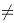中国专家；

（3）中国专家=另一位专家；

（4）波兰专家模态逻辑。

第二步：根据题干条件分析选项。

根据题干所说的“四位专家研究的领域分别是模态逻辑、辩证逻辑、人工智能逻辑中的某一个”，结合条件（1）、（4）可知，辩证逻辑只有加拿大专家研究，波兰专家不研究模态逻辑，故波兰专家研究人工智能逻辑；再结合条件（1）、（2）、（3）可知，中美领域不同，中国专家和另一位专家相同，故中国专家不研究辩证逻辑，中国专家不研究模态逻辑，故中国专家研究人工智能逻辑。

故正确答案为C。

### 第 34 题

某国针对南北部经济发展不均衡的情况，计划实施南部经济大开发战略，该国有专家指出，本国南部涉及国家边境安全、生态安全、能源安全，不应该将重点放在发展经济上。

以下选项如果为真，最能反驳该专家观点的是：

A. 近几年该国南部经济发展迅速，但经济总量仍不及北部的一半

B. 边防、生态、能源等重点领域的发展应由国家层面统筹

C. 该国南部经济落后限制了生态、能源等领域的发展

D. 发展军事装备和能源行业能够带动地方经济的增长

第 34 题 · 答案与解析

**参考答案（粉笔题库参考内容）**

C

**解析**

第一步：找出论点和论据。

论点：本国南部涉及国家边境安全、生态安全、能源安全，不应该将重点放在发展经济上。

论据：无。

本题只有论点，没有论据，优先考虑削弱论点的方式进行削弱，即本国南部应该把重点放在发展经济上。

第二步：逐一分析选项。

A项：该项说明了近几年该国南部的经济发展情况，但无法据此判断是否应该将重点放在发展经济上，不明确选项，无法削弱，排除；

B项：该项指出边防、生态、能源等重点领域的发展应由国家统筹，但是没有提及论点中的经济发展问题，与论点话题不一致，无关选项，无法削弱，排除；

C项：该项说明了南部经济落后限制了生态、能源等领域发展，进而表明南部需要重点发展经济，削弱论点，可以削弱，当选；

D项：该项讨论了发展军事装备和能源行业可以带动地方经济增长，但未提及是否需要发展经济，无关选项，无法削弱，排除。

故正确答案为C。

### 第 35 题

自我教育是要培养受教育者自我认识、自我监督和自我评价的能力，没有自我教育就没有真正的教育：如果没有真正的教育，那么就没有未来。所以自我教育决定了人的未来。

下列选项中，与上述推理结构最为相似的是：

A. 学习要以学生的自我学习为主。但有人认为，有家长的监督学生才能自我学习，而且家长的自我约束能力决定了家长的监督能力。所以，家长的自我约束能力保障了学生的自我学习

B. 教育的主体是人，真正的教育是建立在以人为本的前提之下的。没有爱，就没有真正的教育。如果把教育比作池塘，把爱比作水，没有爱，教育就是一个干枯的池塘，那就不配称作教育

C. 学习，对老年人来说，是总结一生，传授经验；对孩子来说，是学习知识，汲取经验。因此，无论年龄几何，人们都会在学习中有所收获、有所成长

D. “知识改变命运，学习成就未来。”知识是学生改变自身命运的法宝，学习是学生获取知识的主要途径，所以，学生应该把学习放在第一位

第 35 题 · 答案与解析

**参考答案（粉笔题库参考内容）**

A

**解析**

第一步：分析题干的推理结构。

题干中主要涉及到自我教育、真正的教育与未来这三个概念之间的关系。具体来说，题干首先简要介绍了自我教育这一概念，然后根据自我教育与真正的教育、真正的教育与未来之间的关系，推断自我教育与未来之间的关系。如果用相同的数字代替重复出现的概念，则题干的推理结构为：根据1与2、2与3之间的关系，推断1与3之间的关系。

第二步：逐一分析选项。

A项：该项主要涉及到自我学习、家长监督与家长自我约束能力这三个概念之间的关系，并根据自我学习与家长监督、家长监督与家长自我约束能力之间的关系，推断自我学习与家长自我约束能力之间的关系。如果用相同的数字代替重复出现的概念，则该项的推理结构为：根据1与2、2与3之间的关系，推断1与3之间的关系，与题干推理结构最为相似，当选；

B项：该项主要涉及到教育、人与爱这三个概念之间的关系。具体来说，该项首先说明了人与教育之间的关系，然后表明了教育与爱之间的关系，但没有继续对人与爱之间的关系做出推断，所以与题干推理结构不同，排除；

C项：该项分别表明了对于老人和孩子来说学习是怎样的，进而推断出对于所有年龄段的人来说学习是怎样的，这是一个从部分推断到总体的归纳推理过程，与题干推理结构不同，排除；

D项：该项首先表明了知识和学习的重要性，进而推断出应该把学习知识放在第一位。该项没有在三个概念之间的关系中进行的推理，故与题干推理结构不同，排除。

故正确答案为A。

### 第 36 题

病虫害不仅破坏森林的生态环境，也会造成巨大的经济损失，但有研究发现，经常爆发病虫害的森林大都是人工种植林，而自然形成的森林较少发生病虫害。

下列选项中，最能解释这一现象的是：

A. 相对自然森林，人工种植林经济收益大，病虫害带来的经济损失也更大

B. 人工种植林往往受到人们的精心看护，生长速度一般较自然生长更快

C. 相较人工种植林，在自然形成的森林环境中的病虫的类型更为单一

D. 自然森林植物种类繁多，为鸟类等害虫的天敌提供更为合适的栖息地

第 36 题 · 答案与解析

**参考答案（粉笔题库参考内容）**

D

**解析**

第一步：找出题干矛盾。

经常爆发病虫害的森林大都是人工种植林，而自然形成的森林较少发生病虫害。

第二步：逐一分析选项。

A项：该项只是将自然森林和人工种植林在病虫害产生的经济损失方面进行对比，与题干中发生病虫害的频率无关，不能解释题干矛盾，排除；

B项：该项讨论的是人工种植林中的林木生长速度的问题，与题干中发生病虫害的频率无关，不能解释题干矛盾，排除；

C项：该项讨论的是病虫类型是否单一的问题，与题干中发生病虫害的频率无关，不能解释题干矛盾，排除；

D项：该项说明了与人工种植林相比，自然森林中有很多鸟类是害虫的天敌，所以自然森林就较少发生病虫害，可以解释题干矛盾，当选。

故正确答案为D。

### 第 37 题

某咖啡品牌管理层认为，比起从其他咖啡品牌争取用户，在不经常饮用咖啡的人群中发掘新用户，培养用户的咖啡饮用习惯更有助于拓宽市场，于是该公司决定，在宣传中侧重介绍饮用咖啡的好处，并由此大幅调整了广告内容。结果发现，广告效果并不理想。

下列选项如果为真，最能解释上述结果的是：

A. 由于口感问题，许多人并不喜欢喝该品牌的咖啡

B. 其他咖啡品牌根据自身特点也开展了广告宣传

C. 绝大多数没有咖啡饮用习惯的人对咖啡不耐受

D. 该品牌的市场售价并不比其他品牌咖啡低

第 37 题 · 答案与解析

**参考答案（粉笔题库参考内容）**

C

**解析**

第一步：找出题干矛盾。

公司在宣传中侧重介绍饮用咖啡的好处，并且调整了广告内容，但是广告效果却不理想。

第二步：逐一分析选项。

A项：指出该品牌口感不好很多人不爱喝，无法解释为什么广告效果不理想，不能解释题干矛盾，排除；

B项：说的是其他咖啡品牌，与本题某咖啡品牌无关，无法解释为什么广告效果不理想，不能解释题干矛盾，排除；

C项：指出大多数没有喝咖啡习惯的人，对咖啡不耐受，这些人本身就不适宜饮用咖啡，所以无论如何宣传也难以取得期望效果，可以解释题干矛盾，当选；

D项：指出该品牌的售价和其他品牌差不多，无法解释为什么广告效果不理想，不能解释题干矛盾，排除。

故正确答案为C。

### 第 38 题

有研究结果表明，虽然适度休假可以缓解员工的心理压力，从而提高工作效率，但这种效果会随着假期延长而显著降低。当假期超过三天时，因为对回去上班感到焦虑，员工的心理压力水平便有可能出现部分回升，这在一定程度上会影响他们回归工作岗位后的工作表现。

根据以上表述，下列判断一定正确的是：

A. 员工的工作效率与心理压力密切相关

B. 让员工休假三天以上对企业而言弊大于利

C. 企业应该对休假结束后的员工进行适当的心理疏导

D. 长时间休假后员工常因积压了大量工作而感到压力

第 38 题 · 答案与解析

**参考答案（粉笔题库参考内容）**

A

**解析**

日常结论题，根据题干信息逐一分析选项。

A项：根据题干“适度休假可以缓解员工的心理压力，从而提高工作效率”和“当假期超过三天时，因为对回去上班感到焦虑，员工的心理压力水平便有可能出现部分回升从而影响工作表现”，可以推出员工的工作效率与心理压力相关，当选；

B项：根据题干最后一句话可知，当假期超过三天会影响工作，只是谈到了弊端，并没有将利弊做对比，无中生有，无法推出，排除；

C项：题干并未提到企业是否应该对休假结束后的员工进行心理疏导，无中生有，无法推出，排除；

D项：根据题干最后一句话可知，假期超过三天时员工感到压力，但并没有提到是积压的工作导致员工感到压力，无中生有，无法推出，排除。

故正确答案为A。

### 第 39 题

今年夏天，街边冷饮摊上的冰激凌普遍涨价，多款畅销产品的价格都有不同程度的上涨。有人认为，这是因为冰激凌中的中高端品种越来越多，使消费者对价格较高的冰激凌有更高的接受度，最终导致了冰激凌的市场价格普遍上涨。

以下最能削弱上述论断的一项是：

A. 中高端品种冰激凌刺激了其他品种冰激凌的市场价格上涨

B. 低价冰激凌的品种同样越来越多，并且味道也很受欢迎

C. 某家大型超市的冰激凌平均价格未出现明显上涨

D. 厂家和经销商的经营成本、用工成本不断上涨

第 39 题 · 答案与解析

**参考答案（粉笔题库参考内容）**

D

**解析**

第一步：找出论点和论据。

论点：因为冰激凌中的中高端品种越来越多，使消费者对价格较高的冰激凌有更高的接受度，最终导致了冰激凌的市场价格普遍上涨。

论据：无。

本题只有论点没有论据，且论点中存在因果关系，优先考虑因果倒置或他因削弱。

第二步：逐一分析选项。

A项：该项说的是中高端品种冰激凌刺激了其他品种冰激凌的市场价格上涨，在解释为什么冰激凌的市场价格普遍上涨，加强项，无法削弱，排除；

B项：该项说的是“低价冰激凌品种”，题干讨论的是“中高端品种”，讨论主体不一致，无法削弱，排除；

C项：该项说的是某家大型超市的冰激凌平均价格没有明显上涨，某家大型超市平均价格不能代表整个冰激凌的市场价格，无法削弱，排除；

D项：该项说的是在不否定中高端品种多、消费者的接受度高的基础上，增加了另一个原因也就是厂家和经销商的经营成本、用工成本不断上涨，也可能会导致冰激凌的市场价格普遍上涨，属于他因削弱，当选。

故正确答案为D。

### 第 40 题

为了让家长们在放学后尽快接走自己的孩子，某幼儿园开始向不能及时来接走孩子的家长收取“托管费用”。然而，有调查显示，收取费用后不及时接走孩子的家长数量并未因此减少，反而增加了。

下列选项如果为真，最能解释这一现象的是：

A. 收费标准太低，对原本经常晚来接孩子的家长没有太大的约束力

B. 有个别家长对收费行为不满，有时会故意以晚接孩子的行为来抗议

C. 有些家长因工作忙碌，常常不能及时来接孩子

D. 许多有托管需求的家长将这一收费理解为幼儿园开设了托管服务

第 40 题 · 答案与解析

**参考答案（粉笔题库参考内容）**

D

**解析**

第一步：找出题干矛盾。

通过收取费用的方式让家长及时接孩子，但是收费后不及时接孩子的家长数量不减反增。

第二步：逐一分析选项。

A项：该项说的是收费低对原本晚接孩子的家长无影响，可以解释为什么人数没有减少，但是无法解释为什么人数增加，不能解释题干矛盾，排除；

B项：该项说的是个别家长抗议收费而晚来接孩子，但是无法解释清楚为什么晚接孩子的家长数增加了，不能解释题干矛盾，排除；

C项：该项解释了家长晚来接孩子的原因，但与题干幼儿园收费无关，不能解释题干矛盾，排除；

D项：该项说明家长误以为幼儿园开设了托管服务，因此更多家长可以心安理得晚接孩子，可以解释为什么晚接孩子的人不减反增，当选。

故正确答案为D。

### 第 41 题

针对如何戒掉烟瘾，某大学研究小组给出了“试试出去跑两圈”的建议。该小组通过对实验室小白鼠的研究，证明了即使是像慢跑这样中等强度的体育运动，也能激活小白鼠大脑中的α7烟碱型乙酰胆碱受体，提供与吸烟类似的快感。因此，“跑两圈”或许能够让戒烟者的戒断症状有所缓解。

上述论证最可能基于的潜在假设是（ ）。

A. 小白鼠对于香烟中的一些成分较为敏感

B. 小白鼠与人的大脑生理结构具有很高的相似性

C. 小白鼠也能吸烟，也会出现类似烟瘾的生理表现

D. 香烟中的尼古丁等成分不会刺激α7烟碱型乙酰胆碱受体

第 41 题 · 答案与解析

**参考答案（粉笔题库参考内容）**

B

**解析**

第一步：找出论点和论据。

论点：“跑两圈”或许能够让戒烟者的戒断症状有所缓解。

论据：该小组通过对实验室小白鼠的研究，证明了即使是像慢跑这样中等强度的体育运动，也能激活小白鼠大脑中的α7烟碱型乙酰胆碱受体，提供与吸烟类似的快感。

论点说的是“跑两圈”可以缓解戒烟者的戒断症状，论据说的是小白鼠实验中体育运动可以提供与吸烟类似的快感，论点说的是人，论据说的是小白鼠，二者话题不一致，提问方式为“假设”，优先考虑搭桥，其次考虑必要条件。

第二步：逐一分析选项。

A项：说的是小白鼠对于香烟中的一些成分较为敏感，没有提到“跑两圈”或许能让戒断症状缓解，话题不一致，属于无关项，排除；

B项：说的是小白鼠与人的大脑生理结构具有很高的相似性，在小白鼠和人之间建立了联系，说明小白鼠身上的实验结论也可以应用到人身上，建立了论点和论据的联系，属于搭桥项，当选；

C项：说的是小白鼠会出现类似烟瘾的生理表现，没有提到“跑两圈”或许能让戒断症状缓解，话题不一致，属于无关项，排除；

D项：题干说慢跑等体育运动可以激活α7烟碱型乙酰胆碱受体，提供与吸烟类似的快感，而D项说的是香烟中的尼古丁等成分不会刺激α7烟碱型乙酰胆碱受体，与题干中论据的表述意思相反，有削弱的作用，排除。

故正确答案为B。

### 第 42 题

生产顾问小王参观了某工厂1-10车间后，对这10个车间作出了以下判断：“至少有一部分车间能够完成年度生产目标；至少有一部分车间不能完成年度生产目标；3号车间不能完成生产目标。”但到了年底，发现这3项判断中只有1项是正确的。

根据以上表述，下列判断一定正确的是（ ）。

A. 10个车间全部完成了年度生产目标

B. 10个车间中只有3号车间完成了年度生产目标

C. 10个车间中至少有1个车间没有完成年度生产目标

D. 10个车间中除了3号车间，还有其他车间没有完成年度生产目标

第 42 题 · 答案与解析

**参考答案（粉笔题库参考内容）**

A

**解析**

第一步：找关系。

（1）有的车间能够完成年度生产目标；

（2）有的车间不能完成年度生产目标；

（3）3号车间不能完成生产目标。

条件（1）和条件（2）为两个“有的”，必有一真，而根据“3项判断中只有1项是正确的”可知，唯一的一真应该在条件（1）和条件（2）中，那么条件（3）一定为假。

第二步：看其余。

根据条件（3）为假可知，3号车间一定能完成生产目标，可推出条件（1）一定为真的，那么条件（2）一定是假的，可知所有的车间都能完成年度目标，只有A项符合。

故正确答案为A。

### 第 43 题

一项心理调查显示，受过良好教育的人感受到的日常工作生活压力会大于受教育程度低的人。有专家指出，这是因为受过良好教育的人有着更广阔的工作生活场景，而随着场景拓展，面临的冲突性事件数量呈几何级上升。

下列最能削弱以上论证的是（ ）。

A. 克服冲突性事件所造成的压力有助于人们提升心理舒适度

B. 随着受教育程度的提升，冲突性事件所造成的压力将逐渐降低直至消失

C. 日常工作生活的压力越大，人们越能提升自己的个人能力

D. 与受教育程度高的人相比，受教育程度低的人心理抗压能力更弱

第 43 题 · 答案与解析

**参考答案（粉笔题库参考内容）**

B

**解析**

第一步：找出论点和论据。

论点：受过良好教育的人感受到的日常工作生活压力会大于受教育程度低的人。

论据：受过良好教育的人有着更广阔的工作生活场景，而随着场景拓展，面临的冲突性事件数量呈几何级上升。

本题论点说的是”日常工作生活压力大”，论据说的是“冲突性事件多”，二者话题不一致，优先考虑拆桥，即证明冲突事件多不代表产生的压力大。

第二步：逐一分析选项。

A项：选项说的是克服冲突性事件所造成的压力之后对心理状态的影响，但与受过良好教育的人是否压力更大无关，无关选项，无法削弱，排除；

B项：选项说明冲突性事件给教育程度高的人带来压力不大，甚至可能没有，拆掉了“冲突事件”和“压力”之间的关系，拆桥项，当选；

C项：选项说的是日常工作生活压力对个人能力的影响，未提到教育，无关选项，无法削弱，排除；

D项：选项说的是受教育程度高低与心理抗压能力之间的关系，与教育程度不同所具有的压力大小无关，无关选项，无法削弱，排除。

故正确答案为B。

### 第 44 题

为方便用户比较不同酒店的服务品质，某旅游服务平台搜集了最近一段时间内住户对入住酒店服务品质的评价，并依据评价的平均得分对酒店进行排名。然而，有部分高档酒店的住户评分排名反而不如一些中档酒店。

以下各项最不能解释上述现象的是（ ）。

A. 由于高档酒店价格高，住户对酒店服务的评价标准也相应提高了

B. 中档酒店的入住人数要远远多于高档酒店的入住人数

C. 中档酒店经常给对其服务品质做出好评的住户额外的优惠

D. 部分高档酒店正值装修期间，关闭了一些服务设施

第 44 题 · 答案与解析

**参考答案（粉笔题库参考内容）**

B

**解析**

第一步：找出题干矛盾。

部分高档酒店的住户评分排名反而不如一些中档酒店。

第二步：逐一分析选项。

A项：住户对高档酒店的评价标准提高了，因此对高档酒店更有可能出现不满意的情况，造成高档酒店排名低，可以解释题干矛盾，排除；

B项：选项只是说的入住人数的多少，但是并不知道这些人对酒店的评价如何，因此对其评价的影响也不明确，不能解释题干矛盾，当选；

C项：中档酒店经常给对其服务品质做出好评的住户额外的优惠，会在一定程度上刺激用户给予中档酒店更多的好评，造成中档酒店排名高，可以解释题干矛盾，排除；

D项：高档酒店关闭了一些服务设施会在一定程度上影响住户对酒店的评价，造成高档酒店排名靠后，可以解释题干矛盾，排除。

本题为选非题，故正确答案为B。

### 第 45 题

研究发现，适度接受紫外线照射能够增加人体血液中的尿刊酸，尿刊酸能够通过血脑屏障进入大脑，通过一系列转化，最终生成谷氨酸。谷氨酸能够激活学习以及记忆相关的脑内神经环路，从而有助于改善学习和记忆能力。很多谷类蛋白质也含有大量的谷氨酸。

根据以上表述，下列判断一定正确的是（ ）。

A. 尿刊酸能够直接改善学习和记忆能力

B. 多吃谷类食物能够增强学习和记忆能力

C. 适度接受紫外线照射或者多吃谷类食物有助于改善记忆能力

D. 紫外线照射能够增加人体内的谷氨酸从而改善学习和记忆能力

第 45 题 · 答案与解析

**参考答案（粉笔题库参考内容）**

C

**解析**

日常结论题，根据题干信息逐一分析选项。

A项：根据题干第一、二句话可知，尿刊酸只能通过一系列转化生成谷氨酸，从而改善学习和记忆能力，不能直接改善学习和记忆能力，无法推出，排除；

B项：根据题干最后一句话可知，很多谷类蛋白质也含有谷氨酸，又根据第二句话可知，谷氨酸能够激活相关神经，从而有助于改善学习和记忆能力，但多吃谷类食物能增强学习和记忆力过于绝对，排除；

C项：根据整个题干可知，适度接受紫外线照射或者多吃谷类食物都会影响体内谷氨酸含量，谷氨酸能够激活相关神经，从而有助于改善学习和记忆能力，选项说有助于改善记忆能力与原文表达意思一致，当选；

D项：根据题干第一句话可知，适度接受紫外线照射会对人体产生影响，选项未提到适度，并且紫外线能够增加的是尿刊酸，尿刊酸会影响谷氨酸，因此紫外线是间接影响谷氨酸，而选项说的是紫外线照射能够增加人体内的谷氨酸，没有C项表述贴近题干，排除。

故正确答案为C。

### 第 46 题

再灵验的病毒检测试剂都存在漏检的可能性，而任何一个被漏检的病毒携带者都威胁着疫情防控，因此，通过对人群进行大规模的病毒检测来防控疫情是没有意义的。

下列选项中存在的逻辑错误与上文最为类似的是（ ）。

A. 是药三分毒，无论药品是否能够有效治疗肺炎，都不能当做肺炎预防药物给健康大众普遍服用

B. 社区的运动器械使用频率高，维护不及时，可能发生意外伤害，所以老人和小孩尤其不应该使用社区运动器械

C. 如果民众没有健身的意愿，即使财政投入再多资金建设场馆，也无法真正兴起全民健身热潮，因此，健身宣传比场馆建设更为重要

D. 戴口罩能够有效防止病毒传播，但是由于口罩透气性差，为避免损害身体，上体育课禁止戴口罩，因此上体育课容易感染病毒

第 46 题 · 答案与解析

**参考答案（粉笔题库参考内容）**

A

**解析**

第一步：分析题干逻辑错误。

由“再灵验的病毒检测试剂都存在漏检的可能性，而任何一个被漏检的病毒携带者都威胁着疫情防控”推出“通过对人群进行大规模的病毒检测来防控疫情是没有意义的”，犯了以小部分可能性来否定整体的逻辑错误。

第二步：逐一分析选项。

A项：由“是药三分毒”推出“无论药品是否能够有效治疗肺炎，都不能当做肺炎预防药物给健康大众普遍服用”，犯了以小部分可能性来否定整体的逻辑错误，与题干所犯逻辑错误相同，当选；

B项：由“社区的运动器械使用频率高，维护不及时，可能发生意外伤害”推出“老人和小孩尤其不应该使用社区运动器械”，其中老人和小孩只是整体中的一部分，犯了以小部分来否定整体中的一部分的逻辑错误，与题干所犯逻辑错误不同，排除；

C项：由“如果民众没有健身的意愿，即使财政投入再多资金建设场馆，也无法真正兴起全民健身热潮”推出“健身宣传比场馆建设更为重要”，是一个陈述性的推理方式，与题干所犯逻辑错误不同，排除；

D项：由“戴口罩能够有效防止病毒传播，但是由于口罩透气性差，为避免损害身体，上体育课禁止戴口罩”推出“上体育课容易感染病毒”，并没有通过小部分的可能性来否定整体，与题干所犯逻辑错误不同，排除。

故正确答案为A。

### 第 47 题

某研究机构对上千名中年人进行了40年的跟踪调查，结果显示，平均每年休假时间超过3个星期的那些人，死亡率要比休假时间少于3个星期的低37%，因此，在今后的工作中，我们应尽量让自己享受每年3个星期以上的休假。

下列各项最能削弱上述论断的是（ ）。

A. 并不是所有人都有条件每年享受超过3个星期的休假

B. 在这40年中，人们的工作，生活方式都发生了巨大变化

C. 追求更长时间休假的人往往更为关注自己的身体健康状况

D. 长时间休假可能会影响工作业绩，进而影响职业生涯发展

第 47 题 · 答案与解析

**参考答案（粉笔题库参考内容）**

C

**解析**

第一步：找出论点和论据。

论点：在今后的工作中，我们应尽量让自己享受每年3个星期以上的休假。

论据：平均每年休假时间超过3个星期的那些人，死亡率要比休假时间少于3个星期的低37%。

论点和论据都在说每年应该享受3个星期以上的休假时间，话题一致，要想削弱，优先考虑削弱论点，且本题论证过程隐含因果关系，也可以考虑他因削弱。

第二步：逐一分析选项。

A项：该项说明不是所有人都有条件享受3个星期以上的休假时间，与论点应该享受3个星期以上的休假时间无关，话题不一致，无法削弱，排除；

B项：该项说明这40年中，人们的工作和生活方式都发生了巨大变化，但对论据中死亡率的影响不明确，不明确选项，无法削弱，排除；

C项：该项说明追求更长时间休假的人往往更为关注自己的身体健康状况，即除了休假时间长外，还有关注自身健康的原因也可以降低死亡率，属于另有他因，因此休假时间长是否能够降低死亡率就不明确了，可以削弱，当选；

D项：该项说明长时间休假可能给工作带来的影响，与死亡率无关，话题不一致，无法削弱，排除。

故正确答案为C。

### 第 48 题

没有哪位意图作弊的考生能够逃过监考员王老师的眼睛，因为每次王老师觉得考生状态不正常时，都能在考生身上找出违规携带的作弊物品。

以下如果为真，能够削弱上述论证的有（ ）。

①有位考生无意间携带了作弊物品进入考场，却没被王老师发现

②王老师没有觉得某位考生状态不正常，却在该考生身上发现了作弊物品

③某考生故意携带了作弊物品进入考场，却没被王老师发现

A. 只有②

B. 只有③

C. ②和③

D. ①和③

第 48 题 · 答案与解析

**参考答案（粉笔题库参考内容）**

B

**解析**

第一步：找出论点和论据。

论点：没有哪位意图作弊的考生能够逃过监考员王老师的眼睛。

论据：每次王老师觉得考生状态不正常时，都能在考生身上找出违规携带的作弊物品。

论点论据讨论话题一致，优先考虑削弱论点。

第二步：逐一进行分析。

①：指出考生无意间携带作弊物品，而论点讨论的是意图作弊，话题不一致，无法削弱；

②：指出王老师没有觉得考生状态不正常，却发现了作弊物品，但该考生是否有作弊意图不明确，无法削弱；

③：指出某考生意图作弊且未被王老师发现，直接否定论点，可以削弱。

因此，只有③能够削弱上述论证。

故正确答案为B。

### 第 49 题

近年来，一些鸟类学家发现某市农村地区的麻雀数量越来越少，而城区的麻雀数量却逐年递增，它们将巢筑在居民房屋的墙洞或室外的许多建筑墙体孔穴中。因此，有鸟类学家认为，该市的城区正变得越来越适宜麻雀的生存。

下列选项中，最不能支持上述论断的是（ ）。

A. 该市开展了许多保护鸟类的公益活动，增强了人们保护鸟类的意识

B. 近年来，该市城区增加了绿化面积，极大改善了城区生态服务功能

C. 该市农村在农业生产中普遍使用的农药显著影响了麻雀的存活率

D. 除了昆虫等天然食物外，城区的生活垃圾为麻雀提供了更多的食物来源

第 49 题 · 答案与解析

**参考答案（粉笔题库参考内容）**

C

**解析**

第一步：找出论点和论据。

论点：该市的城区正变得越来越适宜麻雀的生存。

论据：某市农村地区的麻雀数量越来越少，而城区的麻雀数量却逐年递增，它们将巢筑在居民房屋的墙洞或室外的许多建筑墙体孔穴中。

本题提问方式为“最不能支持上述论断的是”，故排除可以加强的选项，选择不能加强的选项即可。

第二步：逐一分析选项。

A项：该市开展了保护鸟类的公益活动，增强了人们保护鸟类的意识，解释了为什么该市的城区更适宜麻雀的生存，补充论据，可以加强，排除；

B项：该市城区增加了绿化面积，改善了城区生态服务功能，即在城区麻雀的生存环境更好，解释了为什么该市的城区更适宜麻雀的生存，补充论据，可以加强，排除；

C项：该市农村普遍使用的农药影响了麻雀的存活率，只解释了为什么农村地区的麻雀数量减少，而题干论点讨论的是城区更适宜麻雀的生存，选项与论点话题不一致，无法加强，当选；

D项：城区的生活垃圾为麻雀提供了更多的食物来源，即在城区麻雀有更多的食物，解释了为什么该市的城区更适宜麻雀的生存，补充论据，可以加强，排除。

本题为选非题，故正确答案为C。

### 第 50 题

生猪的生长期一般为5~6个月，而现在市场上的猪肉价格已经持续高涨超过4个月。由于养殖户会倾向于养殖经济效益高的家畜。因此可以预见，在未来的1~2个月内，猪肉价格将明显下跌。

要使上述论断成立，必须补充的前提是（ ）。

A. 随着猪肉价格的上涨，猪饲料的价格不会出现变化

B. 猪肉市场价格开始上涨后，养殖户就会立刻扩大生猪养殖规模

C. 养殖户会在猪肉价格下跌时及时调整生猪的养殖量

D. 近几个月，除了猪肉，市场上其他肉类的价格已经开始回落

第 50 题 · 答案与解析

**参考答案（粉笔题库参考内容）**

B

**解析**

第一步：找出论点和论据。

论点：在未来的1~2个月内，猪肉价格将明显下跌。

论据：生猪的生长期一般为5~6个月，而现在市场上的猪肉价格已经持续高涨超过4个月。由于养殖户会倾向于养殖经济效益高的家畜。

论点论据都在讨论猪肉的价格，话题一致，提问为前提假设，优先考虑必要条件。

第二步：逐一分析选项。

A项：该项讨论猪饲料的价格不会出现变化，与论点讨论的猪肉价格无关，无法加强，排除；

B项：如果猪肉市场价格上涨，但养殖户不会扩大生猪养殖规模，根据供求关系，那么猪肉价格将不会下跌，即如果选项不成立，那么论点也不成立，因此选项为必要条件，可以加强，当选；

C项：该项讨论猪肉价格下跌时生猪的养殖量的调整，与论点讨论的猪肉价格将明显下跌的预测无关，无法加强，排除；

D项：该项讨论除了猪肉，市场上其他肉类的价格已经开始回落，与题干讨论的猪肉价格无关，无法加强，排除。

故正确答案为B。

### 第 51 题

所有优秀的HR（人力资源管理人员），都学习了人力资源管理课程；所有优秀的HR，都会把所在企业的利益放在首位。因此，那些不把所在企业的利益放在首位的HR，都没有学习人力资源管理课程。

以下最能准确指出上述论证缺陷的是：

A. 假设了所有把企业利益放在首位的HR，都学习了人力资源管理课程

B. 暗含了企业的盈利情况已经成为企业发展的决定性因素

C. 默认了把所在企业的利益放在首位是评价HR优秀与否的唯一标准

D. 忽视了并非所有学习了人力资源管理课程的HR，都是优秀的HR

第 51 题 · 答案与解析

**参考答案（粉笔题库参考内容）**

D

**解析**

第一步：找出论点和论据。

论点：不把企业的利益放在首位的HR→没有学习人力资源管理课程（1）。

逆否等价：学习人力资源管理课程→企业的利益放在首位的HR（2）。

论据：所有优秀的HR→学习人力资源管理课程（3）；

所有优秀的HR→把企业的利益放在首位（4）。

第二步：逐一分析选项。

A项：论点说的是不把企业的利益放在首位的HR→没有学习人力资源管理课程，该项说的是把企业利益放在首位的HR→学习人力资源管理课程，肯定论据（4）的后件，得不出必然结论，无法指出论证缺陷，排除；

B项：论点说的是不把企业的利益放在首位的HR→没有学习人力资源管理课程，该项说的是企业的盈利情况成为企业发展的决定性因素，无关项，无法指出论证缺陷，排除；

C项：论点说的是学习人力资源管理课程→把企业的利益放在首位的HR，而该项讨论的是把所在企业的利益放在首位是评价HR优秀与否的唯一标准，话题不一致，无法指出论证缺陷，排除；

D项：论点说的是不把企业的利益放在首位的HR→没有学习人力资源管理课程，该项说的是忽视了并非所有学习了人力资源管理课程的HR，都是优秀的HR，双重否定表肯定，即学习人力资源管理课程的HR→优秀的HR，结合论据（4）可得：学习人力资源管理课程的HR→优秀的HR→把企业的利益放在首位，与论点逆否命题（2）相符，可以指出论证缺陷，当选。

故正确答案为D。

### 第 52 题

某单位招聘两名应届毕业生。经选拔确定甲、乙、丙、丁四位人选进入最终考核。考核结束后，四人进行了以下猜测：甲说：“我不会入选。”乙说：“我入选，则丙会入选。”丙说：“除非丁入选，否则乙不入选。”丁说：“乙会入选但丙不会入选。”

如果四人中只有一人的猜测正确，则下列判断必然正确的是：

A. 甲、乙入选

B. 甲、丁入选

C. 乙、丙入选

D. 乙、丁入选

第 52 题 · 答案与解析

**参考答案（粉笔题库参考内容）**

A

**解析**

第一步：找出题干矛盾命题。

甲：-甲

乙：乙→丙

丙：乙→丁

丁：乙且-丙

分析题干关系，乙和丁说的话为矛盾关系，必然一真一假。

第二步：看其余。

根据题干条件已知只有一人的猜测正确，故甲和丙的话都为假，甲的话为假，可知甲入选，丙的话为假，可知乙且-丁为真，即乙入选，丁没有入选，因此甲和乙入选。

故正确答案为A。

### 第 53 题

某店铺晚上总是因客人多而忙得不可开交，而白天顾客却很少。为了在不增加店铺晚间劳动负荷的同时提升营业额，该店经理提出，可以发行只有白天才能到店使用的低折扣优惠券，这能吸引那些平时没有意愿到店消费的顾客在白天来店铺消费。

以下选项如果为真，最能削弱该店经理建议可行性的是：

A. 发行优惠券后店里的许多常客将选择白天而非晚上到店消费

B. 低折扣可能使白天客人剧增，导致白天店里也忙的不可开交

C. 很难将优惠券有针对性地发放到从未到店消费的新客户手中

D. 对于潜在客户来说，夜间到店消费才更符合他们的生活习惯

第 53 题 · 答案与解析

**参考答案（粉笔题库参考内容）**

D

**解析**

第一步：找出论点和论据。

论点：可以发行只有白天才能到店使用的低折扣优惠券，这能吸引那些平时没有意愿到店消费的顾客在白天来店铺消费。

论据：在不增加店铺晚间劳动负荷的同时提升营业额。

本题论点讨论的是发行白天的优惠券可以吸引顾客白天到店消费，论据讨论的是在不增加晚上顾客的同时增加白天的顾客以提升营业额，都在讨论增加白天的顾客，论点和论据话题一致，优先考虑否定论点，即发行低折扣优惠券，也不能吸引那些平时没有意愿到店消费的顾客在白天来店铺消费。

第二步：逐一分析选项。

A项：论点讨论的主体是没有意愿到店消费的顾客，选项讨论的是常客，话题不一致，无法削弱，排除；

B项：该项说明优惠券会让白天客人剧增，因此发行低折扣优惠券确实能吸引顾客在白天来店铺消费，具有一定的加强作用，无法削弱，排除；

C项：很难将优惠券有针对性地发放到从未到店消费的新客户手中，只是在强调发放难度大，论点讨论发放后能否吸引顾客在白天来店铺消费，选项并未提到，无法削弱，排除；

D项：选项说明对于潜在客户来说，夜间到店消费才更符合他们的生活习惯，即意味着就算发行了低折扣优惠券，顾客也不会在白天来店铺消费，直接否定论点，可以削弱，当选。

故正确答案为D。

### 第 54 题

“人很怪，很难记住享乐，对一次次盛宴的回忆必定空洞和乏味，唯有在痛苦的土壤里，才可以得到记忆的丰收。那繁盛的感受和清晰的画面，存之经年而不腐败。人儿啊，珍惜你的苦难吧，只有它才能给予你难以忘却的岁月。”

以下与上述推理在结构上最为相似的一项是：

A. 谷贵伤民，谷贱伤农，必须把粮价调控到一个平衡点上

B. 你可以看山是山，看山不是山，但不管怎么看，山就在那里

C. 祸兮，福所倚；福兮，祸所伏，是福不是祸，是祸躲不过

D. 自古圣贤多寂寞，唯有饮者自洒脱。劝君更尽一杯酒，穿行人世莫再愁

第 54 题 · 答案与解析

**参考答案（粉笔题库参考内容）**

D

**解析**

第一步：分析题干逻辑关系。

“唯有在痛苦的土壤里，才可以得到记忆的丰收”翻译为：记忆的丰收→痛苦；

“珍惜你的苦难吧，只有它才能给予你难以忘却的岁月”翻译为：难以忘却的岁月→苦难。

根据题干内容可知，记忆的丰收和难以忘怀的岁月意思相近，痛苦和苦难意思相近，属于肯前必肯后的推理形式。

第二步：逐一分析选项。

A项：翻译为谷贵伤民且谷贱伤农→调控粮价，与题干推理形式不同，排除；

B项：翻译为看山→山，看山→-山，与题干推理形式不同，排除；

C项：翻译为祸兮→福所倚，福兮→祸所伏，与题干推理形式不同，排除；

D项：自古以来圣贤都是寂寞的，只有寄情美酒的人才洒脱，翻译为洒脱→饮者；只有再喝一杯酒，穿行于人世间才能不愁苦，翻译为莫再愁→更尽酒；洒脱与莫再愁意思相近，饮者与更尽酒意思相近，属于肯前必肯后的推理形式，与题干推理形式相同，当选。

故正确答案为D。

### 第 55 题

一项针对某地区的调查显示，每周至少食用2次腌制食品的人患消化道癌症的可能性比每周食用腌制食品少于2次的人更低。因此，食用腌制食品并不会引发消化道癌症。

以下选项如果为真，最不能削弱上述论证的是：

A. 相较其他地区而言，该地区的人更习惯于食用腌制食品

B. 很多人在消化道出现不适时，会少吃或不吃腌制食品

C. 该研究由某家腌制食品企业资助，选择研究对象时具有倾向性

D. 食用腌制食品次数多的人每次的食用量一般很少

第 55 题 · 答案与解析

**参考答案（粉笔题库参考内容）**

A

**解析**

第一步：找出论点和论据。

论点：食用腌制食品并不会引发消化道癌症。

论据：每周至少食用2次腌制食品的人患消化道癌症的可能性比每周食用腌制食品少于2次的人更低。

本题为选非题，找出三个削弱项排除，剩下的选项即正确答案。

第二步：逐一分析选项。

A项：选项指出该地区的人更习惯食用腌制食品，并没有说明食用腌制食品是否会患消化道癌症，属于无关项，无法削弱，当选；

B项：选项指出消化道出现不适时，会少吃或不吃腌制食品，说明是消化道不适导致了少食用，与题干的因果关系相反，因果倒置进行削弱，排除；

C项：选项指出该研究选择的对象具有倾向性，说明研究本身不严谨，该研究结果并不可靠，削弱论据，排除；

D项：选项指出食用腌制食品次数多的人，其食用量少，说明只分析食用腌制食品次数，而不讨论整体的食用量得到食用腌制食品对消化道癌症的影响的结果并不可靠，可以削弱，排除。

本题为选非题，故正确答案为A。

### 第 56 题

因为市场严管，欧洲某国没有餐厅售卖冒牌牛肉，且该国餐厅几乎都标榜自己所提供的是澳洲进口牛肉。但由于价格低廉且品质尚可，来自南美洲的牛肉占据了该国牛肉进口总量的一半以上。

下列选项如果为真，最有助于解释上述现象的是：

A. 该国国内餐厅的牛肉使用量不到该国进口牛肉总量的20%

B. 澳洲进口牛肉的品质及价格均高于南美洲进口牛肉

C. 澳洲进口牛肉基本不会出现在该国普通民众的日常饮食中

D. 市场严管前该国餐饮业经常出现用南美洲牛肉冒充澳洲进口牛肉的情况

第 56 题 · 答案与解析

**参考答案（粉笔题库参考内容）**

A

**解析**

第一步：找出题干矛盾。

本题矛盾在于欧洲某国没有餐厅售卖冒牌牛肉，且该国餐厅几乎都标榜自己所提供的是澳洲进口牛肉，但来自南美洲的牛肉占据了该国牛肉进口总量的一半以上。

第二步：逐一分析选项。

A项：该项指出该国国内餐厅牛肉使用量不到进口量的20%，只是国内总体情况的一小部分占比，解释了该国没有餐厅售卖冒牌牛肉，提供的均为澳洲进口牛肉，而来自南美洲的牛肉占据了该国牛肉进口总量的一半以上的现象，可以解释题干矛盾，当选；

B项：该项指出澳洲进口牛肉的品质和价格比南美洲进口牛肉高，解释了该国国内餐厅均标榜自己所提供的为澳洲进口牛肉的原因，但是不能解释为什么来自南美洲的牛肉占据了该国牛肉进口总量的一半以上，不能解释题干矛盾，排除；

C项：该项指出普通民众日常饮食不会有澳洲进口牛肉，解释了来自南美洲的牛肉占据牛肉进口总量的一半以上的原因，但不能解释该国没有餐厅售卖冒牌牛肉，而该国餐厅几乎都标榜自己所提供的是澳洲进口牛肉的现象，不能解释题干矛盾，排除；

D项：该项指出市场严管前会出现用南美洲牛肉冒充澳洲进口牛肉的情况，但不能解释来自南美洲的牛肉占据该国牛肉进口总量的一半以上的现象，不能解释题干矛盾，排除。

故正确答案为A。

### 第 57 题

已知“如果甲和乙不是该学校的学生，那么丙是该学校的学生”，则要推出“乙是该学校学生”，应补充的前提为：

A. 甲是该学校学生

B. 丙是该学校学生

C. 甲和丙都是该学校学生

D. 甲和丙都不是该学校学生

第 57 题 · 答案与解析

**参考答案（粉笔题库参考内容）**

D

**解析**

第一步：翻译题干。

\-甲且-乙→丙，逆否等价为-丙→甲或乙

第二步：逐一分析选项。

A项：如果甲为该校的学生，则是对题干的否前，否前无必然结论，无法得出乙为该校学生的结论，排除；

B项：如果丙为该校的学生，则是对题干的肯后，肯后无必然结论，无法得出乙为该校学生的结论，排除；

C项：如果甲和丙都是该学校学生，则是对题干的否前和肯后，无必然结论，无法得出乙为该校学生的结论，排除；

D项：如果甲和丙都不是该学校学生，根据题干条件的逆否可知，-丙→甲或乙，此时甲或乙成立，又因为或关系否一推一，可以得到-甲→乙，可知乙必然为该校的学生，可以得出乙为该校学生的结论，当选。

故正确答案为D。

### 第 58 题

有研究者分析了公元前735年至公元800年左右的50处玛雅墓葬后发现，玛雅社会的统治阶级日益青睐以玉米为原料的食物。由于公元800年左右曾多次发生旱灾，而旱灾频发会严重影响玉米的收成，因此有研究者认为，过度偏重玉米的农业结构正是导致玛雅文明灭亡的决定性因素。

下列选项最不能削弱上述论证的是：

A. 玛雅社会中底层人民并不以玉米为主食

B. 旱灾同样会严重影响水稻等作物的收成

C. 公元800年左右，玛雅文明受到了外族入侵

D. 有严重旱灾的情况下玉米的产量仍能维持一定比例的人口生存

第 58 题 · 答案与解析

**参考答案（粉笔题库参考内容）**

B

**解析**

第一步：找出论点和论据。

论点：过度偏重玉米的农业结构正是导致玛雅文明灭亡的决定性因素。

论据：玛雅社会的统治阶级日益青睐以玉米为原料的食物，由于公元800年左右曾多次发生旱灾，而旱灾频发会严重影响玉米的收成。

本题的论点和论据都在讨论玉米对玛雅社会的影响，论点论据话题一致，削弱优先考虑削弱论点，即过度偏重玉米的农业结构不是导致玛雅文明灭亡的决定性因素。论点中存在因果关系，还可考虑因果倒置和他因削弱。

第二步：逐一分析选项。

A项：玛雅社会中底层人民并不以玉米为主食，说明玉米的减产只会对统治阶级产生严重影响，并不会对中底层人民造成影响，不会导致玛雅文明的灭亡，否定论点，排除；

B项：旱灾也会严重影响水稻等作物的收成，其他作物对于玛雅文明的影响未知，无关项，当选；

C项：公元800年左右，玛雅文明受到了外族入侵，说明玛雅文明灭亡的决定性因素不一定是过度偏重玉米，还可能是外族入侵，他因削弱，排除；

D项：有严重旱灾的情况下玉米的产量仍能维持一定比例的人口生存，说明即使旱灾严重也会有一部分人存活，所以过度偏重玉米并不是导致玛雅文明灭亡的决定性因素，否定论点，排除。

本题为选非题，故正确答案为B。

### 第 59 题

甲、乙、丙、丁四人参加象棋比赛，根据比赛规则每两人之间要比试一次，胜者计2分，平者计1分，负者计0分。已知全部比赛结束后，共出现了两次平局，且甲获得5分，乙获得1分，丙获得4分，丁获得2分。

则下列陈述一定正确的是：

A. 丁输给了甲

B. 乙输给了丁

C. 甲输给了丙

D. 丁输给了丙

第 59 题 · 答案与解析

**参考答案（粉笔题库参考内容）**

D

**解析**

第一步：分析题干。

① 每两人之间要比试一次，胜者计2分，平者计1分，负者计0分

② 全部比赛结束后，共出现了两次平局

③ 甲获得5分

④ 乙获得1分

⑤ 丙获得4分

⑥ 丁获得2分

第二步：根据题干条件进行推理。

根据①③可得出，甲比赛了三局，获得5分，其结果只能为：胜、胜、平，甲没有输过，排除C项；根据①④可得出，乙比赛获得1分，其结果只能为：平、负、负，再根据②可知，本局共出现了两次平局，也就是四个结果为平。又因为甲乙的结果中已经出现了两个平，所以丙和丁的结果中肯定会有两个平。如果丙、丁的结果中各有一个平，则此时丙和丁的积分会是奇数，与⑤⑥不符合，所以两个平要么都在丙中，要么都在丁中：

第一种情况：两个平都在丙中。根据①⑤可得出，丙的结果为：胜、平、平；根据①⑥可得出，丁比赛的结果为：胜、负、负，此时，甲、乙的平局均与丙比赛，那么丙的胜局是与丁比赛的。

第二种情况：两个平都在丁中。根据①⑤可得出，丙的结果为：胜、胜、负；根据①⑥可得出，丁比赛的结果为：平、平、负，此时，甲、乙的平局均与丁比赛，那么丁的负局是与丙比赛的。

故正确答案为D。

### 第 60 题

甲：最近A品牌某系列汽车又召回了，为了确保行驶安全，我奉劝你还是不要购买这个品牌的汽车了。

乙：最近这几次的召回是因为排气不符合环保要求，并不是安全质量方面的问题。

甲：一个大汽车生产商连排气环保这么基础的要求都无法达到，你还能期待它生产的汽车的安全性能有保障？

下列选项，与甲的推理方式最为相似的是：

A. 一个广告要让人记得住，一定要有出其不意让人过目难忘的因素，不然，这个广告就失去了它的本质作用了

B. 在社交场合，一定要注重穿着打扮，这样才能符合社交礼仪，不然，别人就会认为你不注重社交礼仪

C. 要有阳光、水分和肥料，才能让植物繁茂，如果没有了水分，植物就只能奄奄一息了

D. 经常上课开小差的学生，是一个不懂得尊重老师的人，一个不懂尊重人的人，是不可能取得好的学习成绩的

第 60 题 · 答案与解析

**参考答案（粉笔题库参考内容）**

D

**解析**

第一步：分析题干逻辑关系。

甲的推理方式：大汽车生产商没有达到排气环保，所以其生产的汽车的安全性能没有保障。即根据其中一个负面现象，得到另一个负面现象的结论，而两个负面现象并不相关。

第二步：逐一分析选项的逻辑。

A项：“广告没有让人过目难忘的因素”和“广告失去其本质作用”是两个相关的负面现象，与甲的推理方式不同，排除；

B项：“不注重穿着打扮”和“不注重社交礼仪”是两个相关的负面现象，与甲的推理方式不同，排除；

C项：“没有水分”和“植物奄奄一息”是两个相关的负面现象，与甲的推理方式不同，排除；

D项：“不懂得尊重老师”和“不可能取得好的学习成绩”是两个不相关的负面现象，而且根据“不懂得尊重老师”得到了“不可能取得好的学习成绩”的结论，与甲的推理方式相同，当选。

故正确答案为D。

### 第 61 题

下列选项中最适合填入问号处的是（ ）。

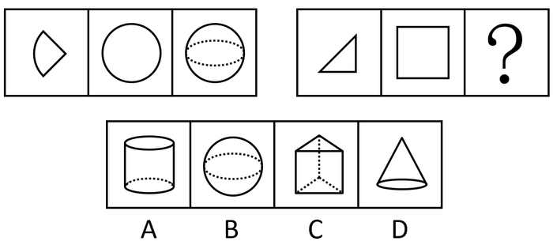

A. A

B. B

C. C

D. D

第 61 题 · 答案与解析

**参考答案（粉笔题库参考内容）**

A

**解析**

第一组图中，4块第一幅图可以拼成第二幅图，第二幅图沿竖轴在空间内旋转360°，其运动轨迹可形成第三幅图；故第二组图形应遵循同样的规律，符合条件的只有A项。

故正确答案为A。

### 第 62 题

下列选项中，与所给图形是同一图形的是（ ）。

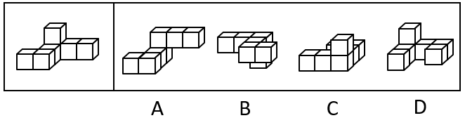

A. A

B. B

C. C

D. D

第 62 题 · 答案与解析

**参考答案（粉笔题库参考内容）**

B

**解析**

如下图所示，题干图形沿着图中线条直接向右翻转可得到B项。

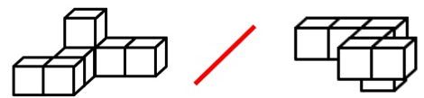

故正确答案为B。

### 第 63 题

下列选项不可能是所给三角形的旋转轨迹的是（ ）。

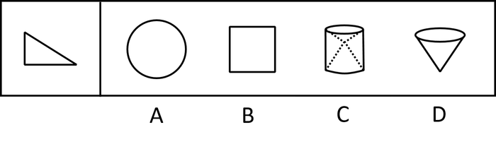

A. A

B. B

C. C

D. D

第 63 题 · 答案与解析

**参考答案（粉笔题库参考内容）**

B

**解析**

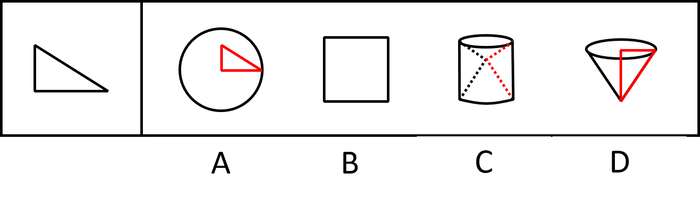

逐一分析选项。

A项：沿三角形的任意一个顶点旋转一周旋转轨迹均为圆形，排除；

B项：该三角形的旋转轨迹不能是正方形，当选；

C项：该三角形的斜边以直角边顶点为中心，旋转一周可得选项，排除；

D项：该三角形的斜边以直角边为中心，旋转一周可得选项，排除。

本题为选非题，故正确答案为B。

### 第 64 题

下面是某物体的两个侧面图，则该物体最可能是（ ）。

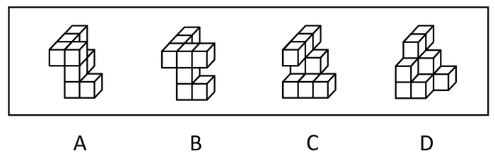

A. A

B. B

C. C

D. D

第 64 题 · 答案与解析

**参考答案（粉笔题库参考内容）**

C

**解析**

本题考查三视图，逐一分析选项。

A项：无法得到题干第二个侧面图，排除；

B项：无法得到题干第一个侧面图，排除；

C项：C项的正视图为第一个侧面图，左视图为第二个侧面图，当选；

D项：无法得到题干第二个侧面图，排除。

故正确答案为C。

注：本题中的侧面图应理解为“三视图”。

### 第 65 题

下列选项中，不能由三个左侧立体图形组成的是（ ）。

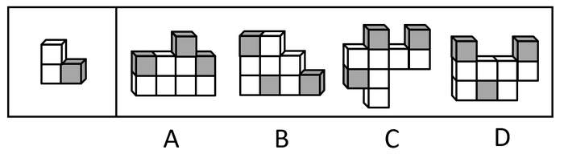

A. A

B. B

C. C

D. D

第 65 题 · 答案与解析

**参考答案（粉笔题库参考内容）**

D

**解析**

本题考查立体拼合。如下图所示，A、B、C三项均可由3个左侧立体图形组成，只有D项不能。

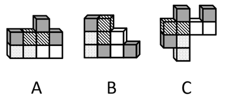

本题为选非题，故正确答案为D。

### 第 66 题

下列选项中，不属于左侧立体图形的截面的是：

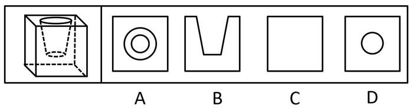

A. A

B. B

C. C

D. D

第 66 题 · 答案与解析

**参考答案（粉笔题库参考内容）**

A

**解析**

本题考查截面图，如下图所示，B、C、D三项均可截出，只有A项无法截出。

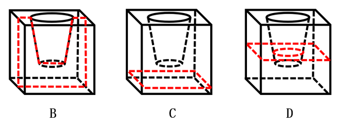

本题为选非题，故正确答案为A。

### 第 67 题

下列选项中，能与所给图形组合成矩形的是：

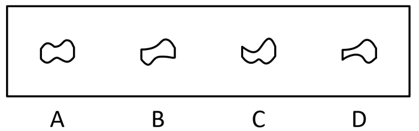

A. A

B. B

C. C

D. D

第 67 题 · 答案与解析

**参考答案（粉笔题库参考内容）**

C

**解析**

本题考查平面拼合。观察所给图形的曲线形状，与其拼合成矩形的形状为

C项逆时针旋转90°可得，具体拼合过程如下图所示：

故正确答案为C。

### 第 68 题

下列选项，能与左侧立体图形组成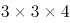的长方体的是：

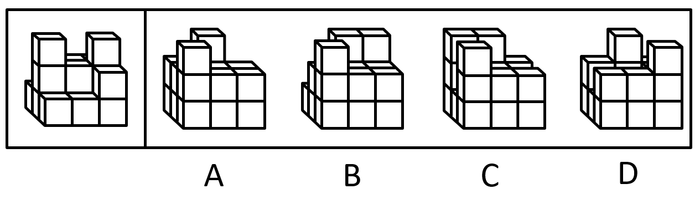

A. A

B. B

C. C

D. D

第 68 题 · 答案与解析

**参考答案（粉笔题库参考内容）**

C

**解析**

本题考查立体拼合。根据提问可知，拼合后的图形可分为4层，每层均有9个小立方体。题干给出的多面体有3层，所有选项的多面体也均为3层，由此可以推出，题干多面体由下至上第一层有9个小立方体，第二层有6个小立方体，第三层有2个小立方体。若想得到3×3×4的立方体，所缺图形第2层需补全3个小立方体，且左前方为2个，左后方为1个；第3层需补全7个小立方体，前后各3个，中间1个；第4层需补全9个立方体，该图形翻转后与C项对应。

故正确答案为C。

### 第 69 题

下列选项不能折成左侧立方体的是（ ）。

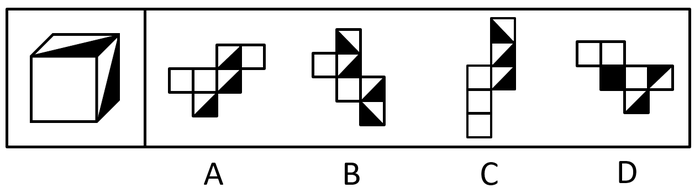

A. A

B. B

C. C

D. D

第 69 题 · 答案与解析

**参考答案（粉笔题库参考内容）**

A

**解析**

将选项原展开图标上序号如下图所示，逐一进行分析。

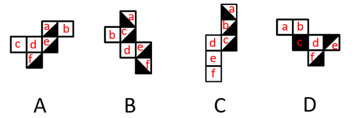

A项：如下图所示，左侧立方体由A项中面a、面d、面e组成时，公共点为点1，与题干六面体公共点对应不一致，左侧立方体由A项中面a、面b、面e组成时，公共点为点2，与题干六面体公共点对应不一致，左侧立方体由A项中面d、面e、面f组成时，公共点为点3，与题干六面体公共点对应不一致，左侧 立方体由A项中面b、面e、面f组成时，公共点为点4，与题干六面体公共点对应不一致，故A项以上四种情况都不能折成左侧立方体，当选；

B项：如下图所示，左侧立方体由B项中面a、面b、面c组成时，公共点为点4，与题干六面体公共点对应一致，可以折成，排除；

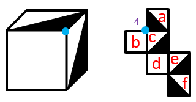

C项：如下图所示，左侧立方体由C项中面a、面b、面d组成时，面b与面d成为直角的两条边为同一条边，故面a、面b、面d公共点为点5，与题干六面体公共点对应一致，可以折成，排除；

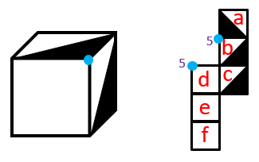

D项：如下图所示，若左侧立方体由D项中面d、面e、面f组成时，与题干六面体公共点对应不一致，故D项不是由面d、面e、面f组成，面f与面b为相对面，故组成左侧立方体的面只能是面a、面e、面f，因由同一个点引出的两条边为同一条边，所以点9与点6为同一个点，所以面a、面e、面f的公共点为点6，与题干六面体公共点对应一致，可以折成，排除。

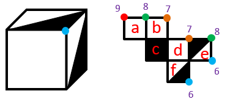

本题为选非题，故正确答案为A。

### 第 70 题

下列选项不可能是左侧立体图形视图的是（ ）。

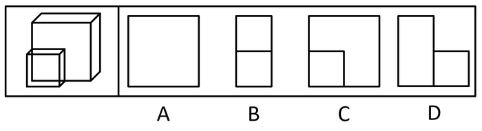

A. A

B. B

C. C

D. D

第 70 题 · 答案与解析

**参考答案（粉笔题库参考内容）**

B

**解析**

本题考查三视图。

A项：从后往前看可以得出，为后视图，排除；

B项：从任意角度看都无法得出此图形，当选；

C项：从前往后看可以得出，为主视图，排除；

D项：从左往右看可以得出，为左视图，排除。

本题为选非题，故正确答案为B。

### 第 71 题

如图三角形中，A、B分别为两条边的中点，则图中阴影部分面积为三角形总面积的（ ）。

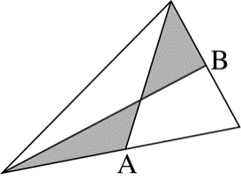

A. 

B. 

C. 

D. 

第 71 题 · 答案与解析

**参考答案（粉笔题库参考内容）**

A

**解析**

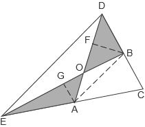

A、B都是中点，则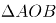与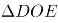相似，边之比为1：2，则面积之比是1：4，假设的面积是1，则的面积是4。DO:AO=2:1，且与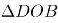共用一个高BF，则的面积是2。EO:BO=2:1，且与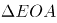也可共用一个高AG，则的面积也为2。四边形ABDE的面积是4+2+2+1=9，因A、B是中点，则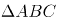与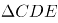相似，且面积之比为1：4，则四边形ABDE的面积是面积的，则的面积是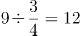。则阴影部分面积为三角形总面积的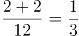。

故正确答案为A。

### 第 72 题

某单位甲、乙、丙三人负责整理一项档案，他们工作5天完成了，之后甲和乙因其他工作被调离，两天后才返回，期间丙继续整理档案。已知甲、乙、丙三人的工作效率之比为4∶3∶2，则完成这项工作共需要花费（ ）天。

A. 20

B. 21

C. 22

D. 23

第 72 题 · 答案与解析

**参考答案（粉笔题库参考内容）**

C

**解析**

赋值甲、乙、丙的效率分别是4、3、2，则任务总量是(4+3+2)×5×4=180。 丙单独工作2天后还剩的工作量是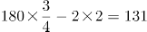，3人一起工作则一共还需要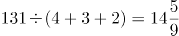天，整个工程的时间是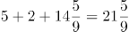天。则完成这项工作共需要花费22天。

故正确答案为C。

### 第 73 题

疫情期间，爱心人士向某街道捐赠了两箱防疫物资，内装物资件数相同。街道将两箱物资分别给了甲、乙两个工作组，其中甲工作组除1人拿到4件物资外，其余每人各分得5件；乙工作组除1人拿到6件物资外，其余每人各分得7件。已知每箱物资数量在50到100件之间，则每箱装有防疫物资（ ）件。

A. 58

B. 62

C. 69

D. 74

第 73 题 · 答案与解析

**参考答案（粉笔题库参考内容）**

C

**解析**

设甲工作组m个人，乙工作组n个人。每箱防疫物资是y件。则有y=5(m-1)+4=7(n-1)+6，整理可得y-4=5(m-1)，即每箱物资的数量减去4是5的倍数；y-6=7(n-1)，每箱物资的数量减去6是7的倍数，逐一代入选项。

A项：58-4=54，不是5的倍数，排除；

B项：62-4=58，不是5的倍数，排除；

C项：69-4=65，是5的倍数；69-6=63，是7的倍数，当选；

D项：74-4=70，是5的倍数；74-6=68，不是7的倍数，排除。

故正确答案为C。

### 第 74 题

某单位新来了4名实习生，要将其分配到3个部门，每个部门至少分配1人，则不同的分配方案有（ ）种。

A. 24

B. 36

C. 64

D. 72

第 74 题 · 答案与解析

**参考答案（粉笔题库参考内容）**

B

**解析**

4名实习生到3个部门且每个部门至少1人，则一定有1个部门是2个人，先选出这2个人即有种方案，之后作为一个整体，与剩下的2个人分别到3个部门工作即有种方案，则一共是6×6=36种方案。

故正确答案为B。

### 第 75 题

某书店以每本30元的价格购进一批书籍，按照每本50元的价格出售。售出后，某单位以每本40元的价格将剩余书籍全部买下。经核算，书店出售这批书籍共赚得420元，则这批书籍总共有（ ）本。

A. 16

B. 20

C. 24

D. 25

第 75 题 · 答案与解析

**参考答案（粉笔题库参考内容）**

C

**解析**

设一共有4x本书，以每本50元的价格卖出3x本，利润是(50-30)×3x=60x。剩下的x本书以40元的售价卖出，则利润是(40-30)x=10x。利润一共是420元，则60x+10x=420，解得x=6，一共有4x=4×6=24本书。

故正确答案为C。

### 第 76 题

小明参加迷宫游戏，迷宫设在圆形区域内（布局如下图所示），游戏规定只能向正东或正南方向行走，那么小明从迷宫入口到出口共有（ ）种走法。

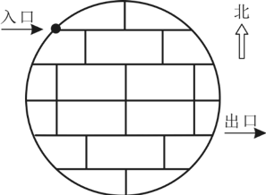

A. 2

B. 4

C. 6

D. 8

第 76 题 · 答案与解析

**参考答案（粉笔题库参考内容）**

B

**解析**

因只能向正东或者正南方向行走，故只能走直线。

方法一：可用描点法解题。

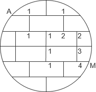

因此有4种走法。

方法二：选项数字较小，可用枚举法：

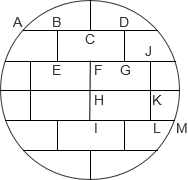

第一种：A→B→E→F→I→M

第二种：A→B→E→F→H→K→L→M

第三种：A→B→E→J→L→M

第四种：A→D→G→J→L→M

故正确答案为B。

### 第 77 题

A、B两个烧杯中装有质量相等的盐溶液，A烧杯中盐溶液的浓度为30%，B烧杯中的盐溶液浓度为20%，现将A、B两个烧杯的溶液完全混合，那么混合后溶液中溶质与溶剂之比为（ ）。

A. 1：3

B. 1：4

C. 1：5

D. 1：6

第 77 题 · 答案与解析

**参考答案（粉笔题库参考内容）**

A

**解析**

方法一：赋值A、B两个烧杯中各有100克盐溶液，则A烧杯中溶质盐的质量=100×30%=30克，B烧杯中溶质盐的质量=100×20%=20克。因此，A、B两个烧杯的溶液完全混合后，溶质的质量=30+20=50克，溶剂的质量=100+100-50=150克，则溶质与溶剂之比为50:150=1:3。

方法二：等量的30%和20%溶液混合后浓度为25%，即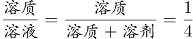，则溶质与溶剂之比为1：3。

故正确答案为A。

### 第 78 题

某单位有40名职工，有部分人分A、B两个批次参与一次法律素质测评，每人只能参加一个批次，A批次的平均成绩为86分，B批次的平均成绩为80分，总的平均成绩为84分，则该单位参与这次法律素质测评的职工最多有（ ）人。

A. 36

B. 37

C. 38

D. 39

第 78 题 · 答案与解析

**参考答案（粉笔题库参考内容）**

D

**解析**

设参加A批次的职工有a人，参加B批次的职工有b人。

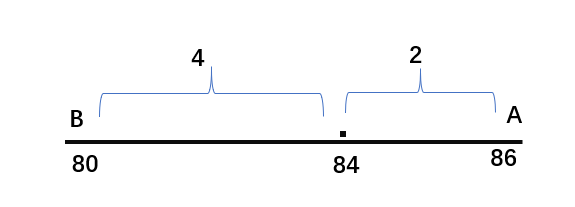

根据线段法平均数混合，距离之比为4:2=2:1，则人数之比为1：2，a+b人数为3的倍数，故参与测评的职工最多有39人。

故正确答案为D。

### 第 79 题

某单位在网上办公系统传阅了15份文件，甲阅读了9份，乙阅读了12份，丙阅读了10份，则甲、乙、丙三人共同阅读过的文件至少有（ ）份。

A. 0

B. 1

C. 2

D. 3

第 79 题 · 答案与解析

**参考答案（粉笔题库参考内容）**

B

**解析**

根据“共同······至少”判定题型为多集合反向构造：

第一步反向：甲、乙、丙没有阅读的文件分别为：15-9=6份、15-12=3份、15-10=5份。

第二步加和：甲、乙、丙没有阅读的文件最多为6+3+5=14份。

第三步作差：甲、乙、丙三人共同阅读过的文件至少有15-14=1份。

故正确答案为B。

### 第 80 题

一艘维修快艇沿着河流逆流而上执行维修任务，快艇航行到途中某处时工具包掉进了河里，10分钟后，驾驶员到达目的地时发现工具包丢失后立即返回追寻。已知水的流速为每秒1米，如果工具包会浮在水面上漂流，那么驾驶员将在距离丢失处（ ）米的地方找回工具包。

A. 640

B. 900

C. 1080

D. 1200

第 80 题 · 答案与解析

**参考答案（粉笔题库参考内容）**

D

**解析**

如下图所示，设船在静水中的速度为v米/秒，驾驶员将在距离丢失处s米的地方找回工具包，则丢失处到目的地间的距离为10×60(v-1)=(600v-600)米。由题意可知，驾驶员到达目的地时，工具包距离丢失处为10×60×1=600米。根据驾驶员到达目的地后，快艇追上工具包所用时间和工具包漂流所用时间相等，可列等式：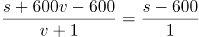，解得s=1200，即驾驶员将在距离丢失处1200米的地方找回工具包。

故正确答案为D。

### 第 81 题

13，13，26，78，（ ）

A. 234

B. 256

C. 284

D. 312

第 81 题 · 答案与解析

**参考答案（粉笔题库参考内容）**

D

**解析**

观察数列发现有明显的倍数关系，考虑作商。后项除以前项可得新数列：1，2，3，是公差为1的等差数列，则等差数列的下一项为3+1=4。因此所求项为78×4=312。

故正确答案为D。

### 第 82 题

69，68，65，60，53，（ ）

A. 42

B. 43

C. 44

D. 45

第 82 题 · 答案与解析

**参考答案（粉笔题库参考内容）**

C

**解析**

观察数列无明显特征，变化趋势平缓，优先考虑作差。前项减后项得到新数列：1，3，5，7，是公差为2的等差数列，则等差数列的下一项为7+2=9。因此所求项为53-9=44。

故正确答案为C。

### 第 83 题

20，20，30，40，50，（ ）

A. 50

B. 60

C. 70

D. 80

第 83 题 · 答案与解析

**参考答案（粉笔题库参考内容）**

B

**解析**

解析一：数列无明显特征，且作差作和无规律，考虑递推。观察发现：20+20=40，20+30=50，即第一项+第二项=第四项，第二项+第三项=第五项；因此考虑第三项+第四项=第六项，所求=30+40=70；答案为C项。

解析二：数列无明显特征，观察发现：从第二项开始，每一项分别为第一项的1倍，1.5倍，2倍，2.5倍，因此考虑所求为第一项的3倍，即20×3=60；答案为B项。

备注：这两种规律都在真题中出现过，因此两个答案都符合。

### 第 84 题

0，3，10，21，36，（ ）

A. 53

B. 54

C. 55

D. 56

第 84 题 · 答案与解析

**参考答案（粉笔题库参考内容）**

C

**解析**

数列无明显特征，优先考虑作差。后项减前项得到新数列：3、7、11、15，是公差为4的等差数列，则所求项为36+15+4=55。

故正确答案为C。

### 第 85 题

98，99，95，104，88，（ ）

A. 113

B. 111

C. 109

D. 107

第 85 题 · 答案与解析

**参考答案（粉笔题库参考内容）**

A

**解析**

数列无明显特征，优先考虑作差。后项减前项得到新数列：1、-4、9、-16，分别为、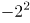、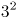、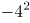，新数列为正负号循环，并且底数为自然数的幂次数列，故下一项应为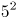，则所求项为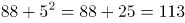。

故正确答案为A。

### 第 86 题

3，5，8，-5，-2，5，（ ）

A. 8

B. 5

C. 3

D. 0

第 86 题 · 答案与解析

**参考答案（粉笔题库参考内容）**

A

**解析**

数列无明显特征，作差作和均无规律，考虑递推。观察可知，3+5=8，3-8=-5，3+(-5)=-2，3-(-2)=5，即第一项+第二项=第三项，第一项-第三项=第四项，第一项+第四项=第五项，第一项-第五项=第六项。则所求项=第一项+第六项=3+5=8。

故正确答案为A。

### 第 87 题

11，24，416，749，（ ）

A. 982

B. 1010

C. 1212

D. 11121

第 87 题 · 答案与解析

**参考答案（粉笔题库参考内容）**

D

**解析**

数列变化幅度较大，且均为多位数，考虑机械划分。观察可知，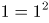，，，，即每项均由底数和其平方数组合而成，只有D项符合规律。

故正确答案为D。

### 第 88 题

47，53，49，51，40，60，38，（ ）

A. 48

B. 54

C. 60

D. 62

第 88 题 · 答案与解析

**参考答案（粉笔题库参考内容）**

D

**解析**

数列项数较多，考虑多重数列，奇偶交叉无规律，可将数列两两分组。（47，53）、（49，51）、（40，60）、（38，？），每组内两个数字之和均为100，则所求项为100-38=62。

故正确答案为D。

### 第 89 题

352，693，716，413，（ ）

A. 402

B. 514

C. 730

D. 854

第 89 题 · 答案与解析

**参考答案（粉笔题库参考内容）**

B

**解析**

数列变化幅度较大，且均为多位数，考虑机械划分。观察可知，5=3+2，9=6+3，7=1+6，4=1+3，即在每项数字中，最大的数字等于另外两个数字之和，只有B项5=1+4符合规律。

故正确答案为B。

### 第 90 题

128，64，16，2，（ ）

A. 

B. 

C. 

D. 

第 90 题 · 答案与解析

**参考答案（粉笔题库参考内容）**

D

**解析**

数列中相邻项倍数关系明显，考虑作商。前项÷后项可得新数列：2、4、8，构成公比为2的等比数列，下一项为16，则所求项为。

故正确答案为D。

### 第 91 题

法律：法官

A. 销售：账本

B. 医嘱：医生

C. 歌词：歌手

D. 地标：游客

第 91 题 · 答案与解析

**参考答案（粉笔题库参考内容）**

C

**解析**

第一步：判断题干词语间逻辑关系。

法官依据法律判断案件，二者为依据对应关系，且法官是一种职业。

第二步：判断选项词语间逻辑关系。

A项：销售是指以出售、租赁或其他任何方式向第三方提供产品或服务的行为。账本不是依据销售进行记录，且账本不是一种职业，与题干逻辑关系不一致，排除；

B项：医嘱是医生根据病情和治疗的需要对病人在饮食、用药、化验等方面的指示。医生下达医嘱，二者为主宾关系，与题干逻辑关系不一致，排除；

C项：歌手依据歌词演唱歌曲，二者为依据对应关系，且歌手是一种职业，与题干逻辑关系一致，当选；

D项：地标是地标性建筑，游客游览地标，二者为主宾关系，与题干逻辑关系不一致，排除。

故正确答案为C。

### 第 92 题

熟练：练习

A. 圆润：打磨

B. 荣誉：表扬

C. 纯洁：过滤

D. 燥热：干旱

第 92 题 · 答案与解析

**参考答案（粉笔题库参考内容）**

A

**解析**

第一步：判断题干词语间逻辑关系。

练习的目的是为了熟练，练习是方式，熟练是目的，二者是方式目的的对应关系。

第二步：判断选项词语间逻辑关系。

A项：打磨的目的是为了圆润，打磨是方式，圆润是目的，二者是方式目的的对应关系，与题干逻辑关系一致，当选；

B项：表扬是指对好人好事公开赞美。荣誉是指由于成就和地位而得到广为流传的名誉和尊荣。二者不是方式目的的对应关系，与题干逻辑关系不一致，排除；

C项：纯洁是指纯粹洁白，没有污点。过滤是指将固体物质与液体或气体的混合物，通过滤纸、滤布、泡沫塑料等多孔物质（过滤介质），把固体物质截留，而使液体、气体通过，用以分离混合物的过程。二者不是方式目的的对应关系，与题干逻辑关系不一致，排除；

D项：燥热是指天气干燥炎热。干旱是指淡水总量少，不足以满足人的生存和经济发展的气候现象，一般是长期的现象。二者不是方式目的的对应关系，与题干逻辑关系不一致，排除。

故正确答案为A。

### 第 93 题

报纸：杂志

A. 塑料：玻璃

B. 磁带：光盘

C. 铜镜：铁锅

D. 网络：光纤

第 93 题 · 答案与解析

**参考答案（粉笔题库参考内容）**

B

**解析**

第一步：判断题干词语间逻辑关系。

报纸和杂志都是大众传播的重要载体，二者是并列关系中的反对关系。

第二步：判断选项词语间逻辑关系。

A项：塑料和玻璃都属于合成材料，都可以做物品的原材料，二者是并列关系中的反对关系，但塑料和玻璃不是载体，与题干逻辑关系不一致，排除；

B项：磁带和光盘都是存储信息的载体，二者是并列关系中的反对关系，与题干逻辑关系一致，当选；

C项：铜镜是一种整理仪容的工具，铁锅是一种烹饪工具，二者不是并列关系，与题干逻辑关系不一致，排除；

D项：光纤是宽带网络的一种传输介质，二者是对应关系，与题干逻辑关系不一致，排除。

故正确答案为B。

### 第 94 题

入学：毕业

A. 就诊：吃药

B. 提拔：跳槽

C. 辞职：创业

D. 出家：还俗

第 94 题 · 答案与解析

**参考答案（粉笔题库参考内容）**

D

**解析**

第一步：判断题干词语间逻辑关系。

只有入学之后才能毕业，入学是毕业的必要条件，二者构成必要条件的对应关系。

第二步：判断选项词语间逻辑关系。

A项：不就诊也可以吃药，就诊不是吃药的必要条件，与题干逻辑关系不一致，排除；

B项：得不到提拔可能会导致跳槽，但提拔不是跳槽的必要条件，与题干逻辑关系不一致，排除；

C项：在不辞职的情况下，可以通过做业余项目进行创业，辞职不是创业的必要条件，与题干逻辑关系不一致，排除；

D项：只有出家之后才能还俗，出家是还俗的必要条件，二者构成必要条件的对应关系，与题干逻辑关系一致，当选。

故正确答案为D。

### 第 95 题

陶瓷：茶杯

A. 白银：项链

B. 黏土：盆栽

C. 鹅毛：大衣

D. 钢铁：汽车

第 95 题 · 答案与解析

**参考答案（粉笔题库参考内容）**

A

**解析**

第一步：判断题干词语间逻辑关系。

陶瓷是制作茶杯的原材料，二者为原材料对应关系，且茶杯可以仅由陶瓷这一种原材料制成。

第二步：判断选项词语间逻辑关系。

A项：白银是制作项链的原材料，二者为原材料对应关系，且项链可以仅由白银这一种原材料制成，与题干逻辑关系一致，当选；

B项：盆栽是指栽在盆里的有生命的植物总称，黏土是制作花盆的原材料，而不是制作盆栽的原材料，二者不是原材料对应关系，与题干逻辑关系不一致，排除；

C项：鹅毛是制作大衣的原材料，二者为原材料对应关系，但大衣必须由鹅毛、布料等原材料共同制成，与题干逻辑关系不一致，排除；

D项：钢铁是制作汽车的原材料，二者为原材料对应关系，但汽车必须由钢铁、橡胶、玻璃等原材料共同制成，与题干逻辑关系不一致，排除。

故正确答案为A。

### 第 96 题

车水马龙：门庭若市

A. 流离失所：安居乐业

B. 饥不择食：废寝忘食

C. 国泰民安：风调雨顺

D. 赴汤蹈火：奋不顾身

第 96 题 · 答案与解析

**参考答案（粉笔题库参考内容）**

D

**解析**

第一步：判断题干词语间逻辑关系。

车水马龙意思是车如流水，马如游龙一般，形容热闹繁华的景象；门庭若市意思是门前像市场一样，形容来的人很多，非常热闹；车水马龙和门庭若市都有繁华热闹的意思，二者为近义关系。

第二步：判断选项词语间逻辑关系。

A项：流离失所意思是无处安身，四处流浪；安居乐业意思指人民生活安定美满的样子，比喻安定地生活，愉快地工作，二者为反义关系，与题干逻辑关系不一致，排除；

B项：饥不择食意思是不管什么都吃，比喻需要急迫，顾不得选择；废寝忘食意思是顾不得睡觉，忘记了吃饭，形容专心努力，二者不是近义关系，与题干逻辑关系不一致，排除；

C项：国泰民安意思是国家太平，人民生活安定；风调雨顺意思是风雨适合农时，年景好，二者不是近义关系，与题干逻辑关系不一致，排除；

D项：赴汤蹈火意思是为某事付出全部的勇气，不留余力地前进，比喻不避艰险，奋勇向前；奋不顾身意思是奋勇向前，不考虑个人安危；赴汤蹈火和奋不顾身都有不顾个人安危、奋勇向前的意思，二者为近义关系，与题干逻辑关系一致，当选。

故正确答案为D。

### 第 97 题

医生：医院：病毒

A. 老板：工厂：薪水

B. 老师：学生：书本

C. 厨师：厨房：食材

D. 司机：汽车：轮胎

第 97 题 · 答案与解析

**参考答案（粉笔题库参考内容）**

C

**解析**

第一步：判断题干词语间逻辑关系。

医生在医院工作，医生与医院构成职业与工作地点的对应关系，医院里存有病毒，病毒与医院构成事物与存在地点的对应关系。

第二步：判断选项词语间逻辑关系。

A项：老板在工厂工作，但不能说工厂存在薪水，与题干逻辑关系不一致，排除；

B项：老师教导学生，学生不是老师的工作场所，而是老师的工作对象，与题干逻辑关系不一致，排除；

C项：厨师在厨房工作，厨师与厨房构成职业与工作地点的对应关系，厨房里存有食材，食材与厨房构成事物与存在地点的对应关系，与题干逻辑关系一致，当选；

D项：司机驾驶汽车，汽车不是司机的工作场所，而是司机的工作工具，与题干逻辑关系不一致，排除。

故正确答案为C。

### 第 98 题

问渠那得清如许：为有源头活水来

A. 蝉噪林逾静：鸟鸣山更幽

B. 不识庐山真面目：只缘身在此山中

C. 空山新雨后：天气晚来秋

D. 长风破浪会有时：直挂云帆济沧海

第 98 题 · 答案与解析

**参考答案（粉笔题库参考内容）**

B

**解析**

第一步：判断题干词语间逻辑关系。

题干的意思是这“半亩方塘”为什么这么清澈呢？因为有这源头活水不断地补充进来，才使得它这么清澈。作者通过设问的方式解答了“半亩方塘”的水是如何变得清澈的，前者是结果，后者是原因，二者构成因果对应关系。

第二步：判断选项词语间逻辑关系。

A项：意思是蝉声高唱，树林却显得格外宁静；鸟鸣声声，深山里倒比往常更清幽。前者描写蝉声，后者描写鸟鸣，二者构成并列关系，与题干逻辑关系不一致，排除；

B项：意思是我之所以认不清庐山真正的面目，是因为我人身处在庐山之中。作者通过自问自答的方式解答了我看不清庐山真面目的原因，前者是结果，后者是原因，二者构成因果对应关系，与题干逻辑关系一致，当选；

C项：意思是一阵新雨过后，青山翠谷越发显得静幽，夜幕降临，凉风习习，更令人感到秋意浓厚。作者是在描述阵雨过后带来的结果，二者构成因果对应关系，但前者是原因，后者是结果，与题干逻辑关系不一致，排除；

D项：意思是实现我理想的那一天会来到的，我将大显身手，大展宏图。作者是在表达对自己未来成功的期许，但理想的实现与能否大显身手、大展宏图都是未知的事情，二者无明显逻辑关系，与题干逻辑关系不一致，排除。

故正确答案为B。

### 第 99 题

儿童：（ ）相当于（ ）：严谨

A. 淘气；律师

B. 天真；演员

C. 勤奋；老人

D. 老师；幼稚

第 99 题 · 答案与解析

**参考答案（粉笔题库参考内容）**

A

**解析**

逐一代入选项。

A项：淘气的儿童，二者是偏正关系，且淘气是儿童的特性；严谨的律师，二者是偏正关系，且严谨是律师的特性，前后逻辑关系一致，当选；

B项：天真的儿童，二者是偏正关系，天真是儿童的特性；严谨的演员，二者虽是偏正关系但严谨不是演员的特性，前后逻辑关系不一致，排除；

C项：勤奋可以修饰学生但不太适用于儿童，二者无明显逻辑关系，排除；

D项：老师教导儿童，二者为职业与工作对象的对应关系，但幼稚与严谨无明显对应关系，前后逻辑关系不一致，排除。

故正确答案为A。

### 第 100 题

卷尺：（ ） 相当于 硬币：（ ）

A. 直尺；人民币

B. 长短；软硬

C. 刻度；面值

D. 家具；账户

第 100 题 · 答案与解析

**参考答案（粉笔题库参考内容）**

C

**解析**

逐一代入选项。

A项：卷尺和直尺是并列关系，有的人民币是硬币，有的人民币不是硬币，有的硬币是人民币，有的硬币不是人民币，人民币和硬币是交叉关系，前后逻辑关系不一致，排除；

B项：卷尺可长可短，二者构成对应关系，而硬币都是质地坚硬的货币，软不能用来形容硬币，二者不构成对应关系，前后逻辑关系不一致，排除；

C项：卷尺上一定有刻度，刻度是卷尺的必然属性，硬币一定有面值，面值是硬币的必然属性，前后逻辑关系一致，当选；

D项：卷尺可以用来测量家具尺寸，二者为工具与其作用对象的对应关系， 硬币可以存入个人账户，二者为位置对应关系，前后逻辑关系不一致，排除。

故正确答案为C。

