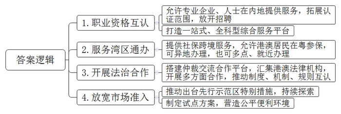
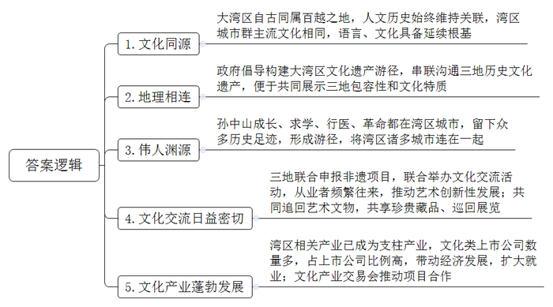
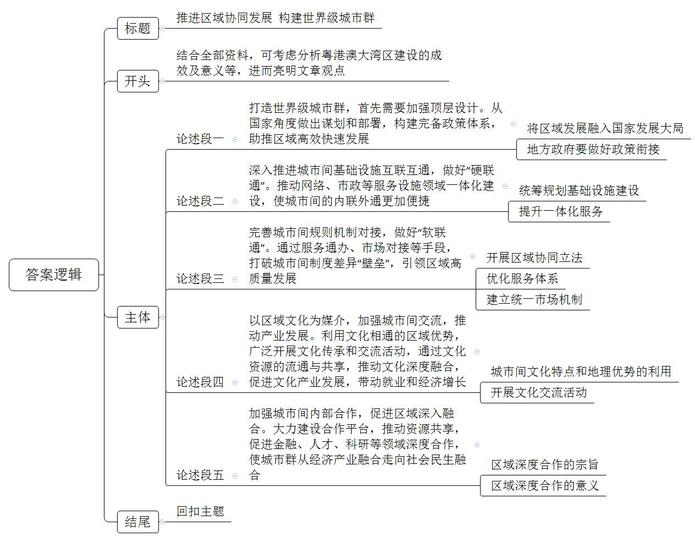

# 2022年广东省公考《申论》题（县级）

<!-- gwy:overview:start -->
> **广东 · 2022 · 申论 · 县级卷** ｜ 3 题 · 图片 3 处 · 答案随题折叠

导航：[题目](#题目) · [材料 1](#材料-1)
<!-- gwy:overview:end -->

> 候选采集稿。参考答案及解析来自粉笔页面，不代表官方答案或真实高分答卷；来源使用许可与原卷对应关系仍需人工核实。

## 给定材料

### 材料 1

雨后的横琴澳门青年三地创业谷空气格外清新。

在全国首家粤港澳大湾区三地联营律师事务所的办公室里，澳门李律师正等待前来咨询的内地客户。

“以前我的客户群体以港澳人士为主，如今内地客户已成为主要客源，并且趋势越来越明显。”李律师说，“早在2014年，广东试点允许港澳与内地律师事务所合伙联营，让我们有机会接触到内地庞大的市场。现在，越来越多港澳律师愿意来这里融入国家发展大局，参与大湾区建设。”

《珠海经济特区横琴新区港澳建筑及相关工程咨询企业资质和专业人士执业资格认可规定》是内地第一次以地方立法形式协助香港和澳门建筑工程领域专业企业和专业人士，在内地提供服务。该规定出台后不到一年，就有100多位港澳专业人士和数十家企业在横琴新区备案和执业。

“通过职业资格互认，让港澳年轻人看到更加广阔的职业发展空间，以及多元化发展的可能性。”澳门工程师学会有关负责人说。

近年来，广东持续拓展职业资格认证的范围，在医师、教师、导游等8个社会重点关注专业领域，以单边认可带动双向互认，在全国率先试点面向港澳居民聘用公务员、出台企业单位公开招聘港澳居民管理办法。职业资格互认正为港澳专业人士进一步打开向内地就业的“大门”。

除了制定政策之外，一站式服务是确保人才政策发挥效果的重要手段。2021年11月，“粤港澳大湾区职称和职业资格业务一站式服务平台”在广州南沙政务服务中心和国际人才港人才一站式服务大厅正式对外运作。这也是国内首个关于职称和职业资格业务一站式、全科型的综合服务平台。该平台集约涵盖粤港澳三地专业人才职称评价和职业资格考试、认可业务等事项，可提供相关业务咨询及受理服务，方便港澳专业人才在南沙从业执业。

“以往，职称和职业资格业务散落在各业务部门，不管是内地人员还是港澳人员，都面临线上网站分散查询不便、线下信息获取渠道少、没有统一对外服务窗口等难题，而现在这些问题都不存在了。”该服务平台负责人说。

实现“同事同标，湾区通办”，为港澳居民在生活、工作诸方面提供了极大的便利。

“我去澳门工会联合总会服务网点提交申请，不到2个工作日，珠海就完成业务审核，跟在广东一样。”来自澳门的黎先生说。

2020年以来，广东省积极推进珠海澳门社保跨境合作试点。珠海市推出珠澳“零通关”跨境社保通办，为澳门居民提供“多点办、就近办、方便办”跨境社保服务。截至2021年8月底，港澳居民在粤参保23.8万人次，比2020年增长了27.6%，享受待遇达2.54万人。

粤港澳大湾区国际仲裁中心交流合作平台于2021年4月在河套深港科技创新合作区揭牌。9月，首批三家香港机构进驻该交流合作平台。12月，首批澳门机构进驻，标志着粤港澳法治合作再上新台阶。

目前，该国际仲裁中心交流合作平台已汇聚了8家港澳法律机构，未来进驻机构将在人才交流、培训推广、专业研讨、法律科技等多个方面开展合作，推动三地制度、机制和规则的互认、共生、融合与衔接。努力为大湾区企业和境内外当事人提供国际一流的法治化营商环境。

“在香港做不到的，在内地做不到的，我们可以在前海先行先试，所以这是一个法律服务发展很好的地方。”香港特别行政区政府律政司有关负责人说。

据统计，仅2019年和2020年，深圳国际仲裁院就受理涉港案例493例，涉及争议金额人民币约260亿元，解决了大量的涉粤港澳跨境商事纠纷，为稳定内地与港澳的经贸合作发挥了重要的作用。

在市场准入方面，广东作出多处部署，包括推动出台深圳先行示范区，放宽市场准入特别措施，探索放宽产业、投资、医药、金融等领域市场准入。2021年3月深圳市表示，要制定实施深圳放宽市场准入特别措施清单试点和商事登记确认制试点，营造更加公平、便利的市场准入环境。

实现以粤港澳制度、规则衔接为重点的“软联通”，将制度差异变成制度优势，释放发展红利，已成为当前引领大湾区高质量发展的根本所在。

### 材料 2

文化是一个国家、一个民族的灵魂。文化的繁荣兴盛是全面建设社会主义现代化的应有之义。粤港澳大湾区文化同源、血脉相通，是共建人文湾区的重要基础。

2021年12月“同舟共济，志同道合”穗港双城图片展在两地同步开展，展览以“同根、同气、同舟、同源、同向”为主题，图文并茂地讲述了两地源远流长的历史文化。

有专家学者指出：“粤港澳大湾区自古同属百越之地，两千多年来，虽然各地制度嬗变，但大湾区11座城市的人文历史始终维持着千丝万缕的关系，湾区城市群仍以岭南文化和珠江文化为主流，使得整个大湾区城市群的语言、文化具备了延续的根基。”

粤港澳地域相近、山水相连，文化合作有着天然的地理优势。广东省首倡共建粤港澳大湾区文化遗产游径，以历史为纽带、将粤港澳三地的历史文化遗产，尤其是广州的文化遗产、珠海和中山的岐澳古道、深圳改革开放的历史遗迹、澳门的世界遗产建筑和历史城区、香港的文物径等，进行有效的串联沟通，构建成一个极富特色和历史底蕴的粤港澳大湾区文化遗产游径系统，共同展示三地的包容性和岭南文化特质。

孙中山是中国近代史上的杰出人物，他在粤港澳三地留下的众多历史足迹连成一体，形成一条文化遗产游径，自然地将大湾区内的诸多城市连在一起。中山是伟人故里，澳门是孙中山从学校走进社会从医的地方，香港是孙中山早年求学和革命的根据地，广州是孙中山革命的圣地……这种高度契合的关系正是粤港澳历史文化中宝贵而核心的共同财富。

粤剧是岭南文化的瑰宝，2009年经粤港澳三地联合申报，被联合国教科文组织列入《人类非物质文化遗产代表作名录》。2020年11月，首届“粤港澳大湾区中国戏曲文化节”在澳门开幕，广州粤剧院演员演出的《斩经堂》赢得满堂喝彩。

永庆二巷七号之一，是粤剧戏班銮舆堂所在地。銮舆堂是粤剧武打演员的行会组织，在全球粤剧戏班中，只有广州和香港两地有銮舆堂。

“现在交通很方便，我们的会员经常来这里参加活动。”热爱粤剧的盘伯来自香港，现年70多岁的他是负责掌板的乐师，几乎每周都专程从香港赶来参加演出。如今，在广东粤剧銮舆堂的会员中，港澳会员也不少。三地会员的频繁往来，有力推动了粤剧艺术的繁荣发展。

除了粤剧，文化的传承和交流也在大湾区各地以不同的形式进行着。广东醒狮拥有千年历史，几乎各地都有自己的醒狮队。在港澳，逢年过节或店铺开业总能看见狮队上街采青、巡游，锣鼓声不断，国内首部以国家非遗项目“广东醒狮”为主题的舞剧《醒·狮》，以深厚的岭南人文为载体，实现了大湾区优秀传统文化的“创造性转化，创新性发展”。

广东博物馆筹建新馆时，正是在香港文物界专家的共同努力下，才促成他们先后从海外收藏回一批反映十三行的珍贵明清外销画。

广州艺博院与香港博物馆和美术馆合作，调拨粤港澳地区的珍贵藏品，先后促成了一系列重要艺术展览并在粤港两地举办，备受两地文化界和市民好评。

三地在文化交流日益密切的同时，文化产业发展也取得了不俗的成绩。

早在2018年，粤港澳大湾区文化及相关产业增加值规模就已达5458亿元，同比增长8.5%，占大湾区整体GDP的4.97%。文化产业已成为粤港澳大湾区重要的新兴支柱产业，对大湾区经济发展和扩大就业的带动作用十分突出。

2021年12月召开的广州文化产业交易会，组织产业发布、项目推介、产融对接、签约交易等活动，促成13个重大产业项目、10个投融资项目、15个招商项目合作，意向合作金额达到1016亿元，突破历史新高。

当前，仅广州地区就有文化上市公司45家，约占全市A股上市公司总数的37.8%，形成特色鲜明的文化板块，已成为产业发展主力军。

随着大湾区建设步伐的加快，文化必将成为大湾区发展壮大不可或缺的强大内生力。

### 材料 3

在夜景卫星图上，珠江入海口，一片灯光分外璀璨的区域囊括香港特别行政区、澳门特别行政区和广东省的广州、深圳、珠海、佛山、惠州、东莞、中山、江门、肇庆9市，总面积达5.6万平方公里。这里就是粤港澳大湾区，我国开放程度最高、经济活力最强的区域之一。

2020年10月，习近平总书记出席深圳经济特区建立40周年庆祝大会并发表重要讲话，就深入推进粤港澳大湾区建设作出部署，“要抓住粤港澳大湾区建设重大历史机遇，推动三地经济运行的规则衔接、机制对接，加快粤港澳大湾区城际铁路建设，促进人员、货物等各类要素高效便捷流动，提升市场一体化水平。”

推进粤港澳大湾区建设，是习近平总书记亲自谋划、亲自部署、亲自推动的重大国家战略。

2012年12月，习近平总书记在广东考察时提出，希望广东联手港澳打造更具综合竞争力的世界级城市群。

2017年7月，习近平总书记在庆祝香港回归祖国20周年大会上发表重要讲话指出，中央政府将一如既往“支持香港在推进‘一带一路’建设、粤港澳大湾区建设、人民币国际化等重大发展战略中发挥优势和作用”。

同一天，在习近平总书记的见证下，香港特别行政区行政长官林郑月娥、澳门特别行政区行政长官崔世安、国家发展和改革委员会主任何立峰、广东省省长马兴瑞共同签署了《深化粤港澳合作 推进大湾区建设框架协议》。按照协议，粤港澳三地将在中央有关部门支持下，完善创新合作机制，促进互利共赢合作关系，共同将粤港澳大湾区建设成为更具活力的经济区、宜居宜业宜游的优质生活圈和内地与港澳深度合作的示范区，打造国际一流湾区和世界级城市群。这标志着粤港澳大湾区建设正式启动。

2019年2月，在习近平总书记的亲切关怀下，中央印发《粤港澳大湾区发展规划纲要》，这对推动粤港澳大湾区建设迈上新台阶具有重要意义。纲要出台后，各级政府到2021年4月已出台231部涉粤港澳大湾区相关政策文件。

2021年4月20日，广东省省长马兴瑞在“大湾区、大未来”主题宣传媒体见面会上介绍粤港澳大湾区的亮眼成绩：2020年，大湾区经济总量达11.5万亿元，比2017年增长1.4万亿元，进入世界五百强企业达21家，比2017年增加4家；广东国家级高新技术企业5.3万家，比2017年增加近2万家。中心区域城市合理分工、形成合力，重要节点城市错位发展、功能互补，成为港澳青年创新创业、实习就业的沃土。

经过四年多的努力，粤港澳大湾区建设取得阶段性显著成效，向国际一流湾区和世界级城市群迈出坚实步伐。如今，粤港澳大湾区内的人员、货物、资金、信息等要素更加便捷、高效流动，粤港澳大湾区正“以更大魄力和更高起点上推进改革开放”。

## 题目

### 第 1 题

**根据材料**3**，简述广东在促进粤港澳大湾区“软联通”方面的主要做法****。****(20分)**

关联材料：材料 1

作答要求：

要求：概括全面、准确，条理清晰，不超过200字。

第 1 题 · 答案与解析

**参考答案（粉笔题库参考内容）**

1.职业资格互认。允许专业企业、人士在内地提供服务，拓展认证范围，放开招聘；打造一站式、全科型综合服务平台。

2.服务湾区通办。提供社保跨境服务，允许港澳居民在粤参保，可异地办理，也可多点、就近办理。

3.开展法治合作。搭建仲裁交流合作平台，汇集港澳法律机构，开展多方面合作，推动制度、机制、规则互认。

4.放宽市场准入。推动出台先行示范区特别措施，持续探索；制定试点方案，营造公平便利环境。

**解析**

**参考答案说明：**本参考答案从“职业资格互认”“服务湾区通办”“开展法治合作”“放宽市场准入”四个方面展开，各条答案要点之间在内容上相互并列，没有交叉。

**考点**：考点概括措施类

**来源**：来源2022年广东省公考《申论》题（县级）

粉笔申论页面对本题只提供「解析视频」入口，该入口是会员推广位，页面无视频地址与文字解析。

### 第 2 题

**根据材料**4**，分析说明粤港澳三地推进文化交流合作，共建人文湾区的优势。(30分)**

关联材料：材料 2

作答要求：

要求：分析透彻全面，不超过300字。

第 2 题 · 答案与解析

**参考答案（粉笔题库参考内容）**

1.文化同源。大湾区自古同属百越之地，人文历史始终维持关联，湾区城市群主流文化相同，语言、文化具备延续根基。

2.地理相连。政府倡导构建大湾区文化遗产游径，串联沟通三地历史文化遗产，便于共同展示三地包容性和文化特质。

3.伟人渊源。孙中山成长、求学、行医、革命都在湾区城市，留下众多历史足迹，形成游径，将湾区诸多城市连在一起。

4.文化交流日益密切。三地联合申报非遗项目，联合举办文化交流活动，从业者频繁往来，推动艺术创新性发展；共同追回艺术文物，共享珍贵藏品、巡回展览。

5.文化产业蓬勃发展。湾区相关产业已成为支柱产业，文化类上市公司数量多，占上市公司比例高，带动经济发展，扩大就业；文化产业交易会推动项目合作。

**解析**

**参考答案说明：**答案根据“文化同源”“地理相连”“伟人渊源”“文化交流日益密切”“文化产业蓬勃发展”这五个方面的优势进行了分条撰写。且对每条要点提炼出了总括词并前置，每条要点之间内容上没有交叉。

**考点**：考点特点类

**来源**：来源2022年广东省公考《申论》题（县级）

粉笔申论页面对本题只提供「解析视频」入口，该入口是会员推广位，页面无视频地址与文字解析。

### 第 3 题

**近年来，粤港澳大湾区建设迈出坚实步伐，向着国际一流湾区和世界级城市群的目标逐浪前行，结合给定材料，联系实际，围绕****“粤港澳大湾区建设取得的实效和经验”，自拟题目，撰写一篇议论文。（50分****）**

关联材料：材料 3

作答要求：

要求：

（1）文章主题与给定材料联系紧密，思想性强；

（2）论点鲜明，论据确凿，论证严密，合乎逻辑；

（3）结构完整，条理清晰，行文流畅；

（4）篇幅在800-1000字。

第 3 题 · 答案与解析

**参考答案（粉笔题库参考内容）**

**推进区域协同发展 构建世界级城市群**

2017年7月1日签署的《深化粤港澳合作 推进大湾区建设框架协议》，标志着粤港澳大湾区建设正式启动。五年来，粤港澳三地不断创新体制机制，促进要素流通，强化内部合作，大湾区建设取得了切实成效：基础设施互联互通水平显著提升，文化交流日益密切，人才吸引优势不断增加，区域经济活力持续加强……大湾区的建设为中国其他地区进行区域协同发展、打造世界级城市群提供了经验和借鉴。

**打造世界级城市群，首先需要加强顶层设计。从国家角度做出谋划和部署，构建完备政策体系，助推区域高效快速发展。**一方面，国家要着眼全局，将区域发展融入国家发展大局中，明确区域功能定位，确定发展目标，为城市群建设领航掌舵、把脉定向；另一方面，地方政府也要做好政策衔接，强化建设中每个环节的制度支持，确保区域建设稳步推进。

**深入推进城市间基础设施互联互通，做好****“硬联通”。推动网络、市政等服务设施领域一体化建设，使城市间的内联外通更加便捷。**统筹规划区域内的交通、网络、能源等基础设施的建设，构建布局合理、功能完善、衔接高效的基础设施网络。增强城市连通性，提升一体化服务水平，促进区域内人流、物流、资金流和信息流的便捷流动，提高区域的资源配置能力和效率。

**完善城市间规则机制对接，做好****“软联通”。通过服务通办、市场对接等手段，打破城市间制度差异“壁垒”，引领区域高质量发展。**探索开展区域协同立法，建立相对统一、相互衔接的法规制度；优化服务体系，实现“同事同标，区域通办”，方便居民生活工作；建立统一市场机制，推进市场监管机制对接，营造更加公平、便利的市场准入环境。

**以区域文化为媒介，加强城市间交流，推动产业发展。利用文化相通的区域优势，广泛开展文化传承和交流活动，通过文化资源的流通与共享，推动文化深度融合，促进文化产业发展，带动就业和经济增长。**充分利用城市间血脉相连、息息相通、历史交融的文化特点和地理优势，开展丰富多样的文化交流活动，加强城市间的情感维系，带动文化产业共荣发展，增强区域发展壮大的内生动力。

**加强城市间内部合作，促进区域深入融合。大力建设合作平台，推动资源共享，促进金融、人才、科研等领域深度合作，使城市群从经济产业融合走向社会民生融合。**聚力打造深度合作发展平台，立足新发展阶段、贯彻新发展理念，服务构建新发展格局，进一步加强研究谋划、创新推动，实现同频共振、同心合力。不仅能推动经济产业高度融合发展，还能带动各地居民生活、学习、工作的全方位融合发展。

打造国际一流的城市群，不仅要完善顶层设计、做好“软硬联通”、加强城市文化交流、达成深度合作，同时还要注重生态效益，推行绿色环保的发展理念，协调好区域内的经济需要、生活需要、生态需要。

**解析**

**文章分析**

**推进区域协同发展 构建世界级城市群**

【**标题的优点：**标题中含有主题词，使文章主题更突出、清晰。其次，主标题在形式上采用对称式结构，使标题更有亮点。】

（1）2017年7月1日签署的《深化粤港澳合作 推进大湾区建设框架协议》，标志着粤港澳大湾区建设正式启动。（2）五年来，粤港澳三地不断创新体制机制，促进要素流通，强化内部合作，大湾区建设取得了切实成效：基础设施互联互通水平显著提升，文化交流日益密切，人才吸引优势不断增加，区域经济活力持续加强……（3）大湾区的建设为中国其他地区进行区域协同发展、打造世界级城市群提供了经验和借鉴。

【**开头的优点：**★内容方面。范文的开头是紧扣题目给定的“粤港澳大湾区建设取得的实效和经验”这一主题展开的：（1）先引出粤港澳大湾区建设的启动；（2）再介绍了粤港澳大湾区建设的成效，并点出主题；（3）粤港澳大湾区建设的意义。★文字表达方面：使用了“显著”“日益”“不断”“持续”等程度副词，使语言表达有气势。】

**打造世界级城市群，首先需要加强顶层设计。从国家角度做出谋划和部署，构建完备政策体系，助推区域高效快速发展。**（1）一方面，国家要着眼全局，将区域发展融入国家发展大局中，明确区域功能定位，确定发展目标，为城市群建设领航掌舵、把脉定向；（2）另一方面，地方政府也要做好政策衔接，强化建设中每个环节的制度支持，确保区域建设稳步推进。

【**论述段****1****的优点：**★观点句：范文的观点句是紧扣“粤港澳大湾区建设取得的实效和经验”这一文章主题提出的。形式上，它在段首处直接写出，位置突出，容易发现。内容上，关键词突出，内容要点明确，主要介绍了“顶层设计”。★论述内容：（1）先介绍了要将区域发展融入国家发展大局；（2）再指出地方政府要做好政策衔接。注意：以上两个方面的内容都是紧扣“打造世界级城市群，首先需要加强顶层设计。从国家角度做出谋划和部署，构建完备政策体系，助推区域高效快速发展”这个观点句进行分析论述的，论述的针对性强，内容层次丰富。最后，在论述方法上采取了讲道理的方式进行展开，做到了论述有力。】

**深入推进城市间基础设施互联互通，做好“硬联通”。推动网络、市政等服务设施领域一体化建设，使城市间的内联外通更加便捷**。（1）统筹规划区域内的交通、网络、能源等基础设施的建设，构建布局合理、功能完善、衔接高效的基础设施网络。（2）增强城市连通性，提升一体化服务水平，促进区域内人流、物流、资金流和信息流的便捷流动，提高区域的资源配置能力和效率。

【**论述段****2****的优点：**★观点句：范文的观点句是紧扣“粤港澳大湾区建设取得的实效和经验”这一文章主题提出的。形式上，它在段首处直接写出，位置突出，容易发现。内容上，关键词突出，内容要点明确，主要介绍了“城市间基础设施互联互通”。★论述内容：（1）先指出统筹规划基础设施建设；（2）再介绍提升一体化服务。注意：以上两个方面的内容都是紧扣“深入推进城市间基础设施互联互通，做好‘硬联通’这个观点句进行分析论述的，论述的针对性强，内容层次丰富。最后，在论述方法和论据的选取上主要采用讲道理的方式，论述内容清晰明确。】

**完善城市间规则机制对接，做好“软联通”。通过服务通办、市场对接等手段，打破城市间制度差异“壁垒”，引领区域高质量发展**。（1）探索开展区域协同立法，建立相对统一、相互衔接的法规制度；（2）优化服务体系，实现“同事同标，区域通办”，方便居民生活工作；（3）建立统一市场机制，推进市场监管机制对接，营造更加公平、便利的市场准入环境。

【**论述段****3****的优点：**★观点句：范文的观点句是紧扣“粤港澳大湾区建设取得的实效和经验”这一文章主题提出的。形式上，它在段首处直接写出，位置突出，容易发现。内容上，关键词突出，内容要点明确，主要介绍了“城市间规则机制对接”。★论述内容：（1）先介绍了开展区域协同立法；（2）再指出优化服务体系；（3）接着建立统一市场机制。注意：以上三个方面的内容都是紧扣“完善城市间规则机制对接，做好‘软联通’”这个观点句进行分析论述的，论述的针对性强，内容层次丰富。最后，在论述方法和论据的选取上主要采用讲道理的方式，论述内容清晰明确。】

**以区域文化为媒介，加强城市间交流，推动产业发展。利用文化相通的区域优势，广泛开展文化传承和交流活动，通过文化资源的流通与共享，推动文化深度融合，促进文化产业发展，带动就业和经济增长**。（1）充分利用城市间血脉相连、息息相通、历史交融的文化特点和地理优势，（2）开展丰富多样的文化交流活动，加强城市间的情感维系，带动文化产业共荣发展，增强区域发展壮大的内生动力。

【**论述段****4****的优点：**★观点句：范文的观点句是紧扣“粤港澳大湾区建设取得的实效和经验”这一文章主题提出的。形式上，它在段首处直接写出，位置突出，容易发现。内容上，关键词突出，内容要点明确，主要介绍了“城市间文化的融合、发展”。★论述内容：（1）先介绍了城市间文化特点和地理优势的利用；（2）再指出开展文化交流活动。注意：以上两个方面的内容都是紧扣“以区域文化为媒介，加强城市间交流，推动产业发展”这个观点句进行分析论述的，论述的针对性强，内容层次丰富。最后，在论述方法上采取了讲道理的方式进行展开，做到了论述有力。】

**加强城市间内部合作，促进区域深入融合。大力建设合作平台，推动资源共享，促进金融、人才、科研等领域深度合作，使城市群从经济产业融合走向社会民生融合**。（1）聚力打造深度合作发展平台，立足新发展阶段、贯彻新发展理念，服务构建新发展格局，进一步加强研究谋划、创新推动，实现同频共振、同心合力。（2）不仅能推动经济产业高度融合发展，还能带动各地居民生活、学习、工作的全方位融合发展。

【**论述段****5****的优点：**★观点句：范文的观点句是紧扣“粤港澳大湾区建设取得的实效和经验”这一文章主题提出的。形式上，它在段首处直接写出，位置突出，容易发现。内容上，关键词突出，内容要点明确，主要介绍了“区域深度合作”。★论述内容：（1）先介绍了区域深度合作的宗旨；（2）再介绍了区域深度合作的意义。注意：以上两个方面的内容都是紧扣“加强城市间内部合作，促进区域深入融合”这个观点句进行分析论述的，论述的针对性强，内容层次丰富。最后，在论述方法和论据的选取上主要采用讲道理的方式，论述内容清晰明确。】

【**论述段之间的关系：★内容的内在逻辑：**范文的论述段之间是依照并列逻辑展开的。论述段1先写了加强顶层设计，论述段2又写了深入推进城市间基础设施互联互通，论述段3还写了完善城市间规则机制对接，论述段4再写了城市间文化的融合、发展，论述段5最后写了区域深度合作。**★段与段的外在衔接：**5个论述段句式结构相似，使读者能够迅速看懂论述段的并列关系。】

打造国际一流的城市群，不仅要完善顶层设计、做好“软硬联通”、加强城市文化交流、达成深度合作，同时还要注重生态效益，推行绿色环保的发展理念，协调好区域内的经济需要、生活需要、生态需要。

【**结尾的优点：**范文的结尾回扣了“粤港澳大湾区建设取得的实效和经验”这一主题。】

**考点**：考点文章写作题

**来源**：来源2022年广东省公考《申论》题（县级）

粉笔申论页面对本题只提供「解析视频」入口，该入口是会员推广位，页面无视频地址与文字解析。

