# 2022年广东省公务员录用考试《行测》题（乡镇卷）（网友回忆版）

<!-- gwy:overview:start -->
> **广东 · 2022 · 行测 · 乡镇卷** ｜ 100 题 · 图片 151 处 · 答案随题折叠

| 题型模块 | 题量 | 题号 |
| --- | ---: | ---: |
| 言语理解与表达 | 10 | 1–10 |
| 常识判断 | 20 | 11–30 |
| 数量关系 | 15 | 31–45 |
| 判断推理 | 20 | 46–65 |
| 科学推理 | 20 | 66–85 |
| 资料分析 | 15 | 86–100 |
| **合计** | **100** | |

导航：[题型与作答说明](#题型与作答说明) · [题目](#题目) · [材料 1](#材料-1)
<!-- gwy:overview:end -->

> 候选采集稿。参考答案及解析来自粉笔页面，不代表官方答案或真实高分答卷；来源使用许可与原卷对应关系仍需人工核实。

## 题型与作答说明

言语理解与表达

（10题）

第一部分 言语理解与表达。 本部分包括表达与理解两方面的内容。请根据题目要求，在四个选项中选出一个最恰当的答案。

常识判断

（20题）

第二部分 常识判断。 根据题目要求，在四个选项中选出一个最恰当的答案。

数量关系

（15题）

第三部分 数量关系 本部分包括数字推理和数学运算两部分，每道题呈现一段表述数字关系的文字，要求你迅速、准确地计算出答案。

判断推理

（20题）

第四部分 判断推理。 本部分包括图形推理、类比推理与逻辑判断三种类型的试题，在四个选项中选出一个最恰当的答案。

科学推理

（20题）

第五部分 科学推理。 每道题给出文字或图表信息，要求你在此基础上，用基本科学知识进行推理判断，从4个备选项中选出最合理的1项。

资料分析

（15题）

第六部分 资料分析。 所给出的图、表、文字或综合性资料均有若干个问题要你回答。你应根据资料提供的信息进行分析、比较、计算和判断处理。

## 题目

### 第 1 题

新时代现实世界是如此新鲜丰富、多姿多彩，生活的            、人民的拼搏奋斗、家庭的            、百姓的爱恨喜痛，都值得作家去侧耳倾听、用心思考、挥笔书写，真正做到语出一人之口，呼出万众之声。

依次填入画横线部分最恰当的一项是（ ）。

A. 日新月异 酸甜苦辣

B. 精彩纷呈 跌宕起伏

C. 精妙绝伦 悲欢离合

D. 一日千里 喜怒哀乐

第 1 题 · 答案与解析

**参考答案（粉笔题库参考内容）**

A

**解析**

第一空，搭配“生活”，A项“日新月异”指每天每月都有新的变化，形容进步、发展很快，B项“精彩纷呈”指美好的场面和事物纷纷在眼前呈现出来，均与“生活”搭配恰当，保留。C项“精妙绝伦”指精巧美妙到了极点，D项“一日千里”形容进展极快，侧重强调速度之快，均与“生活”搭配不当，排除。

第二空，搭配“家庭”，A项“酸甜苦辣”比喻生活中如意、失意等种种遭遇，与“家庭”搭配恰当，当选。B项“跌宕起伏”指事物多变，不稳定，也比喻音乐声忽大忽小和故事情节的曲折，与“家庭”搭配不当，排除。

故正确答案为A。

【文段出处】《新时代文学要牢记“国之大者”》

**考点**：词的辨析-搭配对象、成语填空

**来源**：2022年广东省公务员录用考试《行测》题（乡镇卷）（网友回忆版）第1题

### 第 2 题

在中共一大纪念馆“真理的味道”展陈前，72种版本的《共产党宣言》作为“镇馆之宝”，吸引参观者驻足，在此        真理的力量。

填入横线处最恰当的是：

A. 感知

B. 感悟

C. 体验

D. 品味

第 2 题 · 答案与解析

**参考答案（粉笔题库参考内容）**

B

**解析**

横线处搭配“真理的力量”，体现参观者观看《共产党宣言》后感受到真理的力量之意。B项“感悟”指有所感触而领悟，置于此处可体现参观者观看72种版本的《共产党宣言》后因有所感触而领悟到其中的力量，符合文意，当选。A项“感知”指利用感官对物体获得的有意义的印象，侧重于通过“感官”感受，文段并未体现通过感官感受力量，与文意不符，排除；C项“体验”指通过实践来认识周围的事物或亲身经历，侧重“实践”，与文意不符，排除；D项“品味”意为鉴赏、玩味、品尝，与“真理的力量”搭配不当，排除。

故正确答案为B。

【文段出处】《探索中国道路的百年史诗——写在党的十九届六中全会召开之际》

**考点**：词的辨析-词义侧重、词的辨析-搭配对象、实词填空

**来源**：2022年广东省公务员录用考试《行测》题（乡镇卷）（网友回忆版）第2题

### 第 3 题

历朝历代面临的生态问题不同，        保护环境的治理理念不变。无论在成文法典，还是在政府文件中，多有号令天下植树造林、固土防沙、兴修水利等内容。

依次填入横线处最恰当的是：

A. 因为 所以

B. 不仅 而且

C. 即使 可是

D. 尽管 但是

第 3 题 · 答案与解析

**参考答案（粉笔题库参考内容）**

D

**解析**

根据“生态问题不同”和“治理理念不变”可知，前后两句语义相反，即虽然历朝历代面临的生态问题并不一样，但保护环境的治理理念却是一致的，故横线处所填虚词需体现出转折关系。D项“尽管······但是”为转折关联词，符合文段逻辑，当选。A项“因为······所以”为因果关联词，B项“不仅······而且”为递进关联词，C项“即使······”为假设让步关联词，均不符合文段逻辑，排除。

故正确答案为D。

【文段出处】《民法典“绿色原则”中的法治文化传统》

**考点**：关联关系-转折关系

**来源**：2022年广东省公务员录用考试《行测》题（乡镇卷）（网友回忆版）第3题

### 第 4 题

党的百年历史，就是党与群众水乳交融、            的历史。一条扁担、一张借据、半条棉被就是党与人民血肉相连、情深似海的        。

依次填入画横线部分最恰当的一项是（ ）。

A. 唇齿相依 印记

B. 相濡以沫 记忆

C. 休戚与共 见证

D. 众志成城 证明

第 4 题 · 答案与解析

**参考答案（粉笔题库参考内容）**

C

**解析**

第一空，由“、”可知，横线处所填成语与“水乳交融”语义相近，“水乳交融”比喻关系非常融洽或结合得很紧密，A项“唇齿相依”比喻双方关系密切，相互依存，C项“休戚与共”形容关系紧密，利害相同，均符合文意，保留。B项“相濡以沫”比喻在困难中以微小的力量互相帮助，文段未体现困难的处境，不符合语境，排除；D项“众志成城”比喻众人团结一致就能克服困难，文段强调的是党和群众感情深厚、关系紧密，与文意不符，排除。

第二空，根据文意可知，横线处所填词语意在表达“一条扁担、一张借据、半条棉被”是党和人民感情深厚的确凿证据，C项“见证”指证人或证物，符合文意，当选。A项“印记”指标记，与文意不符，排除。

故正确答案为C。

【文段出处】光明日报《汇聚乡村振兴的红色力量》

**考点**：对应关系-前后呼应、混搭填空、关联关系-并列关系

**来源**：2022年广东省公务员录用考试《行测》题（乡镇卷）（网友回忆版）第4题

### 第 5 题

乡村振兴，关键是产业振兴。因地制宜发展特色产业，大力推动一二三产业融合发展，不断        产业链、        供应链、        价值链，走出一条科学有效、农民受益的产业发展之路。

依次填入横线处最恰当的是：

A. 延伸 提升 打造

B. 延伸 打造 提升

C. 提升 打造 延伸

D. 提升 延伸 打造

第 5 题 · 答案与解析

**参考答案（粉笔题库参考内容）**

B

**解析**

第一空，搭配“产业链”，A、B两项“延伸”指延长、伸展，与“产业链”搭配恰当，保留。C、D两项“提升”指提高，使位置、程度、水平、数量、质量等方面比原来高，与“产业链”搭配不当，排除。

第二空，不好区分，A、B两项均保留。

第三空，搭配“价值链”，B项“提升”常与“价值”搭配，当选。A项“打造”指制造、创造，常搭配“品牌”“形象”等，与“价值链”搭配不当，排除。

故正确答案为B。

【文段出处】《乡村振兴关键是产业振兴》

**考点**：词的辨析-搭配对象、实词填空

**来源**：2022年广东省公务员录用考试《行测》题（乡镇卷）（网友回忆版）第5题

### 第 6 题

文化自信是更深厚的自信。“                    。”中华文化扎实之根脉、醇厚之积淀，恰如有源之水，滋养着中华民族在新的历史条件下的新创造、新发展，给我们的文化自信打下了最深厚的历史根基。

下列句子填入画横线处，最恰当的是：

A. 海纳百川，有容乃大

B. 积土而为山，积水而为海

C. 源浚者流长，根深者叶茂

D. 泰山不让土壤，故能成其大

第 6 题 · 答案与解析

**参考答案（粉笔题库参考内容）**

C

**解析**

本题为语句填空题，横线在文段中间，需联系上下文分析。横线前强调文化自信是更深厚的自信，横线后强调中华文化的根脉和积淀给我们的文化自信打下了深厚的根基。故横线处所填句子应围绕文化根基深厚展开论述。C项“源浚者流长，根深者叶茂”意思是源头深远的河流才能流得长，根扎得深的树木才能枝繁叶茂，符合文意，当选。

A项“海纳百川，有容乃大”指大海能容纳众多河流，所以才如此广大，D项“泰山不让土壤，故能成其大”指泰山不排斥细小的土石，所以能那么高，二者均强调包容，与文意不符，排除；

B项，“积土而为山，积水而为海”指把土堆积起来可以形成高山，把水汇聚起来可以形成大海，比喻事业的成功需由点滴积累而来，强调日积月累、坚持不懈，才能实现从量变到质变，与文意不符，排除。

故正确答案为C。

【文段出处】《如何理解文化自信的这三个“更”？》

**考点**：横线在中间

**来源**：2022年广东省公务员录用考试《行测》题（乡镇卷）（网友回忆版）第6题

### 第 7 题

实践证明，打赢脱贫攻坚战，关键在于对扶贫对象进行精细化管理、对扶贫资源进行精确化配置、对扶贫对象进行精准化扶持。贫有百种，困有千样。只有坚持因村因户因人施策，因贫困原因施策，因贫困类型施策，对症下药，精准滴灌，靶向治疗，才能做到真扶贫、扶真贫、真脱贫。

以下最能概括上述文段所表达的“脱贫攻坚精神”内涵的是：

A. 尽锐出战

B. 开拓创新

C. 攻坚克难

D. 精准务实

第 7 题 · 答案与解析

**参考答案（粉笔题库参考内容）**

D

**解析**

文段开篇便指出打赢脱贫攻坚战的关键，即在于“精细化管理”“精确化配置”“精准化扶持”，接下来通过“只有······才”的句式进一步说明，面对百种千样的贫困，需要“对症下药”“精准滴灌”“靶向治疗”。故结合全文内容可知，文段对“脱贫攻坚精神”内涵的阐述，主要是围绕“精准”一词展开，对应D项。

A、B、C三项均未与“精准”有直接关联，不符合文意，排除。

故正确答案为D。

【文段出处】《脱贫攻坚精神的价值意蕴》

**考点**：关联词-对策、主题词

**来源**：2022年广东省公务员录用考试《行测》题（乡镇卷）（网友回忆版）第7题

### 第 8 题

近年来，越来越多的镇村深刻认识到“绿水青山就是金山银山”的经济和生态双重价值，积极探索发展乡村旅游、田园生态旅游。但有的地方道路、休闲空间等配套基础设施不完备，游客成过客、不愿意留下来过夜，弱化了旅游业对当地餐饮、住宿及日常消费的带动力。只有完善配套基础设施，才能留住游客、发展回头客，提升镇村旅游业的发展潜力。

上述文段主要讲了：

A. 改善配套基础设施对镇村旅游业发展的重要性

B. 乡村旅游、田园生态旅游对游客的吸引力不足

C. 消费带动力不强是当前镇村旅游发展面临的问题

D. 镇村旅游发展潜力有待进一步挖掘

第 8 题 · 答案与解析

**参考答案（粉笔题库参考内容）**

A

**解析**

文段开头通过“近年来”引出背景，指出越来越多的镇村开始探索发展乡村旅游、田园生态旅游，接着通过转折词“但”指出现在有的地方发展出现了配套基础设施不完善的问题，影响了旅游业对当地经济的带动力，最后通过“只有······才”给出对策，说明完善配套基础设施对发展镇村旅游业的重要性。故文段重点为对策，对应A项。

B项，“吸引力不足”无中生有，且为问题表述，非重点，文段重在强调对策，排除；

C项，“面临的问题”为问题表述，非重点，文段重在强调对策，排除；

D项，“发展潜力有待进一步挖掘”表述不明确，文段重在强调通过“完善配套基础设施”提升发展潜力，排除。

故正确答案为A。

【文段出处】《强镇兴村，探索乡村全面振兴广东路径》

**考点**：关联词-对策

**来源**：2022年广东省公务员录用考试《行测》题（乡镇卷）（网友回忆版）第8题

### 第 9 题

“为什么我的时间总是不够用？”我们常被这个问题困扰。我们抱怨有太多事情要做，好像永远都做不完。于是“没有时间”成了我们的口头禅。在这种背景下，“时间管理”理念应运而生。时间管理倡导的很多方法，并不是要让人们逃离现代性境遇所构筑的牢笼，而是对其加以技术性强化。时间管理原本是要教会我们更精细、更严苛地分割利用时间，由于人们的主观感受常常不一样，有些人依然会觉得时间不够用，事情永远做不完，甚至为此心力交瘁。

对上述文段理解最准确的是（ ）。

A. 精细化地分割和利用时间是时间管理的本质要求

B. 时间管理没有完全解决人们“时间不够用”的困扰

C. 对时间进行技术性强化是一种有效的时间管理办法

D. 严格的时间管理在一定程度上会左右人们的主观感受

第 9 题 · 答案与解析

**参考答案（粉笔题库参考内容）**

B

**解析**

A项，由“时间管理原本是要教会我们更精细、更严苛地分割利用时间”可知，文段只介绍了时间管理要教会我们的内容，并未提及其本质要求，无中生有，排除；

B项，由“时间管理原本是······甚至为此心力交瘁”可知，表述正确，当选；

C项，由“时间管理倡导的很多方法······而是对其加以技术性强化”可知，对时间加以技术性强化为很多时间管理方法的实质，而非一种时间管理方法，表述错误，排除；

D项，由“时间管理原本是要教会我们更精细······甚至为此心力交瘁”可知，文段仅说明人们受到主观感受影响而觉得时间不够用，并未提及时间管理对主观感受的影响，强加逻辑，排除。

故正确答案为B。

【文段出处】《赶时间的人，永远没时间》

**考点**：细节判断题

**来源**：2022年广东省公务员录用考试《行测》题（乡镇卷）（网友回忆版）第9题

### 第 10 题

迄今为止，国内外农业灾害史研究还未能建立一个全面记录历史时期世界各地自然灾害发生完整过程和灾情信息的综合性灾害史料数据库。在气候变化、灾害影响与适应防灾减灾应用等方面研究的资料需求无法得到满足，以致于不能全面地揭示灾害成因和环境后果。

上述文段主要讲了：

A. 建立综合性灾害史料数据库的紧迫性

B. 综合性灾害史料对于农业灾害研究的重要性

C. 农业灾害史研究当前面临的问题

D. 推动农业灾害成因和环境后果研究需加强国际合作

第 10 题 · 答案与解析

**参考答案（粉笔题库参考内容）**

C

**解析**

文段开篇指出目前国内外农业方面的灾害史研究还没有建立一个综合性灾害史料数据库，并在后文进一步论述，即在很多方面的资料需求无法得到满足以致产生一些不良后果。因此，文段主要论述了农业灾害史目前缺少综合性灾害史料数据库的问题，对应C项。

A项，“综合性灾害史料数据库”范围扩大，文段强调的是“农业综合性灾害史料数据库”，排除；

B项，“综合性灾害史料”偷换概念，文段话题为“综合性灾害史料数据库”，排除；

D项，“加强国际合作”文段未提及，无中生有，排除。

故正确答案为C。

【文段出处】《大数据与生态史信息化时代中国灾害史料整理与数据库建设》

**考点**：关联词-对策、主题词

**来源**：2022年广东省公务员录用考试《行测》题（乡镇卷）（网友回忆版）第10题

### 第 11 题

党的十八大以来，我们深化对民主政治发展规律的认识，提出（ ）的重大理念，其不仅有完整的制度程序，而且有完整的参与实践。

A. 全方位人民民主

B. 全链条人民民主

C. 全过程人民民主

D. 全覆盖人民民主

第 11 题 · 答案与解析

**参考答案（粉笔题库参考内容）**

C

**解析**

本题考查政治常识。

C项正确，A、B、D三项错误，2021年10月13日至14日中央人大工作会议在北京召开。中共中央总书记、国家主席、中央军委主席习近平出席会议并发表重要讲话指出，“党的十八大以来，我们深化对民主政治发展规律的认识，提出全过程人民民主的重大理念。我国全过程人民民主不仅有完整的制度程序，而且有完整的参与实践。我国全过程人民民主实现了过程民主和成果民主、程序民主和实质民主、直接民主和间接民主、人民民主和国家意志相统一，是全链条、全方位、全覆盖的民主，是最广泛、最真实、最管用的社会主义民主。我们要继续推进全过程人民民主建设，把人民当家作主具体地、现实地体现到党治国理政的政策措施上来，具体地、现实地体现到党和国家机关各个方面各个层级工作上来，具体地、现实地体现到实现人民对美好生活向往的工作上来。”

故正确答案为C。

**考点**：政治建设、重要会议讲话

**来源**：2022年广东省公务员录用考试《行测》题（乡镇卷）（网友回忆版）第11题

### 第 12 题

基层治理是国家治理的基石，在打造基层治理共同体中，基层群众性自治组织发挥的是：

A. 主导作用

B. 决定作用

C. 引领作用

D. 基础作用

第 12 题 · 答案与解析

**参考答案（粉笔题库参考内容）**

D

**解析**

本题考查政治常识。

D项正确，A、B、C三项均错误，《中共中央 国务院关于加强和完善城乡社区治理的意见》的“二、健全完善城乡社区治理体系”中指出：“注重发挥基层群众性自治组织基础作用。进一步加强基层群众性自治组织规范化建设，合理确定其管辖范围和规模。促进基层群众自治与网格化服务管理有效衔接。加快工矿企业所在地、国有农（林）场、城市新建住宅区、流动人口聚居地的社区居民委员会组建工作······”

故正确答案为D。

**考点**：重要文件、社会建设

**来源**：2022年广东省公务员录用考试《行测》题（乡镇卷）（网友回忆版）第12题

### 第 13 题

《中共中央关于党的百年奋斗重大成就和历史经验的决议》阐明了四个历史时期党面临的主要任务，以下关于各个历史时期党面临的主要任务表述正确的是（ ）。

A. 新民主主义革命时期——继续探索中国建设社会主义的正确道路，解放和发展社会生产力，使人民摆脱贫困、尽快富裕起来，为实现中华民族伟大复兴提供充满新的活力的体制保证和快速发展的物质条件

B. 社会主义革命和建设时期——反对帝国主义、封建主义、官僚资本主义，争取民族独立、人民解放，为实现中华民族伟大复兴创造根本社会条件

C. 改革开放和社会主义现代化建设新时期——实现从新民主主义到社会主义的转变，进行社会主义革命，推进社会主义建设，为实现中华民族伟大复兴奠定根本政治前提和制度基础

D. 中国特色社会主义新时代——实现第一个百年奋斗目标，开启实现第二个百年奋斗目标新征程，朝着实现中华民族伟大复兴的宏伟目标继续前进

第 13 题 · 答案与解析

**参考答案（粉笔题库参考内容）**

D

**解析**

本题考查政治常识。

2021年11月11日，中国共产党第十九届中央委员会第六次全体会议通过《中共中央关于党的百年奋斗重大成就和历史经验的决议》（以下简称《决议》）。

A项错误，《决议》指出：“新民主主义革命时期，党面临的主要任务是，反对帝国主义、封建主义、官僚资本主义，争取民族独立、人民解放，为实现中华民族伟大复兴创造根本社会条件。”

B项错误，《决议》指出：“社会主义革命和建设时期，党面临的主要任务是，实现从新民主主义到社会主义的转变，进行社会主义革命，推进社会主义建设，为实现中华民族伟大复兴奠定根本政治前提和制度基础。”

C项错误，《决议》指出：“改革开放和社会主义现代化建设新时期，党面临的主要任务是，继续探索中国建设社会主义的正确道路，解放和发展社会生产力，使人民摆脱贫困、尽快富裕起来，为实现中华民族伟大复兴提供充满新的活力的体制保证和快速发展的物质条件。”

D项正确，《决议》指出：“党的十八大以来，中国特色社会主义进入新时代。党面临的主要任务是，实现第一个百年奋斗目标，开启实现第二个百年奋斗目标新征程，朝着实现中华民族伟大复兴的宏伟目标继续前进。”

故正确答案为D。

**考点**：其他建设、重要文件

**来源**：2022年广东省公务员录用考试《行测》题（乡镇卷）（网友回忆版）第13题

### 第 14 题

近年来，我国在“大国重器”的研发上成果显著，捷报频传。以下关于“大国重器”与其宣传语的对应关系不正确的是（ ）。

A. “奋斗者号”——只有沉得下去，才能浮得上来

B. “复兴号”——暂时地降落是为了下一次更好地起飞

C. “北斗三号”——其实，方向比方法更重要

D. “中国天眼”——要仰望星空，也要脚踏实地

第 14 题 · 答案与解析

**参考答案（粉笔题库参考内容）**

B

**解析**

本题考查科技常识。

A项正确，“奋斗者号”是中国研发的万米载人潜水器。2020年11月10日，“奋斗者号”在马里亚纳海沟成功坐底，坐底深度10909米，刷新中国载人深潜的新纪录。2020年11月28日，习近平致信祝贺“奋斗者号“全海深载人潜水器成功完成万米海试并胜利返航。2021年3月16日，“奋斗者号”全海深载人潜水器在三亚正式交付，2021年10月，“奋斗者号“已在马里亚纳海沟正式投入常规科考应用。与宣传语中的“沉”、“浮”对应。

B项错误，新一代标准高速动车组“复兴号”是中国自主研发、具有完全知识产权的新一代高速列车，它集成了大量现代国产高新技术，牵引、制动、网络、转向架、轮轴等关键技术实现重要突破，是中国科技创新的又一重大成果。与宣传语中的“降落”、“起飞”无关。

C项正确，“北斗三号”全球卫星导航系统由24颗中圆地球轨道卫星、3颗地球静止轨道卫星和3颗倾斜地球同步轨道卫星，共30颗卫星组成，是我国自主建设运行的全球卫星导航系统。2020年6月23日，“北斗三号”最后一颗全球组网卫星在西昌卫星发射中心点火升空，2020年7月31日上午，“北斗三号”全球卫星导航系统建成暨开通仪式在北京举行。与宣传语中的“方向”对应。

D项正确，“中国天眼”即500米口径球面射电望远镜（FAST），位于中国贵州省黔南布依族苗族自治州境内，2020年1月11日，500米口径球面射电望远镜通过中国国家验收工作，并正式开放运行。500米口径球面射电望远镜作为一个多学科基础研究平台，可以观测暗物质和暗能量、发现脉冲星、有希望发现奇异星和夸克星物质、发现中子星——黑洞双星、还可能发现高红移的巨脉泽星系、寻找地外文明等等。与宣传语中的“仰望星空”对应。

本题为选非题，故正确答案为B。

**考点**：科技理论与成就

**来源**：2022年广东省公务员录用考试《行测》题（乡镇卷）（网友回忆版）第14题

### 第 15 题

在经济全球化时代，任何一个国家都不可能孤立于世界之外，团结合作是所有国家的必然选择，各国人民更需要同舟共济、共克时艰。

下列选项最符合该观点内涵的是（ ）。

A. 人视水见形，视民知治不

B. 孤举者难起，众行者易趋

C. 安而不忘危，存而不忘亡

D. 天不言而四时行，地不语而百物生

第 15 题 · 答案与解析

**参考答案（粉笔题库参考内容）**

B

**解析**

本题考查政治常识。

题干中“任何一个国家都不可能孤立于世界之外，团结合作是所有国家的必然选择，各国人民更需要同舟共济、共克时艰”体现了联系的观点，强调要团结、合作。

A项错误，“人视水见形，视民知治不”出自《史记》，意思是人在水中可以照见自己的样子，在民众中可以看出政治治理的状况。体现的是唯物史观中的群众史观，强调人民群众是历史的主体。

B项正确，“孤举者难起，众行者易趋”出自魏源《默觚》，意思是一个人独自举起重物可能会很困难，但许多人一块行走则容易走快。体现了人多力量大，强调了团结、合作的重要性。

C项错误，“安而不忘危，存而不忘亡”出自《易传》，意思是君子在国家安定的时候要不忘危险，国家存在的时候要不忘败亡。体现的是对立统一规律，矛盾的双方相互转化。

D项错误，“天不言而四时行，地不语而百物生”出自李白《上安州裴长史书》的首句，意思是苍天闭口不言，却使四季不断运行；大地默默不语，却让万物蓬勃生长。说明天地之间万事万物都有其发展规律，人们要顺应自然的客观规律，按自然规律办事。

故正确答案为B。

**考点**：唯物史观

**来源**：2022年广东省公务员录用考试《行测》题（乡镇卷）（网友回忆版）第15题

### 第 16 题

马克思主义指引中国成功走上了全面建设社会主义现代化强国的康庄大道，事业越向前发展，新情况新问题势必越多，更应重视理论的作用，增强理论自信和战略定力。这主要体现了（ ）。

A. 认识对实践有着巨大的指导作用

B. 一切从实际出发，实事求是

C. 实践是检验真理的唯一标准

D. 认识是主体对客体的能动反映

第 16 题 · 答案与解析

**参考答案（粉笔题库参考内容）**

A

**解析**

本题考查政治常识。

A项正确，马克思主义指引中国成功走上了全面建设社会主义现代化强国的康庄大道，体现了在理论指导下，实践的巨大发展和伟大成就。体现了马克思主义哲学的认识论中，关于认识对实践有指导作用的原理，正确的认识会促进实践的发展，错误的认识会阻碍实践的发展。马克思主义正是指导我国实践发展的正确认识。

B项错误，一切从实际出发，就是我们想问题、办事情要把客观存在的实际事物作为根本出发点。实事求是，就是说，我们无论做什么事情，都要从客观实际出发，从中引出其固有的而不是臆造的规律性，作为我们行动的向导，做到按客观规律办事。与题干无关。

C项错误，辩证唯物主义认为，只有实践才是检验真理的唯一标准，这是由实践的特点和真理的本性所决定的。真理是标志主观与客观相符合的哲学范畴，因此，要判断主观与客观是否符合以及符合的程度，在主观的领域内是无法解决的，而仅仅在客观世界的范围内也不能检验。要证明主观与客观的符合，唯一能够充当真理性标准的只能是把主观与客观联结起来的“桥梁”即实践。与题干无关。

D项错误，认识的本质是主体对客体能动的反映，这是在揭示认识是什么。而题干中并未强调认识的本质，而是通过重视理论的作用、增强理论自信等来表现认识的反作用。与题干无关。

故正确答案为A。

**考点**：认识论

**来源**：2022年广东省公务员录用考试《行测》题（乡镇卷）（网友回忆版）第16题

### 第 17 题

《中华人民共和国乡村振兴促进法》全面实施乡村振兴战略，应该遵循的原则不包括：

A. 坚持政府主体地位

B. 坚持人与自然和谐共生

C. 坚持农业农村优先发展

D. 坚持因地制宜、规划先行、循序渐进

第 17 题 · 答案与解析

**参考答案（粉笔题库参考内容）**

A

**解析**

本题考查法律常识。

A项错误，B、C、D三项均正确，根据《中华人民共和国乡村振兴促进法》第四条规定：“全面实施乡村振兴战略，应当坚持中国共产党的领导，贯彻创新、协调、绿色、开放、共享的新发展理念，走中国特色社会主义乡村振兴道路，促进共同富裕，遵循以下原则：（一）坚持农业农村优先发展，在干部配备上优先考虑，在要素配置上优先满足，在资金投入上优先保障，在公共服务上优先安排；（二）坚持农民主体地位，充分尊重农民意愿，保障农民民主权利和其他合法权益，调动农民的积极性、主动性、创造性，维护农民根本利益；（三）坚持人与自然和谐共生，统筹山水林田湖草沙系统治理，推动绿色发展，推进生态文明建设；（四）坚持改革创新，充分发挥市场在资源配置中的决定性作用，更好发挥政府作用，推进农业供给侧结构性改革和高质量发展，不断解放和发展乡村社会生产力，激发农村发展活力；（五）坚持因地制宜、规划先行、循序渐进，顺应村庄发展规律，根据乡村的历史文化、发展现状、区位条件、资源禀赋、产业基础分类推进。”

本题为选非题，故正确答案为A。

**考点**：其他法律法规

**来源**：2022年广东省公务员录用考试《行测》题（乡镇卷）（网友回忆版）第17题

### 第 18 题

以下是我国改革开放以来发生的重大事件，按时间先后顺序排列正确的是（ ）。

①脱贫攻坚战取得全面胜利②加入世界贸易组织③全面取消农业税

④香港、澳门回归祖国⑤北京举办第二十九届夏季奥运会

A. ④②③⑤①

B. ②⑤④③①

C. ④②⑤①③

D. ②①⑤③④

第 18 题 · 答案与解析

**参考答案（粉笔题库参考内容）**

A

**解析**

本题考查政治常识。

①2021年2月25日，习近平总书记在全国脱贫攻坚总结表彰大会上的讲话中指出：“今天，我们隆重召开大会，庄严宣告，经过全党全国各族人民共同努力，在迎来中国共产党成立一百周年的重要时刻，我国脱贫攻坚战取得了全面胜利，现行标准下9899万农村贫困人口全部脱贫，832个贫困县全部摘帽，12.8万个贫困村全部出列，区域性整体贫困得到解决，完成了消除绝对贫困的艰巨任务，创造了又一个彪炳史册的人间奇迹！”

②2001年12月11日，我国正式加入世界贸易组织，成为其第143个成员。

③2005年12月，十届全国人大常委会第十九次会议决定，自2006年1月1日起废止《中华人民共和国农业税条例》。自此，在我国延续了两千多年的农业税宣告终结。

④1997年7月1日，中华人民共和国政府对香港恢复行使主权，香港回归祖国；1999年12月20日，中华人民共和国澳门特别行政区成立，中国政府恢复对澳门行使主权，澳门回归祖国。

⑤2008年8月8日至24日，第二十九届夏季奥林匹克运动会在北京举行，国家主席胡锦涛出席开幕式并宣布本届奥运会开幕。

故按时间先后顺序排列正确的是④②③⑤①。

故正确答案为A。

**考点**：重要事件、其他建设

**来源**：2022年广东省公务员录用考试《行测》题（乡镇卷）（网友回忆版）第18题

### 第 19 题

《中华人民共和国国民经济和社会发展第十四个五年规划和2035年远景目标纲要》提出“推进能源革命，建设清洁低碳、安全高效的能源体系”。以下措施有助于建设清洁低碳、安全高效的能源体系的是（ ）。

①提升光伏发电规模

②推进以电代煤

③推动沿海核电建设

④有序发展海上风电

A. ①④

B. ②③

C. ②③④

D. ①②③④

第 19 题 · 答案与解析

**参考答案（粉笔题库参考内容）**

D

**解析**

本题考查政治常识。

①②③④均正确，《中华人民共和国国民经济和社会发展第十四个五年规划和2035年远景目标纲要》在第十一章第三节“构建现代能源体系”指出：“推进能源革命，建设清洁低碳、安全高效的能源体系，提高能源供给保障能力。加快发展非化石能源，坚持集中式和分布式并举，大力提升风电、光伏发电规模，加快发展东中部分布式能源，有序发展海上风电，加快西南水电基地建设，安全稳妥推动沿海核电建设，建设一批多能互补的清洁能源基地，非化石能源占能源消费总量比重提高到20%左右。推动煤炭生产向资源富集地区集中，合理控制煤电建设规模和发展节奏，推进以电代煤。”

故正确答案为D。

**考点**：经济建设、重要文件

**来源**：2022年广东省公务员录用考试《行测》题（乡镇卷）（网友回忆版）第19题

### 第 20 题

2020年底我国区域性整体贫困得到解决，提前实现《联合国2030年可持续发展议程》减贫目标。下列关于我国在减贫事业获得的成就与其具体表现对应不正确的是：

A. 贫困人口食物权得到稳定保障——实现农产品产量稳定增长，解决食物匮乏和营养不良问题，“不愁吃”问题基本解决

B. 贫困人口饮水安全得到有力保障——实施农村饮水安全巩固提升工程，累计解决2889万贫困人口饮水安全问题，3.82亿农村人口受益

C. 贫困地区义务教育得到充分保障——农村贫困家庭子女义务教育阶段辍学问题实现动态清零

D. 贫困人口基本医疗得到有效保障——基本形成包括疾病预防控制、健康教育、妇幼保健、精神卫生防治等各种专业机构在内的公共卫生服务体系

第 20 题 · 答案与解析

**参考答案（粉笔题库参考内容）**

D

**解析**

本题考查政治常识。

A项正确，2021年《全面建成小康社会：中国人权事业发展的光辉篇章》白皮书在“二、消除绝对贫困实现基本生活水准权”中的“1.贫困人口食物权得到稳定保障”部分指出：“中国政府通过发展农业生产奠定免于饥饿的坚实基础。建设现代农业产业技术体系，提升农业综合生产能力，实现农产品产量稳定增长，解决食物匮乏和营养不良问题······贫困人口粮谷类食物摄入量稳定增加，‘不愁吃’问题基本解决，重点贫困群体健康营养状况明显改善，免于饥饿的基本权利得以切实保障。”

B项正确，2021年《全面建成小康社会：中国人权事业发展的光辉篇章》白皮书在“二、消除绝对贫困实现基本生活水准权”中的“2.贫困人口饮水安全得到有力保障”部分指出：“2005年以来，中国政府投入大量财政资金实施农村饮水安全工程，到2015年末共解决了5.2亿农村居民和4700多万农村学校师生的饮水安全问题。农村饮水安全问题基本得到解决。‘十三五’规划期间，又实施农村饮水安全巩固提升工程，累计解决2889万贫困人口饮水安全问题，3.82亿农村人口受益。贫困地区自来水普及率从2015年的70%提高到2020年的83%。各地通过实施水源置换、净化处理、易地搬迁等措施，累计解决952万农村人口饮水型氟超标问题。”

C项正确，2021年《全面建成小康社会：中国人权事业发展的光辉篇章》白皮书在“二、消除绝对贫困实现基本生活水准权”中的“3.贫困地区义务教育得到充分保障”部分指出：“全国每年约1.5亿城乡义务教育学生免除杂费并获得免费教科书，约2500万家庭经济困难学生获得生活补助，约1400万进城务工人员随迁子女实现相关教育经费可携带。农村贫困家庭子女义务教育阶段辍学问题实现动态清零，2020年贫困县九年义务教育巩固率达到94.8%。”

D项错误，2021年《全面建成小康社会：中国人权事业发展的光辉篇章》白皮书在“三、以发展促人权增进经济社会文化权利”中的“2.卫生健康服务公平可及”部分指出：“公共卫生服务体系基本形成。全国医疗卫生机构（包含医院、基层医疗机构、专业公共卫生机构）由1978年的17万个大幅增长到2020年的102.3万个。包括疾病预防控制、健康教育、妇幼保健、精神卫生防治、应急救治、采供血、卫生监督等各种专业机构在内的公共卫生服务体系基本形成。公共卫生服务范围不断扩大。城乡居民免费享受的基本公共卫生服务项目由2010年的9类扩展到2020年的12类，项目内容覆盖居民生命的全过程。”

本题为选非题，故正确答案为D。

**考点**：经济建设、重要文件

**来源**：2022年广东省公务员录用考试《行测》题（乡镇卷）（网友回忆版）第20题

### 第 21 题

根据《农村人居环境整治提升五年行动方案（2021-2025年）》，改善农村人居环境是实施乡村振兴战略的重点任务，事关广大农民根本福祉，事关农民群众健康。以下选项不符合“推动村容村貌整体提升”要求的是：

A. 加强传统村落和历史文化名村名镇保护

B. 引导鼓励村民通过栽植果蔬、花木等开展庭院绿化

C. 加快实现由政府全额支付农村生活垃圾处理等费用

D. 开展农村生活垃圾分类与资源化利用示范县创建

第 21 题 · 答案与解析

**参考答案（粉笔题库参考内容）**

C

**解析**

本题考查政治常识。

A项正确，《农村人居环境整治提升五年行动方案（2021-2025年）》在“五、推动村容村貌整体提升”部分指出：“（十三）加强乡村风貌引导。大力推进村庄整治和庭院整治，编制村容村貌提升导则，优化村庄生产生活生态空间，促进村庄形态与自然环境、传统文化相得益彰。加强村庄风貌引导，突出乡土特色和地域特点，不搞千村一面，不搞大拆大建。弘扬优秀农耕文化，加强传统村落和历史文化名村名镇保护，积极推进传统村落挂牌保护，建立动态管理机制。”

B项正确，《农村人居环境整治提升五年行动方案（2021-2025年）》在“五、推动村容村貌整体提升”部分指出：“（十二）推进乡村绿化美化。深入实施乡村绿化美化行动，突出保护乡村山体田园、河湖湿地、原生植被、古树名木等，因地制宜开展荒山荒地荒滩绿化，加强农田（牧场）防护林建设和修复。引导鼓励村民通过栽植果蔬、花木等开展庭院绿化，通过农村‘四旁’（水旁、路旁、村旁、宅旁）植树推进村庄绿化，充分利用荒地、废弃地、边角地等开展村庄小微公园和公共绿地建设。支持条件适宜地区开展森林乡村建设，实施水系连通及水美乡村建设试点。”

C项错误，加快实现由政府全额支付农村生活垃圾处理等费用不属于《农村人居环境整治提升五年行动方案（2021-2025年）》的内容。

D项正确，《农村人居环境整治提升五年行动方案（2021-2025年）》在“四、全面提升农村生活垃圾治理水平”部分指出：“（十）推进农村生活垃圾分类减量与利用。加快推进农村生活垃圾源头分类减量，积极探索符合农村特点和农民习惯、简便易行的分类处理模式，减少垃圾出村处理量，有条件的地区基本实现农村可回收垃圾资源化利用、易腐烂垃圾和煤渣灰土就地就近消纳、有毒有害垃圾单独收集贮存和处置、其他垃圾无害化处理。有序开展农村生活垃圾分类与资源化利用示范县创建。协同推进农村有机生活垃圾、厕所粪污、农业生产有机废弃物资源化处理利用，以乡镇或行政村为单位建设一批区域农村有机废弃物综合处置利用设施，探索就地就近就农处理和资源化利用的路径······”

本题为选非题，故正确答案为C。

**考点**：重要文件、社会建设

**来源**：2022年广东省公务员录用考试《行测》题（乡镇卷）（网友回忆版）第21题

### 第 22 题

第一次国共合作实现后，以（ ）为中心汇集全国革命力量，很快开创了反对帝国主义和封建军阀的革命新局面。

A. 北京

B. 广州

C. 上海

D. 武汉

第 22 题 · 答案与解析

**参考答案（粉笔题库参考内容）**

B

**解析**

本题考查毛中特。

1924年1月，中国国民党第一次全国代表大会在广州召开，确认了共产党员以个人身份加入国民党的原则，实现了第一次国共合作，标志着第一次国共合作正式形成。这次合作实现后，以广州为中心，汇集全国的革命力量，很快开创出反帝反封建的革命新局面。

故正确答案为B。

**考点**：党的历史

**来源**：2022年广东省公务员录用考试《行测》题（乡镇卷）（网友回忆版）第22题

### 第 23 题

1970年4月24日，我国自行设计、制造的（ ）发射成功，是我国航天空间技术的一个重要里程碑。自2016年起，我国将每年4月24日设立为“中国航天日”。

A. 第一颗人造地球卫星“东方红一号”

B. 第一艘载人航天飞船“神舟五号”

C. 第一颗月球探测卫星“嫦娥一号”

D. 第一艘无人试验飞船“神舟一号”

第 23 题 · 答案与解析

**参考答案（粉笔题库参考内容）**

A

**解析**

本题考查科技常识。

A项正确，“东方红一号”是20世纪70年代初中国发射的第一颗人造地球卫星，于1970年4月24日由长征一号运载火箭在酒泉卫星发射中心成功发射。“东方红一号”卫星的发射成功使中国成为世界上继前苏联、美国、法国和日本之后，第5个完全依靠自己的力量成功发射人造卫星的国家。中国国务院批复同意自2016年起，将每年4月24日设立为“中国航天日”。

B项错误，“神舟五号”是中国载人航天工程发射的第五艘飞船，也是中华人民共和国发射的第一艘载人航天飞船，于北京时间2003年10月15日9时整在酒泉卫星发射中心发射升空。

C项错误，“嫦娥一号”是中国探月计划中的第一颗绕月人造卫星，2007年10月24日，在西昌卫星发射中心发射升空。

D项错误，“神舟一号”是中国载人航天工程发射的第一艘飞船，也是中华人民共和国载人航天计划中发射的第一艘无人试验飞船，于北京时间1999年11月20日凌晨6点在酒泉卫星发射中心发射升空。

故正确答案为A。

**考点**：科技理论与成就

**来源**：2022年广东省公务员录用考试《行测》题（乡镇卷）（网友回忆版）第23题

### 第 24 题

《乡村振兴战略规划（2018－2022年）》提出，到2050年，乡村全面振兴，要全面实现的目标不包括：

A. 农业强

B. 农贸兴

C. 农村美

D. 农民富

第 24 题 · 答案与解析

**参考答案（粉笔题库参考内容）**

B

**解析**

本题考查政治常识。

A、C、D三项正确，B项错误，2018年5月31日，中共中央政治局召开会议，审议《乡村振兴战略规划（2018－2022年）》。在“第六章 远景谋划”指出，“到2035年，乡村振兴取得决定性进展，农业农村现代化基本实现。农业结构得到根本性改善，农民就业质量显著提高，相对贫困进一步缓解，共同富裕迈出坚实步伐；城乡基本公共服务均等化基本实现，城乡融合发展体制机制更加完善；乡风文明达到新高度，乡村治理体系更加完善；农村生态环境根本好转，生态宜居的美丽乡村基本实现。到2050年，乡村全面振兴，农业强、农村美、农民富全面实现。”

本题为选非题，故正确答案为B。

**考点**：经济建设、重要文件

**来源**：2022年广东省公务员录用考试《行测》题（乡镇卷）（网友回忆版）第24题

### 第 25 题

推进农业绿色发展，有助于加快农业现代化，全面推进乡村振兴。关于“推进农业绿色发展”，下列说法准确的是（ ）。

A. 全面实行全国草原禁牧

B. 放开对非农建设占用耕地的限制

C. 发展节水农业和旱作农业

D. 鼓励发展各种形式规模的农业经营

第 25 题 · 答案与解析

**参考答案（粉笔题库参考内容）**

C

**解析**

本题考查政治常识。

C项正确，A、B、D三项错误，《中共中央 国务院关于全面推进乡村振兴加快农业农村现代化的意见》在“三、加快推进农业现代化”部分指出：“（十二）推进农业绿色发展。实施国家黑土地保护工程，推广保护性耕作模式。健全耕地休耕轮作制度。持续推进化肥农药减量增效，推广农作物病虫害绿色防控产品和技术。加强畜禽粪污资源化利用。全面实施秸秆综合利用和农膜、农药包装物回收行动，加强可降解农膜研发推广。在长江经济带、黄河流域建设一批农业面源污染综合治理示范县。支持国家农业绿色发展先行区建设。加强农产品质量和食品安全监管，发展绿色农产品、有机农产品和地理标志农产品，试行食用农产品达标合格证制度，推进国家农产品质量安全县创建。加强水生生物资源养护，推进以长江为重点的渔政执法能力建设，确保十年禁渔令有效落实，做好退捕渔民安置保障工作。发展节水农业和旱作农业······”

故正确答案为C。

**考点**：经济建设、重要文件

**来源**：2022年广东省公务员录用考试《行测》题（乡镇卷）（网友回忆版）第25题

### 第 26 题

以下广告宣传用语中，不存在科学性错误的是（ ）。

A. 矿泉水营养丰富，喝了就能满足你和家人每日的矿物质需求

B. 当季新鲜柑橘含有丰富的维生素C，有助于提高人体免疫力

C. 本台灯采用0频闪技术，灯光不再有闪烁，更能保护眼睛

D. 新款无糖月饼只用果糖，不添加蔗糖，让你多吃也不发胖

第 26 题 · 答案与解析

**参考答案（粉笔题库参考内容）**

B

**解析**

本题考查科技常识。

A项错误，矿泉水是从地下深处自然涌出的或者是经人工揭露的、未受污染的地下矿水，含有一定量的矿物盐、微量元素或二氧化碳气体，在通常情况下，其化学成分、流量、水温等动态在天然波动范围内相对稳定。仅依靠喝矿泉水难以满足人体中所需的全部矿物质，尤其是常量元素，如钙，仍需要从食物中获取，奶制品是钙的最好来源。

B项正确，新鲜柑橘的果肉中含有丰富的维生素C，维生素C能提高机体的免疫力，同时柑橘还能降低患心血管疾病、肥胖症和糖尿病的几率。

C项错误，频闪就是在一个电器的屏幕里看另一种电器的屏幕，另一种电器的屏幕会有一条亮线从屏幕的底部推移到顶部，又从底部出现。这样无穷下去，给我们的感觉就是图像在闪烁。绝对意义上的无频闪实际是不可能的，中国行业标准对合格产品的频闪要求是3125Hz。

D项错误，糖包括蔗糖、葡萄糖、果糖、半乳糖、乳糖、麦芽糖、淀粉、糊精和糖原等。在这些糖中，除了葡萄糖、果糖和半乳糖能被人体直接吸收，其余的糖都要在体内转化为基本的单糖后，才能被吸收利用。糖的主要功能是提供热能，因此果糖和蔗糖都能提供热量，也就是都会使人发胖。

故正确答案为B。

**考点**：生活常识

**来源**：2022年广东省公务员录用考试《行测》题（乡镇卷）（网友回忆版）第26题

### 第 27 题

根据《党政领导干部选拔任用工作条例》，党政领导干部应当逐级提拔。特别优秀或者工作特殊需要的干部，符合有关条件或情形的可以破格提拔。以下不属于可以破格提拔的条件或情形的是（ ）。

A. 经济发达、高新技术产业发展地区急需引进的

B. 在条件艰苦、环境复杂、基础差的地区或者单位工作实绩突出

C. 专业性较强的岗位或者重要专项工作急需的

D. 在关键时刻或者承担急难险重任务中经受住考验、表现突出、作出重大贡献

第 27 题 · 答案与解析

**参考答案（粉笔题库参考内容）**

A

**解析**

本题考查法律常识。

A项错误，B、C、D三项均正确，根据《党政领导干部选拔任用工作条例》第九条规定：“破格提拔的特别优秀干部，应当政治过硬、德才素质突出、群众公认度高，且符合下列条件之一：在关键时刻或者承担急难险重任务中经受住考验、表现突出、作出重大贡献；在条件艰苦、环境复杂、基础差的地区或者单位工作实绩突出；在其他岗位上尽职尽责，工作实绩特别显著。因工作特殊需要破格提拔的干部，应当符合下列情形之一：领导班子结构需要或者领导职位有特殊要求的；专业性较强的岗位或者重要专项工作急需的；艰苦边远地区、贫困地区急需引进的。”

本题为选非题，故正确答案为A。

**考点**：其他法律法规

**来源**：2022年广东省公务员录用考试《行测》题（乡镇卷）（网友回忆版）第27题

### 第 28 题

小李在乡道上驾驶汽车，为避让行人，不小心驶入道路旁的农田导致农作物受损。经协商，小李赔偿了农民的损失，则小李承担的是：

A. 民事责任

B. 刑事责任

C. 行政责任

D. 道德责任

第 28 题 · 答案与解析

**参考答案（粉笔题库参考内容）**

A

**解析**

本题考查法律常识。

A项正确，民事责任是指民事主体违反了民事义务所应承担的法律后果。根据《中华人民共和国民法典》第一百八十二条：“因紧急避险造成损害的，由引起险情发生的人承担民事责任。危险由自然原因引起的，紧急避险人不承担民事责任，可以给予适当补偿。紧急避险采取措施不当或者超过必要的限度，造成不应有的损害的，紧急避险人应当承担适当的民事责任。”题中，小李为避让行人，将车驶入农田，导致农作物受损，属于紧急避险，小李赔偿了农民的损失是在承担民事责任。

B项错误，刑事责任是指犯罪行为应当承担的法律责任。题干中小李的行为并不是犯罪行为，不承担刑事责任。

C项错误，行政责任是指因违反行政法或因行政法规定而应承担的法律责任。题干中小李的行为没有违反行政管理法律法规，不承担行政责任。

D项错误，道德责任是人们对自己行为的过失及其不良后果在道义上所承担的责任。题干中小李的行为已经侵犯了农民的财产权，应依法承担损害赔偿责任，属于法律责任，而不是道德责任。

故正确答案为A。

备注：此题存在瑕疵，题干中并未明确小李与行人之间哪一方存在过错，基于紧急避险的认定和题干中“赔偿”二字，我们倾向于小李承担的是民事责任。

**考点**：民法典

**来源**：2022年广东省公务员录用考试《行测》题（乡镇卷）（网友回忆版）第28题

### 第 29 题

下列诗句中描写的季节，按春夏秋冬排序准确的是：

①枯藤老树昏鸦，小桥流水人家，古道西风瘦马

②沾衣欲湿杏花雨，吹面不寒杨柳风

③稻花香里说丰年，听取蛙声一片

④千山鸟飞绝，万径人踪灭

A. ②①④③

B. ②③①④

C. ③②④①

D. ③②①④

第 29 题 · 答案与解析

**参考答案（粉笔题库参考内容）**

B

**解析**

本题考查人文常识。

①出自元代马致远的《天净沙·秋思》，意思为天色黄昏，一群乌鸦落在枯藤缠绕的老树上，发出凄厉的哀鸣。小桥下流水哗哗作响，小桥边庄户人家炊烟袅袅，古道上一匹瘦马，顶着西风艰难地前行。描写的是秋天。

②出自宋代释志南的《绝句·古木阴中系短篷》，意思为杏花时节的蒙蒙细雨，像故意要沾湿我的衣裳似的下个不停；吹拂着脸庞的微风已感觉不到寒意，嫩绿的柳条随风舞动，格外轻飏。描写的是春天。

③出自南宋辛弃疾的《西江月·夜行黄沙道中》，意思为在稻花的香气里，人们谈论着丰收的年景，耳边传来一阵阵青蛙的叫声，好像在说着丰收年。描写的是夏天。

④出自唐代柳宗元的《江雪》，意思为所有的山上，飞鸟的身影已经绝迹，所有道路都不见人的踪迹。描写的是冬天。

故按春夏秋冬排序准确的是②③①④。

故正确答案为B。

**考点**：文学常识

**来源**：2022年广东省公务员录用考试《行测》题（乡镇卷）（网友回忆版）第29题

### 第 30 题

台湾海峡、渤海海峡、琼州海峡是我国三大海峡。关于三大海峡的地理位置，从北到南正确的是：

A. 琼州海峡——渤海海峡——台湾海峡

B. 渤海海峡——琼州海峡——台湾海峡

C. 渤海海峡——台湾海峡——琼州海峡

D. 台湾海峡——琼州海峡——渤海海峡

第 30 题 · 答案与解析

**参考答案（粉笔题库参考内容）**

C

**解析**

本题考查地理国情。

琼州海峡是中国广东省雷州半岛与海南岛之间的海峡，东为南海广东海区，西为北部湾；台湾海峡是中国大陆与台湾岛之间连通南海、东海的海峡，西起福建省沿海，东至台湾岛西岸；渤海海峡位于中国辽宁省大连市南端的老铁山角，与山东省山东半岛之间，连接黄海、渤海的海峡，是渤海的唯一出口，所以被称为“渤海咽喉”。从北到南依次为渤海海峡——台湾海峡——琼州海峡。

故正确答案为C。

**考点**：中国地理

**来源**：2022年广东省公务员录用考试《行测》题（乡镇卷）（网友回忆版）第30题

### 第 31 题

17，27，39，（ ）

A. 51

B. 53

C. 56

D. 59

第 31 题 · 答案与解析

**参考答案（粉笔题库参考内容）**

B

**解析**

数列每项均在幂次数附近，优先考虑幂次数列。将原数列转化为：4^2+1，5^2+2，6^2+3，（ ）。数列底数及修正项均为公差为1的等差数列，指数均为2，故所求项为。

故正确答案为B。

**考点**：幂次数列

**来源**：2022年广东省公务员录用考试《行测》题（乡镇卷）（网友回忆版）第31题

### 第 32 题

11，14，26，44，65，（ ）

A. 80

B. 83

C. 86

D. 89

第 32 题 · 答案与解析

**参考答案（粉笔题库参考内容）**

C

**解析**

数列无明显特征，优先考虑多级数列。后项减前项得到新数列：3，12，18，21，无明显特征；再次作差，后项减前项可得：9，6，3，是公差为-3的等差数列，则新数列的下一项为21+（3-3）=21，故所求项为65+21=86。

故正确答案为C。

**考点**：多级数列

**来源**：2022年广东省公务员录用考试《行测》题（乡镇卷）（网友回忆版）第32题

### 第 33 题

1/8，1/6，3/16，1/5，（ ）

A. 1/3

B. 2/9

C. 5/18

D. 5/24

第 33 题 · 答案与解析

**参考答案（粉笔题库参考内容）**

D

**解析**

数列均为分数，考虑分数数列。观察分子分母，增减规律不统一，考虑反约分。将原数列转化为：1/8、2/12、3/16、4/20。分子部分为1、2、3、4，则所求项的分子部分为5；分母部分为8、12、16、20，是公差为4的等差数列，则所求项分母部分为20+4=24，所求项为5/24。

故正确答案为D。

**考点**：分数数列

**来源**：2022年广东省公务员录用考试《行测》题（乡镇卷）（网友回忆版）第33题

### 第 34 题

6，12，19，32，52，（ ）

A. 84

B. 85

C. 86

D. 87

第 34 题 · 答案与解析

**参考答案（粉笔题库参考内容）**

B

**解析**

方法一：观察数列无明显特征，优先考虑作差。后项减前项可得：6、7、13、20，为递推和数列，即第一项+第二项=第三项，则下一项为13+20=33。故所求项=52+33=85。

方法二：观察数列无明显特征，考虑递推数列。观察发现：6+12+1=19、12+19+1=32、19+32+1=52，即第一项+第二项+1=第三项，故所求项=32+52+1=85。

故正确答案为B。

**考点**：多级数列、递推数列

**来源**：2022年广东省公务员录用考试《行测》题（乡镇卷）（网友回忆版）第34题

### 第 35 题

123，465，987，（ ），456，897，231，645，789

A. 312

B. 578

C. 684

D. 738

第 35 题 · 答案与解析

**参考答案（粉笔题库参考内容）**

A

**解析**

题干数列均为三位数，因此考虑机械划分。将每项的个位、十位和百位上的数字相加发现，和依次为：6，15，24，（ ），15，24，6，15，24。即新数列呈6，15，24的循环，考虑新数列括号内为6，观察选项，只有A项3+1+2=6符合规律。

故正确答案为A。

**考点**：机械划分

**来源**：2022年广东省公务员录用考试《行测》题（乡镇卷）（网友回忆版）第35题

### 第 36 题

某单位计划从行政部的2名员工和人事部的3名员工中，随机选择2人去参加在职培训，则选出的2人都来自人事部的概率是（ ）。

A. 10%

B. 20%

C. 30%

D. 40%

第 36 题 · 答案与解析

**参考答案（粉笔题库参考内容）**

C

**解析**

5名员工中随机选择2人去参加在职培训，所以总情况数为种。恰好选出的2人都来自人事部的情况数有C_3^2=3种。故所求概率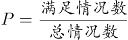=3/10=30%。

故正确答案为C。

**考点**：给情况求概率

**来源**：2022年广东省公务员录用考试《行测》题（乡镇卷）（网友回忆版）第36题

### 第 37 题

老吴从家里出发乘车到银行办理业务，回城时步行，往返共用了45分钟。如果老吴往返都乘车，则只需花30分钟。那么，如果老吴往返时都选择步行，需要花（ ）分钟。

A. 45

B. 50

C. 55

D. 60

第 37 题 · 答案与解析

**参考答案（粉笔题库参考内容）**

D

**解析**

根据题干“老吴往返都乘车，则只需花30分钟”，则老吴乘车从家到银行需要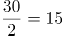分钟。根据题干“老吴从家里出发乘车到银行办理业务，回城时步行，往返共用了45分钟”，则老吴步行单程需要45-15=30分钟。因此如果老吴往返时都选择步行则需要花30×2=60分钟

故正确答案为D。

**考点**：普通行程

**来源**：2022年广东省公务员录用考试《行测》题（乡镇卷）（网友回忆版）第37题

### 第 38 题

小王将新买的时钟调准使用，60天后，时钟走慢了5分钟。那么，该时钟平均每天走慢（ ）秒。

A. 5

B. 10

C. 15

D. 20

第 38 题 · 答案与解析

**参考答案（粉笔题库参考内容）**

A

**解析**

由题意可知，60天走慢了5分钟，即60天走慢了5×60＝300秒，故该时钟平均每天走慢300/60=5秒。

故正确答案为A。

**考点**：钟表问题、平均数问题

**来源**：2022年广东省公务员录用考试《行测》题（乡镇卷）（网友回忆版）第38题

### 第 39 题

如图阴影部分是一块由8块相同的正方形草皮围成的草坪。已知草坪的外圈均铺有一圈小石子带，小石子带的总长度是48米，则该草坪的面积为（ ）平方米。

A. 48

B. 72

C. 81

D. 96

第 39 题 · 答案与解析

**参考答案（粉笔题库参考内容）**

B

**解析**

设每块正方形草皮的边长为a米，则小石子带的总长度即为大正方形周长+内部中空的小正方形周长=3a×4+a×4=16a=48米，解得a=3米，则平方米。故正确答案为B。

**考点**：几何公式类-平面图形

**来源**：2022年广东省公务员录用考试《行测》题（乡镇卷）（网友回忆版）第39题

### 第 40 题

小陈计划在一定时间内完成法律常识题库中的所有练习题。如果每天做50道题，那么最后2天每天要做85道题才能完成，如果每天做55道题，恰好可以提前1天完成，则该题库共有（ ）道题。

A. 1215

B. 1250

C. 1320

D. 1375

第 40 题 · 答案与解析

**参考答案（粉笔题库参考内容）**

C

**解析**

设小陈计划x天完成题库中的所有练习题。根据题意可知：50×（x-2）+85×2=55×（x-1），解得：x=25天。则该题库共有55×（25-1）=1320道题。

故正确答案为C。

**考点**：和差倍比问题

**来源**：2022年广东省公务员录用考试《行测》题（乡镇卷）（网友回忆版）第40题

### 第 41 题

某单位计划从全部80名员工中挑选专项工作组成员，要求该组成员须同时有基层经历和计算机等级证书。已知，单位内有40人有基层经历，有46人有计算机等级证书，既没有基层经历又未获得计算机等级证书的有10人。那么能够进入工作组的员工有（ ）人。

A. 16

B. 40

C. 46

D. 54

第 41 题 · 答案与解析

**参考答案（粉笔题库参考内容）**

A

**解析**

根据两集合容斥原理公式A+B-AB=总数-都不，可得：有基层经历+有计算机等级证书-两种都有=总人数-两种都没有，设同时有基层经历和计算机等级证书的有x人，则有40+46-x=80-10，解得x=16。

故正确答案为A。

**考点**：两集合

**来源**：2022年广东省公务员录用考试《行测》题（乡镇卷）（网友回忆版）第41题

### 第 42 题

甲、乙、丙3个单位订阅同一款报刊，已知3个单位共订了12份，其中，每个单位订阅数量不少于3份，但不超过5份，则这3个单位的报刊订阅数量可能有（ ）种组合。

A. 2

B. 6

C. 7

D. 9

第 42 题 · 答案与解析

**参考答案（粉笔题库参考内容）**

C

**解析**

方法一：根据题意，3份≤每个单位订阅数量≤5份，共12份。这3个单位的报刊订阅数量可以为：（3，4，5），单位不同需考虑顺序，有A_3^3=6种情况；或者（4，4，4），此时有1种情况。因此满足题意的情况数共6+1=7种。

方法二：根据题意，可利用插板法。“不少于3份”时，可先给每个单位分2份，还剩12-2×3=6份，每个单位至少再分1份，有种。但其中包含超出5份的情况（6，3，3），有C_3^1=3种。因此满足题意的情况数共10-3=7种。

故正确答案为C。

**考点**：基础排列组合、同素分堆问题

**来源**：2022年广东省公务员录用考试《行测》题（乡镇卷）（网友回忆版）第42题

### 第 43 题

有一个长方形花坛，长为10米，宽为8米。现要在花坛四周安装栅栏，要求4个顶点处各插一根木桩，除顶点处的木桩外，每边还要插若干木桩，且每两根木桩间的距离至少为3米，则最多可以插（ ）根木桩。

A. 10

B. 12

C. 14

D. 16

第 43 题 · 答案与解析

**参考答案（粉笔题库参考内容）**

A

**解析**

环形植树，有多少间隔就能植多少棵树，要求插入木桩尽量多，则木桩间的距离尽量小，根据题意可确定两木桩之间的间隔为3米，用每条边的边长除以3看商，有余数的话，商是多少就可以分成多少个间隔，没有的话则需减1。长边米，则有3个间隔，宽边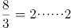米，则有2个间隔，故该长方形花坛共有2×（3+2）=10个间隔，故可以插入10根木桩。

故正确答案为A。

**考点**：植树问题

**来源**：2022年广东省公务员录用考试《行测》题（乡镇卷）（网友回忆版）第43题

### 第 44 题

某防疫工作机构有检验人员和其他工作人员共55人，将检验人员平均分成若干个小组开展工作。近期，该机构补充了20位工作人员，其中，检验人员增加了2组，每组人数不变，其他工作人员增加了30%，则该机构原有检验人员共（ ）组。

A. 4

B. 5

C. 6

D. 7

第 44 题 · 答案与解析

**参考答案（粉笔题库参考内容）**

B

**解析**

假设原检验人员每组x人，其他工作人员共y人。根据“该机构补充了20位工作人员”则可列出：2x+0.3y=20。根据“其他工作人员增加了30%”，也就是3/10，可推出原有的其他工作人员数量一定为10的整数倍，则其他工作人员可能有10人、20人、30人、40人或50人。由于2x和20均为偶数，故0.3y也必须为偶数，因此y只能取值20或40。若y=20，则检验人员原来有55-20=35人，每组有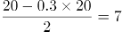人，则该机构原有检验人员共35÷7=5组，符合题意。

故正确答案为B。

备注：若y=40，则检验人员原来有55-40=15人，每组有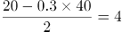人，则该机构原有检验人员共15÷4=3.75组，不符合题意。在实际考试中，若已经验证出y=20符合题意，则不需验证y=40。

**考点**：和差倍比问题

**来源**：2022年广东省公务员录用考试《行测》题（乡镇卷）（网友回忆版）第44题

### 第 45 题

桶中装有一定量的液体，液体体积为桶容量的40%，现向桶中继续加入16升同一液体后，液体体积为原来的1.5倍，则该桶的容量为（ ）升。

A. 20

B. 40

C. 60

D. 80

第 45 题 · 答案与解析

**参考答案（粉笔题库参考内容）**

D

**解析**

设桶中最初装有的液体量为x升，根据题意列等式：x+16=1.5x，解得：x=32升。由于液体体积为桶容量的40%，则该桶的容量为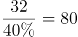升。

故正确答案为D。

**考点**：和差倍比问题

**来源**：2022年广东省公务员录用考试《行测》题（乡镇卷）（网友回忆版）第45题

### 第 46 题

如图是一物体某两个角度的视图，则该物体最可能是（ ）。

A. A

B. B

C. C

D. D

第 46 题 · 答案与解析

**参考答案（粉笔题库参考内容）**

B

**解析**

本题考查三视图，逐一分析选项。

A项：从下往上看，可以看到正方形，但无法看到圆形，排除；

B项：从上往下看，可以看到圆形，从左往右看，可以看到正方形，当选；

C项：从上往下看，可以看到圆形，但无法看到正方形，排除；

D项：从下往上看，可以看到正方形，但无法看到圆形，排除。

故正确答案为B。

**考点**：空间类-三视图

**来源**：2022年广东省公务员录用考试《行测》题（乡镇卷）（网友回忆版）第46题

### 第 47 题

下列选项中最符合所给图形规律的是（ ）。

A. A

B. B

C. C

D. D

第 47 题 · 答案与解析

**参考答案（粉笔题库参考内容）**

D

**解析**

元素组成相同，但无明显位置规律，考虑数量规律。观察发现，题干每幅图形均存在明显的圆相切，优先考虑切点数。题干图形切点数均为1，故问号处图形的切点数也应为1。A、B两项中没有切点，C项有2个切点（如图），只有D项有1个切点。

故正确答案为D。

解析二：元素组成相同，但无明显位置规律，考虑数量规律。观察发现，题干每幅图形线条交叉明显，故考虑交点数。题干图形交点数均为10，故问号处图形的交点数也应为10，只有B项符合。

故正确答案为B。

本题为争议题，但根据题干的图形特征可知，每幅图均存在相切，且圆分别与方块和三角形交替相切，且切点数均为1，考查切点数的概率更大，故粉笔更倾向于本题目的答案为D。

**考点**：数量规律-点

**来源**：2022年广东省公务员录用考试《行测》题（乡镇卷）（网友回忆版）第47题

### 第 48 题

下列选项中最符合所给图形规律的是：

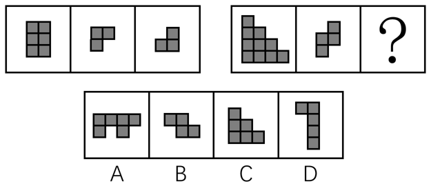

A. A

B. B

C. C

D. D

第 48 题 · 答案与解析

**参考答案（粉笔题库参考内容）**

A

**解析**

本题考察图形拼合。左图中图2和图3拼合为图1，右图也应该遵循此规律。右图中图2和A项可拼合为图1，拼合方式如下图所示：

故正确答案为A。

**来源**：2022年广东省公务员录用考试《行测》题（乡镇卷）（网友回忆版）第48题

### 第 49 题

如图所给的3个立方体为同一立方体，若不考虑立方体表面数字的大小、方向，下列选项中，最有可能是该立方体的是（ ）。

A. A

B. B

C. C

D. D

第 49 题 · 答案与解析

**参考答案（粉笔题库参考内容）**

C

**解析**

第一步：分析题干中六面体。

根据图一可知，面3、面1、面5相邻；根据图二可知，面2、面3、面4相邻；根据图三可知，面4、面5、面6相邻；若均按照顶面为面3来看，可知正面为面5，右侧面为面1时，后面为面2、左侧面应为面4、底面应为面6（如下透视图所示），故可知面3与面6为相对面、面1与面4为相对面、面5与面2为相对面。

第二步：逐一分析选项。

A项：选项中面1与面4为相邻面，题干二者是相对面，相对面不能同时出现，选项与题干不一致，排除；

B项：选项中面1与面4为相邻面，题干二者是相对面，相对面不能同时出现，选项与题干不一致，排除；

C项：选项与题干一致，当选；

D项：选项中面3与面6为相邻面，题干二者是相对面，相对面不能同时出现，选项与题干不一致，排除。

故正确答案为C。

**考点**：空间类-空间重构-六面体

**来源**：2022年广东省公务员录用考试《行测》题（乡镇卷）（网友回忆版）第49题

### 第 50 题

如图是某立方体的平面展开图，则该立方体最可能是：

A. A

B. B

C. C

D. D

第 50 题 · 答案与解析

**参考答案（粉笔题库参考内容）**

D

**解析**

将题干展开图标上序号如下图所示，逐一进行分析。

A项：选项一定包含面a和面e，由于面a和面f为相对面，面e和面c为相对面，相对面不能同时出现，面f和面c一定不可能出现，故选项的正面为面b或面d。若选项的正面为面b，在题干展开图中，面b和面e的公共边挨着面b中的黑色三角形，但在选项中，面b和面e的公共边没有挨着面b中的黑色三角形；若选项的正面为面d，在题干展开图中，面a和面d的公共边挨着面d中的黑色三角形，但在选项中，面a和面d的公共边没有挨着面d中的黑色三角形，选项与题干展开图不一致，排除；

B项：选项的上面和右面为面b、面c、面d或面f中的两个面，且面b和面d为相对面不能同时出现。若该项为面b和面c（或面d和面f），题干二者的公共边均与各自面内白色三角形挨着；若该项为面c和面d（或面c和面f、或面b和面f），题干二者的公共边均与各自面内黑色三角形挨着。而选项中的上面和右面的公共边与一个面内的白色三角形和另外一个面内的黑色三角形挨着，选项与题干展开图不一致，排除；

C项：选项中的面为面b、面c、面d或面f中的三个面，且面b和面d为相对面不能同时出现。则选项是面b、面c和面f（或是面c、面d和面f），在题干展开图中，面c和面f的公共边均与各自面内黑色三角形挨着，但在选项中，任意两个面的公共边都挨着一个白色三角形，选项与题干展开图不一致，排除；

D项：选项由面a、面c与面d（或面b、面e和面f）构成，与题干展开图一致，当选。

故正确答案为D。

**考点**：空间类-空间重构-六面体

**来源**：2022年广东省公务员录用考试《行测》题（乡镇卷）（网友回忆版）第50题

### 第 51 题

从所给的四个选项中，选择最合适的一个填入问号处，使之呈现一定的规律性：

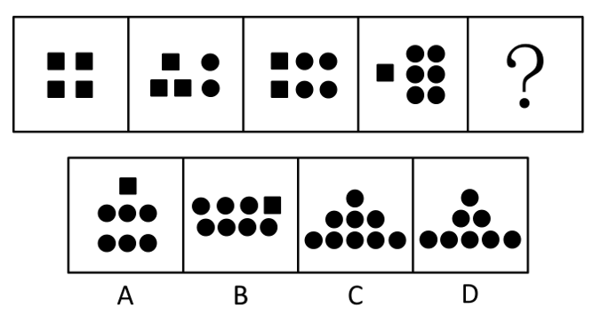

A. A

B. B

C. C

D. D

第 51 题 · 答案与解析

**参考答案（粉笔题库参考内容）**

D

**解析**

元素组成不同，且无明显属性规律，考虑数量规律。观察发现，题干图形基本都由正方形和圆构成，其中正方形的数量分别为4、3、2、1，圆的数量分别为0、2、4、6，故？处图形应该有0个正方形和8个圆，只有D项符合。

故正确答案为D。

**考点**：数量规律-素

**来源**：2022年广东省公务员录用考试《行测》题（乡镇卷）（网友回忆版）第51题

### 第 52 题

从所给的四个选项中，选择最合适的一个填入问号处，使之呈现一定的规律性：

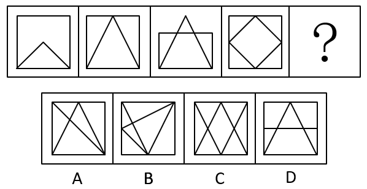

A. A

B. B

C. C

D. D

第 52 题 · 答案与解析

**参考答案（粉笔题库参考内容）**

D

**解析**

解析一：元素组成不同，优先考虑属性规律。观察发现，题干图形出现等腰元素，考虑对称性，题干图形均为轴对称图形，据此可以排除A、B两项；继续观察发现，题干图形明显被分割，考虑数面，题干图形的面数量分别为2、3、4、5，故？处图形应该有6个面，只有D项符合。

故正确答案为D。

解析二：元素组成不同，考虑数量规律，图形明显被分割，考虑面数量。题干图形的面数量分别为2、3、4、5，故？处图形应该有6个面，排除A、C两项；再次观察发现，题干图形均为一笔画图形，故？处应选择一个一笔画图形，只有B项符合。

故正确答案为B。

本题目为争议题，但根据题干的图形特征可知，所有图形均为等腰图形，考察对称性的概率更大，故粉笔更倾向于本题目的答案为D。

**考点**：数量规律-复合

**来源**：2022年广东省公务员录用考试《行测》题（乡镇卷）（网友回忆版）第52题

### 第 53 题

从所给的四个选项中，选择最合适的一个填入问号处，使之呈现一定的规律性：

A. A

B. B

C. C

D. D

第 53 题 · 答案与解析

**参考答案（粉笔题库参考内容）**

B

**解析**

元素组成相同，优先考虑位置规律。观察发现，内部阴影为横线的三角形，依次顺时针移动一格（移动到图4时，阴影被灰色区域遮挡），因此？处应移动到右上角，如下图所示，对应B项。

故正确答案为B。

**考点**：位置规律-平移

**来源**：2022年广东省公务员录用考试《行测》题（乡镇卷）（网友回忆版）第53题

### 第 54 题

下列选项中最符合所给图形规律的是（ ）。

A. A

B. B

C. C

D. D

第 54 题 · 答案与解析

**参考答案（粉笔题库参考内容）**

B

**解析**

图形元素组成相似，优先考虑样式规律。九宫格优先横着看，题干图形元素组成相似，考虑样式规律。题干图形轮廓相同，内部的颜色只有灰、白，且灰、白块数量不同，优先考虑样式规律中的黑白运算。

观察发现，第一行图形的运算规律为：灰+灰=白，白+白=白。第二行验证此规律成立，同时满足：灰+白=灰。第三行应用前两行得到的规律，因为“白+灰”的结果未知，只可排除A、D两项。说明此题并未设置“灰+白≠白+灰”的陷阱，否则无惟一答案。根据“白+灰=灰”可排除C项。

故正确答案为B。

**考点**：样式规律-黑白运算

**来源**：2022年广东省公务员录用考试《行测》题（乡镇卷）（网友回忆版）第54题

### 第 55 题

下列选项中最符合所给图形规律的是（ ）。

A. A

B. B

C. C

D. D

第 55 题 · 答案与解析

**参考答案（粉笔题库参考内容）**

A

**解析**

出现黑白块，观察黑块与白块的相对位置关系，每一行都有各自的规律。第一行黑白块排列规律为黑、白、黑循环排列；第二行黑白块排列规律为白、黑循环排列；第三行黑白块排列规律为白、黑、黑循环排列；第四行黑白块排列规律为黑、白循环排列；第五行黑白块排列规律为黑、白、黑循环排列，只有A项符合。

故正确答案为A。

**来源**：2022年广东省公务员录用考试《行测》题（乡镇卷）（网友回忆版）第55题

### 第 56 题

默念：朗诵

A. 竞走：散步

B. 贩卖：赶集

C. 讲授：练习

D. 调节：管理

第 56 题 · 答案与解析

**参考答案（粉笔题库参考内容）**

A

**解析**

第一步：判断题干词语间逻辑关系。

默念指暗中思考或不出声地读或背，朗诵指大声朗读。默念和朗诵都是阅读的方式，二者为并列关系中的反对关系。

第二步：判断选项词语间逻辑关系。

A项：竞走和散步都是行走的方式，二者为并列关系中的反对关系，与题干逻辑关系一致，当选；

B项：赶集指在集市囤物换物、买卖交易，与贩卖不是并列关系，与题干逻辑关系不一致，排除；

C项：讲授指讲解传授，与练习不是并列关系，与题干逻辑关系不一致，排除；

D项：调节指在数量、程度、规模等方面进行调整，使其符合标准，与管理不是并列关系，与题干逻辑关系不一致，排除。

故正确答案为A。

**考点**：逻辑关系-并列关系

**来源**：2022年广东省公务员录用考试《行测》题（乡镇卷）（网友回忆版）第56题

### 第 57 题

书桌：椅子

A. 柜子：抽屉

B. 沙发：靠枕

C. 灯泡：插座

D. 窗户：玻璃

第 57 题 · 答案与解析

**参考答案（粉笔题库参考内容）**

B

**解析**

第一步：判断题干词语间逻辑关系。

书桌和椅子在一起配套使用，二者是配套使用的对应关系。

第二步：判断选项词语间逻辑关系。

A项：抽屉是柜子的组成部分，二者是组成关系，与题干逻辑关系不一致，排除；

B项：沙发和靠枕在一起配套使用，二者是配套使用的对应关系，与题干逻辑关系一致，当选；

C项：灯泡和插座没有明显的逻辑关系，与题干逻辑关系不一致，排除；

D项：玻璃是窗户的组成部分，二者是组成关系，与题干逻辑关系不一致，排除。

故正确答案为B。

**考点**：逻辑关系-对应关系

**来源**：2022年广东省公务员录用考试《行测》题（乡镇卷）（网友回忆版）第57题

### 第 58 题

航海：指南针

A. 粉笔：黑板报

B. 潜水：救生圈

C. 通信：屏蔽器

D. 驾驶：发动机

第 58 题 · 答案与解析

**参考答案（粉笔题库参考内容）**

D

**解析**

第一步：判断题干词语间逻辑关系。

航海需要用到指南针，二者为活动和工具之间的对应关系。

第二步：判断选项词语间逻辑关系。

A项：粉笔是绘制黑板报时可能会用到的工具，二者为工具与宣传形式之间的对应关系，与题干逻辑关系不一致，排除；

B项：潜水不需要救生圈，潜水装备一般包含潜水服、呼吸器、眼罩等，因此二者无明显逻辑关系，与题干逻辑关系不一致，排除；

C项：屏蔽器是一种可以屏蔽通信信号的设备，二者不是活动与工具之间的对应关系，与题干逻辑关系不一致，排除；

D项：驾驶一般指操纵（车、船、飞机、拖拉机等）使其行驶，驾驶需要用到发动机，二者为活动和工具之间的对应关系，与题干逻辑关系一致，当选。

故正确答案为D。

**考点**：逻辑关系-对应关系

**来源**：2022年广东省公务员录用考试《行测》题（乡镇卷）（网友回忆版）第58题

### 第 59 题

创作：印刷：发行

A. 撒网：钓鱼：捕捞

B. 生产：研发：采购

C. 播种：开花：结果

D. 拆除：安装：维修

第 59 题 · 答案与解析

**参考答案（粉笔题库参考内容）**

C

**解析**

第一步：判断题干词语间逻辑关系。

先创作，再印刷，最后发行，三者是时间先后顺序的对应关系。

第二步：判断选项词语间逻辑关系。

A项：先撒网，再捕捞，二者和钓鱼没有明显的时间先后顺序，与题干逻辑关系不一致，排除；

B项：先研发，再生产，最后采购，研发应在生产之前发生，与题干逻辑关系不一致，排除；

C项：先播种，再开花，最后结果，三者是时间先后顺序的对应关系，与题干逻辑关系一致，当选；

D项：先安装，再拆除，安装应在拆除之前发生，与题干逻辑关系不一致，排除。

故正确答案为C。

**考点**：逻辑关系-对应关系

**来源**：2022年广东省公务员录用考试《行测》题（乡镇卷）（网友回忆版）第59题

### 第 60 题

法律：诉讼：胜败

A. 策略：经营：盈亏

B. 战争：武器：存亡

C. 判断：事实：对错

D. 教师：教学：优劣

第 60 题 · 答案与解析

**参考答案（粉笔题库参考内容）**

A

**解析**

第一步：判断题干词语间逻辑关系。

依据“法律”进行“诉讼”，“胜败”是“诉讼”可能出现的两种结果，三者是对应关系。

第二步：判断选项词语间逻辑关系。

A项：依据“策略”进行“经营”，“盈亏”是“经营”可能出现的两种结果，三者是对应关系，与题干逻辑关系一致，当选；

B项：“存亡”不是“武器”可能出现的两种结果，与题干逻辑关系不一致，排除；

C项：依据“事实”进行“判断”，但两词顺序与题干相反，与题干逻辑关系不一致，排除；

D项：不是依据“教师”进行“教学”，教学是教师的职业内容，与题干逻辑关系不一致，排除。

故正确答案为A。

**考点**：逻辑关系-对应关系

**来源**：2022年广东省公务员录用考试《行测》题（乡镇卷）（网友回忆版）第60题

### 第 61 题

某单位将《稻穗》《播种》两件乡村新风摄影作品选送参赛。关于这两件作品能否获奖，该单位员工有以下猜测：

（1）两件作品都能获奖。

（2）只有一件作品能获奖。

（3）《稻穗》不会获奖。

（4）《播种》会获奖。

结果表明，其中只有一个猜测正确。则以下判断一定正确的是（ ）。

A. 《稻穗》获奖了

B. 《稻穗》没获奖

C. 《播种》获奖了

D. 《播种》没获奖

第 61 题 · 答案与解析

**参考答案（粉笔题库参考内容）**

D

**解析**

第一步：分析题干找关系。

（1）《稻穗》 且 《播种》；

（2）只有一件作品能获奖；

（3）-《稻穗》获奖；

（4）《播种》获奖。

四句话都不是矛盾关系。

第二步：看其余。

可以使用假设法。《稻穗》《播种》的获奖情况可以分为以下四种：

①《稻穗》和《播种》都获奖了：此时条件（1）和（4）同时为真，和题干条件“只有一真”不符；

②《稻穗》获奖，但《播种》没获奖：此时只有条件（2）为真，符合题干要求；

③《稻穗》没获奖，但《播种》获奖了：此时条件（2）（3）（4）都为真，和题干条件“只有一真”不符；

④《稻穗》和《播种》都没获奖：此时只有条件（3）为真，符合题干要求。

综上所述，只有第②种和第④种情况符合题干要求，在这两种情况下《播种》都没获奖，据此可知，《播种》一定不会获奖。

故正确答案为D。

**考点**：只有一真/一假

**来源**：2022年广东省公务员录用考试《行测》题（乡镇卷）（网友回忆版）第61题

### 第 62 题

某公司产品的各项性能都比竞争对手的更好。所以，如果该公司能够降低产品的市场定价，与竞争对手的价格持平，那么该公司产品一定会迅速占领市场。

下列选项若为真，最能削弱上述论断的是（ ）。

A. 该公司产品的生产成本较高，降低市场定价将会极大影响公司利润

B. 与竞争对手相比，该公司的产品宣传力度和售后服务不具显著优势

C. 该公司的生产规模很小，其产量仅能满足市场需求的百分之一

D. 该公司产品设计瞄准的是高端市场，降低价格不符合其市场定位

第 62 题 · 答案与解析

**参考答案（粉笔题库参考内容）**

C

**解析**

第一步：找出论点和论据。

论点：如果该公司能够降低产品的市场定价，与竞争对手的价格持平，那么该公司产品一定会迅速占领市场。

论据：某公司产品的各项性能都比竞争对手的更好。

本题论点讨论的是若该公司产品的价格与竞争对手持平，产品会迅速占领市场，论据讨论的是该公司产品性能比竞争对手更好，都在讨论公司产品情况与竞争对手的比较，话题一致，削弱优先考虑否定论点。

第二步：逐一分析选项。

A项：该项指出由于产品生产成本高，降价后会极大影响利润，但利润受影响指的是公司内部的事，而占有市场指的是用户的多少，二者无关，无法削弱，排除；

B项：该项指出与竞争对手相比，该公司的产品宣传力度和售后服务不具显著优势，只能说明优势不大，但不等同于比竞争对手差，因此是否会影响该公司占有市场不确定，无法削弱，排除；

C项：该项指出该公司规模小，产量仅占市场百分之一，说明就算降低价格，与竞争对手持平，但由于公司产品产量过少，能够满足的用户数量也远小于市场需求，因此不能占领市场，否定论点，可以削弱，当选；

D项：该项指出该公司产品设计的市场定位是高端市场，而论点在讨论公司产品降价后会不会占领市场，定位如何和降价后能否占领市场无关，话题不一致，无法削弱，排除。

故正确答案为C。

**考点**：削弱论点

**来源**：2022年广东省公务员录用考试《行测》题（乡镇卷）（网友回忆版）第62题

### 第 63 题

有调查发现，某镇的乡村振兴工作中，由县农业部门工作人员担任驻村工作队队长的村庄其农业产业发展速度明显快于由其他部门工作人员担任驻村工作队队长的村庄。据此有人认为，县农业部门的工作人员更重视当地的农业产业发展，而农业产业发展是增加当地农民收入的重要手段，因此县农业部门的工作人员开展乡村振兴工作成效往往较好。

以下选项中属于上述论证过程中隐含前提的是（ ）。

A. 农业部门工作人员往往有更多农业产业相关的专业知识

B. 农民收入是评价乡村振兴工作成效的重要指标

C. 乡村振兴工作的成效只能用农业产业发展情况来衡量

D. 不同村庄农民收入在乡村振兴工作开展前基本持平

第 63 题 · 答案与解析

**参考答案（粉笔题库参考内容）**

B

**解析**

第一步：找出论点和论据。

论点：县农业部门的工作人员开展乡村振兴工作成效往往较好。

论据：县农业部门的工作人员更重视当地的农业产业发展，而农业产业发展是增加当地农民收入的重要手段。

论据说的是县农业部门的工作人员更重视农业产业发展、农业产业发展可增加当地农民收入，论点说的是县农业部门的工作人员开展乡村振兴工作成效往往较好，二者话题不一致，问法为“前提”，加强优先考虑搭桥，建立“农业产业发展”或“农民收入”与“乡村振兴工作成效”之间的关系。

第二步：逐一分析选项。

A项：说的是农业部门工作人员有更多农业产业相关的专业知识，而论点讨论的是农业部门工作人员的乡村振兴工作成效，有更多的专业知识不代表工作成效就一定好，不能加强，排除；

B项：说的是农民收入是评价乡村振兴工作成效的重要指标，在“农民收入”和“乡村振兴工作成效”之间建立了联系，搭桥项，可以加强，保留；

C项：说的是乡村振兴工作成效只能用农业产业发展情况来衡量，在“农业产业发展”和“乡村振兴工作成效”之间建立了联系，搭桥项，可以加强，保留；

D项：说的是不同村庄农民收入在乡村振兴工作开展前基本持平，但判断乡村振兴工作的成效是否更好不需要各村庄农民收入在此前均持平，不是论点成立的必要条件，无法加强，排除。

对比B、C两项，B项在“农民收入”和“乡村振兴工作成效”之间建立联系，将“农业产业发展”“农民收入”和“乡村振兴工作成效”三者之间的关系全部串联了起来，对题干的加强更为完整，而C项只是建立“农业产业发展”和“乡村振兴工作成效”之间的联系，未利用“农民收入”这个论据。基于加强题目的命题特点，将所有论据串联起来的选项更好，因此，粉笔倾向选择B项。

故正确答案为B。

**考点**：搭桥

**来源**：2022年广东省公务员录用考试《行测》题（乡镇卷）（网友回忆版）第63题

### 第 64 题

某农村合作社购买了两台新型号收割机，这两台机器收割速度快，而且有助于减少收割过程中的粮食损失。但该农村合作社使用这两台收割机以来，其玉米收割总损失率高达10%，较以往反而有所上升。

以下最能解释这一现象的是（ ）。

A. 使用收割机后，该农村合作社收割玉米的效率大幅提高

B. 两台收割机仅被用于收割部分田地的玉米

C. 操作人员培训不到位，操作收割机时常出现失误

D. 玉米并不是当地种植的主要粮食作物

第 64 题 · 答案与解析

**参考答案（粉笔题库参考内容）**

C

**解析**

第一步：找出题干矛盾。

某农村合作社购买的两台新型号收割机收割速度快，有助于减少收割过程中的粮食损失。但该农村合作社使用这两台收割机以来，其玉米收割总损失率较以往反而有所上升。

第二步：逐一分析选项。

A项：该项只是肯定新型号收割机的收割速度快，但是没有解释为什么新型号收割机能够减少收割过程中的粮食损失，但该农村合作社使用这两台收割机以来，其玉米收割总损失率较以往反而有所上升，不能解释题干矛盾，排除；

B项：该项说的是两台收割机仅被用于收割部分田地的玉米，若是新型号收割机能够减少收割过程中的粮食损失，即使仅被用于收割部分田地的玉米，该村玉米收割总损失率较以往也不可能有所上升，不能解释题干矛盾，排除；

C项：该项说的是操作人员培训不到位，操作收割机时常出现失误，说明操作人员的失误是导致玉米收割总损失率较以往反而有所上升的原因，可以解释题干矛盾，当选；

D项：该项说的是玉米并不是当地种植的主要粮食作物，但不能解释为什么使用了有助于减少收割过程中的粮食损失的新型号收割机后，玉米收割总损失率较以往反而有所上升，不能解释题干矛盾，排除。

故正确答案为C。

**考点**：原因解释

**来源**：2022年广东省公务员录用考试《行测》题（乡镇卷）（网友回忆版）第64题

### 第 65 题

每一名战士都是英雄，每一名英雄都值得被纪念，因此每一名战士都值得被纪念。

下列选项的逻辑结构与题干最相似的是（ ）。

A. 艺术家往往是浪漫主义者，而有些浪漫主义者会感情用事，因此艺术家常会感情用事

B. 所有素食主义者都是人文主义者，而所有和平主义者都是人文主义者，因此素食主义者一定是和平主义者

C. 所有的科学家都是理性主义者，所有的理性主义者都是天生的哲学家。因此科学家都是天生的哲学家

D. 利己主义者总是以自身利益最大化作为行事准则，而单纯追求自身利益的最大化必然会损害到他人利益，因此利己主义者总会和他人发生冲突

第 65 题 · 答案与解析

**参考答案（粉笔题库参考内容）**

C

**解析**

第一步：分析题干推理形式。

战士→英雄，英雄→值得被纪念，因此战士→值得被纪念。

题干逻辑结构为：a→b，b→c，因此a→c。

第二步：逐一分析选项。

A项：翻译为：艺术家→浪漫主义者，有的浪漫主义者→感情用事，因此艺术家→感情用事，逻辑结构为：a→b，有的b→c，因此a→c，与题干推理形式不一致，排除；

B项：翻译为：素食主义者→人文主义者，和平主义者→人文主义者，因此素食主义者→和平主义者，逻辑结构为：a→b，c→b，因此a→c，与题干推理形式不一致，排除；

C项：翻译为：科学家→理性主义者，理性主义者→天生的哲学家，因此科学家→天生的哲学家，逻辑结构为：a→b，b→c，因此a→c，与题干推理形式一致，当选；

D项：翻译为：利己主义者→自身利益最大化，自身利益最大化→损害到他人利益，因此利己主义者→和他人发生冲突，“损害他人利益”与“和他人发生冲突”不是同一个含义，故逻辑结构为：a→b，b→c，因此a→d，与题干推理形式不一致，排除。

故正确答案为C。

**考点**：推理形式

**来源**：2022年广东省公务员录用考试《行测》题（乡镇卷）（网友回忆版）第65题

### 第 66 题

关于水的净化方法和原理，下列说法不准确的是：

A. 静置沉淀可帮助去除水中大颗粒不溶性物质

B. 消毒剂消毒是利用化学方法杀灭水中的细菌

C. 蒸馏法可以去除水中的所有杂质

D. 过滤法可以降低水的硬度从而使硬水软化

第 66 题 · 答案与解析

**参考答案（粉笔题库参考内容）**

D

**解析**

A项：由于大颗粒不溶性物质静置一段时间后，会沉淀到容器的底部，所以静置沉淀可帮助去除水中大颗粒不溶性物质，正确；

B项：消毒剂也被称为“化学消毒剂”，大多数具有强氧化能力，可使环境中的细菌无法生存，从而实现消毒作用，因此消毒剂消毒是利用化学方法杀灭水中的细菌，正确；

C项：蒸馏可使液态水变为水蒸气，通过收集水蒸气来获得纯净的水，该过程中收集的只有水，因此蒸馏法可以去除水中的所有杂质，正确；

D项：硬水是含有较多可溶性钙、镁化合物的水，软水是不含或含较少可溶性钙、镁化合物的水，过滤法是常用的分离溶液与沉淀的操作方法，因此无法去除水中可溶性的物质，无法使硬水软化，错误。

本题为选非题，故正确答案为D。

**来源**：2022年广东省公务员录用考试《行测》题（乡镇卷）（网友回忆版）第66题

### 第 67 题

对下列生活中的现象或做法解释不合理的是（ ）。

A. 物体的热胀冷缩——分子随温度升高而变大

B. 油锅着火用锅盖盖灭——使可燃物与空气隔绝

C. 在铁制品表面刷油漆——避免铁制品氧化生锈

D. 利用真空袋包装食品——破坏需氧菌类的生存环境

第 67 题 · 答案与解析

**参考答案（粉笔题库参考内容）**

A

**解析**

A项：热胀冷缩的原理是温度影响分子间的距离，温度升高，分子间距增大，温度降低，分子间距缩小，升高温度并不会导致分子变大，错误；

B项：物质燃烧需要氧气支持，油锅着火时盖上锅盖，能将油与空气隔绝，使可燃物接触不到氧气，从而使火焰熄灭，正确；

C项：铁暴露在空气中会与空气中的氧气、水蒸气发生化学反应，生成铁锈，所以在铁制品表面刷上一层油漆，可以有效隔绝空气中的氧气和水蒸气，防止铁生锈，正确；

D项：需氧菌是指只能在有氧条件下生长繁殖的菌类，真空包装袋内不含氧气，破坏了需氧菌的生存环境，从而阻止需氧菌的生长繁殖，防止食品腐败，正确。

本题为选非题，故正确答案为A。

**来源**：2022年广东省公务员录用考试《行测》题（乡镇卷）（网友回忆版）第67题

### 第 68 题

以下为甲、乙两车行驶情况的示意图，已知甲、乙同时从一起点出发，甲车在水平道路上匀速直线行驶，乙车在同一水平的道路上匀减速直线行驶，则在两车行驶的过程中，下列说法准确的是（ ）。

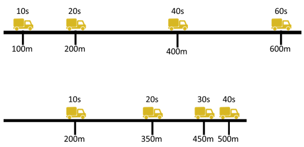

A. 甲车的速度为15m/s

B. 乙车的初始速度为25m/s

C. 45s时，乙车行驶的路程更远

D. 50s时，乙车仍处于行驶状态

第 68 题 · 答案与解析

**参考答案（粉笔题库参考内容）**

C

**解析**

由图可知，甲车匀速直线行驶，甲车10s行驶了100m，根据速度公式v=s/t可知，甲车的速度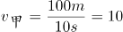m/s，A项错误；乙车匀减速直线行驶，乙车10s行驶了200m，20s行驶了350m，设乙车的初始速度为v_乙，加速度为a，根据位移公式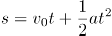可知，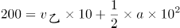······①，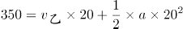······②，联立①、②式解得m/s，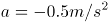，故乙车的初始速度为22.5m/s，B项错误；根据公式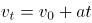可知，当乙车速度减为零时，代入公式可得22.5-0.5t=0，解得t=45s，即乙车在45s时停止行驶，处于静止状态，此时乙车行驶的路程大于500m，而甲车的行驶路程为450m，50s时，乙车仍处于静止状态，故C项正确，D项错误。

故正确答案为C。

**来源**：2022年广东省公务员录用考试《行测》题（乡镇卷）（网友回忆版）第68题

### 第 69 题

如图，小球在细绳的牵引下从A点自由摆动到C点，B点是最低点。若忽略空气阻力，则下列说法不准确的是（ ）。

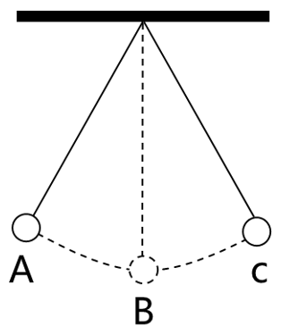

A. 从A点到B点小球的动能增加

B. 从B点到C点小球的势能增加

C. 在B点小球的动能最大

D. 从A点到C点小球的机械能增加

第 69 题 · 答案与解析

**参考答案（粉笔题库参考内容）**

D

**解析**

由题意可知，小球在细线牵引下自由摆动，绳的拉力方向与运动方向始终垂直，因此绳子拉力不做功，并且忽略空气阻力，则小球在运动过程中只有重力做功，其机械能守恒。

A项：从A点到B点小球的高度降低，根据重力势能公式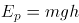，小球的重力势能减小，而其机械能守恒，即在此过程中其重力势能转化为动能，因此小球的动能增加，正确；

B项：从B点到C点小球的高度升高，其重力势能增加，根据机械能守恒可知，小球的动能转化为重力势能，因此小球的势能增加，正确；

C项：根据A、B两项分析可知，小球从A点到C点的过程中，重力势能先减小后增大，B点为最低点，小球的重力势能最小，因此在B点小球的动能最大，正确；

D项：根据上述分析可知，小球在整个运动过程中机械能守恒，错误。

本题为选非题，故正确答案为D。

**来源**：2022年广东省公务员录用考试《行测》题（乡镇卷）（网友回忆版）第69题

### 第 70 题

为提升其行驶过程的稳定性，挖掘机装有履带，其原理是：

A. 减小挖掘机对地面的压强

B. 增大挖掘机对地面的压强

C. 减小挖掘机对地面的压力

D. 增大挖掘机对地面的压力

第 70 题 · 答案与解析

**参考答案（粉笔题库参考内容）**

A

**解析**

根据压强公式p=F/S，F为挖掘机对地面的压力，S为挖掘机与地面的接触面积，由于挖掘机对地面的压力等于挖掘机的重力，即F=G=mg，且挖掘机的质量m不会发生改变，因此挖掘机的重力G不会发生变化，所以挖掘机对地面的压力F不变，而挖掘机装有履带后，使挖掘机与地面的接触面积S增大，因此挖掘机对地面的压强减小，A项正确，B、C、D三项错误。

故正确答案为A。

**来源**：2022年广东省公务员录用考试《行测》题（乡镇卷）（网友回忆版）第70题

### 第 71 题

如图，甲、乙叠放在一起，静置于地面上。此时，乙受到一个水平向右的拉力F，但甲、乙仍然保持静止状态，在此过程中，以下说法准确的是（ ）。

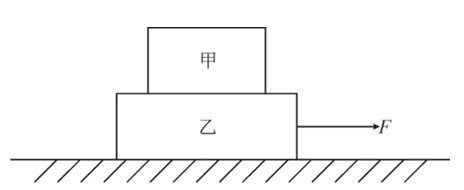

A. 甲和乙之间至少有2对相互作用力

B. 乙对甲的支持力比甲受到的重力大

C. 如果拉力F方向向左，甲、乙将不再保持静止

D. 乙受到的地面摩擦力等于拉力F

第 71 题 · 答案与解析

**参考答案（粉笔题库参考内容）**

D

**解析**

A项：甲对乙的压力和乙对甲的支持力为一对相互作用力，由于甲在乙受到拉力F之后仍然保持静止，说明甲始终受力平衡，甲仅受到重力和支持力这一对平衡力的作用，若甲在水平方向受到摩擦力，则甲无法保持平衡，所以甲、乙之间没有摩擦力，甲、乙之间仅有压力与支持力这1对相互作用力，错误；

B项：甲处于静止状态，受力平衡，所以甲受到的重力和乙对甲的支持力为一对平衡力，两个力大小相等，错误；

C项：乙受到向右的拉力F后，并未拉动乙，说明拉力F小于乙与地面之间的最大静摩擦力，若拉力方向改为向左，拉力F仍然小于乙与地面之间的最大静摩擦力，甲、乙仍然会保持静止，错误；

D项：由于甲、乙之间没有摩擦力，则乙受到的水平方向的力仅有向右的拉力F和地面对乙向左的静摩擦力，由于乙始终保持静止，处于受力平衡状态，所以乙受到的地面摩擦力和拉力F为一对平衡力，大小相等，正确。

故正确答案为D。

**来源**：2022年广东省公务员录用考试《行测》题（乡镇卷）（网友回忆版）第71题

### 第 72 题

将如图所示卡片面向平面镜时，则该卡片在平面镜中的成像最可能是（ ）。

A. A

B. B

C. C

D. D

第 72 题 · 答案与解析

**参考答案（粉笔题库参考内容）**

B

**解析**

平面镜成像特点为：①正立等大的虚像；②像和物左右相反。

该卡片中骑车的小人镜子中的像应当是正立的，所以应当是轮子在下方人在上方，故C、D两项错误；镜像与卡片中的实像还应当左右相反，所以镜像应当面朝左边，并且前轮中弧线应在轮内左上方，后轮中弧线应在轮内右下方，A项错误，B项正确。

故正确答案为B。

**来源**：2022年广东省公务员录用考试《行测》题（乡镇卷）（网友回忆版）第72题

### 第 73 题

关于常见用电器的工作情况，以下说法不准确的是：

A. 道路两边的路灯定时开关，晚上同时亮，早晨同时灭，则所有路灯是串联的

B. 抽油烟机里的照明灯和电动机，既能同时工作，又能单独工作，则照明灯和电动机是并联的

C. 楼道中的感应电灯是由声控开关和光控开关共同控制的，只有在没有光线且出现声音时才能亮起，则电灯和声控开关、光控开关是串联的

D. 电吹风里的电热丝和电动机，可以控制出风温度，则电热丝和电动机是并联的

第 73 题 · 答案与解析

**参考答案（粉笔题库参考内容）**

A

**解析**

A项：若道路两边的所有路灯是串联的，当其中一个路灯出现断路时，则所有路灯都会熄灭，为了保证在此种情况发生时其他路灯能够正常工作，那么所有的路灯应该是并联的。所有路灯并联，只需将开关设置在干路上，便能实现所有路灯晚上同时亮，早晨同时灭，错误；

B项：抽油烟机里的照明灯和电动机，可以单独工作，互不影响，因此照明灯和电动机是并联的，正确；

C项：楼道里的感应电灯由声控开关和光控开关共同控制，即二者必须同时闭合时，灯泡才能发光，因此电灯和声控开关、光控开关是串联的，正确；

D项：电吹风可以控制出风温度，说明电热丝和电动机是独立工作的，则电热丝和电动机是并联的，正确。

本题为选非题，故正确答案为A。

**来源**：2022年广东省公务员录用考试《行测》题（乡镇卷）（网友回忆版）第73题

### 第 74 题

如图是某家庭电路图的一部分，家庭内各电器均正确接入电路。则以下说法准确的是（ ）。

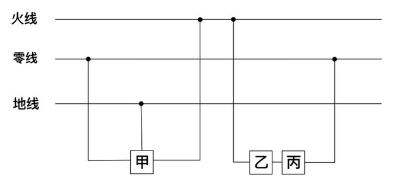

A. 假如乙和甲分别是电器或开关，则丙是开关

B. 假如电路正常，正确使用试电笔接触三孔插座的孔都会显示有电流

C. 假如甲是带金属外壳的用电器，则它接的是三孔插座

D. 假如零线被烧断，应立即关闭开关，否则会引起短路

第 74 题 · 答案与解析

**参考答案（粉笔题库参考内容）**

C

**解析**

A项：根据家庭电路的特点，开关应接在用电器和火线之间，当开关断开时即可切断用电器与火线的连接，防止触电事故的发生，故乙是开关，丙是用电器，错误；

B项：在正常的电路中，使用试电笔接触火线时，试电笔中的氖管会发光，表示火线有电，使用试电笔接触零线或地线，氖管均不发光，根据三孔插座“左零右火上接地”的接线方式可知，只有使用试电笔接触三孔插座的右孔时氖管才会发光，显示此处有电流，接触左孔和上孔均无此现象，错误；

C项: 图中甲的连接方式为左零右火上接地，并且带金属外壳的用电器也必须接地，以防漏电对人造成伤害，故甲接的是三孔插座，正确；

D项：零线被烧断，整个电路处于断路状态，不会引起短路，错误。

故正确答案为C。

**来源**：2022年广东省公务员录用考试《行测》题（乡镇卷）（网友回忆版）第74题

### 第 75 题

如图是甲、乙两车在同一道路上匀速行驶时路程s随时间t变化的曲线图，则在两车行驶的过程中，下列说法准确的是：

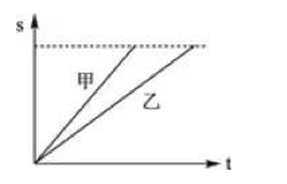

A. 甲车的速度比乙车大

B. 相同时间内，乙车行驶路程更长

C. 甲、乙两车均沿直线运动

D. 甲、乙两车间距离始终保持不变

第 75 题 · 答案与解析

**参考答案（粉笔题库参考内容）**

A

**解析**

A项：在路程-时间（s-t）图像中，图像的斜率代表速率，图中甲的斜率大于乙的斜率，即甲车的速度比乙车大，正确；

B项：在路程-时间（s-t）图像中，纵坐标代表路程，相同时间内，甲的路程均比乙的路程大，即甲车行驶路程更长，错误；

C项：图像仅能反应出行驶路程随时间的变化情况，无法判断其运动轨迹，即无法判断是否沿直线运动，错误；

D项：在路程-时间（s-t）图像中，纵坐标代表路程，则在相同时刻，两图像纵坐标的高度差即为甲、乙两车间的距离，由图可知，甲、乙两车间距离逐渐增大，错误。

故正确答案为A。

**来源**：2022年广东省公务员录用考试《行测》题（乡镇卷）（网友回忆版）第75题

### 第 76 题

如图，甲、乙两个相同的容器中盛着不同的液体，当相同的小球漂浮在容器中并保持静止时，容器中液面的高度相同，则下列说法准确的是（ ）。

A. 小球在甲容器中受到浮力比在乙容器中的小

B. 小球在甲容器中受到浮力比在乙容器中的大

C. 甲容器中液体的密度比乙容器中液体的小

D. 甲容器中液体的密度比乙容器中液体的大

第 76 题 · 答案与解析

**参考答案（粉笔题库参考内容）**

C

**解析**

A、B两项错误，相同的小球在甲、乙两容器中均为漂浮状态，则均处于受力平衡状态，小球受到的浮力等于其自身的重力，所以小球在甲容器中和乙容器中受到的浮力一样大。

C项正确、D项错误，由A、B两项分析可知，小球在甲、乙两容器中受到的浮力一样大，由图可知，，根据浮力公式：可知，。

故正确答案为C。

**来源**：2022年广东省公务员录用考试《行测》题（乡镇卷）（网友回忆版）第76题

### 第 77 题

如图，物体A、B分别位于木板上下方，且处于静止状态，如果将物体B往左移动一段距离，但仍位于木板下方，则下列说法准确的是（ ）。

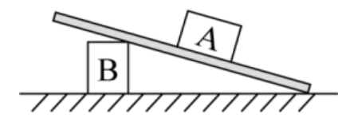

A. 物体A所受合力为零

B. 物体A所受的摩擦力增加

C. 木板对物体A的作用力减小

D. 木板对物体A的作用力增加

第 77 题 · 答案与解析

**参考答案（粉笔题库参考内容）**

A

**解析**

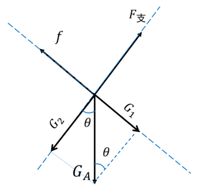

如图所示，对A进行受力分析，受到垂直木板向上的支持力F_支、自身的重力G_A、沿木板向上的摩擦力f。将重力分解成沿木板方向的G_1和垂直于木板方向的G_2，假设此时木板与地面的夹角为θ，物体A的质量为m，根据三角函数可知，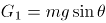，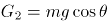；由物体A处于静止状态可知，物体A受力平衡，在沿木板方向上可以得到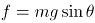，在垂直于木板方向上可以得到；现将B往左移动，可知木板与地面的夹角θ变小，则sinθ变小，cosθ变大。

A项：根据前面分析可知，当θ变小时，增大，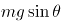变小，所以沿木板方向的始终小于最大静摩擦，故物体A始终处于静止状态，受力平衡，合力为0，正确；

B项：根据前面分析可知，当θ变小时，变小，摩擦力变小，错误；

C项：木板对物体A的作用力即木板对物体A的摩擦力和支持力，由于物体A处于静止状态，受力平衡，故木板对物体A的摩擦力和支持力的合力与重力等大反向，由于物体A质量不变，故物体A的重力不变，所以木板对物体A的作用力也不变，错误；

D项：由C项分析可知，木板对物体A的作用力不变，错误。

故正确答案为A。

**来源**：2022年广东省公务员录用考试《行测》题（乡镇卷）（网友回忆版）第77题

### 第 78 题

如图是某种固态物质在加热过程中，温度随时间变化的图像。下列说法最不准确的是（ ）。

A. 该固态物质有固定的熔点

B. 该固态物质在熔化过程中，比热容增大

C. 温度为0℃时，该物质可能处于固液共存状态

D. 该固态物质在熔化时不断吸收热量，温度不断升高

第 78 题 · 答案与解析

**参考答案（粉笔题库参考内容）**

D

**解析**

从图中信息可见，该固态物质有固定的熔点，属于晶体，晶体熔化时需要不断地吸收热量，但是温度不会发生变化，这个不变的温度就是晶体的熔点，在熔化过程中固态与液态共存，A、C两项均正确；该物质在熔化时不断吸收热量但温度不变，故D项错误；比热容是指单位质量的某种物质升高或下降单位温度所吸收或放出的热量，物质的质量不变，从图中可以看出，物质在固态与液态下，升高相同的温度，液态所用的时间更长，所以该物质在液态下的比热容更大（即升高相同的温度时，液态物质所吸收的热量更多），物质熔化过程中，固体不断减少，液体不断增加，即液体的占比在增大，所以熔化过程中，该物质的比热容会增大，B项正确。

本题为选非题，故正确答案为D。

**来源**：2022年广东省公务员录用考试《行测》题（乡镇卷）（网友回忆版）第78题

### 第 79 题

2021年9月17日，神舟十二号在甘肃酒泉东风着陆场顺利着陆。那么，酒泉当地气候和当天昼长情况最有可能是：

A. 干旱少雨，着陆当天昼长夜短

B. 干旱少雨，着陆当天昼短夜长

C. 湿润多雨，着陆当天昼长夜短

D. 湿润多雨，着陆当天昼短夜长

第 79 题 · 答案与解析

**参考答案（粉笔题库参考内容）**

A

**解析**

9月17日，太阳直射点位于北回归线和赤道之间，此时北半球昼长夜短，南半球昼短夜长，酒泉位于北半球，故当天昼长夜短，排除B、D两项；酒泉位于我国西北内陆地区，远离海洋，全年干旱少雨，排除C项，A项当选。

故正确答案为A。

**来源**：2022年广东省公务员录用考试《行测》题（乡镇卷）（网友回忆版）第79题

### 第 80 题

食物链主要反映了生产者与消费者之间的联系，下列关系中最能准确表示食物链的是（ ）。

A. 草→兔→狐→鹰

B. 阳光→草→鸡→狼

C. 虫→鸟→蛇

D. 草→羊→虎→微生物

第 80 题 · 答案与解析

**参考答案（粉笔题库参考内容）**

A

**解析**

生态系统中生物之间的捕食关系形成了食物链，食物链应该从生产者开始，不包含非生物部分，食物链内生物之间是捕食关系，食物链中不包含分解者。

A项：食物链从草开始，且草、兔、狐、鹰依次为捕食关系，正确；

B项：食物链中不包含非生物部分，阳光属于非生物部分，错误；

C项：食物链应该从生产者开始，虫不是生产者，错误；

D项：食物链中不包含分解者，微生物一般属于分解者，错误。

故正确答案为A。

**来源**：2022年广东省公务员录用考试《行测》题（乡镇卷）（网友回忆版）第80题

### 第 81 题

如图，用绳子分别将两颗不同的磁力球M_1和M_2系在上、下两个平面上，M_1、M_2互相吸引，此时上平面对M_1的作用力为F_1，下平面对M_2的作用力为 F_2，则以下关于F_1、F_2说法准确的是：

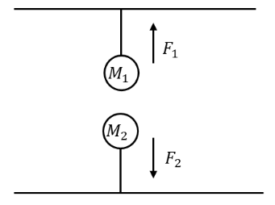

A. F_1大于F_2

B. F_1等于F_2

C. F_1小于F_2

D. 无法判断

第 81 题 · 答案与解析

**参考答案（粉笔题库参考内容）**

A

**解析**

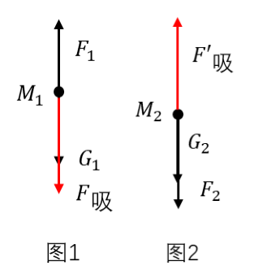

图1为磁力球M_1的受力分析图，M_1在重力G_1，上平面对的M_1拉力F_1，M_2对M_1的吸引力F_吸三个力的作用下保持平衡，三个力之间的大小关系为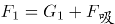；图2为磁力球M_2的受力分析图，M_2在重力G_2，下平面对M_2的拉力F_2，M_1对M_2的吸引力F_吸三个力的作用下保持平衡，三个力之间的大小关系为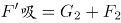，因为F_吸和F_吸为一对作用力与反作用力，两个力大小相等，方向相反，所以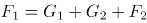，可得F_1大于F_2，A项正确，B、C、D三项均错误。

故正确答案为A。

**来源**：2022年广东省公务员录用考试《行测》题（乡镇卷）（网友回忆版）第81题

### 第 82 题

果树的光合作用主要通过绿叶进行，因此绿叶被称为“食物加工厂”。关于绿叶，下列说法最不准确的是：

A. 通过光合作用，绿叶只能生成碳水化合物

B. 叶片可以通过表皮的气孔与外界进行气体交换

C. 叶脉可以运输水分和无机物

D. 光能主要在叶绿体内转化为化学能

第 82 题 · 答案与解析

**参考答案（粉笔题库参考内容）**

A

**解析**

A项：绿叶通过光合作用，把二氧化碳和水转化成储存着能量的有机物（主要是淀粉，即选项中所说的碳水化合物），但是光合作用同时还生成氧气，并非只能生成碳水化合物，错误；

B项：植物进行光合作用需要吸收二氧化碳释放氧气，植物的呼吸作用需要吸收氧气呼出二氧化碳，氧气和二氧化碳都是从叶片的气孔进出植物体的，气孔是植物体与外界进行气体交换的“门户”，正确；

C项：叶脉是由贯穿在叶肉内的维管束或维管束及其外围的机械组织组成，它一方面为叶输送水分和无机盐（无机物），另一方面又维持了叶片的基本形状，正确；

D项：光合作用进行的主要场所是叶绿体，光能主要在叶绿体内通过光合作用转化为化学能，正确。

本题为选非题，故正确答案为A。

**来源**：2022年广东省公务员录用考试《行测》题（乡镇卷）（网友回忆版）第82题

### 第 83 题

某蔬菜种植户在农田中种植圆白菜时，采取了以下措施。关于这些情形的解释最不准确的是：

A. 圆白菜和玉米间作套种——提高农田利用率

B. 育苗时覆盖地膜——提高地表温度、保持土壤湿度

C. 长期使用化肥——可就地取材，并能改良土壤结构

D. 移栽圆白菜幼苗时带着土坨——保护幼根和根毛

第 83 题 · 答案与解析

**参考答案（粉笔题库参考内容）**

C

**解析**

A项：圆白菜和玉米间作套种，能够使作物高矮成层，相间成行，有利于改善农作物的通风透光条件，提高光能利用率，同时还提高了农田利用率，充分发挥边行优势的增产作用，正确；

B项：育苗时覆盖地膜的主要作用是防止水分蒸发、提高地表的温度，土壤中的水分因为在高温和日照的条件下，会蒸发然后凝集在薄膜上，聚少成多形成水流后，再重新滴落回去，从而为种苗提供一个保温、保湿的环境，更有利于种苗的生长，正确；

C项：长期使用化肥会使其养分不能被作物有效地吸收利用，会导致土壤性状恶化、土壤板结，不能改良土壤结构，错误；

D项：移栽圆白菜幼苗时带着土坨，主要是防止对根部根尖成熟区（主要是根毛）造成损伤，保护根部不受破坏，从而能够使其正常的生长，正确。

本题为选非题，故正确答案为C。

**来源**：2022年广东省公务员录用考试《行测》题（乡镇卷）（网友回忆版）第83题

### 第 84 题

为了缓解或者降低行驶车辆发出的噪音对居民的影响，常在离民居较近的高架桥两旁修建隔音墙。对此，下列关于隔音墙说法最不准确的是：

A. 可以吸收汽车产生的噪音

B. 可以反射汽车产生的噪音

C. 出现破裂会影响隔音效果

D. 可以从源头上减少噪音

第 84 题 · 答案与解析

**参考答案（粉笔题库参考内容）**

D

**解析**

隔音墙主要用于高速公路、高架复合道等处的隔声降噪，目的是减少噪音对居民的影响，隔音墙通常为吸声和隔声混合型的产品，采用的吸音材料可以吸收汽车产生的噪音，隔音材料可以反射汽车产生的噪音，A、B两项正确；如果隔音墙出现破裂，会使隔音墙吸收以及反射噪音的能力减弱，降低隔音效果，C项正确；隔音墙属于在传播过程中控制噪音，不是从源头上减少噪音，D项错误。

本题为选非题，故正确答案为D。

**来源**：2022年广东省公务员录用考试《行测》题（乡镇卷）（网友回忆版）第84题

### 第 85 题

如图是某地生态系统的蒸散示意图，下列说法最准确的是（ ）。

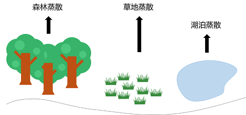

A. 环境温度升高，森林的蒸散作用减弱

B. 空气湿度越大，森林的蒸散作用越弱

C. 任意环境条件下，湖泊的蒸发量比森林蒸散量大

D. 相较于夜晚，该地生态系统在白天时蒸散作用强度明显减弱

第 85 题 · 答案与解析

**参考答案（粉笔题库参考内容）**

B

**解析**

蒸散包括蒸发作用和蒸腾作用，指的是总水分的散失，包括地面与土壤发生的水分蒸发和植物气孔进行的蒸腾作用，影响蒸散作用的因素包括温度、光照、环境湿度等。

A项：在一定温度范围内，环境温度升高，蒸散作用增强，当温度过高时，叶片气孔会关闭，蒸腾作用会减弱，但蒸发作用会增强，此时无法确定蒸散作用是增强还是减弱，错误；

B项：蒸散作用与空气湿度有关，空气湿度越大，植物蒸散作用越弱，正确；

C项：一般情况下，湖泊多的地方湖泊的蒸发量比森林的蒸散量大，但是在我国大西北地区，湖泊较森林数量少，湖泊的蒸发量就会比森林的蒸散量小，错误；

D项：光照能够促进气孔的开启，使蒸散作用增强，相较于夜晚，白天光照时间长，而且温度也较高，蒸散作用也强，错误。

故正确答案为B。

**来源**：2022年广东省公务员录用考试《行测》题（乡镇卷）（网友回忆版）第85题

## 材料 1

基层群众性自治组织是我国在城市和农村按居民的居住地区建立起来的居民委员会或村民委员会，是城市居民或农村村民自我管理、自我教育、自我服务的组织。

截止2020年底，全国基层群众性自治组织共计61.5万个，同比减少4.35%。其中，村委会50.2万个，占基层群众性自治组织的81.63%，村民小组376.1万个，村委会成员207.3万人；居委会11.3万个，占基层群众性自治组织的18.37%，居民小组123.6万个，居委会成员61.6万人。2016-2020年，我国村（居）委会完成选举数分别为9.7万个、18.2万个、27.6万个、8.8万个、6.1万个，其中，2020年村（居）委会登记选民数为1.1亿人，参与投票人数为0.65亿人。

### 第 86 题

2020年，全国基层群众性自治组织较上年减少（ ）万个。

A. 1.4

B. 2.8

C. 4.2

D. 5.6

第 86 题 · 答案与解析

**参考答案（粉笔题库参考内容）**

B

**解析**

根据题干“2020年······较上年减少（ ）万个”，可判定本题为增长量计算问题。定位统计图可知：2020年村委会有50.2万个，居委会有11.3万个，2019年村委会有53.3万个，居委会有11万个。根据公式：增长量=现期量-基期量，则2020年全国基层群众性自治组织较上年的增长量=（50.2+11.3）-（53.3+11）=61.5-64.3=-2.8万个，即减少2.8万个。

故正确答案为B。

**考点**：增长量计算、综合资料

**来源**：2022年广东省公务员录用考试《行测》题（乡镇卷）（网友回忆版）第86题

### 第 87 题

相较2019年，2020年村委会占基层群众性自治组织的比重（ ）。

A. 降低了约1.26个百分点

B. 提高了约1.26个百分点

C. 降低了约12.6个百分点

D. 提高了约12.6个百分点

第 87 题 · 答案与解析

**参考答案（粉笔题库参考内容）**

A

**解析**

根据题干“相较2019年，2020年······占·······的比重”，结合选项为降低/提高+百分点，可判定本题为两期比重问题。定位文字材料第二段可得：截止2020年底，村委会占基层群众性自治组织的81.63%；定位统计图可得：2019年村委会53.3万个，居委会11.0万个。则2019年村委会占基层群众性自治组织的比重。所求比重差=81.63%-83.0%=-1.37%，即降低了约1.37个百分点，与A项最接近。

故正确答案为A。

**考点**：两期比重、综合资料

**来源**：2022年广东省公务员录用考试《行测》题（乡镇卷）（网友回忆版）第87题

### 第 88 题

以下年份中，我国村(居)委会完成选举数同比增幅最大的是（ ）。

A. 2017年

B. 2018年

C. 2019年

D. 2020年

第 88 题 · 答案与解析

**参考答案（粉笔题库参考内容）**

A

**解析**

根据题干“以下年份中，······同比增幅最大的是”，可判定本题为一般增长率问题。定位文字材料第二段可知，2016-2020年，我国村(居)委会完成选举数分别为9.7万个、18.2万个、27.6万个、8.8万个、6.1万个。2019年和2020年我国村(居)委会完成选举数较上年均同比减少，即增长率均小于0，2017年同比增幅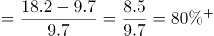，2018年同比增幅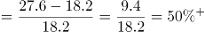，则2017年同比增幅最大。

故正确答案为A。

**考点**：一般增长率、综合资料

**来源**：2022年广东省公务员录用考试《行测》题（乡镇卷）（网友回忆版）第88题

### 第 89 题

2020年，平均每个村委会下辖的村民小组约（ ）个。

A. 3.5

B. 5.5

C. 7.5

D. 9.5

第 89 题 · 答案与解析

**参考答案（粉笔题库参考内容）**

C

**解析**

根据题干“2020年，平均每个······约······”，可判定本题为现期平均数问题。定位文字材料第二段可得：截止2020年底，全国村委会50.2万个；村民小组376.1万个。则2020年平均每个村委会下辖的村民小组数量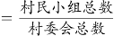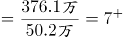个。

故正确答案为C。

**考点**：现期平均数、综合资料

**来源**：2022年广东省公务员录用考试《行测》题（乡镇卷）（网友回忆版）第89题

### 第 90 题

根据所给材料，下列说法最准确的是：

A. 2020年，村民小组数量是居民小组数量的5倍

B. 2020年，平均每个村委会的成员数量超过4人

C. 2020年，超过60%的登记选民参与了投票

D. 2015-2020年，村委会数量与居委会数量的变化趋势一致

第 90 题 · 答案与解析

**参考答案（粉笔题库参考内容）**

B

**解析**

A项：定位文字材料可知：截止2020年底，共有村民小组376.1万个，居民小组123.6万个。则村民小组数量是居民小组数量的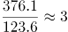倍，错误；

B项：定位文字材料可知：截止2020年底，共有村委会50.2万个，村委会成员207.3万人。根据公式：平均数=总数/个数，可得2020年，平均每个村委会的成员数量为：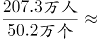4.1人＞4人，正确；

C项：定位文字材料可知：2020年村（居）委会登记选民数为1.1亿人，参与投票人数为0.65亿人。根据公式：比重=部分/总体，可得2020年参与投票人数占登记选民的比重为：，错误；

D项：定位图形材料可知，2015-2020年村委会数量呈整体下降趋势，居委会数量呈整体上升趋势，二者变化趋势并非一致，错误。

故正确答案为B。

**考点**：综合分析、综合资料

**来源**：2022年广东省公务员录用考试《行测》题（乡镇卷）（网友回忆版）第90题

## 材料 2

增加森林面积、提高森林质量、提升生态系统碳汇增量，将为我国实现碳达峰、碳中和目标、维护全球生态安全做出巨大贡献。1973年，我国开展了第一次森林资源清查。目前已完成第9次森林资源清查，我国森林面积和森林蓄积量连续30年保持“双增长”。“十三五”时期，我国累计造林5.45亿亩，森林覆盖率达到23.04%，森林蓄积量为175.6亿立方米，森林面积达到2.2亿公顷（1公顷为15亩）。湿地保护率达到52%，治理沙化土地1.5亿亩。

### 第 91 题

“十三五”期间，我国平均每公顷森林蓄积量达到（ ）立方米。

A. 5.3

B. 32.2

C. 79.8

D. 98.6

第 91 题 · 答案与解析

**参考答案（粉笔题库参考内容）**

C

**解析**

根据题干“‘十三五’期间······平均每公顷森林蓄积量······立方米”，可判定本题为现期平均数问题。定位文字材料可得：“十三五”时期······森林蓄积量为175.6亿立方米，森林面积达到2.2亿公顷（1公顷为15亩）。所求平均数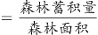≈79.8立方米/公顷。

故正确答案为C。

**考点**：现期平均数、综合资料

**来源**：2022年广东省公务员录用考试《行测》题（乡镇卷）（网友回忆版）第91题

### 第 92 题

相比第1次森林资源清查，第9次森林资源清查时，我国森林覆盖率提高了约（ ）个百分点。（本材料中森林覆盖率为森林面积占国土面积的百分比）

A. 10

B. 15

C. 20

D. 25

第 92 题 · 答案与解析

**参考答案（粉笔题库参考内容）**

A

**解析**

根据题干“······我国森林覆盖率提高了约······”，结合森林覆盖率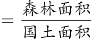，可判定本题为两期比重问题。定位文字材料和图1可得，“十三五”时期我国森林覆盖率达到23.04%，森林面积达到2.2亿公顷（1公顷为15亩）；第1次森林资源清查时，我国森林面积为18.28亿亩，第9次森林资源清查时，我国森林面积为33.07亿亩。

方法一：根据森林覆盖率，则23.04%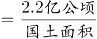，国土面积 亿公顷亿亩。根据公式：比重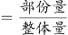，则所求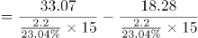≈10%，即提高了约10个百分点。

方法二：根据材料可知“十三五“时期即是第9次森林资源清查时期，故第9次资源清查时森林覆盖率为23.04%；根据森林覆盖率，则23.04%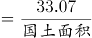，国土面积亿亩；根据公式：比重，则第1次森林资源清查时，我国森林覆盖率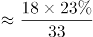≈13%，故所求≈10%，即提高了约10个百分点。

故正确答案为A。

**考点**：两期比重、综合资料

**来源**：2022年广东省公务员录用考试《行测》题（乡镇卷）（网友回忆版）第92题

### 第 93 题

2016-2018年，我国国际重要湿地面积的年均增长率约为（ ）。

A. 25%

B. 30%

C. 35%

D. 40%

第 93 题 · 答案与解析

**参考答案（粉笔题库参考内容）**

B

**解析**

根据题干“2016-2018年······年均增长率约为”，可判定本题为年均增长率问题。定位图2可得：2016年与2018年我国国际重要湿地面积分别为61.68万亩、104.24万亩。根据年均增长率公式：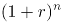（n为年份差），则(1+r)^2≈1.68，解得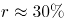。

故正确答案为B。

**考点**：年均增长率、综合资料

**来源**：2022年广东省公务员录用考试《行测》题（乡镇卷）（网友回忆版）第93题

### 第 94 题

以下选项中，最准确地反映了2017-2020年我国国际重要湿地面积、数量同比增速变化情况的是（ ）。

A. 

B. 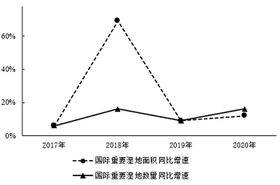

C. 

D. 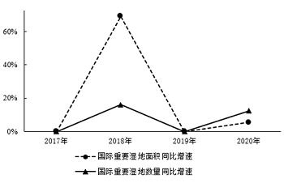

第 94 题 · 答案与解析

**参考答案（粉笔题库参考内容）**

D

**解析**

根据题干“2017-2020年······同比增速变化情况的是”，可判定本题为一般增长率问题。定位图2可得2016-2020年我国国际重要湿地面积和湿地数量。2017我国国际重要湿地面积与2016年相同，即同比增速为0，排除B、C两项；根据公式：增长率，则2018年我国国际重要湿地面积同比增速≈69%>60%，排除A项。

故正确答案为D。

**考点**：一般增长率、综合资料

**来源**：2022年广东省公务员录用考试《行测》题（乡镇卷）（网友回忆版）第94题

### 第 95 题

根据以上资料，下列说法不准确的是（ ）。

A. 我国森林蓄积量较前一次森林资源清查增幅最大的是第6次森林资源清查

B. 第5次至第9次森林资源清查，我国森林面积和森林蓄积量的变化趋势一致

C. 2016-2020年，我国平均每年增加国际重要湿地超过3个

D. 2017-2020年，我国平均每个国际重要湿地面积同比增幅最大的年份是2020年

第 95 题 · 答案与解析

**参考答案（粉笔题库参考内容）**

D

**解析**

A项：定位统计图1，可知我国第1次至第9次森林资源清查中的森林蓄积量，根据公式：增长率=，第6次森林资源清查中我国森林蓄积量增幅；第2次：；第3次：；第4次：<20%；第5次：=0%；第7次：<20%；第8次：<20%；第9次：<20%，故我国森林蓄积量较前一次森林资源清查增幅最大的是第6次森林资源清查，正确；

B项：定位统计图1，观察发现第5次至第9次森林资源清查，我国森林面积和森林蓄积量均保持增长，变化趋势一致，正确；

C项：定位统计图2，可知2016年和2020年我国国际重要湿地数量分别为49个和64个。根据公式：年均增长量，则2016-2020年我国平均每年增加国际重要湿地数量个＞3个，正确；

D项：定位统计图2，可知2016-2020年我国国际重要湿地面积分别为61.68万亩、61.68万亩、104.24万亩、104.24万亩、109.91万亩，2016-2020年我国国际重要湿地数量分别为49个、49个、57个、57个、64个。其中2017年和2019年较上年数据均未发生变化，同比增幅为0，只需比较2018年和2020年即可。根据公式：增长率，可得2018年我国平均每个国际重要湿地面积同比增幅>0，2020年同比增幅<0，则2020年我国平均每个国际重要湿地面积同比增幅并非最大，错误。

本题为选非题，故正确答案为D。

**考点**：综合分析、综合资料

**来源**：2022年广东省公务员录用考试《行测》题（乡镇卷）（网友回忆版）第95题

## 材料 3

近年来，全国基层卫生服务能力稳步提升，居民健康水平进一步提高。2020年，我国农村乡镇卫生院卫生人员数达148.1万人，比上年增加3.6万人，社区卫生人员数达52.1万人，比上年增加3.3万人。

### 第 96 题

2020年，全国农村乡镇卫生院中，卫生人员数同比增长约：

A. 1.4%

B. 2.5%

C. 3.6%

D. 4.7%

第 96 题 · 答案与解析

**参考答案（粉笔题库参考内容）**

B

**解析**

根据题干“2020年······同比增长约”，结合选项为百分数，可判定本题为一般增长率计算问题。定位文字材料可得：2020年全国农村乡镇卫生院卫生人员数比上年增加3.6万人；定位表1可得：2019年全国农村乡镇卫生院卫生人员数为144.5万人。根据公式：增长率，可得所求增长率，与B项最接近。

故正确答案为B。

**考点**：一般增长率、综合资料

**来源**：2022年广东省公务员录用考试《行测》题（乡镇卷）（网友回忆版）第96题

### 第 97 题

2020年，全国社区卫生服务中心平均每名医师全年担负诊疗人次比全国农村乡镇卫生院的约多（ ）人次。

A. 1576

B. 1976

C. 2376

D. 2776

第 97 题 · 答案与解析

**参考答案（粉笔题库参考内容）**

B

**解析**

定位统计表1、2可知：2020年全国农村乡镇卫生院平均每名医师日均担负诊疗人次为8.5，全国社区卫生服务中心平均每名医师日均担负诊疗人次为13.9。2020年为闰年，所以全年为366天。2020年，全国社区卫生服务中心平均每名医师全年担负诊疗人次比全国农村乡镇卫生院的约多人次。

故正确答案为B。

**考点**：综合资料、简单加减计算

**来源**：2022年广东省公务员录用考试《行测》题（乡镇卷）（网友回忆版）第97题

### 第 98 题

2020年，平均每个乡镇床位数约为每个街道床位数的（ ）倍。

A. 0.5

B. 2

C. 3

D. 4

第 98 题 · 答案与解析

**参考答案（粉笔题库参考内容）**

B

**解析**

根据题干“2020年······约为······的（ ）倍”，可判定本题为现期倍数问题。定位表1可得：2020年乡镇床位数为139.0万张，乡镇数为3.00万个；定位表2可得：2020年街道床位数为22.6万张，街道数为8773个。则2020年，平均每个乡镇床位数为每个街道床位数的倍，与B项最接近。

故正确答案为B。

**考点**：现期倍数、综合资料

**来源**：2022年广东省公务员录用考试《行测》题（乡镇卷）（网友回忆版）第98题

### 第 99 题

2020年，全国农村乡镇卫生院卫生人员中，执业（助理）医师占比约为（ ）。

A. 25%

B. 30%

C. 35%

D. 40%

第 99 题 · 答案与解析

**参考答案（粉笔题库参考内容）**

C

**解析**

根据题干“2020年······中······占比约为”，结合材料给出的2020年数据，可以判定本题为现期比重问题。定位表1可得，2020年，全国农村乡镇卫生院卫生人员数为148.1万人，其中执业（助理）医师人员数为52.0万人。根据比重=部分/总体，故所求比重为≈35%。

故正确答案为C。

**考点**：现期比重、综合资料

**来源**：2022年广东省公务员录用考试《行测》题（乡镇卷）（网友回忆版）第99题

### 第 100 题

根据所给材料，下列说法最不准确的是：

A. 与2019年相比，2020年全国乡镇卫生院卫生技术人员和社区卫生服务中心卫生技术人员均有所增加

B. 2020年，平均每个街道社区卫生服务中心数与2019年基本持平

C. 2019-2020年，全国乡镇卫生院年平均入院人数是全国社区服务中心的十倍以上

D. 2019年，全国农村人口约为8亿

第 100 题 · 答案与解析

**参考答案（粉笔题库参考内容）**

D

**解析**

A项：定位表1可得，2019年、2020年全国农村乡镇卫生院卫生技术人员分别为123.2、126.7万人；定位表2可得，2019年、2020年全国社区卫生服务中心卫生技术人员分别为41.5、44.4万人，2020年两者均比2019年有所增加，正确；

B项：定位表2可得，2019年、2020年街道数分别为8515、8773个，社区卫生服务中心数分别为9561、9826个，则2019年平均每个街道社区卫生服务中心数个，2020年平均每个街道社区卫生服务中心数个，两者基本持平，正确；

C项：定位表1可得，2019年、2020年全国农村乡镇卫生院入院人数分别为3909、3383万人；定位表2可得，2019年、2020年全国社区服务中心入院人数分别为339.5、292.7万人，则2019-2020年，全国乡镇卫生院年平均入院人数万人，全国社区服务中心年平均入院人数万人，前者是后者的倍，正确；

D项：定位表1可得，2019年全国农村乡镇卫生院床位数为137.0万张，每千农村人口乡镇卫生院床位为1.48张，则2019年农村人口数 千人=9.1亿人，错误。

本题为选非题，故正确答案为D。

**考点**：综合分析、综合资料

**来源**：2022年广东省公务员录用考试《行测》题（乡镇卷）（网友回忆版）第100题

