# 2022 广东省公务员录用考试 行测（县级卷）

> 行测 · 96 题 · 广东 2022

## 第 1 题　qid 4673098 · 人文常识

党的十八大以来，我们深化对民主政治发展规律的认识，提出（    ）的重大理念，其不仅有完整的制度程序，而且有完整的参与实践。

- **A**. 全方位人民民主
- **B**. 全链条人民民主
- **C**. 全过程人民民主
- **D**. 全覆盖人民民主

## 第 2 题　qid 4673101 · 人文常识

《中共中央关于党的百年奋斗重大成就和历史经验的决议》阐明了四个历史时期党面临的主要任务，以下关于各个历史时期党面临的主要任务表述正确的是（    ）。

- **A**. 新民主主义革命时期——继续探索中国建设社会主义的正确道路，解放和发展社会生产力，使人民摆脱贫困、尽快富裕起来，为实现中华民族伟大复兴提供充满新的活力的体制保证和快速发展的物质条件
- **B**. 社会主义革命和建设时期——反对帝国主义、封建主义、官僚资本主义，争取民族独立、人民解放，为实现中华民族伟大复兴创造根本社会条件
- **C**. 改革开放和社会主义现代化建设新时期——实现从新民主主义到社会主义的转变，进行社会主义革命，推进社会主义建设，为实现中华民族伟大复兴奠定根本政治前提和制度基础
- **D**. 中国特色社会主义新时代——实现第一个百年奋斗目标，开启实现第二个百年奋斗目标新征程，朝着实现中华民族伟大复兴的宏伟目标继续前进

## 第 3 题　qid 4673105 · 人文常识

近年来，我国在“大国重器”的研发上成果显著，捷报频传。以下关于“大国重器”与其宣传语的对应关系不正确的是（    ）。

- **A**. “奋斗者号”——只有沉得下去，才能浮得上来
- **B**. “复兴号”——暂时地降落是为了下一次更好地起飞
- **C**. “北斗三号”——其实，方向比方法更重要
- **D**. “中国天眼”——要仰望星空，也要脚踏实地

## 第 4 题　qid 4673107 · 人文常识

在经济全球化时代，任何一个国家都不可能孤立于世界之外，团结合作是所有国家的必然选择，各国人民更需要同舟共济、共克时艰。
下列选项最符合该观点内涵的是（    ）。

- **A**. 人视水见形，视民知治不
- **B**. 孤举者难起，众行者易趋
- **C**. 安而不忘危，存而不忘亡
- **D**. 天不言而四时行，地不语而百物生

## 第 5 题　qid 4673097 · 人文常识

马克思主义指引中国成功走上了全面建设社会主义现代化强国的康庄大道，事业越向前发展，新情况新问题势必越多，更应重视理论的作用，增强理论自信和战略定力。这主要体现了（    ）。

- **A**. 认识对实践有着巨大的指导作用
- **B**. 一切从实际出发，实事求是
- **C**. 实践是检验真理的唯一标准
- **D**. 认识是主体对客体的能动反映

## 第 6 题　qid 4673102 · 科技常识

《中华人民共和国国民经济和社会发展第十四个五年规划和2035年远景目标纲要》提出“推进能源革命，建设清洁低碳、安全高效的能源体系”。以下措施有助于建设清洁低碳、安全高效的能源体系的是（    ）。
①提升光伏发电规模
②推进以电代煤
③推动沿海核电建设
④有序发展海上风电

- **A**. ①④
- **B**. ②③
- **C**. ②③④
- **D**. ①②③④

## 第 7 题　qid 4673109 · 人文常识

结构性就业问题是因经济结构和劳动力结构不对应，使工作岗位要求与劳动者文化技术水平不相适应而产生的就业问题。以下措施最有助于缓解结构性就业问题的是（    ）。

- **A**. 鼓励创业带动就业，支持多渠道灵活就业
- **B**. 持续、大规模、多层次开展职业培训
- **C**. 完善就业失业统计监测调查体系
- **D**. 健全覆盖城乡劳动者的社会保障体系

## 第 8 题　qid 4673113 · 人文常识

推进农业绿色发展，有助于加快农业现代化，全面推进乡村振兴。关于“推进农业绿色发展”，下列说法准确的是（    ）。

- **A**. 全面实行全国草原禁牧
- **B**. 放开对非农建设占用耕地的限制
- **C**. 发展节水农业和旱作农业
- **D**. 鼓励发展各种形式规模的农业经营

## 第 9 题　qid 4673116 · 科技常识

1970年4月24日，我国自行设计、制造的（    ）发射成功，是我国航天空间技术的一个重要里程碑。自2016年起，我国将每年4月24日设立为“中国航天日”。

- **A**. 第一颗人造地球卫星“东方红一号”
- **B**. 第一艘载人航天飞船“神舟五号”
- **C**. 第一颗月球探测卫星“嫦娥一号”
- **D**. 第一艘无人试验飞船“神舟一号”

## 第 10 题　qid 4673131 · 人文常识

第一次国共合作实现后，以（    ）为中心汇集全国革命力量，很快开创了反对帝国主义和封建军阀的革命新局面。

- **A**. 北京
- **B**. 广州
- **C**. 上海
- **D**. 武汉

## 第 11 题　qid 4673134 · 人文常识

毛泽东一生中写下了许多脍炙人口的诗句，其中描写长征的是（    ）。

- **A**. 独立寒秋，湘江北去，橘子洲头
- **B**. 宜将剩勇追穷寇，不可沽名学霸王
- **C**. 七百里驱十五日，赣水苍茫闽山碧
- **D**. 更喜岷山千里雪，三军过后尽开颜

## 第 12 题　qid 4673137 · 法律常识

根据《党政领导干部选拔任用工作条例》，党政领导干部应当逐级提拔。特别优秀或者工作特殊需要的干部，符合有关条件或情形的可以破格提拔。以下不属于可以破格提拔的条件或情形的是（    ）。

- **A**. 经济发达、高新技术产业发展地区急需引进的
- **B**. 在条件艰苦、环境复杂、基础差的地区或者单位工作实绩突出
- **C**. 专业性较强的岗位或者重要专项工作急需的
- **D**. 在关键时刻或者承担急难险重任务中经受住考验、表现突出、作出重大贡献

## 第 13 题　qid 4673099 · 经济常识

以下是我国改革开放以来发生的重大事件，按时间先后顺序排列正确的是（    ）。
①脱贫攻坚战取得全面胜利②加入世界贸易组织③全面取消农业税
④香港、澳门回归祖国⑤北京举办第二十九届夏季奥运会

- **A**. ④②③⑤①
- **B**. ②⑤④③①
- **C**. ④②⑤①③
- **D**. ②①⑤③④

## 第 14 题　qid 4673141 · 人文常识

以下广告宣传用语中，不存在科学性错误的是（    ）。

- **A**. 矿泉水营养丰富，喝了就能满足你和家人每日的矿物质需求
- **B**. 当季新鲜柑橘含有丰富的维生素C，有助于提高人体免疫力
- **C**. 本台灯采用0频闪技术，灯光不再有闪烁，更能保护眼睛
- **D**. 新款无糖月饼只用果糖，不添加蔗糖，让你多吃也不发胖

## 第 15 题　qid 4673144 · 科技常识

以下诗句和所描述的植物对应有误的是（    ）。

- **A**. 暗淡轻黄体性柔，情疏迹远只香留——桂花
- **B**. 千磨万击还坚劲，任尔东西南北风——梅花
- **C**. 菡萏香销翠叶残，西风愁起绿波间——荷花
- **D**. 此心生不背朝日，肯信众草能蘙之——葵花

## 第 16 题　qid 4673148 · 科技常识

对下列生活中的现象或做法解释不合理的是（    ）。

- **A**. 物体的热胀冷缩——分子随温度升高而变大
- **B**. 油锅着火用锅盖盖灭——使可燃物与空气隔绝
- **C**. 在铁制品表面刷油漆——避免铁制品氧化生锈
- **D**. 利用真空袋包装食品——破坏需氧菌类的生存环境

## 第 17 题　qid 4673159 · 科技常识

镜子前面放有一个圆球。如图是某人站在镜子前从某个角度看到的圆球和其镜像位置关系示意图，则此人在镜子前所站的位置及视角最可能是（    ）。

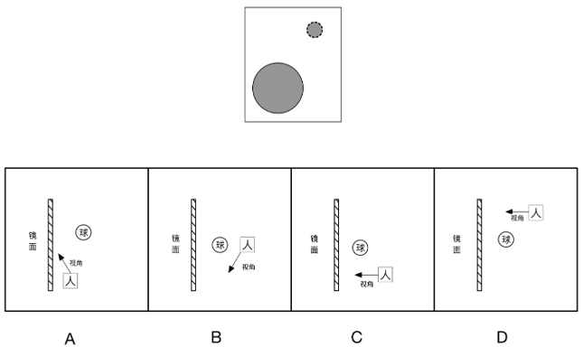

- **A**. A
- **B**. B
- **C**. C
- **D**. D

## 第 18 题　qid 4673166 · 科技常识

如图是某家庭电路图的一部分，家庭内各电器均正确接入电路。则以下说法准确的是（    ）。

- **A**. 假如乙和甲分别是电器或开关，则丙是开关
- **B**. 假如电路正常，正确使用试电笔接触三孔插座的孔都会显示有电流
- **C**. 假如甲是带金属外壳的用电器，则它接的是三孔插座
- **D**. 假如零线被烧断，应立即关闭开关，否则会引起短路

## 第 19 题　qid 4673153 · 科技常识

食物链主要反映了生产者与消费者之间的联系，下列关系中最能准确表示食物链的是（    ）。

- **A**. 
草兔狐鹰

- **B**. 
阳光草鸡狼

- **C**. 
虫鸟蛇

- **D**. 
草羊虎微生物

## 第 20 题　qid 4673155 · 科技常识

如图，甲、乙两个相同的容器中盛着不同的液体，当相同的小球漂浮在容器中并保持静止时，容器中液面的高度相同，则下列说法准确的是（    ）。

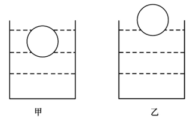

- **A**. 小球在甲容器中受到浮力比在乙容器中的小
- **B**. 小球在甲容器中受到浮力比在乙容器中的大
- **C**. 甲容器中液体的密度比乙容器中液体的小
- **D**. 甲容器中液体的密度比乙容器中液体的大

## 第 21 题　qid 4673171 · 科技常识

如图是某地生态系统的蒸散示意图，下列说法最准确的是（    ）。

- **A**. 环境温度升高，森林的蒸散作用减弱
- **B**. 空气湿度越大，森林的蒸散作用越弱
- **C**. 任意环境条件下，湖泊的蒸发量比森林蒸散量大
- **D**. 相较于夜晚，该地生态系统在白天时蒸散作用强度明显减弱

## 第 22 题　qid 4673158 · 科技常识

以下为甲、乙两车行驶情况的示意图，已知甲、乙同时从一起点出发，甲车在水平道路上匀速直线行驶，乙车在同一水平的道路上匀减速直线行驶，则在两车行驶的过程中，下列说法准确的是（    ）。

- **A**. 甲车的速度为15m/s
- **B**. 乙车的初始速度为25m/s
- **C**. 45s时，乙车行驶的路程更远
- **D**. 50s时，乙车仍处于行驶状态

## 第 23 题　qid 4673163 · 科技常识

如图，小球在细绳的牵引下从A点自由摆动到C点，B点是最低点。若忽略空气阻力，则下列说法不准确的是（    ）。

- **A**. 从A点到B点小球的动能增加
- **B**. 从B点到C点小球的势能增加
- **C**. 在B点小球的动能最大
- **D**. 从A点到C点小球的机械能增加

## 第 24 题　qid 4673173 · 科技常识

如图，用绳子分别将两颗不同的磁力球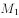和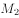系在上、下两个平面上，、互相吸引，此时上平面对的作用力为，下平面对的作用力为 ，则以下关于、说法准确的是：

- **A**. 
大于

- **B**. 
等于

- **C**. 
小于

- **D**. 
无法判断

## 第 25 题　qid 4673168 · 科技常识

如图是某种固态物质在加热过程中，温度随时间变化的图像。下列说法最不准确的是（    ）。

- **A**. 该固态物质有固定的熔点
- **B**. 该固态物质在熔化过程中，比热容增大
- **C**. 温度为0℃时，该物质可能处于固液共存状态
- **D**. 该固态物质在熔化时不断吸收热量，温度不断升高

## 第 26 题　qid 4673106 · 逻辑填空

每一寸鲜血浸染的红色热土，每一段感人至深的红色往事，都        着艰苦卓绝的牺牲奉献，        着气吞山河的壮丽辉煌，是全党全国各族人民弥足珍贵的精神财富。
依次填入画横线部分最恰当的一项是（    ）。

- **A**. 汇聚 镌刻
- **B**. 凝聚 描绘
- **C**. 汇集 勾勒
- **D**. 凝结 铭刻

## 第 27 题　qid 4673110 · 逻辑填空

党的百年历史，就是党与群众水乳交融、            的历史。一条扁担、一张借据、半条棉被就是党与人民血肉相连、情深似海的        。
依次填入画横线部分最恰当的一项是（    ）。

- **A**. 唇齿相依 印记
- **B**. 相濡以沫 记忆
- **C**. 休戚与共 见证
- **D**. 众志成城 证明

## 第 28 题　qid 4673112 · 逻辑填空

一代代特区建设者            、艰苦创业，将昔日落后的边陲小镇、荒滩渔村建成了繁华的现代化城市，在建设中国特色社会主义伟大进程中谱写了勇立潮头、            的壮丽篇章。
依次填入画横线部分最恰当的一项是（    ）。

- **A**. 披荆斩棘 开拓进取
- **B**. 紧锣密鼓 开天辟地
- **C**. 一往无前 开云见日
- **D**. 乘风破浪 开疆拓土

## 第 29 题　qid 4673104 · 逻辑填空

新时代现实世界是如此新鲜丰富、多姿多彩，生活的            、人民的拼搏奋斗、家庭的            、百姓的爱恨喜痛，都值得作家去侧耳倾听、用心思考、挥笔书写，真正做到语出一人之口，呼出万众之声。
依次填入画横线部分最恰当的一项是（    ）。

- **A**. 日新月异 酸甜苦辣
- **B**. 精彩纷呈 跌宕起伏
- **C**. 精妙绝伦 悲欢离合
- **D**. 一日千里 喜怒哀乐

## 第 30 题　qid 4673114 · 逻辑填空

社会是企业家施展才华的舞台。        真诚回报社会、切实履行社会责任的企业家，        能真正得到社会认可，        是符合时代要求的企业家。
依次填入画横线部分最恰当的一项是（    ）。

- **A**. 只有 才 才
- **B**. 只要 就 就
- **C**. 如果 不仅 还
- **D**. 因为 所以 就

## 第 31 题　qid 4673100 · 片段阅读

建设生态文明，要在形成支持绿色发展、循环发展、低碳发展的机制上下真功夫、下大气力；主动抓住新一轮科技革命和产业变革带来的新机遇，掌握革命性、关键性绿色核心技术，进而带动生态技术和生态产业交叉融合、群体跃进。换言之，从“生产力与生产关系矛盾运动规律”来看，如同“铁和犁”于农业文明、“纺纱机和蒸汽机”于工业文明一样，只有实现绿色生产力和绿色生产关系的根本性变革，生态文明才会成为真正引领人类文明的新形态。
对上述文段理解最准确的是（    ）。

- **A**. 生态文明是人类文明形态中的最高级阶段
- **B**. 生产力和生产关系的辩证关系决定了生态文明的发展
- **C**. 实现绿色生产关系变革的关键是取得绿色核心技术突破性进展
- **D**. 形成支持绿色、循环和低碳发展的机制是生态文明建成的标志

## 第 32 题　qid 4673108 · 语句表达

国有企业作为中国特色社会主义经济制度重要载体，是我国经济社会发展的中坚力量。当前，国有企业改革和发展面临新问题和新挑战，特别是在全面建成小康社会，开启建设社会主义现代化国家新征程的重要历史交汇时刻，国有企业要以“                    ”的顽强意志，把企业党建建在实处，应对好每一场重大风险挑战，提高企业效益、增强企业竞争实力，实现又好又快发展，成为改革的主力军和先行者。
下列句子填入画横线处，最恰当的是（    ）。

- **A**. 踏平坎坷成大道，斗罢艰险又出发
- **B**. 山重水复疑无路，柳暗花明又一村
- **C**. 没有比人更高的山，没有比脚更长的路
- **D**. 世上无难事，只要肯登攀

## 第 33 题　qid 4673111 · 片段阅读

对互联网金融加强监管，不是为了制约互联网企业，而是鼓励和保护真正有价值的金融创新，促进互联网金融规范有序健康发展。广大互联网企业只有正确认识行业监管与自身发展的关系，将监管要求内化到企业经营管理中，才能更好地走上规范健康发展的轨道。
上述文段主要讲了（    ）。

- **A**. 推进互联网金融监管创新的价值
- **B**. 当前互联网企业面临的机遇和挑战
- **C**. 制约互联网企业健康发展的客观因素
- **D**. 互联网金融监管对企业发展的重要性

## 第 34 题　qid 4673115 · 片段阅读

“为什么我的时间总是不够用？”我们常被这个问题困扰。我们抱怨有太多事情要做，好像永远都做不完。于是“没有时间”成了我们的口头禅。在这种背景下，“时间管理”理念应运而生。时间管理倡导的很多方法，并不是要让人们逃离现代性境遇所构筑的牢笼，而是对其加以技术性强化。时间管理原本是要教会我们更精细、更严苛地分割利用时间，由于人们的主观感受常常不一样，有些人依然会觉得时间不够用，事情永远做不完，甚至为此心力交瘁。
对上述文段理解最准确的是（    ）。

- **A**. 精细化地分割和利用时间是时间管理的本质要求
- **B**. 时间管理没有完全解决人们“时间不够用”的困扰
- **C**. 对时间进行技术性强化是一种有效的时间管理办法
- **D**. 严格的时间管理在一定程度上会左右人们的主观感受

## 第 35 题　qid 4673103 · 语句表达

①种种乱象对青少年心理、观念、行为和健康成长容易产生消极影响。
②青少年是人生“起步”阶段，他们的思想意识、价值观念和人格正处于养成过程中。
③另一方面也一定要身体力行，引导孩子形成勤俭奋斗的生活习惯，要狠下心来与包办孩子的一切说“再见”。
④为此，身为家庭教育的主角，家长一方面要注重孩子的知识教育。
⑤只有这样，才能把孩子培养成人格健全、自信自尊自强的大写的“人”。
⑥但目前对青少年的养成教育上，家庭、学校、社会和网络舆论之间，却不同程度地存在悖谬现象，言行背离、理论与实践脱节。
将以上6个句子重新排列，最恰当的是（    ）。

- **A**. ②④③⑥①⑤
- **B**. ②⑥①④③⑤
- **C**. ①⑥④③②⑤
- **D**. ①②④⑤③⑥

## 第 36 题　qid 4673194 · 数学运算

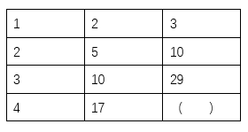

- **A**. 62
- **B**. 64
- **C**. 66
- **D**. 68

## 第 37 题　qid 4673156 · 数学运算

小李开车从甲市到乙市，需要走一段高速公路和一段国道。已知在高速公路上汽车油耗为0.05升/公里，在国道上油耗比在高速公路上多0.03升/公里。小李在高速公路上行驶了200公里，是在国道上行驶路程的4倍，则从甲市到乙市，小李汽车的油耗为（    ）升。

- **A**. 15
- **B**. 14
- **C**. 12
- **D**. 10

## 第 38 题　qid 4673157 · 数学运算

小陈计划在一定时间内完成法律常识题库中的所有练习题。如果每天做50道题，那么最后2天每天要做85道题才能完成，如果每天做55道题，恰好可以提前1天完成，则该题库共有（    ）道题。

- **A**. 1215
- **B**. 1250
- **C**. 1320
- **D**. 1375

## 第 39 题　qid 4673165 · 数学运算

某单位计划从全部80名员工中挑选专项工作组成员，要求该组成员须同时有基层经历和计算机等级证书。已知，单位内有40人有基层经历，有46人有计算机等级证书，既没有基层经历又未获得计算机等级证书的有10人。那么能够进入工作组的员工有（    ）人。

- **A**. 16
- **B**. 40
- **C**. 46
- **D**. 54

## 第 40 题　qid 4673160 · 数学运算

甲、乙、丙3个单位订阅同一款报刊，已知3个单位共订了12份，其中，每个单位订阅数量不少于3份，但不超过5份，则这3个单位的报刊订阅数量可能有（    ）种组合。

- **A**. 2
- **B**. 6
- **C**. 7
- **D**. 9

## 第 41 题　qid 4673151 · 数学运算

某街道对辖内6个社区的垃圾分类情况进行考核评估，结果显示，有2个社区的垃圾分类考核不通过。如果从6个社区中随机抽取3个进行现场检查，则抽取的社区中，既有考核通过的又有考核不通过的社区的概率为（    ）。

- **A**. 

- **B**. 

- **C**. 

- **D**. 

## 第 42 题　qid 4673118 · 数学运算

有一个长方形花坛，长为10米，宽为8米。现要在花坛四周安装栅栏，要求4个顶点处各插一根木桩，除顶点处的木桩外，每边还要插若干木桩，且每两根木桩间的距离至少为3米，则最多可以插（    ）根木桩。

- **A**. 10
- **B**. 12
- **C**. 14
- **D**. 16

## 第 43 题　qid 4673120 · 数学运算

甲、乙两人计划分装会议材料，9点多先后开始工作，且两人每分钟完成分装的份数相同。9点38分时，甲完成的份数是乙的4倍，9点53分时，甲完成的份数是乙的1.5倍。那么，甲比乙早（    ）分钟开始工作。

- **A**. 4
- **B**. 6
- **C**. 8
- **D**. 9

## 第 44 题　qid 4673122 · 数学运算

为鼓励员工阅读，某单位与购书中心合作，员工购书时，享受原价的7折优惠，且打折后每本书还可叠加使用单位提供的5元补贴券。员工小陈买了5本书，且每本书折后价均超过5元，扣除补贴后自己只花了48.5元，则这些书的原价一共为（    ）元。

- **A**. 75
- **B**. 85
- **C**. 95
- **D**. 105

## 第 45 题　qid 4673125 · 数学运算

楼道上方有一盏灯，小刘径直走向这盏灯。一开始, 他发现自己影子的长度为3.2米，前进1米后，发现影子缩短为1.6米。已知小刘身高为1.6米，则这盏灯的高度约为（    ）米。

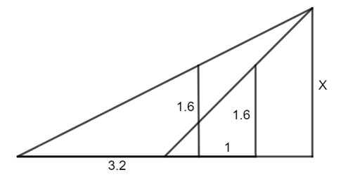

- **A**. 2.6
- **B**. 2.8
- **C**. 3.2
- **D**. 3.4

## 第 46 题　qid 4673136 · 数学运算

如图，仓库有一堆管材，每一层的数量都比上一层多1根。搬运工人将管材逐根搬离，搬了99根后发现，管材堆少了3层，且剩余每层的管材数量都减少了3根。如果这堆管材刚好还剩10层，则剩下的管材共有（    ）根。

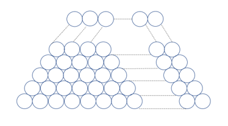

- **A**. 245
- **B**. 265
- **C**. 305
- **D**. 325

## 第 47 题　qid 4673146 · 图形推理

如图所给的3个立方体为同一立方体，若不考虑立方体表面数字的大小、方向，下列选项中，最有可能是该立方体的是（    ）。

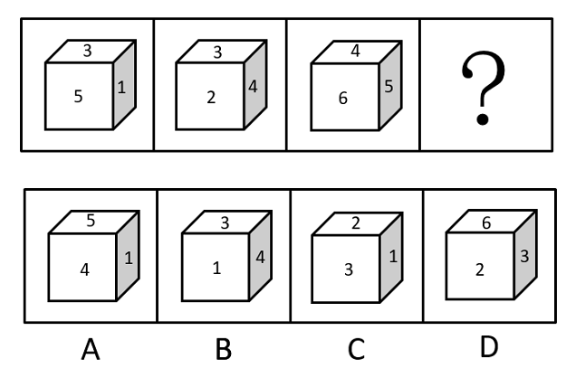

- **A**. A
- **B**. B
- **C**. C
- **D**. D

## 第 48 题　qid 4673170 · 图形推理

下列选项中最符合所给图形规律的是（    ）。

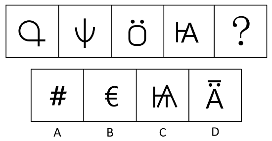

- **A**. A
- **B**. B
- **C**. C
- **D**. D

## 第 49 题　qid 4673172 · 图形推理

如图是某立方体的平面展开图，则该立方体最可能是：

- **A**. A
- **B**. B
- **C**. C
- **D**. D

## 第 50 题　qid 4673129 · 图形推理

如图是一个物体某两个角度的视图，则该图形最有可能是（    ）。

- **A**. A
- **B**. B
- **C**. C
- **D**. D

## 第 51 题　qid 4673138 · 图形推理

下列选项中最符合所给图形规律的是：

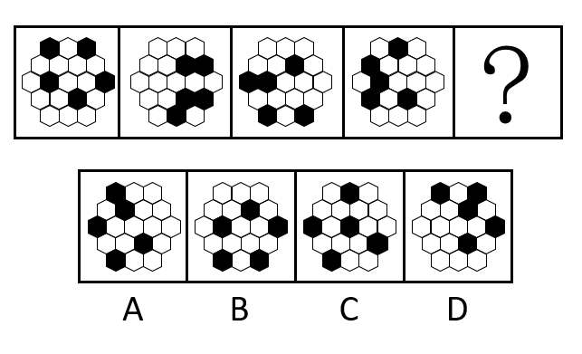

- **A**. A
- **B**. B
- **C**. C
- **D**. D

## 第 52 题　qid 4673130 · 图形推理

从所给的四个选项中，选择最合适的一个填入问号处，使之呈现一定的规律性：

- **A**. A
- **B**. B
- **C**. C
- **D**. D

## 第 53 题　qid 4673201 · 图形推理

从所给的四个选项中，选择最合适的一个填入问号处，使之呈现一定的规律性：

- **A**. A
- **B**. B
- **C**. C
- **D**. D

## 第 54 题　qid 4673178 · 图形推理

下列选项中最符合所给图形规律的是（    ）。

- **A**. A
- **B**. B
- **C**. C
- **D**. D

## 第 55 题　qid 4673180 · 图形推理

下列选项中最符合所给图形规律的是（    ）。

- **A**. A
- **B**. B
- **C**. C
- **D**. D

## 第 56 题　qid 4673195 · 图形推理

从所给的四个选项中，选择最合适的一个填入问号处，使之呈现一定的规律性：

- **A**. A
- **B**. B
- **C**. C
- **D**. D

## 第 57 题　qid 4673126 · 类比推理

耳塞：噪音

- **A**. 书籍：知识
- **B**. 蜡烛：光明
- **C**. 肥皂：污渍
- **D**. 风扇：低温

## 第 58 题　qid 4673128 · 类比推理

洽谈：合作

- **A**. 考试：成绩
- **B**. 打磨：切割
- **C**. 施肥：灌溉
- **D**. 投资：收益

## 第 59 题　qid 4673191 · 类比推理

文字：诗词：绝句

- **A**. 笔画：隶书：汉字
- **B**. 音符：乐谱：五线谱
- **C**. 税收：财政：货币
- **D**. 树木：森林：生态

## 第 60 题　qid 4673127 · 类比推理

法律：诉讼：胜败

- **A**. 策略：经营：盈亏
- **B**. 战争：武器：存亡
- **C**. 判断：事实：对错
- **D**. 教师：教学：优劣

## 第 61 题　qid 4673190 · 类比推理

志同道合：沆瀣一气

- **A**. 居安思危：杞人忧天
- **B**. 鼠目寸光：高瞻远瞩
- **C**. 举棋不定：优柔寡断
- **D**. 口若悬河：信口开河

## 第 62 题　qid 4673150 · 类比推理

我国法律规定，用人单位由于生产经营需要，经协商，取得工会和劳动者同意后可以延长工作时间，且一般每日不超过一小时。某国有企业有员工在周五晚上延长工作时间，但并没有违法。
根据上述信息可以推知（    ）。

- **A**. 该企业员工延长工作一定不超过一小时
- **B**. 该企业所有员工都同意延长工作时间
- **C**. 该企业工会同意延长工作时间
- **D**. 该企业属于不受工作时间限制的特殊行业

## 第 63 题　qid 4673152 · 类比推理

子曰：“名不正，则言不顺；言不顺，则事不成；事不成，则礼乐不兴；礼乐不兴，则刑罚不中；刑罚不中，则民无所措手足。”
根据以上论述，下列推断必然正确的是（    ）。
①名正则言顺
②礼乐兴则事已成
③名不正，则民无所措手足
④只有名正言顺才事可成

- **A**. ①②
- **B**. ②③
- **C**. ②③④
- **D**. ①②③④

## 第 64 题　qid 4673162 · 逻辑判断

某机构对在广州有创业、就业、实习等经历的港澳青年进行调查，结果显示，有留穗发展意愿的港澳青年比例占七成以上；九成港澳青年通过实习了解和认识广州；有超过一半的港澳青年非常看好粤港澳大湾区的发展前景。因此，来广州实习有助于港澳青年获得对粤港澳大湾区的认同感。
要使上述推论成立，可以补充的前提是（    ）。

- **A**. 熟悉广州有助于港澳青年更好地适应在广州工作和生活
- **B**. 港澳青年的留穗发展意愿是其对粤港澳大湾区具有认同感的重要表现
- **C**. 通过实习，港澳青年对粤港澳大湾区发展前景更有信心
- **D**. 超过一半的在穗实习港澳青年参与了这项调查

## 第 65 题　qid 4673167 · 逻辑判断

某高校调查本校学生的兴趣爱好后发现，喜欢打羽毛球的学生中，来自体育学院的学生一定喜欢登山。
根据以上条件，下列情况必定属实的是（    ）。

- **A**. 甲喜欢打羽毛球和登山，则甲是体育学院的学生
- **B**. 乙是体育学院的学生，且喜欢登山，则乙喜欢打羽毛球
- **C**. 丁不喜欢打羽毛球和登山，则丁不是体育学院的学生
- **D**. 丙喜欢打羽毛球，不喜欢登山，则丙不是体育学院的学生

## 第 66 题　qid 4673133 · 逻辑判断

逻辑思维能力是一个人最重要的能力之一，但大部分学校都没有开设专门培养逻辑思维能力的课程。
以下选项若为真，最能有效解释上述现象的是（    ）。

- **A**. 学校内绝大多数课程的设计核心都是提高学生的逻辑思维能力
- **B**. 人们的逻辑思维能力往往能随着学识和社会阅历的增长自然提高
- **C**. 绝大多数大学设有关于逻辑思维能力的公共选修课程
- **D**. 部分教师对于如何培养逻辑思维能力并没有清晰的认识

## 第 67 题　qid 4673174 · 类比推理

某单位将《稻穗》《播种》两件乡村新风摄影作品选送参赛。关于这两件作品能否获奖，该单位员工有以下猜测：
（1）两件作品都能获奖。
（2）只有一件作品能获奖。
（3）《稻穗》不会获奖。
（4）《播种》会获奖。
结果表明，其中只有一个猜测正确。则以下判断一定正确的是（    ）。

- **A**. 《稻穗》获奖了
- **B**. 《稻穗》没获奖
- **C**. 《播种》获奖了
- **D**. 《播种》没获奖

## 第 68 题　qid 4673176 · 逻辑判断

某青年教师学习小组需由2位七年级和1位八年级的教师组成，并且教师教授的科目各不相同。七年级的候选人有：语文老师甲，数学老师乙，英语老师丙；八年级的候选人有：数学老师丁，历史老师戊，语文老师己。则以下人选组合能够满足条件的是（    ）。

- **A**. 甲，己，戊
- **B**. 甲，乙，己
- **C**. 乙，丙，戊
- **D**. 乙，丙，丁

## 第 69 题　qid 4673181 · 定义判断

有调查发现，某镇的乡村振兴工作中，由县农业部门工作人员担任驻村工作队队长的村庄其农业产业发展速度明显快于由其他部门工作人员担任驻村工作队队长的村庄。据此有人认为，县农业部门的工作人员更重视当地的农业产业发展，而农业产业发展是增加当地农民收入的重要手段，因此县农业部门的工作人员开展乡村振兴工作成效往往较好。
以下选项中属于上述论证过程中隐含前提的是（    ）。

- **A**. 农业部门工作人员往往有更多农业产业相关的专业知识
- **B**. 农民收入是评价乡村振兴工作成效的重要指标
- **C**. 乡村振兴工作的成效只能用农业产业发展情况来衡量
- **D**. 不同村庄农民收入在乡村振兴工作开展前基本持平

## 第 70 题　qid 4673175 · 逻辑判断

有研究表明，随着人均收入水平的提高，人民对生活的满意度也提高了。因此，政府应该大力发展经济，从而增加人民的人均收入。
上述研究的推论暗含的前提是（    ）。

- **A**. 人均收入水平的提高能满足人民群众精神层面的需求
- **B**. 人民对生活的满意程度取决于政府在经济建设上的投入力度
- **C**. 提升人民对生活的满意度是政府工作的主要任务之一
- **D**. 人均收入水平的提高对人民满意度的提升作用会不断增强

## 第 71 题　qid 4673169 · 逻辑判断

如今越来越多企业认识到中欧班列具有时效更高、周转更快等优势，从而选择通过中欧班列发运货物。例如，在广州大朗站，2021年前9个月已开行出口中欧班列97列、发运标箱9698个、货值29.47亿元，同比分别增长25.97%、33.80%、19.94%。尽管大朗站的工作人员数量没有明显增加，但有不少企业发现，大朗站货物通关效率比去年更高了。
下列选项最能解释这一现象的是（    ）。

- **A**. 珠三角地区增设了多个通关口岸
- **B**. 当地海关简化了通关流程
- **C**. 中欧班列的列车运行速度有所提高
- **D**. 当地货物通关时间较去年有所减少

## 第 72 题　qid 4673179 · 逻辑判断

某农村合作社购买了两台新型号收割机，这两台机器收割速度快，而且有助于减少收割过程中的粮食损失。但该农村合作社使用这两台收割机以来，其玉米收割总损失率高达10%，较以往反而有所上升。
以下最能解释这一现象的是（    ）。

- **A**. 使用收割机后，该农村合作社收割玉米的效率大幅提高
- **B**. 两台收割机仅被用于收割部分田地的玉米
- **C**. 操作人员培训不到位，操作收割机时常出现失误
- **D**. 玉米并不是当地种植的主要粮食作物

## 第 73 题　qid 4673185 · 逻辑判断

在新的社会发展形势下，如果医生只掌握专业理论知识和实践能力，却缺乏基本职业道德，不仅很难适应社会需求，同时还容易造成医患关系紧张。因此在医学专业学生的培养过程中，不仅要注重专业理论知识的教育，更应注重提升医德医风职业素养。
以下选项若为真，最能支持上述论断的是（    ）。

- **A**. 目前大多数医术水平较高的医生极少与患者产生冲突
- **B**. 医生在救治过程中只顾治病不顾患者感受往往导致医患关系紧张
- **C**. 医学专业学生职业素养的提升，主要依靠学校的思想道德教育
- **D**. 比起专业水平，越来越多患者就医时更看重医生的道德素养

## 第 74 题　qid 4673187 · 逻辑判断

多年来，甲国居民消耗的主要粮食中，有80%以上由本国生产；而乙国居民消耗的主要粮食中有六成以上依赖进口。但经过调查发现，当国际大米价格出现上涨时，甲国国内的大米价格涨幅明显高于乙国。
下列选项如果为真，最能解释这一现象的是（    ）。

- **A**. 甲国主要粮食进口以大米为主，乙国主要粮食进口以小麦为主
- **B**. 乙国居民对食物品质和口感的要求比甲国居民更高
- **C**. 乙国的粮食产量比甲国更加稳定
- **D**. 与甲国相比乙国人口少、收入高，粮食支出占其收入的比重更低

## 第 75 题　qid 4673188 · 类比推理

每一名战士都是英雄，每一名英雄都值得被纪念，因此每一名战士都值得被纪念。
下列选项的逻辑结构与题干最相似的是（    ）。

- **A**. 艺术家往往是浪漫主义者，而有些浪漫主义者会感情用事，因此艺术家常会感情用事
- **B**. 所有素食主义者都是人文主义者，而所有和平主义者都是人文主义者，因此素食主义者一定是和平主义者
- **C**. 所有的科学家都是理性主义者，所有的理性主义者都是天生的哲学家。因此科学家都是天生的哲学家
- **D**. 利己主义者总是以自身利益最大化作为行事准则，而单纯追求自身利益的最大化必然会损害到他人利益，因此利己主义者总会和他人发生冲突

## 第 76 题　qid 4673177 · 类比推理

世界科技强国必须能够在全球范围内吸引人才、留住人才、用好人才。我国要建设世界科技强国。因此，我国必须注重对国际人才的吸引与使用。
下列选项的逻辑结构与题干最相似的是（    ）。

- **A**. 人才的培养培育离不开良好的环境。因此，构筑集聚全球优秀人才的科研创新高地，完善配套制度，就能面向世界汇聚一流人才
- **B**. 国家科技创新力的根本源泉在于人才，国家、民族长远发展离不开科技创新力。因此，培养创新型人才是国家、民族的长远发展之计
- **C**. 科技创新离不开科技人员持久的时间和精力投入。因此，要建立让科研人员把主要精力放在科研上的保障机制
- **D**. 榜样的力量对科技工作者来说是无穷的。两院院士是科技成果的主要贡献者，更应做好表率，激励广大科技工作者不断攻坚克难、勇攀高峰

## 第 77 题　qid 4673182 · 逻辑判断

某便利店销售一款牛奶，这款牛奶在店内每瓶售价8元，在店外自动售货机上的价格为每瓶10元，但依然有部分人选择在自动售货机上购买这款牛奶。
以下选项若为真，最不能解释这一现象的是（    ）。

- **A**. 有些人赶时间，当店内顾客过多时不愿意进店排队结账
- **B**. 有些人购买目标单一，只想买牛奶并不想购买其他商品
- **C**. 有些人不愿花精力进店寻找商品，自动售货机展示商品更直观
- **D**. 有些人喜欢喝冰牛奶，只有自动售货机销售冰牛奶

## 第 78 题　qid 4673184 · 逻辑判断

某教师收集了本班学生的语文学习兴趣、每天的学习时长等信息，结合期末考试语文成绩分析后发现，与每天语文学习时长不足2小时的学生相比，学习超过2小时的学生学习兴致普遍更高，其语文期末考试平均分也更高。该教师由此得出结论，增加语文学习时长能够有效培养学习兴趣，进而提高语文成绩。
下列选项若为真，最能质疑上述结论的是（    ）。

- **A**. 该班级期末考试语文成绩最好的学生每天学习语文1小时
- **B**. 该班级的语文期末考试平均分高于其他班级
- **C**. 语文学习兴趣高的学生拥有更好的学习习惯
- **D**. 只有语文学习兴趣高的学生才乐于花更长时间学习语文

## 第 79 题　qid 4673186 · 类比推理

农业得到极大发展后，农民的收入水平会显著提高，农业科技水平相对落后的地区农民收入水平不能提高。由此可知，农业科技水平相对落后的地区，农业产业有待发展。
下列选项的逻辑结构与题干最相似的是（    ）。

- **A**. 气温低于10摄氏度时，某地的滑雪场就会对外开放。每年的国庆节当地的滑雪场都不对外开放。因此，每年国庆节当地气温都在10摄氏度及以上
- **B**. 景无月不美，酒缺月无味。因此，只有赏月时，才能欣赏到美景、品尝到美味
- **C**. 教育水平不高的地区，往往缺乏优秀的农业生产人才。乡村振兴需要大量的农业生产人才。因此。教育水平不高的地区较难实现乡村振兴
- **D**. 人在逆境中要不忘初心，才能迎难而上，克服挑战；在顺境中也要不忘初心，才能戒骄戒躁，稳步前行，因此，人在任何处境下都要做到不忘初心

## 第 80 题　qid 4673132 · 逻辑判断

某公司产品的各项性能都比竞争对手的更好。所以，如果该公司能够降低产品的市场定价，与竞争对手的价格持平，那么该公司产品一定会迅速占领市场。
下列选项若为真，最能削弱上述论断的是（    ）。

- **A**. 该公司产品的生产成本较高，降低市场定价将会极大影响公司利润
- **B**. 与竞争对手相比，该公司的产品宣传力度和售后服务不具显著优势
- **C**. 该公司的生产规模很小，其产量仅能满足市场需求的百分之一
- **D**. 该公司产品设计瞄准的是高端市场，降低价格不符合其市场定位

## 第 81 题　qid 4673135 · 类比推理

重点民生领域过度金融化，将会在危及广大民众财产安全的同时给相关行业带来沉重打击。因此，为了保护重点民生领域相关行业的健康发展，应防止其过度金融化。
下列选项的逻辑结构与题干最相似的是（    ）。

- **A**. 作家写作时需要持续投入时间和精力。这些作品的销量都很好，看来在写作过程中，创作者都投入了大量的时间和精力
- **B**. 如果未能筑牢网络法治基础，网络上的社会矛盾将会蔓延到现实社会中。因此，为防止现实社会受到网络社会矛盾的冲击，应大力巩固网络法治基础
- **C**. 中国戏剧作品主要通过翻译、演出为海外受众所熟知。近年来演出量大幅下降，而中国传统文化的国际影响力越来越大，可见翻译的作用更大
- **D**. 一个企业越成熟，越能正确地看待过去的成就。某企业总是能正确地看待过去的成就，可以说它是一个成熟的企业

## 材料 1

        2020年，全国职工基本医疗保险（以下简称职工医保）参保人数持续增加，基金收支规模基本稳定。参加职工医保34455万人，比上年同比增加1530万人。其中在职职工25429万人，比上年增长5.0%；退休职工9026万人，比上年增长3.7%。企业、机关事业、灵活就业等其他人员三类参保人员（包括在职职工和退休人员）分别为23317万人、6387万人、4751万人，分别比上年增加1050万人、155万人、325万人。

        受新冠肺炎疫情影响，2020年2-7月全国多地实施阶段性减半征收职工医保单位缴费，累计减征约1649亿元，全年职工医保基金（含生育保险）收入15732亿元，比上年减少0.7%；支出12867亿元，比上年增长1.6%。2020年，职工医保统筹基金（含生育保险）收入9145亿元，比上年减少8.6%；支出7931亿元，比上年减少0.1%；当期结存1214亿元，累计结存15327亿元。

        2020年，职工医保个人账户收入6587亿元，比上年增长12.8%；支出4936亿元，比上年增长4.5%；当期结存1650亿元，累计结存10096亿元。

        2020年就诊量同比有所减少。参加职工医保人员享受待遇17.9亿人次，比上年减少15.6%。职工医保参保人员住院率15.9%，比上年下降2.8个百分点。其中：在职职工住院率为8.6%，比上年下降1.5个百分点；退休职工住院率为36.0%，比上年下降6.5个百分点。

### 第 82 题　qid 4673117 · 增长

2020年，全国参加职工医保人数同比增长约（    ）。

- **A**. 4.6%
- **B**. 5.4%
- **C**. 6.2%
- **D**. 7.1%

### 第 83 题　qid 4673119 · 比重

2020年，灵活就业等其他人员参保人数占职工医保参保总人数的比例约为（    ）。

- **A**. 12.9%
- **B**. 13.8%
- **C**. 15.2%
- **D**. 16.1%

### 第 84 题　qid 4673121 · 增长

若2-7月未实施阶段性减半征收职工医保单位缴费，则2020年职工医保基金总收入（含生育保险）同比增长（    ）。

- **A**. 4%
- **B**. 7%
- **C**. 10%
- **D**. 13%

### 第 85 题　qid 4673123 · 增长

2020年，下列指标的同比增长率从高到低排列正确的是（    ）。

- **A**. 职工医保基金（含生育保险）收入>职工医保个人账户收入>职工医保统筹基金（含生育保险）收入
- **B**. 职工医保个人账户支出>职工医保个人账户收入>职工医保统筹基金（含生育保险）收入
- **C**. 职工医保个人账户收入>职工医保基金（含生育保险）收入>职工医保基金（含生育保险）支出
- **D**. 职工医保基金（含生育保险）支出>职工医保统筹基金（含生育保险）支出>职工医保基金（含生育保险）收入

### 第 86 题　qid 4673124 · 综合

根据以上资料，下列说法不准确的是（    ）。

- **A**. 2020年，职工医保参保人员人均享受待遇约5次
- **B**. 2019年，在职职工住院率约为退休职工住院率的四分之一
- **C**. 2020年，三类职工医保参保人员中，灵活就业等其他人员参保人数同比增速最快
- **D**. 若职工医保个人账户收入和支出的年同比增幅保持不变，则2021年个人账户当期结存不足2000亿元

## 材料 2

        增加森林面积、提高森林质量、提升生态系统碳汇增量，将为我国实现碳达峰、碳中和目标、维护全球生态安全做出巨大贡献。1973年，我国开展了第一次森林资源清查。目前已完成第9次森林资源清查，我国森林面积和森林蓄积量连续30年保持“双增长”。“十三五”时期，我国累计造林5.45亿亩，森林覆盖率达到23.04%，森林蓄积量为175.6亿立方米，森林面积达到2.2亿公顷（1公顷为15亩）。湿地保护率达到52%，治理沙化土地1.5亿亩。

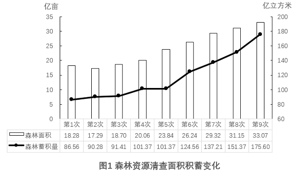

### 第 87 题　qid 4673140 · 平均数

“十三五”期间，我国平均每公顷森林蓄积量达到（    ）立方米。

- **A**. 5.3
- **B**. 32.2
- **C**. 79.8
- **D**. 98.6

### 第 88 题　qid 4673142 · 增长

相比第1次森林资源清查，第9次森林资源清查时，我国森林覆盖率提高了约（    ）个百分点。（本材料中森林覆盖率为森林面积占国土面积的百分比）

- **A**. 10
- **B**. 15
- **C**. 20
- **D**. 25

### 第 89 题　qid 4673145 · 增长

2016-2018年，我国国际重要湿地面积的年均增长率约为（    ）。

- **A**. 25%
- **B**. 30%
- **C**. 35%
- **D**. 40%

### 第 90 题　qid 4673161 · 增长

以下选项中，最准确地反映了2017-2020年我国国际重要湿地面积、数量同比增速变化情况的是（    ）。

- **A**. 
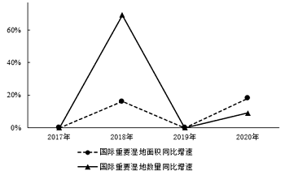

- **B**. 

- **C**. 

- **D**. 

### 第 91 题　qid 4673164 · 综合

根据以上资料，下列说法不准确的是（    ）。

- **A**. 我国森林蓄积量较前一次森林资源清查增幅最大的是第6次森林资源清查
- **B**. 第5次至第9次森林资源清查，我国森林面积和森林蓄积量的变化趋势一致
- **C**. 2016-2020年，我国平均每年增加国际重要湿地超过3个
- **D**. 2017-2020年，我国平均每个国际重要湿地面积同比增幅最大的年份是2020年

## 材料 3

        2020年，受新冠肺炎疫情影响，我国民航全行业完成旅客运输量41777.82万人次，比上年下降36.7%。国内航线完成旅客运输量40821.30万人次，比上年下降30.3%，其中港澳台航线完成旅客运输量96.13万人次，比上年下降91.3%，国际航线完成旅客运输量956.51万人次，比上年下降87.1%。尽管如此，我国国内航空运输市场在全球范围内恢复最快、运行最好。

        2020年，全行业运输航空公司完成运输飞行时长876.22万小时，比上年下降28.8%。国内航线完成运输飞行时长788.22万小时，比上年下降20.5%，其中港澳台航线完成运输飞行时长3.55万小时，比上年下降82.3%，国际航线完成运输飞行时长87.99万小时，比上年下降63.3%。

        2020年，全行业运输航空公司完成运输起飞371.09万架次，比上年下降25.3%。国内航线完成运输起飞357.29万架次，比上年下降20.2%，其中港澳台航线完成运输起飞1.65万架次，比上年下降80.3%，国际航线完成运输起飞13.79万架次，比上年下降71.8%。

### 第 92 题　qid 4673139 · 比重

相比2019年，2020年我国民航全行业完成旅客运输中，国内航线完成旅客运输总量占比约（    ）。

- **A**. 降低了9%
- **B**. 降低了15%
- **C**. 提高了9%
- **D**. 提高了15%

### 第 93 题　qid 4673143 · 平均数

2019年，平均每架次完成运输飞行时长最长的是（    ）。

- **A**. 国内航线
- **B**. 港澳台航线
- **C**. 国际航线
- **D**. 全行业运输航空公司

### 第 94 题　qid 4673147 · 综合

2016-2020年，国内航线条数比国际航线条数多4倍以上的年份有（    ）。

- **A**. 1
- **B**. 2
- **C**. 3
- **D**. 5

### 第 95 题　qid 4673149 · 增长

按不重复距离计算，以下年份中，国际航线里程同比增速最快的是（    ）。

- **A**. 2017年
- **B**. 2018年
- **C**. 2019年
- **D**. 2020年

### 第 96 题　qid 4673154 · 综合

根据以上资料，下列说法准确的是（    ）。

- **A**. 2019年，国内航线运输飞行时长占全行业运输航空公司运输飞行时长的9成以上
- **B**. 相比2019年，2020年我国国内航线、港澳台航线、国际航线平均每条航线完成旅客运输量均有下降
- **C**. 2016-2020年，按重复距离计算的总航线里程公里数年均增长不到100万
- **D**. 2019年，全行业运输航空公司完成运输起飞不到400万架次

## 答案与解析

第 1 题

**答案**：C

**官方解析**

本题考查政治常识。
C项正确，A、B、D三项错误，2021年10月13日至14日中央人大工作会议在北京召开。中共中央总书记、国家主席、中央军委主席习近平出席会议并发表重要讲话指出，“党的十八大以来，我们深化对民主政治发展规律的认识，提出全过程人民民主的重大理念。我国全过程人民民主不仅有完整的制度程序，而且有完整的参与实践。我国全过程人民民主实现了过程民主和成果民主、程序民主和实质民主、直接民主和间接民主、人民民主和国家意志相统一，是全链条、全方位、全覆盖的民主，是最广泛、最真实、最管用的社会主义民主。我们要继续推进全过程人民民主建设，把人民当家作主具体地、现实地体现到党治国理政的政策措施上来，具体地、现实地体现到党和国家机关各个方面各个层级工作上来，具体地、现实地体现到实现人民对美好生活向往的工作上来。”
故正确答案为C。

---

第 2 题

**答案**：D

**官方解析**

本题考查政治常识。
2021年11月11日，中国共产党第十九届中央委员会第六次全体会议通过《中共中央关于党的百年奋斗重大成就和历史经验的决议》（以下简称《决议》）。
A项错误，《决议》指出：“新民主主义革命时期，党面临的主要任务是，反对帝国主义、封建主义、官僚资本主义，争取民族独立、人民解放，为实现中华民族伟大复兴创造根本社会条件。”
B项错误，《决议》指出：“社会主义革命和建设时期，党面临的主要任务是，实现从新民主主义到社会主义的转变，进行社会主义革命，推进社会主义建设，为实现中华民族伟大复兴奠定根本政治前提和制度基础。”
C项错误，《决议》指出：“改革开放和社会主义现代化建设新时期，党面临的主要任务是，继续探索中国建设社会主义的正确道路，解放和发展社会生产力，使人民摆脱贫困、尽快富裕起来，为实现中华民族伟大复兴提供充满新的活力的体制保证和快速发展的物质条件。”
D项正确，《决议》指出：“党的十八大以来，中国特色社会主义进入新时代。党面临的主要任务是，实现第一个百年奋斗目标，开启实现第二个百年奋斗目标新征程，朝着实现中华民族伟大复兴的宏伟目标继续前进。”
故正确答案为D。

---

第 3 题

**答案**：B

**官方解析**

本题考查科技常识。
A项正确，“奋斗者号”是中国研发的万米载人潜水器。2020年11月10日，“奋斗者号”在马里亚纳海沟成功坐底，坐底深度10909米，刷新中国载人深潜的新纪录。2020年11月28日，习近平致信祝贺“奋斗者号“全海深载人潜水器成功完成万米海试并胜利返航。2021年3月16日，“奋斗者号”全海深载人潜水器在三亚正式交付，2021年10月，“奋斗者号“已在马里亚纳海沟正式投入常规科考应用。与宣传语中的“沉”、“浮”对应。
B项错误，新一代标准高速动车组“复兴号”是中国自主研发、具有完全知识产权的新一代高速列车，它集成了大量现代国产高新技术，牵引、制动、网络、转向架、轮轴等关键技术实现重要突破，是中国科技创新的又一重大成果。与宣传语中的“降落”、“起飞”无关。
C项正确，“北斗三号”全球卫星导航系统由24颗中圆地球轨道卫星、3颗地球静止轨道卫星和3颗倾斜地球同步轨道卫星，共30颗卫星组成，是我国自主建设运行的全球卫星导航系统。2020年6月23日，“北斗三号”最后一颗全球组网卫星在西昌卫星发射中心点火升空，2020年7月31日上午，“北斗三号”全球卫星导航系统建成暨开通仪式在北京举行。与宣传语中的“方向”对应。
D项正确，“中国天眼”即500米口径球面射电望远镜（FAST），位于中国贵州省黔南布依族苗族自治州境内，2020年1月11日，500米口径球面射电望远镜通过中国国家验收工作，并正式开放运行。500米口径球面射电望远镜作为一个多学科基础研究平台，可以观测暗物质和暗能量、发现脉冲星、有希望发现奇异星和夸克星物质、发现中子星——黑洞双星、还可能发现高红移的巨脉泽星系、寻找地外文明等等。与宣传语中的“仰望星空”对应。
本题为选非题，故正确答案为B。

---

第 4 题

**答案**：B

**官方解析**

本题考查政治常识。
题干中“任何一个国家都不可能孤立于世界之外，团结合作是所有国家的必然选择，各国人民更需要同舟共济、共克时艰”体现了联系的观点，强调要团结、合作。
A项错误，“人视水见形，视民知治不”出自《史记》，意思是人在水中可以照见自己的样子，在民众中可以看出政治治理的状况。体现的是唯物史观中的群众史观，强调人民群众是历史的主体。
B项正确，“孤举者难起，众行者易趋”出自魏源《默觚》，意思是一个人独自举起重物可能会很困难，但许多人一块行走则容易走快。体现了人多力量大，强调了团结、合作的重要性。
C项错误，“安而不忘危，存而不忘亡”出自《易传》，意思是君子在国家安定的时候要不忘危险，国家存在的时候要不忘败亡。体现的是对立统一规律，矛盾的双方相互转化。
D项错误，“天不言而四时行，地不语而百物生”出自李白《上安州裴长史书》的首句，意思是苍天闭口不言，却使四季不断运行；大地默默不语，却让万物蓬勃生长。说明天地之间万事万物都有其发展规律，人们要顺应自然的客观规律，按自然规律办事。
故正确答案为B。

---

第 5 题

**答案**：A

**官方解析**

本题考查政治常识。
A项正确，马克思主义指引中国成功走上了全面建设社会主义现代化强国的康庄大道，体现了在理论指导下，实践的巨大发展和伟大成就。体现了马克思主义哲学的认识论中，关于认识对实践有指导作用的原理，正确的认识会促进实践的发展，错误的认识会阻碍实践的发展。马克思主义正是指导我国实践发展的正确认识。
B项错误，一切从实际出发，就是我们想问题、办事情要把客观存在的实际事物作为根本出发点。实事求是，就是说，我们无论做什么事情，都要从客观实际出发，从中引出其固有的而不是臆造的规律性，作为我们行动的向导，做到按客观规律办事。与题干无关。
C项错误，辩证唯物主义认为，只有实践才是检验真理的唯一标准，这是由实践的特点和真理的本性所决定的。真理是标志主观与客观相符合的哲学范畴，因此，要判断主观与客观是否符合以及符合的程度，在主观的领域内是无法解决的，而仅仅在客观世界的范围内也不能检验。要证明主观与客观的符合，唯一能够充当真理性标准的只能是把主观与客观联结起来的“桥梁”即实践。与题干无关。
D项错误，认识的本质是主体对客体能动的反映，这是在揭示认识是什么。而题干中并未强调认识的本质，而是通过重视理论的作用、增强理论自信等来表现认识的反作用。与题干无关。
故正确答案为A。

---

第 6 题

**答案**：D

**官方解析**

本题考查政治常识。
①②③④均正确，《中华人民共和国国民经济和社会发展第十四个五年规划和2035年远景目标纲要》在第十一章第三节“构建现代能源体系”指出：“推进能源革命，建设清洁低碳、安全高效的能源体系，提高能源供给保障能力。加快发展非化石能源，坚持集中式和分布式并举，大力提升风电、光伏发电规模，加快发展东中部分布式能源，有序发展海上风电，加快西南水电基地建设，安全稳妥推动沿海核电建设，建设一批多能互补的清洁能源基地，非化石能源占能源消费总量比重提高到20%左右。推动煤炭生产向资源富集地区集中，合理控制煤电建设规模和发展节奏，推进以电代煤。”
故正确答案为D。

---

第 7 题

**答案**：B

**官方解析**

本题考查经济常识。
A项错误，国务院发布的《“十四五”就业促进规划》中“四、强化创业带动作用，放大就业倍增效应”提出：“深入实施创新驱动发展战略，营造有利于创新创业创造的良好发展环境，持续推进双创，更大激发市场活力和社会创造力，促进创业带动就业。”属于扩大就业容量的措施，不符合题意。
B项正确，国务院发布的《“十四五”就业促进规划》中“六、提升劳动者技能素质，缓解结构性就业矛盾”提出：“（十五）大规模多层次开展职业技能培训。”通过职业培训，使得劳动者的素质和能力与工作岗位要求相匹配，符合题意。
C项错误，国务院发布的《“十四五”就业促进规划》中“九、妥善应对潜在影响，防范化解规模性失业风险”提出：“完善就业失业统计监测调查体系。加快构建系统完备、立体化的就业失业监测网络，实现劳动力市场、企业用工主体和劳动者个体全覆盖，全面反映就业增长、失业水平、市场供求状况。完善就业统计指标体系和调查统计方法，探索进行就业质量、就业稳定性等方面的分析。推进大数据在就业统计监测领域的应用。”属于防范化解规模性失业风险的措施，不符合题意。
D项错误，国务院发布的《“十四五”就业促进规划》中“八、优化劳动者就业环境，提升劳动者收入和权益保障水平”提出：“加强劳动者社会保障。健全多层次社会保障体系，持续推进全民参保计划，提高劳动者参保率。加大城镇职工基本养老保险扩面力度，大力发展企业年金、职业年金，规范发展第三支柱养老保险。推进失业保险、工伤保险向职业劳动者广覆盖，实现省级统筹。完善全国统一的社会保险公共服务平台，优化社会保险关系转移接续。”属于提升就业质量的措施，不符合题意。
故正确答案为B。

---

第 8 题

**答案**：C

**官方解析**

本题考查政治常识。
C项正确，A、B、D三项错误，《中共中央 国务院关于全面推进乡村振兴加快农业农村现代化的意见》在“三、加快推进农业现代化”部分指出：“（十二）推进农业绿色发展。实施国家黑土地保护工程，推广保护性耕作模式。健全耕地休耕轮作制度。持续推进化肥农药减量增效，推广农作物病虫害绿色防控产品和技术。加强畜禽粪污资源化利用。全面实施秸秆综合利用和农膜、农药包装物回收行动，加强可降解农膜研发推广。在长江经济带、黄河流域建设一批农业面源污染综合治理示范县。支持国家农业绿色发展先行区建设。加强农产品质量和食品安全监管，发展绿色农产品、有机农产品和地理标志农产品，试行食用农产品达标合格证制度，推进国家农产品质量安全县创建。加强水生生物资源养护，推进以长江为重点的渔政执法能力建设，确保十年禁渔令有效落实，做好退捕渔民安置保障工作。发展节水农业和旱作农业······”
故正确答案为C。

---

第 9 题

**答案**：A

**官方解析**

本题考查科技常识。
A项正确，“东方红一号”是20世纪70年代初中国发射的第一颗人造地球卫星，于1970年4月24日由长征一号运载火箭在酒泉卫星发射中心成功发射。“东方红一号”卫星的发射成功使中国成为世界上继前苏联、美国、法国和日本之后，第5个完全依靠自己的力量成功发射人造卫星的国家。中国国务院批复同意自2016年起，将每年4月24日设立为“中国航天日”。
B项错误，“神舟五号”是中国载人航天工程发射的第五艘飞船，也是中华人民共和国发射的第一艘载人航天飞船，于北京时间2003年10月15日9时整在酒泉卫星发射中心发射升空。
C项错误，“嫦娥一号”是中国探月计划中的第一颗绕月人造卫星，2007年10月24日，在西昌卫星发射中心发射升空。
D项错误，“神舟一号”是中国载人航天工程发射的第一艘飞船，也是中华人民共和国载人航天计划中发射的第一艘无人试验飞船，于北京时间1999年11月20日凌晨6点在酒泉卫星发射中心发射升空。
故正确答案为A。

---

第 10 题

**答案**：B

**官方解析**

本题考查毛中特。
1924年1月，中国国民党第一次全国代表大会在广州召开，确认了共产党员以个人身份加入国民党的原则，实现了第一次国共合作，标志着第一次国共合作正式形成。这次合作实现后，以广州为中心，汇集全国的革命力量，很快开创出反帝反封建的革命新局面。
故正确答案为B。

---

第 11 题

**答案**：D

**官方解析**

本题考查毛中特。
A项错误，“独立寒秋，湘江北去，橘子洲头”出自毛泽东的《沁园春·长沙》，这句诗的意思是在深秋一个秋高气爽的日子里，我独自伫立在橘子洲头，眺望着湘江碧水缓缓北流。与长征无关。
B项错误，“宜将剩勇追穷寇，不可沽名学霸王”出自毛泽东的《七律·人民解放军占领南京》，这句诗的意思是应该趁现在这敌衰我盛的大好时机，痛追残敌，解放全中国。不可学那贪图虚名，放纵敌人而造成自己失败的楚霸王项羽。描写的是解放战争。
C项错误，“七百里驱十五日，赣水苍茫闽山碧”出自毛泽东的《渔家傲·反第二次大“围剿”》，这句诗的意思是十五天长驱七百里，从苍茫的赣江边一直打到青翠的闽西山区。描写的是第二次反围剿。
D项正确，“更喜岷山千里雪，三军过后尽开颜”出自毛泽东的《七律·长征》，这句诗的意思是更加令人喜悦的是踏上千里积雪的岷山，红军翻越过去以后个个笑逐颜开。描写的是红军长征中翻越雪山的情景，体现了中国红军的革命乐观主义精神。
故正确答案为D。

---

第 12 题

**答案**：A

**官方解析**

本题考查法律常识。
A项错误，B、C、D三项均正确，根据《党政领导干部选拔任用工作条例》第九条规定：“破格提拔的特别优秀干部，应当政治过硬、德才素质突出、群众公认度高，且符合下列条件之一：在关键时刻或者承担急难险重任务中经受住考验、表现突出、作出重大贡献；在条件艰苦、环境复杂、基础差的地区或者单位工作实绩突出；在其他岗位上尽职尽责，工作实绩特别显著。因工作特殊需要破格提拔的干部，应当符合下列情形之一：领导班子结构需要或者领导职位有特殊要求的；专业性较强的岗位或者重要专项工作急需的；艰苦边远地区、贫困地区急需引进的。”
本题为选非题，故正确答案为A。

---

第 13 题

**答案**：A

**官方解析**

本题考查政治常识。
①2021年2月25日，习近平总书记在全国脱贫攻坚总结表彰大会上的讲话中指出：“今天，我们隆重召开大会，庄严宣告，经过全党全国各族人民共同努力，在迎来中国共产党成立一百周年的重要时刻，我国脱贫攻坚战取得了全面胜利，现行标准下9899万农村贫困人口全部脱贫，832个贫困县全部摘帽，12.8万个贫困村全部出列，区域性整体贫困得到解决，完成了消除绝对贫困的艰巨任务，创造了又一个彪炳史册的人间奇迹！”
②2001年12月11日，我国正式加入世界贸易组织，成为其第143个成员。
③2005年12月，十届全国人大常委会第十九次会议决定，自2006年1月1日起废止《中华人民共和国农业税条例》。自此，在我国延续了两千多年的农业税宣告终结。
④1997年7月1日，中华人民共和国政府对香港恢复行使主权，香港回归祖国；1999年12月20日，中华人民共和国澳门特别行政区成立，中国政府恢复对澳门行使主权，澳门回归祖国。
⑤2008年8月8日至24日，第二十九届夏季奥林匹克运动会在北京举行，国家主席胡锦涛出席开幕式并宣布本届奥运会开幕。
故按时间先后顺序排列正确的是④②③⑤①。
故正确答案为A。

---

第 14 题

**答案**：B

**官方解析**

本题考查科技常识。
A项错误，矿泉水是从地下深处自然涌出的或者是经人工揭露的、未受污染的地下矿水，含有一定量的矿物盐、微量元素或二氧化碳气体，在通常情况下，其化学成分、流量、水温等动态在天然波动范围内相对稳定。仅依靠喝矿泉水难以满足人体中所需的全部矿物质，尤其是常量元素，如钙，仍需要从食物中获取，奶制品是钙的最好来源。 
B项正确，新鲜柑橘的果肉中含有丰富的维生素C，维生素C能提高机体的免疫力，同时柑橘还能降低患心血管疾病、肥胖症和糖尿病的几率。 
C项错误，频闪就是在一个电器的屏幕里看另一种电器的屏幕，另一种电器的屏幕会有一条亮线从屏幕的底部推移到顶部，又从底部出现。这样无穷下去，给我们的感觉就是图像在闪烁。绝对意义上的无频闪实际是不可能的，中国行业标准对合格产品的频闪要求是3125Hz。
D项错误，糖包括蔗糖、葡萄糖、果糖、半乳糖、乳糖、麦芽糖、淀粉、糊精和糖原等。在这些糖中，除了葡萄糖、果糖和半乳糖能被人体直接吸收，其余的糖都要在体内转化为基本的单糖后，才能被吸收利用。糖的主要功能是提供热能，因此果糖和蔗糖都能提供热量，也就是都会使人发胖。
故正确答案为B。

---

第 15 题

**答案**：B

**官方解析**

本题考查人文常识。
A项正确，“暗淡轻黄体性柔，情疏迹远只香留”出自北宋李清照的《鹧鸪天·桂花》，意思是此花浅黄而清幽，形貌温顺又娇羞；性情萧疏远离尘世，它的浓香却久久存留。描写的是桂花。
B项错误，“千磨万击还坚劲，任尔东西南北风”出自清代郑燮的《竹石》，意思是经历无数磨难和打击身骨仍坚劲，任凭你刮酷暑的东南风，还是严冬的西北风。描写的是竹子，而不是梅花。
C项正确，“菡萏香销翠叶残，西风愁起绿波间”出自南唐李璟的《摊破浣溪沙·菡萏香销翠叶残》，意思是荷花落尽，香气消散，荷叶凋零，深秋的西风拂动绿水，使人愁绪满怀。描写的是荷花。
D项正确，“此心生不背朝日，肯信众草能蘙之”出自北宋梅尧臣的《和石昌言学士官舍十题·葵花》。从“不背朝日”可知描写的是葵花。
本题为选非题，故正确答案为B。

---

第 16 题

**答案**：A

**官方解析**

A项：热胀冷缩的原理是温度影响分子间的距离，温度升高，分子间距增大，温度降低，分子间距缩小，升高温度并不会导致分子变大，错误；
B项：物质燃烧需要氧气支持，油锅着火时盖上锅盖，能将油与空气隔绝，使可燃物接触不到氧气，从而使火焰熄灭，正确；
C项：铁暴露在空气中会与空气中的氧气、水蒸气发生化学反应，生成铁锈，所以在铁制品表面刷上一层油漆，可以有效隔绝空气中的氧气和水蒸气，防止铁生锈，正确；
D项：需氧菌是指只能在有氧条件下生长繁殖的菌类，真空包装袋内不含氧气，破坏了需氧菌的生存环境，从而阻止需氧菌的生长繁殖，防止食品腐败，正确。
本题为选非题，故正确答案为A。

---

第 17 题

**答案**：D

**官方解析**

A项：图示位置中，人的视角看到圆球在其镜像的右侧，错误；

B项：图示位置中，人的视角看不到完整的圆球的镜像，错误；

C项：图示位置中，人的视角处于圆球的后方左侧位置，看到的圆球和其镜像位置关系应如图一所示，错误；

D项：图示位置中，人的视角处于圆球的后方右侧位置，看到的圆球和其镜像位置关系应如图二所示，与题干所给图片相符，正确。

故正确答案为D。

---

第 18 题

**答案**：C

**官方解析**

A项：根据家庭电路的特点，开关应接在用电器和火线之间，当开关断开时即可切断用电器与火线的连接，防止触电事故的发生，故乙是开关，丙是用电器，错误；
B项：在正常的电路中，使用试电笔接触火线时，试电笔中的氖管会发光，表示火线有电，使用试电笔接触零线或地线，氖管均不发光，根据三孔插座“左零右火上接地”的接线方式可知，只有使用试电笔接触三孔插座的右孔时氖管才会发光，显示此处有电流，接触左孔和上孔均无此现象，错误；
C项: 图中甲的连接方式为左零右火上接地，并且带金属外壳的用电器也必须接地，以防漏电对人造成伤害，故甲接的是三孔插座，正确；
D项：零线被烧断，整个电路处于断路状态，不会引起短路，错误。
故正确答案为C。

---

第 19 题

**答案**：A

**官方解析**

生态系统中生物之间的捕食关系形成了食物链，食物链应该从生产者开始，不包含非生物部分，食物链内生物之间是捕食关系，食物链中不包含分解者。
A项：食物链从草开始，且草、兔、狐、鹰依次为捕食关系，正确；
B项：食物链中不包含非生物部分，阳光属于非生物部分，错误；
C项：食物链应该从生产者开始，虫不是生产者，错误；
D项：食物链中不包含分解者，微生物一般属于分解者，错误。
故正确答案为A。

---

第 20 题

**答案**：C

**官方解析**

A、B两项错误，相同的小球在甲、乙两容器中均为漂浮状态，则均处于受力平衡状态，小球受到的浮力等于其自身的重力，所以小球在甲容器中和乙容器中受到的浮力一样大。

C项正确、D项错误，由A、B两项分析可知，小球在甲、乙两容器中受到的浮力一样大，由图可知，，根据浮力公式：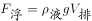可知，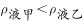。

故正确答案为C。

---

第 21 题

**答案**：B

**官方解析**

蒸散包括蒸发作用和蒸腾作用，指的是总水分的散失，包括地面与土壤发生的水分蒸发和植物气孔进行的蒸腾作用，影响蒸散作用的因素包括温度、光照、环境湿度等。
A项：在一定温度范围内，环境温度升高，蒸散作用增强，当温度过高时，叶片气孔会关闭，蒸腾作用会减弱，但蒸发作用会增强，此时无法确定蒸散作用是增强还是减弱，错误；
B项：蒸散作用与空气湿度有关，空气湿度越大，植物蒸散作用越弱，正确；
C项：一般情况下，湖泊多的地方湖泊的蒸发量比森林的蒸散量大，但是在我国大西北地区，湖泊较森林数量少，湖泊的蒸发量就会比森林的蒸散量小，错误；
D项：光照能够促进气孔的开启，使蒸散作用增强，相较于夜晚，白天光照时间长，而且温度也较高，蒸散作用也强，错误。
故正确答案为B。

---

第 22 题

**答案**：C

**官方解析**

由图可知，甲车匀速直线行驶，甲车10s行驶了100m，根据速度公式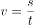可知，甲车的速度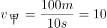m/s，A项错误；乙车匀减速直线行驶，乙车10s行驶了200m，20s行驶了350m，设乙车的初始速度为，加速度为a，根据位移公式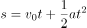可知，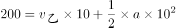······①，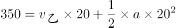······②，联立①、②式解得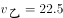m/s，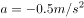，故乙车的初始速度为22.5m/s，B项错误；根据公式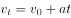可知，当乙车速度减为零时，代入公式可得22.5-0.5t=0，解得t=45s，即乙车在45s时停止行驶，处于静止状态，此时乙车行驶的路程大于500m，而甲车的行驶路程为450m，50s时，乙车仍处于静止状态，故C项正确，D项错误。

故正确答案为C。

---

第 23 题

**答案**：D

**官方解析**

由题意可知，小球在细线牵引下自由摆动，绳的拉力方向与运动方向始终垂直，因此绳子拉力不做功，并且忽略空气阻力，则小球在运动过程中只有重力做功，其机械能守恒。

A项：从A点到B点小球的高度降低，根据重力势能公式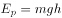，小球的重力势能减小，而其机械能守恒，即在此过程中其重力势能转化为动能，因此小球的动能增加，正确；

B项：从B点到C点小球的高度升高，其重力势能增加，根据机械能守恒可知，小球的动能转化为重力势能，因此小球的势能增加，正确；

C项：根据A、B两项分析可知，小球从A点到C点的过程中，重力势能先减小后增大，B点为最低点，小球的重力势能最小，因此在B点小球的动能最大，正确；

D项：根据上述分析可知，小球在整个运动过程中机械能守恒，错误。

本题为选非题，故正确答案为D。

---

第 24 题

**答案**：A

**官方解析**

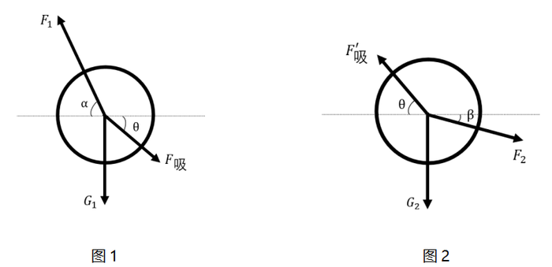

如图1所示，对进行受力分析，受到竖直向下的重力，绳子的拉力，以及对的吸引力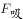，此时处于平衡状态，则水平方向受力平衡，设与水平方向的夹角为，与水平方向的夹角为，则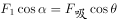；

如图2所示，对进行受力分析，受到竖直向下的重力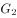，绳子的拉力，以及的对的吸引力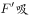，此时处于平衡状态，则水平方向受力平衡，设与水平方向的夹角为，由于与为一对作用力与反作用力，则二者大小相等，方向相反，所以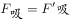且与水平面的夹角为，则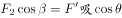；

由此可知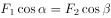，由图可知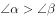，则，所以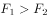。

故正确答案为A。

---

第 25 题

**答案**：D

**官方解析**

从图中信息可见，该固态物质有固定的熔点，属于晶体，晶体熔化时需要不断地吸收热量，但是温度不会发生变化，这个不变的温度就是晶体的熔点，在熔化过程中固态与液态共存，A、C两项均正确；该物质在熔化时不断吸收热量但温度不变，故D项错误；比热容是指单位质量的某种物质升高或下降单位温度所吸收或放出的热量，物质的质量不变，从图中可以看出，物质在固态与液态下，升高相同的温度，液态所用的时间更长，所以该物质在液态下的比热容更大（即升高相同的温度时，液态物质所吸收的热量更多），物质熔化过程中，固体不断减少，液体不断增加，即液体的占比在增大，所以熔化过程中，该物质的比热容会增大，B项正确。
本题为选非题，故正确答案为D。

---

第 26 题

**答案**：D

**官方解析**

第一空，搭配“牺牲奉献”，形容“红色热土”“红色往事”的作用，B项“凝聚”指聚集、积聚，D项“凝结”指气体遇冷而变成液体，如水蒸气遇冷变成水，多用于形容物理变化，也用来形容心血等的积聚，常搭配抽象事物，均与“牺牲奉献”搭配恰当，保留。A项“汇聚”、C项“汇集”均侧重强调从四面八方聚集在一处，与“牺牲奉献”搭配不当，排除。
第二空，搭配“壮丽辉煌”，形容“红色热土”“红色往事”的作用，D项“铭刻”指铭记，牢牢地记住，与“壮丽辉煌”搭配恰当，当选。B项“描绘”指画，也指用语言文字来描写，侧重于生动形象地描写，与“红色热土”“红色往事”的对应不及D项“铭刻”好，且体现不出应牢牢记住过去的往事，并将其作为珍贵的精神财富之意，排除。
故正确答案为D。
【文段出处】《红色江山永不变色》

---

第 27 题

**答案**：C

**官方解析**

第一空，由“、”可知，横线处所填成语与“水乳交融”语义相近，“水乳交融”比喻关系非常融洽或结合得很紧密，A项“唇齿相依”比喻双方关系密切，相互依存，C项“休戚与共”形容关系紧密，利害相同，均符合文意，保留。B项“相濡以沫”比喻在困难中以微小的力量互相帮助，文段未体现困难的处境，不符合语境，排除；D项“众志成城”比喻众人团结一致就能克服困难，文段强调的是党和群众感情深厚、关系紧密，与文意不符，排除。
第二空，根据文意可知，横线处所填词语意在表达“一条扁担、一张借据、半条棉被”是党和人民感情深厚的确凿证据，C项“见证”指证人或证物，符合文意，当选。A项“印记”指标记，与文意不符，排除。
故正确答案为C。
【文段出处】光明日报《汇聚乡村振兴的红色力量》

---

第 28 题

**答案**：A

**官方解析**

第一空，根据“、”以及后文可知，横线处所填成语需表达在艰难困苦中前进的意思，A项“披荆斩棘”比喻清除障碍，克服重重困难，C项“一往无前”指不把前进道路上的困难放在眼里，无所畏惧、毫不动摇地奋勇前进，D项“乘风破浪”指船只乘着风势破浪前进，比喻排除困难，奋勇前进，均符合文意，保留。B项“紧锣密鼓”强调准备工作进行得紧张、急促，与文意无关，排除。
第二空，横线处所填成语与“勇立潮头”构成并列关系，体现敢于站在时代的前沿，带领大家开创新的局面，A项“开拓进取”指努力想办法创新向前，立志有所作为，符合文意，当选。C项“开云见日”比喻黑暗已经过去，光明已经到来，也比喻误会消除，D项“开疆拓土”指开拓疆域，扩展领土，均无法与“勇立潮头”构成并列关系，排除。
故正确答案为A。
【文段出处】《勇当新时代的“拓荒牛”——发扬特区精神》

---

第 29 题

**答案**：A

**官方解析**

第一空，搭配“生活”，A项“日新月异”指每天每月都有新的变化，形容进步、发展很快，B项“精彩纷呈”指美好的场面和事物纷纷在眼前呈现出来，均与“生活”搭配恰当，保留。C项“精妙绝伦”指精巧美妙到了极点，D项“一日千里”形容进展极快，侧重强调速度之快，均与“生活”搭配不当，排除。
第二空，搭配“家庭”，A项“酸甜苦辣”比喻生活中如意、失意等种种遭遇，与“家庭”搭配恰当，当选。B项“跌宕起伏”指事物多变，不稳定，也比喻音乐声忽大忽小和故事情节的曲折，与“家庭”搭配不当，排除。
故正确答案为A。
【文段出处】《新时代文学要牢记“国之大者”》

---

第 30 题

**答案**：A

**官方解析**

根据文意可知，“真诚回报社会、切实履行社会责任”是对社会有利的，是社会所希望看到的，那么满足这个条件的企业家是能够“得到社会认可”的，是“符合时代要求”的，故前后语句构成必要条件关系。A项“只有······才······才”为必要条件关系标志词，填入文段符合文意，当选。
B项，“只要······就”为充分不必要条件关系标志词，即条件一定能推出之后的结果，填入文段表述过于绝对，排除；
C项，“如果”为假设关系标志词，根据文意可知，横线处缺少必要条件关系关联词，而非对企业家回报社会、履行责任进行假设，且“不仅······还”表示递进关系，而文段“得到社会认可”和“符合时代要求的企业家”无法构成递进关系，排除；
D项，“因为······所以”为因果关系标志词，即原因导致结果，文段强调“真诚回报社会、切实履行社会责任”是“得到社会认可”的条件，不构成因果关系，不符合文意，排除。
故正确答案为A。
【文段出处】《弘扬企业家精神，带领企业战胜困难》

---

第 31 题

**答案**：B

**官方解析**

A项，“最高级阶段”文段并未提及，无中生有，排除；
B项，根据“从‘生产力与生产关系矛盾运动规律’，如同‘铁和犁’于农业文明、‘纺纱机和蒸汽机’于工业文明一样”可知，“绿色生产力和绿色生产关系”也需符合“生产力与生产关系矛盾运动规律”，结合“只有实现绿色生产力和绿色生产关系的根本性变革，生态文明才会成为真正引领人类文明的新形态”可知，“绿色生产力和绿色生产关系的根本性变革”对生态文明起到决定性作用，表述正确，当选；
C项，根据“掌握革命性、关键性绿色核心技术，进而带动生态技术和生态产业交叉融合、群体跃进”可知，“关键性绿色核心技术”可以“带动生态技术和生态产业交叉融合、群体跃进”，并非“实现绿色生产关系变革的关键”，与文意不符，排除；
D项，根据“建设生态文明，要在形成支持绿色发展、循环发展、低碳发展的机制上下真功夫、下大气力”可知，建设生态文明需要“绿色发展、循环发展和低碳发展的机制”，并非“建成的标志”，与文意不符，排除。
故正确答案为B。
【文段出处】《生态文明是人类文明发展的历史趋势》

---

第 32 题

**答案**：A

**官方解析**

横线位于文段中间，需结合上下文进行分析。横线前指出国有企业对我国经济社会发展有重要作用，接着阐述国有企业的改革和发展面临新问题和新挑战，横线后指出国有企业以顽强意志把企业建在实处，应对每一场风险挑战，实现发展，成为主力军和先行者。故横线处应体现出国有企业应该以不畏困难、不惧挫折的信念应对每一次问题和挑战，提升自身，实现发展，A项“踏平坎坷成大道，斗罢艰险又出发”，即能把坎坷的路踏平，能不断战胜艰险，当选。
B项，“山重水复疑无路，柳暗花明又一村”比喻在遇到困难时，一种办法不行，可以用另一种办法去解决，通过探索去发现答案，或指绝处逢生，文段未体现此意，排除；
C项“没有比人更高的山，没有比脚更长的路”指的是无论多高的山，无论多远的路，人都可以达到，体现的是乐观、进取、自信的态度，D项“世上无难事，只要肯登攀”指的是世上没有什么困难的事，只要肯下定决心去登攀，指的是做事情有决心、恒心，二者均未能体现国有企业面临困难时要以坚强意志解决之意，排除。
故正确答案为A。
【文段出处】《国企党建要握“根”聚“魂”》

---

第 33 题

**答案**：D

**官方解析**

文段开篇说明对互联网金融加强监管的目的是促进互联网金融有序发展，接着通过对策标志词“只有······才······”再次强调互联网企业要明确互联网行业监管对自身发展的重要性，故文段主要强调互联网金融监管对互联网企业很重要，对应D项。
A项，缺少文段主题词“企业”，排除；
B、C两项缺少文段主题词“监管”，排除。
故正确答案为D。
【文段出处】《实现平台经济更加规范更有活力更高质量发展》

---

第 34 题

**答案**：B

**官方解析**

A项，由“时间管理原本是要教会我们更精细、更严苛地分割利用时间”可知，文段只介绍了时间管理要教会我们的内容，并未提及其本质要求，无中生有，排除；
B项，由“时间管理原本是······甚至为此心力交瘁”可知，表述正确，当选；
C项，由“时间管理倡导的很多方法······而是对其加以技术性强化”可知，对时间加以技术性强化为很多时间管理方法的实质，而非一种时间管理方法，表述错误，排除；
D项，由“时间管理原本是要教会我们更精细······甚至为此心力交瘁”可知，文段仅说明人们受到主观感受影响而觉得时间不够用，并未提及时间管理对主观感受的影响，强加逻辑，排除。
故正确答案为B。
【文段出处】《赶时间的人，永远没时间》

---

第 35 题

**答案**：B

**官方解析**

对比选项，确定首句。①句论述乱象对于青少年价值观养成的消极影响，②句论述青少年时期是培养价值观的重要时期，应先论述培养价值观这一话题，再说明对价值观产生消极影响的因素，故②句更适合作首句，排除C、D两项。
观察选项，对比④③两句与⑥①两句的前后顺序，④③两句论述家长培养孩子的具体做法，⑥①两句论述青少年养成教育中的种种问题，按照逻辑顺序，应先指出问题再提出对策，故⑥①两句应在前，④③两句在后，排除A项，锁定B项。
故正确答案为B。
【文段出处】《要让孩子懂得“愁”滋味》

---

第 36 题

**答案**：C

**官方解析**

题干为表格形式，判定为图形数阵。优先寻找每行相同的规律，可发现：1×2+1=3；2×5+0=10；3×10+（-1）=29，其中修正项1、0、-1是公差为-1的等差数列，故所求项应为4×17+（-2）=66。
故正确答案为C。

---

第 37 题

**答案**：B

**官方解析**

根据题意，在国道上行驶的路程为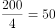公里，在国道上油耗为0.05+0.03=0.08升/公里。则从甲市到乙市，小李汽车的油耗为200×0.05+50×0.08=14升。

故正确答案为B。

---

第 38 题

**答案**：C

**官方解析**

设小陈计划x天完成题库中的所有练习题。根据题意可知：50×（x-2）+85×2=55×（x-1），解得：x=25天。则该题库共有55×（25-1）=1320道题。
故正确答案为C。

---

第 39 题

**答案**：A

**官方解析**

根据两集合容斥原理公式A+B-AB=总数-都不，可得：有基层经历+有计算机等级证书-两种都有=总人数-两种都没有，设同时有基层经历和计算机等级证书的有x人，则有40+46-x=80-10，解得x=16。

故正确答案为A。

---

第 40 题

**答案**：C

**官方解析**

方法一：根据题意，3份每个单位订阅数量5份，共12份。这3个单位的报刊订阅数量可以为：（3，4，5），单位不同需考虑顺序，有种情况；或者（4，4，4），此时有1种情况。因此满足题意的情况数共6+1=7种。

方法二：根据题意，可利用插板法。“不少于3份”时，可先给每个单位分2份，还剩12-2×3=6份，每个单位至少再分1份，有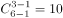种。但其中包含超出5份的情况（6，3，3），有种。因此满足题意的情况数共10-3=7种。

故正确答案为C。

---

第 41 题

**答案**：D

**官方解析**

根据题意，从6个社区中随机抽取3个社区的总情况数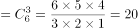种。

方法一：满足抽取的社区中既有考核通过的又有考核不通过的情况分类讨论如下：

①2个考核通过的、1个考核不通过的，情况数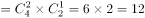种；

②1个考核通过的、2个考核不通过的，情况数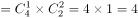种。

则所求概率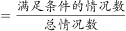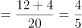。

方法二：考虑反面求解，因考核不通过的社区只有2个，则反面情况仅有1种情况，即抽取社区中只有考核通过的，情况数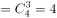种。则所求概率=1-反面情况概率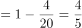。

故正确答案为D。

---

第 42 题

**答案**：A

**官方解析**

环形植树，有多少间隔就能植多少棵树，要求插入木桩尽量多，则木桩间的距离尽量小，根据题意可确定两木桩之间的间隔为3米，用每条边的边长除以3看商，有余数的话，商是多少就可以分成多少个间隔，没有的话则需减1。长边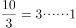米，则有3个间隔，宽边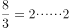米，则有2个间隔，故该长方形花坛共有2×（3+2）=10个间隔，故可以插入10根木桩。

故正确答案为A。

---

第 43 题

**答案**：D

**官方解析**

方法一：赋值甲、乙两人每分钟分装材料份数为1。设甲开始工作的时间为9点x分，乙开始工作的时间为9点y分。根据题意，可列方程组：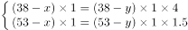，解得：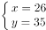，即甲开始工作的时间是9点26分，乙开始工作的时间是9点35分，甲比乙早9分钟开始工作。

方法二：赋值甲、乙两人每分钟分装材料份数为1。设甲开始工作的时间为9点x分，乙开始工作的时间为9点y分。根据题意，可列方程组：，化简为：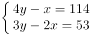，利用奇偶性可判断出x为偶数，y为奇数，则y-x应为奇数，仅有D项满足。

故正确答案为D。

---

第 44 题

**答案**：D

**官方解析**

设这些书的原价为x元，购书时可享受原价的7折优惠，折后价为70%x元。因每本书的折后价均超过5元，在折后价的基础上还可以叠加使用5元补贴券，则小陈实际花费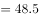，解得x=105。

故正确答案为D。

---

第 45 题

**答案**：A

**官方解析**

根据题意，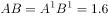米，DB=3.2米，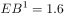米，米，如图所示：

根据，即，代入数据可得，解得EO=X米。米，DE=DB-EB=3.2-0.6=2.6米，DO=DE+EO=2.6+X米。根据，即，代入数据可得，解得X=2.6米。

故正确答案为A。

---

第 46 题

**答案**：B

**官方解析**

方法一：根据题意：剩余每层钢管数量都减少3根，则剩余10层共减少30根。因为共搬运99根，所以少了的3层原有钢管数量为99-30=69根。由于每一层的数量都比上一层多1根，可知每层管材数量为等差数列，根据等差数列求和公式中项×项数，计算可得中项根，可知最上面3层数量分别为22，23，24根，则剩余10层最上层原为25根。由于剩余每层的管材数量都减少了3根，可知剩余10层最上层为25-3=22根。根据求和公式，则剩下的管材共有根。

方法二：根据题意，搬了99根后管材堆少了3层，可知原有层数为10+3=13层，根据等差数列求和公式中项×项数，可知原有钢材总数为13的倍数。代入A项：245+99=344根，非13倍数，排除。代入B项：265+99=364根，为13倍数，满足题意，当选。同理代入C、D两项均不符合要求，排除。

故正确答案为B。

---

第 47 题

**答案**：C

**官方解析**

第一步：分析题干中六面体。

根据图一可知，面3、面1、面5相邻；根据图二可知，面2、面3、面4相邻；根据图三可知，面4、面5、面6相邻；若均按照顶面为面3来看，可知正面为面5，右侧面为面1时，后面为面2、左侧面应为面4、底面应为面6（如下透视图所示），故可知面3与面6为相对面、面1与面4为相对面、面5与面2为相对面。

第二步：逐一分析选项。

A项：选项中面1与面4为相邻面，题干二者是相对面，相对面不能同时出现，选项与题干不一致，排除；

B项：选项中面1与面4为相邻面，题干二者是相对面，相对面不能同时出现，选项与题干不一致，排除；

C项：选项与题干一致，当选；

D项：选项中面3与面6为相邻面，题干二者是相对面，相对面不能同时出现，选项与题干不一致，排除。

故正确答案为C。

---

第 48 题

**答案**：D

**官方解析**

元素组成不同，且无明显属性规律，考虑数量规律。题干图1、图2和图4为多端点图形，考虑笔画数。题干四幅图形的笔画数依次为1、2、3、4，故“？”处选一个5笔画的图形，只有D项符合。
故正确答案为D。

---

第 49 题

**答案**：D

**官方解析**

将题干展开图标上序号如下图所示，逐一进行分析。

A项：选项一定包含面a和面e，由于面a和面f为相对面，面e和面c为相对面，相对面不能同时出现，面f和面c一定不可能出现，故选项的正面为面b或面d。若选项的正面为面b，在题干展开图中，面b和面e的公共边挨着面b中的黑色三角形，但在选项中，面b和面e的公共边没有挨着面b中的黑色三角形；若选项的正面为面d，在题干展开图中，面a和面d的公共边挨着面d中的黑色三角形，但在选项中，面a和面d的公共边没有挨着面d中的黑色三角形，选项与题干展开图不一致，排除；

B项：选项的上面和右面为面b、面c、面d或面f中的两个面，且面b和面d为相对面不能同时出现。若该项为面b和面c（或面d和面f），题干二者的公共边均与各自面内白色三角形挨着；若该项为面c和面d（或面c和面f、或面b和面f），题干二者的公共边均与各自面内黑色三角形挨着。而选项中的上面和右面的公共边与一个面内的白色三角形和另外一个面内的黑色三角形挨着，选项与题干展开图不一致，排除；

C项：选项中的面为面b、面c、面d或面f中的三个面，且面b和面d为相对面不能同时出现。则选项是面b、面c和面f（或是面c、面d和面f），在题干展开图中，面c和面f的公共边均与各自面内黑色三角形挨着，但在选项中，任意两个面的公共边都挨着一个白色三角形，选项与题干展开图不一致，排除；

D项：选项由面a、面c与面d（或面b、面e和面f）构成，与题干展开图一致，当选。

故正确答案为D。

---

第 50 题

**答案**：B

**官方解析**

本题考查三视图，逐一分析选项。
A项：该项的左视图可能为第一个视图，从下往上看可能为第二个视图，保留；
B项：该项左视图可能为第一个视图，从下往上看可能为第二个视图，保留；
C项：无法得到题干的第一个视图，排除；
D项：无法得到题干的第一个视图，排除。
对比A、B两个选项，B项全部小方块都可以被看到，能够满足题干要求，而A项要想满足题干的视图，那么最底部被遮挡的方块应该是一个纯白色小方块，但现在无法确定A项中最底部是否存在纯白色的小方块，故B项比A项更可能满足题干视图。
故正确答案为B。

---

第 51 题

**答案**：D

**官方解析**

元素组成相同，优先考虑位置规律。观察发现，题干的小六边形不是常规的直线走，故考虑内外分开看。如下图所示，图形的小六边形可以分为内外两圈以及中心位置的一块空白，外圈小六边形绕着外圈依次顺时针移动三格；内圈小六边形绕着内圈依次逆时针移动两格；中心位置一直保持空白，对应D项。

故正确答案为D。

---

第 52 题

**答案**：C

**官方解析**

图形元素组成相似，优先考虑样式规律。题干图形轮廓一致，黑块个数不同，优先考虑黑白运算。九宫格优先横向观察，第一行图形的黑白运算规律为：黑+黑=白，黑+白=黑，白+黑=黑，白+白=白，第二行图形经验证符合此规律，第三行应用此规律，只有C项符合。
故正确答案为C。

---

第 53 题

**答案**：D

**官方解析**

解析一：元素组成不同，优先考虑属性规律。观察发现，题干图形出现等腰元素，考虑对称性，题干图形均为轴对称图形，据此可以排除A、B两项；继续观察发现，题干图形明显被分割，考虑数面，题干图形的面数量分别为2、3、4、5，故？处图形应该有6个面，只有D项符合。
故正确答案为D。
解析二：元素组成不同，考虑数量规律，图形明显被分割，考虑面数量。题干图形的面数量分别为2、3、4、5，故？处图形应该有6个面，排除A、C两项；再次观察发现，题干图形均为一笔画图形，故？处应选择一个一笔画图形，只有B项符合。
故正确答案为B。
本题目为争议题，但根据题干的图形特征可知，所有图形均为等腰图形，考察对称性的概率更大，故粉笔更倾向于本题目的答案为D。

---

第 54 题

**答案**：A

**官方解析**

本题考查图形拼合。将题干每行所给的三个图形拼到一起都是中间2块为白色的4×3的矩形，如下图所示：

第三行拼合之后的结果如下图所示，图1为红色，图2为蓝色，拼合之后只有A项符合。

故正确答案为A。

---

第 55 题

**答案**：A

**官方解析**

出现黑白块，观察黑块与白块的相对位置关系，每一行都有各自的规律。第一行黑白块排列规律为黑、白、黑循环排列；第二行黑白块排列规律为白、黑循环排列；第三行黑白块排列规律为白、黑、黑循环排列；第四行黑白块排列规律为黑、白循环排列；第五行黑白块排列规律为黑、白、黑循环排列，只有A项符合。

故正确答案为A。

---

第 56 题

**答案**：D

**官方解析**

元素组成不同，且无明显属性规律，考虑数量规律。观察发现，题干图形基本都由正方形和圆构成，其中正方形的数量分别为4、3、2、1，圆的数量分别为0、2、4、6，故？处图形应该有0个正方形和8个圆，只有D项符合。
故正确答案为D。

---

第 57 题

**答案**：C

**官方解析**

第一步：判断题干词语间逻辑关系。
耳塞是用来减少噪音的，二者为功能对应关系。
第二步：判断选项词语间逻辑关系。
A项：书籍是知识的载体，二者不是功能对应关系，与题干逻辑关系不一致，排除；
B项：蜡烛是用来增加光明的，不是用来减少光明，与题干逻辑关系不一致，排除；
C项：肥皂是用来减少污渍的，二者为功能对应关系，与题干逻辑关系一致，当选；
D项：风扇是用来降低温度的，不是用来减少低温，与题干逻辑关系不一致，排除。
故正确答案为C。

---

第 58 题

**答案**：D

**官方解析**

第一步：判断题干词语间逻辑关系。
通过洽谈来达到合作的目的，二者为方式目的对应关系。
第二步：判断选项词语间逻辑关系。
A项：成绩是考试结果的体现，二者不是方式目的对应关系，与题干逻辑关系不一致，排除；
B项：打磨和切割是两种不同的制造工艺，二者为并列关系，与题干逻辑关系不一致，排除；
C项：施肥和灌溉是两种不同的农业技术措施，二者为并列关系，与题干逻辑关系不一致，排除；
D项：通过投资来获得收益，投资是方式，收益是目的，二者为方式目的对应关系，与题干逻辑关系一致，当选。
故正确答案为D。

---

第 59 题

**答案**：B

**官方解析**

第一步：判断题干词语间逻辑关系。
文字是诗词的组成部分，二者为组成关系；绝句是诗词的一种，二者为种属关系。
第二步：判断选项词语间逻辑关系。
A项：笔画是隶书的组成部分，二者为组成关系，隶书是汉字的一种，二者为种属关系，但顺序与题干相反，与题干逻辑关系不一致，排除；
B项：音符是乐谱的组成部分，二者为组成关系，五线谱是乐谱的一种，二者为种属关系，与题干逻辑关系一致，当选；
C项：税收是财政收入的主要来源之一，货币不是财政的一种，与题干逻辑关系不一致，排除；
D项：树木是森林的组成部分，森林是生态的组成部分，三者间两两构成组成关系，与题干逻辑关系不一致，排除。
故正确答案为B。

---

第 60 题

**答案**：A

**官方解析**

第一步：判断题干词语间逻辑关系。
依据“法律”进行“诉讼”，“胜败”是“诉讼”可能出现的两种结果，三者是对应关系。
第二步：判断选项词语间逻辑关系。
A项：依据“策略”进行“经营”，“盈亏”是“经营”可能出现的两种结果，三者是对应关系，与题干逻辑关系一致，当选；
B项：“存亡”不是“武器”可能出现的两种结果，与题干逻辑关系不一致，排除；
C项：依据“事实”进行“判断”，但两词顺序与题干相反，与题干逻辑关系不一致，排除；
D项：不是依据“教师”进行“教学”，教学是教师的职业内容，与题干逻辑关系不一致，排除。
故正确答案为A。

---

第 61 题

**答案**：A

**官方解析**

第一步：判断题干词语间逻辑关系。
“志同道合”与“沆瀣一气”都是在描述“人与人之间在某方面相投”，且前者为褒义，后者为贬义。
第二步：判断选项词语间逻辑关系。
A项：“居安思危”与“杞人忧天”都是在描述“担忧”，且前者为褒义，后者为贬义，与题干逻辑关系一致，当选；
B项：“鼠目寸光”比喻目光短浅，没有远见，“高瞻远瞩”比喻眼光远大，二者为反义关系，且前者为贬义，后者为褒义，与题干逻辑关系不一致，排除；
C项：“举棋不定”与“优柔寡断”都是在描述“犹豫”，但二者均为贬义，与题干逻辑关系不一致，排除；
D项：“口若悬河”与“信口开河”都是在描述“说话”，但前者为中性，后者为贬义，与题干逻辑关系不一致，排除。
故正确答案为A。

---

第 62 题

**答案**：C

**官方解析**

日常结论题，根据题干信息逐一分析选项。
A项：根据题干可知，该企业在周五晚上延长工作时间并且没有违法，已知我国法律规定延长工作时间一般每日不超过一小时，这里说的是一般情况下，可能会存在特殊情况，即超过一小时也可能不违法，因此无法得知该企业员工延长工作是否一定不超过一小时，无法推出，排除；
B项：根据题干可知，我国法律规定延长工作时间需要工会和劳动者同意，该企业只有“有员工”周五晚上延长了工作时间，不一定是所有员工，无法确定是不是所有员工都同意延长工作时间，无法推出，排除；
C项：根据题干可知，我国法律规定延长工作时间需要工会和劳动者同意，该企业已经延长工作时间并且没有违法，说明已经取得该企业工会的同意，可以推出，当选；
D项：根据题干可知，该企业为国有企业，但并未提及具体属于什么行业，不明确是否不受工作时间限制，无法推出，排除。
故正确答案为C。

---

第 63 题

**答案**：C

**官方解析**

第一步：翻译题干。

①言顺名正

②事成言顺

③礼乐兴事成

④刑罚中礼乐兴

⑤民所措手足刑罚中

以上条件可以串串：⑥民所措手足刑罚中礼乐兴事成言顺名正

第二步：逐一分析选项。

①错误：翻译为“名正言顺”，是对①的肯后，肯后得不到必然结论，无法推出；

②正确：翻译为“礼乐兴事成”，是对③的肯前，肯前必肯后，可以推出；

③正确：翻译为“民所措手足名正”，是对⑥的肯前，肯前必肯后，可以推出；

④正确：翻译为“事成名正 且 言顺”，即“事成名正，事成言顺”，是对⑥的肯前，肯前必肯后，可以推出。

综上，②③④正确。

故正确答案为C。

---

第 64 题

**答案**：B

**官方解析**

第一步：找出论点和论据。
论点：来广州实习有助于港澳青年获得对粤港澳大湾区的认同感。
论据：有留穗发展意愿的港澳青年比例占七成以上；九成港澳青年通过实习了解和认识广州；有超过一半的港澳青年非常看好粤港澳大湾区的发展前景。
本题论点讨论的是来广州实习有助于港澳青年获得对粤港澳大湾区的认同感，论据讨论的是在广州实习的港澳青年中有七成以上有留穗发展意愿、有超过一半看好粤港澳大湾区的发展前景，论点论据话题不一致，加强优先考虑搭桥。找到论据与论点中不同的关键词为“留穗发展意愿”或“看好粤港澳大湾区的发展前景”与“对粤港澳大湾区的认同感”，需要在二者之间进行搭桥。
第二步：逐一分析选项。
A项：论点讨论的是来广州实习有助于港澳青年获得对粤港澳大湾区的认同感，而该项讨论的是熟悉广州能让港澳青年更好地适应在广州工作和生活，适应工作和生活与能否获得认同感无必然联系，因此该项不是论点成立的前提，排除；
B项：该项讨论的是港澳青年的留穗发展意愿是其对粤港澳大湾区具有认同感的重要表现，指出了“留穗发展意愿”与“对粤港澳大湾区的认同感”之间的联系，搭桥项，保留；
C项：论点讨论的是来广州实习有助于港澳青年获得对粤港澳大湾区的认同感，而该项讨论的是通过实习能让港澳青年对粤港澳大湾区发展前景更有信心，但更有信心不等同于会产生认同感，话题不一致，无法加强，排除；
D项：论点讨论的是来广州实习有助于港澳青年获得对粤港澳大湾区的认同感，而该项讨论的是超过一半的在穗实习港澳青年参与了这项调查，说明论据的调查结果相对准确的，加强论据，保留。
比较B、D两项，D项是加强论据，力度没有B项搭桥强，故排除D项，B项当选。
故正确答案为B。

---

第 65 题

**答案**：D

**官方解析**

第一步：翻译题干。

题干可翻译为：喜欢打羽毛球且来自体育学院喜欢登山。

第二步：逐一分析选项。

A项：翻译为：甲喜欢打羽毛球且喜欢登山甲来自体育学院，“喜欢登山”是对题干的肯后，肯后得不到确定性的结论，无法推出，排除；

B项：翻译为：乙来自体育学院且喜欢登山乙喜欢打羽毛球，“喜欢登山”是对题干的肯后，肯后得不到确定性的结论，无法推出，排除；

C项：翻译为：丁不喜欢打羽毛球且不喜欢登山丁不来自体育学院，“不喜欢登山”是对题干的否后，根据否后必否前可知，“喜欢打羽毛球且来自体育学院”为假，则“不喜欢打羽毛球或不来自体育学院”为真，此时结合丁不喜欢打羽毛球，是对“或关系”的肯定，无法推出丁是否来自体育学院，排除；

D项：翻译为：丙喜欢打羽毛球且不喜欢登山丙不来自体育学院，“不喜欢登山”是对题干的否后，根据否后必否前可知，“喜欢打羽毛球且来自体育学院”为假，则“不喜欢打羽毛球或不来自体育学院”为真，再结合丙喜欢打羽毛球可知，“或关系”否一推一，则丙一定不是体育学院的学生，可以推出，当选。

故正确答案为D。

---

第 66 题

**答案**：A

**官方解析**

第一步：找出题干矛盾。
逻辑思维能力是一个人最重要的能力之一，但大部分学校都没有开设专门培养逻辑思维能力的课程。
第二步：逐一分析选项。
A项：指出学校内绝大多数课程的设计核心都是提高学生的逻辑思维能力，说明即使不开设专门培养逻辑思维能力的课程，在绝大多数的课程中也能培养到这项能力，因此不需要单独开设课程，可以解释题干矛盾，当选；
B项：指出人们的逻辑思维能力往往能随着学识和社会阅历的增长自然提高，但逻辑思维能力的自然提高和学校是否开设课程没有必然联系，能力会自然提高，不代表就没有通过课程来学习的必要性，不能解释为什么大部分学校都没有开设专门培养逻辑思维能力的课程，不能解释题干矛盾，排除；
C项：指出绝大多数大学设有关于逻辑思维能力的公共选修课程，但是题干说的主体是大部分学校，绝大多数大学不能代表大部分学校，不能解释为什么大部分学校都没有开设专门培养逻辑思维能力的课程，不能解释题干矛盾，排除；
D项：指出部分教师对于如何培养逻辑思维能力并没有清晰的认识，只是部分教师，不能代表所有教师都不知道如何培养逻辑思维能力，不能解释为什么大部分学校都没有开设专门培养逻辑思维能力的课程，不能解释题干矛盾，排除。
故正确答案为A。

---

第 67 题

**答案**：D

**官方解析**

第一步：分析题干找关系。

（1）《稻穗》 且 《播种》；

（2）只有一件作品能获奖；

（3）《稻穗》获奖；

（4）《播种》获奖。

四句话都不是矛盾关系。

第二步：看其余。

可以使用假设法。《稻穗》《播种》的获奖情况可以分为以下四种：

①《稻穗》和《播种》都获奖了：此时条件（1）和（4）同时为真，和题干条件“只有一真”不符；

②《稻穗》获奖，但《播种》没获奖：此时只有条件（2）为真，符合题干要求；

③《稻穗》没获奖，但《播种》获奖了：此时条件（2）（3）（4）都为真，和题干条件“只有一真”不符；

④《稻穗》和《播种》都没获奖：此时只有条件（3）为真，符合题干要求。

综上所述，只有第②种和第④种情况符合题干要求，在这两种情况下《播种》都没获奖，据此可知，《播种》一定不会获奖。

故正确答案为D。

---

第 68 题

**答案**：C

**官方解析**

第一步：分析题干条件。
（1）选2位七年级、1位八年级教师；
（2）选的3个人教授的科目各不相同；
（3）七年级：语文甲、数学乙、英语丙；
（4）八年级：数学丁、历史戊、语文己。
第二步：根据题干条件进行推理。
题干信息确定，选项信息充分，优先考虑排除法。
根据条件（1）（3）可知，被选中的七年级教师有甲、乙，乙、丙，甲、丙三种可能，排除A 项；根据条件（2）（3）（4）可知，不能同时选中甲、己，乙、丁，排除B、D两项。
故正确答案为C。

---

第 69 题

**答案**：B

**官方解析**

第一步：找出论点和论据。
论点：县农业部门的工作人员开展乡村振兴工作成效往往较好。
论据：县农业部门的工作人员更重视当地的农业产业发展，而农业产业发展是增加当地农民收入的重要手段。
论据说的是县农业部门的工作人员更重视农业产业发展、农业产业发展可增加当地农民收入，论点说的是县农业部门的工作人员开展乡村振兴工作成效往往较好，二者话题不一致，问法为“前提”，加强优先考虑搭桥，建立“农业产业发展”或“农民收入”与“乡村振兴工作成效”之间的关系。
第二步：逐一分析选项。
A项：说的是农业部门工作人员有更多农业产业相关的专业知识，而论点讨论的是农业部门工作人员的乡村振兴工作成效，有更多的专业知识不代表工作成效就一定好，不能加强，排除；
B项：说的是农民收入是评价乡村振兴工作成效的重要指标，在“农民收入”和“乡村振兴工作成效”之间建立了联系，搭桥项，可以加强，保留；
C项：说的是乡村振兴工作成效只能用农业产业发展情况来衡量，在“农业产业发展”和“乡村振兴工作成效”之间建立了联系，搭桥项，可以加强，保留；
D项：说的是不同村庄农民收入在乡村振兴工作开展前基本持平，但判断乡村振兴工作的成效是否更好不需要各村庄农民收入在此前均持平，不是论点成立的必要条件，无法加强，排除。
对比B、C两项，B项在“农民收入”和“乡村振兴工作成效”之间建立联系，将“农业产业发展”“农民收入”和“乡村振兴工作成效”三者之间的关系全部串联了起来，对题干的加强更为完整，而C项只是建立“农业产业发展”和“乡村振兴工作成效”之间的联系，未利用“农民收入”这个论据。基于加强题目的命题特点，将所有论据串联起来的选项更好，因此，粉笔倾向选择B项。
故正确答案为B。

---

第 70 题

**答案**：C

**官方解析**

第一步：找出论点和论据。
论点：政府应该大力发展经济，从而增加人民的人均收入。
论据：随着人均收入水平的提高，人民对生活的满意度也提高了。
本题论点是个建议，建议政府要大力发展经济从而实现提高收入的目的，本题论点的重点在于为什么政府要大力发展经济，而不在于讨论发展经济和收入之间的关系，而现有的论据不足以证明政府为什么要大力发展经济，需要补充新的论据来支持论点。
第二步：逐一分析选项。
A项：该项说的是人均收入水平的提高能够满足人民精神层面的需求，但论点讨论的是政府大力发展经济与增加人民的人均收入的关系，话题不一致，排除；
B项：该项指出人民对生活的满意度取决于政府在经济建设上的投入力度，能够解释为什么政府要大力发展经济，可以支持，保留；
C项：该项指出了政府工作的主要任务是提高人民的满意度，而人均收入的提高会带来满意度的提高，因此，政府应该大力发展经济，可以支持，保留；
D项：该项讨论的是人均收入水平提高，人民满意度也会不断增强，跟论据表达的意思一致，但并未提到政府是否应该发展经济来增加人民的人均收入，不是论点成立的前提，排除。
对比B、C两项，C项强调 “政府工作的主要任务之一是提高满意度”，说明提高人民满意度对于政府是非常重要的，那么论点建议政府大力发展经济，就更有必要性，为论点成立的必要条件；而B项只能说明政府在经济建设上的投入力度与人民满意度有关，但政府是否会为了提高满意度而大力发展经济并不明确，因此无法确定论点政府大力发展经济的必要性。C项比B项更明确，择优选C。
故正确答案为C。

---

第 71 题

**答案**：B

**官方解析**

第一步：找出题干矛盾。
广州大朗站工作人员数量没有明显增加，但大朗站的货物通关效率比去年更高了。
第二步：逐一分析选项。
A项：该项在说珠三角地区增设了多个通关口岸，而题干讨论的是为什么广州大朗站没有明显增加工作人员，货物的通关效率却提高了，主体不一致，不能解释题干矛盾，排除；
B项：该项在说当地海关简化了通关流程，通关步骤减少，所以效率提高，很好地解释了为什么广州大朗站没有明显增加工作人员，货物的通关效率却提高了，可以解释题干矛盾，当选；
C项：该项在说中欧班列的列车运行速度有所提高，而题干讨论的是为什么广州大朗站没有明显增加工作人员，货物的通关效率却提高了，话题不一致，不能解释题干矛盾，排除；
D项：该项在说当地货物通关时间较去年有所减少，结合题干所说货物增多，货物通关时间减少即货物通关效率提高，是对题干内容的重复，不能解释题干矛盾，排除。
故正确答案为B。

---

第 72 题

**答案**：C

**官方解析**

第一步：找出题干矛盾。
某农村合作社购买的两台新型号收割机收割速度快，有助于减少收割过程中的粮食损失。但该农村合作社使用这两台收割机以来，其玉米收割总损失率较以往反而有所上升。
第二步：逐一分析选项。
A项：该项只是肯定新型号收割机的收割速度快，但是没有解释为什么新型号收割机能够减少收割过程中的粮食损失，但该农村合作社使用这两台收割机以来，其玉米收割总损失率较以往反而有所上升，不能解释题干矛盾，排除；
B项：该项说的是两台收割机仅被用于收割部分田地的玉米，若是新型号收割机能够减少收割过程中的粮食损失，即使仅被用于收割部分田地的玉米，该村玉米收割总损失率较以往也不可能有所上升，不能解释题干矛盾，排除；
C项：该项说的是操作人员培训不到位，操作收割机时常出现失误，说明操作人员的失误是导致玉米收割总损失率较以往反而有所上升的原因，可以解释题干矛盾，当选；
D项：该项说的是玉米并不是当地种植的主要粮食作物，但不能解释为什么使用了有助于减少收割过程中的粮食损失的新型号收割机后，玉米收割总损失率较以往反而有所上升，不能解释题干矛盾，排除。
故正确答案为C。

---

第 73 题

**答案**：D

**官方解析**

第一步：找出论点和论据。
论点：在医学专业学生的培养过程中，不仅要注重专业理论知识的教育，更应注重提升医德医风职业素养。
论据：如果医生只掌握专业理论知识和实践能力，却缺乏基本职业道德，不仅很难适应社会需求，同时还容易造成医患关系紧张。
本题论点和论据均在讨论医生以及医学专业学生的培养不仅要注重专业理论知识，更应注重提升医德医风职业素养，话题一致，加强优先考虑补充论据。
第二步：逐一分析选项。
A项：该项说的是医术水平较高的医生与患者冲突少，但“医术水平较高”不等同于“医德医风职业素养高”，与论点“医学专业学生的培养更应注重提升医德医风职业素养”无关，无法加强，排除；
B项：该项说的是医生如果只顾治病，而不顾患者感受会导致医患关系紧张，但“只顾治病不顾患者感受”不等同于“医德医风职业素养低”，与论点“医学专业学生的培养更应注重提升医德医风职业素养”无关，无法加强，排除；
C项：该项说的是医学专业学生职业素养提升的途径，与论点“医学专业学生的培养更应注重提升医德医风职业素养”无关，无法加强，排除； 
D项：该项说的是相较于专业水平，患者就医更看重医生的道德素养，解释了为什么医学专业学生的培养更应注重提升医德医风职业素养，解释原因，可以加强，当选。
故正确答案为D。

---

第 74 题

**答案**：A

**官方解析**

第一步：找出题干矛盾。
甲国的主要粮食80%由本国生产，乙国的主要粮食六成以上依赖进口，但当国际大米价格出现上涨时，甲国的大米价格涨幅明显高于乙国。
第二步：逐一分析选项。
A项：指出甲国主要进口大米，而乙国主要进口小麦，因此国际大米价格上涨对甲国的大米价格影响更大，解释了为什么当国际大米价格出现上涨时，甲国的大米价格涨幅明显高于乙国，可以解释题干矛盾，当选；
B项：指出甲、乙两国对食物品质和口感的要求存在差别，与国际大米价格对两国大米价格的影响无关，不能解释题干矛盾，排除；
C项：指出乙国的粮食产量比甲国稳定，即使甲国的粮食产量发生变化，也无法判断是增加还是减少，更无法判断变化幅度是多少，而乙国的主要粮食进口比例仍然很大，无法解释为什么当国际大米价格出现上涨时，甲国大米价格涨幅明显要高于乙国，不能解释题干矛盾，排除；
D项：指出甲、乙两国居民的粮食支出占收入的比重情况，与国际大米价格对两国大米价格的影响无关，不能解释题干矛盾，排除。
故正确答案为A。

---

第 75 题

**答案**：C

**官方解析**

第一步：分析题干推理形式。

战士英雄，英雄值得被纪念，因此战士值得被纪念。

题干逻辑结构为：ab，bc，因此ac。

第二步：逐一分析选项。

A项：翻译为：艺术家浪漫主义者，有的浪漫主义者感情用事，因此艺术家感情用事，逻辑结构为：ab，有的bc，因此ac，与题干推理形式不一致，排除；

B项：翻译为：素食主义者人文主义者，和平主义者人文主义者，因此素食主义者和平主义者，逻辑结构为：ab，cb，因此ac，与题干推理形式不一致，排除；

C项：翻译为：科学家理性主义者，理性主义者天生的哲学家，因此科学家天生的哲学家，逻辑结构为：ab，bc，因此ac，与题干推理形式一致，当选；

D项：翻译为：利己主义者自身利益最大化，自身利益最大化损害到他人利益，因此利己主义者和他人发生冲突，“损害他人利益”与“和他人发生冲突”不是同一个含义，故逻辑结构为：ab，bc，因此ad，与题干推理形式不一致，排除。

故正确答案为C。

---

第 76 题

**答案**：B

**官方解析**

第一步：分析题干推理结构。

世界科技强国在全球范围内吸引人才、留住人才、用好人才。我国建设世界科技强国。因此，我国注重对国际人才的吸引与使用。

题干的论证过程为：12，31，因此32。

第二步：逐一分析选项。

A项：翻译为人才的培养培育良好的环境，因此，构筑集聚全球优秀人才的科研创新高地，完善配套制度面向世界汇聚一流人才。第二句中的“构筑集聚全球优秀人才的科研创新高地，完善配套制度”可以等同于“良好的环境”，故该项推理形式为：12，因此23，与题干推理形式不同，排除；

B项：翻译为国家科技创新力人才，国家、民族长远发展科技创新力，因此，国家、民族的长远发展人才。该项推理形式为：12，31，因此32，与题干推理形式一致，当选；

C项：翻译为科技创新科技人员持久的时间和精力投入，因此，要建立让科研人员把主要精力放在科研上的保障机制。最后一句话中的“保障机制”在上文中并未提及，故该项推理形式为：12，因此3，与题干推理形式不同，排除；

D项：翻译为科技工作者榜样的力量，两院院士科技成果的主要贡献者，因此，两院院士做好表率，激励广大科技工作者不断攻坚克难、勇攀高峰。虽然第三句中的“做好表率，激励广大科技工作者不断攻坚克难、勇攀高峰”等同于“发挥榜样的力量”，但第二句中“科技成果的主要贡献者”与第一句中“科技工作者”是两个不同的概念，不能进行串联，故该项推理形式为：12，34，因此32，与题干推理形式不同，排除。

故正确答案为B。

---

第 77 题

**答案**：B

**官方解析**

第一步：找出题干矛盾。
某款牛奶在店内每瓶售价8元，在店外自动售货机上的价格为每瓶10元，但依然有部分人选择在自动售货机上购买这款牛奶。
第二步：逐一分析选项。
A项：该项说的是有些人在店内顾客过多的时候不愿意进店排队结账，说明这些人在店内顾客过多的时候会选择在店外自动售货机上购买这款牛奶，可以解释题干矛盾，排除；
B项：该项说的是有些人只想买牛奶并不想购买其他商品，但题干只讨论了购买牛奶的场所，并未涉及其他商品，不能解释题干矛盾，当选；
C项：该项说的是有些人不愿花精力进店寻找商品，自动售货机展示商品更直观，说明这些人会选择在自动售货机上购买这款牛奶，可以解释题干矛盾，排除；
D项：该项说的是有些人喜欢喝冰牛奶，而只有自动售货机销售冰牛奶，说明这些人会选择在自动售货机上购买这款牛奶，可以解释题干矛盾，排除。
本题为选非题，故正确答案为B。

---

第 78 题

**答案**：D

**官方解析**

第一步：找出论点和论据。
论点：增加语文学习时长能够有效培养学习兴趣，进而提高语文成绩。
论据：某教师收集了本班学生的语文学习兴趣、每天的学习时长等信息，结合期末考试语文成绩分析后发现，与每天语文学习时长不足2小时的学生相比，学习超过2小时的学生学习兴致普遍更高，其语文期末考试平均分也更高。
本题的论点和论据讨论的都是语文学习时长和培养学习兴趣、提高语文成绩的关系，论点和论据话题一致，削弱优先考虑削弱论点，且论点为因果关系，也可以考虑因果倒置和他因削弱。
第二步：逐一分析选项。
A项：该项说的是该班级期末考试语文成绩最好的学生每天学习语文1小时，但题干研究的是学习语文时长不足和超过2小时的学生的平均成绩，个例无法质疑整体成绩情况，无法削弱，排除；
B项：该项说的是该班级的语文期末考试平均分高于其他班级，只是说了班级整体的考试情况，并没有说明取得高成绩与该班学生学习语文的兴趣和时长之间的关系，话题不一致，无法削弱，排除；
C项：该项说的是语文学习兴趣高的学生拥有更好的学习习惯，但更好的学习习惯是否包括对学习时长的把控并不明确，无法削弱，排除；
D项：该项说的是只有语文学习兴趣高的学生才乐于花更长时间学习语文，即对语文感兴趣导致学习语文时间长，而论点认为学习语文时间长导致能够有效培养学习兴趣，该项颠倒了论点中的因果，属于因果倒置，可以削弱，当选。
故正确答案为D。

---

第 79 题

**答案**：A

**官方解析**

第一步：分析题干逻辑关系。 

题干第一句可翻译为：农业得到极大发展农民的收入水平会显著提高；

题干第二句中农业科技水平相对落后的地区“农民收入水平不能提高”是对第一句条件的“否后”，由此可以推出，农业科技水平相对落后的地区“农业产业有待发展”，即“否前”，所以本题的推理形式为“否后推否前”。

第二步：逐一分析选项。

A项：该项的第一句话可翻译为：气温低于10摄氏度某地的滑雪场就会对外开放；第二句话中每年的国庆节“当地的滑雪场都不对外开放”是对第一句话的否后。因此，每年国庆节“当地气温都在10摄氏度及以上”是对第一句话的否前，推理结构为“否后推否前”，与题干逻辑关系一致，当选；

B项：该项的第一句话翻译为：没有月景不美，第二句话的翻译为：缺月酒无味，这两句话为并列结构，与题干逻辑结构不一致，排除；

C项：该项的第一句话可以翻译为：教育水平不高缺乏优秀的农业生产人才，第二句话中乡村振兴需要大量的农业生产人才说明目前是缺乏优秀的农业人才，是对第一句话的肯后，与题干逻辑结构不一致，排除；

D项：该项的第一句话可以翻译为：迎难而上，克服挑战在逆境中要不忘初心；第二句话翻译为：戒骄戒躁，稳步前行在顺境中也要不忘初心，这两句话为并列结构，与题干逻辑结构不一致，排除；

故正确答案为A。

---

第 80 题

**答案**：C

**官方解析**

第一步：找出论点和论据。
论点：如果该公司能够降低产品的市场定价，与竞争对手的价格持平，那么该公司产品一定会迅速占领市场。
论据：某公司产品的各项性能都比竞争对手的更好。
本题论点讨论的是若该公司产品的价格与竞争对手持平，产品会迅速占领市场，论据讨论的是该公司产品性能比竞争对手更好，都在讨论公司产品情况与竞争对手的比较，话题一致，削弱优先考虑否定论点。
第二步：逐一分析选项。
A项：该项指出由于产品生产成本高，降价后会极大影响利润，但利润受影响指的是公司内部的事，而占有市场指的是用户的多少，二者无关，无法削弱，排除；
B项：该项指出与竞争对手相比，该公司的产品宣传力度和售后服务不具显著优势，只能说明优势不大，但不等同于比竞争对手差，因此是否会影响该公司占有市场不确定，无法削弱，排除；
C项：该项指出该公司规模小，产量仅占市场百分之一，说明就算降低价格，与竞争对手持平，但由于公司产品产量过少，能够满足的用户数量也远小于市场需求，因此不能占领市场，否定论点，可以削弱，当选；
D项：该项指出该公司产品设计的市场定位是高端市场，而论点在讨论公司产品降价后会不会占领市场，定位如何和降价后能否占领市场无关，话题不一致，无法削弱，排除。
故正确答案为C。

---

第 81 题

**答案**：B

**官方解析**

第一步：分析题干逻辑关系。
题干第一句话，重点民生领域过度金融化，将会在危及广大民众财产安全的同时给相关行业带来沉重打击，提出一个问题，以及造成的危害。第二句话，为了保护重点民生领域相关行业的健康发展，应防止其过度金融化，属于为了解决危害，提出一个对策。
题干的论证结构为：问题导致危害，因此，提出解决危害的对策。
第二步：逐一分析选项。
A项：整个文段并未涉及任何危害，与题干逻辑关系不一致，排除；
B项：未能筑牢网络法制基础，网络上的社会矛盾将会蔓延到现实社会中，属于问题导致危害，因此，防止现实社会受到网络社会矛盾冲击，应大力巩固网络法治基础，属于提出解决危害的对策，与题干逻辑关系一致，当选；
C项：演出量下降且影响力越来越大，翻译作用更大，并未提出解决危害的对策，与题干逻辑关系不一致，排除；
D项：整个文段并未涉及任何危害，与题干逻辑关系不一致，排除。
故正确答案为B。

---

第 82 题

**答案**：A

**官方解析**

根据题干“2020年······同比增长约······”，结合选项为百分数，可判定本题为一般增长率问题。定位文字材料第一段可得：“（2020年）参加职工医保34455万人，比上年同比增加1530万人。”根据公式：增长率，则2020年，全国参加职工医保人数同比增速。

故正确答案为A。

---

第 83 题

**答案**：B

**官方解析**

根据题干“2020年······占······的比例约为”，结合材料时间为2020年，可判定本题为现期比重问题。定位文字材料第一段可得：“2020年······参加职工医保34455万人······企业、机关事业、灵活就业等其他人员三类参保人员（包括在职职工和退休人员）分别为23317万人、6387万人、4751万人。”根据公式：比重，可得灵活就业等其他人员参保人数占职工医保参保总人数的比例。

故正确答案为B。

---

第 84 题

**答案**：C

**官方解析**

根据题干“······2020年······同比增长”，结合选项为百分数，可判定本题为一般增长率问题。定位文字材料第二段：“2020年2-7月全国多地实施阶段性减半征收职工医保单位缴费，累计减征约1649亿元，全年职工医保基金（含生育保险）收入15732亿元，比上年减少0.7%。”根据公式：基期量，可得2019年职工医保基金（含生育保险）收入亿元；若2-7月未实施阶段性减半征收职工医保单位缴费，则2020年职工医保基金（含生育保险）收入=15732+1649=17381亿元；又根据公式：增长率，可得2020年职工医保基金总收入（含生育保险）同比增长率，与C项最接近。

故正确答案为C。

---

第 85 题

**答案**：D

**官方解析**

定位材料第二、第三段可得：（2020）全年职工医保基金（含生育保险）收入······比上年减少0.7%；支出······比上年增长1.6%。2020年，职工医保统筹基金（含生育保险）······支出······比上年减少0.1%。2020年，职工医保个人账户收入······比上年增长12.8%；支出······比上年增长4.5%。各项指标的同比增长率验证如下：
A项，职工医保基金（含生育保险）收入（-0.7%）&lt;职工医保个人账户收入（12.8%），错误；
B项，职工医保个人账户支出（4.5%）&lt;职工医保个人账户收入（12.8%），错误；
C项，职工医保基金（含生育保险）收入（-0.7%）&lt;职工医保基金（含生育保险）支出（1.6%），错误；
D项，职工医保基金（含生育保险）支出（1.6%）&gt;职工医保统筹基金（含生育保险）支出（-0.1%）&gt;职工医保基金（含生育保险）收入（-0.7%），正确。
故正确答案为D。

---

第 86 题

**答案**：D

**官方解析**

A项：定位文字材料第一段可得，2020年全国参加职工医保34455万人，定位文字材料第四段可得，2020年参加职工医保人员享受待遇17.9亿人次，则人均享受待遇次数次。正确；

B项：定位文字材料第四段可得，2020年在职职工住院率为8.6%，比上年下降1.5个百分点；退休职工住院率为36.0%，比上年下降6.5个百分点。则2019年在职职工住院率为8.6%+1.5%=10.1%，退休职工住院率为36%+6.5%=42.5%，在职职工住院率约为退休职工住院率的。正确；

C项：定位文字材料第一段可得，2020年企业、机关事业、灵活就业等其他人员三类参保人员（包括在职职工和退休人员）分别为23317万人、6387万人、4751万人，分别比上年增加1050万人、155万人、325万人。根据增长率。则三类参保人员参保人数同比增速分别为：企业：；机关事业：；灵活就业等其他人员：，可得灵活就业等其他人员参保人数同比增速最快。正确；

D项：定位文字材料第三段可得，2020年职工医保个人账户收入6587亿元，比上年增长12.8%；支出4936亿元，比上年增长4.5%；当期结存1650亿元。根据公式：现期量=基期量×（1+增长率），则2021年个人账户当期结存=2021年个人账户收入-2021年个人账户支出亿元，超过2000亿元。错误。

本题为选非题，故正确答案为D。

---

第 87 题

**答案**：C

**官方解析**

根据题干“‘十三五’期间······平均每公顷森林蓄积量······立方米”，可判定本题为现期平均数问题。定位文字材料可得：“十三五”时期······森林蓄积量为175.6亿立方米，森林面积达到2.2亿公顷（1公顷为15亩）。所求平均数立方米/公顷。

故正确答案为C。

---

第 88 题

**答案**：A

**官方解析**

根据题干“······我国森林覆盖率提高了约······”，结合森林覆盖率，可判定本题为两期比重问题。定位文字材料和图1可得，“十三五”时期我国森林覆盖率达到23.04%，森林面积达到2.2亿公顷（1公顷为15亩）；第1次森林资源清查时，我国森林面积为18.28亿亩，第9次森林资源清查时，我国森林面积为33.07亿亩。

方法一：根据森林覆盖率，则，国土面积 亿公顷亿亩。根据公式：比重，则所求，即提高了约10个百分点。

方法二：根据材料可知“十三五“时期即是第9次森林资源清查时期，故第9次资源清查时森林覆盖率为23.04%；根据森林覆盖率，则，国土面积亿亩；根据公式：比重，则第1次森林资源清查时，我国森林覆盖率，故所求，即提高了约10个百分点。

故正确答案为A。

---

第 89 题

**答案**：B

**官方解析**

根据题干“2016-2018年······年均增长率约为”，可判定本题为年均增长率问题。定位图2可得：2016年与2018年我国国际重要湿地面积分别为61.68万亩、104.24万亩。根据年均增长率公式：（n为年份差），则，解得。

故正确答案为B。

---

第 90 题

**答案**：D

**官方解析**

根据题干“2017-2020年······同比增速变化情况的是”，可判定本题为一般增长率问题。定位图2可得2016-2020年我国国际重要湿地面积和湿地数量。2017我国国际重要湿地面积与2016年相同，即同比增速为0，排除B、C两项；根据公式：增长率，则2018年我国国际重要湿地面积同比增速，排除A项。

故正确答案为D。

---

第 91 题

**答案**：D

**官方解析**

A项：定位统计图1，可知我国第1次至第9次森林资源清查中的森林蓄积量，根据公式：增长率=，第6次森林资源清查中我国森林蓄积量增幅；第2次：；第3次：；第4次：；第5次：；第7次：；第8次：；第9次：，故我国森林蓄积量较前一次森林资源清查增幅最大的是第6次森林资源清查，正确；

B项：定位统计图1，观察发现第5次至第9次森林资源清查，我国森林面积和森林蓄积量均保持增长，变化趋势一致，正确；

C项：定位统计图2，可知2016年和2020年我国国际重要湿地数量分别为49个和64个。根据公式：年均增长量，则2016-2020年我国平均每年增加国际重要湿地数量个个，正确；

D项：定位统计图2，可知2016-2020年我国国际重要湿地面积分别为61.68万亩、61.68万亩、104.24万亩、104.24万亩、109.91万亩，2016-2020年我国国际重要湿地数量分别为49个、49个、57个、57个、64个。其中2017年和2019年较上年数据均未发生变化，同比增幅为0，只需比较2018年和2020年即可。根据公式：增长率，可得2018年我国平均每个国际重要湿地面积同比增幅，2020年同比增幅，则2020年我国平均每个国际重要湿地面积同比增幅并非最大，错误。

本题为选非题，故正确答案为D。

---

第 92 题

**答案**：C

**官方解析**

根据题干“相比2019年，2020年······中······占比约”，结合选项为提高了/降低了+%，可判定本题为两期比重计算问题。定位文字材料第一段可得：2020年，我国民航全行业完成旅客运输量41777.82万人次（B），比上年下降36.7%（b）。国内航线完成旅客运输量40821.30万人次（A），比上年下降30.3%（a）。根据公式：两期比重差，可得2020年国内航线完成旅客运输总量占比与2019年的差值为，即约提高了9%。

故正确答案为C。

备注：比重自身为率，一般只讨论比重变化的差值。本题严谨表示应为两期比重变化了几个百分点。

---

第 93 题

**答案**：C

**官方解析**

根据题干“2019年，平均每······最长的是”，结合材料时间为2020年，可判定本题为基期平均数问题。定位文字材料第二段可得：2020年，全行业运输航空公司完成运输飞行时长876.22万小时（），比上年下降28.8%（）。国内航线完成运输飞行时长788.22万小时（），比上年下降20.5%（），其中港澳台航线完成运输飞行时长3.55万小时（），比上年下降82.3%（），国际航线完成运输飞行时长87.99万小时（），比上年下降63.3%（）。

定位文字材料第三段可得：2020年，全行业运输航空公司完成运输起飞371.09万架次（），比上年下降25.3%（）。国内航线完成运输起飞357.29万架次（），比上年下降20.2%（），其中港澳台航线完成运输起飞1.65万架次（），比上年下降80.3%（），国际航线完成运输起飞13.79万架次（），比上年下降71.8%（）。

根据公式：基期平均数，可得2019年平均每架次完成运输飞行时长分别为：国内航线小时/架次，港澳台航线小时/架次，国际航线小时/架次，全行业运输航空公司小时/架次，比较可得，国际航线平均每架次完成运输飞行时长最长。

故正确答案为C。

---

第 94 题

**答案**：A

**官方解析**

根据题干“2016-2020年······比······多4倍以上的年份有”，可判定本题为现期倍数问题。定位统计表可得：2016-2020年我国国内航线条数分别为3055条、3615条、4096条、4568条、4686条；2016-2020年国际航线条数分别为739条、803条、849条、953条、895条。则2016-2020年国内航线条数比国际航线条数分别多：

2016年：倍；

2017年：倍；

2018年：倍；

2019年：倍；

2020年：倍。

综上，国内航线条数比国际航线条数多4倍以上的年份只有2020年。

故正确答案为A。

---

第 95 题

**答案**：A

**官方解析**

根据题干“······同比增速最快的是······”，可判定本题为一般增长率问题。定位统计表可得：按不重复距离计算，2016-2020年国际航线的里程分别为282.8万公里、324.6万公里、359.9万公里、401.5万公里、382.9万公里。根据公式：增长率，可得各个年份按不重复距离计算的国际航线里程同比增速分别为：

2017年：；

2018年：；

2019年：；

2020年：，

比较可得，国际航线里程同比增速最快的是2017年。

故正确答案为A。

---

第 96 题

**答案**：B

**官方解析**

A项：定位文字材料第二段可得，2020年，全行业运输航空公司完成运输飞行时长876.22万小时（B），比上年下降28.8%（b）。国内航线完成运输飞行时长788.22万小时（A），比上年下降20.5%（a）。根据公式：基期比重，则2019年，国内航线运输飞行时长占全行业运输航空公司运输飞行时长，错误；

B项：定位文字材料第一段可得，2020年，国内航线完成旅客运输量40821.30万人次，比上年下降30.3%（），其中港澳台航线完成旅客运输量96.13万人次，比上年下降91.3%（），国际航线完成旅客运输量956.51万人次，比上年下降87.1%（）。定位统计表可得，2019年、2020年国内航线条数分别为4568条、4686条；港澳台航线条数分别为111条、94条；国际航线条数分别为953条、895条。根据公式：增长率，则2020年国内航线条数的同比增长率（）；2020年港澳台航线条数的同比增长率（）；2020年国际航线条数的同比增长率（）。根据平均每条航线完成旅客运输量，结合两期平均数比较理论，当a＜b时，平均数下降，观察数据发现，（-30.3%）＜（2.6%）；（-91.3%）＜（-15.3%）； （-87.1%）＜（-6.1%）。则相比2019年，2020年我国国内航线、港澳台航线、国际航线平均每条航线完成旅客运输量均有下降，正确；

C项：定位统计表可得，2016年、2020年按重复距离计算的总航线里程公里数分别为919.3万公里、1357.7万公里。根据公式：年均增长量，则2016-2020年，按重复距离计算的总航线里程公里数年均增长量万公里万公里，错误；

D项：定位文字材料第三段可得，2020年，全行业运输航空公司完成运输起飞371.09万架次，比上年下降25.3%。根据公式：基期量，则2019年，全行业运输航空公司完成运输起飞万架次，超过400万架次，错误。

故正确答案为B。

---

