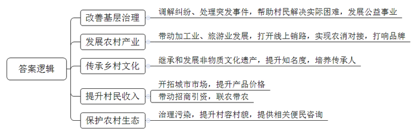
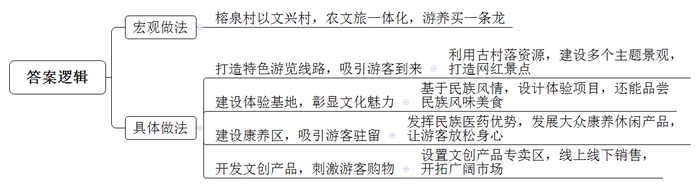
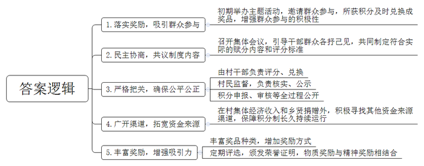
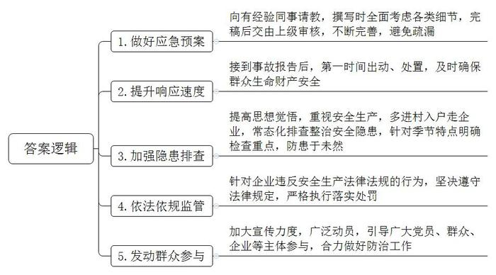
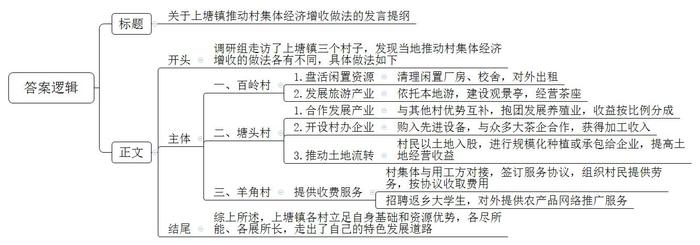

# 2023年广东省公考《申论》题（乡镇）

<!-- gwy:overview:start -->
> **广东 · 2023 · 申论 · 乡镇卷** ｜ 5 题 · 图片 5 处 · 答案随题折叠

导航：[题目](#题目) · [材料 1](#材料-1)
<!-- gwy:overview:end -->

> 候选采集稿。参考答案及解析来自粉笔页面，不代表官方答案或真实高分答卷；来源使用许可与原卷对应关系仍需人工核实。

## 给定材料

### 材料 1

总括材料

党的二十大把高质量发展作为全面建设社会主义现代化国家的首要任务，对全面推进乡村振兴作出了重要部署。广东实现高质量发展的突出短板在县、薄弱环节在镇、最艰巨最繁重的任务在农村。2022年广东全面推进乡村振兴，部署实施“百县千镇万村高质量发展工程”，提出建设宜居宜业和美乡村，通过构建现代乡村产业体系，稳步实施乡村建设行动，加强和完善乡村治理，进一步扎实有序做好乡村发展、乡村建设、乡村治理重点工作，推动乡村振兴取得新进展、农业农村现代化迈出新步伐，对推动广东在全面建设社会主义现代化国家新征程中走在全国前列、创造新的辉煌具有重要意义。

为深入贯彻党的二十大精神，进一步抓好以乡村振兴为重心的“五农”各项工作，源南县乡村振兴工作领导小组办公室近日派出调研组前往各镇村调研，了解乡村振兴推进情况。以下摘录了调研组杨组长、小王、小陈实地调研中的所见所闻。

材料1

时间：2023年2月20日9：00

地点：北山镇

在北山镇党委委员李斌的陪同下，调研组来到该镇乡村振兴人才驿站。宽敞的大厅里，咨询处、办事服务终端、文体设施等应有尽有。一旁的人才展示宣传栏吸引住了大家的目光，其中一张照片下有这样一段文字：邓忠达，新安村党支部书记、村委会主任，乡村治理工作经验丰富，调解纠纷、处理突发事件能力强，热心帮助村民解决实际困难，是村民公认的“好支书”。在他的带领下，2022年新安村荣获源南县“基层治理示范村”称号。

人才驿站工作人员曾小琪在一旁介绍道：“这是我镇的人才展示宣传栏，上面这些都是助推我镇乡村振兴的典型人物。这是企业家林启长，他开办了一家预制菜加工厂，把本地丰富的农产品做成美味佳肴，送到千家万户的餐桌上，带动本地预制菜产业的发展。他热心公益事业，逢年过节都会去慰问村里的困难户。”

鲁小洪接着说：“除了本地企业家，这几年返乡创业的人才也很多，像这位赖以赏，大学毕业后在省会待了几年，前年回来开了家电商公司，在网上卖起了我们这儿的农产品，不仅打开了销路，还实现了本地农产品从农民手上到消费者手上的‘一步到位’。还有这位叫邓志明，退伍后就在家琢磨怎么把青头鸭养好，现在已经成为了村里的养鸭大户，大家看他身后的养鸭场，已经被打造成吃、住、游一体化的生态养殖场，不仅带动本地的旅游发展，还打响了这里的青头鸭品牌。”

杨组长听后连连点头：“真的是人才兴，产业兴！”

“这是李其让，根雕大师，根雕是我市非物质文化遗产，为了传承这门祖传手艺，他精钻深研40多年，现在雕出来的东西栩栩如生，把根雕文化给做‘活’了，他的工作室在我们这边很有名气，很多人在他那儿当学徒，乡村振兴工作队的同志帮他在大城市找到了新市场，像他手上拿的那对小福鹿就能卖到三四千。”曾小琪指着一张背景满是根雕的照片说。

小陈问：“你们镇乡村振兴工作队工作开展得怎么样？”

李委员介绍道：“他们刚来没多久就摸透了镇上情况，然后天天跑项目、跑资金，一年内引进了好几个项目，有兰花厂、种苗基地、蘑菇种植等。这些项目推行‘党支部+公司+基地+农户’的联农带农模式，带动周边村民一起干，现在村民赚得比以前更多了。大家都特别佩服他们！”李委员指着咨询台的中年男子，“那位是工作队的队长，是生态环境局的林科长，他跟进的农村垃圾、污水治理、农业面源污染调整治理、村容村貌提升这几项工作都取得很大成效。现在我们这儿的生态越来越好了，为了方便村民咨询，林科长还在这里驻了点，围着他的那几位村民，就是在咨询养殖污水处理和农药使用注意事项的……”

看着这些“能人”在乡村舞台大显身手的画面，杨组长不禁感叹道：“乡村为人才提供广阔天地，人才为乡村振兴添砖加瓦！”

### 材料 2

时间：2023年2月20日15：00

地点：清河镇榕泉村

榕泉村历史悠久，是个少数民族村，在清河镇副镇长张德新的提议下，一行人沿着榕泉村打造的特色游览线路参观。

榕泉村党支部书记阳光华介绍道：“我们围绕粤乡风貌、民族风情、四季风景等主题，精心打造‘一河十景百花千树万种风情游’，像千年榕、不老泉、古祠堂都已经成为网红打卡点。”对着指示牌上的线路图，阳书记如数家珍，“经常有节目组在这里取景，好多游客成为了群演，可开心了！还有不少年轻人专程赶来露把脸呢！”

这是个典型的古村落，临河而建，经过修缮改造，民族风格更加浓郁：溪流潺潺，清可见底；花团锦簇，香气馥郁；古树名木，枝繁叶茂；百年老屋，古色古香，游人如织，还有好几个画家正在采风。

随后，一行人来到体验基地，榕泉村基于独特的民族风情，设计很多体验项目，从服饰、茶叶的制作，到文化节、传统墟市等游客都可以亲身体验，感受民族文化的魅力。“做一回银匠、绣娘、器师，跳一场舞，抓一次鱼，这些活动为游客带来全新体验，让他们乐在其中。”阳书记说。

在“稻田鱼”照片前，阳书记念起他们的“鱼经”，“我们围绕稻田鱼做文章，游客可以自己抓鱼、烤鱼，体验农家乐趣；每年举办稻田鱼文化节‘万人抓鱼’活动，吸引近万名游客参与，那场面，非常壮观。”稻田养鱼这种古老的农耕文化和现代农业的绿色理念不谋而合，稻鱼共生，收获的不仅有肥美的鱼儿，更有健康的粮食。“稻田鱼、丝苗米也是我们的特色农产品，可抢手啦！这儿的土鸡、豆腐、竹笋也特好吃，我们采用本土秘制烹饪方法，做成各类美食，别有一番风味，不少人专门开车过来，就为了吃这一口。在特色美食街，四处飘香，身着盛装的村民载歌载舞，用农家自酿酒款待客人，让人感到宾至如归。”

面对热闹的场面，杨组长问道：“有些景区白天热闹非凡，夜晚门可罗雀，你们有没有遇到这种情况？”

阳书记点点头道：“当然遇到过！为此还费了一番脑筋呢！”

说着把大家带到康养区并作详细解释。榕泉村在原有民宿的基础上，发挥民族医药资源优势，发展大众康养休闲产品，让游客泡泡温泉，放松身心。疗养房、推拿房、钓鱼台、高山茶、养生汤、特色药膳、篝火晚会、康养节目、养生讲座，不胜枚举。

康养区内还设置了文创品专卖区，手机挂件、穿戴配饰、车载饰品、房间摆件等琳琅满目。两名主播穿戴着民族服饰，正在直播带货。这些文创产品既传播了民族文化，又提升了经济效益。

“不仅要让游客满意而去，还要让他们满载而归。榕泉村专门请了创意设计专家，举办创意设计大赛，开发大量文创产品，通过线上线下销售，开拓了广阔的市场。”张副镇长说。

“我们做好‘以文兴村’这篇大文章，农文旅一体化，游养买一条龙。”随后阳书记幽默了一把，“引得来，玩得嗨；留下来，买买买。”顺口溜逗得大家哈哈大笑。

### 材料 3

时间：2023年2月21日9：00

地点：临溪镇大围村

“百县千镇万村高质量发展工程”提出创新乡村治理方式方法，其中提到推广应用积分制。积分制是指对村民参与乡村治理的行为进行积分制给予奖励的一种机制。听说大围村在这方面做得还不错，调研组决定去看看。

走进大围村党群服务中心，能看到积分奖品兑换处的货柜上摆满杯子、牙刷、雨伞等小物品，都是村民平时用得到的。一旁的公开栏上，经费来源、奖品购买价格、村民得分和兑换情况等内容一目了然。

1月6日，袁明参与村庄清洁志愿活动获5分，总积分25分。

1月28日，张秀梅兑换洗洁精一瓶用10分，总积分余5分。

……

看到不少来兑奖的村民，小王说：“积分制挺受欢迎啊！”

“那当然啦！现在氛围都不一样了，大家都争着做好事。”身旁提着瓶洗衣液的阿姨笑着说，“一开始村里面搞这个，我们也不太相信，怕赚了积分换不到奖品。还别说，有些村民和党员们一起参加了几次防电信诈骗宣传活动，每个人拿到20分，兑换了茶杯，还有的去参加交通劝导、治安巡逻等，都拿到积分换了奖品，慢慢地大家都参与进来了。”

大围村党支部书记朱小治介绍说：“我们实行积分制有段时间了，以前没有充分认识到积分的意义，不够重视，实施效果不太好。后来我们去了解其他地方是怎么做的，才意识到它有那么多的好处！”

同行的临溪党委副书记赵卫国接过话说：“积分制能引导更多村民参与乡村治理，促进农村和谐稳定。作为组织方，肯定得自己先明白为什么要进行积分制。”

朱书记点点头，继续介绍道：“于是我们决定改变做法，召开党员大会、村民代表大会，大家各抒己见，一起制定更符合实际的赋分内容和评分标准。大家都认为修改后的方法可操作性更强。实行一段时间后，参与的村民越来越多，乡风也更加文明了。”

杨组长问：“实行积分制这么久，有没有出现随意兑换的情况？购买奖品的钱从哪里来呢？”

“这个倒不会。在程序规范和公平公正方面，我们把得很严，村‘两委’班子组成评分小组，负责评分、兑换；党员代表、村民代表组成监督小组，负责核实、公示；积分申报、审核、评定、统计等全过程公开。资金这方面，主要来源于村集体经济收入和乡贤捐赠。为保障积分制一直运行下去，我们正寻找其他资金来源渠道。”朱书记回答道。

“我们每月都会把明细公布在这里和交流群，村民可以随时监督。”朱书记指着公开栏继续说，“除了准备更丰富的奖品，每季度我们还会按照积分高低，评选‘文明先锋’，颁发流动红旗。我们还在征求村民意见，看还有没有其他的奖励方式。此外，这几天一直跟镇上的大超市谈，打算用他们的消费券来做奖励，我相信积分制会越来越有吸引力。”

听完朱书记的介绍，杨组长对大家说：“对于乡村治理来说，积分制就是一套有效的奖励机制。国家和省市一直在倡导推广运用积分制。大围村在这方面作了有效的探索，值得推广。”

### 材料 4

时间：2023年2月21日14：30

地点：上塘镇

此次来到上塘镇，调研组计划向分管农业农村的副镇长詹世钊了解农村集体经济增收的情况。一行人提前到达镇政府，得知詹副镇长兼管应急管理工作，正在主持应急管理办的例会，征得同意后，大家决定旁听会议，参会的还有应急管理办张主任、余副主任和科员小曾、小潘，以及新入职干部小麦。

调研组入座后，詹副镇长说：“我们继续，小曾你接着说。”

“目前我正在完善防汛应急预案。我原本以为预案写得很不错了，没想到初稿出来后，主任指出了很多疏漏，尤其是群众转移路线、人员安置、生活物资保障等考虑得不够全面，自己还是太缺乏经验了。”小曾挠挠头说。

张主任说：“小曾，这方面你还得再加强一下。应急预案很重要，一旦出现突发情况，就要对照预案开展处置工作，特别是涉及群众生命财产安全的，一定马虎不得！”

“说到突发事件处置工作，我想起前几天邻镇的那场森林火灾，虽然过火面积不是很大，但是处分了不少人。”小潘说。

余副主任马上说：“这件事我了解过。他们接到报告后，出动慢，处置也慢！火势差点蔓延到村民生活区，威胁到群众生命财产安全，这是不可原谅的！无论出现什么突发情况，应急处置每慢一分钟，就多十分危害。”

小麦说：“我虽然来这儿工作不久，但感觉工作特别多特别杂，除了随时待命，还要不停地做防风、防汛、防寒、防火等各种‘防’的工作。”

这时詹副镇长皱了皱眉，“小麦啊，你要提高思想觉悟，安全重于泰山，保障群众生命财产安全就是我们工作的重中之重！应急管理工作涉及面广，工作难免会多一些。”

张主任紧接着说：“所以啊，要经常进村入户走企业，开展各项安全隐患排查整治，把安全隐患扼杀在萌芽状态，‘防’住了总比事后再处置好吧。”

“最近天气冷，用火用电变多了。张主任，你明天要继续安排并开展消防安全检查。”詹副镇长交代。

张主任点点头，“好的，会后就安排。”

“不好意思，我想请教一下，如果有企业不重视安全生产工作，我们该怎么处理？”小麦问道。

张主任拍了拍桌上那一摞安全生产法律法规，“这些就是我们的‘武器’！法律法规怎么定的，我们就怎么来，该责令限期整改的就责令限期整改，该责令暂时停产停业的就责令暂时停产停业。”

“说到隐患排查，辖区这么大，总感觉我们力量有点不够，风险隐患光靠镇村干部哪里排查得过来……”小潘摇摇头说。

“单靠我们这些人肯定不够，所以必须发动群众一起参与。上次暴雨过后，胜利桥有个涵洞堵了，不就是几个村民最先发现，然后清理了嘛！所以平常要多宣传、多动员，引导广大党员、群众、企业、社会组织、领导等都参与进来，合力做好防治工作。”詹副镇长说完后，大家不约而同地点了点头……

### 材料 5

时间：2023年2月21日15：20

地点：上塘镇百岭村、塘头村、羊角村

会议结束后，调研组跟着詹副镇长来到位于半山腰的百岭村。

“以前光靠山林池场这些租金，村集体一年收入也就1万多，镇里急，我们也急。”百岭村党支部书记巫智杰带着大家来到几间厂房前，上面写着“鸿力电子商务中心”“飞兔快递驿站”等字样，巫书记指着它们继续说：“后来我们在清点村集体资产时，发现这几间厂房闲置了好久，于是清理好租了出去；还有一处废弃校舍，租给村民改造成特色民宿。现在每年光这两项就能进账好几万块。”

大家走到观景亭，只见亭柱上写着“蓝天白云常做客，绿水青山入画来”，放眼望去，群山连绵起伏，层峦叠嶂，云雾缭绕。大家顿觉心旷神怡。亭内不少游客在茶座上边喝茶边欣赏风景，谈笑风生。“观景亭和这些茶座是在近几年建成的，由村集体负责管护。喏，那些茶具都是我们租给游客使用的。这几年本地游很火，茶座生意蛮好。”巫书记说。

“相信不久后，这些绿水青山都将变成金山银山！”杨组长说。离开百岭村，调研组来到塘头村。村党支部书记黄强带着大家来到甲鱼养殖基地，工人们正在忙活。“这是和塘尾村、羊角村一起建的。我们村的地是不少，但资金短缺；塘尾村没有合适的养殖场地，不过比较有钱；羊角村没什么自然资源，劳动力比较多。我们出地，他们出钱、出劳动力，抱团搞养殖，收益由三个村按比分成。”

随后，一行人来到“塘头茶叶色选”厂房，厂内堆着大量毛茶，工人正将毛茶送入机器进行分拣。黄书记介绍：“除了和别的村一起搞养殖，我们村还自己办企业开工厂，主要经营茶叶分拣等业务。大家看，这是全县最好的八层茶叶色选机，刚买不久，这个‘大家伙’可不便宜，我们还向银行贷了款。”

“这机器能为村集体带来多少收入？”杨组长提了个关键问题。

“虽然一斤毛茶只收几毛钱，但胜在量够大，很多大茶企都送来这里分拣。除去成本，他们每年将有10多万的收入，这个投入还是比较划算的。”詹副镇长说。

接着，黄书记带着大家来到一片大棚基地，“这些大棚里种的是花卉，也是村集体的产业。我们大力推动土地流转，村民以土地入股。根据发展规划，对连片流转的土地，有些进行规模化种植，有些承包给外来企业。这提高了土地产出率，让土地经营收益最大化。目前，我们已经流转了两千多亩土地。”

詹副镇长指向远处一片正在平整的土地，补充道：“现在县里准备申报建设现代农业产业园，我们争取将这一片纳入其中。”

最后，调研组来到羊角村党群服务中心，正好遇到一群手拿斗笠的村民从小巴上走下来。“他们是不是去参加什么活动呀？”小陈疑惑道。“应该是刚采完茶回来。”詹副镇长说。

“没错。”羊角村党支部委员郑文军接过话，“我们村自然资源不多，以前村民大多外出务工。后来我们书记调查发现，每当采茶季，镇上很多种茶大户都需要雇人采茶。我们村这些人，祖祖辈辈都是农民，采茶种地轻车熟路。于是，村集体负责跟种茶大户和茶企对接，签订服务协议，组织村民去采摘茶叶，按协议收取费用。不仅村民能在家门口赚钱，村集体也有一定收入，两全其美。”

小陈好奇地问：“那采茶季忙完后，村民还有别的活干吗？”

“除了采茶，还可以为其他地方的工程建设、养殖项目等提供人手。不久前有几个返乡大学生加入我们队伍，我们正计划增加农产品网络推广服务。”郑委员回答。

“靠山吃山，靠水吃水，看来为了建设宜居宜业和美乡村，大家立足自身基础和资源优势，各尽所能、各展所长，走出了自己的特色发展道路！”返程路上，回顾这两天的所见所闻，杨组长不禁感叹。

## 题目

### 第 1 题

**推动乡村全面振兴，关键靠人。根据材料1，简要概括人才在北山镇乡村振兴工作中发挥的作用。（15分）**

关联材料：材料 1、材料 2、材料 3、材料 4、材料 5

作答要求：

要求：概括全面，表达准确，条理清晰；篇幅不超过200字。

第 1 题 · 答案与解析

**参考答案（粉笔题库参考内容）**

1.改善基层治理。调解纠纷、处理突发事件，帮助村民解决实际困难，发展公益事业。

2.发展农村产业。带动加工业、旅游业发展，打开线上销路，实现农消对接，打响品牌。

3.传承乡村文化。继承和发展非物质文化遗产，提升知名度，培养传承人。

4.提升村民收入。开拓城市市场，提升产品价格；带动招商引资，联农带农。

5.保护农村生态。治理污染，提升村容村貌，提供相关便民咨询。

**解析**

**参考答案说明**：本参考答案从“改善基层治理”“发展农村产业”“传承乡村文化”“提升村民收入”“保护农村生态”五个方面展开，各条答案要点之间在内容上相互并列，没有交叉。

**考点**：影响类

**来源**：2023年广东省公考《申论》题（乡镇）

粉笔申论页面对本题只提供「解析视频」入口，该入口是会员推广位，页面无视频地址与文字解析。

### 第 2 题

**根据材料2，请你谈谈榕泉村是如何利用自身文化资源吸引游客的。（15分）**

关联材料：材料 1、材料 2、材料 3、材料 4、材料 5

作答要求：

要求：分析全面，表述准确，条理清晰；篇幅不超过200字。

第 2 题 · 答案与解析

**参考答案（粉笔题库参考内容）**

榕泉村以文兴村，农文旅一体化，游养买一条龙，具体做法为：

1.打造特色游览线路，吸引游客到来。利用古村落资源，建设多个主题景观，打造网红景点。

2.建设体验基地，彰显文化魅力。基于民族风情，设计体验项目，还能品尝民族风味美食。

3.建设康养区，吸引游客驻留。发挥民族医药优势，发展大众康养休闲产品，让游客放松身心。

4.开发文创产品，刺激游客购物。设置文创产品专卖区，线上线下销售，开拓广阔市场。

**解析**

**参考答案说明**：本参考答案呈现“总-分”结构，由宏观做法和具体做法两个方面组成，具体做法从“打造特色游览线路，吸引游客到来”“建设体验基地，彰显文化魅力”“建设康养区，吸引游客驻留”“开发文创产品，刺激游客购物”这四个方面进行了分条撰写。各条答案要点之间在内容上相互并列，没有交叉。

**考点**：概括措施类

**来源**：2023年广东省公考《申论》题（乡镇）

粉笔申论页面对本题只提供「解析视频」入口，该入口是会员推广位，页面无视频地址与文字解析。

### 第 3 题

**根据材料3，如果要在全镇推广大围村实行积分制的经验，你认为临溪镇应重点把握哪些方面？（20分）**

关联材料：材料 1、材料 2、材料 3、材料 4、材料 5

作答要求：

要求：紧扣材料，考虑全面，表述准确；篇幅不超过300字。

第 3 题 · 答案与解析

**参考答案（粉笔题库参考内容）**

1.落实奖励，吸引群众参与。初期举办主题活动，邀请群众参与，所获积分及时兑换成奖品，增强群众参与的积极性。

2.民主协商，共议制度内容。召开集体会议，引导干部群众各抒己见，共同制定符合实际的赋分内容和评分标准。

3.严格把关，确保公平公正。由村干部负责评分、兑换；村民监督，负责核实、公示；积分申报、审核等全过程公开。

4.广开渠道，拓宽资金来源。在村集体经济收入和乡贤捐赠外，积极寻找其他资金来源渠道，保障积分制长久持续运行。

5.丰富奖励，增强吸引力。丰富奖品种类，增加奖励方式；定期评选，颁发荣誉证明，物质奖励与精神奖励相结合。

**解析**

**参考答案说明**：本参考答案围绕“落实鼓励，吸引群众参与”“民主协商，共议制度内容”“严格把关，确保公平公正”“广开渠道，拓宽资金来源”“丰富奖励，增强吸引力”这五个方面的经验做法分条撰写，各条具体要点之间在内容上相互并列，没有交叉。

**考点**：提出对策类

**来源**：2023年广东省公考《申论》题（乡镇）

粉笔申论页面对本题只提供「解析视频」入口，该入口是会员推广位，页面无视频地址与文字解析。

### 第 4 题

**根据材料4，假如你是小麦，此次会议对你今后做好应急管理工作有什么启示？（20分）**

关联材料：材料 1、材料 2、材料 3、材料 4、材料 5

作答要求：

要求：观点正确，认识深刻，条理清晰；篇幅不超过300字。

第 4 题 · 答案与解析

**参考答案（粉笔题库参考内容）**

1.做好应急预案。向有经验同事请教，撰写时全面考虑各类细节，完稿后交由上级审核，不断完善，避免疏漏。

2.提升响应速度。接到事故报告后，第一时间出动、处置，及时确保群众生命财产安全。

3.加强隐患排查。提高思想觉悟，重视安全生产，多进村入户走企业，常态化排查整治安全隐患，针对季节特点明确检查重点，防患于未然。

4.依法依规监管。针对企业违反安全生产法律法规的行为，坚决遵守法律规定，严格执行落实处罚。

5.发动群众参与。加大宣传力度，广泛动员，引导广大党员、群众、企业等主体参与，合力做好防治工作。

**解析**

**参考答案说明**：本参考答案从“做好应急预案”“提升响应速度”“加强隐患排查”“依法依规监管”“发动群众参与”五个方面展开，各条答案要点之间在内容上相互并列，没有交叉。

**考点**：经验启示类

**来源**：2023年广东省公考《申论》题（乡镇）

粉笔申论页面对本题只提供「解析视频」入口，该入口是会员推广位，页面无视频地址与文字解析。

### 第 5 题

**县里计划召开农村集体经济工作交流会，根据安排，杨组长将介绍上塘镇当地推动村集体经济增收的做法。假如你是杨组长，请根据材料5，列出发言提纲。（30分）**

关联材料：材料 1、材料 2、材料 3、材料 4、材料 5

作答要求：

要求：紧扣材料，内容全面，条理清晰；篇幅不超过400字。

第 5 题 · 答案与解析

**参考答案（粉笔题库参考内容）**

关于上塘镇推动村集体经济增收做法的发言提纲

调研组走访了上塘镇三个村子，发现当地推动村集体经济增收的做法各有不同，具体做法如下：

一、百岭村：1.盘活闲置资源。清理闲置厂房、校舍，对外出租。2.发展旅游产业。依托本地游，建设观景亭，经营茶座。

二、塘头村：1.合作发展产业。与其他村优势互补，抱团发展养殖业，收益按比例分成。2.开设村办企业。购入先进设备，与众多大茶企合作，获得加工收入。3.推动土地流转。村民以土地入股，进行规模化种植或承包给企业，提高土地经营收益。

三、羊角村：提供收费服务。村集体与用工方对接，签订服务协议，组织村民提供劳务，按协议收取费用；招聘返乡大学生，对外提供农产品网络推广服务。

综上所述，上塘镇各村立足自身基础和资源优势，各尽所能、各展所长，走出了自己的特色发展道路。

**解析**

**参考答案说明：**（1）格式方面，本参考答案写到了“标题”“正文”两个个部分。（2）正文部分，一方面从内容上来看，围绕“上塘镇推动村集体经济增收”这一主题，本参考答案的开头先写到了“上塘镇推动村集体经济增收的宏观情况”；主体部分介绍了“百岭村”“塘头村”和“羊角村”三个村子推动村集体经济增收的具体做法；结尾对上塘镇推动村集体经济增收进行了总结。另一方面，形式上，本参考答案做到了分段、分条撰写，整体上条理较为清晰。

**考点**：总结类

**来源**：2023年广东省公考《申论》题（乡镇）

粉笔申论页面对本题只提供「解析视频」入口，该入口是会员推广位，页面无视频地址与文字解析。

