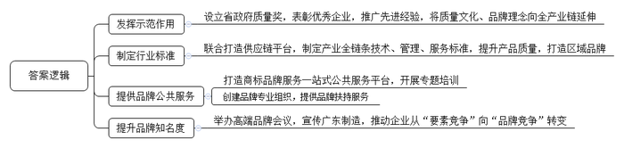
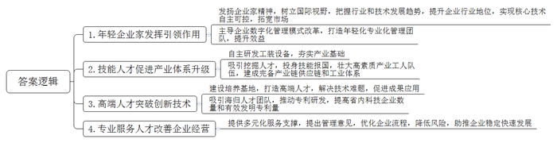
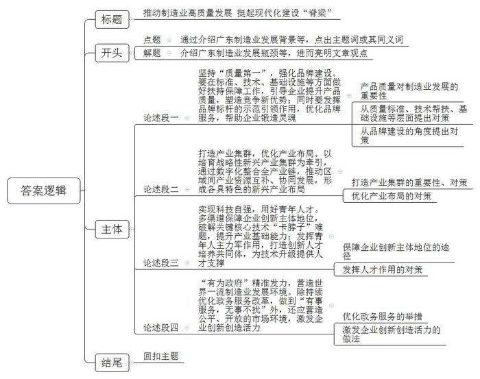

# 2023年广东省公考《申论》题（县级）

<!-- gwy:overview:start -->
> **广东 · 2023 · 申论 · 县级卷** ｜ 3 题 · 图片 3 处 · 答案随题折叠

导航：[题目](#题目) · [材料 1](#材料-1)
<!-- gwy:overview:end -->

> 候选采集稿。参考答案及解析来自粉笔页面，不代表官方答案或真实高分答卷；来源使用许可与原卷对应关系仍需人工核实。

## 给定材料

### 材料 1

追求质量、打造品牌，擦亮广东制造金字招牌，是广东制造的优良传统。上世纪九十年代，珠江水(饮料)、广东粮(食品)、岭南衣(服装)、粤家电，优质的广东制造赢得人们的青睐。现在，广东生产了全世界近一半的智能手机、三分之一的液晶电视、三成的空调，新能源汽车、无人机等新赛道上的广东企业领跑全球，越来越多的广东制造优质产品享誉世界。

在湖南长沙，国内首条磁悬浮列车所用“导电轨”的供应商是一家来自广东佛山的企业——H集团。“质量是企业的生命，品牌是企业的灵魂。”作为广东省政府质量奖获奖企业，该集团总经理倍感自豪。

在广东，像H集团一样的品牌标杆越来越多。截至2022年，全省共有3家组织获中国质量奖，15家组织和1名个人获中国质量奖提名奖，累计62家组织获省政府质量奖，36家组织和1名个人获省政府质量奖提名奖。近年来，广东大力强化品牌建设，发挥省政府质量奖示范引领作用，推广获奖企业先进经验，将先进的质量文化、品牌理念向全产业链延伸。

“中国陶瓷要受世界青睐，就要保证质量、打造品牌。”深耕行业40余年，佛山D陶瓷公司董事长何先生深谙品牌的重要性。作为佛山陶瓷龙头企业之一，D陶瓷公司不断强化自身品牌建设，引领行业品质提升。作为发起人之一，D公司联合佛山陶瓷行业34家企业成立佛山众陶联供应链服务有限公司(简称众陶联)。

“打造品牌是我们的发展方向。”众陶联一位负责人谈到联盟发展时脱口而出。众陶联通过制定陶瓷产业全链条的技术标准、管理标准、服务标准，提升全行业产品质量，打造佛山陶瓷品牌。“佛山陶瓷”已为广东“产品＋产业＋集群＋产地”区域品牌创建的典型代表。如今，全球每出口3块瓷砖就有一块来自中国，仅佛山陶瓷出口就占61%。

2022年12月，汕头市商标品牌培育指导站揭牌仪式隆重举行。指导站的设立，旨在打造为当地企业提供商标品牌服务一站式公共服务平台，揭牌仪式结束后，指导站立即开展首场活动，为参会企业进行商标品牌专题培训，围绕商品服务分类、商标注册审查、品牌侵权判定等内容进行辅导。

截至目前，汕头市有效注册商标累计达33万多件，平均每1.4个市场主体拥有1件注册商标，拥有集体商标53件，迫切需要商标品牌公共服务。

2023年1月，在主题为“新时代·新品牌”的第三届品牌强国先行论坛上，广东B铝材公司凭借在铝型材领域的专攻专研和质量保证，获评“广东知名品牌”称号。

“开年就获得‘广东知名品牌’，为我们公司新的一年打响头炮，赢得开门红。”B铝材公司负责人表示，“我们将以广东知名品牌的荣誉担当，不负重任，为广东制造争光。”

品牌强国先行论坛由广东省企业品牌建设促进会承办，“作为全国领先的品牌建设社会服务平台，近些年我们发起了品牌广东工程、品牌强国先行工程、广东品牌发展大会等活动，广受制造业企业欢迎。”该促进会有关负责人介绍。

据了解，广东还有国家商标品牌创新创业（广州）基地、广东商标协会、广东品牌网等一批品牌专业组织，为制造业企业提供品牌人才培养、知名品牌培育、企业品牌战略升维等服务。

此外，广东近些年也通过举办中国品牌国际化（广东）峰会、广东省中国品牌日活动、中国品牌人年会、品牌强国先行论坛等高端品牌会议，大力宣传广东制造，推动企业从“要素竞争”向“品牌竞争”转变，为广东打造国家级品牌、世界级品牌注入强大动力，擦亮了广东制造金字招牌。

### 材料 2

济济多士，乃成大业；人才蔚起，国运方兴。习近平总书记强调，“青年强，则国家强”，“青年人才是国家战略人才力量的源头活水”，要“给予年轻人才更多的信任、更好的帮助、更有力的支持，支持青年人才挑大梁、当主角”。

人才大潮涌珠江，广东制造业的发展，是一代代青年的热血和汗水浇灌的，也为广大青年提供了施展才干的广阔舞台。一支有理想、敢担当、能吃苦、肯奋斗的青年人才队伍，有力助推广东在制造业发展中赢得主动。

一场有关广东制造业高质量发展的某高端论坛上，38岁的F集团董事长高先生豪情满怀，“中国企业家的格局决定了中国制造未来的发展，富有企业家精神的年轻一代企业家，正挑起广东制造业高质量发展的大梁。”F集团主业是工业机器人，在高先生带领下，已经成为行业领军企业，实现了核心技术自主可控，产品远销80多个国家和地区。

“跟广东老一代企业家相比，年轻一代企业家更具有国际视野，更能把握行业和技术发展趋势，引领作用更加明显。”长期研究企业管理的周教授说。

F集团总经理方先生是一名职业经理人，3年前，年仅32岁的方先生主导了F集团数字化管理模式改革，打造了一支年轻化、专业化的管理团队，带领企业成功实现从传统管理向现代智能管理的转型，使企业效益不断提升。2021年，集团营收超500亿元，产值近2000亿元。

走进广州某航空公司飞机部件维修基地，“这是电子电气研究室，旁边是机械研发室，我们增设了一批自动化设备。”“南粤工匠”刘工热情介绍。

1985年，20岁的刘工从技校毕业进入该基地。“当时我国飞机维修能力很有限，连辅助工具都依赖进口。”如今，刘工团队研究发现的工装设备已获国家专利证书131项。“技能人才是制造业当家的重要基础。这支队伍后继有人、日渐壮大，我们的制造强国梦才能实现。”刘工说。

不少“00后”受到鼓舞，投身技能报国。白云国际机场户外修机坪，20岁的小郑正对照图纸认真检查飞机。“之前有幸到某基地参观并聆听刘工的分享，我想成为飞机维修师！”这位全国职业技能大赛银牌得主尚未毕业，便收到公司的邀请，提前签约。

改革开放以来，广东建成了世界上最完备的产业链供应链和工业体系，背后是一支宏大的高素质产业工人队伍。目前，广东技能人才总量超1800万，其中高技能人才超600万，青年人才占了大部分，他们是广东制造业的有力支撑。

制造业重镇佛山、东莞、中山设有广东省研究生联合培养基地，从基地毕业的研究生，几乎都留在粤港澳大湾区发展。2022年7月，新一批近300名佛山基地研究生陆续到企业报到。其中，研究生小黎入驻一家新材料公司。短短半年，小黎就依托该企业的创新实验室成功申请3项专利，帮助企业解决了耐高温、耐冲蚀、高导热涂料的技术难题，制备出的新型材料很快投入试用。

2020年12月，30岁的吴博士从美国学成归来，受邀出任广东一家科技初创企业研发总监。“广东向我伸出‘橄榄枝’，简直一拍即合。”这位年轻的海归科学家把粤港澳大湾区称为“梦想之都”。两年来，吴博士团队成功申请20余项PCT国际专利。

如今，数十万青年研发人才活跃在广东制造业各领域，全省高科技企业数量、有效发明专利量稳居全国首位。

“我刚担任该企业法律顾问时，出售产品的送货单随便由职员签字，企业直接盖章整本的收款收据，造成大量货款成了呆账，合同管理混乱严重影响企业经营发展。”潮州一家五金企业法律顾问王律师说。年仅28岁的王律师对该公司合同管理提出了合理意见，帮助公司重新设计了收取货款流程。

“现在公司的货款呆账降到极低比例，企业得到快速发展。”王律师介绍，“该企业已成为潮州五金行业龙头企业。”

“广东制造业当家，离不开知识产权、管理咨询、法律、设计等服务的支持，活跃在专业服务领域的主要是青年人。”从事生产性服务业研究的一位专家说。

### 材料 3

党的二十大强调，高质量发展是全面建设社会主义现代化国家的首要任务。党的十八大以来，习近平总书记对广东高质量发展谆谆指引，总书记深情指出，“广东改革发展先行一步，对推动高质量发展必要性和紧迫性的感受会更深一些”，寄望广东“在推动高质量发展上聚焦用力，发挥示范引领作用”。2023年春节，总书记又提出“扎实推进广东高质量发展”的殷切要求。

2023年1月28日，正月初七，全省高质量发展大会在兔年首个工作日召开，会议强调，广东的未来发展，取决于今天的行动，关键在于推动高质量发展的谋划、担当与作为。

产业潮流，浩浩荡荡，纵观世界工业史，制造业的竞争格局在很大程度上是由制造业重镇引领和决定的。改革开放以来，广东经历了从“制造业起家”到“制造业当家”的发展和跨越，成为引领中国高质量发展的“排头兵”。

推动制造业高质量发展，制造业当家是内在要求。

2019年11月，全省推动制造业高质量发展大会指出，广东要把推动制造业高质量发展摆在必争必胜的关键地位，以制造业高质量发展承载时代机遇、履行时代担当。

2022年12月，中共广东省委十三届二次全会强调，坚持制造业当家，高水平谋划推进现代化产业体系建设，把制造业这份厚实家当做优做强，在新的高度挺起广东现代化建设的“脊梁”。

岭南处处是春天，广东时时无闲人。新时代新征程新起点，制造业当家的嘹亮号角已经吹响，广东正谱写中国式现代化广东实践的新篇章！

## 题目

### 第 1 题

**请根据材料**4**，概括广东“追求质量、打造品牌，擦亮广东制造金字招牌”的主要举措。（20分****）**

关联材料：材料 1

作答要求：

要求：概括全面、准确，条理清晰，篇幅不超过200字。

第 1 题 · 答案与解析

**参考答案（粉笔题库参考内容）**

1.发挥示范作用。设立省政府质量奖，表彰优秀企业，推广先进经验，将质量文化、品牌理念向全产业链延伸。

2.制定行业标准。联合打造供应链平台，制定产业全链条技术、管理、服务标准，提升产品质量，打造区域品牌。

3.提供品牌公共服务。打造商标品牌服务一站式公共服务平台，开展专题培训；创建品牌专业组织，提供品牌扶持服务。

4.提升品牌知名度。举办高端品牌会议，宣传广东制造，推动企业从“要素竞争”向“品牌竞争”转变。

**解析**

**参考答案说明**：本参考答案围绕“发挥示范作用”“制定行业标准”“提供品牌公共服务”“提升品牌知名度”这四个方面的举措分条撰写，各条具体要点之间在内容上相互并列，没有交叉。

**考点**：考点概括措施类

**来源**：来源2023年广东省公考《申论》题（县级）

粉笔申论页面对本题只提供「解析视频」入口，该入口是会员推广位，页面无视频地址与文字解析。

### 第 2 题

**未来属于青年，希望寄予青年。请根据材料**7**，谈谈青年人才对推动制造业高质量发展的重要作用。（30分****）**

关联材料：材料 2

作答要求：

要求：观点鲜明正确，分析全面透彻，条理清晰，表达准确，篇幅不超过300字。

第 2 题 · 答案与解析

**参考答案（粉笔题库参考内容）**

1.年轻企业家发挥引领作用。发扬企业家精神，树立国际视野，把握行业和技术发展趋势，提升企业行业地位，实现核心技术自主可控，拓宽市场；主导企业数字化管理模式改革，打造年轻化专业化管理团队，提升效益。

2.技能人才促进产业体系升级。自主研发工装设备，夯实产业基础；吸引挖掘人才，投身技能报国，壮大高素质产业工人队伍，建成完备产业链供应链和工业体系。

3.高端人才突破创新技术。建设培养基地，打造高端人才，解决技术难题，促进成果应用；吸引海归人才团队，推动专利研发，提高省内科技企业数量和有效发明专利量。

4.专业服务人才改善企业经营。提供多元化服务支撑，提出管理意见，优化企业流程，降低风险，助推企业稳定快速发展。

**解析**

**参考答案说明**：本参考答案围绕“年轻企业家发挥引领作用”“技能人才促进产业体系升级”“高端人才突破创新技术”“专业服务人才改善企业经营”这四个方面的作用分条撰写，各条具体要点之间在内容上相互并列，没有交叉。

**考点**：考点影响类

**来源**：来源2023年广东省公考《申论》题（县级）

粉笔申论页面对本题只提供「解析视频」入口，该入口是会员推广位，页面无视频地址与文字解析。

### 第 3 题

**制造业是国家经济命脉所系，是立国之本、强国之基。请结合全部给定材料，联系实际，围绕****“把广东制造业这份厚实家当做优做强”这一主题，自拟题目，撰写一篇策论文。（50分****）**

关联材料：材料 3

作答要求：

要求：

（1）对策合理，紧密联系材料；

（2）条理清晰，论证严密，合乎逻辑；

（3）结构完整，表达准确，行文流畅；

（4）篇幅在800-1000字。

第 3 题 · 答案与解析

**参考答案（粉笔题库参考内容）**

**推动制造业高质量发展** **挺起现代化建设****“脊梁”**

改革开放以来，广东制造业实现了跨越式发展，然而与制造业当家的要求相比，仍有很大提升空间。要把制造业这份厚实家当做优做强，就要高水平谋划，扎实推进制造业高质量发展，在新高度挺起广东现代化建设“脊梁”。

**坚持****“质量第一”，强化品牌建设。要在标准、技术、基础设施等方面做好扶持保障工作，引导企业提升产品质量，塑造竞争新优势；同时要发挥品牌标杆的示范引领作用，优化品牌服务，帮助企业锻造灵魂。**产品质量是企业安身立命之本，为此广东应主动作为，不断推动行业质量标准升级，为企业提供针对性技术帮扶，强化质量基础设施的协同应用，多路径帮助企业以质量赢得市场。此外，还要擦亮广东制造金字招牌，树立典型，提供品牌培育等服务，将先进品牌理念向全产业链延伸。

**打造产业集群，优化产业布局。以培育战略性新兴产业集群为牵引，通过数字化整合全产业链，推动区域间产业资源互补、协同发展，形成各具特色的新兴产业布局。**数据表明，新兴产业集群是广东制造业逆势上升的“压舱石”，因此要抓住全球产业变革机遇，加速推进数字经济与实体经济融合，集群聚力，助力企业提质增效。不但如此，各地区也应充分发挥自身的比较优势，立足产业特色和资源禀赋，善于借势、因地制宜，推进区域错位、协调发展。

**实现科技自强，用好青年人才。多渠道保障企业创新主体地位，破解关键核心技术****“卡脖子”难题，提升产业基础能力；发挥青年人主力军作用，打造创新人才培养共同体，为技术升级提供人才支撑。**既要创新“技术流”金融扶持评价体系，又要加强企业知识产权服务，加快专利成果转化运用，以此支持企业开展技术研发与推广，保障企业制造业技术进步的主体地位。此外，我们还要依托人才的力量，深化产学研融合，协同培养复合型创新人才，保障人才多样性，为广东“智造”提供服务支持。

**“****有为政府****”精准发力，营造世界一流制造业发展环境。除持续优化政务服务改革，做到“有事服务，无事不扰”外，还应营造公平、开放的市场环境，激发企业创新创造活力。**推进“放管服”改革，打造线上民生诉求系统，实现办事服务快速响应，推动制造业企业降低经营成本；实施“信任筹建”制度，满足市场主体需求，从“给优惠”向“给机会”转变，积极鼓励新兴产业与领域发展。

岭南春早，奋楫扬帆。广东只有持续高质量发展制造业，才能更好服务大局，当好中国高质量发展“排头兵”。

**解析**

**文章分析**

**推动制造业高质量发展** **挺起现代化建设****“脊梁”**

【**标题的优点：**标题中包含了主题词“制造业”，做到了文章主题突出、清晰；同时，形式上采取对称式，使标题美观饱满。】

（1）改革开放以来，广东制造业实现了跨越式发展，然而与制造业当家的要求相比，仍有很大提升空间。（2）要把制造业这份厚实家当做优做强，就要高水平谋划，扎实推进制造业高质量发展，在新高度挺起广东现代化建设“脊梁”。

【**开头的优点：**★内容方面。范文的开头是紧扣“把广东制造业这份厚实家当做优做强”这一主题展开的。首先，介绍了广东制造业发展的背景以及发展瓶颈；其次，引出了把广东制造业这份厚实家当做优做强的总体对策。★文字表达方面。使用了“然而”等逻辑词，增强了文章的逻辑性。】

**坚持****“质量第一”，强化品牌建设。要在标准、技术、基础设施等方面做好扶持保障工作，引导企业提升产品质量，塑造竞争新优势；同时要发挥品牌标杆的示范引领作用，优化品牌服务，帮助企业锻造灵魂。**（1）产品质量是企业安身立命之本，（2）为此广东应主动作为，不断推动行业质量标准升级，为企业提供针对性技术帮扶，强化质量基础设施的协同应用，多路径帮助企业以质量赢得市场。（3）此外，还要擦亮广东制造金字招牌，树立典型，提供品牌培育等服务，将先进品牌理念向全产业链延伸。

【论述段1的优点：★观点句：范文的观点句是紧扣“把广东制造业这份厚实家当做优做强”这一文章主题提出的。形式上，它在段首处直接写出，位置突出，容易发现。内容上，关键词突出，内容要点明确，可以明显看出是从“提升产品质量，加强品牌建设”的角度，论述“把广东制造业这份厚实家当做优做强”的对策。★论述内容：（1）先指出产品质量对制造业发展的重要性；（2）再从质量标准、技术帮扶、基础设施等层面提出对策；（3）最后从品牌建设的角度提出对策。注意：以上几个方面的内容都是紧扣“坚持‘质量第一’，强化品牌建设”这方面观点进行分析论述的，论述的针对性强，内容层次清晰。】

**打造产业集群，优化产业布局。以培育战略性新兴产业集群为牵引，通过数字化整合全产业链，推动区域间产业资源互补、协同发展，形成各具特色的新兴产业布局。**（1）数据表明，新兴产业集群是广东制造业逆势上升的“压舱石”，因此要抓住全球产业变革机遇，加速推进数字经济与实体经济融合，集群聚力，助力企业提质增效。（2）不但如此，各地区也应充分发挥自身的比较优势，立足产业特色和资源禀赋，善于借势、因地制宜，推进区域错位、协调发展。

【论述段2的优点：★观点句：范文的观点句是紧扣“把广东制造业这份厚实家当做优做强”这一文章主题提出的。形式上，它在段首处直接写出，位置突出，容易发现。内容上，关键词突出，内容要点明确，可以明显看出是从“打造产业集群，优化产业布局”的角度，论述“把广东制造业这份厚实家当做优做强”的对策。★论述内容：（1）先指出打造产业集群的重要性、对策；（2）再提出优化产业布局的对策。以上几个方面的内容都是紧扣“打造产业集群，优化产业布局”这方面观点进行分析论述的，论述的针对性强，内容层次清晰。】

**实现科技自强，用好青年人才。多渠道保障企业创新主体地位，破解关键核心技术****“卡脖子”难题，提升产业基础能力；发挥青年人主力军作用，打造创新人才培养共同体，为技术升级提供人才支撑。**（1）既要创新“技术流”金融扶持评价体系，又要加强企业知识产权服务，加快专利成果转化运用，以此支持企业开展技术研发与推广，保障企业制造业技术进步的主体地位。（2）此外，我们还要依托人才的力量，深化产学研融合，协同培养复合型创新人才，保障人才多样性，为广东“智造”提供服务支持。

【论述段3的优点：★观点句：范文的观点句是紧扣“把广东制造业这份厚实家当做优做强”这一文章主题提出的。形式上，它在段首处直接写出，位置突出，容易发现。内容上，关键词突出，内容要点明确，可以明显看出是从“实现科技自强，用好青年人才”的角度，论述“把广东制造业这份厚实家当做优做强”的对策。★论述内容：（1）先介绍了保障企业创新主体地位的途径；（2）再介绍了发挥人才作用的对策。以上几个方面的内容都是紧扣“实现科技自强，用好青年人才”这方面观点进行分析论述的，论述的针对性强，内容层次清晰。】

**“有为政府”精准发力，营造世界一流制造业发展环境。除持续优化政务服务改革，做到“有事服务，无事不扰”外，还应营造公平、开放的市场环境，激发企业创新创造活力。**（1）推进“放管服”改革，打造线上民生诉求系统，实现办事服务快速响应，推动制造业企业降低经营成本；（2）实施“信任筹建”制度，满足市场主体需求，从“给优惠”向“给机会”转变，积极鼓励新兴产业与领域发展。

【论述段4的优点：★观点句：范文的观点句是紧扣“把广东制造业这份厚实家当做优做强”这一文章主题提出的。形式上，它在段首处直接写出，位置突出，容易发现。内容上，关键词突出，内容要点明确，可以明显看出是从“政府发力”的角度，论述“把广东制造业这份厚实家当做优做强”的对策。★论述内容：（1）先提出优化政务服务的举措；（2）而后提出激发企业创新创造活力的做法。以上几个方面的内容都是紧扣“政府发力，营造一流制造业发展环境”这方面观点进行分析论述的，论述的针对性强，内容层次清晰。】

【**论述段之间的关系**：★内在逻辑上：范文的论述段之间呈现出递进的关系，论述段1先提出要“坚持‘质量第一’，强化品牌建设”，明确指出质量是第一位的；之后，论述段2、3再在保证质量的基础上，提出要“打造产业集群，优化产业布局”“实现科技自强，用好青年人才”；最后，从长远来看，良好的发展环境才能促进可持续、高质量发展，因此，论述段4提出“政府发力，营造一流制造业发展环境”。】

岭南春早，奋楫扬帆。广东只有持续高质量发展制造业，才能更好服务大局，当好中国高质量发展“排头兵”。

【**结尾的优点**：范文的结尾回扣了主题，并阐述了深远意义。】

**考点**：考点文章写作题

**来源**：来源2023年广东省公考《申论》题（县级）

粉笔申论页面对本题只提供「解析视频」入口，该入口是会员推广位，页面无视频地址与文字解析。

