# 2023年广东省公务员录用考试《行测》题（乡镇卷）（网友回忆版）

<!-- gwy:overview:start -->
> **广东 · 2023 · 行测 · 乡镇卷** ｜ 100 题 · 图片 213 处 · 答案随题折叠

| 题型模块 | 题量 | 题号 |
| --- | ---: | ---: |
| 言语理解与表达 | 10 | 1–10 |
| 常识判断 | 20 | 11–30 |
| 数量关系 | 15 | 31–45 |
| 判断推理 | 20 | 46–65 |
| 科学推理 | 20 | 66–85 |
| 资料分析 | 15 | 86–100 |
| **合计** | **100** | |

导航：[题型与作答说明](#题型与作答说明) · [题目](#题目) · [材料 1](#材料-1)
<!-- gwy:overview:end -->

> 候选采集稿。参考答案及解析来自粉笔页面，不代表官方答案或真实高分答卷；来源使用许可与原卷对应关系仍需人工核实。

## 题型与作答说明

言语理解与表达

（10题）

第一部分 言语理解与表达。 本部分包括表达与理解两方面的内容。请根据题目要求，在四个选项中选出一个最恰当的答案。

常识判断

（20题）

第二部分 常识判断。 根据题目要求，在四个选项中选出一个最恰当的答案。

数量关系

（15题）

第三部分 数量关系 本部分包括数字推理和数学运算两部分，每道题呈现一段表述数字关系的文字，要求你迅速、准确地计算出答案。

判断推理

（20题）

第四部分 判断推理。 本部分包括图形推理、类比推理与逻辑判断三种类型的试题，在四个选项中选出一个最恰当的答案。

科学推理

（20题）

第五部分 科学推理。 每道题给出文字或图表信息，要求你在此基础上，用基本科学知识进行推理判断，从4个备选项中选出最合理的1项。

资料分析

（15题）

第六部分 资料分析。 所给出的图、表、文字或综合性资料均有若干个问题要你回答。你应根据资料提供的信息进行分析、比较、计算和判断处理。

## 题目

### 第 1 题

我国将采取有力措施全面推进乡村振兴，巩固脱贫成果。要在守住不发生规模性返贫底线的基础上，            、再接再厉，朝着实现农业农村现代化的目标接续奋斗。

填入画横线部分最恰当的一项是（ ）。

A. 运筹帷幄

B. 急流勇进

C. 逆流而上

D. 乘势而上

第 1 题 · 答案与解析

**参考答案（粉笔题库参考内容）**

D

**解析**

根据顿号可知，横线处所填成语与“再接再厉”构成并列关系，语义相近，并根据“巩固脱贫成果······朝着实现农业农村现代化的目标接续奋斗”可知，横线处应体现凭借现在的有利形势，继续努力，取得更大的成果之意，D项“乘势而上”指利用有利的形势而加紧完成某事，符合文意，当选。A项“运筹帷幄”指在帐幕中谋划军机，拟定作战策略，文段侧重继续努力，而非“谋划”，排除；B项“急流勇进”形容在险境中积极进取，不退缩，C项“逆流而上”比喻迎着困难而上，文段介绍的是继续巩固脱贫成果，“险境”“困难”文段均未提及，与文意不符，排除。

故正确答案为D。

【文段出处】新华社《国家乡村振兴局：为全球贫困治理贡献更多中国方案》

### 第 2 题

当前，各乡镇纷纷在特色农产品上做文章，但真正能在市场竞争中            的，还是那些品类独特、品质优良的农产品。

填入画横线部分最恰当的一项是（ ）。

A. 历久弥新

B. 脱颖而出

C. 一枝独秀

D. 披荆斩棘

第 2 题 · 答案与解析

**参考答案（粉笔题库参考内容）**

B

**解析**

根据前文“各乡镇纷纷在特色农产品上做文章”及后文“还是那些品类独特、品质优良的农产品”可知，横线处应体现出只有部分优秀的农产品才能在市场竞争中展露出来。B项“脱颖而出”比喻本领全部显露出来，往往用在比较语境，符合文意，当选。

A项，“历久弥新”指经历长久的时间而更加鲜活，更加有活力，与文意不符，排除；

C项，“一枝独秀”形容在同类事物中最为突出优秀，由后文“那些”可知，文段并未体现“最优秀”的主体唯一性，与文意不符，排除；

D项，“披荆斩棘”比喻扫除前进中的困难和障碍，与文意不符，排除。

故正确答案为B。

【文段出处】人民日报《别让“盛果期”变成“剩果期”（现场评论）》

### 第 3 题

风清则气正，气正则心齐，心齐则事成。在以习近平同志为核心的党中央坚强领导下，贵州各地各部门靠着不懈的干劲、韧劲，持之以恒加强党风廉政建设，驰而不息开展反腐败工作。如今，党风政风焕然一新，社风民风持续向好，干群关系更加        、党心民心更加        。

依次填入画横线部分最恰当的一项是（ ）。

A. 融洽 凝聚

B. 和谐 包容

C. 密切 一致

D. 稳定 团结

第 3 题 · 答案与解析

**参考答案（粉笔题库参考内容）**

A

**解析**

第一空，搭配“干群关系”，且根据“党风政风焕然一新，社风民风持续向好”可知，横线处应体现出如今的干群关系更好之意，A项“融洽”指彼此关系好，没有抵触，B项“和谐”指和睦协调，均符合文意，保留。C项“密切”指关系近，体现不出关系更好之意，排除；D项“稳定”指稳固安定，没有变动，常搭配“情绪”“社会”等，与“干群关系”搭配不当，且体现不出关系更好之意，排除。

第二空，搭配“党心民心”，且根据“气正则心齐”与“党风政风焕然一新，社风民风持续向好”可知，横线处应体现出党心民心紧密结合在一起之意，A项“凝聚”指聚集，积聚，搭配恰当且符合文意，当选。B项“包容”指宽容，与文意无关，排除。

故正确答案为A。

【文段出处】《党风廉政建设促社区综合服务提升》

### 第 4 题

备耕种先行。种子作为春耕时必不可少的农资，数量和质量都至关重要。如今，乡村储备仓库里一袋袋优质早稻种子            ，还会有专业人员定时查看种子情况，确保            。

依次填入画横线部分最恰当的一项是（ ）。

A. 琳琅满目 分毫不差

B. 漫山遍野 巨细无遗

C. 堆积如山 万无一失

D. 铺天盖地 滴水不漏

第 4 题 · 答案与解析

**参考答案（粉笔题库参考内容）**

C

**解析**

第一空，搭配“种子”，且根据“种子作为春耕时必不可少的农资，数量和质量都至关重要”可知，横线处所填成语需体现乡村储备仓库里优质早稻种子的数量很多之意。A项“琳琅满目”比喻面前美好的东西很多，C项“堆积如山”指东西堆积得像山一样，形容极多，均符合文意，且搭配恰当，保留。B项“漫山遍野”指山上和田野里到处都是，形容极多，无法与“乡村储备仓库里”形成对应，排除；D项“铺天盖地”形容来势非常猛烈，充满了整个天地，常搭配“报道”“信息”“宣传”等，与“种子”搭配不当，排除。

第二空，搭配“种子情况”，且根据“种子作为春耕时必不可少的农资”“专业人员定时查看种子情况”可知，种子对于春耕至关重要，定时查看种子情况可以确保种子不出问题。C项“万无一失”指非常有把握，绝对不会出差错，符合文意，且搭配恰当，当选。A项“分毫不差”形容没有一点差错，通常搭配“动作”“工作”“计划”等，与“种子情况”搭配不当，排除。

故正确答案为C。

【文段出处】《浏阳小河乡：春耕备耕生产忙 不负农作好时光》

### 第 5 题

质量        是产出来的，        是管出来的，        是市场竞争出来的。这就要推动有效市场与有为政府更好结合，共助质量强国建设取得新成效。

依次填入画横线部分最恰当的一项是（ ）。

A. 不 不 而

B. 既 也 更

C. 首先 其次 再次

D. 要么 要么 要么

第 5 题 · 答案与解析

**参考答案（粉笔题库参考内容）**

B

**解析**

根据“是产出来的”“是管出来的”以及“是市场竞争出来的”可知，这三方面内容均是质量发展的重要组成部分，故这三方面内容应为并列或递进关系。B项“既······也······更······”中，“既······也······”表示并列关系，“更”表示递进关系，可体现文段这三方面内容均是质量发展的重要组成部分，符合文段逻辑关系，当选。

A项“不······不······而······”为反义并列关联词，文段并未体现这三方面内容具有反义并列关系，不符合文段逻辑关系，排除；

C项“首先······其次······再次······”为承接关系关联词，文段并未体现这三方面内容的先后顺序，不符合文段逻辑关系，排除；

D项“要么······要么······要么······”为选择关系关联词，文段并未体现这三方面内容间的选择关系，不符合文段逻辑关系，排除。

故正确答案为B。

【文段出处】《质量强则国家强》

### 第 6 题

农村生态文明建设，                    。一是必须加速由高耗能、高污染的粗放型农业生产方式向清洁循环的集约型农业发展方式转变，加强农业科技研发与推广应用，建立全产业链绿色化农业发展模式。二是促进农业资源循环利用，积极推进农业清洁生产，提高禽畜养殖废弃物资源化利用。

以下句子填入划横线处，最恰当的是（ ）。

A. 必须与美丽乡村建设紧密结合

B. 必须大力推进绿色循环农业发展

C. 必须充分利用科技研发促进农业生产

D. 必须树立“绿水青山就是金山银山”的价值导向

第 6 题 · 答案与解析

**参考答案（粉笔题库参考内容）**

B

**解析**

横线出现在文段开头，需结合后文内容进行分析。后文围绕两个方面论述，一是必须转变为清洁循环的集约型农业发展方式，二是促进农业资源循环利用，积极推进农业清洁生产，这两个方面都围绕发展绿色循环农业展开，对应B项。

A项“与美丽乡村建设紧密结合”、D项“树立价值导向”文段均未提及，无中生有，且均偏离核心话题“循环”，排除；

C项，“科技研发”仅对应后文第一部分内容，表述片面，排除。

故正确答案为B。

【文段出处】光明网《农村生态文明建设成就瞩目》

### 第 7 题

协调城乡发展旨在让农民平等参与改革发展进程、共同享受改革发展成果，以实现城乡人民共同富裕。协调城乡发展要求深入实施乡村振兴战略，加快推进农业农村现代化：推进以人为核心的新型城镇化，深化户籍制度改革，加快农业转移人口市民化，实现基本公共服务城乡均等。

对这段文字，以下理解最准确的是（ ）。

A. 新型城镇化要求实现全体农业人口市民化

B. 农业农村现代化的重心在深化户籍制度改革

C. 公共服务城乡均等能极大提高农业人口素质

D. 协调城乡发展的目标是促进城乡人民共同富裕

第 7 题 · 答案与解析

**参考答案（粉笔题库参考内容）**

D

**解析**

A项，根据“推进以人为核心的新型城镇化······加快农业转移人口市民化”可知，文段仅表达“加快农业转移人口市民化”，而非“实现全体农业人口市民化”，表述过于绝对，排除；

B项，根据“推进以人为核心的新型城镇化，深化户籍制度改革”可知，文段仅论述新型城镇化的核心是“人”，并未提及“深化户籍制度改革”是“重心”，无中生有，排除；

C项，“农业人口素质”文段并未提及，无中生有，排除；

D项，根据“协调城乡发展旨在让农民平等参与改革发展进程、共同享受改革发展成果，以实现城乡人民共同富裕”可知，表述正确，当选。

故正确答案为D。

【文段出处】《协调发展：实现共同富裕的必由之路》

### 第 8 题

烈士纪念设施是讲好英雄烈士故事的重要平台，要在建设好、管理好烈士纪念设施的基础上，将其教育作用发挥好，创新手段发挥其红色教育主阵地功能。比如，在烈士纪念设施的展板和展柜上设置二维码，参观者可以扫码收听烈士事迹及相关介绍；开设烈士纪念设施VR虚拟现实展厅，让网络祭扫者全方位参观烈士纪念设施；等等。

本段文字主要讲的是（ ）。

A. 如何讲好英雄烈士的红色故事

B. 如何保护和管理好烈士纪念设施

C. 如何强化烈士纪念设施的教育作用

D. 如何利用科技手段加强烈士纪念设施建设

第 8 题 · 答案与解析

**参考答案（粉笔题库参考内容）**

C

**解析**

文段开篇提出烈士纪念设施是讲好英雄烈士故事的重要平台，要充分发挥其教育作用，接着通过“比如”进行举例，具体说明可通过哪些现代技术手段帮助其实现红色教育作用。故文段重在强调需进一步发挥烈士纪念设施的教育功能，对应C项。

A项，缺少文段核心话题“烈士纪念设施”“教育作用”，排除；

B项，“保护烈士纪念设施”文段未提及，无中生有，排除；

D项，缺少文段核心话题“教育作用”，且“科技手段”对应举例部分，非重点，排除。

故正确答案为C。

【文段出处】人民网《强化烈士纪念设施的教育功能（新论）》

### 第 9 题

对各级领导干部来说，摸清吃透基层情况，了解“第一手”民意，才能扎实开展好各项工作。网络中的群众诉求和建议是社情民意的直观表达，群众反映的问题清单就是党员干部办实事的履职清单。各级干部特别是领导干部要深刻认识互联网在国家管理和社会治理中的作用，不断创新互联网时代群众工作机制，用信息化手段更好地了解社会态势、畅通沟通渠道、辅助决策施政。

这段文字意在强调（ ）。

A. 各级领导干部要善于运用网络了解民意，做好工作

B. 互联网在国家管理和社会治理中发挥着重要作用

C. 了解民情民意是各级领导干部开展好各项工作的基础

D. 听取和接受群众意见建议是新时代社会治理的内在要求

第 9 题 · 答案与解析

**参考答案（粉笔题库参考内容）**

A

**解析**

文段开篇指出各级领导干部要吃透基层情况，了解民意才能开展好工作，随后论述群众在网络上反映的问题是党员干部需要切实解决的清单，并由此提出对策，强调领导干部要认识互联网的重要性，用信息化手段来辅助了解社会态势、畅通沟通渠道、辅助决策施政，故文段重在强调领导干部要运用网络来了解民意，辅助自己更好地工作，对应A项。

B项，缺少文段核心话题“领导干部”，偏离文段中心，排除；

C、D两项，文段重在强调领导干部要运用网络来了解民意，故均缺少文段核心话题“网络”，排除。

故正确答案为A。

【文段出处】《善于运用网络了解民意开展工作》

### 第 10 题

队伍建设和人才工作事关高校领导权归属，事关高校发展水平和一流大学建设成效，是一项必须牢牢抓在手里、丝毫不能松懈的基础性、战略性工作。高校加强党的全面领导，必须坚持党管干部和党管人才原则，着力培养忠诚干净担当的高素质干部，着力集聚爱国奉献的各方面优秀人才，团结全校师生员工抓改革、谋发展、开新局、创一流。

下列选项最适合作为这段文字标题的是（ ）。

A. 以改革发展促进一流大学建设

B. 以爱国奉献凝聚高校优秀人才

C. 以加强党的领导促进高校人才工作

D. 以人才强国战略作为高校发展目标

第 10 题 · 答案与解析

**参考答案（粉笔题库参考内容）**

C

**解析**

文段开篇介绍队伍建设和人才工作对于高校的重要意义，随后针对高校队伍建设和人才工作提出对策，即高校应加强党的全面领导，接着从多个方面进行具体的解释说明，故文段重在强调加强党的全面领导对于高校人才工作的重要性，对应C项。

A项，缺少主题词“党的领导”和“高校人才”，且“改革发展”对应解释说明的内容，非重点，排除；

B项，缺少主题词“党的领导”，且“爱国奉献”对应解释说明的内容，非重点，排除；

D项，缺少主题词“党的领导”，且“人才强国战略”无中生有，排除。

故正确答案为C。

【文段出处】求是网《坚持党的全面领导 推进一流大学建设》

### 第 11 题

中国式现代化是我们党领导全国各族人民在长期探索和实践中历经千辛万苦、付出巨大代价取得的重大成果，党的领导与中国式现代化关系正确的是（ ）。

①党的领导决定中国式现代化的根本性质

②党的领导确保中国式现代化锚定奋斗目标行稳致远

③党的领导激发建设中国式现代化的强劲动力

④党的领导凝聚建设中国式现代化的磅礴力量

A. ①②③

B. ①②④

C. ①③④

D. ①②③④

第 11 题 · 答案与解析

**参考答案（粉笔题库参考内容）**

D

**解析**

本题考查政治常识。

①正确。党的领导决定中国式现代化的根本性质。中国共产党是时代的先锋、民族的脊梁、人民的主心骨。没有中国共产党，就没有新中国，就没有中华民族伟大复兴。

②正确。党的领导确保中国式现代化锚定奋斗目标行稳致远。在新中国成立特别是改革开放以来长期探索实践基础上，经过党的十八大以来在理论和实践上的创新突破，我们成功推进和拓展了中国式现代化。

③正确。党的领导激发建设中国式现代化的强劲动力。优势提供原动力，动力创造新优势。中国共产党的领导是中国式现代化最鲜明的特征和最突出的优势。

④正确。党的领导凝聚建设中国式现代化的磅礴力量。力量生于团结，幸福源自奋斗。团结奋斗是党和人民锤炼铸就的最宝贵精神品质。

综上所述，关系正确的是①②③④。

故正确答案为D。

### 第 12 题

党的二十大报告指出，改革开放和社会主义现代化建设深入推进，书写了（ ）两大奇迹新篇章，我国发展具备了更为坚实的物质基础、更为完善的制度保证，实现中华民族伟大复兴进入了不可逆转的历史进程。

A. 经济快速发展和社会长期稳定

B. 经济高速发展和全面建成小康社会

C. 经济高质量发展和打赢脱贫攻坚战

D. 经济发展新格局和中国式现代化

第 12 题 · 答案与解析

**参考答案（粉笔题库参考内容）**

A

**解析**

本题考查政治常识。

A项正确，B、C、D三项错误，党的二十大报告的“一、过去五年的工作和新时代十年的伟大变革”部分指出：“新时代十年的伟大变革，在党史、新中国史、改革开放史、社会主义发展史、中华民族发展史上具有里程碑意义······改革开放和社会主义现代化建设深入推进，书写了经济快速发展和社会长期稳定两大奇迹新篇章，我国发展具备了更为坚实的物质基础、更为完善的制度保证，实现中华民族伟大复兴进入了不可逆转的历史进程······”

故正确答案为A。

### 第 13 题

党的二十大报告指出，分配制度是促进共同富裕的基础性制度。坚持按劳分配为主体、多种分配方式并存，坚持多劳多得，鼓励勤劳致富，促进机会公平，（ ）。

①增加低收入者收入

②扩大中等收入群体

③减少高收入者收入

④规范收入分配秩序

⑤收紧财富积累渠道

A. ①②③

B. ①②④

C. ①③④

D. ②④⑤

第 13 题 · 答案与解析

**参考答案（粉笔题库参考内容）**

B

**解析**

本题考查政治常识。

①②④正确，③⑤错误，党的二十大报告的“九、增进民生福祉，提高人民生活品质”部分指出：“（一）完善分配制度······坚持多劳多得，鼓励勤劳致富，促进机会公平，增加低收入者收入，扩大中等收入群体。完善按要素分配政策制度，探索多种渠道增加中低收入群众要素收入，多渠道增加城乡居民财产性收入。加大税收、社会保障、转移支付等的调节力度。完善个人所得税制度，规范收入分配秩序，规范财富积累机制，保护合法收入，调节过高收入，取缔非法收入。引导、支持有意愿有能力的企业、社会组织和个人积极参与公益慈善事业。”

故正确答案为B。

### 第 14 题

党的二十大报告指出，高质量发展是全面建设社会主义现代化国家的首要任务。发展是党执政兴国的第一要务。下列属于建设现代化产业体系的是（ ）。

①支持专精特新企业发展

②完善农业支持保护制度

③加快建设西部陆海新通道

④加快发展数字经济

⑤构建优质高效的服务业新体系

A. ①④⑤

B. ②③⑤

C. ①②③④

D. ②③④⑤

第 14 题 · 答案与解析

**参考答案（粉笔题库参考内容）**

A

**解析**

本题考查政治常识。

①④⑤正确，党的二十大报告中“四、加快构建新发展格局，着力推动高质量发展”部分指出：“（二）建设现代化产业体系······实施产业基础再造工程和重大技术装备攻关工程，支持专精特新企业发展，推动制造业高端化、智能化、绿色化发展······构建优质高效的服务业新体系，推动现代服务业同先进制造业、现代农业深度融合。加快发展物联网，建设高效顺畅的流通体系，降低物流成本。加快发展数字经济，促进数字经济和实体经济深度融合，打造具有国际竞争力的数字产业集群······”

②错误，“完善农业支持保护制度，健全农村金融服务体系”属于“（三）全面推进乡村振兴”部分。

③错误，“加快建设西部陆海新通道”属于“（五）推进高水平对外开放”部分。

故正确答案为A。

### 第 15 题

习近平主席指出我们要善于通过历史看现实、透过现象看本质，把握好全局和局部、当前和长远、宏观和微观、主要矛盾和次要矛盾、特殊和一般的关系，不断提高战略思维、历史思维、辩证思维、系统思维、创新思维、法治思维、底线思维能力，为前瞻性思考、全局性谋划、整体性推进党和国家各项事业提供科学思想方法，体现了以下哪个观念？（ ）

A. 必须坚持守正创新

B. 必须坚持系统观念

C. 必须坚持问题导向

D. 必须坚持胸怀天下

第 15 题 · 答案与解析

**参考答案（粉笔题库参考内容）**

B

**解析**

本题考查政治常识。

B项正确，A、C、D三项错误，二十大报告“二、开辟马克思主义中国化时代化新境界”部分指出：“必须坚持系统观念。万事万物是相互联系、相互依存的。只有用普遍联系的、全面系统的、发展变化的观点观察事物，才能把握事物发展规律。我国是一个发展中大国，仍处于社会主义初级阶段，正在经历广泛而深刻的社会变革，推进改革发展、调整利益关系往往牵一发而动全身。我们要善于通过历史看现实、透过现象看本质，把握好全局和局部、当前和长远、宏观和微观、主要矛盾和次要矛盾、特殊和一般的关系，不断提高战略思维、历史思维、辩证思维、系统思维、创新思维、法治思维、底线思维能力，为前瞻性思考、全局性谋划、整体性推进党和国家各项事业提供科学思想方法。”

故正确答案为B。

### 第 16 题

党纪国法不能成为“橡皮泥”、“稻草人”，无论是因为“法盲”导致违纪违法，还是故意违规违法，都要受到追究，否则就会形成“破窗效应”。以下哪句与上述理论意思最为一致？（ ）

A. 靡不有初，鲜克有终

B. 不矜细行，终累大德

C. 浇风易渐，淳化难归

D. 纪纲一废，何事不生

第 16 题 · 答案与解析

**参考答案（粉笔题库参考内容）**

D

**解析**

本题考查人文常识。

所谓“橡皮泥”，是软的、没有约束力的东西；所谓“稻草人”，则是纯用作摆设的、形式主义的东西。党纪国法不是摆设、不能没有约束力，它必须是有实效性的，习近平总书记用这两个比喻是要向领导干部强调有法必依，有法必行。

A项错误，“靡不有初，鲜克有终”最早出自于《诗经·大雅·荡》，指事情都有个开头，但很少能到终了，多用以告诫人们为人做事要善始善终。与题意不符。

B项错误，“不矜细行，终累大德”出自《尚书·周书·旅獒》，意思是不顾惜小节方面的修养，到头来会伤害大节，酿成终生的遗憾。体现量的积累促成质变的原理，与题意不符。

C项错误，“浇风易渐，淳化难归”出自唐代王勃的《上刘右相书》，意思是浮薄的风气容易蔓延，淳厚的风尚难以回归，与题意不符。

D项正确，“纪纲一废，何事不生”出自宋代苏轼的《上神宗皇帝书》，意思是国家纲纪一经败坏，什么祸国殃民的坏事都会生出来。题干强调党员领导干部要严守党纪国法，与题意相符。

故正确答案为D。

### 第 17 题

新时代十年，我国实行更加积极主动的开放战略，形成更大范围、更宽领域、更深层次的对外开放格局。以下不属于新时代十年对外开放领域成就的是（ ）。

A. 加快推进海南自由贸易港建设

B. 推动共建“一带一路”

C. 货物贸易总额居世界第一

D. 共建共治共享的制度进一步健全

第 17 题 · 答案与解析

**参考答案（粉笔题库参考内容）**

D

**解析**

本题考查政治常识。

A、B、C三项正确，二十大报告“一、过去五年的工作和新时代十年的伟大变革”部分指出，“我们实行更加积极主动的开放战略，构建面向全球的高标准自由贸易区网络，加快推进自由贸易试验区、海南自由贸易港建设，共建‘一带一路’成为深受欢迎的国际公共产品和国际合作平台。我国成为一百四十多个国家和地区的主要贸易伙伴，货物贸易总额居世界第一，吸引外资和对外投资居世界前列，形成更大范围、更宽领域、更深层次对外开放格局。”

D项错误，二十大报告“十一、推进国家安全体系和能力现代化，坚决维护国家安全和社会稳定”部分指出，“完善社会治理体系，健全共建共治共享的社会治理制度，提升社会治理效能，畅通和规范群众诉求表达、利益协调、权益保障通道，建设人人有责、人人尽责、人人享有的社会治理共同体。”因此共建共治共享的制度进一步健全属于推进国家安全体系和能力现代化的成就。

本题为选非题，故正确答案为D。

### 第 18 题

习近平主席在二〇二三年新年贺词中提到了“太空之家”、白鹤滩水电站、“福建号”、愚公移山，下列与之相关的说法正确的是（ ）。

A. 航天员刘洋参加了神舟十四号、神舟十五号的载人飞行任务

B. 白鹤滩水电站是世界第一大电站，开启了我国南水北调新篇章

C. “福建号”是我国第三艘航母

D. 愚公移山的故事出自《山海经》

第 18 题 · 答案与解析

**参考答案（粉笔题库参考内容）**

C

**解析**

本题考查科技常识。

A项错误，刘洋于2012年6月，执行神舟九号载人飞行任务，是中国第一位进入太空的女航天员。2022年6月至12月，执行神舟十四号载人飞行任务。神舟十五号飞行乘组由航天员费俊龙、邓清明和张陆组成，没有刘洋。

B项错误，白鹤滩水电站是金沙江下游干流河段梯级开发的第二个梯级电站，以发电为主，兼有防洪、拦沙、改善下游航运条件等综合效益。白鹤滩水电站仅次于三峡水电站，是中国第二大水电站和世界第二大水电站。

C项正确，中国人民解放军海军福建舰，是中国完全自主设计建造的首艘弹射型航空母舰，采用平直通长飞行甲板，配置电磁弹射和阻拦装置，满载排水量8万余吨。2022年6月17日，经中央军委批准，中国第三艘航空母舰命名为“中国人民解放军海军福建舰”，舷号为“18”。

D项错误，愚公移山的故事出自《列子·汤问》，是战国时期思想家列子创作的一篇寓言小品文。文章叙述了愚公不畏艰难，坚持不懈，挖山不止，最终感动天帝而将山挪走的故事。

故正确答案为C。

### 第 19 题

高质量发展是全面建设社会主义现代化国家的首要任务。2023年1月28日，广东召开全省高质量发展大会。关于广东的高质量发展，下列表述不正确的是（ ）。

A. 坚持把发展经济的着力点放在数字经济上

B. 打造更多享誉世界的广东产品、广东企业、广东产业

C. 扎实抓好“双区”和横琴、前海、南沙三大平台建设

D. 实施“百县千镇万村高质量发展工程”，推动产业有序转移

第 19 题 · 答案与解析

**参考答案（粉笔题库参考内容）**

A

**解析**

本题考查政治常识。

A项错误，广东深入贯彻落实党中央关于坚持把发展经济的着力点放在实体经济上的决策部署，出台《“数字政府2.0”建设落实“实体经济为本，制造业当家”工作若干措施》，发挥数字政府建设牵引驱动作用，依托数字政府大平台持续创新涉企服务应用，赋能实体经济特别是制造业高质量发展。

B项正确，2023年2月2日，在广东省工商联召开广东省民营企业家共同推动高质量发展誓师大会上指出：“用好两种资源、两个市场，加快培育国际合作和竞争新优势，打造更多享誉世界的广东产品、广东企业、广东产业，力争上游、赶超一流。”

C、D两项正确，2023年1月28日，广东省委、省政府召开“新春第一会”——全省高质量发展大会。会议指出，要勃发开局之气象、展示开局之作为，扎实抓好“双区”和横琴、前海、南沙三大平台建设、坚持制造业当家、“百县千镇万村高质量发展工程”、绿美广东生态建设、构建全过程创新生态链、推动产业有序转移等重大部署落实。

本题为选非题，故正确答案为A。

### 第 20 题

2022年，广东把稳就业摆在突出位置，抓好重点群体就业。以下不属于广东省推出的就业培训工程的是（ ）。

A. 广东智造

B. 粤菜师傅

C. 广东技工

D. 南粤家政

第 20 题 · 答案与解析

**参考答案（粉笔题库参考内容）**

A

**解析**

本题考查政治常识。

A项错误，B、C、D三项正确，2022年广东省《政府工作报告》中“二、2022年工作安排”指出：“（十）持续保障和改善民生，大力发展各项社会事业，在高质量发展中促进共同富裕。强化就业优先导向。深入实施3.0版‘促进就业九条’，延续减负稳岗扩就业政策，突出抓好高校毕业生、异地务工人员、退役军人、脱贫人口等重点群体就业，确保零就业家庭动态‘清零’。推动‘粤菜师傅’‘广东技工’‘南粤家政’三项工程标准化品牌化发展，培育‘乡村工匠’，实施技工教育‘强基培优’计划，推动技师学院和高职院校政策互通。大力支持创业带动就业和多渠道灵活就业，推进就业实名制。启动新一轮和谐劳动关系综合试验区建设，健全保障农民工工资支付长效机制。”

本题为选非题，故正确答案为A。

### 第 21 题

“风雨浸衣骨更硬，野菜充饥志越坚；官兵一致同甘苦，革命理想高于天。”该文句最有可能描述的事件是（ ）。

A. 三湾改编

B. 红军长征

C. 百团大战

D. 淮海战役

第 21 题 · 答案与解析

**参考答案（粉笔题库参考内容）**

B

**解析**

本题考查毛中特。

B项正确，A、C、D三项错误，“风雨浸衣骨更硬，野菜充饥志越坚。”出自开国上将萧华作词的《长征组歌》中的第六章《过雪山草地》。描写了红军长征战天斗地、以野菜充饥的顽强斗志，突出了红军在恶劣环境中的革命乐观主义精神和“不怕难”的钢铁意志。

故正确答案为B。

### 第 22 题

毛泽东同志说：“我们共产党人从来不隐瞒自己的政治主张。我们的将来纲领或最高纲领，是要将中国推进到社会主义社会和共产主义社会去的，这是确定的和毫无疑义的。”这段话出自（ ）。

A. 《井冈山的斗争》

B. 《中国共产党在抗日时期的任务》

C. 《论联合政府》

D. 《论十大关系》

第 22 题 · 答案与解析

**参考答案（粉笔题库参考内容）**

C

**解析**

本题考查毛中特。

A项错误，《井冈山的斗争》是毛泽东同志写给中共中央的报告，作于1928年11月25日。文章分为湘赣边界的割据和八月失败、割据地区的现势两个部分，割据地区的现势从军事问题、土地问题、政权问题、党的组织问题、革命性质问题、割据地区问题等六个方面进行了论述。

B项错误，《中国共产党在抗日时期的任务》是毛泽东同志于1937年5月3日在中国共产党全国代表会议（即1937年5月2日至14日在延安召开的苏区党代表会议）上作的报告。

C项正确，《论联合政府》是毛泽东于1945年4月24日在中国共产党第七次全国代表大会上所作的政治报告。文中提到“我们共产党人从来不隐瞒自己的政治主张。我们的将来纲领或最高纲领，是要将中国推进到社会主义社会和共产主义社会去的，这是确定的和毫无疑义的。我们的党的名称和我们的马克思主义的宇宙观，明确地指明了这个将来的、无限光明的、无限美妙的最高理想”。

D项错误，《论十大关系》是毛泽东同志于1956年4月25日在中央政治局扩大会议上的讲话，于1976年12月26日发表于《人民日报》。

故正确答案为C。

### 第 23 题

中国共产党很早就认识到农民问题的重要性，早在1923年就在（ ）成立了中国第一个县级农会组织。

A. 安徽金寨

B. 湖南宁乡

C. 江西永新

D. 广东海丰

第 23 题 · 答案与解析

**参考答案（粉笔题库参考内容）**

D

**解析**

本题考查毛中特。

D项正确，A、B、C三项错误，1923年1月1日，广东海丰县农会成立。这是我国第一个县级农会组织，内设教育、卫生、财政、农业、仲裁等部。彭湃任会长，会员约10万人，占海丰全县人口的四分之一。

故正确答案为D。

### 第 24 题

根据《中华人民共和国土地管理法》，以下属于法律所禁止的行为有（ ）。

①退耕还牧

②围湖造田

③闲置耕地

④耕地取土

A. ①②

B. ③④

C. ①②③

D. ②③④

第 24 题 · 答案与解析

**参考答案（粉笔题库参考内容）**

D

**解析**

本题考查法律常识。

①正确，根据《中华人民共和国土地管理法》第四十条第二款规定：“根据土地利用总体规划，对破坏生态环境开垦、围垦的土地，有计划有步骤地退耕还林、还牧、还湖。”

②错误，根据《中华人民共和国土地管理法》第四十条第一款规定：“开垦未利用的土地，必须经过科学论证和评估，在土地利用总体规划划定的可开垦的区域内，经依法批准后进行。禁止毁坏森林、草原开垦耕地，禁止围湖造田和侵占江河滩地。”

③错误，根据《中华人民共和国土地管理法》第三十八条第一款规定：“禁止任何单位和个人闲置、荒芜耕地。已经办理审批手续的非农业建设占用耕地，一年内不用而又可以耕种并收获的，应当由原耕种该幅耕地的集体或者个人恢复耕种，也可以由用地单位组织耕种；一年以上未动工建设的，应当按照省、自治区、直辖市的规定缴纳闲置费；连续二年未使用的，经原批准机关批准，由县级以上人民政府无偿收回用地单位的土地使用权；该幅土地原为农民集体所有的，应当交由原农村集体经济组织恢复耕种。”

④错误，根据《中华人民共和国土地管理法》第三十七条第二款规定：“禁止占用耕地建窑、建坟或者擅自在耕地上建房、挖砂、采石、采矿、取土等。”

综上，②③④行为被《中华人民共和国土地管理法》所禁止。

故正确答案为D。

### 第 25 题

根据我国法律，敏感个人信息是一旦泄露或者非法使用，容易导致自然人的人格尊严受到侵害或者人身、财产安全受到危害的个人信息。以下不属于敏感个人信息的是（ ）。

A. 人脸特征

B. 从业经历

C. 医疗健康

D. 行踪轨迹

第 25 题 · 答案与解析

**参考答案（粉笔题库参考内容）**

B

**解析**

本题考查法律常识。

A、C、D三项正确，B项错误，根据《中华人民共和国个人信息保护法》第二十八条第一款规定：“敏感个人信息是一旦泄露或者非法使用，容易导致自然人的人格尊严受到侵害或者人身、财产安全受到危害的个人信息，包括生物识别、宗教信仰、特定身份、医疗健康、金融账户、行踪轨迹等信息，以及不满十四周岁未成年人的个人信息。”

本题为选非题，故正确答案为B。

### 第 26 题

根据《中华人民共和国乡村振兴促进法》，下列说法错误的是（ ）。

A. 国家实行永久基本农田保护制度

B. 每年农历秋分日为中国农民丰收节

C. 各级人民政府应当采取措施发挥村规民约积极作用

D. 县级人民代表大会应当对本县乡村振兴战略实施情况进行评估

第 26 题 · 答案与解析

**参考答案（粉笔题库参考内容）**

D

**解析**

本题考查法律常识。

A项正确，根据《中华人民共和国乡村振兴促进法》第十四条第二款规定：国家实行永久基本农田保护制度，建设粮食生产功能区、重要农产品生产保护区，建设并保护高标准农田。”

B项正确，根据《中华人民共和国乡村振兴促进法》第七条第二款规定：“每年农历秋分日为中国农民丰收节。”

C项正确，根据《中华人民共和国乡村振兴促进法》第三十条规定：“各级人民政府应当采取措施丰富农民文化体育生活，倡导科学健康的生产生活方式，发挥村规民约积极作用，普及科学知识，推进移风易俗，破除大操大办、铺张浪费等陈规陋习，提倡孝老爱亲、勤俭节约、诚实守信，促进男女平等，创建文明村镇、文明家庭，培育文明乡风、良好家风、淳朴民风，建设文明乡村。”

D项错误，根据《中华人民共和国乡村振兴促进法》第六十九条规定：“国务院和省、自治区、直辖市人民政府有关部门建立客观反映乡村振兴进展的指标和统计体系。县级以上地方人民政府应当对本行政区域内乡村振兴战略实施情况进行评估。”

本题为选非题，故正确答案为D。

### 第 27 题

下列选项不符合《中华人民共和国立法法》表述的是（ ）。

A. 立法应当遵循宪法的基本原则

B. 立法应当符合社会舆论的观点

C. 立法应当从国家整体利益出发

D. 立法应当适应经济社会发展和全面深化改革的要求

第 27 题 · 答案与解析

**参考答案（粉笔题库参考内容）**

B

**解析**

本题考查法律常识。

A、C两项正确，根据《中华人民共和国立法法》第五条规定：“立法应当符合宪法的规定、原则和精神，依照法定的权限和程序，从国家整体利益出发，维护社会主义法制的统一、尊严、权威。”（注：本题考查后，《立法法》被修改，将原条文“立法应当遵循宪法的基本原则”改为“立法应当符合宪法的规定、原则和精神”。）

B项错误，根据《中华人民共和国立法法》第六条规定：“立法应当坚持和发展全过程人民民主，尊重和保障人权，保障和促进社会公平正义。立法应当体现人民的意志，发扬社会主义民主，坚持立法公开，保障人民通过多种途径参与立法活动。”因此，立法应当体现人民的意志，而不是符合社会舆论的观点。

D项正确，根据《中华人民共和国立法法》第七条规定：“立法应当从实际出发，适应经济社会发展和全面深化改革的要求，科学合理地规定公民、法人和其他组织的权利与义务、国家机关的权力与责任。”

本题为选非题，故正确答案为B。

### 第 28 题

以下关于我国社会保障体系相关内容的表述，错误的是（ ）。

A. 我国已建成世界上规模最大的社会保障体系

B. 经济发展和社会保障是水涨船高的关系

C. 以市场主体和社会力量承担的保障为核心

D. 以社会保险为主体，包括社会救助、社会福利、社会优抚等制度

第 28 题 · 答案与解析

**参考答案（粉笔题库参考内容）**

C

**解析**

本题考查政治常识。

A项正确，“十三五”以来，我国基本公共服务制度体系建设和基本公共服务均等化工作取得了一系列突出成就，建成了世界上规模最大的社会保障体系。

B项正确，党的十九届五中全会明确了“十四五”时期我国社会保障事业发展的蓝图。总书记告诫全党：“经济发展和社会保障是水涨船高的关系，水浅行小舟，水深走大船，违背规律就会搁浅或翻船。”

C项错误，中国要建立的是多层次的养老保险、医疗保障、社会救助、养老服务及住房保障等体系，其实质是要在夯实政府负责或主导的法定社会保障制度的同时，充分发挥市场主体与社会力量的积极性，通过市场机制与慈善机制更多更好地配备资源，进而持续壮大社会保障体系的物质基础，这构成了社会保障可持续发展和满足人民群众日益增长的美好生活需要的必要条件。故我国社会保障体系以政府为主导，并非以市场主体和社会力量承担的保障为核心。

D项正确，目前，我国以社会保险为主体，包括社会救助、社会福利、社会优抚等制度，功能完备的社会保障体系基本建成，基本医疗保险覆盖13.6亿人，基本养老保险覆盖近10亿人，是世界上规模最大的社会保障体系。

本题为选非题，故正确答案为C。

### 第 29 题

以下诗句描写的节气或节日，发生在秋季的是（ ）。

A. 玉律传佳节，青阳应此辰

B. 岁阴穷暮纪，献节启新芳

C. 西北望乡何处是，东南见月几回圆

D. 节分端午自谁言，万古传闻为屈原

第 29 题 · 答案与解析

**参考答案（粉笔题库参考内容）**

C

**解析**

本题考查人文常识。

A项错误，诗句出自唐代冷朝阳的《立春》，意指季节转换，春天到了。诗句发生在春季。

B项错误，诗句出自唐代李世民（另一说是董思恭）的《守岁二首/除夜》，意指除夕守岁，迎接新春。诗句发生在冬季。

C项正确，诗句出自唐代白居易的《八月十五日夜湓亭望月》，意指中秋佳节，思念故乡。诗句发生在秋季。

D项错误，诗句出自唐代文秀的《端午》，意指前人传说端午节是为纪念屈原而设。诗句发生在夏季。

故正确答案为C。

### 第 30 题

碳中和是指某个地区在一定时间内，人类活动直接和间接排放的二氧化碳总量，与通过植树造林、工业固碳等吸收的碳总量相互抵消，实现碳“净零排放”，以下不属于实现碳中和的科学手段的是（ ）。

A. 用清洁能源来替代传统的化石能源

B. 利用化学或生物手段将二氧化碳转化为有用的化学品或燃料

C. 提倡极简生活，限制社会总需求，降低工业生产总量

D. 利用技术手段使碳以其他的形式与大气隔绝并封存

第 30 题 · 答案与解析

**参考答案（粉笔题库参考内容）**

C

**解析**

本题考查科技常识。

A项正确，清洁能源是不排放污染物、能够直接用于生产生活的能源，它包括核能和“可再生能源”。用清洁能源来替代传统的化石能源，属于碳中和策略中的“碳替代”。

B项正确，利用化学或生物手段将二氧化碳转化为有用的化学品或燃料，让这部分二氧化碳产生作用，叫做人工碳转化，属于碳中和策略中的“碳循环”。

C项错误，提倡极简生活，限制社会总需求，降低工业生产总量，可以从源头上减少碳排放，与碳中和科学手段无关。

D项正确，二氧化碳分子间有间隔，可将其压缩液化后封存。大型火力发电厂、炼钢厂、化工厂可以在二氧化碳集中收集后，利用技术手段将其液化进行地质封存，隔绝在大气碳循环之外。这种方式属于碳中和策略中的“碳封存”。

本题为选非题，故正确答案为C。

### 第 31 题

11，-13，15，-17，19，（ ）

A. \-21

B. \-22

C. 21

D. 22

第 31 题 · 答案与解析

**参考答案（粉笔题库参考内容）**

A

**解析**

观察数列，数字去掉正负号后是公差为2的等差数列，则所求项的绝对值为19+2=21；正负号以周期交替的形式出现，奇数项为正，偶数项为负，则所求项为负数，故所求项为-21。

故正确答案为A。

### 第 32 题

35，71，53，17，62，（ ）

A. 24

B. 26

C. 36

D. 38

第 32 题 · 答案与解析

**参考答案（粉笔题库参考内容）**

B

**解析**

数列作差、作和均无规律，且各项均为两位数，考虑机械划分。将原数列中的数字拆成两部分去看，观察发现：3+5=8，7+1=8，5+3=8，1+7=8，6+2=8，即原数列个位数加十位数的和均为8，故所求项个位数加十位数的和为8，观察选项，只有B项符合规律。

故正确答案为B。

### 第 33 题

1.24，2.48，3.612，4.816，（ ）

A. 5.102

B. 6.224

C. 5.1020

D. 6.1224

第 33 题 · 答案与解析

**参考答案（粉笔题库参考内容）**

C

**解析**

数列各项均为小数，考虑机械划分。整数部分：1，2，3，4，是连续自然数列，则所求项整数部分为5。小数部分起伏较大，考虑将小数部分中的数字分成两个部分：2|4，4|8，6|12，8|16，观察发现：2×2=4，4×2=8，6×2=12，8×2=16，即小数部分中的第一部分×2=第二部分。综上所述，只有C项整数部分为5、小数部分10×2=20，符合规律。

故正确答案为C。

### 第 34 题

10，3，13，1，14，2，16，5，（ ）

A. 18

B. 19

C. 20

D. 21

第 34 题 · 答案与解析

**参考答案（粉笔题库参考内容）**

D

**解析**

数列项数较多，考虑多重数列。

方法一：交叉找规律，奇数项：10，13，14，16，（ ），无明显规律，后项-前项可得新数列：3，1，2，（ ），新数列前三项与原数列偶数项相同，则新数列下一项为5，故所求项为16+5=21。

方法二：原数列两两分组：（10，3），（13，1），（14，2），（16，5），观察发现，10+3=13，13+1=14，14+2=16，即前一组组内加和为后一组第一个数，故所求项为16+5=21。

故正确答案为D。

### 第 35 题

1/4，2/9，1/5，2/11，（ ）

A. 1/6

B. 1/7

C. 

D. 

第 35 题 · 答案与解析

**参考答案（粉笔题库参考内容）**

A

**解析**

数列各项均为分数，优先考虑分数数列。观察数列，分子、分母均不单调，考虑反约分。原数列可转化为：，2/9，，2/11，分子部分为常数列，则所求项分子为2；分母部分为自然数列，则所求项分母为12。故原数列所求项。

故正确答案为A。

### 第 36 题

某社区计划组建多支社工团队，为此招募了一批社工。如果每支团队由3名社工组成，则剩余2名社工；如果每支团队由4名社工组成，同样剩余2名社工，则该社区可能招募了（ ）名社工。

A. 32

B. 34

C. 36

D. 38

第 36 题 · 答案与解析

**参考答案（粉笔题库参考内容）**

D

**解析**

方法一：根据题意，当3个人一组还剩2人时，即总人数减2是3的倍数，可排除B、C两项；当4个人一组也是还剩2人时，即总人数减2是4的倍数，排除A项，只有D项满足条件。

方法二：根据同余定理：余同取余，最小公倍数做周期。3、4的最小公倍数为12，则社工团队总人数可表示为：（12n+2）人。即总人数减2是12的倍数，只有D项满足条件。

故正确答案为D。

### 第 37 题

甲、乙两个仓库共存有340吨粮食。如果甲仓库存放的粮食是乙仓库的2倍多10吨，则甲仓库存有粮食（ ）吨。

A. 110

B. 120

C. 230

D. 240

第 37 题 · 答案与解析

**参考答案（粉笔题库参考内容）**

C

**解析**

设乙仓库存有粮食x吨，则甲仓库存有粮食（2x+10）吨。根据题意可列式：x+（2x+10）=340，解得：x=110，则甲仓库存有粮食2×110+10=230吨。

故正确答案为C。

### 第 38 题

某单位共有8名安保队员，并根据序号每天安排2名队员轮流值班：第一天由队员1、2负责值班；第二天由队员3、4负责值班······以此类推。如果队员3今天负责了值班，则他将在（ ）天后再次负责值班。

A. 4

B. 5

C. 6

D. 7

第 38 题 · 答案与解析

**参考答案（粉笔题库参考内容）**

A

**解析**

根据题意可知，每天2名队员轮流值班，8名队员轮一个周期需值天班。如果队员3今天负责值班，则他将在一个周期，即4天后，再次负责值班。

故正确答案为A。

### 第 39 题

某地有4片果园需要施肥。使用1台无人机为4片果园施肥分别需要1.2、1.3、2、2.5小时。如果使用2台无人机，则完成所有施肥任务至少需要（ ）小时。

A. 2.5

B. 3.5

C. 3.8

D. 4.8

第 39 题 · 答案与解析

**参考答案（粉笔题库参考内容）**

B

**解析**

使用1台无人机为4片果园全部施肥共需要1.2+1.3+2+2.5=7小时，若想完成所有施肥任务用时尽量少，则2台无人机均应不间歇地工作，至少需小时。

故正确答案为B。

### 第 40 题

某工厂加工出一批正方体奶酪,抽检时质检员从奶酪中切下了一个厚度为2厘米的长方体（如图所示）。如果剩余奶酪的体积为144立方厘米，则奶酪原本的边长为（ ）厘米。

A. 4

B. 6

C. 8

D. 10

第 40 题 · 答案与解析

**参考答案（粉笔题库参考内容）**

B

**解析**

设原正方体边长为x厘米，根据题意可知，切下一块厚度为2厘米的长方体奶酪后，剩余部分的高为（x-2）厘米，长和宽均为x厘米。已知剩下体积为144立方厘米，由此可列式：。代入A项：当x=4时，，排除；代入B项：当x=6时，，符合题意，当选。

故正确答案为B。

### 第 41 题

某单位去年报名参加志愿活动的党员与非党员之比为1∶3。今年的报名总人数提高了20%，党员与非党员之比为1∶2，党员人数比去年多了6人。则今年该单位报名参加志愿活动的党员共有（ ）人。

A. 16

B. 24

C. 32

D. 48

第 41 题 · 答案与解析

**参考答案（粉笔题库参考内容）**

A

**解析**

设原来党员人数为x人，则原来总人数为（x+3x）=4x人，现在总人数为4x×(1+20%)=4.8x人。根据题意可知，现在党员人数为人，则有1.6x-x=6人，解得x=10，即现在党员人数为1.6×10=16人。

故正确答案为A。

### 第 42 题

某牧场的草，匀速生长。如果20头牛来吃，20天可将草吃光；如果10头牛和10只羊来吃，30天可以恰好吃光。已知一头牛每天的吃草量是一只羊的2倍，则30只羊吃该牧场的草，多少天可以吃光？

A. 10

B. 20

C. 30

D. 40

第 42 题 · 答案与解析

**参考答案（粉笔题库参考内容）**

C

**解析**

方法一：设牧场原有草量为Y，每天生长草量为X，一只羊每天吃草量为1，则根据“一头牛每天的吃草量是一只羊的2倍”，可知一头牛每天吃草量为1×2=2。由牛吃草公式：Y=（N-X）×T，可得：Y=（2×20-X）×20······①，Y=（2×10+1×10-X）×30······②，解得X=10，Y=600。设30只羊吃牧场的草，t天可以吃光，则有600=（30-10）×t，解得t=30，即30只羊吃该牧场的草，30天可以吃光。

方法二：由于一头牛每天吃草的量是一只羊的2倍，则10头牛和10只羊吃草的量=10×2+10=30头羊吃草的量，故30只羊吃该牧场的草，30天可以吃完。

故正确答案为C。

### 第 43 题

某单位共有员工200人，其中订阅杂志的人数比只订阅报纸的人数多88%。则报纸和杂志均未订阅的员工有（ ）人。

A. 36

B. 56

C. 76

D. 96

第 43 题 · 答案与解析

**参考答案（粉笔题库参考内容）**

B

**解析**

根据题意可知，，设订阅杂志人数为47x人，则仅订阅报纸人数为25x人，因订阅杂志人数+仅订阅报纸人数=总人数-不订阅报纸和杂志的人数，故47x+25x=200-不订阅报纸和杂志的人数，当x=1时，所求=128，无对应选项；当x=2时，所求=56，对应B项；当x＞2时，47x+25x＞200，不符合题意。

故正确答案为B。

### 第 44 题

某公司向餐馆订购盒饭，要求每份盒饭包含2种荤菜、2种素菜。如果餐馆共准备了4种荤菜和3种素菜，则最多有（ ）种盒饭。

A. 6

B. 12

C. 18

D. 24

第 44 题 · 答案与解析

**参考答案（粉笔题库参考内容）**

C

**解析**

先从4种荤菜中选择2种，情况数为种；再从3种素菜中选择2种，情况数为种。分步用乘法，则最多有6×3=18种盒饭。

故正确答案为C。

### 第 45 题

小明骑车从甲镇前往乙镇。如果骑车的速度为每小时20千米，那么将准时到达。如果骑车的速度为每小时24千米，那么将提早5分钟到达。则甲镇到乙镇的距离为（ ）千米。

A. 8

B. 10

C. 12

D. 16

第 45 题 · 答案与解析

**参考答案（粉笔题库参考内容）**

B

**解析**

方法一：设小明骑车速度为每小时20千米时，用时为t小时，则骑车速度为每小时24千米时，用时为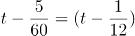小时。可列式为：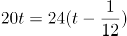，解得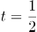，则甲镇到乙镇的距离为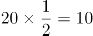千米。

方法二：根据路程不变，速度与时间成反比可知，两次骑车的速度之比为20：24=5：6，则时间之比为6：5，可知骑车速度为每小时20千米时所用时间为6×5=30分钟。则甲镇到乙镇的距离为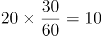千米。

故正确答案为B。

### 第 46 题

以下选项能与左侧图形组成一个完整圆形的是：

A. A

B. B

C. C

D. D

第 46 题 · 答案与解析

**参考答案（粉笔题库参考内容）**

A

**解析**

本题考查平面拼合。观察选项所给图形的线条分布形状，应与题干图形拼合成一个完整的圆。具体拼合方式如下图所示：

故正确答案为A。

### 第 47 题

以下平面图形最可能折叠成左图所示长方体的是：

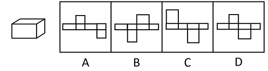

A. A

B. B

C. C

D. D

第 47 题 · 答案与解析

**参考答案（粉笔题库参考内容）**

B

**解析**

本题为空间重构题，可以通过公共边长短进行判断，由成直角的两条边是公共边可知，要想折叠成与题干一致的封闭立体图形，需要公共边相互垂直且等长。

A项：线1、线2是平面中相互垂直的两条线，为公共边，垂直但不等长，排除；

B项：线1、线2是平面中相互垂直的两条线，为公共边，垂直且等长，当选；

C项：线1、线2是平面中相互垂直的两条线，为公共边，垂直但不等长，排除；

D项：线1、线2是平面中相互垂直的两条线，为公共边，垂直但不等长，排除；

故正确答案为B。

### 第 48 题

下列选项最可能与左侧立体图形是同一物体的是：

A. A

B. B

C. C

D. D

第 48 题 · 答案与解析

**参考答案（粉笔题库参考内容）**

B

**解析**

本题要找与左侧立体图形一致的选项，将左侧立体图形旋转，旋转方式如下图所示，可得到B项。

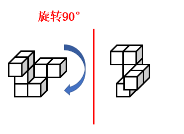

故正确答案为B。

### 第 49 题

某物体由两个相同的正三棱柱组合而成，则其侧面轮廓最不可能是（ ）。

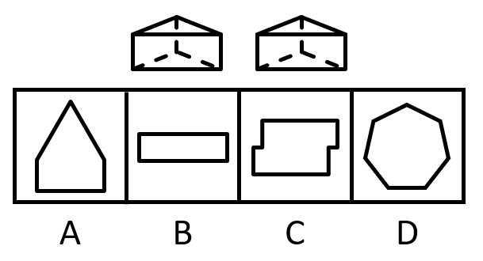

A. A

B. B

C. C

D. D

第 49 题 · 答案与解析

**参考答案（粉笔题库参考内容）**

D

**解析**

本题考查三视图。如下图所示，A、B、C三项按图示摆放，从侧面均可看到图形轮廓，排除；D项无法看到，当选。

本题为选非题，故正确答案为D。

### 第 50 题

从所给的四个选项中，选择最合适的一个填入问号处，使之呈现一定的规律性：

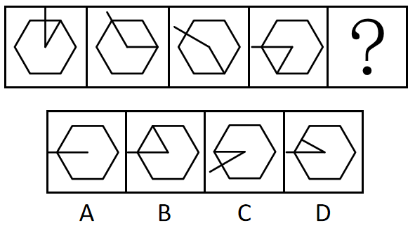

A. A

B. B

C. C

D. D

第 50 题 · 答案与解析

**参考答案（粉笔题库参考内容）**

C

**解析**

元素组成相同，优先考虑位置规律。观察发现，每幅图的长直线依次逆时针旋转，短直线依次顺时针旋转，只有C项符合。

故正确答案为C。

### 第 51 题

下列选项最符合所给图形规律的是：

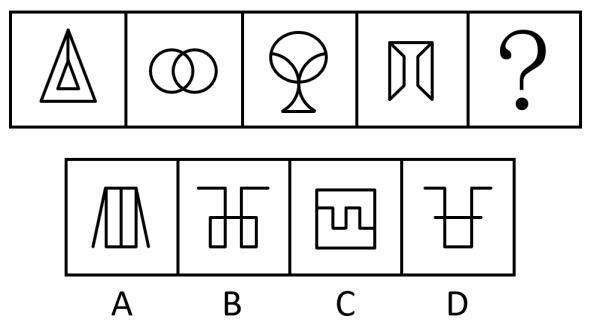

A. A

B. B

C. C

D. D

第 51 题 · 答案与解析

**参考答案（粉笔题库参考内容）**

B

**解析**

元素组成不同，优先考虑属性规律。观察发现，题干图形均为轴对称图形，排除C项；继续观察发现，题干中图2为交圆，图3为切圆变形图，因此考虑笔画数。题干图形均为一笔画图形，所以？处图形也应该是一笔画图形，只有B项符合。

故正确答案为B。

### 第 52 题

下列选项最符合所给图形规律的是：

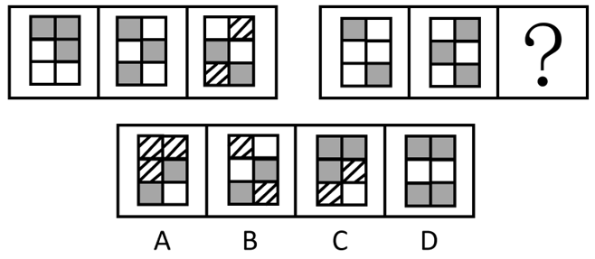

A. A

B. B

C. C

D. D

第 52 题 · 答案与解析

**参考答案（粉笔题库参考内容）**

A

**解析**

图形元素组成相似，所有图形轮廓相同、分割区域一致，且出现灰块、白块以及阴影区域，优先考虑黑白运算。第一组图形的运算规律为：灰+灰=白，白+白＝灰，白+灰=阴影，灰+白＝阴影，第二组图形运用此规律，只有A项符合。

故正确答案为A。

### 第 53 题

下列选项最符合所给图形规律的是：

A. A

B. B

C. C

D. D

第 53 题 · 答案与解析

**参考答案（粉笔题库参考内容）**

D

**解析**

元素组成不同，无明显属性规律，考虑数量规律。观察发现，题干图形均由圆形外框和内部直线构成，且内部直线与外框有明显交叉，考虑框上交点数，题干图形的框上交点数依次为0、1、2、3，故？处应选择框上交点数为4的图形，排除C项；继续观察发现，题干前三幅图形中均出现三角形，考虑直线数，题干图形的直线数均为3，故？处应选择直线数为3的图形，只有D项符合。

故正确答案为D。

### 第 54 题

下列选项最符合所给图形规律的是：

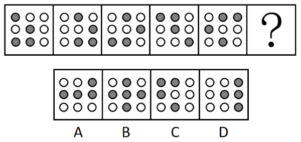

A. A

B. B

C. C

D. D

第 54 题 · 答案与解析

**参考答案（粉笔题库参考内容）**

C

**解析**

元素组成相同，且无位置规律。观察发现，题干图形中灰色的小球的数量均为4个，排除B项。图形都是由横向相邻的两个黑球和对角线相邻的两个黑球组成，即两球连线一个是横线，一个是对角线，只有C项符合规律。

故正确答案为C。

### 第 55 题

下列选项与框内字符串规律最接近的是（ ）。

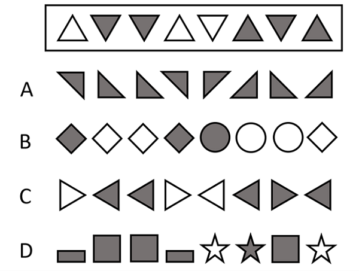

A. A

B. B

C. C

D. D

第 55 题 · 答案与解析

**参考答案（粉笔题库参考内容）**

A

**解析**

元素组成不同，且无明显属性规律，考虑数量规律。观察发现，题干图形中不同位置有相同元素重复出现，可优先考虑相同元素的位置，题干图形中位置1、4的元素相同，位置2、3、7的元素相同，位置6、8的元素相同，位置5的元素与其他位置均不相同，所以正确选项应具有相同规律。

A项，位置1、4的元素相同，位置2、3、7的元素相同，位置6、8的元素相同，位置5的元素与其他位置均不相同，符合题干规律，当选；

B项，位置2、3、7的元素不完全相同，位置6、8的元素不相同，不符合题干规律，排除；

C项，位置2、3、7的元素不完全相同，排除；

D项，位置6、8的元素不相同，位置5、8的元素相同，不符合题干规律，排除。

故正确答案为A。

### 第 56 题

章：节

A. 年：月

B. 桌：椅

C. 中考：高考

D. 班主任：班长

第 56 题 · 答案与解析

**参考答案（粉笔题库参考内容）**

A

**解析**

第一步：判断题干词语间逻辑关系。

一章由多节组成，二者是包容关系中的组成关系。

第二步：判断选项词语间逻辑关系。

A项：一年由12个月组成，二者是组成关系，与题干逻辑关系一致，当选；

B项：桌、椅常搭配在一起使用，二者是配套使用的关系，与题干逻辑关系不一致，排除；

C项：中考和高考是不同的考试，二者是并列关系，与题干逻辑关系不一致，排除；

D项：班长在班主任的指导下管理班级，二者是对应关系，与题干逻辑关系不一致，排除。

故正确答案为A。

### 第 57 题

农作物：农民

A. 草原：斑马

B. 锯子：木匠

C. 文章：编辑

D. 报纸：记者

第 57 题 · 答案与解析

**参考答案（粉笔题库参考内容）**

C

**解析**

第一步：判断题干词语间逻辑关系。

农民经过一系列种植活动后收获农作物，二者是职业与劳动成果的对应关系。

第二步：判断选项词语间逻辑关系。

A项：斑马在草原上生存，二者是动物与生活地点的对应关系，与题干逻辑关系不一致，排除；

B项：木匠利用锯子进行劳动，二者是职业与工具的对应关系，与题干逻辑关系不一致，排除；

C项：编辑进行一系列编写活动后作出文章，二者是职业与劳动成果的对应关系，与题干逻辑关系一致，当选；

D项：记者主要从事信息采集和新闻报道的工作，与报纸不是职业与劳动成果的对应关系，与题干逻辑关系不一致，排除。

故正确答案为C。

### 第 58 题

鱼∶渔网

A. 蜜蜂∶蜂果

B. 光线∶镜子

C. 警察∶防弹衣

D. 灰尘∶吸尘器

第 58 题 · 答案与解析

**参考答案（粉笔题库参考内容）**

D

**解析**

第一步：判断题干词语间逻辑关系。

渔网可以捕鱼，鱼群聚集在渔网中，二者为功能对象的对应关系。

第二步：判断选项词语间逻辑关系。

A项：蜂果是一个游戏网站的名字，与蜜蜂无关，与题干逻辑关系不一致，排除；

B项：镜子可以反射光线，与题干逻辑关系不一致，排除；

C项：防弹衣可以保护警察，与题干逻辑关系不一致，排除；

D项：吸尘器可以吸灰尘，灰尘聚集在吸尘器中，二者为功能对象的对应关系，与题干逻辑关系一致，当选。

故正确答案为D。

### 第 59 题

风扇：风：电

A. 火电厂：电：煤

B. 水龙头：水：阀门

C. 篮球：球框：橡胶

D. 榨汁机：果汁：水果

第 59 题 · 答案与解析

**参考答案（粉笔题库参考内容）**

A

**解析**

第一步：判断题干词语间逻辑关系。

风扇可以生成风，以电为动力来源，将电能转换成风能。

第二步：判断选项词语间逻辑关系。

A项：火电厂可以生成电，以煤为动力来源，将煤炭能量转换成电能，与题干逻辑关系一致，当选；

B项：水龙头可以控制水的流动，但不能生成水，且水龙头属于阀门，二者为种属关系，与题干逻辑关系不一致，排除；

C项：篮球是以橡胶为原材料制成的，篮球可以投入球框，与题干逻辑关系不一致，排除；

D项：榨汁机可以制作果汁，但水果是原材料而不是其动力来源，与题干逻辑关系不一致，排除。

故正确答案为A。

### 第 60 题

海底捞月：缘木求鱼

A. 抱薪救火：釜底抽薪

B. 七嘴八舌：鹦鹉学舌

C. 趁火打劫：浑水摸鱼

D. 锦上添花：画蛇添足

第 60 题 · 答案与解析

**参考答案（粉笔题库参考内容）**

C

**解析**

第一步：判断题干词语间逻辑关系。

海底捞月比喻根本做不到，白费力气；缘木求鱼比喻方向、方法不对，一定达不到目的，二者为近义关系。

第二步：判断选项词语间逻辑关系。

A项：抱薪救火比喻因为方法不对，虽然有心消灭祸患，结果反而使祸患扩大；釜底抽薪指抽去锅底下的柴火，比喻从根本上解决问题，二者为反义关系，与题干逻辑关系不一致，排除；

B项：七嘴八舌形容人多口杂；鹦鹉学舌比喻别人怎样说，他也跟着怎样说（含贬义），二者不是近义关系，与题干逻辑关系不一致，排除；

C项：趁火打劫指趁紧张危急的时候侵犯别人的权益；浑水摸鱼比喻趁混乱的时机捞取利益，二者为近义关系，与题干逻辑关系一致，当选；

D项：锦上添花比喻使美好的事物更加美好；画蛇添足比喻做多余的事，反而不恰当，二者不是近义关系，与题干逻辑关系不一致，排除。

故正确答案为C。

### 第 61 题

某街道计划将3名男性干部甲、乙、丙和3名女性干部张、李、王下沉至各个社区开展工作，可供选择的社区有A、B、C、D四个。已知：

①每人只能去一个社区。

②凡是有男性去的社区就必须有女性去。

③张去A社区或者B社区，乙去D社区。

如果最终李去了C社区，则下列推论必然正确的是（ ）。

A. 丙去了A社区

B. 张去了B社区

C. 甲去了C社区

D. 王去了D社区

第 61 题 · 答案与解析

**参考答案（粉笔题库参考内容）**

D

**解析**

第一步：分析题干条件。

（1）每人只能去一个社区；

（2）有男性去的社区有女性去；

（3）张去A社区 或 B社区、乙去D社区；

（4）李去C社区。

第二步：根据题干条件进行推理。

根据条件（3）男性乙去D社区，再结合条件（2）可知，D社区必须有女性去。女性涉及张、李、王3名干部，又根据条件（1）、条件（3）可知，张去A社区或B社区，以及条件（4）李去C社区可知，女性张和李均不能去D社区，故推出仅剩的女性王一定去D社区，只有D项正确。

故正确答案为D。

### 第 62 题

为推动社区养老服务建设，某社区开设了长者食堂，向社区内符合条件的老年人提供一日三餐。该食堂饭菜价格远低于市场价，且品种多样、味道极佳、分量充足，然而每天到该食堂就餐的老年人数量并不多。

以下各项如果为真，最能解释这一现象的是（ ）。

A. 社区内多数老年人选择送餐上门而非到食堂用餐

B. 该社区内和周边有许多深受当地居民喜爱的餐馆

C. 该长者食堂占地面积较大，食堂内就餐座位充足

D. 符合就餐条件的老年人在社区居民中的占比不高

第 62 题 · 答案与解析

**参考答案（粉笔题库参考内容）**

A

**解析**

第一步：找出题干矛盾。

长者食堂饭菜价格远低于市场价，且品种多样、味道极佳、分量充足，然而每天到该食堂就餐的老年人数量并不多。

第二步：逐一分析选项。

A项：社区内多数老年人选择送餐上门而非到食堂用餐，解释了为什么长者食堂有优势但每天到该食堂就餐的老年人数量不多，可以解释题干矛盾，当选；

B项：该社区内和周边有许多深受当地居民喜爱的餐馆，但长者食堂饭菜价格远低于市场价，且品种多样、味道极佳、分量充足，明显比其他餐馆更有优势，不能解释为什么每天到该食堂就餐的老年人数量不多，不能解释题干矛盾，排除；

C项：该长者食堂占地面积较大，食堂内就餐座位充足，补充说明了该食堂的优点，不能解释为什么每天到该食堂就餐的老年人数量不多，不能解释题干矛盾，排除；

D项：符合就餐条件的老年人在社区居民中的占比不高，由于不明确社区居民的总数，所以根据占比无法判断符合就餐条件的老年人的数量，如果社区居民总数很多，那么尽管占比不高，符合就餐条件的老年人也会很多，不能解释为什么每天到该食堂就餐的老年人数量不多，不能解释题干矛盾，排除。

故正确答案为A。

### 第 63 题

分散的农户经营不成规模，已经远远不能适应各个城市群规模化、批量化的农产品需求，也限制了农民收入的提高。如果不解决农户的组织化这个问题，就无法推广农业机械化、规模化，也无法降低农业的经营成本。因此，可以通过推进农户的组织化，让现有的农民实现增产增收。

以下选项如果为真，最能支持上述论断的是（ ）。

A. 当前分散的农户是农村的农业经营主体

B. 机械化、规模化种植能有效实现农业增产

C. 推广农业机械化、规模化不需要花费较长时间

D. 实现农业机械化生产后，劳动力投入将有所减少

第 63 题 · 答案与解析

**参考答案（粉笔题库参考内容）**

B

**解析**

第一步：找出论点和论据。

论点：可以通过推进农户的组织化，让现有的农民实现增产增收。

论据：如果不解决农户的组织化这个问题，就无法推广农业机械化、规模化，也无法降低农业的经营成本。

论据讨论的是实现农户的组织化有利于推广农业机械化，规模化，降低农业的经营成本，论点说的是推进农户的组织化，让现有的农民实现增产增收，论据和论点话题不一致，加强优先考虑搭桥，即在“推广农业机械化、规模化，降低农业的经营成本”和“让农民实现增产增收”之间建立联系。

第二步：逐一分析选项。

A项：论点讨论的是农户的组织化与农民增产增收的关系，而该项说的是分散的农户是农村的农业经营主体，不明确推进农户的组织化后是否可以让农民增产增收，无法加强，排除；

B项：该项说的是机械化、规模化种植能有效实现农业增产，即在推广农业机械化、规模化和让农民实现增产之间建立联系，为搭桥项，可以加强，当选；

C项：论点讨论的是农户的组织化与农民增产增收的关系，该项说的是推广农业机械化、规模化不需要花费较长时间，话题不一致，无法加强，排除；

D项：论点讨论的是农户的组织化与农民增产增收的关系，该项说的是实现农业机械化生产后对于劳动力投入的影响，话题不一致，无法加强，排除。

故正确答案为B。

### 第 64 题

目前，风能技术员是某国受伤率最高的职业之一，从业人员较少。但随着国家能源需求向可再生能源转变，该国将越来越需要从事这样高风险性职业的人才，以保证国家能源的正常供应。由于风能技术人才紧缺，该国此类岗位的薪酬不断提高。对此有专家建议，在加大风能技术人才培养的同时，该国还应积极引进国际风能技术人才。

要使该建议成立，必须补充的前提是（ ）。

A. 风能技术员在工作中面临的风险在短期内不会下降

B. 该国风能技术人才培养无法完全满足能源发展需求

C. 风能技术员岗位薪酬的不断提高将制约能源产业的发展

D. 国际风能技术人才的技术水平不低于该国培养的风能技术人才

第 64 题 · 答案与解析

**参考答案（粉笔题库参考内容）**

B

**解析**

第一步：找出论点和论据。

论点：在加大风能技术人才培养的同时，该国还应积极引进国际风能技术人才。

论据：随着国家能源需求向可再生能源转变，该国将越来越需要从事这样高风险性职业的人才，以保证国家能源的正常供应。由于风能技术人才紧缺，该国此类岗位的薪酬不断提高。

本题论点和论据都在讨论风能技术人才紧缺的问题，论点和论据话题一致，且提问方式为“前提”，加强优先考虑补充必要条件。

第二步：逐一分析选项。

A项：该项讨论的是风能技术员的工作风险不会下降，而论点讨论的是加大风能技术人才培养和引进国际风能技术人才，话题不一致，无法加强，排除；

B项：该项讨论的是该国风能技术人才培养无法满足能源发展需求，所以才需要引进国际风能技术人才，是题干论点成立的必要条件，可以加强，当选；

C项：该项讨论的是风能技术员的岗位薪酬与能源产业发展的关系，而论点讨论的是引进国际风能技术人才，话题不一致，无法加强，排除；

D项：该项讨论的国际风能技术人才的技术水平不低于该国培养的风能技术人才，如果国际风能技术人才的技术水平略低于该国培养的风能技术人才，在该国对风能技术人才有需求的情况下，照样可以从海外引进风能技术人才，不是论点成立的必要条件，无法加强，排除。

故正确答案为B。

### 第 65 题

优秀的企业家既要有杰出的领导能力，也必须积极承担相应的社会责任。因此，能运用出色的领导力引领企业发展却不愿承担任何社会责任的人，一定不是优秀的企业家。

以下选项的逻辑结构与题干最为相似的是（ ）。

A. 真正的“美丽”不仅体现在外表上，还体现在心灵上。因此，心灵美丽的人外表也一定出众

B. 设计要源于现实生活才能发挥意义而成为真正伟大的设计。因此，脱离生活的设计是不切实际的，更是毫无现实意义的

C. 优秀的学习成绩和良好的道德品质在评奖评优中缺一不可。因此，即使有优秀的学习成绩，要想评奖评优，良好的道德品质仍然不可或缺

D. 流量明星一定程度带动了经济发展，也带来了一些新的社会问题。因此，片面强调流量明星带来的经济效益，忽视其后来的社会问题并不可取

第 65 题 · 答案与解析

**参考答案（粉笔题库参考内容）**

C

**解析**

第一步：分析题干推理形式。

题干翻译为：优秀的企业家杰出的领导能力 且 积极承担相应的社会责任，因此，有出色的领导力 且 -承担相应的社会责任优秀的企业家。

题干逻辑结构为：12 且 3，因此，2 且 -31。

第二步：逐一分析选项。

A项：翻译为：真正的“美丽”外表美丽 且 心灵美丽，因此，心灵美丽外表出众，逻辑结构为：1→2 且 3，因此，3→2，与题干推理形式不一致，排除；

B项：翻译为：发挥意义成为真正伟大的设计→源于现实生活，因此，-源于生活的设计→不切实际的设计 且 -现实意义的设计，逻辑结构为：1→2，因此，-23 且 -1，与题干推理形式不一致，排除；

C项：翻译为：评奖评优优秀的学习成绩 且 良好的道德品质，因此，优秀的学习成绩 且 -良好的道德品质评奖评优（“因此”之后的语句可以理解为：如果只有优秀的学习成绩，而没有良好的道德品质，是不能评奖评优的），逻辑结构为：12 且 3，因此，2 且 -31，与题干推理形式一致，当选；

D项：翻译为：流量明星带动经济发展 且 带来社会问题，因此，片面强调经济效益 且 忽视带来社会问题不可取，逻辑结构为：12 且 3，因此，2 且 -34，与题干推理形式不一致，排除。

故正确答案为C。

### 第 66 题

某电热水器设计了两个开关。当水温低于指定温度时，两个开关自动闭合，电热丝将水加热，指示灯亮起；当水温升高到指定温度时，一个开关断开，电热丝停止加热，指示灯仍亮。该电热水器的电路图最有可能是（ ）。

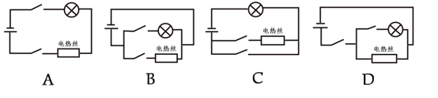

A. A

B. B

C. C

D. D

第 66 题 · 答案与解析

**参考答案（粉笔题库参考内容）**

B

**解析**

A项：该电路中，电热丝与指示灯串联接入电路，当两个开关闭合时，电热丝加热，指示灯亮起；当一个开关断开时，电热丝停止加热，指示灯也熄灭，不满足题干要求，错误；

B项：该电路图中，电热丝与指示灯并联接入电路，两个开关分别与两个用电器串联，当两个开关闭合时，电热丝加热，指示灯亮起；当与电热丝串联的开关断开时，电热丝停止加热，指示灯仍亮，满足题干要求，正确；

C项：该电路图中，电热丝与指示灯串联接入电路，当两个开关闭合时，电热丝被短路，停止加热，指示灯亮起，不满足题干要求，错误；

D项：该电路图中，电热丝与指示灯并联接入电路，两个开关中，其中一个开关与指示灯串联，另一个开关在干路上，当两个开关闭合时，电热丝加热，指示灯亮起；当断开干路上的开关时，电热丝停止加热，指示灯灭，不满足题干要求；当断开与指示灯串联的开关时，电热丝加热，指示灯灭，也不满足题干要求，错误。

故正确答案为B。

### 第 67 题

水平地面上有甲、乙两块由不同材质构成、质地分布均匀的长方体金属块。已知甲的体积>乙的体积，甲的底面积<乙的底面积，甲的质量>乙的质量。则以下判断一定正确的有（ ）。

①甲的高度>乙的高度

②甲的高度<乙的高度

③甲的密度>乙的密度

④甲的密度<乙的密度

A. ①

B. ③

C. ①③

D. ②④

第 67 题 · 答案与解析

**参考答案（粉笔题库参考内容）**

A

**解析**

甲和乙的体积分别用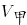和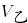表示，甲和乙的底面积分别用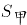和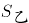表示，甲和乙的质量分别用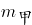和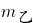表示，甲和乙的高度分别用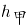和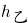表示。

由题意可知，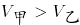，根据长方体的体积公式V=Sh可知，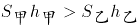，又由于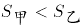，故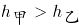，①正确，②错误。

由题意可知，、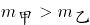，根据密度公式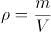，甲的体积和质量均比乙的大，无法判定甲、乙二者的密度大小关系，③④无法确定。

综上所述，一定正确的有①。

故正确答案为A。

### 第 68 题

如图，物体M在恒力F的作用下沿粗糙的斜面匀速向上移动。下列说法不准确的是（ ）。

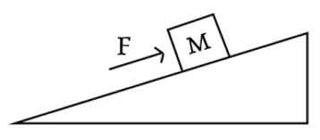

A. 恒力F对物体M做正功

B. 物体M的重力势能逐渐增大

C. 物体所受的摩擦力与运动方向相反

D. 斜面对物体M的支持力和M受到的重力是一对平衡力

第 68 题 · 答案与解析

**参考答案（粉笔题库参考内容）**

D

**解析**

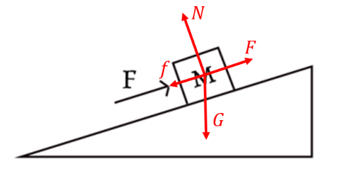

物体M做匀速直线运动，则处于受力平衡状态，对物体M进行受力分析，其受到竖直向下的重力G、沿着斜面向上的恒力F、垂直于斜面向上的支持力N，又因为物体M沿着斜面向上移动，且斜面表面粗糙，所以物体M还会受到沿着斜面向下的摩擦力f。

A项：恒力F的方向与物体M的位移方向相同，因此恒力F对物体M做正功，正确；

B项：物体M的高度逐渐增大，由重力势能公式：可知，物体M的重力势能逐渐增大，正确；

C项：物体M沿斜面向上运动，受到的摩擦力方向为沿着斜面向下，故物体M所受的摩擦力与运动方向相反，正确；

D项：平衡力是指作用于同一物体上的大小相等、方向相反且处于同一直线上的两个力。斜面对物体M的支持力的方向为垂直于斜面向上，物体M受到的重力的方向为竖直向下，这两个力的方向不在同一直线上，不是一对平衡力，错误。

本题为选非题，故正确答案为D。

### 第 69 题

小李驾驶卡丁车驶过一个半圆形弯道时，滑离了原定赛道，撞到了安全护栏。为了避免卡丁车转弯时滑离赛道，下列做法最可能有效的是（ ）。

A. 增加卡丁车的质量

B. 减少卡丁车的质量

C. 使用更加粗糙的轮胎

D. 减小半圆形弯道的半径

第 69 题 · 答案与解析

**参考答案（粉笔题库参考内容）**

C

**解析**

当卡丁车转弯时，对卡丁车进行受力分析，竖直方向上受到的重力和支持力为一对平衡力，水平方向上受到的地面对轮胎的静摩擦力提供卡丁车转弯时所需的向心力。当地面对轮胎的最大静摩擦力不足以提供卡丁车转弯时所需的向心力时，卡丁车就会发生滑动。

因为最大静摩擦力近似等于滑动摩擦力，所以可以用滑动摩擦力的公式来计算最大静摩擦力，对于在赛道上行驶的卡丁车，，所以卡丁车受到的最大静摩擦力为μmg。根据向心力公式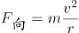可知，若要避免卡丁车转弯时滑离赛道，则需要最大静摩擦力大于向心力，即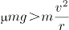，化简为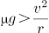，因此可通过增大动摩擦力因数μ、减小卡丁车的速度v、增大卡丁车的过弯半径r的方式来避免卡丁车转弯时滑离赛道，A、B、D三项均错误，使用更加粗糙的轮胎可增大动摩擦力因数，C项正确。

故正确答案为C。

### 第 70 题

小张观察发现，自家房屋的北面在夏天能够被阳光照射，而在冬天，房屋的南面可以被阳光照射。则他家最有可能位于以下城市中的（ ）。

A. 海口

B. 武汉

C. 上海

D. 北京

第 70 题 · 答案与解析

**参考答案（粉笔题库参考内容）**

A

**解析**

太阳直射点在地球表面的南北回归线之间来回移动，夏季时太阳直射点在赤道和北回归线之间，冬季时太阳直射点在赤道和南回归线之间。由题可知，夏季时，小张家的房屋北面能够被阳光照射，则小张家应该位于太阳直射点以南，所以小张家所在城市的纬度应低于北回归线，即城市纬度小于；海口市为海南省省会，坐标为（N，E），武汉市为湖北省省会，坐标为（N，E），上海市坐标为（N，E），北京市坐标为（N，E），其中只有海口市的纬度低于北回归线，A项正确，B、C、D三项错误。

故正确答案为A。

### 第 71 题

以下延长粮食存放时间的措施，最不合理的是（ ）。

A. 粮库的粮食存放区保持较低温度

B. 将其真空包装，以避免接触氧气

C. 适当在粮库中洒水，保持空气湿度

D. 给粮库的粮食存放区充入二氧化碳

第 71 题 · 答案与解析

**参考答案（粉笔题库参考内容）**

C

**解析**

储存粮食时既要降低植物细胞的呼吸强度，减少自身养分消耗，又要抑制微生物和粮食害虫的生长，减少其对粮食的破坏。

A项：细胞的生命活动离不开酶的参与，降低温度可降低酶的活性，从而降低植物细胞的呼吸强度，同时也可以抑制微生物和粮食害虫的生长，正确；

B项：细胞的呼吸作用需要氧气的参与，隔绝氧气不仅可以降低植物细胞的呼吸强度，同时也可以抑制微生物和粮食害虫的生长，正确；

C项：提高湿度有可能促进种子的萌发，从而增强植物细胞的呼吸强度，同时潮湿的环境也有助于微生物和粮食害虫的生长，容易导致粮食发霉、变质，不利于粮食的储存，错误；

D项：二氧化碳可抑制细胞的呼吸作用，所以适当地提高二氧化碳浓度不仅可以降低植物细胞的呼吸强度，同时也可以抑制微生物和粮食害虫的生长，正确。

本题为选非题，故正确答案为C。

### 第 72 题

以下现象属于化学变化的是（ ）。

A. 将木纤维打碎后摊薄晒干制成土纸

B. 石墨在高温高压作用下变成金刚石

C. 打开易拉罐，一股气体喷涌而出

D. 在室外放了一段时间的干冰消失了

第 72 题 · 答案与解析

**参考答案（粉笔题库参考内容）**

B

**解析**

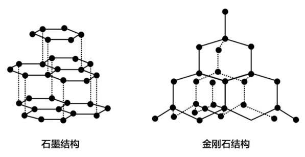

物理变化指没有新物质生成的变化过程，化学变化是指有新物质生成的变化过程。

A项：将木纤维打碎后摊薄晒干制成土纸的过程，只是改变了木纤维的形状，同时降低其含水量，此过程中没有新物质生成，属于物理变化，错误；

B项：石墨和金刚石都是由碳原子组成的碳单质，但是其结构不同（如上图所示），因此是两种不同的物质。在高温高压的条件下，石墨变为金刚石，改变了其原子间的结合与排列方式，即由一种物质变为另一种物质，此过程中有新物质生成，属于化学变化，正确；

C项：气体的溶解度会随压强减小而减小，打开易拉罐后，易拉罐内部的压强会随之减小，罐内气体的溶解度也会减小，所以内部的气体会喷涌而出，此过程中没有新物质生成，属于物理变化，错误；

D项：干冰是固态的二氧化碳，在室外放置一段时间后，会吸热升华，由固态二氧化碳直接变为二氧化碳气体，扩散到空气中，此过程中没有新物质生成，属于物理变化，错误。

故正确答案为B。

### 第 73 题

透过一块纯绿色的玻璃窗观察白墙上写的纯红色大字，最有可能看到（ ）。

A. 绿墙无字

B. 绿墙黑字

C. 绿墙橙字

D. 黑墙无字

第 73 题 · 答案与解析

**参考答案（粉笔题库参考内容）**

B

**解析**

玻璃窗呈现绿色，是因为只有绿色的光能透过它，而其他颜色都被吸收或反射了。白墙呈现白色，是因为其反射出白色光，白色光为复色光，是由红、橙、黄、绿、蓝、靛、紫等各种单色光组成，当白色光照射到纯绿色玻璃上时，只有绿色光可以穿透，所以透过绿色玻璃窗观察，白墙会显示绿色；墙上的纯红色大字呈现红色，是因为其反射出红色光，当红色光照射到纯绿色玻璃上时，无法穿透，人在玻璃窗另一侧无法接收到这部分光线，就会看到绿色墙上有一片与字形轮廓相同的黑色区域，也就是看到了“黑字”。综上所述，最有可能看到的是绿墙黑字，B项正确，A、C、D三项均错误。

故正确答案为B。

### 第 74 题

生物能对外界刺激做出反应。反射是指生物通过神经系统，对外界或内部的各种刺激所发生的有规律的反应。下列生命现象，不属于反射的是（ ）。

A. 小陈刚坐上过山车心跳就开始加速

B. 小狗闻到肉的味道后开始流口水

C. 猎豹发现猎物后停下脚步开始观察环境

D. 乳酸菌向培养皿中果糖浓度高的区域聚集

第 74 题 · 答案与解析

**参考答案（粉笔题库参考内容）**

D

**解析**

在中枢神经系统的参与下，机体对刺激产生的规律性应答反应叫做反射。高等动物和人类具有中枢神经系统，而植物或单细胞生物（如细菌）无中枢神经系统。

A项：小陈（人）具有中枢神经系统，能够对“坐过山车”的环境刺激产生反射活动（心跳加速），正确；

B项：狗具有中枢神经系统，能够对“肉（食物）”的嗅觉刺激产生反射活动（流口水），正确；

C项：猎豹具有中枢神经系统，能够对猎物所在的环境刺激产生反射活动（观察判断是否存在危险，进而做出下一步行动），正确；

D项：乳酸菌是单细胞生物，不存在中枢神经系统，故不可能产生反射活动，其向培养皿中果糖浓度高的区域聚集的行为，属于应激性（生物体能接受外界刺激并产生合目的的反应，使生物体能趋利避害），错误。

本题为选非题，故正确答案为D。

### 第 75 题

目前，我国许多城市已经实现5G网络全覆盖，由于5G基站覆盖范围比4G基站的覆盖范围要小，这就意味着想要覆盖同样的区域，5G网络基站数量要比4G基站多。由此可知，与4G信号相比，5G信号（ ）。

A. 频率较低，波长较短

B. 频率较低，波长较长

C. 频率较高，波长较短

D. 频率较高，波长较长

第 75 题 · 答案与解析

**参考答案（粉笔题库参考内容）**

C

**解析**

5G和4G信号均为电磁波，根据波的特性，其波长越长，越容易绕过障碍物，实现远距离覆盖，由题干可知，5G基站比4G基站覆盖范围小，所以5G信号波长更短。由于各种电磁波的传播速度均为光速，根据公式：波速=波长×频率，由于5G信号比4G信号波长更短，因此5G信号波长较4G信号频率更高，A、B、D三项错误，C项正确。

故正确答案为C。

### 第 76 题

下图是一束光在空气和玻璃两种不同的介质中传播的路径示意图，则下列说法正确的是（ ）。

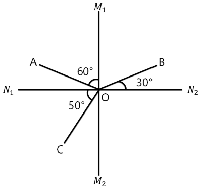

A. 是界面

B. AO是入射光线

C. OC是反射光线

D. 下方是玻璃介质

第 76 题 · 答案与解析

**参考答案（粉笔题库参考内容）**

D

**解析**

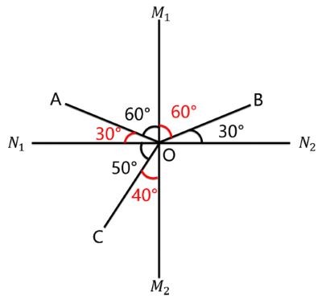

光斜射在介质不均匀的界面上，会同时发生折射和反射。

光的反射定律：入射光线、反射光线、法线三者在同一平面内，入射光线和反射光线分居法线两侧，且入射角等于反射角。

光的折射定律：入射光线、折射光线、法线三者在同一平面内，入射光线和折射光线分居法线两侧，且入射角不等于折射角。并且，当光在空气-玻璃的界面上发生折射时，总是空气侧角更大。

若是界面，则为法线，此时由于AO与CO两条光线在界面同侧，因此是入射光线与反射光线的关系，但是入射角和反射角不相等，不能满足反射定律，故不成立。所以可以确定为界面，为法线，A项错误；

由于AO与BO两条光线在界面同侧，因此是入射光线与反射光线的关系，OC在界面另一侧，是折射光线，而AO和OC在法线同侧，不可能是入射光线与折射光线的关系，因此可确定BO是入射光线，OA为反射光线、OC为折射光线，B、C两项均错误；

由图可知，入射角和反射角均为，折射角为，根据折射时空气侧角更大，可知界面的上方为空气，下方为玻璃，D项正确。

故正确答案为D。

### 第 77 题

下图是动物养殖场自动喂水装置的简要示意图。当动物通过饮水口饮水后，水箱内的水位下降，水瓶中的水将自动流入水箱，使水位回到一定的高度。关于这一装置，下列说法正确的是（ ）。

A. 水瓶最终会处于真空状态

B. 水瓶内的气压始终等于水箱内的气压

C. 装置达到平衡时，水瓶内的气压高于大气压

D. 该装置是利用水瓶、水箱之间的气压差实现的

第 77 题 · 答案与解析

**参考答案（粉笔题库参考内容）**

D

**解析**

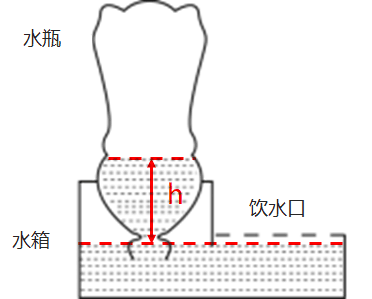

设水瓶中的液面高度与水箱中的液面高度差为h、水的密度为ρ、水瓶中的气体压强为，由于水箱中液面处的压强等于大气压强p，当整个装置平衡时，大气压等于水瓶内的气体压强与液体压强的总和，即，因此水瓶中的气体压强小于水箱中的气体压强（即大气压），B、C两项错误；

水箱的补水过程如下：当动物在饮水口饮水时，水箱中的水减少，水箱中的液面高度也会下降，当水箱中的液面高度低于瓶口的高度时，水瓶的瓶口会与空气接触，导致空气进入到水瓶中，此时水瓶中的气压增大，瓶中的水就会流出，实现自动喂水，直到水箱中的液面高于瓶口的高度时，水将瓶口封住，空气不能再进入水瓶中，则水不会再流出，此时就自动停止对水箱补水。最终水瓶中的水会全部进入到水箱当中，水瓶中最终会充满空气，而不是真空，A项错误；由以上分析也可见，正是水瓶和水箱之间的气压差支持着水瓶内的水柱，从而让瓶中的液面高于水箱中的液面，实现自动喂水，D项正确。

故正确答案为D。

### 第 78 题

“庄稼一枝花，全靠肥当家。”以下有关农业种植中肥料使用的说法，错误的是（ ）。

A. 肥料的主要作用是给农作物提供有机物

B. 除了根部，肥料也可以通过叶片等部位被农作物吸收

C. 施肥浓度过高导致“烧根”，是由于农作物根部的细胞在高浓度溶液中失水

D. 应根据不同农作物和农作物不同生长阶段的实际需要，有针对性地施用肥料

第 78 题 · 答案与解析

**参考答案（粉笔题库参考内容）**

A

**解析**

A项：肥料的作用主要是给农作物提供生长所必需的氮、磷、钾等营养元素，植物生长所需要的有机物是由植物自己进行光合作用获得的，错误；

B项：植物所需要的养分主要是靠根部进行吸收的，但是由于植物的叶片等其他部位表面有气孔，喷洒到叶片等部位表面的养分，也可以通过气孔进入叶肉细胞，所以叶片等其他部位也能够吸收肥料，正确；

C项：若给农作物施肥过多，会使土壤的溶液浓度过高，大于植物细胞溶液的浓度，植物根部细胞不仅不能吸水，反而会失水，进而导致植物因失水而萎蔫，造成“烧根”现象，因此要合理施肥，正确；

D项：不同农作物和农作物不同生长阶段所需肥料的种类、数量均有所不同，为了提高农作物产量和品质，发挥肥料的最大效益，应根据不同农作物的不同生长情况有针对性地施用肥料，以达到最佳效果，正确。

本题为选非题，故正确答案为A。

### 第 79 题

下图是某物体做直线运动时，其速度v与时间t关系的折线图，则以下说法准确的有（ ）。

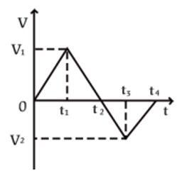

①在~，物体匀速运动

②在0~和~，物体做同方向运动

③在时，物体离出发点距离最远

④在~和~，物体的加速度方向相反

⑤在时，物体改变运动方向

A. ①⑤

B. ③④

C. ④⑤

D. ①②④

第 79 题 · 答案与解析

**参考答案（粉笔题库参考内容）**

C

**解析**

在速度-时间（v-t）图像中：纵坐标表示速度，纵坐标的大小表示速度的大小、纵坐标的正负表示速度的方向；斜率表示加速度，斜率的大小表示加速度的大小、斜率的正负表示加速度的方向；图像与横轴围成的面积表示位移，面积的大小表示位移的大小，若围成的面积在横轴的上方则位移方向为正、若围成的面积在横轴的下方则位移为负。

①由图像可知，在~，物体的速度均匀减小，即物体做匀减速直线运动。在~，物体的速度变为负但均匀增大，即朝反方向做匀加速直线运动。因此，在~，物体先减速后朝反方向加速，并非匀速运动，错误；

②由图像可知，在0~，物体的速度为正，即朝正方向做直线运动，在~，物体的速度为负，即朝反向做直线运动，错误；

③由图像可知，在0~，物体的速度为正，始终朝正方向做直线运动，距离出发点越来越远，即位移越来越大。从~，物体的速度变为负，即从时开始朝反向做直线运动，距离出发点越来越近，即位移越来越小，因此在时，物体离出发点距离最远，错误；

④由图像可知，在~，从左往右看，直线呈现下降的趋势，即加速度方向为负。在~，从左往右看，直线呈现上升的趋势，即加速度方向为正，两个时间段的加速度方向相反，正确；

⑤由③的分析可知，在时，物体的速度由正变负，意味着速度方向发生改变，即物体运动方向发生改变，正确。

综上所述，①②③错误，④⑤正确。

故正确答案为C。

### 第 80 题

甲酸（HCOOH）具有清洁制氢的巨大潜力，其反应前后分子种类变化的微观示意图如下图所示。则下列说法正确的是（ ）。

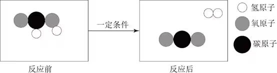

A. 反应后分子个数增多

B. 该反应类型为化合反应

C. 反应物和生成物都是有机物

D. 该反应不遵守能量守恒定律

第 80 题 · 答案与解析

**参考答案（粉笔题库参考内容）**

A

**解析**

由题干图示可知，反应物甲酸是由1个碳原子、2个氢原子和2个氧原子组成的，其化学式为，反应后的生成物为2种物质，其中由2个氢原子组成的是，由1个碳原子和2个氧原子组成的是，故甲酸制取氢气的化学反应方程式为。

A项：由上述分析可知，在该反应过程中，1个甲酸分子分解成1个氢气分子和1个二氧化碳分子，即1个分子分解为2个分子，故反应后分子个数增多，正确；

B项：由上述分析可知，甲酸反应后生成氢气和二氧化碳，是由一种物质生成两种物质的反应，属于分解反应，并非化合反应，错误；

C项：有机物主要由碳元素和氢元素组成（也可能有氧、氮等其他元素），一定是含碳的化合物，但是不包括碳的氧化物、碳酸、碳酸盐等，甲酸由碳、氢、氧三种元素组成，属于有机化合物，而生成物中的氢气和二氧化碳则均不属于有机物，错误；

D项：所有的化学反应均遵守能量守恒定律，错误。

故正确答案为A。

### 第 81 题

下列关于我国家庭用电的说法正确的是（ ）。

A. 我国家庭使用的是220V的直流电

B. 带金属外壳的用电器一般使用两孔插座

C. 要使用电器之间互不影响，用电器应串联接入电路

D. 家庭用电的保险丝可以由电阻率大、熔点低的合金制成

第 81 题 · 答案与解析

**参考答案（粉笔题库参考内容）**

D

**解析**

A项：我国家庭使用的是220V的交流电，其电流的大小和方向都进行周期性变化，家庭用电的频率为50Hz，即每秒完成50次周期性变化，错误；

B项：由于金属外壳具有导电性，因此带金属外壳的用电器一般需要使用三孔插座，因为三孔插座的上孔连接地线，能够使用电器的金属外壳与地线相连，从而能够避免因用电器外壳漏电而发生触电的危险，错误；

C项：要使用电器之间互不影响，则需每一个用电器开关的闭合与断开均不影响其他用电器的正常工作，故用电器应并联接入电路，错误；

D项：在家庭电路中，保险丝一般是由电阻率较大而熔点较低的铅锑合金制成，其目的是当电路中有过大的电流通过时，保险丝因发热而自动熔断，从而切断电路，因此能够起到保护电路的作用，正确。

故正确答案为D。

### 第 82 题

无性繁殖是一种不涉及生殖细胞，不需要经过受精过程，由母体的一部分直接形成新个体的繁殖方式。以下繁殖过程不属于无性繁殖的是（ ）。

A. 西瓜的花被授粉后结出了果实

B. 一个草履虫经过细胞分裂变成两个

C. 水螅母体的体壁上形成与母体相似的芽体

D. 马铃薯的块茎发芽生长后，形成新的个体

第 82 题 · 答案与解析

**参考答案（粉笔题库参考内容）**

A

**解析**

生物的繁殖方式可分为有性繁殖和无性繁殖：有性繁殖是指两性生殖细胞结合（受精过程）成为受精卵后，再由受精卵发育成新的个体的生殖方式；无性繁殖是指不产生生殖细胞，无需经过受精过程，直接由母体的一部分形成新个体的繁殖方式。

A项：西瓜的花朵中有雄蕊和雌蕊，雄蕊和雌蕊可产生生殖细胞，雄蕊产生花粉，花粉中含有西瓜的精子，雌蕊中含有西瓜的卵细胞，授粉是雄蕊中的精子与雌蕊中的卵细胞结合并形成受精卵的过程，属于有性繁殖，错误；

B项：草履虫为单细胞生物，在其细胞分裂过程中，没有产生生殖细胞，也没有经历受精过程，而是直接由母体分裂形成新的个体，属于无性繁殖，正确；

C项：水螅体壁上的芽体即为一个新的小水螅，母体形成芽体的过程中，没有产生生殖细胞，也没有经历受精过程，而是直接从母体的一部分形成新的芽体，属于无性繁殖，正确；

D项：马铃薯块茎中的细胞为马铃薯的体细胞，而非生殖细胞，在马铃薯块茎发芽的过程中，没有产生生殖细胞，也没有经历受精过程，而是从母体的一部分直接形成新的个体，属于无性繁殖，正确。

本题为选非题，故正确答案为A。

### 第 83 题

夏日，小王调制了一杯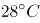的蔗糖水，尝了一口后感觉不够甜，又加入了一些蔗糖，搅拌后蔗糖完全溶解。之后他把蔗糖水放入冰箱，一段时间后取出时发现杯子底部有少许晶体析出，则下列说法正确的有（ ）。

①刚放入冰箱的蔗糖溶液一定不是饱和溶液

②从冰箱中取出的蔗糖溶液一定是饱和溶液

③放入冰箱前后，蔗糖溶液中溶质的质量相等

④用加热蒸发溶剂的方法能够得到与析出晶体相同的物质

A. ①②

B. ①④

C. ②③

D. ②④

第 83 题 · 答案与解析

**参考答案（粉笔题库参考内容）**

D

**解析**

在一定温度下，向一定量溶剂里加入某种溶质，当溶质不能继续溶解时，所得到的溶液叫做这种溶质的饱和溶液。由题干可知，小王感觉蔗糖水不够甜，又加入蔗糖后，此时蔗糖在杯中完全溶解，但是仅凭这一信息无法判定蔗糖溶液是否饱和，如果再加入更多蔗糖后不能继续溶解，则说明此时溶液恰好为饱和溶液，如果再加入更多蔗糖后还能继续溶解，则说明此时溶液为不饱和溶液，因此无法判断刚放入冰箱的溶液是否饱和，①错误；蔗糖溶液放入冰箱一段时间后取出，发现杯子底部有少许晶体析出，说明此时溶液中有部分溶质不能继续溶解，此时溶液一定为饱和溶液，这部分晶体即为蔗糖，②正确；放入冰箱前，杯子中加入的蔗糖完全溶解，溶质的质量等于杯子中加入蔗糖的质量，放入冰箱后，杯子底部有蔗糖析出，溶液中溶质的质量减少，所以放入冰箱前蔗糖溶液中溶质的质量比放入冰箱后蔗糖溶液中溶质的质量大，③错误；放入冰箱后，杯子底部析出的晶体为蔗糖晶体，加热蒸发溶剂时，溶剂的量减少，溶剂中能够溶解的溶质的量也随之减少，多余的蔗糖就会以晶体的形式析出，也可以得到蔗糖晶体，④正确。

综上，正确的为②④。

故正确答案为D。

### 第 84 题

大棚种植是一种被广泛采用的农作物种植方式。以下大棚种植的增产做法，有误的是（ ）。

A. 在大棚内补充二氧化碳，促进农作物的光合作用

B. 维持大棚昼夜温度相对稳定，提高农作物的生长速度

C. 傍晚和夜间在大棚内开灯，增加光照时间和光照强度

D. 合理密植农作物，增加单位面积内农作物的光照面积

第 84 题 · 答案与解析

**参考答案（粉笔题库参考内容）**

B

**解析**

光合作用是指绿色植物利用光能，把二氧化碳和水转化成储存能量的有机物（如淀粉）并释放氧气的过程。呼吸作用是指生物体内的有机物在细胞内经过一系列的氧化分解，最终生成二氧化碳、水或其他产物，并且释放出能量的总过程。

A项：由上述分析可知，二氧化碳是进行光合作用的原料，在大棚内补充二氧化碳，可以促进光合作用，从而提高产量，正确；

B项：白天保持适宜温度，有利于光合作用进行，夜间应该适当降低温度，从而降低农作物的呼吸作用，减少有机物在夜间的消耗，有利于农作物积累更多的有机物，进而提高产量，因此维持大棚昼夜温度相对稳定不能提高产量，错误；

C项：光照是植物进行光合作用的必要条件，因此傍晚和夜间在大棚内开灯，增加了光照时间，可延长光合作用的时间，从而提高产量，正确；

D项：合理密植就是适当提高种植密度，充分利用单位面积上的光照，避免造成光能的浪费，从而增加单位面积内农作物的光照面积，同时又不至于种植过密造成叶片相互遮挡，影响光合作用。因此可以提高产量，正确。

本题为选非题，故正确答案为B。

### 第 85 题

从北极上空俯视，地球围绕地轴呈逆时针方向自转。如果在北极的地轴正上方有一颗肉眼可见的星星，有一人站在赤道上整晚观察这颗星星。他有可能观察到（ ）。

①这颗星星东升西落

②这颗星星没有东升西落

③周围的星星以这颗星星为中心呈逆时针方向转动

④周围的星星以这颗星星为中心呈顺时针方向转动

A. ②③

B. ①④

C. ①③

D. ②④

第 85 题 · 答案与解析

**参考答案（粉笔题库参考内容）**

A

**解析**

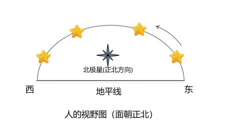

由题意可知，这颗星星位于北极的地轴的正上方，其实就是北极星，虽然地球绕着地轴不停的自转，但由于北极星位于北极地轴的正上方，因此夜晚看天空，北极星在地面的观察者看来是静止不动的，所以无论地球怎么自转，北极星都不会升起落下，因此没有东升西落，①错误，②正确。

除北极星外，由于地球自西向东的自转，太阳、月亮、星星都有东升西落的现象。如上图所示，人站在赤道上面朝正北方向观察，北极星在正北方位不动，除北极星外的其他星星（图中的黄星）均是东升西落，在人的视野中就是绕着北极星逆时针转动，因此在赤道上会看到其他星星绕着北极星沿逆时针方向旋转，③正确，④错误。

故正确答案为A。

## 材料 1

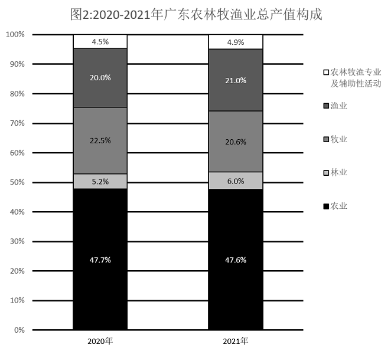

### 第 86 题

（ ）广东农林牧渔业总产值首次突破了5000亿元。

A. 2014年

B. 2015年

C. 2017年

D. 2018年

第 86 题 · 答案与解析

**参考答案（粉笔题库参考内容）**

A

**解析**

定位图1可得：2013年广东农林牧渔业总产值为4802.0亿元，2014年为5053.7亿元。则2014年广东农林牧渔业总产值首次突破了5000亿元。

故正确答案为A。

### 第 87 题

2021年广东农林牧渔业总产值约为9年前的（ ）倍。

A. 1.2

B. 1.4

C. 1.6

D. 1.8

第 87 题 · 答案与解析

**参考答案（粉笔题库参考内容）**

D

**解析**

根据题干“2021年······约为9年前的······倍”，结合9年前为2021-9=2012年，可判定本题为现期倍数问题。定位图1可得：2012年广东农林牧渔业总产值为4550.3亿元，2021年为8305.8亿元。则题干所求倍数。

故正确答案为D。

### 第 88 题

2017-2021年间，广东农林牧渔业总产值年均增加约（ ）亿元。

A. 415

B. 467

C. 584

D. 779

第 88 题 · 答案与解析

**参考答案（粉笔题库参考内容）**

C

**解析**

根据题干“2017-2021年间，广东农林牧渔业总产值年均增加······亿元”，可判定本题为年均增长量问题。定位图1可得：2017、2021年广东农林牧渔业总产值分别为5969.9亿元、8305.8亿元。根据公式：年均增长量，则所求亿元。

故正确答案为C。

### 第 89 题

2021年广东林业产值同比增长率（ ）。

A. 小于5%

B. 在5%-10%之间

C. 在10%-15%之间

D. 大于15%

第 89 题 · 答案与解析

**参考答案（粉笔题库参考内容）**

D

**解析**

根据题干“2021年广东林业产值同比增长率”，可判定本题为一般增长率问题。定位图1可得：2020、2021年广东农林牧渔业总产值分别为7901.9亿元、8305.8亿元。定位图2可得：2020、2021年广东林业产值占比分别为5.2%、6.0%。根据公式：部分=整体×比重，可知2020年广东林业产值亿元，2021年广东林业产值亿元。根据公式：增长率，则所求，在D项范围内。

故正确答案为D。

### 第 90 题

根据资料，下列说法正确的是（ ）。

A. 2016-2021年间，广东农林牧渔业总产值年均增长率约为20%

B. 2020年和2021年，广东农林牧渔专业及辅助性活动产值均高于300亿元

C. 与2020年相比，2021年广东农业各类产业的产值均有所增加

D. 与2020年相比，2021年广东农业、林业和渔业产值在农业总产值中的比重均有所增加

第 90 题 · 答案与解析

**参考答案（粉笔题库参考内容）**

B

**解析**

A项：定位图1可得，2016年与2021年广东农林牧渔业总产值分别为5817.6亿元和8305.8亿元。根据公式：，可得，错误；

B项：定位图1可得，2020年与2021年广东农林牧渔业总产值分别为7901.9亿元和8305.8亿元；定位图2可得，2020年和2021年，广东农林牧渔专业及辅助性活动产值在农林牧渔业总产值中的比重分别为4.5%和4.9%。根据公式：部分=整体×比重，则2020年广东农林牧渔专业及辅助性活动产值亿元，2021年该产值亿元，均高于300亿元，正确；

C项：定位图1可得，2020年与2021年广东农林牧渔业总产值分别为7901.9亿元和8305.8亿元；定位图2可得，2020年和2021年，广东牧业产值在农林牧渔业总产值中的比重分别为22.5%和20.6%。根据公式：部分=整体×比重，则2020年广东牧业产值亿元；2021年该产值亿元，即与2020年相比，2021年该产值有所减少，错误；

D项：定位图2可得，2020年广东农业、林业和渔业产值在农林牧渔业总产值中的比重分别为47.7%、5.2%和20.0%；2021年这三类产业产值在农林牧渔业总产值中的比重分别为47.6%、6.0%和21.0%。比较可知，与2020年相比，2021年广东农业产值在农业总产值中的比重有所减少，错误。

故正确答案为B。

## 材料 2

2021年，广东省财政科学技术支出为982.76亿元，占当年全省财政一般公共预算支出的比重为5.4%。其中，省本级财政科学技术支出为102.05亿元，占省本级财政一般公共预算支出的比重为6.6%，同比增加0.84个百分点。珠江三角洲核心区财政科学技术支出845.09亿元，同比增长2.6%。

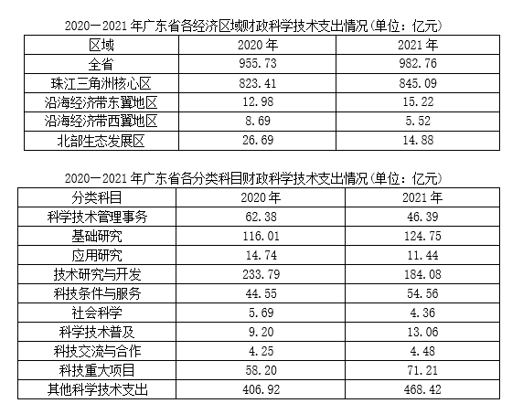

### 第 91 题

2021年，广东省财政科学技术支出比上年提高了（ ）亿元。

A. 7.03

B. 17.03

C. 27.03

D. 37.03

第 91 题 · 答案与解析

**参考答案（粉笔题库参考内容）**

C

**解析**

根据题干“2021年······比上年提高了······亿元”，可判定本题为增长量计算问题。定位表1可得：2020、2021年广东省财政科学技术支出分别为955.73亿元、982.76亿元。根据公式：增长量=现期量-基期量，则所求=982.76-955.73=27.03亿元。

故正确答案为C。

### 第 92 题

2021年，以下经济区域财政科学技术支出同比增长率最高的是（ ）。

A. 珠江三角洲核心区

B. 沿海经济带东翼地区

C. 沿海经济带西翼地区

D. 北部生态发展区

第 92 题 · 答案与解析

**参考答案（粉笔题库参考内容）**

B

**解析**

根据题干“2021年······同比增长率最高的是”，可判定本题为一般增长率问题。定位文字材料，可知2021年广东省珠江三角洲核心区财政科学技术支出同比增长2.6%；定位表1，可知2020年、2021年广东省沿海经济带东翼地区、沿海经济带西翼地区和北部生态发展区的财政科学技术支出情况。则2021年广东省各经济区域财政科学技术支出：珠江三角洲核心区同比增长率=2.6%；根据公式：增长率，沿海经济带东翼地区同比增长率，沿海经济带西翼地区同比增长率，北部生态发展区同比增长率。比较可知，同比增长率最高的是沿海经济带东翼地区。

故正确答案为B。

### 第 93 题

2020年广东省省本级财政科学技术支出（ ）。

A. 在60-80亿元之间

B. 在80-100亿元之间

C. 在100-120亿元之间

D. 超过120亿元

第 93 题 · 答案与解析

**参考答案（粉笔题库参考内容）**

B

**解析**

定位文字资料可知：2021年广东省省本级财政科学技术支出为102.05亿元；定位统计表1可知：2021年广东省各经济区域财政科学技术支出情况。由2021年数据可知，全省财政科学技术支出=各经济区域财政科学技术支出+省本级财政科学技术支出。定位统计表1可知：2020年，广东省全省财政科学技术支出为955.73亿元，各经济区域财政科学技术支出分别为823.41亿元、12.98亿元、8.69亿元、26.69亿元。则2020年广东省省本级财政科学技术支出=955.73-823.41-12.98-8.69-26.69=83.96，在B项范围内。

故正确答案为B。

### 第 94 题

2021年，以下分类科目财政科学技术支出同比增加值最多的是（ ）。

A. 基础研究

B. 技术研究与开发

C. 科技条件与服务

D. 科技重大项目

第 94 题 · 答案与解析

**参考答案（粉笔题库参考内容）**

D

**解析**

根据题干“2021年······同比增加值最多的是”，可判定本题为增长量比较问题。定位统计表2可得2021年和2020年各分类科目财政科学技术支出情况。根据公式：增长量=现期量-基期量，则2021年以下四类科目财政科学技术支出的同比增加值分别为：基础研究：124.75-116.01=8.74亿元；技术研究与开发：184.08-233.79=-49.71亿元；科技条件与服务：54.56-44.55=10.01亿元；科技重大项目：71.21-58.20=13.01亿元。比较可知，同比增加值最多的是科技重大项目。

故正确答案为D。

### 第 95 题

根据资料，下列说法有误的是（ ）。

A. 2021年，广东省财政一般公共预算支出超过了2万亿元

B. 2021年，广东省省本级财政一般公共预算支出超过了1000亿元

C. 2020年和2021年，其他科学技术支出在广东省财政科学技术支出中的比重均未超过一半

D. 与2020年相比，2021年科学技术普及支出在广东省财政科学技术支出中的比重略有增加

第 95 题 · 答案与解析

**参考答案（粉笔题库参考内容）**

A

**解析**

A项：定位文字资料可知，2021年，广东省财政科学技术支出为982.76亿元，占当年全省财政一般公共预算支出的比重为5.4%。根据公式：整体，可得2021年，广东省财政一般公共预算支出，错误；

B项：定位文字资料可知，2021年，省本级财政科学技术支出为102.05亿元，占省本级财政一般公共预算支出的比重为6.6%。根据公式：整体，可得2021年，广东省省本级财政一般公共预算支出，正确；

C项：定位统计表1可知，2020年和2021年广东省财政科学技术支出分别为955.73亿元、982.76亿元；定位统计图2可知，2020年和2021年广东省其他科学技术支出分别为406.92亿元、468.42亿元。根据公式：比重，可得2020年其他科学技术支出在广东省财政科学技术支出中的比重；2021年其他科学技术支出在广东省财政科学技术支出中的比重，比重均小于50%，正确；

D项：定位统计表1可知，2020年和2021年广东省财政科学技术支出分别为955.73亿元、982.76亿元；定位统计图2可知，2020年和2021年广东省科学技术普及支出分别为9.20亿元、13.06亿元。根据公式：比重，可得2020年和2021年科学技术普及支出在广东省财政科学技术支出中的比重分别为、。，即与2020年相比，2021年科学技术普及支出在广东省财政科学技术支出中的比重略有增加，正确。

本题为选非题，故正确答案为A。

## 材料 3

2022年，全国居民人均可支配收入36883元，比上年增长（以下如无特别说明，均为同比名义增长）5.0%。分城乡看，城镇居民人均可支配收入49283元，增长3.9%；农村居民人均可支配收入20133元，增长6.3%。

2022年，全国居民人均消费支出24538元，比上年增长1.8%。分城乡看，城镇居民人均消费支出30391元，增长0.3%；农村居民人均消费支出16632元，增长4.5%。

### 第 96 题

2021年，全国居民人均可支配收入约为（ ）万元。

A. 3.33

B. 3.42

C. 3.51

D. 3.60

第 96 题 · 答案与解析

**参考答案（粉笔题库参考内容）**

C

**解析**

根据题干“2021年，全国居民人均可支配收入约为······”，结合材料时间为2022年，可判定本题为基期计算问题。定位文字材料第一段可得，2022年，全国居民人均可支配收入36883元，比上年增长5.0%。根据公式：基期量，可得2021年全国居民人均可支配收入为。

故正确答案为C。

### 第 97 题

2022年，城镇居民人均可支配收入较消费支出多（ ）元。

A. 3501

B. 7906

C. 12545

D. 18892

第 97 题 · 答案与解析

**参考答案（粉笔题库参考内容）**

D

**解析**

定位文字材料第一段可得，2022年······城镇居民人均可支配收入49283元；定位文字材料第二段可得，2022年······城镇居民人均消费支出30391元。故2022年城镇居民人均可支配收入较消费支出多49283-30391=18892元。

故正确答案为D。

### 第 98 题

2022年，表中所呈现的农村居民消费支出的类别中，同比增加超过120元的有（ ）项。

A. 1

B. 2

C. 3

D. 4

第 98 题 · 答案与解析

**参考答案（粉笔题库参考内容）**

B

**解析**

根据题干“······同比增加超过120元······”，可判定本题为增长量比较问题。定位统计表可得2022年农村居民各类别的消费支出和同比增速。根据公式：增长量，可得食品烟酒同比增量元；衣着同比增量元；居住同比增量元；生活用品及服务同比增量元；交通通信同比增量元；教育文化娱乐同比增量元；医疗保健同比增量元；其他用品及服务同比增量元。比较可知，食品烟酒类、居住类的农村居民消费支出同比增加超过120元，共2项。

故正确答案为B。

### 第 99 题

2022年，我国城镇居民与农村居民人数之比最接近（ ）。

A. 2：3

B. 3：2

C. 3：4

D. 4：3

第 99 题 · 答案与解析

**参考答案（粉笔题库参考内容）**

D

**解析**

根据题干“······城镇居民与农村居民人数之比······”，可判定本题为比值计算问题。定位文字材料第一段可得，2022年，全国居民人均可支配收入36883元，城镇居民人均可支配收入49283元；农村居民人均可支配收入20133元。因为城镇人数+农村人数=全国人数，且人均可支配收入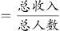，故可利用混合比例求解。根据线段法：距离与量（人数）成反比，可得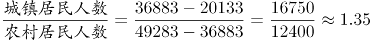，与4：3最接近。

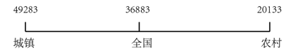

故正确答案为D。

### 第 100 题

根据资料，下列说法正确的是（ ）。

A. 2022年，农村居民人均可支配收入较去年增加上千元

B. 2021年，全国居民人均消费支出首次超过了2.4万元

C. 与2021年相比，2022年城镇居民在衣着上的消费支出减少最多

D. 2021年，无论在城镇还是农村，居民消费支出的重点都是食品烟酒支出和医疗保健支出

第 100 题 · 答案与解析

**参考答案（粉笔题库参考内容）**

A

**解析**

A项：定位文字材料第一段可得，2022年农村居民人均可支配收入20133元，增长6.3%。则农村居民人均可支配收入同比增量元>1000元，正确；

B项：定位文字材料第二段可得，2022年，全国居民人均消费支出24538元，比上年增长1.8%。则2021年全国居民人均消费支出元，但材料未给出2020年相关数据，无法推出在2021年是否“首次”超过了2.4万元，错误；

C项：定位统计表可得，2022年城镇居民各类型消费支出及同比增速，其中衣着人均支出为1735元，同比增速为-5.8%；教育文化娱乐人均支出为3050元，同比增速为-8.2%。根据增长量比较口诀“大大则大”，可得教育文化娱乐人均支出的现期量和降幅均大于衣着，故前者减少量大于后者，错误；

D项：定位统计表可得，2022年城镇居民各类型消费支出及同比增速，其中居住人均支出为7644元，同比增速为3.2%；医疗保健人均支出为2481元，同比增速为-1.6%。根据公式：基期量，可得2021年居住人均支出元，医疗保健人均支出元，2021年居住人均支出大于医疗保健人均支出，故城镇居民消费支出的重点不包含医疗保健支出，错误。

故正确答案为A。

