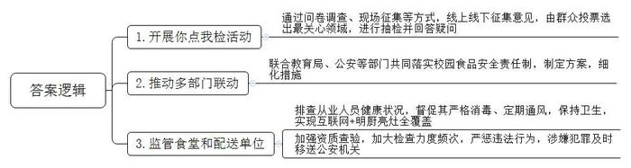
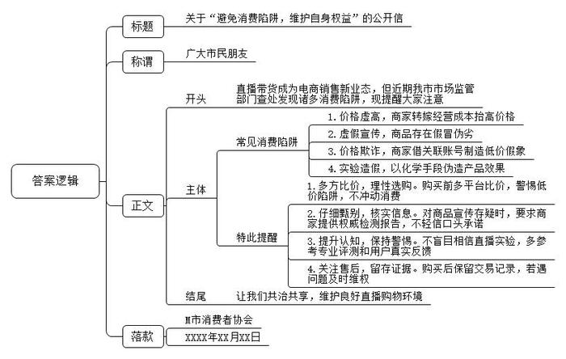
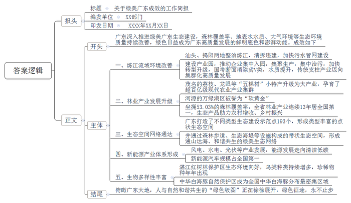

# 2024年广东省公考《申论》题（行政执法）

> 候选采集稿。参考答案及解析来自粉笔页面，不代表官方答案或真实高分答卷；来源使用许可与原卷对应关系仍需人工核实。

## 给定材料

### 材料 material-ec44c2154b730882

“食用农产品的流通速度快、保质时间短，现场抽检时，除了抽检样品，也要检查销售者是否有进货查验记录、合法进货凭证等，一旦发现问题，及时给予查处。”目前，G省市场监督管理局“你点我检”活动走进S大学附属中学周边，对食用农产品进行抽检并回答市民关心关注的问题。

“你点我检”活动是G省市场监督管理局加强校园食品安全监督的创新做法。群众最关心什么，就抽检什么。这场抽检活动是由群众投票选出来的。在开展“你点我检”活动过程中，G省市场监督管理局通过多种渠道开展问卷调查、设立现场意见征集点等方式，线上线下广泛征集消费者关心的食品品种、监测项目、抽样场所等信息，确定了消费者最关心的食品安全领域，如“一老一小”食品、校园食品、网红食品、网购食品、夏日饮品、地方特色食品等，主要针对此类食品进行抽检。

本次活动G省市场监督管理局主要聚焦校园食品安全问题。“校园食品安全事关青少年身体健康，社会关注度高。我们一直很重视校园食品安全监督工作。”G省市场监督局有关负责人表示，“除了市场监督部门外，我们还联合教育局、公安等部门共同落实校园食品安全责任制，制定方案，细化措施，将工作抓紧抓实抓细。”

确保校园食品安全，加强对学校食堂和学生集体用餐配送单位的监管是重中之重，据统计，2023年G省全省2.8万家学校食堂和262家学生集体用餐配送单位实现“互联网+明厨亮灶”全覆盖。各地市场监督、教育部门督促学校食堂和学生集体用餐配送单位认真排查从业人员健康状况，严格采用蒸煮、热力消毒柜消毒等多种方式消毒餐饮具，保持加工制作和就餐场所清洁卫生，定期通风换气。各地市场监督部门加强对校外供餐单位、学校食堂有关资质的查验，进一步加大监督检查力度和频次，依法严惩重处食品安全违法违规行为，及时向公安机关移送涉嫌犯罪的食品安全案件，全面提升群众对市场监督部门校园食品安全监督工作的信任度。

民生无小事，枝叶总关情。校园食品安全事关学生的身体健康，是民生工程、民心工程。提升校园食品安全的监督水平和能力，做到民有所呼、政有所应。

### 材料 material-f1f401d7838384d7

直播带货已经成为电商平台销售新业态。近期，M市市场监管综合执法支队在查处直播带货案件的过程中，发现直播带货存在虚假宣传、价格欺诈等消费陷阱。以下是部分相关案例：

案例一：执法人员调查发现，直播间推荐的某些商品，只要你去其他团购平台上找同款，就会发现部分商品都比直播间便宜不少，主要有三个原因：一是平台抽成，不同平台都会有不同比例的抽成；二是主播提成，主播往往有高额提成，主播承诺给予消费者的优惠，其实是建立在商品获取提成的基础上；三是营销费用，为了提高直播间和主播的知名度需要投入大量的资金进行营销推广。商家为了利润，必然抬高价格，转嫁到消费者头上。

案例二：执法人员在直播平台调取的录像中看到，主播推销某款皮鞋时宣称“某款皮鞋是羊皮制作”。而征询厂家得知，该款皮鞋实际是人造皮革制作。也有网友反映说，自己在某直播间购买到一件羽绒服，号称是名贵水貂皮毛，90白鸭绒，价值上万，直播间售价1980元。但拿到手发现，所谓的名贵水貂皮毛，明显就是兔毛。

案例三：执法人员发现，某市涉案文化传媒公司的法人同时是4家公司、多个直播账号的实际控制人，所管理的账号涉嫌通过虚假宣传或价格欺诈的手段诱导消费者购买，还利用其控制的两家公司进行联合价格欺诈。当事人实际控制的两家公司分别在直播销售平台、传统电商平台销售同款白酒，同一款酒在直播平台标价为998元，在传统电商平台标价为7980元。直播销售时，主播为了证明直播间的价格非常优惠，会在推销时打开手机，佯装在网上寻找其他平台的销售价格，其实搜索出来展示的是其控制或与其合谋的网店的价格，让消费者误以为直播间的商品价格更便宜。

案例四：执法人员检查发现，直播间里做的所谓实验，其实也是“套路”，日用品类商品中特别突出，以洗衣液为例，主播为力证产品的强大功效，往往在现场演示如何“一秒洁衣”。主播通常会在镜头前摆一盆水，拿起酱油瓶往里倒酱油，等水变浑浊后，再倒入洗衣液，用手轻轻一搅，盆中的水就变清澈了。事实上，酱油瓶里装的不是酱油，而是碘伏。洗衣液里也提前加了维生素C，当维生素C和碘伏混合在一起产生化学反应，碘伏溶解，水就变清了。

### 材料 material-58be08c2d1d33493

作为中国经济第一大省的广东，背枕南岭、面朝南海，珠江奔流、水网密布，降水充沛、热力充足，植物繁茂、四季花开，全省森林覆盖率达53.03%。去年,广东地表水水质创近年来最好水平，国考断面水质优良率达92.6%，全面消除劣V类断面。大气环境质量持续高位改善，全省PM2.5平均浓度降至20微克/立方米，珠三角PM2.5平均浓度在“三大经济圈”中率先进入“1字头”（19微克/立方米）。生态环境质量持续改善，绿色日益成为广东高质量发展的鲜明底色和澎湃动能。

绿水青山就是金山银山。对此，广东的感受更深一些。

广东潮汕地区的练江，发源于广东普宁、于汕头潮阳区入海。20世纪90年代，沿岸人口密集，高耗水、高污染的纺织印染企业林立，重发展轻治污导致练江污染严重。积重难返，在当时很多人看来，不敢想，这条污染了十多年的江几乎不可能治理好。痛定思痛，督察通报后，汕头、揭阳两地自2018年起大力整治练江。谷饶溪河道边原有1.3万平方米、涉及71栋违章建筑的拆除工作全部完成，违建清拆完成后，谷饶镇加快了污水管网建设。从2019年1月1日起，汕头市加速建设纺织印染园区，推动企业集中入园，集聚生产，集中治污，加快转型升级。到2020年底，练江海门桥闸国考断面消除劣V类，整体水质创2004年以来最好水平。当地传统支柱产业也迈向集群化高质量发展。2023年端午，潮阳区和平镇下寨蚝潭湾的13支队伍，在练江流域赛起了龙舟，村民马先生表示，“龙腾练江，竞渡端午，真的想不到！”

人不负青山，青山不负人，有好生态，才能有好空气、好水源、好土壤，才能种出好水果、好米、好茶、好产品，才能有“爆款”生态产品。茂名有荔枝、龙眼、沉香、化橘红、三华李。这“五棵树”让茂名推动“小特产”升级为“大产业”，超百亿级现代农业产业集群呼之欲出。河源有“万绿湖”，这个总面积1600平方公里的湖区，被誉为华南地区最珍贵的“软黄金”。坐拥53.03%的森林覆盖率，广东不负“绿青”，林业产业连续13年居全国第一，约占全国的十分之一。生态产品助力农村增收，乡村振兴。

只有把绿水青山建得更美，才能把金山银山做得更大。广东按照“九核、多点、两屏、三网”的空间布局，自2023年以来，打造了不同类型绿美广东生态建设示范点193个，森林公园、湿地公园、风景名胜区和拟建各类公园共同形成了类型丰富的点状生态空间，并通过森林步道和绿道、碧道、生态海堤等设施构成的带状生态空间，形成通山达海、和谐共生的绿美生态网络。

为深入贯彻习近平生态文明思想，牢固树立和践行绿水青山就是金山银山的理念，深入推进绿美广东生态建设，推动广东省高质量发展，2022年12月，中共广东省委作出《关于深入推进绿美广东生态建设的决定》，确定了生态优先、人民至上、求真务实、系统谋划、群策群力的基本原则，坚定地让“绿美”在更高起点上锚定了更高目标。到2027年底，全省完成林分优化提升1000万亩、森林抚育提升1000万亩；全域建成国家森林城市；率先建成国家公园、国家植物园“双园”之省……到2035年，全省完成林分优化1500万亩；混交林比例达到60%以上，建成人与自然和谐共生的“绿美广东”样板。

好风借好力，中国风电看广东，就在2023年8月11日，又一台大容量12兆瓦海上风电机组在广东省临海试验基地完成并网测试，即将在广东海上风场正式发电应用。不仅是“呼风换电”，还有水电、光伏……能源发展，正向着“清洁低碳”大步向前，锚定未来，项目聚“能”，产业向“新”，新能源产业体系初见其成。2023年上半年，广东新能源汽车产量占全国的28.74%，规模占全国第一，全国每4辆新能源汽车便有一辆是“广东造”。各地以生态为基底孕育的产品，正在一、二、三产业间灵活切换，相得益彰。

良好的生态环境是最公平的公共产品，是最普惠的民生福祉。广东湛江红树林国家级自然保护区，是我国红树林面积最大、分布最集中的自然保护区。2023年4月，习近平总书记来到湛江金牛岛，实地察看红树林长势和周边生态环境。他强调，这片红树林是“国宝”，要像爱护眼睛一样守护好。湛江红树林国家级自然保护区管理局有关负责人深有感触：“从2002年到现在，我们观察到的鸟类已经从194种增长到312种，并持续呈稳定的趋势，更难能可贵的是，一些珍稀物种比如中华凤头燕鸥、黑嘴端凤头燕鸥、黑脸琵鹭、黑嘴鸥等，也逐渐在保护区里出现，第一次、第二次，年年如此。”生态好不好，我们说了不算，对于环境极其敏感的珍稀候鸟说了算。来一次不算，年年来才算。2023年全球红树林面积整体递减，我国却是世界上少数几个红树林面积净增加的国家之一。一减一增，可见保护之艰难。

珠江出海口，波光潋滟。三两成群的中华白海豚偶尔跃出水面，觅食嬉戏。这片总面积约460平方公里的水域，就是广东珠江口中华白海豚国家级自然保护区。不远处，横亘于伶仃洋上的港珠澳大桥，宛如巨龙。桥面上，车流穿行，海面上，货轮如梭。中华白海豚与港珠澳大桥“同框”的画面，在交通繁忙的珠江口，并不鲜见。目前，广东有6个中华白海豚自然保护区，已然成为全国中华白海豚分布最密集的区域。

岭南大地，出门见绿，推窗见景。俯瞰广东大地，人与自然和谐共生的“绿色版图”正在徐徐展开，替河山装点锦绣，将国土描绘丹青，绿色征途，永不止步。

## 题目

### 第 1 题

**根据材料**1**，简述G省市场监督管理局在加强校园食品安全监督方面采取的主要做法。****（****15分****）**

关联材料：material-ec44c2154b730882、material-f1f401d7838384d7、material-58be08c2d1d33493

作答要求：

要求：全面、准确、有条理；篇幅不超过200字。

### 第 2 题

**根据材料**2**，以M市消费者协会的名义，草拟一份实名的公开信，提醒广大市民在网购消费中注意避免消费陷阱，维护自身的合法权益。****（****2****5****分****）**

关联材料：material-ec44c2154b730882、material-f1f401d7838384d7、material-58be08c2d1d33493

作答要求：

要求：公开信的内容包括问题和对策建议，紧扣材料，内容全面，结构完整，逻辑清晰流畅，篇幅不超过400字。

### 第 3 题

**根据材料**3**，撰写一篇工作简报，介绍绿美广东取得的主要成效，供经验交流使用。****（****25分****）**

关联材料：material-ec44c2154b730882、material-f1f401d7838384d7、material-58be08c2d1d33493

作答要求：

要求：紧扣材料，内容全面，逻辑清晰，语言流畅，篇幅不超过600字。

## 答案与解析

第 1 题

**参考答案（粉笔题库参考内容）**

1.开展你点我检活动。通过问卷调查、现场征集等方式，线上线下征集意见，由群众投票选出最关心领域，进行抽检并回答疑问。

2.推动多部门联动。联合教育局、公安等部门共同落实校园食品安全责任制，制定方案，细化措施。

3.监管食堂和配送单位。排查从业人员健康状况，督促其严格消毒、定期通风，保持卫生，实现互联网+明厨亮灶全覆盖；加强资质查验，加大检查力度频次，严惩违法行为，涉嫌犯罪及时移送公安机关。

**解析**

**参考答案说明：**本参考答案从“开展你点我检活动”“推动多部门联动”“监管食堂和配送单位”三个方面展开，各条答案要点之间在内容上相互并列，没有交叉。

**考点**：考点概括措施类

**来源**：来源2024年广东省公考《申论》题（行政执法）

粉笔申论页面对本题只提供「解析视频」入口，该入口是会员推广位，页面无视频地址与文字解析。

第 2 题

**参考答案（粉笔题库参考内容）**

关于“避免消费陷阱，维护自身权益”的公开信

广大市民朋友：

直播带货成为电商销售新业态，但近期我市市场监管部门查处发现诸多消费陷阱，现提醒大家注意：  

常见消费陷阱：1.价格虚高，商家转嫁经营成本抬高价格。2.虚假宣传，商品存在假冒伪劣。3.价格欺诈，商家借关联账号制造低价假象。4.实验造假，以化学手段伪造产品效果。特此提醒：1.多方比价，理性选购。购买前多平台比价，警惕低价陷阱，不冲动消费。2.仔细甄别，核实信息。对商品宣传存疑时，要求商家提供权威检测报告，不轻信口头承诺。3.提升认知，保持警惕。不盲目相信直播实验，多参考专业评测和用户真实反馈。4.关注售后，留存证据。购买后保留交易记录，若遇问题及时维权。

让我们共治共享，维护良好直播购物环境！

M市消费者协会

XXXX年XX月XX日

**解析**

**参考答案说明：**（1）格式方面，本参考答案写到了“标题”“称谓”“正文”“落款”。（2）正文部分，一方面从内容来看，围绕“避免消费陷阱，维护自身权益”这一主题，本参考答案的开头写到了网购消费的趋势、总体问题；主体写到了“消费陷阱的具体问题”“给消费者的建议”两个方面的内容；结尾向消费者进行了动员呼吁。另一方面，形式上，本参考答案做到了分段、分条撰写，整体上条理颇为清晰。

**考点**：考点宣传类

**来源**：来源2024年广东省公考《申论》题（行政执法）

粉笔申论页面对本题只提供「解析视频」入口，该入口是会员推广位，页面无视频地址与文字解析。

第 3 题

**参考答案（粉笔题库参考内容）**

关于绿美广东成效的工作简报

XX部门 XXXX年XX月XX日

广东深入推进绿美广东生态建设，森林覆盖率、地表水水质、大气环境等生态环境质量持续改善，绿色日益成为广东高质量发展的鲜明底色和澎湃动能。成效如下：

一、练江流域环境改善。汕头、揭阳两地整治练江，清拆违建，加快污水管网建设；建设产业园，推动企业集中入园，集聚生产，集中治污，加快转型升级，国考断面消除劣V类，水质提升，传统支柱产业迈向集群化高质量发展。二、林业产业发展升级。茂名的荔枝、龙眼等“五棵树”小特产升级为大产业，孕育了超百亿级现代农业产业集群；河源的万绿湖区被誉为“软黄金”；坐拥53.03%的森林覆盖率，全省林业产业连续13年居全国第一，生态产品助力农村增收、乡村振兴。三、生态空间网络通达。广东打造了不同类型生态建设示范点193个，形成类型丰富的点状生态空间，并通过森林步道、生态海堤等设施构成的带状生态空间，形成通山达海、和谐共生的绿美生态网络。四、新能源产业体系形成。风电、水电、光伏等产业发展，能源发展走向清洁低碳；新能源汽车规模占全国第一。五、生物多样性丰富。湛江红树林保护区生态环境向好，鸟类种类持续增多，珍稀物种年年出现；中华白海豚自然保护区成为全国中华白海豚分布最密集区域。

俯瞰广东大地，人与自然和谐共生的“绿色版图”正在徐徐展开，绿色征途，永不止步。

**解析**

**参考答案说明**：（1）格式方面，本参考答案写到了“报头”“正文”两个部分，其中“报头”包括标题、编发单位、印发日期。（2）正文部分，一方面从内容上来看，围绕“绿美广东成效”这一主题，本参考答案的开头先写到了绿美广东取得的总体成效；主体部分从“练江流域环境改善”“林业产业发展升级”“生态空间网络通达”“新能源产业体系形成”“生物多样性丰富”五个方面介绍了绿美广东的具体经验和成效；结尾部分进行了总结。另一方面，形式上，本参考答案做到了分段、分条撰写，整体上条理较为清晰。

**考点**：考点总结类

**来源**：来源2024年广东省公考《申论》题（行政执法）

粉笔申论页面对本题只提供「解析视频」入口，该入口是会员推广位，页面无视频地址与文字解析。

