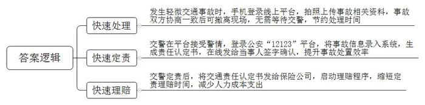
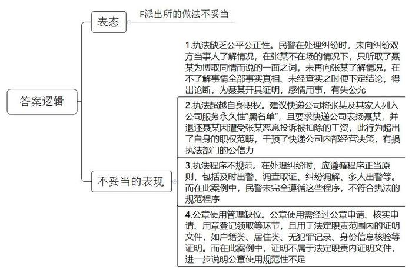
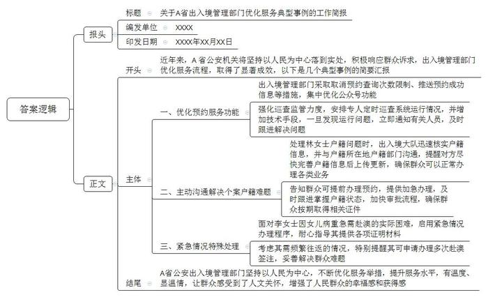

# 2024年广东省公考《申论》题（公安）

<!-- gwy:overview:start -->
> **广东 · 2024 · 申论 · 公安** ｜ 3 题 · 图片 3 处 · 答案随题折叠

导航：[题目](#题目) · [材料 1](#材料-1)
<!-- gwy:overview:end -->

> 候选采集稿。参考答案及解析来自粉笔页面，不代表官方答案或真实高分答卷；来源使用许可与原卷对应关系仍需人工核实。

## 给定材料

### 材料 1

随着城市车辆保有量快速增长，交通事故连年增加，一些小事故往往就带来大拥堵。为此，D市探索“快处快赔121”交通警务机制改革，破解“小事故大拥堵、警力少出警慢、周期长认定慢、定损繁理赔难”痛点，实现“小创新大便捷、省警力聚合力、保畅通防事故”的多赢效果。

2023年2月的一天，刘某驾驶车辆在D市桥东开发区与贺某驾驶的小车发生了追尾事故。正当刘某下车查看情况，准备拨打110报警时，司机贺某表示不用那么麻烦，并拿出了手机，登录D市“快处快赔121”平台，拍照上传事故现场照片、驾驶证号、车牌号、投保的保险公司、人车合影、损坏部位等内容，上传完毕后，就准备开车离开现场。

刘某满脸疑惑：“交警都没来，你怎么就要走啦？”司机贺某向刘某解释说，本市最新推行的“快处快赔121”，发生事故后，如果不是很严重，只需要通过手机上传相关资料，就可以自己处理了，不需要等交警来。

贺某和刘某协商一致后，当事双方撤离现场，路面交通迅速恢复，车辆从事故发生到撤离的整个过程，耗时不到10分钟，D市调研机构电话访问了处理此次事故的交警及追尾事故相关人员，刘某表示：“快处快赔121”极大地节约了处理时间，以往要等待好几个小时才能处理得完，当天他正准备去签订一个非常重要的商务合同，正是因为“快处快赔121”机制的高效便捷，才没有错过合同的签订。

当日后台值班民警小王则表示：“‘快处快赔121’机制改变了我们的警务模式，以往路面发生交通事故后，我们得要两名民警一同出警赶往现场，大量小事故让警力捉襟见肘，影响了处置效率，现在我们值班民警在收到‘快处快赔121’平台上的警情后，直接登录公安‘12123’平台，将事故信息录入系统，生成责任认定书，在线发给当事人签字确认，大大提升了事故处置效率。”

保险公司小杨在访问中也肯定了“快处快赔121”机制：这一机制让数据多跑腿，减轻了保险公司的人力成本支出，也提高了我们的工作效率，按照现在“快处快赔121”机制，在交警定责后，只要在线上将交通责任认定书发送给我们，我们就能启动理赔程序，原本需要3个工作日的定责理赔程序，则缩短至30分钟内就能定责，15分钟内就能完成理赔。

“快处快赔121”机制实施以来，D市处理交通事故总数约1.95万起，处理轻微交通事故约1.89万起，其中“快处快赔121”平台处置约1.17万起，占比超过61%，成为轻微事故处置的主渠道，目前，该机制正在农村及偏远地区加快推广，“路途远、出警慢、理赔难”问题大为改观。

### 材料 2

张某是F派出所辖区居民，因其购买的商品赠送的一箱芒果少了一个和负责此次送货的快递员聂某发生争执，张某对聂某的服务不满意，先后四次投诉聂某，聂某为解决矛盾，遂于某日驾驶非机动车到张某住处请求原谅，双方在张某家门口再次发生争执，张某要求聂某立即离开，但聂某坚持不肯离开，于是张某拨打110报警，要求警察将聂某带离。

F派出所民警小周接到报警后到达现场，见聂某坐在张某家门口哭泣，张某则不在场，民警小周向聂某了解情况，聂某告知民警自己与张某的纠纷，称如果自己再被张某投诉，将被公司开除，但直至其下跪，也未得到张某及其家人的谅解，向聂某了解情况后，民警小周非常同情聂某的遭遇，告知其不必摈弃尊严乞求原谅，派出所会为其作证明，之后民警小周便同聂某一起离开，也没有再向张某了解情况。

此后，F派出所为聂某出具了一份加盖该派出所公章的证明，证明中派出所建议快递公司将张某及其家人列入公司服务永久性“黑名单”，退还聂某因遭受张某恶意投诉被扣除的2000元工资，对聂某这种宁肯牺牲个人尊严也要维护公司声誉的优秀员工进行表扬等。

随着该证明被曝光，张某上网回应称派出所民警没有查清事情经过就下结论，执法有失公允，而聂某也承认，公司并未因其被投诉而对其罚款、开除，自己为博取同情，谎称被扣工资甚至要被开除。

网友对此事件中F派出所为聂某开证明的行为议论纷纷，意见不一，有网友认为张某的行为不近人情，聂某上门请求原谅，仍不依不饶，在此情形下派出所为聂某发声，为其开证明是维护弱者，值得肯定；也有网友认为派出所没有权力开这样的证明，而且F派出所听信了聂某的一面之词就下论断并不公平公正。

### 材料 3

习近平法治思想是全面依法治国的根本遵循和行动指南，其中，坚持以人民为中心是全面依法治国的根本立场，全面依法治国要坚持人民主体地位，把体现人民利益、反映人民愿望、维护人民权益、增进人民福祉落实到依法治国全过程，使法律及其实施充分体现人民意志。

近年来，A省公安机关将坚持以人民为中心落到实处，出入境管理部门涌现出一批典型事例，获得群众的高度评价。

2023年3月，A省公安机关出入境管理部门陆续收到群众反映，在预约办理证件时遇到困难，有些群众因历史预约办证次数超过6次后无法正常查询、预约；有些群众因为没有关注公众号，在预约后无法收到预约结果信息推送；因预约号放号时间设为每日零点，群众为了抢预约号往往要熬夜抢号，影响休息，出入境管理部门对上述问题调研分析后，发现是由于出入境公众号办证预约系统部分设置不够合理，不能很好地满足群众的办证要求。

出入境管理部门积极回应，迅速调整，采取了取消预约查询次数限制、推送预约成功信息、增加预约编号字段、调整预约放号时间等措施，集中优化公众号预约服务功能。在跟进落实上述优化措施的同时，出入境管理部门进一步强化对预约系统的巡查监管力度，安排专人定时巡查系统运行情况，并增加包括手机短信、系统报警等技术手段，一旦发现运行问题，立即通过相关渠道通知有关人员，及时跟进解决问题。上述优化措施受到群众的一致好评。

2023年8月，群众林女士遇到一件让她困扰的事，其目前居住在A省H市。因紧急事务需要办理证件前往香港，但几次申请均无法成功办理，办证部门回复说其户籍信息显示为服兵役状态，不符合办证条件。

林女士很纳闷，其早已服完兵役，不知为何还是服兵役状态。为解决问题，林女士便给“局长信箱”写信请求帮助。接到信件后，H市L区公安出入境大队迅速核查，核实其户籍人口信息确实为现役状态。按传统做法，林女士的户籍状态变更应回到户籍地找户籍部门完成后再申请办理出入境证件，耗时较长，本着急群众之所急，想群众之所想的为民服务理念，考虑到林女士急需办理证件前往香港，出入境大队主动作为，与林女士户籍所在地户籍部门沟通，提醒对方尽快完善户籍信息后上传更新，确保林女士可以正常办理各类业务。

与林女士户籍所在地沟通后，出入境大队告知林女士可以提前办理预约，提供相关材料到窗口加急办理，并安排民警及时跟进掌握户籍状态，更新完毕后加快审批流程，最终林女士如愿按期取得相关证件，林女士表示，“L区公安出入境管理部门的做法有温度、显温情，十分感谢，感觉非常暖心。”

2023年10月，赴澳劳务人员骆某在澳门工作期间因硫化氢中毒，被送入当地医院抢救，病情危重，急需家人入院陪护照顾。因其母亲李女士原签注已用完，无法紧急赴澳照顾病重的女儿，李女士便向A省公安厅驻C市签证办事处反映，请求帮助解决这一难题。

接到求助后，C市签证办事处非常重视，虽然类似申请不属于常规业务范围，但群众利益无小事，公安机关的工作就是要服务群众、依法为群众办实事，签证处根据李女士母女的实际困难，启用紧急情况办理程序，并且安排人手耐心指导李女士提供女儿在澳门工作及住院等各项证明材料。

考虑到李女士需较长时间在澳门陪护照顾，且李女士在澳门无住所，确需频繁往返，经办民警还特别提醒她申请办理3个月多次赴澳签注，妥善地解决了她的难题，A省公安厅驻C市签证办事处工作中坚持“以人民为中心”的人性化做法，让群众切身感受到公安机关出入境管理部门的人文关怀，增强了人民群众的幸福感和获得感，李女士感激之情溢于言表：“感谢你们为我解决了大问题，让我能顺利去澳门照顾女儿，太感谢你们啦！”

## 题目

### 第 1 题

**根据材料**1**，简要概括D市“快处快赔121”机制的主要步骤。（15分）**

关联材料：材料 1、材料 2、材料 3

作答要求：

要求：概括全面，准确，条理清晰，字数不超过200字。

第 1 题 · 答案与解析

**参考答案（粉笔题库参考内容）**

1.快速处理。发生轻微交通事故时，手机登录线上平台，拍照上传事故相关资料，事故双方协商一致后可撤离现场，无需等待交警，节约处理时间。

2.快速定责。交警在平台接受警情，登录公安“12123”平台，将事故信息录入系统，生成责任认定书，在线发给当事人签字确认，提升事故处置效率。

3.快速理赔。交警定责后，将交通责任认定书发给保险公司，启动理赔程序，缩短定责理赔时间，减少人力成本支出。

**解析**

**参考答案说明：**本题答案按照时间先后顺序，介绍了“快处快赔121”机制“快速处理”“快速定责”“快速理赔”的三个步骤，各条答案要点之间逻辑上呈现出时间上的递进，内容上相互独立，没有交叉。

**考点**：考点概括措施类

**来源**：来源2024年广东省公考《申论》题（公安）

粉笔申论页面对本题只提供「解析视频」入口，该入口是会员推广位，页面无视频地址与文字解析。

### 第 2 题

**根据材料**2**，你认为F派出所的做法是否妥当？并分析说明理由。（20分）**

关联材料：材料 1、材料 2、材料 3

作答要求：

要求：观点正确，分析全面，条理清晰，字数不超过500字。

第 2 题 · 答案与解析

**参考答案（粉笔题库参考内容）**

F派出所的做法不妥当。

1.执法缺乏公平公正性。民警在处理纠纷时，未向纠纷双方当事人了解情况，在张某不在场的情况下，只听取了聂某为博取同情而说的一面之词，未再向张某了解情况，在不了解事情全部事实真相、未经查实之时便下定结论，得出论断，为聂某开具证明，感情用事，有失公允。

2.执法超越自身职权。建议快递公司将张某及其家人列入公司服务永久性“黑名单”，且要求快递公司表扬聂某，并退还聂某因遭受张某恶意投诉被扣除的工资，此行为超出了自身的职权范畴，干预了快递公司内部经营决策，有损执法部门的公信力。

3.执法程序不规范。在处理纠纷时，应遵循程序正当原则，包括及时出警、调查取证、纠纷调解、多人出警等。而在此案例中，民警未完全遵循这些程序，不符合执法的规范程序。

4.公章使用管理缺位。公章使用需经过公章申请、核实申请、用章登记领取等环节，且用于法定职责范围内的证明文件，如户籍类、居住类、无犯罪记录、身份信息核验等证明。而在此案例中，证明不属于法定职责内证明文件，进一步说明公章使用规范性不足。

**解析**

**参考答案说明**：本参考答案从从“表态”及“欠妥理由”两方面展开，其中，“欠妥理由”又分别从“执法缺乏公平公正性”“执法超越自身职权”“执法程序不规范”“公章使用管理缺位”四个方面阐述，各条答案要点之间在内容上相互并列，没有交叉。

**考点**：考点其他类

**来源**：来源2024年广东省公考《申论》题（公安）

粉笔申论页面对本题只提供「解析视频」入口，该入口是会员推广位，页面无视频地址与文字解析。

### 第 3 题

**请根据材料**3**，就A省公安机关出入境管理部门优化服务典型事例，草拟一份工作简报。（25分）**

关联材料：材料 1、材料 2、材料 3

作答要求：

要求：内容概括，条理清晰，字数不超过600字。

第 3 题 · 答案与解析

**参考答案（粉笔题库参考内容）**

关于A省出入境管理部门优化服务典型事例的工作简报

XXXX XXXX年XX月XX日

近年来，A省公安机关将坚持以人民为中心落到实处，积极响应群众诉求，出入境管理部门优化服务流程，取得了显著成效，以下是几个典型事例的简要汇报。

一、优化预约服务功能。出入境管理部门采取取消预约查询次数限制、推送预约成功信息等措施，集中优化公众号功能；强化巡查监管力度，安排专人定时巡查系统运行情况，并增加技术手段，一旦发现运行问题，立即通知有关人员，及时跟进解决问题。

二、主动沟通解决个案户籍难题。处理林女士户籍问题时，出入境大队迅速核实户籍信息，并与户籍所在地户籍部门沟通，提醒对方尽快完善户籍信息后上传更新，确保群众可以正常办理各类业务；告知群众可提前办理预约，提供加急办理，及时跟进掌握户籍状态，加快审批流程，确保群众按期取得相关证件。

三、紧急情况特殊处理。面对李女士因女儿病重急需赴澳的实际困难，启用紧急情况办理程序，耐心指导其提供各项证明材料；考虑其需频繁往返的情况，特别提醒其可申请办理多次赴澳签注，妥善解决群众难题。

A省公安出入境管理部门坚持以人民为中心，不断优化服务举措，提升服务水平，有温度、显温情，让群众感受到了人文关怀，增强了人民群众的幸福感和获得感。

**解析**

**参考答案说明：**（1）格式方面，本参考答案写到了“报头（标题、编发单位、印发时间）”“正文”两个部分。（2）正文部分，一方面从内容上来看，围绕“A省出入境管理部门优化服务”这一主题，本参考答案的开头先写到了背景；主体部分从“优化预约服务功能”“主动沟通解决个案户籍难题”“紧急情况特殊处理”这三个方面进行展开；结尾部分给出了总结评价。另一方面，形式上，本参考答案做到了分段、分条撰写，整体上条理较为清晰。

**考点**：考点总结类

**来源**：来源2024年广东省公考《申论》题（公安）

粉笔申论页面对本题只提供「解析视频」入口，该入口是会员推广位，页面无视频地址与文字解析。

