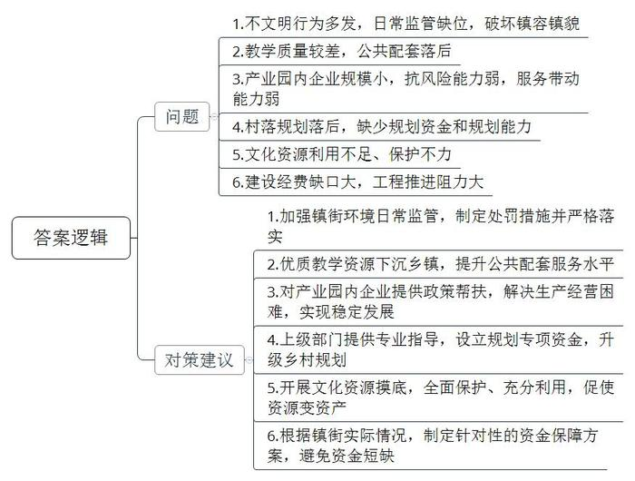
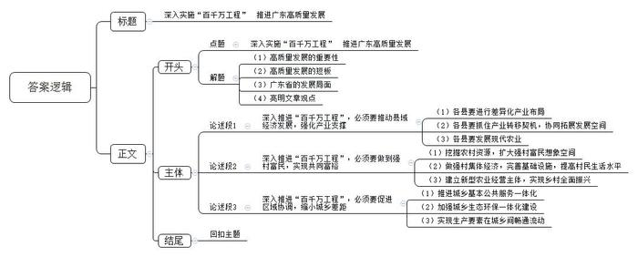

# 2024年广东省公考《申论》题（县镇）

> 候选采集稿。参考答案及解析来自粉笔页面，不代表官方答案或真实高分答卷；来源使用许可与原卷对应关系仍需人工核实。

## 给定材料

### 材料 material-9396fa2f6272a6df

岭南处处是春天，一年四季好干活。广东把习近平总书记的殷殷嘱托转化为做好新发展阶段广东工作的强大动力，深入开展“大学习、深调研、真落实”，坚持从总书记重要讲话和重要指示精神中找方向、找方法，融会贯通转化为广东走在全国前列的发展思路、战略目标和政策举措，以“再造一个新广东”的意志和干劲奋力开拓、攻坚克难，奏响推动粤港澳大湾区建设向纵深推进的“集结号”。

2023年春节后上班第一天，广东首次召开全省高质量发展大会，向全社会释放苦干实干、聚力前行的鲜明信号。2024年2月18日，也是春节后上班第一天，广东再度召开全省高质量发展大会，聚焦产业科技话创新、谋未来，持续推动高质量发展。

以下内容摘自广东省委书记黄坤明同志在2024年广东省高质量发展大会上的讲话实录。

推进产业科技创新、发展新质生产力是广东的战略之举、长远之策，也必将是一场艰苦的竞速赛、耐力赛、接力赛。我们要沿着习近平总书记指引的方向加速前进，向着产业科技高峰全力攀登，加快打造具有全球影响力的产业科技创新中心，不断增强高质量发展“硬实力”。

要视人才为珍宝。推进产业科技创新，人才是决定性因素。要真心爱才、悉心育才、倾心引才、精心用才，携手港澳加快建设大湾区高水平人才高地，吸聚全球高层次创新型人才，以人才工作的主动，更好掌握创新的主动、发展的主动。我省产业科技创新所需人才数量庞大，要坚持高标准精准引进和高质量自主培养两手抓，优化实施省市重大人才工程，推进高等教育“冲一流、补短板、强特色”，让广东的人才金字塔“塔基更实、塔身更强、塔尖更高”。视人才为珍宝，关键是要让人才有用武之地，让珍宝绽放光彩。我们既要创造更多的平台和机会，更要打通人才价值实现的通道，让各类人才在研究探索创新时拥有足够舞台，在成果转移转化中获得应有收益。省里已经出台方案，赋予事业单位科研人员科技成果转化更大受益权。今天参会的有不少专家和领军人才，感谢大家为广东作出的贡献，也希望大家弘扬科学家精神，“十年磨一剑”潜心研究，把论文写在广袤大地上，在推进产业科技创新中贡献智慧、成就事业、收获幸福。

广东企业敢于创新、百折不挠，华为、美的、比亚迪等在长期的市场洗礼中成长为世界级创新型企业，一系列专精特新企业如雨后春笋般茁壮成长，这是我们推进产业科技创新的厚实家底和强大底气。要全力支持企业做创新的主角，推动创新资源向优质企业集聚，政产学研协同发力，攻克“卡脖子”技术，锻造“撒手锏”技术，研发更多“根技术”，让企业把腰杆子挺起来。质量就是生命，效率就是生命。要支持企业积极运用新技术、新设备、新材料、新工艺，提升产品品质，提高生产效率，在市场竞争中立于不败之地。要以企业生产技术的整体提升，带动产业转型升级，实现传统产业老树新花，新兴产业竞相发展，未来产业孕育孵化。省里今年将推出一批新的重大科研项目，推动9000家工业企业开展技术改造，推动9200家规上工业企业数字化转型。今天来了很多企业，广东的产业科技创新主要靠你们，希望大家积极参与进来，与广东高质量发展同频共振。

市场是产业科技创新最重要的孵化器、加速器、放大器。拥有规模庞大的市场，才能为各类新技术、新业态提供试验场，才能容纳多条技术路线竞争成长，让真正具备发展优势、符合产业升级方向的技术和产品脱颖而出。我们要深刻把握产业科技创新的演进逻辑，把超大规模市场这一独特优势，切实转化为加快创新发展的优势、胜势。要根据市场需求凝练科研问题，依托市场优势吸聚创新资源，运用市场机制兑现创新价值，让市场力量激发出更加澎湃的创新动能。我们将推出一批新的应用场景，让更多新技术、新产品在广东市场率先应用推广，加速迭代升级。我们还将积极发展科技金融、技术、数据等创新要素市场，促进创新链产业链资金链人才链深度融合，营造更好的创新生态。

科技创新和体制创新如车之双轮、鸟之两翼，互为促进、缺一不可。要着眼发展新质生产力，下好改革“先手棋”，抓紧推进地方科技管理机构改革，带动科技体制改革向纵深和具体处发展，切实打通制约产业科技创新的卡点堵点。在这方面，我们要特别感谢国家部委给予的指导，港澳各方大力的支持，海外华侨华人提供的帮助，省各民主党派、工商联和无党派人士的积极参与。新型举国体制是攻克关键核心技术的利器，要积极探索具体路径，促进有为政府和有效市场紧密结合，推进“有组织的科研”“有组织的转化”，更好实现从科技强到企业强、产业强、经济强。要持续营造有利于创新的政策和制度环境，实施包容审慎监管，加强知识产权保护，让每一个创新行为都得到市场尊重，让每一份创新成果都能够形成市场价值。“脱钩断链”“小院高墙”是小伎俩，国际科技产业合作是大趋势。要坚持以开放促改革、促创新，在更广阔的空间布局产业科技创新，在开放合作中提升科技自立自强能力。

### 材料 material-0370ce7c747a1f25

为更实更细推进“百千万工程”，充分发挥乡镇连接城市与农村的节点和纽带作用，近期Z市“百千万工程”指挥部办公室深入部分镇街开展专题调研。总体来看，这次走访的10个镇街自实施“百千万工程”以来，已取得阶段性成果。但调研组发现有的地方在推进“百千万工程”的过程中碰到一些问题。

在E镇，调研组发现沿街存在占道经营、乱摆乱卖、路边随意晾晒衣物等现象，E镇周边有一些乱搭乱建的临时铁皮房、铁皮围挡，这些现象与美丽E镇建设的相关要求不符。有居民反映：“之前镇里集中整治过，刚整治完还好，但平时没人管，不知道什么时候又乱糟糟了。”

有居民还反映，他虽然在镇上产业园工作，但住在县城，这是因为小孩要上学，镇上的学校教学质量不如县里，也没有像样的图书馆，公园、医院等公共配套也不行。

来到F镇现代农业产业园，冷清的园区景象引起了调研组的注意。产业园负责人告诉调研组：“今年，产业园发展遇到困难。园区最大的企业是一家粮油食品有限公司，目前面临经营困难，其他一些企业也不同程度受到了影响。”调研组在走访中进一步了解到，产业园的其他主要生产单位，如花卉产业园、粮食储备仓库、水稻生产基地等，规模偏小，抗风险能力不强，服务带动周边片区农户的能力有限。产业园负责人说：“产业园建立很不容易，下一步还是要想想办法帮助企业渡过难关，促进产业园更好发展。”

在G镇园墨村，独具岭南特色的历史文化建筑风格让调研组眼前一亮。

“村里拥有区内现存规模最大、保存最好的古建筑群，前些年我们成立文化公司对古建筑群进行了开发运营，吸引了不少游客来参观旅游，村里的小商铺、农家乐多了起来。”一见到调研组，园墨村古建筑群运营公司负责人就迫不及待地反映，“现在我们正响应‘百千万工程’号召，积极扩大规模，丰富产业形态，正准备申报国家AAA级旅游景区，但土地使用、道路建设、产业布局等都受到规划制约，影响了工作进展。”

调研组深入了解到，村里的规划还是十多年前的一个简单规划，已经不能适应目前高质量发展要求。村里有加强规划的意愿，但没有规划专项资金，也不知道怎么推进规划工作，非常需要上级指导支持。

在调研过程中，调研组发现，其他一些镇的文化资源也比较丰富，但没有像园墨村那样利用起来。如H镇廊下村有一座近400年历史的客家围屋，非常气派。据村里老人介绍，这么大的围屋，在全县都是数一数二的，县里也曾派专家过来了解这座建筑的历史，后来就没有下文了。遗憾的是，这里因常年无人居住，年久失修，屋顶早已破损。

I镇徐家村也存在类似情况。该村徐书记介绍，村里至今仍留存着一批富有特色的古建筑群，其中最具特色的是清代一名将官的故居。多年前，村里就曾考虑过挖掘利用这么好的文化资源，但同样让人感到可惜的是，目前未能进行更有效、更充分利用，更别说转化为资产了。

推动“百千万工程”，资金的要素保障是大家关心的问题之一，也是较为突出的矛盾之一。调研组发现，像J镇这种以自然保护区为主要功能的零工业镇，在这次建设乡村振兴示范带时，尽管上级部门有安排专项资金，但因地处偏僻，村集体经济不发达，经济基础薄弱，历史欠账较多，在建设经费上仍存在较大的缺口，村里压力非常大。

### 材料 material-4373c84debab7c31

习近平总书记指出：“中国式现代化是强国建设、民族复兴的康庄大道。”

党的二十大报告明确概括了中国式现代化五个方面的中国特色：中国式现代化是人口规模巨大的现代化、是全体人民共同富裕的现代化、是物质文明与精神文明相协调的现代化、是人与自然和谐共生的现代化、是走和平发展道路的现代化。这既是理论概括，也是实践要求，为全面建成社会主义现代化强国、实现中华民族伟大复兴指明了一条康庄大道。

康庄大道并不等于一马平川。要把中国式现代化五个方面的中国特色变为成功实践，把鲜明特色变成独特优势，需要付出艰巨努力。

推进中国式现代化是一个系统工程，需要统筹兼顾、系统谋划、整体推进，正确处理好一系列重大关系。党的二十大报告指出，要把握好新时代中国特色社会主义思想的世界观和方法论，坚持好、运用好贯穿其中的立场观点方法，即“六个必须坚持”：必须坚持人民至上、必须坚持自信自立、必须坚持守正创新、必须坚持问题导向、必须坚持系统观念、必须坚持胸怀天下。科学的世界观和方法论是我们研究问题、解决问题的“总钥匙”。

2023年4月10日至13日，习近平总书记在广东考察时强调要锚定强国建设、民族复兴目标，围绕高质量发展这个首要任务和构建新发展格局这个战略任务，在全面深化改革、扩大高水平对外开放、提升科技自立自强能力、建设现代化产业体系、促进城乡区域协调发展等方面继续走在全国前列，在推进中国式现代化建设中走在前列。

习近平总书记强调，全体人民共同富裕是中国式现代化的本质特征，区域协调发展是实现共同富裕的必然要求。广东要下功夫解决区域发展不平衡问题，加快推进交通等基础设施的区域互联互通，带动和推进粤东、粤西、粤北地区更好承接珠三角地区的产业有序转移。要加强陆海统筹、山海互济，强化港产城整体布局，加强海洋生态保护，全面建设海洋强省。要积极推进以县城为重要载体的新型城镇化建设，加快构建现代乡村产业体系，发展新型农村集体经济，深入实施乡村建设行动，促进共同富裕。持续做好防止返贫动态监测和常态化帮扶，防止出现返贫。

## 题目

### 第 1 题

**根据材料**2**，概括2024年全省高质量发展大会上广东就“推进产业科技创新****、****发展新质生产力****”提出的主要举措。（20分）**

关联材料：材料 material-9396fa2f6272a6df

作答要求：

要求：概括全面、准确、条理清晰，不超过200字。

### 第 2 题

**材料**5**中反映了Z市推进“百县千镇万村高质量发展工程”中的一些问题。调研组拟向领导汇报调研发现的问题，并提出对策建议。假如你是调研组成员，请草拟汇报的主要内容。（30分）**

关联材料：材料 material-0370ce7c747a1f25

作答要求：

要求：

（1）汇报内容包括问题和对策建议；

（2）紧扣材料，梳理全面准确，所提对策建议有针对性、合理性；

（3）表达准确，条理清晰；

（4）不超过300字。

### 第 3 题

**高质量发展是全面建设社会主义现代化国家的首要任务。请结合给定材料，联系实际，围绕****“‘百千万工程’是****广东推动****高质量发展的头号工程****”，自拟题目，撰写一篇议论文。（50分）**

关联材料：材料 material-4373c84debab7c31

作答要求：

要求：

（1）紧扣主题，思想深刻；

（2）论点鲜明，论据确凿，论证严谨，合乎逻辑；

（3）与给定材料联系紧密；

（4）结构完整，条理清晰，行文流畅，篇幅在800-1000字。

## 答案与解析

第 1 题

**参考答案（粉笔题库参考内容）**

1.加强人才建设。精准引进、自主培养，实施人才工程；创造平台机会，保障人才从成果中转化获益。

2.支持企业创新。集聚创新资源，政产学研协同发力；支持运用四新技术，提升质量、效率，带动产业转型升级。

3.把握市场优势。根据市场凝练科研问题，吸聚创新资源，兑现创新价值，推出新应用场景，发展创新要素市场。

4.推动体制创新。推进科技管理机构改革，探索新型举国体制路径，营造利于创新的政策制度环境，推动国际科技产业合作。

**解析**

**参考答案说明：**本参考答案从“加强人才建设”“支持企业创新”“把握市场优势”“推动体制创新”四个方面展开，各条答案要点之间在内容上相互并列，没有交叉。

**考点**：考点概括措施类

**来源**：来源2024年广东省公考《申论》题（县镇）

粉笔申论页面对本题只提供「解析视频」入口，该入口是会员推广位，页面无视频地址与文字解析。

第 2 题

**参考答案（粉笔题库参考内容）**

问题：1.不文明行为多发，日常监管缺位，破坏镇容镇貌。2.教学质量较差，公共配套落后。3.产业园内企业规模小，抗风险能力弱，服务带动能力弱。4.村落规划落后，缺少规划资金和规划能力。5.文化资源利用不足、保护不力。6.建设经费缺口大，工程推进阻力大。

对策建议：1.加强镇街环境日常监管，制定处罚措施并严格落实。2.优质教学资源下沉乡镇，提升公共配套服务水平。3.对产业园内企业提供政策帮扶，解决生产经营困难，实现稳定发展。4.上级部门提供专业指导，设立规划专项资金，升级乡村规划。5.开展文化资源摸底，全面保护、充分利用，促使资源变资产。6.根据镇街实际情况，制定针对性的资金保障方案，避免资金短缺。

**解析**

**参考答案说明：**本参考答案结合题干要求分成了问题和对策建议两个部分。首先，从“不文明行为”“配套服务”“现代农业产业园内企业发展”“乡村规划发展”“文化资源利用”“‘百千万工程’建设经费”6个方面指出了Z市推进“百县千镇万村高质量发展工程”中的问题；接着，针对每一方面的问题给出了相应的对策。此外，形式方面，本答案做到了分类分条撰写，各条要点之间在内容上是并列关系，没有交叉。

**考点**：考点提出对策类

**来源**：来源2024年广东省公考《申论》题（县镇）

粉笔申论页面对本题只提供「解析视频」入口，该入口是会员推广位，页面无视频地址与文字解析。

第 3 题

**参考答案（粉笔题库参考内容）**

**深入实施“百千万工程” 推进广东高质量发展**

当下，高质量发展成为了全面建设社会主义现代化国家的首要任务，而习近平总书记明确指出，“城乡区域发展不平衡是广东高质量发展的最大短板”。为解决这一问题，“百千万工程”应运而生。在开局起步一年后，广东省强县促镇带村、县村镇高质量发展的势头已然形成。在新的起点上，“百千万工程”的重点应当放在发力县域经济、强村富民、推动城乡一体化发展三方面。

**深入推进“百千万工程”，必须要推动县域经济发展，强化产业支撑。**县域强，则全省强。首先，各县应立足自身资源禀赋和比较优势，以差异化的产业布局助推高质量发展；同时，各县要抓住全省产业有序转移的契机，在高新技术产业方面发力，粤东粤西粤北及珠三角地区协同拓展发展空间，因地制宜、错位发展，迸发产业有序转移的协同效益；此外，现代化农业的发展也不可缺位，沿海各县要充分利用丰富的海洋资源，建设现代化海洋牧场，其他县则可在生态农业、生态旅游的方向上探索，实现经济发展与环境美化的双重目标。

**深入推进“百千万工程”，必须要做到强村富民，实现共同富裕。**广东农村丰富的土特产、古建筑等资源，应当充分挖掘、包装，并在此基础上打造品牌、举办节庆活动，不断扩大强村富民的想象空间。还应对村集体土地统一规划，关闭淘汰落后产能，引进优质企业落户，在做大做强村集体经济后，发力加强基础设施建设，提升村民生活水平。农村还要建立合作社等各类新型农业经营主体，实现与现代化农业的完美链接，联农带农。利用好乡村优良资源、深厚底蕴，不断探索丰富资源利用方式，发展乡村新业态，必能实现乡村全面振兴。

**深入推进“百千万工程”，必须要促进区域协调，缩小城乡差距。**在公共服务方面，要加快推进全省基本公共服务一体化，把公共基础设施建设的重点放在农村，加快推动公共服务下乡，全面提高农村公共服务水平。在生态建设方面，要加强生态环保一体化建设，扎实推进绿美广东生态建设，让森林、碧道和生态景观贯穿县域。最重要的，还是要释放政策红利，构建起要素流动的畅通渠道，实现人才、资本、资源、技术等生产要素在城乡区域间畅通流动，真正消弭城乡二元结构造成的要素断层，做到城乡一体化发展。

新起点，新征程。广东要推动“百千万工程”不断走深走实，奋力书写高质量发展新篇章。

**解析**

**文章分析**

**深入实施“百千万工程” 推进广东高质量发展**

【**标题的优点：**首先，标题中含有主题词，使文章主题更突出、清晰。其次，形式上采用对称式结构，使标题更加完整、饱满。】

（1）当下，高质量发展成为了全面建设社会主义现代化国家的首要任务，而习近平总书记明确指出，（2）“城乡区域发展不平衡是广东高质量发展的最大短板”。为解决这一问题，“百千万工程”应运而生。（3）在开局起步一年后，广东省强县促镇带村、县村镇高质量发展的势头已然形成。（4）在新的起点上，“百千万工程”的重点应当放在发力县域经济、强村富民、推动城乡一体化发展三方面。

【**开头的优点：**★内容方面。范文的开头是紧扣“‘百千万工程’是广东推动高质量发展的头号工程”这一主题展开的。首先，开头点出主题，做到了主题明确。其次，对“‘百千万工程’是广东推动高质量发展的头号工程”这一主题进行了分析阐述，指出了：（1）高质量发展的重要性。（2）高质量发展的短板。（3）广东省的发展局面。（4）亮明文章观点。★文字表达方面：长短句配合使用，使语言表达有节奏感。】

**深入推进****“百千万工程”，必须要推动县域经济发展，强化产业支撑。**县域强，则全省强。（1）首先，各县应立足自身资源禀赋和比较优势，以差异化的产业布局助推高质量发展；同时，（2）各县要抓住全省产业有序转移的契机，在高新技术产业方面发力，粤东粤西粤北及珠三角地区协同拓展发展空间，因地制宜、错位发展，迸发产业有序转移的协同效益；此外，（3）现代化农业的发展也不可缺位，沿海各县要充分利用丰富的海洋资源，建设现代化海洋牧场，其他县则可在生态农业、生态旅游的方向上探索，实现经济发展与环境美化的双重目标。

【**论述段****1的优点：**★观点句：范文的观点句是紧扣“‘百千万工程’是广东推动高质量发展的头号工程”这一文章主题提出的。形式上，它在段首处直接写出，位置突出，容易发现。内容上，关键词突出，内容要点明确，可以明显看出主要从“发力县域经济”的角度展开论述。★论述内容：（1）各县要进行差异化产业布局；（2）各县要抓住产业转移契机，协同拓展发展空间；（3）各县要发展现代农业。注意：以上三个方面的内容都是紧扣“深入推进‘百千万工程’，必须要推动县域经济发展，强化产业支撑”这个观点句进行分析论述的，论述的针对性强，内容层次丰富。在论述方法上主要采用了讲道理的方式，论述清晰深刻。】

**深入推进****“百千万工程”，必须要做到强村富民，实现共同富裕。**（1）广东农村丰富的土特产、古建筑等资源，应当充分挖掘、包装，并在此基础上打造品牌、举办节庆活动，不断扩大强村富民的想象空间。（2）还应对村集体土地统一规划，关闭淘汰落后产能，引进优质企业落户，在做大做强村集体经济后，发力加强基础设施建设，提升村民生活水平。（3）农村还要建立合作社等各类新型农业经营主体，实现与现代化农业的完美链接，联农带农。利用好乡村优良资源、深厚底蕴，不断探索丰富资源利用方式，发展乡村新业态，必能实现乡村全面振兴。

【**论述段****2****的优点：**★观点句：范文的观点句是紧扣“‘百千万工程’是广东推动高质量发展的头号工程”这一文章主题提出的。形式上，它在段首处直接写出，位置突出，容易发现。内容上，关键词突出，内容要点明确，可以明显看出主要从“强村富民”的角度展开论述。★论述内容：（1）挖掘农村资源，扩大强村富民想象空间；（2）做强村集体经济，完善基础设施，提高村民生活水平；（3）建立新型农业经营主体，实现乡村全面振兴。注意：以上三个方面的内容都是紧扣“深入推进‘百千万工程’，必须要做到强村富民，实现共同富裕”这个观点句进行分析论述的，论述的针对性强，内容层次丰富。在论述方法上主要采用了讲道理的方式，论述清晰透彻。】

**深入推进****“百千万工程”，必须要促进区域协调，缩小城乡差距。**（1）在公共服务方面，要加快推进全省基本公共服务一体化，把公共基础设施建设的重点放在农村，加快推动公共服务下乡，全面提高农村公共服务水平。（2）在生态建设方面，要加强生态环保一体化建设，扎实推进绿美广东生态建设，让森林、碧道和生态景观贯穿县域。最重要的，（3）还是要释放政策红利，构建起要素流动的畅通渠道，实现人才、资本、资源、技术等生产要素在城乡区域间畅通流动，真正消弭城乡二元结构造成的要素断层，做到城乡一体化发展。

【**论述段****3****的优点：**★观点句：范文的观点句是紧扣“‘百千万工程’是广东推动高质量发展的头号工程”这一文章主题提出的。形式上，它在段首处直接写出，位置突出，容易发现。内容上，关键词突出，内容要点明确，可以明显看出主要从“推动城乡一体化”的角度展开论述。★论述内容：（1）推进城乡基本公共服务一体化；（2）加强城乡生态环保一体化建设；（3）实现生产要素在城乡间畅通流动。注意：以上三个方面的内容都是紧扣“深入推进‘百千万工程’，必须要促进区域协调，缩小城乡差距”这个观点句进行分析论述的，论述的针对性强，内容层次丰富。在论述方法上主要采用了讲道理的方式，论述清晰到位。】

【**论述段****之间的关系****：**★内容的内在逻辑：范文的论述段之间是依照“并列”的逻辑展开的。论述段1先写了“要推动县域经济发展，强化产业支撑”，论述段2再写了“要做到强村富民，实现共同富裕”，论述段3接着写了“要促进区域协调，缩小城乡差距”。整体论述逻辑清晰。】

新起点，新征程。广东要推动“百千万工程”不断走深走实，奋力书写高质量发展新篇章。

【**结尾的优点：**范文的结尾回扣了“‘百千万工程’是广东推动高质量发展的头号工程”这一主题，语言简练，不拖沓。】

**考点**：考点文章写作题

**来源**：来源2024年广东省公考《申论》题（县镇）

粉笔申论页面对本题只提供「解析视频」入口，该入口是会员推广位，页面无视频地址与文字解析。

