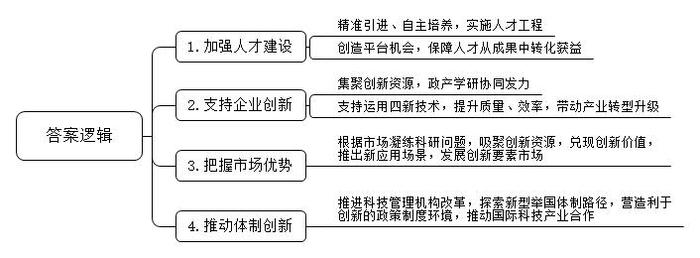
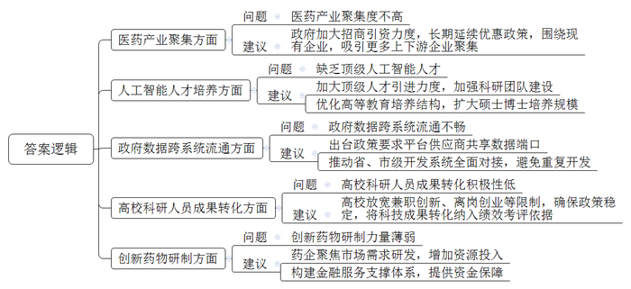
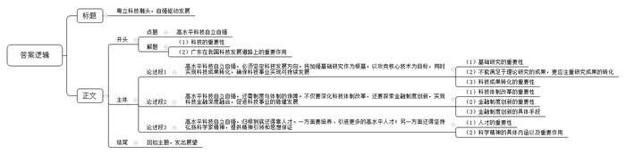

# 2024年广东省公考《申论》题（省市）

> 候选采集稿。参考答案及解析来自粉笔页面，不代表官方答案或真实高分答卷；来源使用许可与原卷对应关系仍需人工核实。

## 给定材料

### 材料 material-d71ae041dc12d563

岭南处处是春天，一年四季好干活。广东把习近平总书记的殷殷嘱托转化为做好新发展阶段广东工作的强大动力，以“再造一个新广东”的意志和干劲奋力开拓、攻坚克难，奏响进军高质量发展的“集结号”。

2023年春节后上班第一天，广东首次召开全省高质量发展大会，向全社会释放苦干实干、聚力前行的鲜明信号。2024年2月18日，农历新春第一个工作日，广东再度召开全省高质量发展大会，聚焦产业科技话创新、谋未来，持续推动高质量发展。

以下内容摘自中央政治局委员，广东省委书记黄坤明同志在2024年广东省高质量发展大会上的讲话实录：

推进产业科技创新、发展新质生产力是广东的战略之举、长远之策，也必将是一场艰苦的竞速赛、耐力赛、接力赛。我们要沿着习近平总书记指引的方向加速前进，向着产业科技高峰全力攀登，加快打造具有全球影响力的产业科技创新中心，不断增强高质量发展“硬实力”。

推进产业科技创新，人才是决定性因素。要真心爱才、悉心育才、倾心引才、精心用才，携手港澳加快建设大湾区高水平人才高地，吸聚全球高层次创新型人才，以人才工作的主动，更好掌握创新的主动、发展的主动。我省产业科技创新所需人才数量庞大，要坚持高标准精准引进和高质量自主培养两手抓，优化实施省市重大人才工程，推进高等教育“冲一流、补短板、强特色”，让广东的人才金字塔“塔基更实、塔身更强、塔尖更高”。视人才为珍宝，关键是要让人才有用武之地，让珍宝绽放光彩。我们既要创造更多的平台和机会，更要打通人才价值实现的通道，让各类人才在研究探索创新时拥有足够舞台，在成果转移转化中获得应有收益。省里已经出台方案，赋予事业单位科研人员科技成果转化更大受益权。今天参会的有不少专家和领军人才，感谢大家为广东作出的贡献，也希望大家弘扬科学家精神，“十年磨一剑”潜心研究，把论文写在广袤大地上，在推进产业科技创新中贡献智慧、成就事业、收获幸福。

广东企业敢于创新、百折不挠，华为、美的、比亚迪等在长期的市场洗礼中成长为世界级创新型企业，一系列专精特新企业如雨后春笋般茁壮成长，这是我们推进产业科技创新的厚实家底和强大底气。要全力支持企业做创新的主角，推动创新资源向优质企业集聚，政产学研协同发力，攻克“卡脖子”技术，锻造“撒手锏”技术，研发更多“根技术”，让企业把腰杆子挺起来。质量就是生命，效率就是生命。要支持企业积极运用新技术、新设备、新材料、新工艺，提升产品品质，提高生产效率，在市场竞争中立于不败之地。要以企业生产技术的整体提升，带动产业转型升级，实现传统产业老树新花，新兴产业竞相发展，未来产业孕育孵化。省里今年将推出一批新的重大科研项目，推动9000家工业企业开展技术改造，推动9200家规上工业企业数字化转型。今天来了很多企业，广东的产业科技创新主要靠你们，希望大家积极参与进来，与广东高质量发展同频共振。

市场是产业科技创新最重要的孵化器、加速器、放大器。拥有规模庞大的市场，才能为各类新技术、新业态提供试验场，才能容纳多条技术路线竞争成长，让真正具备发展优势、符合产业升级方向的技术和产品脱颖而出。我们要深刻把握产业科技创新的演进逻辑，把超大规模市场这一独特优势，切实转化为加快创新发展的优势、胜势。要根据市场需求凝练科研问题，依托市场优势吸聚创新资源，运用市场机制兑现创新价值，让市场力量激发出更加澎湃的创新动能。我们将推出一批新的应用场景，让更多新技术、新产品在广东市场率先应用推广，加速迭代升级。我们还将积极发展科技金融、技术、数据等创新要素市场，促进创新链产业链资金链人才链深度融合，营造更好的创新生态。

科技创新和体制创新如车之双轮、鸟之两翼，互为促进、缺一不可。要着眼发展新质生产力，下好改革“先手棋”，抓紧推进地方科技管理机构改革，带动科技体制改革向纵深和具体处发展，切实打通制约产业科技创新的卡点堵点。在这方面，我们要特别感谢国家部委给予的指导，港澳各方大力的支持，海外华侨华人提供的帮助，省各民主党派、工商联和无党派人士的积极参与。新型举国体制是攻克关键核心技术的利器，要积极探索具体路径，促进有为政府和有效市场紧密结合，推进“有组织的科研”“有组织的转化”，更好实现从科技强到企业强、产业强、经济强。要持续营造有利于创新的政策和制度环境，实施包容审慎监管，加强知识产权保护，让每一个创新行为都能够得到市场尊重，让每一份创新成果都能够形成市场价值。“脱钩断链”“小院高墙”是小伎俩，国际科技产业合作是大趋势。要坚持以开放促改革、促创新，在更广阔的空间布局产业科技创新，在开放合作中提升科技自立自强能力。

### 材料 material-7cfcb3339c3355a9

科技是第一生产力，人才是第一资源，创新是第一动力。科技创新催生新产业、新业态、新模式，是高质量发展的新动能，是制胜未来的关键变量。

近期，G市召开高质量发展座谈会，围绕产业科技互促，持续推动高质量发展，来自各行各业的代表踊跃建言献策。

某生物技术公司创始人刘先生：我市生物医药行业能够蓬勃发展，离不开政府的大力支持。我们刚落户的时候，政府给了很多优惠政策，也希望我们能够吸引更多的上下游企业，形成产业聚集，为此我们也作出了很大努力。但如何吸引更多相关企业落户，还是需要政府部门加大力度去推动。而且，产业聚集度不高，会影响到人才的就业选择。这也不利于企业在起步阶段组建研发团队。

某人工智能研究院李研究员：人工智能基础研究领域具有高成本、长周期的特点，创新的核心在于人才。我市拥有丰富的高校资源，但人工智能专业高等教育起步时间不长，多以本科生培养为主，硕士博士培养占比偏低。缺乏顶级科研人才，组建顶级科研团队有难度，研发周期就会变得很长，科研机构在研发资金投入上压力也增大了。

某大数据科技公司总经理吴女士：数字技术已成为新一轮科技革命的主导技术，在我市数字化建设过程中，部分平台供应商出于自身利益最大化考虑，往往不愿共享数据端口，结果导致不同部门不同层级之间的数据对接存在隐形壁垒，数据的跨系统流通渠道不畅。省级与市级开发系统提出的数据对接需求存在重复，造成开发费用高，也导致大量“数据孤岛”出现，数据无法进行联合分析或建模，数据价值无法充分发挥。

某大学科研处陈处长：近年省里为推进省内高校高质量发展出台了多项宏观性、指导性政策，促进产学研一体化，鼓励高校高水平科技成果转化，支持鼓励高校科研人员兼职创新或离岗创业。但在实践中，有些高校对兼职创新、离岗创业等方面约束性条件较多、政策稳定性不足，高校现有的绩效考核评价体系仍然以项目、论文、教学情况等为主要依据，使得大多数高校科研人员对科技成果转化持谨慎态度。

市科技局许局长：科技研发与成果转化两者协同推进、“螺旋式上升”，才能促进传统产业转型升级、塑造新兴产业新动能、开辟未来产业新领域，进而形成新质生产力，持续推动高质量发展。

某医药科技公司技术部文经理：研制创新药需要大量资源和研发资金持续投入，过程漫长，业内许多公司很难承受，导致产品以生物仿制药为主。现在癌症种类很多，真正做到精准治疗的药物很有限，市场对精准治疗的创新药物需求很大，但行业内聚焦这个研究方向的科研力量很薄弱。根据市场需求凝练科研问题，才能加快新技术、新产品在市场应用推广。我们坚持研制创新药，一经验证，推出后立刻收到了市场的良好反应。

某银行分行行长肖先生：研发资金匮乏的短板需要金融活水的赋能。今年我行计划向全市投放信贷资金6000万元，其中约2/3通过科创中心平台、科创金融特色产品、科技金融服务投向市场。我行努力构建“股、贷、债、保”联动的金融服务支撑体系，助力我市构建现代化产业体系，促进高质量发展。

### 材料 material-14b7d5f337aee1d1

习近平总书记指出：“中国式现代化是强国建设、民族复兴的康庄大道。”

党的二十大报告明确概括了中国式现代化5个方面的中国特色：中国式现代化是人口规模巨大的现代化，是全体人民共同富裕的现代化，是物质文明和精神文明相协调的现代化，是人与自然和谐共生的现代化，是走和平发展道路的现代化。这既是理论概括，也是实践要求，为全面建成社会主义现代化强国、实现中华民族伟大复兴指明了一条康庄大道。

康庄大道并不等于一马平川。要把中国式现代化5个方面的中国特色变为成功实践，把鲜明特色变成独特优势，需要付出艰巨努力。

推进中国式现代化是一个系统工程，需要统筹兼顾、系统谋划、整体推进，正确处理好一系列重大关系。党的二十大报告指出，要把握好习近平新时代中国特色社会主义思想的世界观和方法论，坚持好、运用好贯穿其中的立场观点方法，即“六个必须坚持”：必须坚持人民至上，必须坚持自信自立，必须坚持守正创新，必须坚持问题导向，必须坚持系统观念，必须坚持胸怀天下。科学的世界观和方法论是我们研究问题、解决问题的“总钥匙”。

2023年4月10日至13日，习近平总书记在广东考察时强调，要锚定强国建设、民族复兴目标，围绕高质量发展这个首要任务和构建新发展格局这个战略任务，在全面深化改革、扩大高水平对外开放、提升科技自立自强能力、建设现代化产业体系、促进城乡区域协调发展等方面继续走在全国前列，在推进中国式现代化建设中走在前列。

习近平总书记强调，实现高水平科技自立自强，是中国式现代化建设的关键。要深入实施创新驱动发展战略，加强区域创新体系建设，进一步提升自主创新能力，努力在突破关键核心技术难题上取得更大进展。要加强对中小企业创新支持，培育更多具有自主知识产权和核心竞争力的创新型企业。要强化企业主体地位，推进创新链产业链资金链人才链深度融合，不断提高科技成果转化和产业化水平，打造具有全球影响力的产业科技创新中心。要推进粤港澳大湾区人才高地建设，形成高端科创人才聚集效应。

## 题目

### 第 1 题

**请根据材料**2**，概括2024年全省高质量发展大会上，广东就“推进产业科技创新、发展新质生产力”提出的主要举措。（20分）**

关联材料：材料 material-d71ae041dc12d563

作答要求：

要求：概括全面、准确，条理清晰。篇幅不超过200字。

### 第 2 题

**假如你是****G市高质量发展座谈会组织人员，请根据材料**8**中的与会代表发言，梳理问题并提出相应对策建议。（30分）**

关联材料：材料 material-7cfcb3339c3355a9

作答要求：

要求：

（1）紧扣材料，梳理全面，对策建议具有针对性、合理性。

（2）表达准确，条理清晰。篇幅不超过300字。

### 第 3 题

**2023年4月，习近平总书记在广东考察时强调，实现高水平科技自立自强，是中国式现代化建设的关键。广东要在提升科技自立自强能力等方面继续走在全国前列。请结合给定材料，联系广东实际，围绕“高水平科技自立自强”，自拟题目，撰写一篇议论文。（50分）**

关联材料：材料 material-14b7d5f337aee1d1

作答要求：

要求：

（1）紧扣主题，思想深刻。

（2）论点鲜明，论据确凿，论证严密、合乎逻辑。

（3）与给定材料联系紧密。

（4）结构完整，条理清晰，行文流畅，篇幅1000字左右。

## 答案与解析

第 1 题

**参考答案（粉笔题库参考内容）**

1.加强人才建设。精准引进、自主培养，实施人才工程；创造平台机会，保障人才从成果中转化获益。

2.支持企业创新。集聚创新资源，政产学研协同发力；支持运用四新技术，提升质量、效率，带动产业转型升级。

3.把握市场优势。根据市场凝练科研问题，吸聚创新资源，兑现创新价值，推出新应用场景，发展创新要素市场。

4.推动体制创新。推进科技管理机构改革，探索新型举国体制路径，营造利于创新的政策制度环境，推动国际科技产业合作。

**解析**

**参考答案说明：**本参考答案从“加强人才建设”“支持企业创新”“把握市场优势”“推动体制创新”四个方面展开，各条答案要点之间在内容上相互并列，没有交叉。

**考点**：考点概括措施类

**来源**：来源2024年广东省公考《申论》题（省市）

粉笔申论页面对本题只提供「解析视频」入口，该入口是会员推广位，页面无视频地址与文字解析。

第 2 题

**参考答案（粉笔题库参考内容）**

一、问题：医药产业聚集度不高。建议：政府加大招商引资力度，长期延续优惠政策，围绕现有企业，吸引更多上下游企业聚集。

二、问题：缺乏顶级人工智能人才。建议：加大顶级人才引进力度，加强科研团队建设；优化高等教育培养结构，扩大硕士博士培养规模。

三、问题：政府数据跨系统流通不畅。建议：出台政策要求平台供应商共享数据端口；推动省、市级开发系统全面对接，避免重复开发。

四、问题：高校科研人员成果转化积极性低。建议：高校放宽兼职创新、离岗创业等限制，确保政策稳定，将科技成果转化纳入绩效考评依据。

五、问题：创新药物研制力量薄弱。建议：药企聚焦市场需求研发，增加资源投入；构建金融服务支撑体系，提供资金保障。

**解析**

**参考答案说明：**本参考答案从“医药产业聚集”“人工智能人才培养”“政府数据跨系统流通”“高校科研人员成果转化”“创新药物研制”五个方面介绍了G市高质量发展遇到的问题和解决建议。各条答案要点之间在内容上相互并列，没有交叉。

**考点**：考点提出对策类

**来源**：来源2024年广东省公考《申论》题（省市）

粉笔申论页面对本题只提供「解析视频」入口，该入口是会员推广位，页面无视频地址与文字解析。

第 3 题

**参考答案（粉笔题库参考内容）**

**粤立科技潮头，自强驱动发展**

科技时代，日新月异，高水平科技自立自强不仅是中国式现代化建设的关键，更是国家高质量发展的核心驱动力。广东，作为我国的教育强省、科技创新强省和人才建设强省，肩负着在高水平自立自强道路上做好排头兵、示范者的重要使命。

**高水平科技自立自强，必须坚定科技发展方向****。****将加强基础研究作为根基，以攻克核心技术为目标，同时实现科技成果转化，确保科技事业****实现****可持续发展。**基础研究是科技创新的源头活水，只有不断加强对基础科学的探索和投入，才能为未来的技术突破提供源源不断的动力。同时，我们不能仅仅满足于理论研究的成果，更要以攻克核心技术为明确目标，努力将科研成果转化为实际应用，服务于社会经济的发展。科技成果的转化不仅能够验证研究的实用性，还能够为科技事业的可持续发展提供源源不断的资金支持，形成良性循环。这样，我们的科技事业才能在不断创新中实现真正意义上的自立自强。

**高水平科技自立自强****，****还****需制度与体制的保障****。****不仅****要深化科技体制改革，****还****要探索金融制度创新，实现科技金融深度融合，促进科技事业的稳健发展。**深化科技体制改革是激发创新活力的关键，通过优化科研管理机制、提高科研资金使用效率等措施，可以进一步释放科研人员的创造力。同时，金融制度创新也必不可少，如探索新型举国体制，集中力量办大事，助力推动重大科技项目的实施；此外，通过信贷提供资金支持、保险降低创新风险等金融手段，可以为科技事业的稳健发展注入强大动力。这些制度与体制的创新和完善，将为高水平科技自立自强提供坚实的支撑。

**高水平科技自立自强，归根到底还得靠人才。一方面要培养、引进更多的高水平人才；另一方面还得坚持弘扬科学家精神，提供精神引领和思想保证。**人才的培养与引进，是提升科技创新能力的基础。我们需要不断加强教育和培训，同时积极引进国内外优秀人才，为科技创新提供源源不断的智力支持。更为重要的是，我们还要坚持弘扬科学家精神。这种精神，包括对科学的无限热爱，对真理的不懈追求，以及勇于创新、敢于挑战的勇气。正是这种精神，为科技自立自强提供了强大的精神引领和思想保证，激励着一代又一代科研工作者不断前行。

在高水平科技自立自强的征途上，广东承载着国家与时代的期望。只有持续推动人才培养、制度创新、科研攻关，才能确保科技事业蓬勃发展，为实现中国式现代化贡献力量，以强大的科技实力铸就国家的未来与希望。

**解析**

**文章分析**

**粤立科技潮头，自强驱动发展**

【**标题的优点：**首先，范文的标题“粤立科技潮头，自强驱动发展”突出了“高水平科技自立自强”这一主题。其次，形式上，文字简洁明快有力，不拖沓。】

科技时代，日新月异，（1）高水平科技自立自强不仅是中国式现代化建设的关键，更是国家高质量发展的核心驱动力。（2）广东，作为我国的教育强省、科技创新强省和人才建设强省，肩负着在高水平自立自强道路上做好排头兵、示范者的重要使命。

【**开头的优点：****★内容方面。**范文的开头是紧扣“高水平科技自立自强”这一主题展开的。首先，开头点出主题，做到了主题明确。其次，对“高水平科技自立自强”这一主题进行了分析阐述，指出了（1）科技的重要性；（2）广东在我国科技发展道路上的重要作用。】

**高水平科技自立自强，必须坚定科技发展方向。将加强基础研究作为根基，以攻克核心技术为目标，同时实现科技成果转化，确保科技事业实现可持续发展**。（1）基础研究是科技创新的源头活水，只有不断加强对基础科学的探索和投入，才能为未来的技术突破提供源源不断的动力。（2）同时，我们不能仅仅满足于理论研究的成果，更要以攻克核心技术为明确目标，努力将科研成果转化为实际应用，服务于社会经济的发展。（3）科技成果的转化不仅能够验证研究的实用性，还能够为科技事业的可持续发展提供源源不断的资金支持，形成良性循环。这样，我们的科技事业才能在不断创新中实现真正意义上的自立自强。

【**论述段****1的优点：**★观点句：范文的观点句是紧扣“高水平科技自立自强”这一文章主题提出的。形式上，它在段首处直接写出，位置突出，容易发现。内容上，关键词突出，内容要点明确，可以明显看出它是从“坚定科技发展方向”这个角度入手，指出了广东省实现高水平科技自立自强的对策。★论述内容：指出了（1）基础研究的重要性；（2）不能满足于理论研究的成果，更应注重研究成果的转化；（3）科技成果转化的重要性。注意：以上三个方面的内容都是紧扣“高水平科技自立自强，必须坚定科技发展方向。将加强基础研究作为根基，以攻克核心技术为目标，同时实现科技成果转化，确保科技事业实现可持续发展”这个观点句进行分析论述的，论述的针对性强，内容层次丰富。最后，在论述方法上主要采取了讲道理和举例子相结合，做到了丰富多样。】

**高水平科技自立自强，还需制度与体制的保障。不仅要深化科技体制改革，还要探索金融制度创新，实现科技金融深度融合，促进科技事业的稳健发展**。（1）深化科技体制改革是激发创新活力的关键，通过优化科研管理机制、提高科研资金使用效率等措施，可以进一步释放科研人员的创造力。（2）同时，金融制度创新也必不可少，如探索新型举国体制，集中力量办大事，助力推动重大科技项目的实施；（3）此外，通过信贷提供资金支持、保险降低创新风险等金融手段，可以为科技事业的稳健发展注入强大动力。这些制度与体制的创新和完善，将为高水平科技自立自强提供坚实的支撑。

【**论述段****2****的优点：**★观点句：范文的观点句是紧扣“高水平科技自立自强”这一文章主题提出的。形式上，它在段首处直接写出，位置突出，容易发现。内容上，关键词突出，内容要点明确，可以明显看出它是从“制度与体制的保障”这个角度入手，指出了广东省实现高水平科技自立自强的对策。★论述内容：指出了（1）科技体制改革的重要性；（2）金融制度创新的重要性；（3）金融制度创新的具体手段。注意：以上三个方面的内容都是紧扣“高水平科技自立自强，还需制度与体制的保障。不仅要深化科技体制改革，还要探索金融制度创新，实现科技金融深度融合，促进科技事业的稳健发展”这个观点句进行分析论述的，论述的针对性强，内容层次丰富。最后，在论述方法上主要采取了讲道理和举例子相结合，做到了丰富多样。】

**高水平科技自立自强，归根到底还得靠人才。一方面要培养、引进更多的高水平人才；另一方面还得坚持弘扬科学家精神，提供精神引领和思想保证**。（1）人才的培养与引进，是提升科技创新能力的基础。我们需要不断加强教育和培训，同时积极引进国内外优秀人才，为科技创新提供源源不断的智力支持。（2）更为重要的是，我们还要坚持弘扬科学家精神。这种精神，包括对科学的无限热爱，对真理的不懈追求，以及勇于创新、敢于挑战的勇气。正是这种精神，为科技自立自强提供了强大的精神引领和思想保证，激励着一代又一代科研工作者不断前行。

【**论述段****3****的优点：**★观点句：范文的观点句是紧扣“高水平科技自立自强”这一文章主题提出的。形式上，它在段首处直接写出，位置突出，容易发现。内容上，关键词突出，内容要点明确，可以明显看出它是从“依靠人才”这个角度入手，指出了广东省实现高水平科技自立自强的对策。★论述内容：指出了（1）人才的重要性；（2）科学精神的具体内涵以及重要作用。注意：以上两个方面的内容都是紧扣“高水平科技自立自强，归根到底还得靠人才。一方面要培养、引进更多的高水平人才；另一方面还得坚持弘扬科学家精神，提供精神引领和思想保证”这个观点句进行分析论述的，论述的针对性强，内容层次丰富。最后，在论述方法上主要采取了讲道理和举例子相结合，做到了丰富多样。】

【**论述段之间的关系：****★内容的内在逻辑：**范文的论述段之间是依照并列逻辑展开的。论述段1先写了坚定科技发展方向，论述段2又写了需要制度和体制的保障，论述段3最后写了要依靠人才。】

在高水平科技自立自强的征途上，广东承载着国家与时代的期望。只有持续推动人才培养、制度创新、科研攻关，才能确保科技事业蓬勃发展，为实现中国式现代化贡献力量，以强大的科技实力铸就国家的未来与希望。

【**结尾的优点：**范文的结尾回扣了“高水平科技自立自强”这一主题，并发出了展望。】

**考点**：考点文章写作题

**来源**：来源2024年广东省公考《申论》题（省市）

粉笔申论页面对本题只提供「解析视频」入口，该入口是会员推广位，页面无视频地址与文字解析。

