# 2024年广东省公务员录用考试《行测》题（网友回忆版）

<!-- gwy:overview:start -->
> **广东 · 2024 · 行测 · 统考** ｜ 90 题 · 图片 31 处 · 答案随题折叠

| 题型模块 | 题量 | 题号 |
| --- | ---: | ---: |
| 常识判断 | 15 | 1–15 |
| 言语理解与表达 | 15 | 16–30 |
| 数量关系 | 15 | 31–45 |
| 判断推理 | 20 | 46–65 |
| 科学推理 | 5 | 66–70 |
| 资料分析 | 20 | 71–90 |
| **合计** | **90** | |

导航：[题型与作答说明](#题型与作答说明) · [题目](#题目) · [材料 1](#材料-1)
<!-- gwy:overview:end -->

> 候选采集稿。参考答案及解析来自粉笔页面，不代表官方答案或真实高分答卷；来源使用许可与原卷对应关系仍需人工核实。

## 题型与作答说明

常识判断

（15题）

根据题目要求，在四个选项中选出一个最恰当的答案。

言语理解与表达

（15题）

本部分包括表达与理解两方面的内容。请根据题目要求，在四个选项中选出一个最恰当的答案。

数量关系

（15题）

本部分包括数字推理和数学运算两部分，每道题呈现一段表述数字关系的文字，要求你迅速、准确地计算出答案。

判断推理

（20题）

本部分包括图形推理与逻辑判断两种类型的试题，在四个选项中选出一个最恰当的答案。

科学推理

（5题）

每道题给出文字或图表信息，要求你在此基础上，用基本科学知识进行推理判断，从4个备选项中选出最合理的1项。

资料分析

（20题）

所给出的图、表、文字或综合性资料均有若干个问题要你回答。你应根据资料提供的信息进行分析、比较、计算和判断处理。

## 题目

### 第 1 题

中国特色社会主义制度的最大优势是中国共产党领导。

A. 正确

B. 错误

第 1 题 · 答案与解析

**参考答案（粉笔题库参考内容）**

A

**解析**

本题考查政治常识。

党的十九大报告指出：“明确中国特色社会主义最本质的特征是中国共产党领导，中国特色社会主义制度的最大优势是中国共产党领导，党是最高政治领导力量，提出新时代党的建设总要求，突出政治建设在党的建设中的重要地位。”

故表述正确。

**考点**：政治建设、重要文件

**来源**：2024年广东省公务员录用考试《行测》题（网友回忆版）第1题

### 第 2 题

党确立习近平同志党中央的核心、全党的核心地位，确立习近平新时代中国特色社会主义思想的指导地位，反映了全党全军全国各族人民的共同心愿。

A. 正确

B. 错误

第 2 题 · 答案与解析

**参考答案（粉笔题库参考内容）**

A

**解析**

本题考查政治常识。

《中国共产党第十九届中央委员会第六次全体会议公报》指出：“”党确立习近平同志党中央的核心、全党的核心地位，确立习近平新时代中国特色社会主义思想的指导地位，反映了全党全军全国各族人民共同心愿，对新时代党和国家事业发展、对推进中华民族伟大复兴历史进程具有决定性意义。”

故表述正确。

**考点**：新思想总论、重要文件

**来源**：2024年广东省公务员录用考试《行测》题（网友回忆版）第2题

### 第 3 题

2024年3月5日，第十四届全国人民代表大会第二次会议在北京人民大会堂开幕。

A. 正确

B. 错误

第 3 题 · 答案与解析

**参考答案（粉笔题库参考内容）**

A

**解析**

本题考查政治常识。

2024年3月5日，第十四届全国人民代表大会第二次会议在北京人民大会堂开幕。党和国家领导人习近平、李强、王沪宁、蔡奇、丁薛祥、李希、韩正等出席大会。

故表述正确。

**考点**：政治建设、重要事件

**来源**：2024年广东省公务员录用考试《行测》题（网友回忆版）第3题

### 第 4 题

对中华民族形成起决定作用的是对中华民族共同体的认同。

A. 正确

B. 错误

第 4 题 · 答案与解析

**参考答案（粉笔题库参考内容）**

A

**解析**

本题考查政治常识。

求是杂志中题为《画好强国建设、民族复兴的最大同心圆》的文章指出：“民族团结是我国各族人民的生命线，中华民族共同体意识是民族团结之本······事实充分说明，对中华民族形成起决定作用的是对中华民族共同体的认同，而不是种族、血缘、地域、宗教等因素。”

故表述正确。

**考点**：政治建设

**来源**：2024年广东省公务员录用考试《行测》题（网友回忆版）第4题

### 第 5 题

广东省是全国光、热和水资源相对匮乏的地区。

A. 正确

B. 错误

第 5 题 · 答案与解析

**参考答案（粉笔题库参考内容）**

B

**解析**

本题考查地理国情。

广东省属于东亚季风区，从北向南分别为中亚热带、南亚热带和热带气候，是全国光、热和水资源较丰富的地区，且雨热同季，降水主要集中在4-9月。

故表述错误。

**考点**：中国地理

**来源**：2024年广东省公务员录用考试《行测》题（网友回忆版）第5题

### 第 6 题

中国共产党是为中国人民谋幸福、为中华民族谋复兴的党，也是为人类谋进步、为世界谋大同的党。我们要拓展世界眼光，深刻洞察人类发展进步潮流，积极回应各国人民普遍关切，为解决人类面临的共同问题作出贡献，以海纳百川的宽阔胸襟借鉴吸收人类一切优秀文明成果，推动建设更加美好的世界。这段话最能体现习近平新时代中国特色社会主义思想（ ）的立场观点方法。

A. 必须坚持人民至上

B. 必须坚持守正创新

C. 必须坚持系统理念

D. 必须坚持胸怀天下

第 6 题 · 答案与解析

**参考答案（粉笔题库参考内容）**

D

**解析**

本题考查政治常识。

A、B、C三项错误，D项正确，党的二十大报告中强调：“必须坚持胸怀天下。中国共产党是为中国人民谋幸福、为中华民族谋复兴的党，也是为人类谋进步、为世界谋大同的党。我们要拓展世界眼光，深刻洞察人类发展进步潮流，积极回应各国人民普遍关切，为解决人类面临的共同问题作出贡献，以海纳百川的宽阔胸襟借鉴吸收人类一切优秀文明成果，推动建设更加美好的世界。”

故正确答案为D。

**考点**：政治建设、重要文件

**来源**：2024年广东省公务员录用考试《行测》题（网友回忆版）第6题

### 第 7 题

要挖掘中华优秀传统文化的思想观念、人文精神、道德规范，把艺术创造力和中华文化价值融合起来，把中华美学精神和当代审美追求结合起来，激活中华文化生命力，下列选项最能体现这一理念的是（ ）。

A. 立文之道，惟字与义

B. 得道者多助，失道者寡助

C. 收百世之阙文，采千载之遗韵

D. 观古今于须臾，抚四海于一瞬

第 7 题 · 答案与解析

**参考答案（粉笔题库参考内容）**

C

**解析**

本题考查人文历史。

A项错误，“立文之道，惟字与义”出自《文心雕龙·指瑕》，作者为南朝文学理论家刘勰。意思是文章的写作方法，不外用字和立义两个方面。刘勰认为，好的文章是形式和内容相辅相成、文质统一的完美艺术，但是形式必须服从于内容，使道理能够清楚地表达出来，他反对奇言怪语的使用而造成的意旨模糊不清、笼统含混。不符合题意。

B项错误，“得道者多助，失道者寡助”出自《孟子·公孙丑下》，作者为战国思想家孟子。意思是能施行“仁政”的君王，帮助支持他的人就多；不能施行“仁政”的君主，支持帮助他的人就少。不符合题意。

C项正确，“收百世之阙文，采千载之遗韵”出自《文赋》，作者为晋代文学家陆机。意思是文学创作要探究千百年来古人还未表达清楚的意旨，采取未曾使用过的文辞。这并不是要弃绝传统、凭空虚造，而是说明文学创作既要继承传统，也要在此基础上推陈出新，学古不泥古、破法不悖法，从而形成自己的风格和特点，迈向更加广阔的创作天地。符合题意。

D项错误，“观古今于须臾，抚四海于一瞬”出自《文赋》，作者为晋代文学家陆机。意思是片刻之间浏览古今，一瞬间周游世界。在论及艺术构思时，陆机一方面主张“谢朝华于已披，启夕秀于未振”，即务去陈言，开启未述之旨，谢去已用之意；另一方面，陆机又强调“观古今于须臾，抚四海于一瞬”，即作家要体察万物，转瞬之间将古今四海所有之物罗致笔端。不符合题意。

故正确答案为C。

**考点**：文学常识

**来源**：2024年广东省公务员录用考试《行测》题（网友回忆版）第7题

### 第 8 题

1930年，毛泽东同志在文章中强调调查研究是一切工作的第一步，提出了“没有调查，没有发言权”的著名论断。这一论断出自他的（ ）。

A. 《星星之火，可以燎原》

B. 《反对本本主义》

C. 《中国革命和中国共产党》

D. 《论十大关系》

第 8 题 · 答案与解析

**参考答案（粉笔题库参考内容）**

B

**解析**

本题考查政治常识。

A项错误，1930年，毛泽东撰写了《星星之火，可以燎原》，文中进一步阐述了农村包围城市，武装夺取政权的革命道路，标志着毛泽东思想基本形成。

B项正确，《反对本本主义》是毛泽东于1930年5月为反对当时中国工农红军中的教条主义思想而写的关于调查研究问题的重要著作，原名《调查工作》，提出“没有调查，没有发言权”的重要论断。这是毛泽东最早的一篇马克思主义哲学著作。

C项错误，《中国革命和中国共产党》是毛泽东于1939年12月所写的关于中国社会矛盾和革命对象、任务、动力及性质的政治著作。文中提出的新民主主义革命理论，与《〈共产党人〉发刊词》《新民主主义论》一起，是新民主主义理论的代表作。

D项错误，1956年4月25日，毛泽东在中央政治局扩大会议上作了《论十大关系》的讲话，初步总结了中国社会主义建设的经验，提出了探索适合中国国情的社会主义建设道路的任务。

故正确答案为B。

**来源**：2024年广东省公务员录用考试《行测》题（网友回忆版）第8题

### 第 9 题

2023年4月，习近平总书记在广东视察时指出，粤港澳大湾区在全国新发展格局中具有重要战略地位，以下不属于粤港澳大湾区战略地位的是（ ）。

A. 具有世界凝合力的双向开放枢纽

B. 新发展格局的战略支点

C. 高质量发展的示范地

D. 中国式现代化的引领地

第 9 题 · 答案与解析

**参考答案（粉笔题库参考内容）**

A

**解析**

本题考查政治常识。

A项错误，习近平总书记在江苏考察时强调，要畅通国内国际双循环，积极打通堵点、接通断点，不断创新吸引外资、扩大开放的新方式新举措，建设具有世界聚合力的双向开放枢纽，推动外贸创新发展，不断巩固和拓展国际市场。

B、C、D三项正确，2023年4月，习近平总书记在广东视察时强调，粤港澳大湾区在全国新发展格局中具有重要战略地位。广东要认真贯彻党中央决策部署，把粤港澳大湾区建设作为广东深化改革开放的大机遇、大文章抓紧做实，摆在重中之重，以珠三角为主阵地，举全省之力办好这件大事，使粤港澳大湾区成为新发展格局的战略支点、高质量发展的示范地、中国式现代化的引领地。

本题为选非题，故正确答案为A。

**考点**：经济建设

**来源**：2024年广东省公务员录用考试《行测》题（网友回忆版）第9题

### 第 10 题

2024年2月，广东召开全省高质量发展大会，会议强调，推进产业科技创新，发展新质生产力是广东的战略之举、长远之策。以下有关广东高质量发展要求的表述，不准确的是（ ）。

A. 要坚持以开放促改革、促创新

B. 要持续营造有利于创新的政策和制度环境

C. 要全力支持高校做创新的主角，推动创新资源向高校集聚

D. 要依托市场优势吸聚创新资源，运用市场机制兑现创新价值

第 10 题 · 答案与解析

**参考答案（粉笔题库参考内容）**

C

**解析**

本题考查政治常识。

2024年2月18日，广东省委、省政府召开全省高质量发展大会，广东省委书记黄坤明发表重要讲话。

A项正确，广东省委书记黄坤明指出：“要坚持以开放促改革、促创新，在更广阔的空间布局产业科技创新，在开放合作中提升科技自立自强能力。”

B项正确，广东省委书记黄坤明指出：“要持续营造有利于创新的政策和制度环境，实施包容审慎监管，加强知识产权保护，让每一个创新行为都得到市场尊重，让每一份创新成果都能够形成市场价值。”

C项错误，广东省委书记黄坤明指出：“要全力支持企业做创新的主角，推动创新资源向优质企业集聚，政产学研协同发力，攻克‘卡脖子’技术，锻造‘撒手锏’技术，研发更多‘根技术’，让企业把腰杆子挺起来。质量就是生命，效率就是生命。”

D项正确，广东省委书记黄坤明指出：“要根据市场需求凝练科研问题，依托市场优势吸聚创新资源，运用市场机制兑现创新价值，让市场力量激发出更加澎湃的创新动能。”

本题为选非题，故正确答案为C。

**考点**：经济建设

**来源**：2024年广东省公务员录用考试《行测》题（网友回忆版）第10题

### 第 11 题

党的二十大报告指出，要完善社会治理体系。关于完善社会治理体系，以下说法准确的有（ ）。

A. 完善社会治理体系必须着力解决社会治安难题

B. 完善社会治理体系必须提高重大突发公共事件处置保障能力

C. 完善社会治理体系是一场广泛而深刻的经济社会系统性变革

D. 完善社会治理体系是推进国家治理体系特别是国家安全体系现代化的基础性工作

第 11 题 · 答案与解析

**参考答案（粉笔题库参考内容）**

ABD

**解析**

本题考查政治常识。

A项正确，完善社会治理体系必须着力解决社会治安难题，强化社会治安整体防控，推进扫黑除恶常态化，依法严惩群众反映强烈的各类违法犯罪活动。

B项正确，党的二十大报告在“十一、推进国家安全体系和能力现代化，坚决维护国家安全和社会稳定”部分指出：“（三）提高公共安全治理水平······提高防灾减灾救灾和重大突发公共事件处置保障能力，加强国家区域应急力量建设。”提高公共安全治理水平既是公共安全的一部分，又是社会治理的一部分。

C项错误，党的二十大报告在“十、推动绿色发展，促进人与自然和谐共生”部分指出：“（四）积极稳妥推进碳达峰碳中和。实现碳达峰碳中和是一场广泛而深刻的经济社会系统性变革。”

D项正确，完善社会治理体系是推进国家治理体系特别是国家安全体系现代化的基础性工作，必须牢牢把握国家治理体系和治理能力现代化总要求，主动适应社会治理新的阶段性特征，坚持党的全面领导，健全共建共治共享的社会治理制度，完善党委领导、政府负责、民主协商、社会协同、公众参与、法制保障、科技支撑的社会治理体系，强化全周期动态治理、全方位依法治理、全要素智慧治理，提高社会治理社会化、法治化、智能化、专业化水平，建设人人有责、人人尽责、人人享有的社会治理共同体。

故正确答案为ABD。

**考点**：重要文件、社会建设

**来源**：2024年广东省公务员录用考试《行测》题（网友回忆版）第11题

### 第 12 题

矛盾是反映事物内部或者事物之间对立统一关系的哲学范畴。矛盾的同一性是指矛盾着的对立面相互依存、相互贯通的性质和趋势。关于矛盾的同一性，以下表述正确的有（ ）。

A. 在矛盾双方中，一方的发展以另一方的发展为条件

B. 矛盾双方相互吸取有利于自身的因素，在相互作用中各自得到发展

C. 事物的发展方向、趋势不是随意的，而是有规律地向自己的对立面转化

D. 矛盾双方的统一是一种矛盾统一体向另一种矛盾统一体过渡的决定性力量

第 12 题 · 答案与解析

**参考答案（粉笔题库参考内容）**

ABC

**解析**

本题考查政治常识。

矛盾的同一性是指矛盾双方相互依存、相互贯通的性质和趋势。它有两个方面的含义：一是矛盾着的对立面相互依存，互为存在的前提，并共处于一个统一体中，二是矛盾着的对立面之间相互贯通，在一定条件下相互转化。

A项正确，矛盾双方相互依存，一方的存在以另一方的存在为条件，这是任何矛盾得以存在的前提。同样，对立一方的发展也以另一方的某种发展为条件，因为矛盾双方力量的变化过程是在相互依存的矛盾统一体中实现的。

B项正确，矛盾双方相互吸取有利于自身的因素，在相互作用、相互促进中各自得到发展。这不仅对于那些对立面之间不存在根本利害冲突的矛盾是一种普遍现象，而且对于那些对立面之间存在根本利害冲突的矛盾，情形也是如此。

C项正确，矛盾双方的相互贯通规定事物发展的基本趋势。发展是一物转化为他物，但不是转化为别的东西，而是转化为自己的他物，是向自己的对立面的转化。

D项错误，矛盾的斗争性在事物发展中的作用表现在：第一，矛盾双方的斗争促进矛盾双方力量的变化，造成双方力量发展的不平衡，为对立面的转化、事物的质变创造条件；第二，矛盾双方的斗争是一种矛盾统一体向另一种矛盾统一体过渡的决定性力量。

故正确答案为ABC。

**考点**：哲学-其他

**来源**：2024年广东省公务员录用考试《行测》题（网友回忆版）第12题

### 第 13 题

在面对重重困难艰辛探索适合中国国情的社会主义建设道路过程中，涌现出大量先进典型和英雄模范人物，抒写了无数改天换地的壮丽诗篇，形成跨越时空、历久弥新的时代精神。下列词句关联人物的主要事迹，发生于社会主义建设时期的有（ ）。

A. “清澈的爱，只为中国”

B. “干惊天动地事，做隐姓埋名人”

C. “生也沙丘，死也沙丘，父老生死系”

D. “以青春之我，创建青春之家庭，青春之国家，青春之民族”

第 13 题 · 答案与解析

**参考答案（粉笔题库参考内容）**

BC

**解析**

本题考查毛中特。

中国共产党百年历史，可以划分为四个历史时期：从1921年7月中国共产党建立至1949年10月中华人民共和国成立，是新民主主义革命时期；从1949年10月至1978年12月党的十一届三中全会召开，是社会主义革命和建设时期；从1978年12月至2012年11月党的十八大召开，是改革开放和社会主义现代化建设新时期；从2012年11月至今是中国特色社会主义新时代。

A项错误，“清澈的爱，只为中国”是18岁的戍边烈士陈祥榕留下的战斗口号。2020年6月在边防斗争中，陈祥榕英勇战斗，直至壮烈牺牲。此事迹发生于中国特色社会主义新时代。

B项正确，20世纪50年代中期至70年代，中国共产党带领中国人民突破了西方国家技术封锁，自主创新，独立掌握了核技术和空间技术，取得了“两弹一星”工程的伟大成功，实现了新中国国防科技事业的一次伟大飞跃，奠定了国防基石，在艰苦创业过程中，孕育形成了伟大的“两弹一星”精神。“两弹一星”精神是中国共产党领导全国人民在社会主义革命和建设时期创造的红色精神。“干惊天动地事，做隐姓埋名人”是许多参加“两弹一星”工程工作人员的真实写照。

C项正确，“生也沙丘，死也沙丘，父老生死系”是1990年7月，时任福州市委书记的习近平同志读了《人民呼唤焦裕禄》一文，有感于焦裕禄精神，填写了《念奴娇·追思焦裕禄》一词的内容。焦裕禄为了改变兰考人民贫穷落后的面貌，拖着患病的身体带领全县人民封沙、治水、改地，1964年5月14日，他因劳累过度病逝。此事迹发生于社会主义建设时期。

D项错误，“以青春之我，创建青春之家庭，青春之国家，青春之民族”是李大钊在《新青年》第二卷第一号上发表的《青春》一文的内容，表达改变国家、社会的决心，展现了慷慨悲壮的气魄。李大钊是中国共产党的创始人之一。此事迹发生于新民主主义革命时期。

故正确答案为BC。

**考点**：党的历史

**来源**：2024年广东省公务员录用考试《行测》题（网友回忆版）第13题

### 第 14 题

马克思主义道德观认为，人类社会的实际情况是“物质生活的生产方式制约着整个社会生活、政治生活和精神生活的过程。”关于道德起源问题，以下认识正确的有（ ）。

A. 劳动是道德起源的首要前提

B. 道德起源于人与生俱来的善性

C. 社会关系是道德赖以产生的客观条件

D. 人的自我意识是道德产生的主观条件

第 14 题 · 答案与解析

**参考答案（粉笔题库参考内容）**

ACD

**解析**

本题考查政治常识。

A项正确，劳动是道德起源的首要前提。道德是人类社会的特有现象，动物的本能行为中不存在真正的道德。劳动将人与动物区分开来，创造了人、社会和社会关系，也创造了道德。劳动创造了道德主体。劳动在创造人的同时也形成了人与人的关系，原始的劳动分工与协作，使相互依赖、相互扶持自觉不自觉地成为当时最自然、最朴实的道德生活状态。

B项错误，马克思主义科学地揭示了道德的起源，认为道德是产生于人类的历史发展和人们的社会实践中。马克思、恩格斯在《德意志意识形态》一文中指出：“思想、观念、意识的生产最初是直接与人们的物质活动、与人们的物质交往、与现实生活的语言交织在一起······表现在某一民族的政治、法律、道德、宗教、形而上学等的语言中的，精神生产也是这样。”

C项正确，社会关系的形成是道德赖以产生的客观条件。道德是社会关系的产物，只有形成了人与人、人与社会之间的相互关系，才会产生道德。道德恰恰是适应社会关系调节的需要而产生的。

D项正确，人的自我意识是道德产生的主观条件，没有自我意识的人所做出的行为，无法对其做道德判断。意识是道德产生的思想认识前提。人只有在社会实践中，充分意识到自我作为社会成员与其他动物的根本区别，意识到自我在社会中的角色与地位，意识到自我与他人或集体不同的利益关系，并由此产生调节利益矛盾的迫切要求时，道德才得以产生。

故正确答案为ACD。

**考点**：哲学-其他

**来源**：2024年广东省公务员录用考试《行测》题（网友回忆版）第14题

### 第 15 题

根据《中华人民共和国爱国主义教育法》，以下属于爱国主义教育主要内容的有（ ）。

A. 马克思列宁主义、毛泽东思想、邓小平理论、“三个代表”重要思想、科学发展观、习近平新时代中国特色社会主义思想

B. 国旗、国歌、国徽等国家象征和标志

C. 祖国的壮美河山和历史文化遗产

D. 宪法和法律，国家统一和民族团结、国家安全和国防等方面的意识和观念

第 15 题 · 答案与解析

**参考答案（粉笔题库参考内容）**

ABCD

**解析**

本题考查法律常识。

A、B、C、D四项均正确，根据《中华人民共和国爱国主义教育法》第六条规定：“爱国主义教育的主要内容是：（一）马克思列宁主义、毛泽东思想、邓小平理论、‘三个代表’重要思想、科学发展观、习近平新时代中国特色社会主义思想；（二）中国共产党史、新中国史、改革开放史、社会主义发展史、中华民族发展史；（三）中国特色社会主义制度，中国共产党带领人民团结奋斗的重大成就、历史经验和生动实践；（四）中华优秀传统文化、革命文化、社会主义先进文化；（五）国旗、国歌、国徽等国家象征和标志；（六）祖国的壮美河山和历史文化遗产；（七）宪法和法律，国家统一和民族团结、国家安全和国防等方面的意识和观念；（八）英雄烈士和先进模范人物的事迹及体现的民族精神、时代精神；（九）其他富有爱国主义精神的内容。”

故正确答案为ABCD。

**考点**：其他法律法规

**来源**：2024年广东省公务员录用考试《行测》题（网友回忆版）第15题

### 第 16 题

在南粤大地，一场场深入群众的宣传宣讲，一个个扎根基层的思政课堂，都在        着广东牢记嘱托、感恩奋进的生动实践。

填入画横线部分最恰当的一项是：

A. 诉说

B. 倾诉

C. 倾听

D. 传达

第 16 题 · 答案与解析

**参考答案（粉笔题库参考内容）**

A

**解析**

根据文段可知横线处词语搭配“实践”，且需体现在“宣传宣讲”“思政课堂”中，有广东相关实践的阐述。A项“诉说”指带感情的陈述，填入文段符合“宣传宣讲”“思政课堂”的表现形式，与“实践”搭配恰当，当选。

B项，“倾诉”指把想要说的心里话全部说出来，通常搭配“心声”“烦恼”等，与“实践”搭配不当，排除；

C项，“倾听”指细心地听取，与“实践”搭配不当，排除；

D项，“传达”指把一方的意思告诉给另一方，通常搭配“命令”“精神”等，与“实践”搭配不当，排除。

故正确答案为A。

【文段出处】南方网《广东深入实施习近平新时代中国特色社会主义思想传播工程》

**考点**：词的辨析-搭配对象、实词填空

**来源**：2024年广东省公务员录用考试《行测》题（网友回忆版）第16题

### 第 17 题

我们取得的历史性成就、发生的历史性变革，在人类历史长河中是不多见的。这些实实在在的进步，让每一个中国人都倍感荣光，让唱衰中国的歪理邪说            ，也让越来越多的国际有识之士为我们点赞。

A. 不合时宜

B. 不名一文

C. 不攻自破

D. 不以为然

第 17 题 · 答案与解析

**参考答案（粉笔题库参考内容）**

C

**解析**

横线处搭配“唱衰中国的歪理邪说”，根据“这些实实在在的进步，让每一个中国人都倍感荣光”可知，横线处所填成语应表达“唱衰中国的歪理邪说”站不住脚、言论荒谬之意。C项“不攻自破”形容荒谬的言论或谣言经不起批驳，符合文意，且搭配恰当，当选。

A项“不合时宜”指不适合时代形势的需要，体现不出“歪理邪说”荒谬之意，与文意不符，排除；

B项“不名一文”形容极其贫穷，D项“不以为然”指不认为是对的，表示不同意，均与“歪理邪说”搭配不当，排除。

故正确答案为C。

【文段出处】南方+客户端《黄坤明同志在广东省高质量发展大会上的讲话实录（2024）》

**考点**：词的辨析-搭配对象、对应关系-前后呼应、成语填空

**来源**：2024年广东省公务员录用考试《行测》题（网友回忆版）第17题

### 第 18 题

潮涌湾区，            。这片GDP超13万亿元的热土，正在面向全球展示发展机遇和投资商机，邀请全球投资者、企业家、创新创业者共同谱写粤港澳大湾区建设的壮丽篇章。

填入画横线部分最恰当的一项是：

A. 涓滴不漏

B. 千帆竞渡

C. 风高浪急

D. 海天一色

第 18 题 · 答案与解析

**参考答案（粉笔题库参考内容）**

B

**解析**

根据后文“正在面向全球展示发展机遇和投资商机，邀请全球投资者、企业家、创新创业者共同谱写粤港澳大湾区建设的壮丽篇章”可知，横线处应体现大湾区经济发展迅猛之意，B项“千帆竞渡”指许多条船在水中竞争着渡过，形容人们争先恐后地做某事，能够体现大湾区的经济发展迅猛，符合文意，当选。A项“涓滴不漏”指极小或极少的东西，一点儿也不遗漏，C项“风高浪急”形容风浪很大，D项“海天一色”比喻海和天都很广阔，一眼望不到边，好像连在一起一样，均与文意不符，排除。

故正确答案为B。

【文段出处】南方日报《南方时论：投资大湾区 共创美好未来》

**考点**：对应关系-前后呼应、成语填空

**来源**：2024年广东省公务员录用考试《行测》题（网友回忆版）第18题

### 第 19 题

如同蒸汽时代既改造手工作坊又产生蒸汽船、蒸汽机车和无数新的商业机会，电气时代既重构蒸汽时代的制造业同时也发展出化学工业、内燃机等新的产业一样，通过数字经济和实体经济的深度融合重构既有经济体系，是一个        又        的创造性破坏过程。

依次填入画横线部分最恰当的一项是：

A. 简短 迅速

B. 简易 短暂

C. 繁杂 冗长

D. 复杂 漫长

第 19 题 · 答案与解析

**参考答案（粉笔题库参考内容）**

D

**解析**

第一空，根据“如同······一样”可知，这一过程既重构过往，又发展产生新的事物，是涉及多方面的。C项“繁杂”指繁琐而杂乱，D项“复杂”指繁多而杂，均符合文意，保留。A项“简短”指内容简单，言词不长，B项“简易”指简单而容易的，均与文意相悖，排除。

第二空，搭配“过程”，D项“漫长”形容时间或者道路长得看不见尽头，与“过程”搭配恰当，当选。C项“冗长”指（文章、讲话等）啰唆、拉得很长，常搭配“内容”“报告”等，与“过程”搭配不当，排除。

故正确答案为D。

【文段出处】《理性认识与科学应对数实融合的创造性破坏效应》

**考点**：词的辨析-搭配对象、实词填空、对应关系-前后呼应

**来源**：2024年广东省公务员录用考试《行测》题（网友回忆版）第19题

### 第 20 题

实现博物馆业高质量发展，需要做好藏品推介 。        自身资源，讲好文化故事，才能让博物馆里            的典籍珍宝绽放风采，受到更多观众的喜爱。

依次填入画横线部分最恰当的一项是：

A. 改造 凤毛麟角

B. 盘活 浩如烟海

C. 发掘 车载斗量

D. 优化 寥若晨星

第 20 题 · 答案与解析

**参考答案（粉笔题库参考内容）**

B

**解析**

第一空，搭配“自身资源”，且根据“做好藏品推介”“讲好文化故事”可知，横线处所填词语应体现充分开发利用资源，让这些资源让更多的人知道，B项“盘活”指采取措施，使资产、资金等恢复运作，产生效益，C项“发掘”形容把埋藏的东西挖掘出来，均符合文意，保留。A项“改造”形容改变事物原有状况，常搭配“形象”“工程”等，与“自身资源”搭配不当，排除；D项“优化”指采取一定措施使之变得优异，与“自身资源”搭配不当，若置于文中，应改为“优化资源配置”，排除。

第二空，搭配“典籍珍宝”，B项“浩如烟海”多指书籍、文献等数量多，极其丰富，置于文中可表达博物馆内馆藏典籍珍宝的精美丰富，符合文意，当选。C项“车载斗量”形容数量很多，不足为奇，置于文中不及“浩如烟海”与“典籍珍宝”的搭配恰当，且无法体现馆藏典籍珍宝的宝贵，排除。

故正确答案为B。

【文段出处】人民日报《博物馆热，升温更要“保温”》

**考点**：词的辨析-搭配对象、混搭填空

**来源**：2024年广东省公务员录用考试《行测》题（网友回忆版）第20题

### 第 21 题

纪录片肩负着在国际交流中真实展现中国形象、有效传播中国声音的使命。加强国际传播能力建设，是中国纪录片发展面临的重大课题。既要创新传播形式、拓展传播平台、细分国际受众，也要积极拓宽素材的维度与视野，加强国际化叙事表达，丰富能激发受众情感共鸣的主题内容，增强国际传播实效。

根据以上文段，作者意在强调：

A. 要着力提升纪录片的国际传播能力

B. 要通过纪录片更好地展现国情风貌

C. 要积极拓宽纪录片素材的维度与视野

D. 要选取能引起观众共鸣的纪录片主题

第 21 题 · 答案与解析

**参考答案（粉笔题库参考内容）**

A

**解析**

文段开篇引出纪录片这一话题，讲述其在国际交流中的重要作用，接着指出中国纪录片应该加强国际传播能力建设，并通过“既要······也要······”两个方面详细介绍如何提升我国纪录片的国际传播能力。故文段重在强调要提升我国纪录片的国际传播能力，对应A项。

B项，“展现国情风貌”对应首句，属于引出话题部分的内容，非重点，排除；

C、D两项，均未提及文段主题词“国际传播能力”，且对应“也要”之后的内容，表述片面且非重点，排除。

故正确答案为A。

【文段出处】《讲述多姿多彩的中国故事》

**考点**：分述句特征-多角度论述、关联词-对策、主题词、分述句特征-引入铺垫

**来源**：2024年广东省公务员录用考试《行测》题（网友回忆版）第21题

### 第 22 题

大力倡导绿色消费方式是实现经济高质量发展和生态环境高水平保护共赢的重要推动力。要进一步引导全社会认同绿色消费，使绿色消费方式成为公众自觉选择；引导促进绿色产品消费，为促进经济社会发展全面绿色转型创造条件；全面推动各领域消费绿色转型升级，形成节约适度、绿色低碳、文明健康的生活方式和消费模式。

本段文字主要讲了（ ） 。

A. 如何倡导绿色消费方式

B. 如何实现经济高质量发展

C. 为什么要倡导绿色消费方式

D. 为什么要实现经济高质量发展

第 22 题 · 答案与解析

**参考答案（粉笔题库参考内容）**

A

**解析**

文段开篇指出大力倡导绿色消费方式的作用，随后通过“；”引导并列结构，提出倡导绿色消费方式的三个对策，即“引导全社会认同绿色消费”“促进绿色产品消费”“推动各领域消费绿色转型升级”。故文段重在强调倡导绿色消费方式的对策，对应A项。

B、D两项，文段核心话题为“绿色消费方式”，“经济高质量发展”偏离核心话题，且表述片面，均排除；

C项，“为什么要倡导绿色消费方式”仅对应开篇内容，非重点，排除。

故正确答案为A。

【文段出处】光明网《协同推进经济高质量发展和生态环境高水平保护》

**考点**：关联词-对策、主题词

**来源**：2024年广东省公务员录用考试《行测》题（网友回忆版）第22题

### 第 23 题

当前，数字经济规则已成为国际经贸规则竞争的制高点。在新发展格局下，中国应主动参与数字经济国际规则谈判，积极争取与欧盟等区域外经济体签订数字贸易和数字经济合作框架，持续推动加入《数字经济伙伴关系协定》，提升在数字经济国际规则竞争中的话语权和规则制定权。

根据这段文字，作者最有可能认同：

A. 全球数字技术深度合作尚存阻碍

B. 中国应深度参与全球数字经济规则制定

C. 数字经济发展催生数字技术国际合作壁垒

D. 各国应致力于促进数字经济发展红利的共享

第 23 题 · 答案与解析

**参考答案（粉笔题库参考内容）**

B

**解析**

文段开篇指出数字经济规则的重要性，接着通过“应”提出对策，指出中国应主动参与数字经济国际规则谈判，并阐述具体做法，尾句论述要提升在数字经济国际规则竞争中的话语权和规则制定权，故文段围绕“数字经济规则”论述，重在强调中国应参与全球数字经济规则制定，对应B项。

A、C、D三项，均缺少文段主题词“数字经济规则”，偏离文段核心话题，排除。

故正确答案为B。

【文段出处】光明日报《数字技术如何更好走出国门》

**考点**：关联词-对策、主题词、特殊问法

**来源**：2024年广东省公务员录用考试《行测》题（网友回忆版）第23题

### 第 24 题

“                    ”。各地各部门要牢固树立人才是第一资源的发展理念，把教师队伍建设作为基础工作，健全中国特色教师教育体系，提升教师教书育人能力，提高教师政治地位、社会地位、职业地位，不断优化教师管理和资源配置，营造全社会尊师重教的浓厚氛围，让教师成为全社会最受尊重和令人羡慕的职业之一。

以下句子填入画横线处，最恰当的是（ ）。

A. 经师易求，人师难得

B. 国将兴，必贵师而重傅

C. 桃李不言，下自成蹊

D. 师也者，教之以事而喻诸德者也

第 24 题 · 答案与解析

**参考答案（粉笔题库参考内容）**

B

**解析**

横线出现在文段开头，需结合后文内容分析。文段开门见山提出一系列对策，首先指出要重视人才培养，接着论述要建设教师队伍，提升教师能力和地位，营造全社会尊师重教的浓厚氛围，让教师成为全社会最受尊重和令人羡慕的职业之一。故文段重在强调应该重视教师的培养、成长和发展，B项“国将兴，必贵师而重傅”指国家将要兴盛，一定要尊敬老师并看重有技能的人，可概括后文，当选。

A项，“经师易求，人师难得”指教读经书的老师容易找，而教做人道理的老师很难得，重在强调老师自身应具备高尚的品德，与文意无关，排除；

C项，“桃李不言，下自成蹊”原意是桃树、李树不会说话，但因其花朵美艳，果实可口，人们纷纷去摘取，于是便在树下踩出一条路来，后比喻为人真诚笃实，自然能感召人心，无法体现文段中“重视教师”之意，排除；

D项，“师也者，教之以事而喻诸德者也”指老师的职责，是教导学生应做些什么，并阐明其中所体现的各种德行，强调老师的责任所在，与文意无关，排除。

故正确答案为B。

【文段出处】央视网《【央视快评】牢记为党育人、为国育才的初心使命——庆祝第三十九个教师节》

**考点**：横线在开头

**来源**：2024年广东省公务员录用考试《行测》题（网友回忆版）第24题

### 第 25 题

将以下句子重新排列，顺序最恰当的是（ ）。

①与此同时，网络也给未成年人保护带来一些隐患。

②对广大未成年人来说，网络为他们开启了一个全新的世界，能帮他们更好学习知识、开阔眼界。

③现实生活中，未成年人因沉迷网络而荒废学业、出现打赏纠纷的新闻不时见诸媒体，更突显了加强未成年人网络保护的重要性。

④作为在互联网时代出生和成长的一代人，未成年人的日常生活与网络息息相关。

A. ②①③④

B. ②④①③

C. ④②①③

D. ④③①②

第 25 题 · 答案与解析

**参考答案（粉笔题库参考内容）**

C

**解析**

对比选项，确定首句，首句分别为②句和④句，②句介绍了网络给未成年人带来的积极作用，④句介绍未成年人日常生活与网络息息相关，根据逻辑顺序，应当先交代未成年人生活与网络有关系，再介绍具体有何关系，④句应在②句之前，因此首句为④句，排除A、B两项。

继续观察发现，①句以“与此同时”开头，为并列关联词，分析前一句，②句介绍网络给未成年人带来的积极作用，①句介绍网络也给未成年人保护带来了一些隐患，二者衔接得当，C项当选。③句具体介绍了网络给年轻人带来的隐患并强调加强未成年人网络保护的重要性，故③句应在①句之后，排除D项。

故正确答案为C。

【文段出处】人民日报《筑牢未成年人网络保护法治防线》

**考点**：确定捆绑、确定顺序

**来源**：2024年广东省公务员录用考试《行测》题（网友回忆版）第25题

### 第 26 题

从光明科学城到南沙科学城，从横琴粤澳深度合作区到河套深港科技创新合作区······近年来，高端科研资源在粤港澳大湾区加速汇聚，推动粤港澳大湾区国际科技创新中心建设不断取得新进展。目前，广东已初步构建起以鹏城实验室、广州实验室为引领的高水平多层次实验室体系，散裂中子源、强流重离子加速器装置等一批重大科技基础设施也相继落成，世界一流的重大科技基础设施集群正在粤港澳大湾区加速成型。

下列选项最适合作为这段文字标题的是（ ）。

A. 粤港澳大湾区“软硬联通”加速推进

B. 粤港澳大湾区基础设施建设稳步推进

C. 粤港澳大湾区建设纵深推进动能澎湃

D. 粤港澳大湾区科技设施集群加速成型

第 26 题 · 答案与解析

**参考答案（粉笔题库参考内容）**

D

**解析**

文段开篇通过列举例子介绍了科研资源在粤港澳大湾区汇聚，推动粤港澳大湾区科技创新中心建设不断取得新进展，接着继续论述了多种重大科技基础设施群相继落成，世界一流的重大科技基础设施集群正在粤港澳大湾区加速成型，故文段主要围绕“粤港澳大湾区”以及“科技设施”进行论述，对应D项。

A项，“软硬联通”为文段未提及内容，无中生有，且缺少文段主题词“科技设施”，排除；

B项，“基础设施建设”话题范围扩大，文段核心话题是“科技设施”，排除；

C项，缺少文段主题词“科技设施”，排除。

故正确答案为D。

【文段出处】新华网《布局更完善 科创力更足——粤港澳大湾区建设纵深推进一线扫描》

**考点**：标题填入题

**来源**：2024年广东省公务员录用考试《行测》题（网友回忆版）第26题

### 第 27 题

公园功能的拓展，需要规划先行。一方面要精准定位公园的基本功能，充分考虑公园周边居民的功能需求，将周边居民日常生活和工作引入公园。另一方面要强化公众参与的理念，让居民参与到公园建设前、建设中、建设后的全过程。

对这段文字理解准确的是（ ）。

A. 公园建设过程中应当了解居民的功能需求

B. 公园必须满足全市居民的日常生活和工作需求

C. 公众参与公园建设有助于提升公园建设效率

D. 应根据周边居民的需要不断拓展公园的功能区域

第 27 题 · 答案与解析

**参考答案（粉笔题库参考内容）**

A

**解析**

A项，根据“一方面要精准定位公园的基本功能，充分考虑公园周边居民的功能需求”可知，表述正确，当选；

B项，根据“一方面要精准定位公园的基本功能，充分考虑公园周边居民的功能需求，将周边居民日常生活和工作引入公园”可知，“全市居民”概念扩大，且“必须满足”表述绝对，排除；

C项，“有助于提升公园建设效率”文段并未提及，无中生有，排除；

D项，根据“一方面要精准定位公园的基本功能，充分考虑公园周边居民的功能需求”可知，文段确实提到了根据居民需求来定位公园功能，但“不断拓展公园的功能区域”文段并未提及，无中生有，排除。

故正确答案为A。

【文段出处】人民日报《公园功能+ 生活美好+》

**考点**：细节判断题

**来源**：2024年广东省公务员录用考试《行测》题（网友回忆版）第27题

### 第 28 题

构建高质量充电基础设施体系，首要在于                    ，更好满足不同领域、不同场景充电需求。城际之间应打造有效满足新能源汽车中长途出行需求的城际充电设施系统。农村地区应确保充电基础设施在适宜使用新能源汽车的区域有效覆盖。部分城市中心城区公共充电基础设施服务半径已与加油站相当，但城市周边、热门公园景区等依然需要加强建设力度。

以下句子填入画横线处，最恰当的是（ ）。

A. 加强技术研发攻关

B. 全面扩大覆盖区域

C. 增加充电设施数量

D. 优化完善网络布局

第 28 题 · 答案与解析

**参考答案（粉笔题库参考内容）**

D

**解析**

横线位于文段开头，且为首句中的一部分，需结合前文及后文内容综合分析。横线前指出要“构建高质量充电基础设施体系”，横线后强调要“更好满足”不同情况下的充电需求，进一步说明了要注意充电基础设施体系的“高质量”。接下来指出城际之间的充电设施系统应“有效满足”需求，农村地区的充电基础设施应在“适宜”区域“有效覆盖”，城市周边、热门公园景区等需要“加强建设力度”。这些均是围绕首句中的“构建高质量充电基础设施体系”展开论述的。故文段重在强调在构建充电基础设施体系时要注意“高质量”，D项符合文意，当选。

A项，“技术研发攻关”并非文段重点，排除；

B项，“扩大覆盖区域”偏离文段重点，没有体现“高质量”这一要求，排除；

C项，“增加充电设施数量”仅能体现数量增加，而文段强调充电设施建设的高质量，偏离文段重点，排除。

故正确答案为D。

【文段出处】人民日报《进一步构建高质量充电基础设施体系》

**考点**：横线在开头

**来源**：2024年广东省公务员录用考试《行测》题（网友回忆版）第28题

### 第 29 题

气候变化是全人类共同面临的严峻挑战。当前，全球气候变暖正在加速演进，极端天气气候事件呈现频发、强发、广发特征，严重影响全球经济社会和自然生态环境。世界气象组织日前指出，2023年10月是全球有记录以来最热的10月。同时，由于厄尔尼诺现象将至少持续至明年4月，大大增加了出现破纪录高温的可能性。

根据以上文段，以下说法正确的是（ ）。

A. 厄尔尼诺现象呈现出频发、强发、广发的特征

B. 气候变化会对生态环境和人类经济社会造成影响

C. 根据世界气象组织的记录，10月份一般是最热的月份

D. 全球气温的反复变化是极端天气气候事件的主要原因

第 29 题 · 答案与解析

**参考答案（粉笔题库参考内容）**

B

**解析**

A项，根据“当前，全球气候变暖正在加速演进，极端天气气候事件呈现频发、强发、广发特征”可知，“厄尔尼诺现象”偷换概念，排除；

B项，根据“当前，全球气候变暖正在加速演进，极端天气气候事件呈现频发、强发、广发特征，严重影响全球经济社会和自然生态环境”可知，表述正确，当选；

C项，根据“世界气象组织日前指出，2023年10月是全球有记录以来最热的10月”可知，文段强调的是2023年10月比往年同期热，但并非是每年10月是最热的月份，排除；

D项，根据“当前，全球气候变暖正在加速演进，极端天气气候事件呈现频发、强发、广发特征，严重影响全球经济社会和自然生态环境”可知，文段并未说明极端天气气候事件和气温变化之间的关系，强加因果，排除。

故正确答案为B。

【文段出处】人民网《携手应对气候环境领域挑战（生态论苑）》

**考点**：细节判断题

**来源**：2024年广东省公务员录用考试《行测》题（网友回忆版）第29题

### 第 30 题

将以下句子重新排列，顺序最恰当的是（ ）。

①近代以来，特别是新中国成立后，我国工业由小到大、由弱到强。

②工业文化资源，既包括历史上人类工业活动产生的艺术品和手工艺品、遗址遗迹、文献出版物等，也包括工业化产生的各类人文资源。

③这一波澜壮阔的发展历程，催生了实业报国等影响至今的思潮，形成了大量工业遗产，铸就了大庆精神、工匠精神等一批宝贵的精神财富。

④回溯既往，从一系列遗址遗迹和古代典籍的记录中，可以窥见中国古代工业文化的一角。

⑤如今，我们构建起门类齐全、世界上最完整的现代工业体系。

⑥这些工业文化资源，是党团结带领全国各族人民开拓进取、不懈奋斗的生动写照，具有丰富的历史价值、文化价值和艺术价值。

A. ①⑤③②④⑥

B. ①⑤④③②⑥

C. ②④①⑤③⑥

D. ②⑥④①⑤③

第 30 题 · 答案与解析

**参考答案（粉笔题库参考内容）**

C

**解析**

对比选项，判断首句。①句指出近代以来我国工业发生的变化，②句介绍什么是“工业文化资源”，均可作为首句，无法判断。

继续分析所给语句，⑥句出现指代词“这些”，据此可寻找捆绑内容。⑥句介绍党带领全国各族人民创造了多种工业文化资源，强调我国具有多种工业文化资源。结合选项分析，⑥句前是②③④句，②句对“工业文化资源”下定义，未提及“我国”这一话题，排除B、D两项；④句论述“中国古代工业文化”，与⑥句话题不一致，无法构成捆绑，排除A项。③句“大量工业遗产”“大庆精神、工匠精神”为我国的工业文化资源，且“大庆精神”“工匠精神”是在党带领下形成的人文遗产，故③⑥句可通过指代词构成捆绑，C项当选。

故正确答案为C。

【文段出处】《挖掘好利用好工业文化资源（新论）》

**考点**：确定捆绑

**来源**：2024年广东省公务员录用考试《行测》题（网友回忆版）第30题

### 第 31 题

A. 13

B. 14

C. 15

D. 16

第 31 题 · 答案与解析

**参考答案（粉笔题库参考内容）**

B

**解析**

题干出现图形，判定为图形数阵。观察图形发现，第一行4+5=9，第三行2+3=5，即规律为每行第一个数字+第三个数字=第二个数字。则第二行6+8=？，故？=14。

故正确答案为B。

**考点**：图形数阵

**来源**：2024年广东省公务员录用考试《行测》题（网友回忆版）第31题

### 第 32 题

1，11，23，33，45，55，67，（ ）

A. 66

B. 70

C. 73

D. 77

第 32 题 · 答案与解析

**参考答案（粉笔题库参考内容）**

D

**解析**

方法一：数列项数较多，优先考虑多重数列。先交叉看，奇数项：1，23，45，67，是公差为22的等差数列；偶数项：11，33，55，也是公差为22的等差数列，故所求项为55+22=77。

方法二：将数列两两分组为：（1，11），（23，33），（45，55），（67，？），观察发现，每组内后项-前项=10，故所求项为67+10=77。

方法三：数列除第一项外，其余各项均为两位数，考虑机械划分。将首项1看作01，观察发现，各项十位数字分别为0、1、2、3、4、5、6，为自然数列，则下一项十位数字为7；各项个位数字分别为1、1、3、3、5、5、7，为各数字重复1次的奇数数列，则下一项个位数字为7，故所求项为77。

故正确答案为D。

备注：由于本题奇数项与偶数项均为等差数列，故本题两两分组后，组内作和也可成规律。

**考点**：机械划分、多重数列

**来源**：2024年广东省公务员录用考试《行测》题（网友回忆版）第32题

### 第 33 题

8/15，2/5，3/10，9/40，（ ），81/640

A. 12/55

B. 21/80

C. 27/160

D. 49/240

第 33 题 · 答案与解析

**参考答案（粉笔题库参考内容）**

C

**解析**

数列均为分数，考虑分数数列。原数列可转化为：(1/3)/(5/8)，1/(5/2)，3/10，9/40，（ ），81/640。分子部分：1/3，1，3，9，（ ），81，可转化为：3^-1，3^0，3^1，3^2，（ ），3^4，即分子部分是底数为3、指数为连续自然数的幂次数列，则所求项的分子为3^3=27；分母部分：5/8，5/2，10，40，（ ），640，是公比为4的等比数列，则所求项的分母为40×4=160，故所求项=27/160。

故正确答案为C。

**考点**：分数数列

**来源**：2024年广东省公务员录用考试《行测》题（网友回忆版）第33题

### 第 34 题

21.98，18.77，17.49，14.55，（ ）

A. 12.26

B. 13.66

C. 14.26

D. 15.66

第 34 题 · 答案与解析

**参考答案（粉笔题库参考内容）**

A

**解析**

数列各项均为小数，优先考虑机械划分。观察发现，21-（9+8）=4，18-（7+7）=4，17-（4+9）=4，14-（5+5）=4，即整数部分-小数部分各位数字之和=4。代入选项，只有A项12-（2+6）=4满足。

故正确答案为A。

**考点**：机械划分

**来源**：2024年广东省公务员录用考试《行测》题（网友回忆版）第34题

### 第 35 题

5，-7，16，-50，202，（ ）

A. 1012

B. \-1012

C. 1122

D. \-1122

第 35 题 · 答案与解析

**参考答案（粉笔题库参考内容）**

B

**解析**

数列无明显特征，作差作和均无规律，考虑递推数列。数列符号正负交替，所求项应为负数，排除A、C两项。数列取绝对值得到新数列：5，7，16，50，202，（ ），观察发现：5×1+2=7，7×2+2=16，16×3+2=50，50×4+2=202，规律为：前一项×n+2=后一项，n为1，2，3，4······是首项为1、公差为1的等差数列，故下一项为5，则新数列下一项为202×5+2=1012，故所求项为-1012。

故正确答案为B。

**考点**：递推数列

**来源**：2024年广东省公务员录用考试《行测》题（网友回忆版）第35题

### 第 36 题

档案室需要整理300份档案，要求每天整理的档案数量相同，且规定了完成的期限。如果要提前一天完成，那么每天需要多整理10份档案。则规定的期限为（ ）天。

A. 6

B. 7

C. 8

D. 9

第 36 题 · 答案与解析

**参考答案（粉笔题库参考内容）**

A

**解析**

方法一：代入A项，若规定的期限为6天，则原计划每天整理300/6 = 50份档案，提前一天需每天整理300/(6-1)=60份档案，较原计划每天多整理10份档案，符合全部条件，无需验证其它选项。

方法二：设规定的期限为x天，根据题意可得P现 − P原 = 300/(x−1) − 300/x = 10，化简得x（x-1）=30，解得x=6。

故正确答案为A。

**考点**：给具体单位型

**来源**：2024年广东省公务员录用考试《行测》题（网友回忆版）第36题

### 第 37 题

某家政公司承诺以低于市场价20％的价格为小区业主提供服务。如果有业主向该公司支付了服务费4000元，则与市场价相比优惠了（ ）元。

A. 400

B. 600

C. 800

D. 1000

第 37 题 · 答案与解析

**参考答案（粉笔题库参考内容）**

D

**解析**

设市场价为x元，根据题意可列式：（1-20%）x=4000，解得x=5000。故实际支付比市场价优惠5000-4000=1000元。

故正确答案为D。

**考点**：经济利润问题

**来源**：2024年广东省公务员录用考试《行测》题（网友回忆版）第37题

### 第 38 题

甲、乙、丙三艘船在海上航行。某一时刻，甲观测到乙位于它的北偏西30°方向，甲、乙相距6千米；甲观测到丙位于它的正西方向，甲、丙相距6千米，则乙与丙之间的距离为（ ）千米。

A. 3

B. 4

C. 5

D. 6

第 38 题 · 答案与解析

**参考答案（粉笔题库参考内容）**

D

**解析**

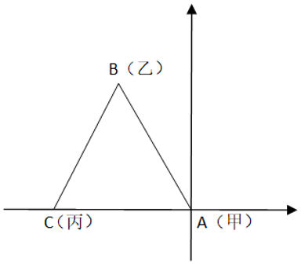

甲、乙、丙位置如图所示，根据题意可知，∠BAC=90°-30°=60°，又因AB=AC=6千米，则△ABC为等边三角形，故乙与丙之间的距离BC也为6千米。

故正确答案为D。

**考点**：几何结论类-三角形相关、几何公式类-平面图形

**来源**：2024年广东省公务员录用考试《行测》题（网友回忆版）第38题

### 第 39 题

某企业在展销会上销售甲、乙两种产品。已知甲产品的库存比乙产品多100件，展销会结束后，甲产品全部售完，乙产品售出库存的60%，两种产品共售出1260件，则甲、乙两种产品原有总库存（ ）件。

A. 1450

B. 1500

C. 1550

D. 1600

第 39 题 · 答案与解析

**参考答案（粉笔题库参考内容）**

C

**解析**

设乙产品库存为x件，则甲产品库存为（100+x）件。根据题意可得，100+x+60%x=1260，解得x=725，故甲、乙两种产品的库存分别为825件、725件，原有总库存为825+725=1550件。

故正确答案为C。

**考点**：和差倍比问题

**来源**：2024年广东省公务员录用考试《行测》题（网友回忆版）第39题

### 第 40 题

只有在星期六，小王才会去图书馆。如果某年3月小王一共有5天去过图书馆，则当年4月1日可能是（ ）。

A. 星期二

B. 星期三

C. 星期五

D. 星期六

第 40 题 · 答案与解析

**参考答案（粉笔题库参考内容）**

A

**解析**

每连续7天会出现1次星期六，则连续28天会出现4次星期六，3月共31天，根据“小王一共有5天去过图书馆”，则3月剩下的3天还会出现1次星期六。若3月29日为星期六，4月1日为星期二；若3月30日为星期六，4月1日为星期一；若3月31日为星期六，4月1日为星期日。只有A项符合。

故正确答案为A。

**考点**：星期日期问题

**来源**：2024年广东省公务员录用考试《行测》题（网友回忆版）第40题

### 第 41 题

某高校中文系计划从3名男生和3名女生中选派4名学生参加暑期支教活动。如果选派的女生不少于2名，则选派方案共有（ ）种。

A. 4

B. 8

C. 12

D. 16

第 41 题 · 答案与解析

**参考答案（粉笔题库参考内容）**

C

**解析**

要求选派的4名学生中女生不少于2名，则女生有2名或3名，对应的男生分别为2名和1名，共有C_3^2×C_3^2+C_3^3×C_3^1=12种选派方案。

故正确答案为C。

**考点**：基础排列组合

**来源**：2024年广东省公务员录用考试《行测》题（网友回忆版）第41题

### 第 42 题

甲、乙、丙3人参加专业测试，考试包含10道题，答对每题得10分，不答或答错不得分。已知每道题3人中至少有2人答对，没有人得100分且任意2人总分都不相同。则最多有（ ）道题3人都答对。

A. 3

B. 4

C. 5

D. 6

第 42 题 · 答案与解析

**参考答案（粉笔题库参考内容）**

B

**解析**

根据题意可知，要求3人都答对的题目数多，则3人都尽量多答对题目，根据“没有人得100分”，则3人中最高得分为90分即答对9题。由于任意2人总分都不相同，且使其答对题量最多，则3人分别答对9题、8题、7题，出错题量分别为1题、2题、3题，共6题出错。由于每道题3人中至少有2人答对，即每道题只有1人出错或无人出错，共出错6题无交叉，则最多有4道题3人都答对。

故正确答案为B。

**考点**：非典型最值问题

**来源**：2024年广东省公务员录用考试《行测》题（网友回忆版）第42题

### 第 43 题

某个障碍跑项目需要在100米长的跑道上布置障碍（起点和终点均不布置）。如果从起点开始，每隔4米布置一个甲障碍，每隔6米布置一个乙障碍，甲、乙障碍的重合点则不布置甲障碍。则跑道上总共布置（ ）个甲障碍。

A. 16

B. 17

C. 24

D. 25

第 43 题 · 答案与解析

**参考答案（粉笔题库参考内容）**

A

**解析**

布置甲障碍，由于起点和终点均不布置，甲障碍布置数量=100/4-1=24个。

乙障碍每隔6米布置一个，甲、乙障碍重合点每12米一个（4和6的最小公倍数）。 100/12 = 8···4，由于存在余数每段的右侧均可以布置障碍，甲、乙重合障碍取8个。

跑道上甲障碍布置数量=甲障碍布置数量-甲、乙障碍布置重合点数量=24-8=16个。

故正确答案为A。

**考点**：植树问题

**来源**：2024年广东省公务员录用考试《行测》题（网友回忆版）第43题

### 第 44 题

小李从山脚开始登顶，匀速走了1小时后到达一个凉亭，并在凉亭休息了半小时。继续走500米后，恰好完成登顶路程的一半。从山顶沿原路匀速返回时，他走了1小时又到了这个凉亭，继续走半小时回到了山脚。则登顶路程为（ ）米。

A. 2000

B. 3000

C. 3600

D. 4000

第 44 题 · 答案与解析

**参考答案（粉笔题库参考内容）**

B

**解析**

根据题意，从山脚到凉亭上山需要1个小时，从凉亭到山脚下山需要半小时，上、下山需要的时间之比为1：0.5=2：1，而路程一定，速度与时间成反比，可得上、下山的速度之比为1：2。设上山的速度为v，则下山的速度为2v。可列式为：（v+500）×2=2v×1.5，解得v=1000米/小时，则登顶的路程为2×1000×1.5=3000米。

故正确答案为B。

**考点**：普通行程

**来源**：2024年广东省公务员录用考试《行测》题（网友回忆版）第44题

### 第 45 题

某社区计划组织志愿者为社区内的独居老人提供服务。按已有志愿者的数量，如果每位志愿者服务10位老人，则有5位老人无人提供服务；如果增加2位志愿者，则每位志愿者最多服务8位老人就能为所有老人提供服务。那么该社区最多有（ ）位独居老人。

A. 50

B. 55

C. 60

D. 65

第 45 题 · 答案与解析

**参考答案（粉笔题库参考内容）**

B

**解析**

本题为余数问题，优先用代入排除法。题干所求为最多多少人，故从最大项依次代入。

D项：当独居老人为65人时，志愿者人数为（65-5）÷10=6人，按照题意增加2人后变为6+2=8人，8×8=64＜65，服务人员数＜独居老人数，排除；

C项：当独居老人为60人时，志愿者人数为（60-5）÷10=5.5人，求得人数为非整数，排除；

B项：当独居老人为55人时，志愿者人数为（55-5）÷10=5人，按照题意增加2人后变为5+2=7人，7×8=56＞55，满足题干所有条件，当选。

故正确答案为B。

**考点**：和差倍比问题

**来源**：2024年广东省公务员录用考试《行测》题（网友回忆版）第45题

### 第 46 题

下列选项中最符合所给图形规律的是（ ）。

A. A

B. B

C. C

D. D

第 46 题 · 答案与解析

**参考答案（粉笔题库参考内容）**

B

**解析**

元素组成相似，优先考虑样式规律。题干图形轮廓和分割区域相同，黑块数量不同，优先考虑黑白运算。九宫格横向看无规律，考虑纵向看，观察第一列发现，运算规律为：黑+黑=白，黑+白=黑，白+黑=黑，白+白=白；经验证，第二列符合此规律；第三列应用此规律，只有B项符合。

故正确答案为B。

**考点**：样式规律-黑白运算

**来源**：2024年广东省公务员录用考试《行测》题（网友回忆版）第46题

### 第 47 题

下列选项中最符合所给图形规律的是（ ）。

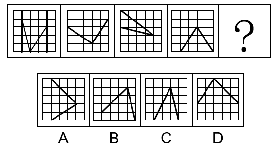

A. A

B. B

C. C

D. D

第 47 题 · 答案与解析

**参考答案（粉笔题库参考内容）**

C

**解析**

元素组成相同，但无明显位置规律，考虑数量规律。观察发现，题干图形中的两条直线共经过了8个格子，故？处应选择两条直线共经过8个格子的图形，只有C项符合。

故正确答案为C。

**考点**：数量规律-素

**来源**：2024年广东省公务员录用考试《行测》题（网友回忆版）第47题

### 第 48 题

如图所示，正方形卡片沿对角线折叠两次后得到一个三角形，沿着虚线裁剪后，再展开卡片，则展开的图形最有可能是（ ）。

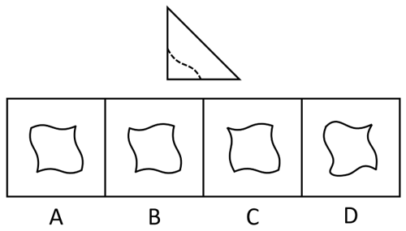

A. A

B. B

C. C

D. D

第 48 题 · 答案与解析

**参考答案（粉笔题库参考内容）**

A

**解析**

由题干可知，正方形卡片沿对角线折叠两次后依照虚线进行裁剪，裁剪后再展开的图案至少有两条相互垂直的对称轴，即该图案应为既轴对称又中心对称图形，如下图所示，只有A项符合。

故正确答案为A。

**考点**：属性规律-对称性

**来源**：2024年广东省公务员录用考试《行测》题（网友回忆版）第48题

### 第 49 题

下图为给定的立体图形，从任一角度看，下列选项最不可能是该立体图形视图的是（ ）。

A. A

B. B

C. C

D. D

第 49 题 · 答案与解析

**参考答案（粉笔题库参考内容）**

C

**解析**

本题考查三视图。如下图所示，A、B、D三项按图中箭头方向观察，均可看到。

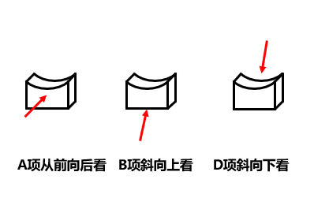

C项可按下图中箭头方向观察，但视图应如下图所示，上半部分的右侧应存在曲线，下半部分应为矩形，而非曲线图形，C项图形错误，不是该立体图形视图，当选。

本题为选非题，故正确答案为C。

**考点**：空间类-三视图

**来源**：2024年广东省公务员录用考试《行测》题（网友回忆版）第49题

### 第 50 题

下列立体图形，最不可能由两个左侧立体图形拼接成的是（ ）。

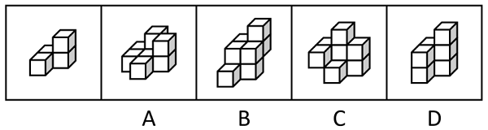

A. A

B. B

C. C

D. D

第 50 题 · 答案与解析

**参考答案（粉笔题库参考内容）**

D

**解析**

本题考查立体拼合。

A项：如下图所示，可以由两个左侧立体图形拼接成，排除；

B项：如下图所示，可以由两个左侧立体图形拼接成，排除；

C项：如下图所示，可以由两个左侧立体图形拼接成，排除；

D项：左侧立体图形为4个小方块，由两个左侧立体图形拼接成的立体图形应为8个小方块，而该项只有7个小方块，无法由两个左侧立体图形拼接成，当选。

本题为选非题，故正确答案为D。

**考点**：空间类-立体拼合

**来源**：2024年广东省公务员录用考试《行测》题（网友回忆版）第50题

### 第 51 题

如果某地不禁止在鱼类繁衍季节捕鱼，当地的鱼类资源就会枯竭。如果鱼类资源枯竭了，当地渔民的渔业生涯就会终结。只有鱼类资源良性循环，渔民的收入才能得到保障。

由此可以推出（ ）。

A. 如果某地的鱼类资源没有枯竭，那么当地渔民的收入就能得到保障

B. 如果某地禁止在鱼类繁衍季节捕鱼，那么当地渔民的收入就能得到保障

C. 如果某地渔民的渔业生涯没有终结，那么当地一定禁止在鱼类繁衍季节捕鱼

D. 如果某地渔民的收入没有得到保障，那么当地的鱼类资源一定不能良性循环

第 51 题 · 答案与解析

**参考答案（粉笔题库参考内容）**

C

**解析**

第一步：翻译题干。

（1）-禁止在鱼类繁衍季节捕鱼→鱼类资源枯竭；

（2）鱼类资源枯竭→渔民的渔业生涯终结；

（3）渔民的收入得到保障→鱼类资源良性循环（即：-鱼类资源枯竭）；

将（1）（2）串联可得（4）：-禁止在鱼类繁衍季节捕鱼→鱼类资源枯竭→渔民的渔业生涯终结；

将（3）逆否和（1）串联可得（5）：-禁止在鱼类繁衍季节捕鱼→鱼类资源枯竭→-渔民的收入得到保障。

第二步：逐一分析选项。

A项：翻译为：-鱼类资源枯竭→渔民的收入得到保障，是对（5）的否前，否前无必然结论，无法推出，排除；

B项：翻译为：禁止在鱼类繁衍季节捕鱼→渔民的收入得到保障，是对（5）的否前，否前无必然结论，无法推出，排除；

C项：翻译为：-渔民的渔业生涯终结→禁止在鱼类繁衍季节捕鱼，是对（4）的否后，否后必否前，可以推出，当选；

D项：翻译为：-渔民的收入得到保障→-鱼类资源良性循环，是对（5）的肯后，肯后无必然结论，无法推出，排除。

故正确答案为C。

**考点**：常规翻译

**来源**：2024年广东省公务员录用考试《行测》题（网友回忆版）第51题

### 第 52 题

如今，越来越多的消费者习惯在第三方平台查看商家的好评率与他人对商家的具体评价，再作出消费选择。一直以来，甲餐厅的好评率始终略高于乙餐厅，但是乙餐厅的日营业额却远远超过甲餐厅。

下列选项如果为真，最能解释这一现象的是（ ）。

A. 与乙餐厅相比，甲餐厅有更多的常客

B. 乙餐厅的人均消费金额远高于甲餐厅

C. 甲餐厅无法为消费者提供免费停车服务

D. 许多消费者在平台上表达了对乙餐厅菜品的喜爱

第 52 题 · 答案与解析

**参考答案（粉笔题库参考内容）**

B

**解析**

第一步：找出题干矛盾。

越来越多的消费者习惯查看商家的好评率再作出消费选择，一直以来，甲餐厅的好评率始终略高于乙餐厅，但是乙餐厅的日营业额却远远超过甲餐厅。

第二步：逐一分析选项。

A项：该项指出与乙餐厅相比，甲餐厅有更多的常客，甲餐厅常客多，按理说甲餐厅的日营业额应该更多，不能解释为什么乙餐厅的日营业额却远远超过甲餐厅，不能解释题干矛盾，排除；

B项：该项指出乙餐厅的人均消费金额远高于甲餐厅，日营业额=人均消费金额×日消费人次，即使甲餐厅的好评率高，但乙餐厅的平均交易单价远高于甲餐厅，人均消费金额较高可能导致乙餐厅的日营业额远远超过甲餐厅，可以解释题干矛盾，当选；

C项：该项指出甲餐厅无法为消费者提供免费停车服务，但不清楚乙餐厅是否有免费停车服务，不能解释为什么甲餐厅的好评率始终略高于乙餐厅，但是乙餐厅的日营业额却远远超过甲餐厅，不能解释题干矛盾，排除；

D项：该项指出许多消费者在平台上表达了对乙餐厅菜品的喜爱，只能说明有消费者喜欢乙餐厅，不能解释为什么甲餐厅的好评率始终略高于乙餐厅，但是乙餐厅的日营业额却远远超过甲餐厅，不能解释题干矛盾，排除。

故正确答案为B。

**考点**：原因解释

**来源**：2024年广东省公务员录用考试《行测》题（网友回忆版）第52题

### 第 53 题

过去，直播带货中虚假宣传、销售假冒伪劣产品等违法现象层出不穷。最近，针对直播“乱象”，相关部门拓宽了消费者的投诉渠道，因此，直播带货中违法现象将有所减少。

要使上述推理成立，需要补充的前提条件是（ ）。

A. 拓宽消费者投诉渠道有助于遏制直播带货中的违法现象

B. 投诉能促使直播带货平台严格把关上架产品的质量

C. 从事直播带货经营活动需要承担相应的法律责任

D. 所有消费者都能准确识别侵权行为

第 53 题 · 答案与解析

**参考答案（粉笔题库参考内容）**

A

**解析**

第一步：找出论点和论据。

论点：直播带货中违法现象将有所减少。

论据：针对直播“乱象”，相关部门拓宽了消费者的投诉渠道。

论点讨论的是“直播带货中违法现象将有所减少”，论据讨论的是“拓宽了消费者的投诉渠道”，二者话题不一致，加强优先考虑搭桥，即在“拓宽投诉渠道”与“违法现象减少”之间建立联系。

第二步：逐一分析选项。

A项：该项指出拓宽消费者投诉渠道有助于遏制直播带货中的违法现象，即在“拓宽投诉渠道”与“违法现象减少”之间建立了联系，为搭桥项，可以加强，当选；

B项：该项指出投诉能促使平台把关产品质量，而论点讨论的是“直播带货中违法现象将有所减少”，话题不一致，无法加强，排除；

C项：该项指出从事直播带货经营活动需要承担相应的法律责任，而论点讨论的是“直播带货中违法现象将有所减少”，话题不一致，无法加强，排除；

D项：该项指出所有消费者都能准确识别侵权行为，而论点讨论的是“直播带货中违法现象将有所减少”，话题不一致，无法加强，排除。

故正确答案为A。

**考点**：搭桥

**来源**：2024年广东省公务员录用考试《行测》题（网友回忆版）第53题

### 第 54 题

去年9月起，某高校图书馆开设了通宵学习室。该学习室受到许多学生的欢迎，在4个月后，由于使用人数大幅减少，图书馆关闭了通宵学习室。

以下各项如果为真，最能解释这一现象的是（ ）。

A. 许多学生认为，通宵学习不可持续

B. 通宵学习室座位少，能容纳的学生有限

C. 图书馆需要为通宵学习室配备专门的管理人员

D. 通宵学习的学生大多在备考12月的研究生入学考试

第 54 题 · 答案与解析

**参考答案（粉笔题库参考内容）**

D

**解析**

第一步：找出题干矛盾。

通宵学习室很受欢迎，但4个月后由于使用人数变少被关闭。

第二步：逐一分析选项。

A项：只能说明有的学生不认同通宵学习，但并没有说明使用通宵学习室的人数为什么4个月后大幅减少，不能解释题干矛盾，排除；

B项：通宵学习室容纳学生有限是一直存在的现象，但并没有说明通宵学习室为什么开始受欢迎但4个月后人数大幅减少，不能解释题干矛盾，排除；

C项：图书馆要配备专门的管理人员，是针对图书馆管理方面的，但并没有说明使用通宵学习室的人数为什么4个月后大幅减少，不能解释题干矛盾，排除；

D项：通宵学习的学生大多备考12月的考试，因此4个月后，大多数的学生不再需要通宵学习，因此也就很好地解释了为什么4个月后使用人数会大幅减少，可以解释题干矛盾，当选。

故正确答案为D。

**考点**：原因解释

**来源**：2024年广东省公务员录用考试《行测》题（网友回忆版）第54题

### 第 55 题

某单位派出小李、小王、小杨、小张四人参加技能比赛。小李和小王的得分之和大于小杨和小张的得分之和，小李和小张的得分之和大于小王和小杨的得分之和，小王和小张的得分之和大于小李和小杨的得分之和。

由此可以推出，四个人中得分最低的是（ ）。

A. 小李

B. 小王

C. 小杨

D. 小张

第 55 题 · 答案与解析

**参考答案（粉笔题库参考内容）**

C

**解析**

第一步：分析题干条件。

①小李+小王>小杨+小张；

②小李+小张>小王+小杨；

③小王+小张>小李+小杨。

第二步：根据题干条件进行推理。

①+②：2小李+小王+小张>2小杨+小王+小张。去掉相同项可知：2小李>2小杨，即小李>小杨；

②+③：2小张+小李+小王>2小杨+小李+小王。去掉相同项可知：2小张>2小杨，即小张>小杨；

①+③：2小王+小李+小张>2小杨+小李+小张。去掉相同项可知：2小王>2小杨，即小王>小杨。

小李、小张、小王的得分均大于小杨，即小杨得分最低。

故正确答案为C。

**考点**：框架题

**来源**：2024年广东省公务员录用考试《行测》题（网友回忆版）第55题

### 第 56 题

对于要不要读《红楼梦》，许多学者认为：读《红楼梦》有助于了解中国传统文化，因此年轻人都应该读《红楼梦》。

以下属于这一推论暗含前提的是（ ）。

A. 《红楼梦》是中国古典文学著作

B. 年轻人都应该了解中国传统文化

C. 大部分学者都读过《红楼梦》

D. 《红楼梦》与中国文化相辅相成

第 56 题 · 答案与解析

**参考答案（粉笔题库参考内容）**

B

**解析**

第一步：找出论点和论据。

论点：年轻人都应该读《红楼梦》。

论据：读《红楼梦》有助于了解中国传统文化。

本题论点讨论的是年轻人都应该读《红楼梦》，论据讨论的是读《红楼梦》有助于了解中国传统文化，二者话题不一致，且提问方式为“前提”，加强优先考虑搭桥，即在“年轻人”与“了解中国传统文化”之间建立联系。

第二步：逐一分析选项。

A项：该项指出《红楼梦》是中国古典文学著作，与论点中年轻人应该读《红楼梦》无关，话题不一致，无法加强，排除；

B项：该项指出年轻人都应该了解中国传统文化，建立了“年轻人”与“了解中国传统文化”之间的关系，为搭桥项，可以加强，保留；

C项：该项指出大部分学者都读过《红楼梦》，与论点中年轻人应该读《红楼梦》无关，话题不一致，无法加强，排除；

D项：该项指出《红楼梦》与中国文化相辅相成，能够支持读《红楼梦》的确有助于了解中国文化，补充论据，可以加强，保留。

对比B、D两项，B项的搭桥加强力度大于D项的补充论据，B项当选。

故正确答案为B。

**考点**：搭桥

**来源**：2024年广东省公务员录用考试《行测》题（网友回忆版）第56题

### 第 57 题

水火是无情的，人不是水火，所以人不是无情的。

下列选项所犯的逻辑错误与题干最相似的是（ ）。

A. 所有羊都是白色的，羊毛是白色的，所以羊毛是羊

B. 蛋糕都是圆的，蛋糕里面添加了鸡蛋，所以鸡蛋也是圆的

C. 水星是星球，水星上没有人类；地球是星球，所以地球上也没有人类

D. 所有不遵守规则的司机都会被处罚，司机小陈一直遵守规则，所以他不会被处罚

第 57 题 · 答案与解析

**参考答案（粉笔题库参考内容）**

D

**解析**

第一步：分析题干推理形式。

题干翻译为：水火→无情，人不是水火（即“否前”），所以，人不是无情的（即“否后”），逻辑结构为“否前推否后”。

第二步：逐一分析选项。

A项：选项翻译为：羊→白色，羊毛是白色的（即“肯后”），所以，羊毛是羊（即“肯前”），逻辑结构为“肯后推肯前”，所犯逻辑错误与题干不一致，排除；

B项：选项翻译为：蛋糕→圆，“蛋糕里面添加了鸡蛋”无法翻译，与题干结构不同，所犯逻辑错误与题干不一致，排除；

C项：选项翻译为：水星→星球，水星→没人类；地球→星球，所以，地球→没人类，逻辑结构为“错误类比”，所犯逻辑错误与题干不一致，排除；

D项：选项翻译为：不遵守规则的司机→被处罚，司机小陈遵守规则（即“否前”），所以，他不会被处罚（即“否后”），逻辑结构为“否前推否后”，所犯逻辑错误与题干一致，当选。

故正确答案为D。

**考点**：推理形式

**来源**：2024年广东省公务员录用考试《行测》题（网友回忆版）第57题

### 第 58 题

甲、乙、丙、丁4人每人都会演奏钢琴、小提琴、二胡和古筝4种乐器中的2种，且每种乐器都有2人会演奏。已知：

①甲不会演奏钢琴；

②丁不会演奏古筝；

③丙不会演奏钢琴和小提琴；

④乙和丙会演奏的乐器中有且仅有1种相同。

由此可以推出（ ）。

A. 甲会演奏小提琴

B. 甲不会演奏二胡

C. 乙会演奏古筝

D. 甲和丁会演奏的乐器完全不同

第 58 题 · 答案与解析

**参考答案（粉笔题库参考内容）**

A

**解析**

第一步：分析题干条件。

①甲不会演奏钢琴；

②丁不会演奏古筝；

③丙不会演奏钢琴和小提琴；

④乙和丙会演奏的乐器中有且仅有1种相同；

⑤每人都会演奏钢琴、小提琴、二胡和古筝中的2种，每种乐器都有2人会演奏。

第二步：根据题干条件进行推理。

根据条件①③可知，甲、丙不会演奏钢琴，结合条件⑤“每种乐器都有2人会演奏”可知，乙、丁会演奏钢琴。根据条件③⑤可知，丙会演奏二胡、古筝，结合条件④“乙和丙会演奏的乐器中有且仅有1种相同”可知，乙会演奏二胡或古筝，又已知乙会演奏钢琴，且每人只会演奏2种乐器，那么乙一定不会演奏小提琴，结合条件③“丙不会演奏钢琴和小提琴”，那么甲、丁会演奏小提琴。确定可推出的信息如下表所示：

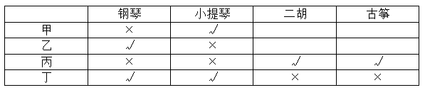

故正确答案为A。

**考点**：从确定信息开始推

**来源**：2024年广东省公务员录用考试《行测》题（网友回忆版）第58题

### 第 59 题

研究表明，购物行为能够刺激大脑的多个区域，使人们感到幸福。进一步研究发现，在别人身上花的钱占购物支出的比例越大的人，其幸福感越强；但在自己身上花钱的多少和幸福感的关系则不那么明显。有人因此认为，为了提高个人幸福感，在购物时，应该给别人花更多的钱。

下列选项如果为真，最能反驳这一结论的是（ ）。

A. 向他人推荐的商品如果受到了他人的认可，人们也会感到幸福

B. 如果为他人购买的商品没有受到他人的喜爱，容易使人变得沮丧

C. 购物带来的快乐很短暂，个人所面对的困难和压力不会因为购物而消失

D. 与他人关系好的人往往更加幸福，且更愿意在购物时为他人花更多的钱

第 59 题 · 答案与解析

**参考答案（粉笔题库参考内容）**

D

**解析**

第一步：找出论点和论据。

论点：为了提高个人幸福感，在购物时，应该给别人花更多的钱。

论据：在别人身上花的钱占购物支出的比例越大的人，其幸福感越强；但在自己身上花钱的多少和幸福感的关系则不那么明显。

本题论点、论据讨论的都是给别人花钱能够获得幸福感，二者话题一致，削弱优先考虑削弱论点。

第二步：逐一分析选项。

A项：该项说向他人推荐的商品被认可后也会感到幸福，讨论的是向他人推荐商品能否获得幸福感，而论点讨论的是购物时给别人花钱能够获得幸福感，话题不一致，无法削弱，排除；

B项：该项说如果为他人购买的商品不被喜欢，容易让人变得沮丧，说明购物时给他人花钱购买商品，不一定会获得幸福感，具有一定的削弱力度，保留；

C项：该项说个人所面对的困难和压力不会因为购物而消失，讨论的是购物能否减轻压力，而论点讨论的是购物时给别人花钱能够获得幸福感，话题不一致，无法削弱，排除；

D项：该项说与他人关系好的人“往往更加幸福”，同时也“更愿意在购物时为他人花更多的钱”，即证明“幸福”与“更愿意在购物时为他人花更多的钱”同时出现，二者是并列关系，所以彼此之间不存在因果关系，削弱论点，保留。

比较B、D两项，B项只提到了为他人购买商品的其中一种情况，不够全面，不如D项直接削弱论点，且B项的表述不如D项更贴近论点，故D项削弱力度更强。

故正确答案为D。

**考点**：削弱论点

**来源**：2024年广东省公务员录用考试《行测》题（网友回忆版）第59题

### 第 60 题

建设生态公园可以保护生态环境，保护生态环境有利于经济社会的绿色发展，所以建设生态公园有利于经济社会的绿色发展。

以下选项的逻辑结构与题干最为相似的是（ ）。

A. 诚实的人被尊敬，虚伪的人被疏远，所以，诚实的人不会被疏远

B. 运动有利于身体健康，跑步有利于身体健康，所以跑步是一种运动

C. 新能源汽车使用清洁能源，使用清洁能源是绿色环保的，所以新能源汽车是绿色环保的

D. 正直的人做的事都是合法的，不正直的人才会做不合法的事，所以，做事是否合法是判断正直与否的标准

第 60 题 · 答案与解析

**参考答案（粉笔题库参考内容）**

C

**解析**

第一步：分析题干逻辑关系。

建设生态公园（a）可以保护生态环境（b），保护生态环境（b）有利于经济社会的绿色发展（c），所以建设生态公园（a）有利于经济社会的绿色发展（c）。

题干论证结构为：a有利于b，b有利于c，所以a有利于c，根据a与b、b与c之间的关系，推断a与c之间的关系。

第二步：分析选项逻辑关系。

A项：诚实的人（a）被尊敬（b），虚伪的人（-a）被疏远（c），所以诚实的人（a）不会被疏远（-c）。论证结构为：a导致b，-a导致c，所以a导致-c，与题干推理结构不一致，排除；

B项：运动（a）有利于身体健康（b），跑步（c）有利于身体健康（b），所以跑步（c）是一种运动（a），论证结构为：a有利于b，c有利于b，所以c是a，与题干推理结构不一致，排除；

C项：新能源汽车（a）使用清洁能源（b），使用清洁能源（b）是绿色环保的（c），所以新能源汽车（a）是绿色环保的（c），论证结构为：a使用b，b是c，所以a是c，根据a与b、b与c之间的关系，推断a与c之间的关系，与题干推理结构一致，当选；

D项：正直的人（a）做的事都是合法的（b），不正直的人（-a）才会做不合法的事（-b），所以做事是否合法（b）是判断正直（a）与否的标准，论证结构为：a是b，-b是-a，所以b是判断a的标准，与题干推理结构不一致，排除。

故正确答案为C。

**考点**：论证结构

**来源**：2024年广东省公务员录用考试《行测》题（网友回忆版）第60题

### 第 61 题

有研究发现，即使经过多次清洗，塑料水壶瓶身的化学成分还是会释放到水中。而在用清洁剂清洗水壶后，不但没有解决问题，水壶内还增加了多种来自清洁剂的化学成分。有人因此认为，与金属材质水壶相比，塑料水壶更不利于人体健康。

下列选项如果为真，最能质疑上述观点的是：

A. 如果使用不当，金属材质水壶可能会生锈

B. 在多数情况下，人们不会用清洁剂清洗塑料水壶

C. 由于剂量低，这些化学成分无法对人体产生任何影响

D. 不同种类的塑料水壶，其瓶身的化学成分具有显著差异

第 61 题 · 答案与解析

**参考答案（粉笔题库参考内容）**

C

**解析**

第一步：找出论点和论据。

论点：与金属材质水壶相比，塑料水壶更不利于人体健康。

论据：即使经过多次清洗，塑料水壶瓶身的化学成分还是会释放到水中。而在用清洁剂清洗水壶后，不但没有解决问题，水壶内还增加了多种来自清洁剂的化学成分。

论点说的是塑料水壶不利于人体健康，论据说的是塑料瓶身本就含有化学成分，清洗塑料瓶的清洁剂也会在塑料瓶中残留化学成分，论点论据话题不一致，削弱优先考虑拆桥，即“塑料瓶身及清洁剂残留的化学成分”不等于“不利于人体健康”。

第二步：逐一分析选项。

A项：该项说的是金属材质的水壶，并不是论点中的塑料水壶，并且并不明确生锈是否会影响健康，话题不一致，无法削弱，排除；

B项：该项说的是人们不会用清洁剂清洗塑料水壶，但没说塑料水壶自身释放到水中的化学成分是否会影响健康，话题不一致，无法削弱，排除；

C项：该项说的是释放到水中的化学成分无法对人体产生任何影响，即断开“塑料瓶身及清洁剂残留的化学成分”与“不利于人体健康”之间的联系，说明即使存在这些化学成分，也不会不利于健康，拆桥项，可以削弱，当选；

D项：该项说的是不同塑料水壶瓶身的化学成分有差异，但没有提及这些化学成分是否影响健康，话题不一致，无法削弱，排除。

故正确答案为C。

**考点**：拆桥

**来源**：2024年广东省公务员录用考试《行测》题（网友回忆版）第61题

### 第 62 题

最近，市场上中药材的价格有所下降。据调查，中药材产量的增加是价格下降的主要原因。由于近年来中药材种植业蓬勃发展，而野生中药材的产量没有显著增加，因此中药材产量的增加主要缘于中药材种植业的蓬勃发展。

要使上述推理成立，需要补充的前提条件是：

A. 多种中药材的产量大幅增加

B. 一些消费者偏好野生中药材

C. 部分中药材已经实现规模化种植

D. 中药材只能通过种植和野外采集获得

第 62 题 · 答案与解析

**参考答案（粉笔题库参考内容）**

D

**解析**

第一步：找出论点和论据。

论点：中药材产量的增加主要缘于中药材种植业的蓬勃发展。

论据：中药材产量的增加是价格下降的主要原因。由于近年来中药材种植业蓬勃发展，而野生中药材的产量没有显著增加。

本题论点和论据均在讨论“中药材产量的增加”与“中药材种植业的蓬勃发展”之间的关系，论点论据话题一致，且提问方式为“前提”，优先考虑必要条件。

第二步：逐一分析选项。

A项：该项说的是多种中药材的产量增加，但没有说明产量增加的原因，而论点讨论的是中药材产量的增加主要缘于中药材种植业的蓬勃发展，话题不一致，无法加强，排除；

B项：该项说的是一些消费者买药材时偏好野生中药材，而论点讨论的是中药材产量的增加主要缘于中药材种植业的蓬勃发展，话题不一致，无法加强，排除；

C项：该项说的是部分中药材已经实现规模化种植，但具体产量多少并不明确，无法证明中药材产量的增加主要缘于中药材种植业的蓬勃发展，为不明确项，无法加强，排除；

D项：该项指出中药材只能通过种植和野外采集两种方式获得，因此当中药材总量增加，而野生中药材产量没有显著增加时，能够说明中药材产量的增加确实与种植中药材的产量有关，如果还有其他途径能够获得中药材，那么中药材产量的增加可能与中药材种植业的蓬勃发展无关，是论点成立的必要条件，可以加强，当选。

故正确答案为D。

**考点**：必要条件

**来源**：2024年广东省公务员录用考试《行测》题（网友回忆版）第62题

### 第 63 题

成年人读书，既可以提升专业技能，又能提升个人修养；儿童读书，不仅可以开阔视野，还能提高阅读写作能力。所以，读书没有年龄的限制，任何人读书都有好处。

以下选项的逻辑结构与题干最为相似的是（ ）。

A. 无论是一线还是二、三线城市，有人就有商机。因此，无论在哪一座城市，人口数量都是商业发展的决定性因素

B. 冬季家中的温度计，量出来的不只是室内温度，更是民生的“温度”。民众越是费心，越说明政府工作没有用心；民众越是舒心，越体现政府工作的暖心

C. 经济工作千头万绪，善于抓住并集中力量解决主要矛盾、关键问题，就能在错综复杂的局面中育新机、开新局。所以，局面越是复杂，越需要团结协力

D. 劳动者懂法，可以在个人利益受到侵犯时，运用法律武器维护自身权益；用人单位懂法，可以减少劳动纠纷，使劳动关系更加和谐。所以，懂法对劳动关系双方都是有益的

第 63 题 · 答案与解析

**参考答案（粉笔题库参考内容）**

D

**解析**

第一步：分析题干的推理结构。

题干中主要涉及到成年人读书、儿童读书与任何人读书这三部分之间的关系。具体来说，题干先指出成年人读书有好处，然后指出儿童读书有好处，这两个并列主体结合组成了任何人，因此得出结论，任何人读书有好处。简化题干的推理结构为：根据A有好处，B有好处，得出C（由AB组成）有好处。

第二步：逐一分析选项。

A项：该项涉及一线、二线、三线城市，是三个并列的主体，而题干是两个并列主体，而且也没有提及带来的好处，与题干推理结构不同，排除；

B项：该项涉及民众这一个主体，而且是通过民众的状态反映政府工作的结果，也没有提及其带来的好处，与题干推理结构不同，排除；

C项：该项在说解决经济工作的对策，而不是其好处，与题干推理结构不同，排除；

D项：该项指出劳动者懂法的好处，以及用人单位懂法的好处，这两个并列主体结合组成了劳动关系双方，因此得出结论，懂法对劳动关系双方有好处，推理结构为：根据A有好处，B有好处，得出C（由AB组成）有好处，与题干推理结构最为相似，当选。

故正确答案为D。

**考点**：论证结构

**来源**：2024年广东省公务员录用考试《行测》题（网友回忆版）第63题

### 第 64 题

某团队开展了一项关于预防中风的研究。研究对象分为两组，一组食用低钠盐（约75%的氯化钠和25%的氯化钾），一组食用普通盐（约97%的氯化钠）。在5年的跟踪调查中发现，食用低钠盐的群体，其中风发病率显著低于食用普通盐的群体。因此，减少钠的摄入有助于预防中风。

以下各项如果为真，最不能支持这一结论的是（ ）。

A. 食用低钠盐的中风患者的死亡率远低于食用普通盐的中风患者

B. 两组研究对象在性别、年龄等方面不存在明显差异

C. 研究期间，两组研究对象每日摄入的盐含量接近

D. 摄入氯化钾不会影响中风发病率

第 64 题 · 答案与解析

**参考答案（粉笔题库参考内容）**

A

**解析**

第一步：找出论点和论据。

论点：减少钠的摄入有助于预防中风。

论据：研究对象分为两组，一组食用低钠盐（约75%的氯化钠和25%的氯化钾），一组食用普通盐（约97%的氯化钠）。在5年的跟踪调查中发现，食用低钠盐的群体，其中风发病率显著低于食用普通盐的群体。

本题论点和论据讨论的都是食用钠盐和预防中风之间的关系，二者话题一致，加强优先考虑补充论据，且本题为选非题，排除能够加强的选项即可。

第二步：逐一分析选项。

A项：选项说的是得了中风之后的死亡率，而论点讨论的是预防中风，说的是中风之前，话题不一致，无法加强，当选；

B项：选项说的是两组研究对象在性别、年龄等方面不存在明显差异，排除了性别、年龄等方面对实验结果的干扰，使得实验结果更可靠，补充论据，可以加强，排除；

C项：选项说的是两组研究对象每日摄入的盐含量接近，排除了摄入的盐含量对实验结果的干扰，使得实验结果更可靠，补充论据，可以加强，排除；

D项：选项说的是摄入氯化钾不会影响中风发病率，实验中一组食用低钠盐，而低钠盐含有的25%的氯化钾，故排除了氯化钾对实验结果的干扰，使得实验结果更可靠，补充论据，可以加强，排除。

本题为选非题，故正确答案为A。

**考点**：加强选非题、加强-实验类

**来源**：2024年广东省公务员录用考试《行测》题（网友回忆版）第64题

### 第 65 题

为降低景区人流量负荷，某景区从原先的窗口售票制改为网上预约制，每个时段限量放票，游客仅可在网上预约的时段进入景区。实行网上预约制一段时间后，许多时间段里景区依然拥挤，游客的旅游体验并未得到明显改善。

以下各项如果为真，最不能解释这一现象的是（ ）。

A. 该景区各时段放票数量过多，超过了景区承载能力

B. 该景区门票预约系统操作繁琐，许多游客反映预约体验不佳

C. 该景区未规定游客离开的时间，许多游客在景区内长时间逗留

D. 游客预约的时段过于集中，一些时段人满为患、一些时段无人预约

第 65 题 · 答案与解析

**参考答案（粉笔题库参考内容）**

B

**解析**

第一步：找出题干矛盾。

某景区从原先的窗口售票制改为网上预约制，每个时段限量放票，游客仅可在网上预约的时段进入景区。但实行网上预约制一段时间后，许多时间段里景区依然拥挤，游客的旅游体验并未得到明显改善。

第二步：逐一分析选项。

A项：该景区各时段放票数量过多，超过了景区承载能力，说明各时段进入景区的游客数量均大于景区能够承载的游客数量，可以解释为什么实行了网上预约制后，景区依然拥挤，游客的旅游体验并未得到明显改善，可以解释题干矛盾，排除；

B项：该景区门票预约系统操作繁琐，游客预约体验不佳，说的是进入景区前预约操作的体验情况，无法解释为什么许多时间段里景区依然拥挤，游客的旅游体验并未得到明显改善，不能解释题干矛盾，当选；

C项：该景区未规定游客离开的时间，许多游客在景区内长时间逗留，说明会存在不同时段的游客叠加在一起，导致某时段的游客总量大于该时段的放票数量，可以解释为什么实行了网上预约制后，景区依然拥挤，游客的旅游体验并未得到明显改善，可以解释题干矛盾，排除；

D项：游客预约的时段过于集中，一些时段人满为患，说明这些时段内的游客数量确实很多，可以解释为什么实行了网上预约制后，景区依然拥挤，游客的旅游体验并未得到明显改善，可以解释题干矛盾，排除。

本题为选非题，故正确答案为B。

**考点**：原因解释

**来源**：2024年广东省公务员录用考试《行测》题（网友回忆版）第65题

### 第 66 题

有一种传统的制墨工艺：把冷碟子放在蜡烛火焰的上方，蜡烛燃烧一段时间后，冷碟子底部会有黑色物质生成，黑色物质经过进一步加工可以变成墨，则以下说法有误的是（ ）。

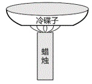

A. 所使用的蜡烛由该黑色物质和其他材料混合制成

B. 该黑色物质具有还原性

C. 冷碟子会影响蜡烛燃烧过程中氧气的补充，导致蜡烛不完全燃烧

D. 冷碟子能冷却底部的黑色物质，使其无法燃烧

第 66 题 · 答案与解析

**参考答案（粉笔题库参考内容）**

A

**解析**

蜡烛的主要成分是石蜡，石蜡包含碳元素和氢元素。若蜡烛充分燃烧，其燃烧的产物为二氧化碳和水；若蜡烛燃烧不充分，则会生成炭黑。墨的主要成分是炭黑，结合题意可知，冷碟子底部生成的黑色物质为炭黑。

A项：蜡烛中除了含有石蜡之外，还含有白油、硬脂酸、聚乙烯、香精等其他物质，具体添加何种物质，要视生产什么种类的蜡烛而定，但是蜡烛中不包含炭黑，冷碟子底部的炭黑是蜡烛发生不完全燃烧（化学反应）生成的新物质，不是蜡烛中原有的成分，错误；

B项：炭黑的主要成分是碳单质，碳单质具有还原性，因此炭黑也具有还原性，正确；

C项：冷碟子置于蜡烛的上方，而碟子底部主要与蜡烛的内焰接触，内焰被外焰包裹，与外焰相比，内焰能够接触到的氧气更少，氧气越少燃烧越不充分，最终导致蜡烛不完全燃烧，正确；

D项：燃烧需满足三个条件，有可燃物、达到可燃物的着火点、氧气，这三个条件缺一不可。冷碟子温度较低，生成的炭黑（固体）遇到冷碟子会降温，导致无法达到炭黑的着火点，因此炭黑无法燃烧，正确。

本题为选非题，故正确答案为A。

**来源**：2024年广东省公务员录用考试《行测》题（网友回忆版）第66题

### 第 67 题

根据某地等高线地形图，下列说法最不可能属实的是（ ）。

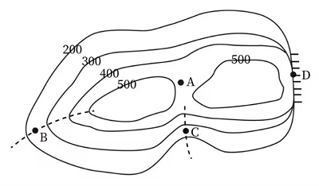

A. 图中A处是海拔400米以上露营的最佳选择地

B. 图中B处发展耕作业比发展林业更合适

C. 图中C处可能发育河流

D. 图中D处适合攀岩活动

第 67 题 · 答案与解析

**参考答案（粉笔题库参考内容）**

B

**解析**

A项：根据等高线地形图“同线等高、同图等距”的特点可知，A处的海拔高于400米，低于500米。因为A处位于等高线地形图中两座山峰之间的空白部分，所以A处是鞍部地形。鞍部通常平坦而开阔，为露营提供了良好的条件，因此A处是海拔400米以上露营的最佳选择地，正确；

B项：B处等高线向低处凸出，因此是山脊地形。山脊地形陡峭，水土容易流失，发展林业有利于水土保持，因此山脊适合发展林业。耕作业不适合在山地、丘陵和崎岖的高原发展，而适合在地势平坦、土层深厚、土壤肥沃的平原地区发展，因此B处发展林业比发展耕作业更合适，错误；

C项：C处等高线向高处凸出，是山谷地形。山谷地势较低，雨后容易积水，可能会发育成河流，正确；

D项：D处等高线重合，是陡崖地形，攀岩的对象主要是天然岩壁或人工岩壁，因此D处适合攀岩活动，正确。

本题为选非题，故正确答案为B。

**来源**：2024年广东省公务员录用考试《行测》题（网友回忆版）第67题

### 第 68 题

如图1所示，物体M在力F的作用下开始移动，其F-t图像、v-t图像如图2、图3所示，则下列说法正确的是（ ）。

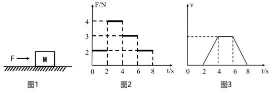

A. 在0-2s，力F对物体做正功

B. 在4-6s，物体所受的摩擦力不做功

C. 在4-6s，物体所受的合外力大于零

D. 物体所受的摩擦力在2-4s做的功与在6-8s做的功相等

第 68 题 · 答案与解析

**参考答案（粉笔题库参考内容）**

D

**解析**

A项：当力F的方向与物体位移的方向相同时，力F对物体做正功；当力F的方向与物体位移的方向相反时，力F对物体做负功；当物体在力F的作用下没有移动时，力F对物体不做功。由图3可知，物体M在0-2s内的速度始终为零，即物体始终处于静止状态，因此0-2s内力F对物体M不做功，错误；

B、C两项：由图3可知，物体M在4-6s内的速度不变，即物体M在4-6s内做匀速直线运动，处于受力平衡的状态，物体M所受的合外力为零。对物体M进行受力分析，竖直方向上，物体M受到竖直向下的重力和地面对其竖直向上的支持力，这两个力互相平衡，水平方向上，物体受到水平向右的外力F，要使物体在水平方向上也受力平衡，则物体一定受到地面对其水平向左的摩擦力，而物体向右运动，即摩擦力方向与物体运动的方向相反，因此摩擦力对物体做负功，均错误；

D项：功的大小W=Fs。由图3可知，物体M在2-4s与6-8s内的速度均大于零，可知物体受到的摩擦力均为滑动摩擦力，根据滑动摩擦力公式f = μF_N，μ由接触面的粗糙程度决定，保持不变，而F_N为物体对地面的压力，物体在水平地面上运动，则F_N等于其自身重力，也保持不变，因此物体在2-4s与6-8s受到的滑动摩擦力f保持不变。在v-t图像中，图线与横轴围成的面积代表物体的位移，由图3可知物体在2-4s与6-8s内的位移相同（两个三角形同底等高，所以面积大小相等），摩擦力f和位移均相同，因此物体所受的摩擦力在2-4s做的功与在6-8s做的功相等，正确。

故正确答案为D。

**来源**：2024年广东省公务员录用考试《行测》题（网友回忆版）第68题

### 第 69 题

某汽车设置了灯光关闭提醒系统。当汽车熄火后，开关S_1闭合。此时，若灯光未关闭，则开关S_2断开，仪表台的提示灯亮起，蜂鸣器发出警示声；若灯光关闭，则开关S_2闭合，仪表台的提示灯熄灭，蜂鸣器停止警示声。则下列选项最有可能正确反映该系统电路图的是（ ）。

A. 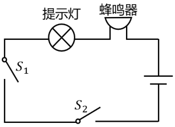

B. 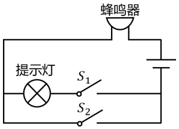

C. 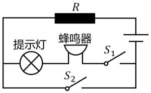

D. 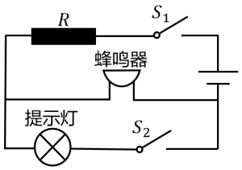

第 69 题 · 答案与解析

**参考答案（粉笔题库参考内容）**

C

**解析**

根据题意，开关S_2的断开与闭合，取决于灯光是否关闭。若灯光未关闭，则开关S_2断开；若灯光关闭，则开关S_2闭合。

A项：提示灯与蜂鸣器串联，当汽车熄火后，开关S_1闭合。此时，若灯光未关闭，则开关S_2断开，提示灯熄灭，与题意不符，错误；

B项：提示灯与蜂鸣器串联，当汽车熄火后，开关S_1闭合。此时，若灯光关闭，则开关S_2闭合，提示灯被短路，蜂鸣器发出警示声，与题意不符，错误；

C项：提示灯与蜂鸣器串联，当汽车熄火后，开关S_1闭合。此时，若灯光未关闭，则开关S_2断开，提示灯亮起，蜂鸣器发出警示声；若灯光关闭，则开关S_2闭合，提示灯和蜂鸣器均被短路，则提示灯熄灭，蜂鸣器停止警示声，与题意相符，正确；

D项：提示灯与蜂鸣器并联，当汽车熄火后，开关S_1闭合。此时，若灯光未关闭，则开关S_2断开，提示灯熄灭，与题意不符，错误。

故正确答案为C。

**来源**：2024年广东省公务员录用考试《行测》题（网友回忆版）第69题

### 第 70 题

胰岛素是一种蛋白质，可以用于治疗糖尿病。以下有关胰岛素的说法，正确的是（ ）。

A. 胰岛素能够抑制血糖分解

B. 人体中的胰岛素由肝脏分泌

C. 一般通过口服胰岛素治疗糖尿病

D. 血液中的胰岛素浓度过高会导致低血糖

第 70 题 · 答案与解析

**参考答案（粉笔题库参考内容）**

D

**解析**

胰岛素由胰腺内的胰岛细胞分泌，其主要功能是调节葡萄糖的吸收、利用和转化，促进血液中的葡萄糖转化为糖原，从而有效降低血糖浓度，而非抑制血糖分解，A、B两项均错误；胰岛素是一种蛋白质激素，口服后会被消化道中的蛋白酶水解而失去活性，可以通过皮下注射的方式使其直接进入血液循环，从而降低血糖水平，有效治疗糖尿病，C项错误；如果血液中的胰岛素浓度过高，可能会导致血液中的葡萄糖被大量合成为糖原，使得血糖水平降低，导致低血糖，D项正确。

故正确答案为D。

**来源**：2024年广东省公务员录用考试《行测》题（网友回忆版）第70题

## 材料 1

党的二十大报告强调，教育、科技、人才是全面建设社会主义现代化国家的基础性、战略性支撑。近年来，广东紧紧围绕制造业当家、聚焦高质量发展，大力实施制造业当家技能人才支撑工程，加快建设一支规模宏大的知识型、技能型、创新型技能人才队伍。2023年，全省技能人才总量达1934万人，其中高技能人才657万人。

为推动广东技工与广东制造共同成长，近年来，广东紧紧围绕壮大20个战略性产业集群，紧密对接产业升级和技术变革趋势，开展新产业工人职业技能提升工程，培育掌握新技术的产业新工匠。广东充分发挥经济大省、制造业大省的优势，将产教融合、校企合作融入技能人才培养全过程，打造了全国最大的技工教育体系。

2023年，广东共有技工院校148所，实现21个地级以上市技师学院全覆盖；在校生65万人，占全国的七分之一；面向先进制造业、战略性新兴产业、现代服务业建设233个省级重点专业和50个特色专业；与100多家世界500强企业及国内800多家大型企业开展深度合作，实现教学与企业岗位无缝对接，精准培养产业急需人才。技工院校招生人数、教研成果、技能竞赛、就业率等九项主要指标均居全国第一。

2022年世界技能大赛，广东共有11位选手代表国家参赛，获7金、1银、1铜和2个优胜奖，金牌数占全国三分之一，金牌数及奖牌数连续4届位居全国第一，展现了广东技能人才的精湛技能和职业风采。

### 第 71 题

2023年广东高技能人才是全省技能人才总量的（ ）。

A. 12%

B. 23%

C. 34%

D. 45%

第 71 题 · 答案与解析

**参考答案（粉笔题库参考内容）**

C

**解析**

根据题干“2023年······是······总量的”，结合选项为百分数，可判定本题为现期比重问题。定位文字材料第一段可知“2023年，全省技能人才总量达1934万人，其中高技能人才657万人”。根据公式：比重=部分/整体，可得所求比重为657/1934 ≈ 657/1900 = 30%^+，只有C项符合。

故正确答案为C。

**考点**：文字资料、现期比重

**来源**：2024年广东省公务员录用考试《行测》题（网友回忆版）第71题

### 第 72 题

2023年，全国技工院校在校生人数（ ）。

A. 小于400万

B. 在400万到500万之间

C. 在500万到600万之间

D. 大于600万

第 72 题 · 答案与解析

**参考答案（粉笔题库参考内容）**

B

**解析**

根据题干“2023年，全国······”，结合材料时间为2023年，且材料给出广东省数据和所占比重，可判定本题为现期比重问题。定位文字材料第三段可得：2023年广东技工院校在校生65万，占全国的七分之一。根据公式：整体=部分/比重，可得2023年全国技工院校在校生人数= 65/(1/7) = 65 × 7 = 455万，在B项范围内。

故正确答案为B。

**考点**：文字资料、现期比重

**来源**：2024年广东省公务员录用考试《行测》题（网友回忆版）第72题

### 第 73 题

关于广东技能人才培养，以下表述不准确的是（ ）。

A. 注重产教融合、校企合作

B. 实现教学与企业岗位无缝对接

C. 精准培养产业急需人才

D. 强调提升全体学生技能竞赛成绩

第 73 题 · 答案与解析

**参考答案（粉笔题库参考内容）**

D

**解析**

A项：定位文字材料第二段可得：广东充分发挥经济大省、制造业大省的优势，将产教融合、校企合作融入技能人才培养全过程，打造了全国最大的技工教育体系。说明广东技能人才培养“注重产教融合、校企合作”，正确；

B、C两项：定位文字材料第三段可得：2023年，广东与100多家世界500强企业及国内800多家大型企业开展深度合作，实现教学与企业岗位无缝对接，精准培养产业急需人才。说明广东技能人才培养“实现教学与企业岗位无缝对接”，“精准培养产业急需人才”，均正确；

D项：材料仅在第三段给出：技工院校招生人数、教研成果、技能竞赛、就业率等九项主要指标均居全国第一。无法推出广东技能人才培养“强调提升全体学生技能竞赛成绩”，错误。

本题为选非题，故正确答案为D。

**考点**：文字资料、综合分析

**来源**：2024年广东省公务员录用考试《行测》题（网友回忆版）第73题

### 第 74 题

以下不属于广东建设省级重点专业和特色专业所面向产业的是（ ）。

A. 传统手工业

B. 先进制造业

C. 战略性新兴产业

D. 现代服务业

第 74 题 · 答案与解析

**参考答案（粉笔题库参考内容）**

A

**解析**

定位文字材料第三段可得“2023年，广东面向先进制造业、战略性新兴产业、现代服务业建设233个省级重点专业和50个特色专业”，属于广东建设省级重点专业和特色专业所面向产业的有先进制造业（B项）、战略性新兴产业（C项）和现代服务业（D项）。

本题为选非题，故正确答案为A。

**考点**：文字资料、直接找数

**来源**：2024年广东省公务员录用考试《行测》题（网友回忆版）第74题

### 第 75 题

关于广东技工，以下说法有误的是（ ）。

A. 2023年，广东有全国最大的技工教育体系

B. 2023年，广东技工院校教研成果居全国第一

C. 2023年，广东技工院校与233家世界500强企业开展合作

D. 2022年世界技能大赛，广东金牌数位居全国第一

第 75 题 · 答案与解析

**参考答案（粉笔题库参考内容）**

C

**解析**

A项：定位文字材料第二段可得，近年来，广东打造了全国最大的技工教育体系，正确；

B项：定位文字材料第三段可得，2023年，广东技工院校招生人数、教研成果、技能竞赛、就业率等九项主要指标均居全国第一，正确；

C项：定位文字材料第三段可得，2023年，广东技工院校与100多个世界500强企业开展深度合作，并非233家，错误；

D项：定位文字材料第四段可得，2022年世界技能大赛，广东金牌数及奖牌数连续4届位居全国第一，正确。

本题为选非题，故正确答案为C。

**考点**：文字资料、综合分析

**来源**：2024年广东省公务员录用考试《行测》题（网友回忆版）第75题

## 材料 2

2022年，全球对外直接投资流量1.5万亿美元，比上年下降14%。其中发达经济体对外直接投资1.03万亿美元，比上年下降17.2%；发展中经济体对外直接投资4589亿美元，比上年下降5.4%。

2022年，中国对外直接投资流量1631.2亿美元，与上年历史次高值相比，下降8.8%，占全球份额的10.9%。

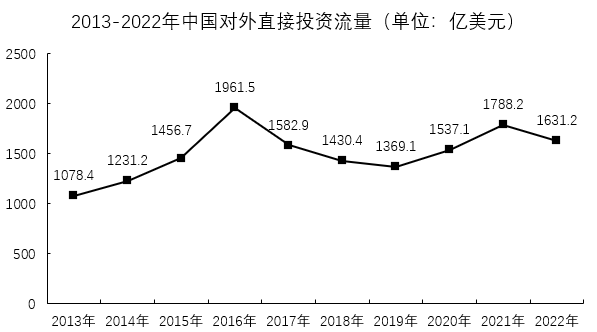

2022年，中国对外直接投资涵盖了国民经济的18个行业大类，其中流向租赁和商务服务、制造、金融、批发和零售、采矿、交通运输/仓储和邮政业的投资均超过百亿美元，租赁和商务服务业保持首位，制造业由上年第三位上升至第二位。

### 第 76 题

2013-2022年，中国对外直接投资流量年均增加约（ ）亿美元。

A. 55.3

B. 61.4

C. 67.5

D. 73.6

第 76 题 · 答案与解析

**参考答案（粉笔题库参考内容）**

B

**解析**

根据题干“2013-2022年······年均增加约······”，可判定本题为年均增长量问题。定位统计图可知2013和2022年中国对外直接投资流量分别为1078.4亿美元、1631.2亿美元。根据公式：年均增长量= (现期量-基期量)/年份差，则所求= (1631.2−1078.4)/(2022−2013)≈ 553/9 ≈ 61.4。

故正确答案为B。

**考点**：年均增长量、综合资料

**来源**：2024年广东省公务员录用考试《行测》题（网友回忆版）第76题

### 第 77 题

与2021年相比，2022年中国对外直接投资流量在全球中的占比（ ）。

A. 增加了不到3个百分点

B. 增加了超过3个百分点

C. 减少了不到3个百分点

D. 减少了超过3个百分点

第 77 题 · 答案与解析

**参考答案（粉笔题库参考内容）**

A

**解析**

根据题干“与2021年相比，2022年······在······的占比”，结合选项为“增加/减少+百分点”，可判定本题为两期比重问题。定位文字材料第一、二段可得：2022年，全球对外直接投资流量1.5万亿美元（B），比上年下降14%（b）；中国对外直接投资流量1631.2亿美元（A），下降8.8%（a），占全球份额的10.9%（A/B）。根据公式：两期比重=A/B×(a−b)/(1+a)，则题目所求为10.9% × (-8.8% - (-14%))/(1 - 8.8%)≈ 10.9% × 5.2%/0.91 ≈ 0.6%，即增加了不到3个百分点。

故正确答案为A。

**考点**：两期比重、综合资料

**来源**：2024年广东省公务员录用考试《行测》题（网友回忆版）第77题

### 第 78 题

2022年，中国国民经济的18个行业大类中有（ ）个行业的对外直接投资流量同比有所增加。

A. 4

B. 5

C. 6

D. 7

第 78 题 · 答案与解析

**参考答案（粉笔题库参考内容）**

C

**解析**

定位统计表可得，2022年中国对外直接投资流量18个行业的同比增长率。对外直接投资流量同比有所增加，即同比增长率大于0%的行业有：制造业（1.0%）、采矿业（79.5%）、交通运输/仓储和邮政业（23.0%）、电力/热力/燃气及水的生产和供应业（24.1%）、文化/体育和娱乐业（1600.0%）、教育（700.0%），共6个。

故正确答案为C。

**考点**：直接找数、综合资料

**来源**：2024年广东省公务员录用考试《行测》题（网友回忆版）第78题

### 第 79 题

2021年，中国下列行业的对外直接投资流量，从大到小排序正确的是（ ）。

A. 金融业>租赁和商务服务业>批发和零售业>制造业

B. 金融业>租赁和商务服务业>制造业>批发和零售业

C. 租赁和商务服务业>制造业>批发和零售业>金融业

D. 租赁和商务服务业>批发和零售业>制造业>金融业

第 79 题 · 答案与解析

**参考答案（粉笔题库参考内容）**

D

**解析**

根据题干“2021年······从大到小排序正确的是”，结合材料时间为2022年，可判定本题为基期比较问题。定位统计表可得2022年中国租赁和商务服务业、制造业、金融业、批发和零售业对外直接投资流量及增长率。根据公式：基期量=现期量/(1+增长率)，则2021年这四个行业对外直接投资流量分别为：

租赁和商务服务业：434.8/(1 − 11.9%) ≈ 434.8/0.88 ≈ 494亿美元；

制造业：271.5/(1+1.0%) ≈ 271.5×(1−1.0%) ≈ 269亿美元；

金融业：221.2/(1 − 17.5%) ≈ 221.2/0.83 ≈ 267亿美元；

批发和零售业：211.7/(1 − 24.8%) ≈ 211.7/0.75 ≈ 282亿美元。

对比可得，四个行业中，租赁和商务服务业对外直接投资流量最大，排除A、B两项；其次为批发和零售业，排除C项。

故正确答案为D。

**考点**：综合资料、基期比较

**来源**：2024年广东省公务员录用考试《行测》题（网友回忆版）第79题

### 第 80 题

根据资料，下列说法正确的是（ ）。

A. 截至2022年，中国对外直接投资流量最高的年份是2016年

B. 2022年，发展中经济体对外直接投资流量在全球的占比同比有所下降

C. 2018-2022年，中国对外直接投资流量累计超过了8000亿美元

D. 2021年，科学研究和技术服务业在中国对外直接投资流量中的占比超过4%

第 80 题 · 答案与解析

**参考答案（粉笔题库参考内容）**

A

**解析**

A项：定位文字材料第二段可得：2022年中国对外直接投资流量1631.2亿美元，与上年历史次高值相比，下降8.8%。则2021年中国对外直接投资流量为次高，即第二大。观察统计图可知2016年（1961.5亿美元）高于2021年（1788.2亿美元），即截至2022年，中国对外直接投资流量最高的年份是2016年，正确；

B项：定位文字材料第一段可得：2022年，全球对外直接投资流量比上年下降14%（b），其中发展中经济体对外直接投资比上年下降5.4%（a）。根据两期比重比较结论：当部分增长率（a）>整体增长率（b）时，比重上升。由于-5.4%>-14%，则2022年，发展中经济体对外直接投资流量在全球的占比同比上升，错误；

C项：定位统计图可得：2018-2022年中国对外直接投资流量分别为1430.4亿美元、1369.1亿美元、1537.1亿美元、1788.2亿美元、1631.2亿美元。则2018-2022年，中国对外直接投资流量累计为1430.4+1369.1+1537.1+1788.2+1631.2<1500+1400+1600+1800+1700=8000亿美元，错误；

D项：定位统计图可得：2021年中国对外直接投资流量为1788.2亿美元；定位统计表可得：2022年科学研究和技术服务业对外直接投资流量为48.2亿美元，同比下降4.9%。根据公式：基期量=现期量/(1+增长率)，可知2021年科学研究和技术服务业对外直接投资流量为48.2/(1-4.9%) ≈ 48.2 × (1+4.9%)≈48.2+48.2×5%=48.2+2.41=50.61亿美元。根据公式：比重=部分/整体，可知2021年，科学研究和技术服务业在中国对外直接投资流量中的占比为50.61/1788.2 = 2%^+ ＜ 4%，错误。

故正确答案为A。

**考点**：综合分析、综合资料

**来源**：2024年广东省公务员录用考试《行测》题（网友回忆版）第80题

## 材料 3

自2022年1月1日《中华人民共和国法律援助法》施行以来，我国法律援助覆盖面不断扩大、服务水平显著提升。据统计，2022年全国法律援助机构共组织办理法律援助案件137万余件，值班律师提供法律帮助95万余件，为1980万余人次提供法律咨询，提供法律咨询人次同比增加约5%。

2022年，G省法律援助机构共组织办理法律援助案件（以下简称G省法律援助案件）195779件，较2021年减少40937件，同比下降17.29%，其中刑事案件133509件（含值班律师法律帮助案件65647件），民事案件61754件，行政案件516件。帮助受援群众212993人。

| 年份 | 法律援助案件（万件） | 刑事案件（万件） | 民事案件（万件） | 行政案件（件） |
| --- | ---: | ---: | ---: | ---: |
| 2018 | 14.25 | 8.18 | 6.00 | 666 |
| 2019 | 24.05 | 17.34 | 6.63 | 831 |
| 2020 | 24.56 | 18.41 | 6.08 | 618 |
| 2021 | 23.67 | 17.66 | 5.96 | 514 |
| 2022 | 19.58 | 13.35 | 6.18 | 516 |

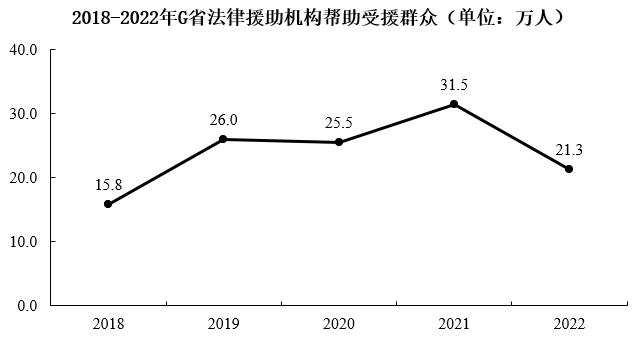

### 第 81 题

2022年，G省法律援助案件数量约占全国的（ ）。

A. 9.2%

B. 14.3%

C. 19.4%

D. 24.5%

第 81 题 · 答案与解析

**参考答案（粉笔题库参考内容）**

B

**解析**

根据题干“2022年，······占······”，结合材料时间为2022年，可判定本题为现期比重问题。定位文字材料第一、二段可得：2022年，全国法律援助案件数量为137万余件，G省法律援助案件数量为195779件。根据公式：比重=部分/整体，则2022年G省法律援助案件数量约占全国的195779/137万≈19.6/140=14%，与B项最接近。

故正确答案为B。

**考点**：现期比重、综合资料

**来源**：2024年广东省公务员录用考试《行测》题（网友回忆版）第81题

### 第 82 题

2022年，G省平均每件法律援助案件帮助受援群众（ ）。

A. 小于1.1人

B. 在1.1到1.2人之间

C. 在1.2到1.3人之间

D. 大于1.3人

第 82 题 · 答案与解析

**参考答案（粉笔题库参考内容）**

A

**解析**

根据题干“2022年······平均每······”，结合材料时间为2022年，可判定本题为现期平均数问题。定位文字材料第二段可得∶2022年，G省法律援助机构共组织办理法律援助案件（以下简称G省法律援助案件）195779件，帮助受援群众212993人。根据平均每件法律援助案件帮助受援群众人数=帮助受援群众人数/法律援助案件件数，则题干所求= 212993/195779 ≈ 212993/196000 ≈ 1.09人，在A项范围内。

故正确答案为A。

**考点**：现期平均数、综合资料

**来源**：2024年广东省公务员录用考试《行测》题（网友回忆版）第82题

### 第 83 题

2018-2022年，行政案件在G省法律援助案件中占比最高的年份是（ ）。

A. 2018年

B. 2019年

C. 2020年

D. 2021年

第 83 题 · 答案与解析

**参考答案（粉笔题库参考内容）**

A

**解析**

根据题干“2018-2022年······占比最高······”，且材料中包含2018-2022年相关数据，可判定本题为现期比重问题。定位统计表可得，2018-2021年G省行政案件分别为666件、831件、618件、514件，法律援助案件分别为14.25万件、24.05万件、24.56万件、23.67万件。根据公式：比重=部分/整体，则2018-2021年，行政案件在G省法律援助案件中占比分别为666件/14.25万件、831件/24.05万件、618件/24.56万件、514件/23.67万件，观察发现2018年分子比2020、2021年大，分母比2020、2021年小，故2018年占比大于2020、2021年，排除C、D两项。比较2018、2019年占比可得：2018年，(666件)/(14.25万件)=(666件)/(142500件)=0.4%^+，2019年，831件/24.05万件 = 831件/240500件 = 0.3%^+，故2018年行政案件在G省法律援助案件中占比最高。

故正确答案为A。

注：由于本题选项只有2018-2021年，故无需考虑2022年。

**考点**：现期比重、综合资料

**来源**：2024年广东省公务员录用考试《行测》题（网友回忆版）第83题

### 第 84 题

下列选项最有可能准确反映了2018-2022年间G省法律援助机构办理的相关案件的同比增长率的是（ ）。

A. 

B. 

C. 

D. 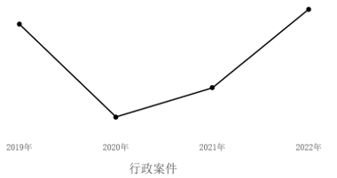

第 84 题 · 答案与解析

**参考答案（粉笔题库参考内容）**

C

**解析**

根据题干“下列选项最有可能准确反映了······2018-2022年间······同比增长率的是”，可判定本题为一般增长率问题。定位统计表可得：2018-2022年G省法律援助案件数量。根据公式：增长率= (现期量 − 基期量)/基期量，则2019-2022年，G省法律援助机构办理的相关案件的同比增长率分别为：

A项：2019年为(24.05−14.25)/14.25 ≈ 9.8/14 = 70%，2020年为(24.56 − 24.05)/24.05 ≈ 0.51/24 ≈ 2%，2021年为(23.67-24.56)/24.56 ≈ -0.89/25 ≈ -4%，2022年为(19.58 - 23.67)/23.67 ≈ -4.09/24 ≈ -17%。其中2022年的同比增长率最小，应处在最低点，排除；

B项：2019年为(17.34-8.18)/8.18 ≈ 9.16/8.2 ≈ 112%，2020年为(18.41−17.34)/17.34 ≈ 1.07/17 ≈ 6%，2021年为(17.66 − 18.41)/18.41 ≈ −0.75/18 ≈ −4%，2022年为(13.35 − 17.66)/17.66 ≈ −4.31/18 ≈ −24%。其中2019年的同比增长率最大，应处在最高点，排除；

C项：2019年为(6.63-6.00)/6.00 = 0.63/6 ≈ 11%，2020年为(6.08−6.63)/6.63 ≈ −0.55/6.6 ≈ −8%，2021年为(5.96−6.08)/6.08≈−0.12/6.1≈−2%，2022年为(6.18−5.96)/5.96≈0.22/6≈4%。其中2019年的同比增长率最大，2020年的同比增长率最小，且2019-2022年的同比增长率的变化趋势为先下降再上升，当选；

D项：2019年为(831−666)/666 ≈ 165/670 ≈ 25%，2020年为(618-831)/831 ≈ -213/830 ≈ -26%，2021年为(514−618)/618 ≈ −104/620 ≈ −17%，2022年为(516-514)/514≈2/510≈0.4%。其中2019年的同比增长率最大，应处在最高点，排除。

故正确答案为C。

**考点**：一般增长率、综合资料

**来源**：2024年广东省公务员录用考试《行测》题（网友回忆版）第84题

### 第 85 题

根据资料，下列说法正确的是（ ）。

A. 2021年，全国法律援助机构提供法律咨询超1900万人次

B. 2022年，值班律师法律帮助案件在G省法律援助刑事案件中的占比超50%

C. 2022年，全国法律援助机构值班律师提供法律帮助超100万件

D. 2018-2022年，G省法律援助机构累计帮助受援群众超110万人

第 85 题 · 答案与解析

**参考答案（粉笔题库参考内容）**

D

**解析**

A项：定位文字材料第一段可得：2022年全国法律援助机构为1980万余人次提供法律咨询，提供法律咨询人次同比增加约5%。根据公式：基期量=现期量/(1+增长率)，则2021年全国法律援助机构提供法律咨询为1980/(1 + 5%) = 1980/1.05 = 1800^+万人次，未超过1900万人次，错误；

B项：定位文字材料第二段可得：2022年，G省法律援助机构共组织办理刑事案件133509件（含值班律师法律帮助案件65647件）。根据公式：比重=部分/整体，则2022年值班律师法律帮助案件在G省法律援助刑事案件中的占比为65647/133509 ≈ 49% ＜ 50%，错误；

C项：定位文字材料第一段可得：2022年全国法律援助机构共组织办理法律援助案件137万余件，值班律师提供法律帮助95万余件。则2022年全国法律援助机构值班律师提供法律帮助未超过100万件，错误；

D项：定位折线图可得：2018-2022年，G省法律援助机构帮助受援群众分别为15.8万人、26.0万人、25.5万人、31.5万人、21.3万人。则2018-2022年G省法律援助机构累计帮助受援群众=15.8+26.0+25.5+31.5+21.3=120.1>110万人，正确。

故正确答案为D。

**考点**：综合分析、综合资料

**来源**：2024年广东省公务员录用考试《行测》题（网友回忆版）第85题

## 材料 4

2021年，各地区各部门全面落实党中央、国务院关于实现数字乡村发展战略的决策部署，积极引入社会资本投资建数字乡村。2021年全国用于县域农业农村信息化建设的社会资本投入为954.6亿元，县均社会资本投入3588.8万元、乡村人均社会资本投入135.2元，分别比上年增长17.2%和24.0%。分区域看，东部地区社会资本投入562.4亿元，占全国社会资本投入58.9%；中部地区社会资本投入193.8亿元；西部地区社会资本投入198.4亿元。

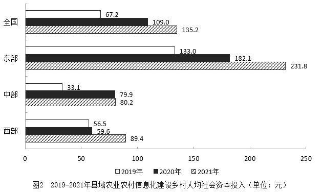

### 第 86 题

2019-2021年，全国县域农业农村信息化建设县均社会资本投入的年均增率约为（ ）。

A. 10%

B. 21%

C. 32%

D. 43%

第 86 题 · 答案与解析

**参考答案（粉笔题库参考内容）**

C

**解析**

根据题干“2019-2021年，······年均增率约为”，可判定本题为年均增长率问题。定位图1可得：2019年全国县域工业农村信息化建设县均社会资本投入为2054.6万元，2021年为3588.8万元。根据公式：(1+r)^n = 现期量/基期量，则(1+r)² = 3588.8/2054.6 ≈ 1.75，解得r ≈ 32%。

故正确答案为C。

**考点**：年均增长率、综合资料

**来源**：2024年广东省公务员录用考试《行测》题（网友回忆版）第86题

### 第 87 题

2020年，全国用于县域农业农村信息化建设的社会资本投入（ ）（假设2020年县的数量与2021年相同）。

A. 不到800亿元

B. 在800亿元到850亿元之间

C. 在850亿元到900亿元之间

D. 超过900亿元

第 87 题 · 答案与解析

**参考答案（粉笔题库参考内容）**

B

**解析**

根据题干“2020年······社会资本投入······”，结合材料给出2021年县域农业农村信息化建设的社会资本投入和2021年与2020年县均社会资本投入，可判定本题为现期平均数问题。定位文字材料可得：2021年全国用于县域农业农村信息化建设的社会资本投入为954.6亿元；县均社会资本投入3588.8万元，比上年增长17.2%。定位图1可得：2020年全国县域农业农村信息化建设县均社会资本投入为3062.3万元。根据题干可知：2020年县的数量与2021年相同，结合公式：总数=份数×平均数，则所求2020年全国用于县域农业农村信息化建设的社会资本投入=2020年县的数量×2020年县均社会资本投入=2021年县的数量×2020年县均社会资本投入。

方法一：根据公式：份数=总数/平均数，2021年县的数量= 2021年用于县域农业农村信息化建设的社会资本投入/2021年县均社会资本投入。则所求= (2021年用于县域农业农村信息化建设的社会资本投入/2021年县均社会资本投入) × 2020年县均社会资本投入= 954.6/3588.8 × 3062.3≈ 954.6 × 3062.3/3590≈954.6×85%=810^+亿元，在B项范围内。

方法二：根据公式：基期量=现期量/(1+增长率)，2020年县均社会资本投入=2021年县均社会资本投入/(1+2021年县均社会资本投入增长率)。则所求= 2021年县的数量×2021年县均社会资本投入/(1+2021年县均社会资本投入增长率)= 2021年县域农业农村信息化建设的社会资本投入/(1 + 2021年县均社会资本投入增长率)= 954.6/(1+17.2%)≈954.6/1.17=810^+亿元，在B项范围内。

故正确答案为B。

**考点**：现期平均数、综合资料

**来源**：2024年广东省公务员录用考试《行测》题（网友回忆版）第87题

### 第 88 题

2021年，东部地区县域农业农村信息化建设社会资本投入约是中、西部地区之和的（ ）倍。

A. 1.43

B. 1.64

C. 1.80

D. 1.95

第 88 题 · 答案与解析

**参考答案（粉笔题库参考内容）**

A

**解析**

根据“2021年······是······倍”，可判定本题为现期倍数问题。定位文字材料第一段可得：（2021年）分区域看，东部地区社会资本投入562.4亿元，占全国社会资本投入的58.9%；中部地区社会资本投入193.8亿元；西部地区社会资本投入198.4亿元。

方法一：根据公式：倍数=A/B，则所求= 东部/(中部 + 西部) = 562.4/(193.8 + 198.4)=562.4/392.2＜1.5倍，只有A项符合。

方法二：根据公式：部分=整体×比重，且全国社会资本投入=东部+中部+西部，则所求倍数=东部/(全国-东部)= (全国 × 东部占比)/(全国 − 全国 × 东部占比)= 东部占比/(1 − 东部占比) = 58.9%/(1 − 58.9%)=58.9%/41.1%＜1.5倍，只有A项符合。

故正确答案为A。

**考点**：现期倍数、综合资料

**来源**：2024年广东省公务员录用考试《行测》题（网友回忆版）第88题

### 第 89 题

2021年，关于县域农业农村信息化建设，下列数据同比增长率最大的是（ ）。

A. 东部地区县均社会资本投入

B. 东部地区乡村人均社会资本投入

C. 西部地区县均社会资本投入

D. 西部地区乡村人均社会资本投入

第 89 题 · 答案与解析

**参考答案（粉笔题库参考内容）**

D

**解析**

根据题干“2021年······同比增长率最大的是”，可判定本题为一般增长率问题。定位图1可得2020、2021年东部、西部地区的县均社会资本投入。定位图2可得2020、2021年东部、西部地区的乡村人均社会资本投入。根据公式：增长率= (现期量 − 基期量)/基期量，则各选项2021年同比增长率分别为：

东部地区县均社会资本投入= (7410.0 − 6129.8)/6129.8≈ 1280.2/6100 = 20%^+；

东部地区乡村人均社会资本投入=(231.8-182.1)/182.1≈ 49.7/180 = 20%+；

西部地区县均社会资本投入= (1893.1 − 1327.9)/1327.9≈ 565.2/1300 = 40%^+；

西部地区乡村人均社会资本投入= (89.4 - 59.6)/59.6 = 29.8/59.6 = 50%。

综上，同比增长率最大的是2021年西部地区乡村人均社会资本投入。

故正确答案为D。

**考点**：一般增长率、综合资料

**来源**：2024年广东省公务员录用考试《行测》题（网友回忆版）第89题

### 第 90 题

根据资料，关于县域农业农村信息化建设，以下说法正确的是（ ）。

A. 2019年，西部地区乡村人均社会资本投入低于中部地区

B. 2020年，东部地区县均社会资本投入同比增量高于中部地区

C. 2019~2021年，东部地区乡村人均社会资本投入年均增长率高于中部和西部地区

D. 2019~2021年，中部地区县均社会资本投入增速高于全国县均社会资本投入增速

第 90 题 · 答案与解析

**参考答案（粉笔题库参考内容）**

D

**解析**

A项：定位图二可得，2019年西部地区乡村人均社会资本投入为56.5元，中部地区乡村人均社会资本投入为33.1元。西部地区高于中部地区，错误。

B项：定位图一可得东部地区和中部地区2020年和2019年的县均社会资本投入，根据公式：增长量=现期量-基期量，可得：2020年东部地区县均社会资本投入同比增量为6129.8-4900.7=1229.1万元；2020年中部地区县均社会资本投入同比增量为2409.5-1150.2=1259.3万元。东部地区同比增量低于中部地区同比增量，错误。

C项：定位图二可得2019年-2021年东部、中部和西部地区的乡村人均社会资本投入。根据年均增长率公式：(1+r)^n = 现期量/基期量，因比较的都为2019-2021年，年份差n相同，故仅比较现期量/基期量的大小即可。则各地区2021年乡村人均社会资本投入/2019年乡村人均社会资本投入分别为：东部地区= 231.8/133.0 = 1^+；中部地区：80.2/33.1=2^+；西部地区=89.4/56.5=1^+。东部地区年均增长率低于中部地区年均增长率，错误。

D项：定位图一可得2019年-2021年全国和中部地区的县均社会资本投入。根据公式：增长率= (现期量 − 基期量)/基期量，可知2019年-2021年县均社会资本投入增速分别为：中部地区=(2272.0-1150.2)/1150.2≈1120/1200=90^+%；全国= (3588.8 − 2054.6)/2054.6 ≈ 1530/2100 = 70^+%，中部地区增速高于全国增速，正确。

故正确答案为D。

**考点**：综合分析、综合资料

**来源**：2024年广东省公务员录用考试《行测》题（网友回忆版）第90题

## 未自动迁移的旧版答案

旧版完整内容保留在本地候选目录中的 legacy-original.md。因题目身份未唯一确认，这些答案没有按旧题号附加到新题目。
