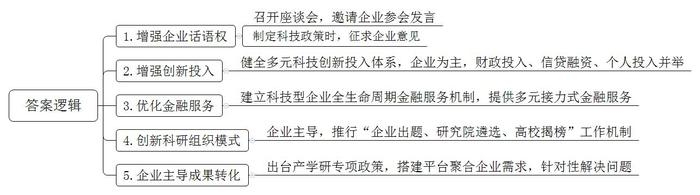
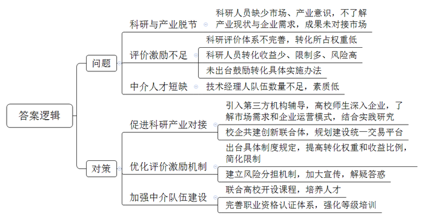
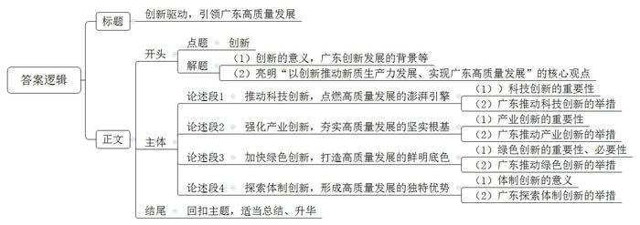

# 2025年广东省公考《申论》题（省市）

> 候选采集稿。参考答案及解析来自粉笔页面，不代表官方答案或真实高分答卷；来源使用许可与原卷对应关系仍需人工核实。

## 给定材料

### 材料 material-b2d556203e3125d7

企业是广东S市科技创新当之无愧的主体和主力军，该市近年来的一组数据足以证明：约90%的科研机构、90%的科研人员、90%的研发经费、90%的发明专利申请都来源于企业。

Y科技公司是S市人工智能大模型代表企业，AI与3D技术服务国内领先，旗下VR大空间品牌领跑行业，已落地全国30多个城市。日前，S市召开人工智能与机器人产业发展座谈会，该公司创始人受邀出席座谈会并发言，就行业发展问题谈认识、说体会、提建议。记者见到他时，他依然激动不已，“在S市，政府制定科技政策时，征求我们企业的意见已经是一个‘规定动作’。”市有关单位负责人表示，我们就是要让“听得见市场‘炮声’的人”有话语权。

近年来，S市不断健全以企业研发投入为主，财政投入、信贷融资、个人投入并举的多元化科技创新投入体系。2024年，该市全社会研发投入2236.61亿元，其中企业研发投入占比93.3%。

2025年1月，S市某新能源汽车公司举办“梦想日”活动，行业首个智电融合的智能化架构“筑梦”亮相。“最大的研发投入，最强的研发团队，才能打造最好的智能驾驶。未来，我们将响应政府号召，在研发上继续投入1000亿元，加速汽车行业智能化转型。”该公司研发部负责人说。

S市某商业银行信贷部周经理说：“我们银行助力企业研发，也尊重企业的主体地位。我们探索建立了科技型企业全生命周期金融服务机制，为企业提供多元化接力式金融服务，受到广大企业欢迎。今年以来，我们已经为上百家企业提供了研发融资。”该市的相关经验做法被新闻媒体竞相报道。

企业面向社会“发榜”，是S市近年来兴起的一种科研组织模式。该模式强调创新需求由市场提出、创新主体由市场选择、创新成果由市场验证，构建起以企业为主体的科研组织体系。该市创新研究院依靠“企业出题、研究院遴选、高校揭榜”工作机制，2024年以来共遴选出300多个企业课题与高校对接合作。该市H科技公司定期将产业发展中遇到的难题向社会发布，迄今已有数百人“揭榜”，相关问题得到了有效解决。“在科研组织工作中，S市做到了‘像尊重科学家一样尊重企业家’。”公司董事长宋先生高兴地说。

为了让创新成果更好地从科研人员的办公桌、实验室“走”向工厂车间，该市制造业重镇R镇率先出台以企业为主体的产学研专项政策，有效打通产学研融合的“最后一公里”。G公司是扎根R镇的优秀制造业企业，公司总经理余女士表示，公司是最早一批受惠于R镇产学研政策的企业，政府搭建平台聚合企业需求，科研机构、高校依托自身强大的研发能力有针对性地帮助企业解决问题。余女士说：“产学研合作，‘产’是第一位的，我们企业要掌握成果转化的主动权。”

长期研究产业发展的刘教授认为，“企业主导产学研，意味着企业主导产品研发方向，主导研发工作和产业化进程。企业是创新目标的提出者、实践者，企业主导产学研深度融合，能够产出更多适合市场需求的产品。”

### 材料 material-ae7575c768097b72

近日，G市科技局举办圆桌论坛，邀请相关领域专家学者，围绕G市“如何有效促进科研成果转化”这一主题展开讨论。以下是与会者的发言摘录。

市农科院叶研究员：我们以前曾直接找企业去做技术转化，但最后总碰到各种问题。科研人员如何了解产业现状和企业需求，成果转化如何服务产业发展，这始终是我们面对的困难和挑战。我的研究方向是发酵技术，我们把最新的发酵技术引入果蔬加工领域，开发出高活性的果蔬发酵专用益生菌剂。我们的技术已经在40多家企业推广应用，成功开发了果汁、酸奶等产品，大受欢迎。我们成功的经验，主要是科研成果和市场需求、产业发展对接上了，不少科研成果转化不顺利，就是因为没有把准企业需求，科研成果跟产业发展脱节。

市社科院廖教授：我接触过不少科研人员，他们的很多研究成果是有产业潜力和市场前景的，但没有去做转化，只是把论文发表作为第一目标。一些高校和研究机构还没有把科研成果转化纳入科研评价体系，有的虽然纳入了但权重较低，实际上还是把论文发表、课题申报作为主要评价标准。另外，据我了解，在科研成果转化中，有些单位对科研人员设置的收益比例明显过低，还附加了不少限制性条件，打击了科研人员成果转化的积极性。

报社记者张女士：科技成果转化项目应涵盖三个元素，一是学术成果质量；二是技术经理人，这个指科研成果转化的中介人员；三是企业和资本。一个项目具备这三个元素，转化成功率是比较高的。据我了解，第二个元素是成果转化链条中的短板，这支队伍数量不足、素质也不够高。科研人员创业、转化自己的科研成果，应该去找个经验丰富的技术经理人，这样可以避免再花费时间和精力去钻研一些自己不擅长、不太懂的东西，科研和转化毕竟属于不同的领域。说得大一点，就是要打通科研成果转化的通道和桥梁，培养高水平的技术经理人，搭建企业和科研机构沟通的平台。

青年学者苗博士：作为青年科研人员，我也渴望自己的研究成果能够转化为产品，既推动产业发展，自己也能获得回报和收益。但我们面对的现实问题是，评价体系主要是以学术论文、纵向科研项目为主，高校科研工作要跟着这个“指挥棒”走。我们很多老师常年埋头做研究、写论文，确实没有多少市场意识、产业意识，对产业发展方向和需求也不是很了解，如果有机构辅导一下就好了。我也看到有些成果转化失败的例子，投入的经费、智力、人力都打了水漂，我们也有一些顾虑，万一转化失败了怎么办？对我们而言，风险太大了。

某科技公司王经理：科研成果转化问题，我们企业也高度关注。企业更在意技术在产品应用中的性价比和市场前景，而不仅仅是技术的先进程度，做科研的老师应当注意这一点。高校的科研导向、评价体系确实要把成果转化、促进产业发展这个要素加进去，权重设置也要合理。可以让高校教师、研究生以科技特派员身份深入企业，了解市场需求和企业运营模式，把论文写在生产一线。

市科技局李处长：前段时间，中央、省、市先后出台了鼓励科研成果转化的政策文件，现在主要是政策落地的问题，部分高校和科研机构还没有及时出台具体实施办法。下一步，我们将加强督促和指导，推动他们及时出台相关规定。高校和科研机构要主动开展调查研究，根据最新的政策要求，结合自身实际，抓紧出台科研成果转化的具体制度规定；也要加大宣传力度，为科研人员解疑答惑，把激励机制和保障措施用活用好，消除他们的后顾之忧。我们鼓励校企共建创新联合体，也在规划建设科研成果统一交易平台，推动科研成果高效转化，更好服务产业发展。

### 材料 material-0b5b649e46e6c21b

创新是第一动力。创新才能把握时代、引领时代。习近平总书记指出：“必须继续做好创新这篇大文章，推动新质生产力加快发展。”（摘自习近平总书记在二十届中央政治局第十一次集体学习时的讲话）

2023年9月，习近平总书记在黑龙江视察时，首次提出“新质生产力”，强调“要整合科技创新资源，引领发展战略性新兴产业和未来产业，加快形成新质生产力”。

2024年1月，习近平总书记系统阐释新质生产力的概念和内涵：“新质生产力是创新起主导作用，摆脱传统经济增长方式、生产力发展路径，具有高科技、高效能、高质量特征，符合新发展理念的先进生产力质态”，“新质生产力的显著特点是创新，既包括技术和业态模式层面的创新，也包括管理和制度层面的创新”。

2024年4月，习近平总书记在重庆视察时强调：“加强重大科技攻关，强化科技创新和产业创新深度融合，积极培育新业态新模式新动能，因地制宜发展新质生产力。”

2024年7月，党的二十届三中全会召开，习近平总书记在会上强调：“注重构建支持全面创新体制机制”，“促进各类先进生产要素向发展新质生产力集聚”。

2024年12月31日，习近平总书记在新年贺词中指出：“我们因地制宜培育新质生产力，新产业新业态新模式竞相涌现，新能源汽车年产量首次突破1000万辆，集成电路、人工智能、量子通信等领域取得新成果。”

习近平总书记关于新质生产力的一系列重要论述，为我国经济社会创新发展指明了新方向、提出了新要求，各地迅速掀起发展新质生产力的热潮。

2023年4月，习近平总书记视察广东时指出，“广东是改革开放的排头兵、先行地、实验区，在中国式现代化建设的大局中地位重要、作用突出”，寄望广东“在推进中国式现代化建设中走在前列”。作为领跑全国的经济大省、制造业大省，广东的新质生产力故事备受瞩目。

2023年以来，广东已连续三年在新春首个工作日召开全省高质量发展大会。中共广东省委书记黄坤明强调，推进产业科技创新、发展新质生产力是广东的战略之举、长远之策，也必将是一场艰苦的竞速赛、耐力赛、接力赛。广东要以新的生产力理论为指导，坚持实体经济为本、制造业当家，推动产业科技互促双强，练好高质量发展的“看家本领”，挺起现代化建设的“产业脊梁”。

岭南春来早，人勤地生宝。抓住创新这个“牛鼻子”，因地制宜发展新质生产力，广东高质量发展之路走得更有奔头、更有劲头，一幅百业兴旺、春色满园的美好画卷“粤”然纸上。

## 题目

### 第 1 题

**请根据材料**4**，概括S市强化企业科技创新主体地位的主要做法。（20分****）**

关联材料：material-b2d556203e3125d7

作答要求：

要求：概括全面、准确，条理清晰。篇幅不超过200字。

### 第 2 题

**如果你是****G市科技局的工作人员，请根据材料**5**中与会者的发言摘录，梳理G市科研成果转化中存在的问题，并提出对策建议。（30分****）**

关联材料：material-ae7575c768097b72

作答要求：

要求：

（1）问题梳理全面、准确；

（2）对策建议合理、有针对性、具体明确；

（3）紧扣材料，条理清晰；

（4）篇幅不超过300字。

### 第 3 题

**习近平总书记指出，****“新质生产力的显著特点是创新****”，****“****必须继续做好创新这篇大文章****，****推动新质生产力加快发展****”。请结合给定材料，联系实际，围绕广东****“****继续做好创新这篇大文章****”进行深入思考，自拟题目，撰写一篇议论文。****（****50分****）**

关联材料：material-0b5b649e46e6c21b

作答要求：

要求：

（1）文章主题与给定材料联系紧密，观点正确，思想性强；

（2）论点鲜明，论据确凿，论证严密，逻辑性强；

（3）结构完整，条理清晰，表述准确，行文流畅；

（4）篇幅1000字左右。

## 答案与解析

第 1 题

**参考答案（粉笔题库参考内容）**

1.增强企业话语权。召开座谈会，邀请企业参会发言；制定科技政策时，征求企业意见。

2.增强创新投入。健全多元科技创新投入体系，企业为主，财政投入、信贷融资、个人投入并举。

3.优化金融服务。建立科技型企业全生命周期金融服务机制，提供多元接力式金融服务。

4.创新科研组织模式。企业主导，推行“企业出题、研究院遴选、高校揭榜”工作机制。

5.企业主导成果转化。出台产学研专项政策，搭建平台聚合企业需求，针对性解决问题。

**解析**

**参考答案说明**：本参考答案从“增强企业话语权”“增强创新投入”“优化金融服务”“创新科研组织模式”“企业主导成果转化”这五个方面给出了做法，各条答案要点之间在内容上互相并列，没有交叉。

**考点**：考点概括措施类

**来源**：来源2025年广东省公考《申论》题（省市）

粉笔申论页面对本题只提供「解析视频」入口，该入口是会员推广位，页面无视频地址与文字解析。

第 2 题

**参考答案（粉笔题库参考内容）**

问题：1.科研与产业脱节。科研人员缺少市场、产业意识，不了解产业现状与企业需求，成果未对接市场。2.评价激励不足。科研评价体系不完善，转化所占权重低；科研人员转化收益少、限制多、风险高；未出台鼓励转化具体实施办法。3.中介人才短缺。技术经理人队伍数量不足，素质低。

对策：1.促进科研产业对接。引入第三方机构辅导，高校师生深入企业，了解市场需求和企业运营模式，结合实践研究；校企共建创新联合体，规划建设统一交易平台。2.优化评价激励机制。出台具体制度规定，提高转化权重和收益比例，简化限制；建立风险分担机制，加大宣传，解疑答惑。3.加强中介队伍建设。联合高校开设课程，培养人才；完善职业资格认证体系，强化等级培训。

**解析**

**参考答案说明：**本参考答案分为“问题”和“对策”两个部分。其中，“问题”部分从“科研与产业脱节”“评价激励不足”“中介人才短缺”三个方面进行了分条撰写；“对策”部分针对问题，从“促进科研产业对接”“优化评级激励机制”“加强中介队伍建设”三个方面提出了解决办法。各条要点之间在内容上相互并列，没有交叉。

**考点**：考点提出对策类

**来源**：来源2025年广东省公考《申论》题（省市）

粉笔申论页面对本题只提供「解析视频」入口，该入口是会员推广位，页面无视频地址与文字解析。

第 3 题

**参考答案（粉笔题库参考内容）**

**创新驱动，引领广东高质量发展**

习近平总书记强调，“必须继续做好创新这篇大文章，推动新质生产力加快发展”。创新才能把握时代、引领时代。在时代发展的浪潮中，广东作为改革开放的排头兵、先行地，一直勇立潮头。如今，做好创新这篇大文章，加快形成新质生产力，更是广东实现高质量发展，在推进中国式现代化建设中走在前列的关键所在。

**推动科技创新，点燃高质量发展的澎湃引擎。**科技创新能够催生新产业、新模式、新动能，是高质量发展的核心驱动力。广东以极具前瞻性的战略眼光，持续加大科研投入，加快构建全过程创新链，以科创平台为支撑，加快实现高水平科技自立自强。政府通过完善实验室体系、落地重大科技基础设施，在战略必争领域实现并跑领跑；从产业需求出发，聚焦实体经济，推动制造业智能化转型发展；瞄准“卡脖子”的技术难题，努力打好关键核心技术攻关战，促进科研成果转化实现“加速跑”。

**强化产业创新，夯实高质量发展的坚实根基。**产业体系向新图强，发展才能以质取胜。广东通过技术赋能，推动传统产业转型升级。依靠完整的产业链和强大的品牌阵营，广东称霸智能手机领域；借助“5G+工业互联网”叠加倍增效应，佛山再造了制造新优势。在新兴产业培育上，广东聚焦细分产业，精准发力。低空经济、智能机器人、新能源等发展势头迅猛，不断取得新突破。此外，广东超前布局未来产业，打造具有国际竞争力的现代化产业体系。

**加快绿色创新，打造高质量发展的鲜明底色。**新质生产力本身就是绿色生产力。过去，粗放型的发展方式支撑了经济的高速增长，但也带来了资源浪费、生态破坏、环境污染等严重问题。为实现经济的可持续发展，必须促进全面绿色转型，形成具有竞争力的绿色生产力。从深圳龙岗能源生态园到惠州积极探索红树林碳汇交易，再到阳江新技术海上风电跨越式发展，广东的绿色产业优势正源源不断转化为高质量发展优势。

**探索体制创新，形成高质量发展的独特优势。**近年来，广东不断健全因地制宜发展新质生产力体制机制，引导各类优质要素集聚，为高质量发展营造了良好的环境。政府出台一系列创新政策，打通堵点卡点，不仅带动了区域间协调发展，同时推动了上下游企业协同合作，形成了强大竞争优势。比如，重大合作平台体系框架的完善推动了粤港澳大湾区等区域合作共赢，“百千万工程”的深入推进促进了城乡协调发展等。不断完善发展新质生产力体制机制，是高质量发展的必由之路，也是广东的使命担当。

珠江潮涌千帆竞，南粤风来万象新，鹏城奋翼九万里，粤海弄潮第一声。且看湾区逐浪处，以创新为笔，正挥毫泼墨，续写南粤高质量发展的锦绣华章！

**解析**

**文章分析**

**创新驱动，引领广东高质量发展**

【**标题的优点：**首先，范文的标题突出了“以‘创新’推动新质生产力发展，实现广东高质量发展”这一主题。其次，形式上，文字简洁明快。】

习近平总书记强调，“必须继续做好创新这篇大文章，推动新质生产力加快发展”。（1）创新才能把握时代、引领时代。在时代发展的浪潮中，广东作为改革开放的排头兵、先行地，一直勇立潮头。如今，（2）做好创新这篇大文章，加快形成新质生产力，更是广东实现高质量发展，在推进中国式现代化建设中走在前列的关键所在。

【**开头的优点：**★内容方面：范文的开头是紧扣“以‘创新’推动新质生产力发展，实现广东高质量发展”这一主题展开的。首先指出了创新发展的时代背景；其次指出了如何做好创新，实现高质量发展。★文字表达方面：长短句配合使用，使语言表达有节奏感。】

**推动科技创新，点燃高质量发展的澎湃引擎。**（1）科技创新能够催生新产业、新模式、新动能，是高质量发展的核心驱动力。（2）广东以极具前瞻性的战略眼光，持续加大科研投入，加快构建全过程创新链，以科创平台为支撑，加快实现高水平科技自立自强。政府通过完善实验室体系、落地重大科技基础设施，在战略必争领域实现并跑领跑；从产业需求出发，聚焦实体经济，推动制造业智能化转型发展；瞄准“卡脖子”的技术难题，努力打好关键核心技术攻关战，促进科研成果转化实现“加速跑”。

【**论述段****1的优点：**★观点句：范文的观点句是紧扣“以‘创新’推动新质生产力发展，实现广东高质量发展”这一主题提出的。形式上，它在段首处直接写出，位置突出，容易发现。内容上，关键词突出，内容要点明确，可以明显看出它是围绕“利用数智技术，构建现代化产业体系”的展开。★论述内容：（1）科技创新的重要性；（2）广东推动科技创新的举措。注意：以上几个方面的内容都是紧扣“推动科技创新，点燃高质量发展的澎湃引擎”这个观点句论述的，论述的针对性强，内容层次丰富。在论述方法上采用了讲道理、举例子相结合，做到了丰富多样。】

**强化产业创新，夯实高质量发展的坚实根基。**（1）产业体系向新图强，发展才能以质取胜。（2）广东通过技术赋能，推动传统产业转型升级。依靠完整的产业链和强大的品牌阵营，广东称霸智能手机领域；借助“5G+工业互联网”叠加倍增效应，佛山再造了制造新优势。在新兴产业培育上，广东聚焦细分产业，精准发力。低空经济、智能机器人、新能源等发展势头迅猛，不断取得新突破。此外，广东超前布局未来产业，打造具有国际竞争力的现代化产业体系。

【**论述段****2****的优点：**★观点句：范文的观点句是紧扣“以‘创新’推动新质生产力发展，实现广东高质量发展”这一主题提出的。形式上，它在段首处直接写出，位置突出，容易发现。内容上，关键词突出，内容要点明确，可以明显看出它是围绕“利用数智技术，构建现代化产业体系”的展开。★论述内容：（1）产业创新的重要性；（2）广东如何推动产业创新的举措。注意：以上几个方面的内容都是紧扣“强化产业创新，夯实高质量发展的坚实根基”这个观点句论述的，论述的针对性强，内容层次丰富。在论述方法上采用了讲道理、举例子相结合，做到了丰富多样。】

**加快绿色创新，打造高质量发展的鲜明底色。**（1）新质生产力本身就是绿色生产力。过去，粗放型的发展方式支撑了经济的高速增长，但也带来了资源浪费、生态破坏、环境污染等严重问题。为实现经济的可持续发展，必须促进全面绿色转型，形成具有竞争力的绿色生产力。（2）从深圳龙岗能源生态园到惠州积极探索红树林碳汇交易，再到阳江新技术海上风电跨越式发展，广东的绿色产业优势正源源不断转化为高质量发展优势。

【**论述段****3****的优点：**★观点句：范文的观点句是紧扣“以‘创新’推动新质生产力发展，实现广东高质量发展”这一主题提出的。形式上，它在段首处直接写出，位置突出，容易发现。内容上，关键词突出，内容要点明确，可以明显看出它是围绕“利用数智技术，构建现代化产业体系”的展开。★论述内容：（1）绿色创新的重要性、必要性；（2）广东推动绿色创新的举措。注意：以上几个方面的内容都是紧扣“加快绿色创新，打造高质量发展的鲜明底色”这个观点句论述的，论述的针对性强，内容层次丰富。在论述方法上采用了讲道理、举例子相结合，做到了丰富多样。】

**探索体制创新，形成高质量发展的独特优势。**近年来，（1）广东不断健全因地制宜发展新质生产力体制机制，引导各类优质要素集聚，为高质量发展营造了良好的环境。（2）政府出台一系列创新政策，打通堵点卡点，不仅带动了区域间协调发展，同时推动了上下游企业协同合作，形成了强大竞争优势。比如，重大合作平台体系框架的完善推动了粤港澳大湾区等区域合作共赢，“百千万工程”的深入推进促进了城乡协调发展等。不断完善发展新质生产力体制机制，是高质量发展的必由之路，也是广东的使命担当。

【**论述段****4****的优点：**★观点句：范文的观点句是紧扣“以‘创新’推动新质生产力发展，实现广东高质量发展”这一主题提出的。形式上，它在段首处直接写出，位置突出，容易发现。内容上，关键词突出，内容要点明确，可以明显看出它是围绕“利用数智技术，构建现代化产业体系”的展开。★论述内容：（1）体制创新的意义；（2）广东探索体制创新的举措。注意：以上几个方面的内容都是紧扣“探索体制创新，形成高质量发展的独特优势”这个观点句论述的，论述的针对性强，内容层次丰富。在论述方法上采用了讲道理、举例子相结合，做到了丰富多样。】

珠江潮涌千帆竞，南粤风来万象新，鹏城奋翼九万里，粤海弄潮第一声。且看湾区逐浪处，以创新为笔，正挥毫泼墨，续写南粤高质量发展的锦绣华章！

【**结尾的优点：**范文的结尾回扣了“以‘创新’推动新质生产力发展，实现广东高质量发展”这一主题，并且进行了总结提升。】

**考点**：考点文章写作题

**来源**：来源2025年广东省公考《申论》题（省市）

粉笔申论页面对本题只提供「解析视频」入口，该入口是会员推广位，页面无视频地址与文字解析。

