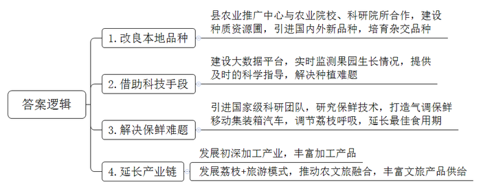
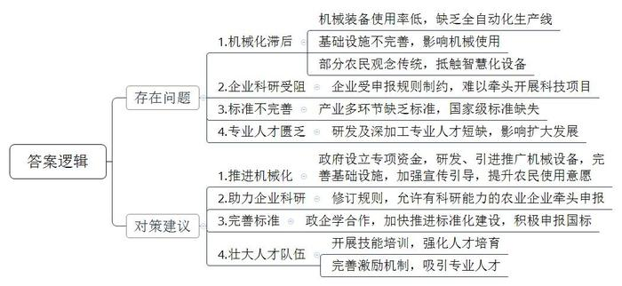
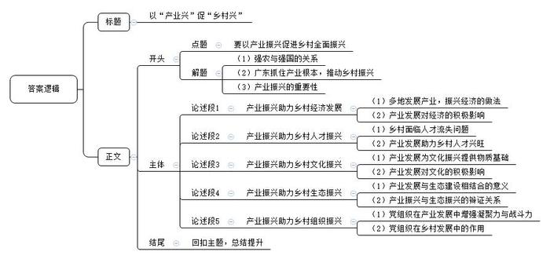

# 2025年广东省公考《申论》题（县镇）

<!-- gwy:overview:start -->
> **广东 · 2025 · 申论 · 县镇** ｜ 3 题 · 图片 3 处 · 答案随题折叠

导航：[题目](#题目) · [材料 1](#材料-1)
<!-- gwy:overview:end -->

> 候选采集稿。参考答案及解析来自粉笔页面，不代表官方答案或真实高分答卷；来源使用许可与原卷对应关系仍需人工核实。

## 给定材料

### 材料 1

广东荔枝种植历史悠久，种植面积全国第一，是省内品种特色最鲜明、区域优势最明显的水果。近年来，A县深挖荔枝历史文化底蕴，着力做好“土特产”文章，把荔枝“小特产”做成“大产业”，以产业振兴促进乡村全面振兴。2024年，A县荔枝产量达16万吨，农民收益同比增长9%。让荔农困扰的是，荔枝有“大小年”，产量不稳定。荔枝出现“大小年”的一个原因与品种有关，像桂味、糯米糍等品种就容易出现“大小年”。还有一些品种核大肉少，不太受市场欢迎。

“近几年，我们一直在改良品种上下功夫。县农业推广中心和农业院校、科研院所合作培育新品种，引进荔枝新品种对本地品种进行改良。”A县农业推广中心吕主任介绍说。

目前，A县荔枝种质资源圃汇集了国内外荔枝种质资源700多份、3500多株，是全省最大的荔枝种质资源圃，这里培育了上百棵白糖罂与禾虾串、桂味等品种杂交的荔枝，这些杂交后的果树，易成花，坐果率高，是没有“大小年”的优质品种。2024年，A县荔枝种植面积有59万亩，其中34万亩种植的是经过改良的品种。改良品种不仅在产量上比老品种高，经济价值也比老品种高，而且更受欢迎。

在县农业农村事务中心，“荔枝产业大数据平台”正在实时监测着荔枝主产区6个乡镇的荔枝果园生长情况，一屏展示实时土壤温湿度、荔枝长势及虫害等数据。平台上，荔农还可在线向荔枝专家请教种植难题。荔枝园里，荔农收到平台发出的相关提示和预警后，就能第一时间利用智能浇灌系统实现精准浇水，或利用无人机及时开展虫害防治。即时的监测数据和及时的科学指导，让荔枝长势更好，味道更甜，为荔枝种植增添了更多“科技”含量。

“若离本枝，一日而色变，二日而香变，三日而味变，四五日外，色香味尽去矣。”保鲜难题一直是荔枝产业发展的痛点。

过去，即便有冷库保鲜，但荔枝从离开枝头的那一刻鲜度便开始降低。现在有了荔枝气调保鲜移动集装箱汽车就不一样了。“集装箱内温度控制在4摄氏度，并通过光触媒和空调微风调节荔枝的呼吸，延长了最佳食用期，解决了荔枝保鲜‘最先一公里’的难题。”吕主任介绍道，“从广东运输到新疆，我们的荔枝都还是新鲜的。”

2024年，当地还引进国家级科研团队，开展植物源保鲜技术、物理源保鲜技术和微生物源保鲜技术等方面的研究，实现荔枝保鲜技术新突破。“新技术让荔枝的保鲜期延长了很多，荔枝贮存20天后好果率仍可达到99.8%。我们的荔枝销路更广、品质更好，价格也提高了30%以上。”吕主任说。

新鲜荔枝只能卖三个多月，剩下八九个月，就必须在荔枝的附加值上要效益。因此，要做大荔枝产业，就不能只卖鲜果。

这些年来，A县也一直发展荔枝的初加工以及深加工产业。在A县某龙眼荔枝专业合作社的一楼展厅里，游客们正兴致盎然地挑选着荔枝蜜、荔枝酒、荔枝醋等各类荔枝加工产品。此时，二楼的加工车间一片繁忙，筛选机一边旋转，一边将尺寸不同的荔枝干果分到不同的包装箱里。目前，合作社荔枝、龙眼等农产品年加工产值高达1亿元，带动就业3000多人，村民人均年收入突破5万元。

夜幕降临，走进A县桥头村荔枝主题夜市，只见荔枝咖啡、荔枝饼、荔枝冰淇淋、荔枝文创帆布袋等特色商品琳琅满目。这里每周五、六晚上开市，设有美食区和娱乐区，吸引了不少游客，也让村民茶余饭后有了好去处。

除荔枝主题夜市外，桥头村荔枝种植园也迎来一批批游客。以10公里的荔乡景观大道为主轴，桥头村连片打造独具岭南文化特色的荔乡风情园。随着荔枝花开，一批批“赏花叹蜜”的游客前来打卡。

发展特色产业是实现乡村振兴的一条重要途径。2024年，到A县旅游的游客达200多万人次，依托荔枝这一独具特色的农产品，A县积极发展“荔枝+旅游”模式，加大农业与文旅融合的步伐，丰富文旅产品供给，蓬勃乡村业态，实现“产业兴”“百姓富”。

### 材料 2

科技是第一生产力。乡村要振兴，必须坚持科技兴农，大力发展农业新质生产力，加快农业农村现代化步伐。近年来，G市坚持把农业科技创新摆在突出位置，依托广东雄厚的科技创新基础，不断提升农业科技实力，为农业高质量发展提供更加强劲的动能。

为深入了解全市科技赋能农业产业建设情况，G市农业部门、科技部门和有关农业科技专家组成调研组开展专题调研，以下是调研有关情况。

（一）

柚子及其深加工产业是G市农业主导产业之一。2024年G市L县柚子年产量占全省总产量约20%，是全省第二大柚类生产基地。该县绿柚农业科技公司是全市柚子加工龙头企业，公司开发的柚子精油、柚子饮料等产品市场销售良好。据公司负责人刘经理反映，因为柚子加工部分关键装备缺乏，柚子加工能力还有一定的提升空间。目前柚子加工前处理主要依靠人工剥皮，缺乏柚子深加工前油胞层、柚皮、柚肉、柚核自动分解处理技术设备，无法形成全自动化“前处理-提取-精深加工”机械化生产线。柚子深加工有一定专业性，但这方面的人才还比较欠缺，影响了公司的扩大生产。

刘经理还介绍了企业科技研发情况。该公司目前建立了生产研发实验室，2024年，他们想牵头联合上下游企业共同申报市“揭榜挂帅”科技攻关项目和乡村振兴战略专项资金，开展柚子深加工前处理技术设备的创新和研制工作，但相关申报规定，项目牵头申报单位必须是本地科研院所、高等院校和事业单位。事实上，当地不少企业都有一定的科研能力，也有开展农业科技的创新热情，希望能够有机会发挥自己的能力，为农业科技发展贡献力量，但很多时候却不知道怎么参与，或者被排除在外了。

（二）

D县素有“粤东竹海”之称，全县毛竹林面积约15万亩。近年来，D县成功申报创建毛竹省级现代农业产业园，逐步发展竹制品深加工、竹林观光旅游等，着力推动一二三产业融合发展。

当地规模较大的竹子种植和加工企业兴盛竹制品厂负责人李先生反映，竹子寿命只有5年，越砍伐长得越茂盛，如果不及时砍伐，竹子也会自然干枯死亡，从而影响周边竹子的生长。之前砍伐竹子的经济收益不高，大家不愿意过多投入管理，所以当前许多竹林都是“天生天养”，而且上山缺乏平缓的道路，仅有农户自己用锄头辟出的林间小道，上下山通行不便，影响了机械的使用。

市农机专家谢教授指出，李先生道出了当前许多企业共同面临的困境。有关调查结果显示，目前全市各产区竹子仍以人工砍伐为主，缺乏机械设备的投入使用，伐竹效率低，砍伐后的竹子只能用木板手推车运送下山。建议市里加强竹子、茶叶、柚子等这类产业的机械化、智能化设备研发和引进推广，将人们的双手解放出来，以科技创新赋能农业产业高质量发展。

D县还是传统产茶区。随着茶叶出口总值与价格持续攀升，D县积极推动智慧茶园建设，一些规模较大的茶园，已率先利用农业物联网传感器等设备，对喷灌系统进行智能管控，提高水肥的利用效率，提升了茶叶的品质和产量。

但在一些专业合作社、乡村茶园，茶农对参与智慧茶园建设的热情和意愿并不高，甚至为了智能炒茶设备争吵了起来。他们虽然有着强烈的增产增收愿望，但在传统观念里，手工炒茶更香，更能卖个好价钱。有的茶农直截了当地说：“我不想学它（机器）怎么用，它会把茶叶破坏掉的。”“我都这样干了一辈子了，相信机器不如相信自己的手艺。”

深入调研了解到，不仅仅是茶农，G市其他农业产业的不少农民都存在类似情况。这些农民大多数年纪偏大，受教育程度偏低，主要依靠个人经验开展劳作。

（三）

南药产业是近年G市大力发展的特色中药产业。在有“南药之乡”之称的G市，仅H县南药产业园就带动当地800多家农户增收。

虽然H县南药具有良好的产业发展基础，但产业发展仍面临一些困难。康药合作社负责人蔡先生反映，开发南药离不开药理作用研究，提升南药价值离不开增加南药的科学内涵，目前相关领域缺乏标准化，已成为制约H县南药产业进一步发展的重要因素。

G市南药研究中心的专家老林反映，基于药理研究的南药开发包括南药的传统功效和药化特征、开展其提取物或化学成分的药效学研究等，这些都需要标准支撑。近年来，G市积极开展南药标准化立项，支持企业、科研机构开展南药标准化研究，推动了部分南药的标准化研究，但成果不多，仅有市级地方标准2项、团体标准8项。像岗梅、猴耳环、金毛狗脊、黑老虎等20多种在当地有一定种植规模的特色中药材，在种苗培育、药材性状、活性成分、炮制加工等方面还没制定出相关标准，尤其是没有建立国家级标准，影响了南药的开发和市场进一步推广。G市虽然有中医药大学、南药研究中心、医学院等，但研究力量总体不足，这就需要政府、企业和学界加强合作，加快推进标准化建设。

随着南药产业规模进一步扩大，当地人才稀缺的问题也被放大。当地多家企业反映，随着中药现代化的推进，中药研发和创新成为关键，需要更多具备现代药物研发知识和技术的中医药人才。南药的深加工同样需要相应的技术人才，特别是提取技术、炮制工艺等方面的人才很难招到。

### 材料 3

党的二十大在擘画全面建成社会主义现代化强国宏伟蓝图时，对农业农村工作进行了总体部署。概括地讲：未来5年“三农”工作要全面推进乡村振兴，到2035年基本实现农业现代化，到本世纪中叶建成农业强国。这是党中央着眼全面建成社会主义现代化强国作出的战略部署。强国必先强农，农强方能国强。没有农业强国就没有整个现代化强国；没有农业农村现代化，社会主义现代化就是不全面的。

《中共中央 国务院关于进一步深化农村改革 扎实推进乡村全面振兴的意见》（2025年1月1日）指出，“实现中国式现代化，必须加快推进乡村全面振兴。”

乡村振兴关键在产业振兴，习近平总书记指出，“产业兴旺，是解决农村一切问题的前提”，要“紧紧围绕发展现代农业，围绕农村一二三产业融合发展，构建乡村产业体系，实现产业兴旺”，强调“产业振兴是乡村振兴的重中之重，也是实际工作的切入点。没有产业的农村，难聚人气，更谈不上留住人才，农民增收路子拓不宽，文化活动很难开展起来”。

“产业兴旺、生态宜居、乡风文明、治理有效、生活富裕”是实施乡村振兴战略的总要求，乡村振兴是包括产业振兴、人才振兴、文化振兴、生态振兴、组织振兴的全面振兴，其中最重要、最根本、最关键的是产业振兴。

2025年2月，广东全省高质量发展大会提出，奋力在建设现代化产业体系等方面继续走在全国前列。产业体系向新图强，发展才能以质取胜，这是广东的必由之路、光明大道。要以新的生产力理论为指导，坚持实体经济为本、制造业当家，推动产业科技互促双强，练好高质量发展的“看家本领”，挺起现代化建设的“产业脊梁”。在此次大会“兴产业、强县域、促协调，全力推动‘百千万工程’三年初见成效”平行论坛上，与会人员一致认为，2025年是“百县千镇万村高质量发展工程”（以下简称“百千万工程”）三年初见成效的关键之年，要始终抓住产业这个高质量发展的根本，为县镇村高质量发展打牢基础、激发活力，努力促进全省城乡区域融合发展，确保广东高质量发展步子更稳、成色更足。

## 题目

### 第 1 题

**请根据材料**3**，概括A县做好荔枝“土特产”文章的主要做法。（20分）**

关联材料：材料 1

作答要求：

要求：概括全面、准确，条理清晰，篇幅不超过200字。

第 1 题 · 答案与解析

**参考答案（粉笔题库参考内容）**

1.改良本地品种。县农业推广中心与农业院校、科研院所合作，建设种质资源圃，引进国内外新品种，培育杂交品种。

2.借助科技手段。建设大数据平台，实时监测果园生长情况，提供及时的科学指导，解决种植难题。

3.解决保鲜难题。引进国家级科研团队，研究保鲜技术，打造气调保鲜移动集装箱汽车，调节荔枝呼吸，延长最佳食用期。

4.延长产业链。发展初深加工产业，丰富加工产品；发展荔枝+旅游模式，推动农文旅融合，丰富文旅产品供给。

**解析**

**参考答案说明**：本参考答案从“改良本地品种”“借助科技手段”“解决保鲜难题”“延长产业链”这四个方面展开，各条答案要点之间在内容上相互并列，没有交叉。

**考点**：概括措施类

**来源**：2025年广东省公考《申论》题（县镇）

粉笔申论页面对本题只提供「解析视频」入口，该入口是会员推广位，页面无视频地址与文字解析。

### 第 2 题

**G市专题调研组准备提交一份关于全市“科技赋能农业产业建设情况”的调研报告。如果你是调研组成员，请根据材料**4**，拟写报告中“存在问题”和“对策建议”两部分的主要内容。（30分）**

关联材料：材料 2

作答要求：

要求：

（1）问题梳理全面、准确；

（2）对策建议合理、有针对性、具体明确；

（3）紧扣材料，条理清晰；

（4）篇幅不超过300字。

第 2 题 · 答案与解析

**参考答案（粉笔题库参考内容）**

存在问题：1.机械化滞后。机械装备使用率低，缺乏全自动化生产线；基础设施不完善，影响机械使用；部分农民观念传统，抵触智慧化设备。2.企业科研受阻。企业受申报规则制约，难以牵头开展科技项目。3.标准不完善。产业多环节缺乏标准，国家级标准缺失。4.专业人才匮乏。研发及深加工专业人才短缺，影响扩大发展。

对策建议：1.推进机械化。政府设立专项资金，研发、引进推广机械设备，完善基础设施，加强宣传引导，提升农民使用意愿。2.助力企业科研。修订规则，允许有科研能力的农业企业牵头申报。3.完善标准。政企学合作，加快推进标准化建设，积极申报国标。4.壮大人才队伍。开展技能培训，强化人才培育；完善激励机制，吸引专业人才。

**解析**

**参考答案说明：**本参考答案包括“存在问题”和“对策建议”两个部分，其中“存在问题”部分从“机械化滞后”“企业科研受阻”“标准不完善”“专业人才匮乏”四个方面展开；“对策建议”部分从“推进机械化”“助力企业科研”“完善标准”“壮大人才队伍”四个方面展开，且和问题相对应。各条答案要点之间在内容上相互并列，没有交叉。

**考点**：提出对策类

**来源**：2025年广东省公考《申论》题（县镇）

粉笔申论页面对本题只提供「解析视频」入口，该入口是会员推广位，页面无视频地址与文字解析。

### 第 3 题

**广东聚焦实施****“百县千镇万村高质量发展工程”，始终抓住产业这个高质量发展的根本，推动乡村全面振兴。请结合给定材料，联系实际，围绕“乡村振兴关键在产业振兴”进行深入思考，自拟题目，撰写一篇议论文。（50分）**

关联材料：材料 3

作答要求：

要求：

（1）文章主题与给定材料联系紧密，观点正确，思想深刻；

（2）论点鲜明，论据确凿，论证严密，逻辑性强；

（3）结构完整，条理清晰，表述准确，行文流畅；

（4）篇幅在800-1000字。

第 3 题 · 答案与解析

**参考答案（粉笔题库参考内容）**

**以****“产业兴”促“乡村兴”**

强国必先强农，农强方能国强。广东聚焦实施“百千万工程”，牢牢抓住产业这个“牛鼻子”，为乡村全面振兴注入强劲动力。实践证明，产业振兴是乡村振兴的重中之重，也是实际工作的切入点，要以产业振兴促进乡村全面振兴。

**产业振兴助力乡村经济发展。**产业是经济发展的核心引擎。A县深挖本地文化资源，把荔枝“小特产”做成“大产业”；D县打造现代农业产业园，推动三产融合发展；G市坚持科技兴农，助力农业高质量发展……产业的蓬勃发展，拓宽了农民增收渠道，壮大了村集体经济，为乡村经济腾飞插上翅膀。

**产业振兴助力乡村人才振兴。**人气因产业而聚，人才因产业而兴。随着工业化和城镇化进程的不断加快，乡村人口流失问题严重，“空心村”成为了制约乡村全面振兴的“老大难”。而产业发展创造了更多的就业岗位及创新创业的机会，在激活本地的人才资源的同时，也吸引了更多年轻人才回归乡村，推动了乡村的人才振兴。

**产业振兴助力乡村文化振兴。**产业发展为文化振兴提供物质基础。产业的发展带动村民及村集体收入的增加，让村民对高质量精神文化生活的需求更加强烈，同时也为乡村公共文化设施的建设、改造，多元化文体活动的组织提供了资金基础。产业振兴能够充分激活乡村文化，丰富当地百姓的精神文化生活，进而创造出更多经济价值。

**产业振兴助力乡村生态振兴。**产业发展与生态建设相结合，能够实现生态与经济的双赢。生态设施的完善、环境的修复与保护，都离不开大量资金的投入，这就需要以产业振兴为依托。而良好的生态环境也会进一步助力当地的经济发展，创造更多的发展机会，从而吸引当地主动投入资金，推动生态振兴，实现经济与生态的正向循环。

**产业振兴助力乡村组织振兴。**产业发展需要党组织的引领与推动，党组织在产业发展中也能不断增强凝聚力与战斗力。比如沙尾村推行“党组织+头雁、基地、合作社、能人、农户、市场”的发展模式，既带动了村民增收，也壮大了村集体经济。在增收致富的过程中，党组织的领导核心作用得到充分体现，构建出更加高效且充满活力的乡村治理新体系。

民族要复兴，乡村必振兴。以产业振兴为抓手，推动乡村经济、人才、文化、生态、组织全面振兴，广东乡村必将绘就乡村全面振兴壮美画卷！

**解析**

**文章分析**

**以****“产业兴”促“乡村兴”**

【**标题的优点：**标题中含有主题词，使文章主题更突出、清晰。】

（1）强国必先强农，农强方能国强。（2）广东聚焦实施“百千万工程”，牢牢抓住产业这个“牛鼻子”，为乡村全面振兴注入强劲动力。（3）实践证明，产业振兴是乡村振兴的重中之重，也是实际工作的切入点，要以产业振兴促进乡村全面振兴。

【**开头的优点：**★内容方面。范文的开头是紧扣“以产业振兴促进乡村振兴”这一主题展开的。首先，开头点出主题，做到了主题明确。其次，对“以产业振兴促进乡村振兴”这一主题进行了分析阐述，指出了：（1）强农与强国的关系；（2）广东抓住产业根本，推动乡村振兴；（3）产业振兴的重要性。★文字表达方面。长短句配合使用，使语言表达有节奏感。】

**产业振兴助力乡村经济发展。**（1）产业是经济发展的核心引擎。A县深挖本地文化资源，把荔枝“小特产”做成“大产业”；D县打造现代农业产业园，推动三产融合发展；G市坚持科技兴农，助力农业高质量发展……（2）产业的蓬勃发展，拓宽了农民增收渠道，壮大了村集体经济，为乡村经济腾飞插上翅膀。

【**论述段****1的优点：**★观点句：范文的观点句是紧扣“以产业振兴促进乡村振兴”这一文章主题提出的。形式上，它在段首处直接写出，位置突出，容易发现。内容上，关键词突出，内容要点明确，可以明显看出主要从“助力经济发展”的角度展开论述。★论述内容：（1）多地发展产业，振兴经济的做法；（2）产业发展对经济的积极影响。注意：以上两个方面的内容都是紧扣“产业振兴助力乡村经济发展”这个观点句进行分析论述的，论述的针对性强，内容层次丰富。在论述方法上采用了讲道理与举例子相结合的方式，论述充实清晰。】

**产业振兴助力乡村人才振兴。**（1）人气因产业而聚，人才因产业而兴。随着工业化和城镇化进程的不断加快，乡村人口流失问题严重，“空心村”成为了制约乡村全面振兴的“老大难”。（2）而产业发展创造了更多的就业岗位及创新创业的机会，在激活本地的人才资源的同时，也吸引了更多年轻人才回归乡村，推动了乡村的人才振兴。

【**论述段****2的优点：**★观点句：范文的观点句是紧扣“以产业振兴促进乡村振兴”这一文章主题提出的。形式上，它在段首处直接写出，位置突出，容易发现。内容上，关键词突出，内容要点明确，可以明显看出主要从“助力人才振兴”的角度展开论述。★论述内容：（1）乡村面临人才流失问题；（2）产业发展助力乡村人才兴旺。注意：以上两个方面的内容都是紧扣“产业振兴助力乡村人才振兴”这个观点句进行分析论述的，论述的针对性强，内容层次丰富。在论述方法上主要采用了讲道理的方式，论述清晰流畅。】

**产业振兴助力乡村文化振兴。**（1）产业发展为文化振兴提供物质基础。产业的发展带动村民及村集体收入的增加，让村民对高质量精神文化生活的需求更加强烈，同时也为乡村公共文化设施的建设、改造，多元化文体活动的组织提供了资金基础。（2）产业振兴能够充分激活乡村文化，丰富当地百姓的精神文化生活，进而创造出更多经济价值。

【**论述段****3的优点：**★观点句：范文的观点句是紧扣“以产业振兴促进乡村振兴”这一文章主题提出的。形式上，它在段首处直接写出，位置突出，容易发现。内容上，关键词突出，内容要点明确，可以明显看出主要从“助力文化振兴”的角度展开论述。★论述内容：（1）产业发展为文化振兴提供物质基础；（2）产业发展对文化的积极影响。注意：以上两个方面的内容都是紧扣“产业振兴助力乡村文化振兴”这个观点句进行分析论述的，论述的针对性强，内容层次丰富。在论述方法上主要采用了讲道理的方式，论述清晰透彻。】

**产业振兴助力乡村生态振兴。**（1）产业发展与生态建设相结合，能够实现生态与经济的双赢。（2）生态设施的完善、环境的修复与保护，都离不开大量资金的投入，这就需要以产业振兴为依托。而良好的生态环境也会进一步助力当地的经济发展，创造更多的发展机会，从而吸引当地主动投入资金，推动生态振兴，实现经济与生态的正向循环。

【**论述段****4的优点：**★观点句：范文的观点句是紧扣“以产业振兴促进乡村振兴”这一文章主题提出的。形式上，它在段首处直接写出，位置突出，容易发现。内容上，关键词突出，内容要点明确，可以明显看出主要从“助力生态振兴”的角度展开论述。★论述内容：（1）产业发展与生态建设相结合的意义；（2）产业振兴与生态振兴的辩证关系。注意：以上两个方面的内容都是紧扣“产业振兴助力乡村生态振兴”这个观点句进行分析论述的，论述的针对性强，内容层次丰富。在论述方法上主要采用了讲道理的方式，论述深刻清晰。】

**产业振兴助力乡村组织振兴。**（1）产业发展需要党组织的引领与推动，党组织在产业发展中也能不断增强凝聚力与战斗力。（2）比如沙尾村推行“党组织+头雁、基地、合作社、能人、农户、市场”的发展模式，既带动了村民增收，也壮大了村集体经济。在增收致富的过程中，党组织的领导核心作用得到充分体现，构建出更加高效且充满活力的乡村治理新体系。

【**论述段****5的优点：**★观点句：范文的观点句是紧扣“以产业振兴促进乡村振兴”这一文章主题提出的。形式上，它在段首处直接写出，位置突出，容易发现。内容上，关键词突出，内容要点明确，可以明显看出主要从“助力组织振兴”的角度展开论述。★论述内容：（1）党组织在产业发展中增强凝聚力与战斗力；（2）党组织在乡村发展中的作用。注意：以上两个方面的内容都是紧扣“产业振兴助力乡村组织振兴”这个观点句进行分析论述的，论述的针对性强，内容层次丰富。在论述方法上采用了讲道理与举例子相结合的方式，论述充实到位。】

【**论述段之间的关系：**★内容的内在逻辑：范文的论述段之间是依照“并列”的逻辑展开的。论述段1先写了“产业振兴助力乡村经济发展”，论述段2再写了“产业振兴助力乡村人才振兴”，论述段3接着写了“产业振兴助力乡村文化振兴”，论述段4又写了“产业振兴助力乡村生态振兴”，论述段5最后写了“产业振兴助力乡村组织振兴”，文章整体论述逻辑清晰。】

民族要复兴，乡村必振兴。以产业振兴为抓手，推动乡村经济、人才、文化、生态、组织全面振兴，广东乡村必将绘就乡村全面振兴壮美画卷！

【**结尾的优点：**范文的结尾回扣了“以产业振兴促进乡村振兴”这个主题，并且进行了总结提升。】

**考点**：文章写作题

**来源**：2025年广东省公考《申论》题（县镇）

粉笔申论页面对本题只提供「解析视频」入口，该入口是会员推广位，页面无视频地址与文字解析。

