# 2025年广东省公务员录用考试《行测》题（网友回忆版）

<!-- gwy:overview:start -->
> **广东 · 2025 · 行测 · 统考** ｜ 90 题 · 图片 22 处 · 答案随题折叠

| 题型模块 | 题量 | 题号 |
| --- | ---: | ---: |
| 政治理论 | 10 | 1–10 |
| 常识判断 | 5 | 11–15 |
| 言语理解与表达 | 15 | 16–30 |
| 数量关系 | 15 | 31–45 |
| 判断推理 | 20 | 46–65 |
| 科学推理 | 5 | 66–70 |
| 资料分析 | 20 | 71–90 |
| **合计** | **90** | |

导航：[题型与作答说明](#题型与作答说明) · [题目](#题目) · [材料 1](#材料-1)
<!-- gwy:overview:end -->

> 候选采集稿。参考答案及解析来自粉笔页面，不代表官方答案或真实高分答卷；来源使用许可与原卷对应关系仍需人工核实。

## 题型与作答说明

政治理论

（10题）

根据题目要求，在四个选项中选出一个最恰当的答案。

常识判断

（5题）

根据题目要求，在四个选项中选出一个最恰当的答案。

言语理解与表达

（15题）

本部分包括表达与理解两方面的内容。请根据题目要求，在四个选项中选出一个最恰当的答案。

数量关系

（15题）

本部分包括数字推理和数学运算两部分，每道题呈现一段表述数字关系的文字，要求你迅速、准确地计算出答案。

判断推理

（20题）

本部分包括图形推理与逻辑判断两种类型的试题，在四个选项中选出一个最恰当的答案。

科学推理

（5题）

每道题给出文字或图表信息，要求你在此基础上，用基本科学知识进行推理判断，从4个备选项中选出最合理的1项。

资料分析

（20题）

所给出的图、表、文字或综合性资料均有若干个问题要你回答。你应根据资料提供的信息进行分析、比较、计算和判断处理。

## 题目

### 第 1 题

习近平文化思想是坚持“两个结合”、推进马克思主义文化理论创新的重大成果，其中“第二个结合”是指把马克思主义基本原理同中华优秀传统文化相结合。（ ）

A. 正确

B. 错误

第 1 题 · 答案与解析

**参考答案（粉笔题库参考内容）**

A

**解析**

本题考查理论与政策。

2021年7月1日，在庆祝中国共产党成立100周年大会上，习近平总书记首次正式提出“两个结合”重大论断，即“坚持把马克思主义基本原理同中国具体实际相结合，同中华优秀传统文化相结合”。2025年1月3日，人民日报刊文《深入把握习近平文化思想的核心要义及其内在逻辑》，文中指出，习近平文化思想是新时代党领导文化建设实践经验的理论总结，是坚持“两个结合”、推进马克思主义文化理论创新的重大成果，标志着我们党对社会主义文化建设规律的认识达到了新高度，表明我们党的历史自信、文化自信达到了新高度，为做好新时代新征程宣传思想文化工作、担负起新时代的文化使命提供了强大思想武器和科学行动指南。“第二个结合”即“把马克思主义基本原理同中华优秀传统文化相结合”。

故表述正确。

**考点**：文化建设、重要会议讲话

**来源**：2025年广东省公务员录用考试《行测》题（网友回忆版）第1题

### 第 2 题

科技创新能够催生新产业、新模式、新动能，是发展新质生产力的核心要素。（ ）

A. 正确

B. 错误

第 2 题 · 答案与解析

**参考答案（粉笔题库参考内容）**

A

**解析**

本题考查理论与政策。

习近平总书记在二十届中央政治局第十一次集体学习时强调，科技创新能够催生新产业、新模式、新动能，是发展新质生产力的核心要素；必须继续做好创新这篇大文章，推动新质生产力加快发展。

故表述正确。

**考点**：经济建设、重要会议讲话

**来源**：2025年广东省公务员录用考试《行测》题（网友回忆版）第2题

### 第 3 题

国家安全是中国式现代化行稳致远的重要基础。（ ）

A. 正确

B. 错误

第 3 题 · 答案与解析

**参考答案（粉笔题库参考内容）**

A

**解析**

本题考查理论与政策。

党的二十届三中全会通过《中共中央关于进一步全面深化改革 推进中国式现代化的决定》（简称《决定》）。《决定》在“十三、推进国家安全体系和能力现代化”部分指出：“国家安全是中国式现代化行稳致远的重要基础。必须全面贯彻总体国家安全观，完善维护国家安全体制机制，实现高质量发展和高水平安全良性互动，切实保障国家长治久安。”

故表述正确。

**考点**：其他建设、重要文件

**来源**：2025年广东省公务员录用考试《行测》题（网友回忆版）第3题

### 第 4 题

科学性是马克思主义理论区别于其他理论的根本特征。（ ）

A. 正确

B. 错误

第 4 题 · 答案与解析

**参考答案（粉笔题库参考内容）**

B

**解析**

本题考查马克思主义。

马克思主义理论具有科学性、实践性、革命性、人民性、发展性等特征。其中，实践性是马克思主义理论区别于其他理论的显著特征。马克思主义诞生于实践，在实践中不断丰富和发展，其全部理论都来源于实践，又经过实践的反复检验，并用于指导实践。

故表述错误。

**考点**：总论

**来源**：2025年广东省公务员录用考试《行测》题（网友回忆版）第4题

### 第 5 题

古人说：“志之所趋，无远勿届，穷山距海，不能限也。志之所向，无坚不入，锐兵精甲，不能御也。”下列好干部的标准与这一古语的意思最为接近的是（ ）。

A. 敢于担当

B. 勤政务实

C. 清正廉洁

D. 信念坚定

第 5 题 · 答案与解析

**参考答案（粉笔题库参考内容）**

D

**解析**

本题考查理论与政策。

“志之所趋，无远勿届，穷山距海，不能限也。志之所向，无坚不入，锐兵精甲，不能御也。”出自清代的《格言联璧》。意思是志向所趋，没有不能达到的地方，即使是山海尽头，也不能限制；意志所向，没有不能攻破的壁垒，即使是精兵坚甲，也不能抵抗。强调志向的坚定和不可阻挡，只要有坚定的志向，就没有克服不了的困难和到达不了的目标。

A项错误，敢于担当强调好干部在面对困难和挑战时勇于承担责任，不推诿、不退缩，敢于迎难而上。

B项错误，勤政务实强调好干部要勤奋工作，务实做事，注重实际效果，不搞形式主义，不做表面文章。

C项错误，清正廉洁强调好干部要廉洁自律，不贪污腐败，保持清正廉洁的作风，做到公私分明，廉洁奉公。

D项正确，信念坚定强调好干部必须坚定共产主义理想信念，对党忠诚，坚定不移地贯彻执行党的路线方针政策。

故正确答案为D。

**考点**：其他建设

**来源**：2025年广东省公务员录用考试《行测》题（网友回忆版）第5题

### 第 6 题

“我们要坚持对马克思主义的坚定信仰、对中国特色社会主义的坚定信念，坚定道路自信、理论自信、制度自信、文化自信，以更加积极的历史担当和创造精神为发展马克思主义作出新的贡献，既不能刻舟求剑、封闭僵化，也不能照抄照搬、食洋不化。”这段话最能体现习近平新时代中国特色社会主义思想（ ）的立场观点方法。

A. 必须坚持问题导向

B. 必须坚持守正创新

C. 必须坚持自信自立

D. 必须坚持胸怀天下

第 6 题 · 答案与解析

**参考答案（粉笔题库参考内容）**

C

**解析**

本题考查理论与政策。

A项错误，党的二十大报告指出：“必须坚持问题导向。问题是时代的声音，回答并指导解决问题是理论的根本任务。今天我们所面临问题的复杂程度、解决问题的艰巨程度明显加大，给理论创新提出了全新要求。”

B项错误，党的二十大报告指出：“必须坚持守正创新。我们从事的是前无古人的伟大事业，守正才能不迷失方向、不犯颠覆性错误，创新才能把握时代、引领时代。”

C项正确，党的二十大报告指出：“必须坚持自信自立······我们要坚持对马克思主义的坚定信仰、对中国特色社会主义的坚定信念，坚定道路自信、理论自信、制度自信、文化自信，以更加积极的历史担当和创造精神为发展马克思主义作出新的贡献，既不能刻舟求剑、封闭僵化，也不能照抄照搬、食洋不化。”

D项错误，党的二十大报告指出：“必须坚持胸怀天下。中国共产党是为中国人民谋幸福、为中华民族谋复兴的党，也是为人类谋进步、为世界谋大同的党。”

故正确答案为C。

**考点**：新思想总论、重要会议讲话

**来源**：2025年广东省公务员录用考试《行测》题（网友回忆版）第6题

### 第 7 题

习近平指出，法律是成文的道德，道德是内心的法律。法治和德治不可分离、不可偏废，国家治理需要法律和道德协同发力。下列关于思想道德和法律的认识不正确的是（ ）。

A. 思想道德和法律都是上层建筑的重要组成部分

B. 思想道德建设为法治建设提供思想指引和价值基础

C. 思想道德是调节人们思想的重要手段，但法律不是

D. 法治建设为思想道德建设提供制度支撑和法律保障

第 7 题 · 答案与解析

**参考答案（粉笔题库参考内容）**

C

**解析**

本题考查毛中特。

A项正确，上层建筑是建立在一定经济基础之上的意识形态以及与之相应的制度、组织和设施。思想道德和法律都是上层建筑的重要组成部分，共同服务于一定的经济基础。

B、D两项正确，在我国，社会主义思想道德建设和法治建设紧密联系、相互补充、相互促进，为党和国家事业提供坚实的思想基础、精神支撑和制度保障。一方面，思想道德建设为法治建设提供思想指引和价值基础。另一方面，法治建设为思想道德建设提供制度支撑和法律保障，法律通过对思想道德的基本原则予以确认，为思想道德建设提供国家强制力保障。

C项错误，思想道德和法律都是调节人们思想行为、协调人际关系、维护社会秩序的重要手段。它们相互补充、相互促进,为党和国家事业提供坚实的思想基础、精神支撑和制度保障。

本题为选非题，故正确答案为C。

**来源**：2025年广东省公务员录用考试《行测》题（网友回忆版）第7题

### 第 8 题

坚持以人民为中心的发展思想，体现了党的理想信念、性质宗旨、初心使命，也是对党的奋斗历程和实践经验的深刻总结。领导人在不同场合多次强调，必须坚持人民至上。以下选项最能体现必须坚持人民至上这一理念的是（ ）。

A. 能用众力，则无敌于天下矣；能用众智，则无畏于圣人矣

B. 与天下同利者，天下持之；擅天下之利者，天下谋之

C. 贤良之士众，则国家之治厚；贤良之士寡，则国家之治薄

D. 畏则不敢肆而德以成，无畏则从其所欲而及于祸

第 8 题 · 答案与解析

**参考答案（粉笔题库参考内容）**

B

**解析**

本题考查理论与政策。

A项错误，“能用众力，则无敌于天下矣；能用众智，则无畏于圣人矣”在2022年第20期《求是》杂志发表习主席重要文章《坚持人民至上》中引用，语出陈寿《三国志》，意思是如果能够充分发挥和凝聚众人的力量与智慧，就可以所向无敌、无所畏惧。党一路走来，紧紧依靠人民交出了优秀的历史答卷。面向未来，仍然要依靠人民创造新的历史伟业。我们要坚持人民民主，更好把人民的智慧和力量凝聚到党和人民事业中来。这体现的是人民群众的团结所带来的伟大力量。而题干中“党的理想信念、性质宗旨、初心使命”侧重强调党的最高理想和最终目标是实现共产主义，必须全心全意为人民服务，故该项不是最符合题意的。

B项正确，“与天下同利者，天下持之；擅天下之利者，天下谋之”在2022年第20期《求是》杂志发表习主席重要文章《坚持人民至上》中引用，语出《管子》，意思是与天下人利益一致的，人民就拥护支持他；独揽天下利益的，人民就谋划对付他。习主席引用此句旨在强调，我们党没有自己特殊的利益，党在任何时候都把群众利益放在第一位。这是我们党作为马克思主义政党区别于其他政党的显著标志。自成立以来，我们党团结带领人民进行革命、建设、改革，根本目的就是为了让人民过上好日子，无论面临多大挑战和压力，无论付出多大牺牲和代价，这一点都始终不渝、毫不动摇。这与题干中的“党的理想信念、性质宗旨、初心使命”是对应的。

C项错误，“贤良之士众，则国家之治厚；贤良之士寡，则国家之治薄”在2020年第15期《求是》杂志发表习主席重要文章《贯彻落实新时代党的组织路线 不断把党建设得更加坚强有力》中引用。语出《墨子·尚贤上》，意思是说，国家拥有的贤士良才多了，国家治理就会坚实；反之，贤士良才少了，国家治理就会薄弱。习主席引用词句旨在强调，要把党的各级领导班子和干部队伍建设好、建设强，选干部、用人才要注重德才兼备。

D项错误，“畏则不敢肆而德以成，无畏则从其所欲而及于祸”出自明代·吕坤《呻吟语》。其含义为心中有所敬畏，言行不敢放纵，才能养成美好的德行操守。反之，心中无戒惧，就会肆意妄为，招致祸端。旨在强调领导干部务必常存敬畏之心，敬畏党、敬畏人民、敬畏法纪，敬畏历史、敬畏文化、敬畏生态，涵养如临深渊、如履薄冰的谨慎与警觉，慎重决策、慎重用权，方能行稳致远。

故正确答案为B。

**考点**：社会建设

**来源**：2025年广东省公务员录用考试《行测》题（网友回忆版）第8题

### 第 9 题

习近平总书记说，一百年来，中国共产党团结带领中国人民，以“为有牺牲多壮志，敢教日月换新天”的大无畏气概，书写了中华民族几千年历史上最恢宏的史诗。以下有关党的奋斗历程的表述符合历史事实的有（ ）。

A. 中国早期马克思主义思想运动，没有明确的与第二国际的社会民主主义划清界线

B. 第一次国共合作发生在新民主主义革命时期

C. 在社会主义建设时期，中共中央制定了“三步走”现代化发展战略

D. 党在社会主义初级阶段的基本路线的核心内容是“一个中心、两个基本点”

第 9 题 · 答案与解析

**参考答案（粉笔题库参考内容）**

BD

**解析**

本题考查理论与政策。

A项错误，第一次党的全国代表大会确定党的名称为“中国共产党”。党的纲领是“以无产阶级革命军队推翻资产阶级”“采用无产阶级专政，以达到阶级斗争的目的——消灭阶级”“废除资本私有制”，以及联合第三国际。这表明，中国共产党从建党一开始就旗帜鲜明地把社会主义和共产主义规定为自己的奋斗目标，并且坚持用革命的手段来实现这个目标，从而同崇拜资产阶级民主制度、主张走议会道路的第二国际社会民主主义划清了原则界限。

B项正确，新民主主义革命时期是从1919年五四运动到1949年新中国成立。第一次国共合作发生在1924年至1927年，期间共产党和国民党合作进行了北伐战争等，推动了反帝反封建的革命运动，属于新民主主义革命时期。

C项错误，1949年10月1日新中国成立到十一届三中全会，是社会主义革命和建设时期；1978年十一届三中全会到2012年的中共十八大，是改革开放和社会主义现代化建设新时期。1987年，中共中央制定了“三步走”现代化发展战略：第一步，到20世纪80年代末解决人民温饱问题；第二步，到20世纪末使人民生活达到小康水平；第三步，到21世纪中叶基本实现现代化，达到中等发达国家水平。此时期为“改革开放和社会主义现代化建设新时期”。

D项正确，1987年11月1日《中国共产党第十三次全国代表大会关于十二届中央委员会报告的决议》，把社会主义初级阶段基本路线的核心内容，概括为“一个中心、两个基本点”。一个中心，指以经济建设为中心；两个基本点，指坚持四项基本原则，坚持改革开放。

故正确答案为BD。

**考点**：其他建设

**来源**：2025年广东省公务员录用考试《行测》题（网友回忆版）第9题

### 第 10 题

一个民族要走在时代前列，就一刻不能没有理论思维，一刻不能没有正确思想指引。中国共产党为什么能，中国特色社会主义为什么好，归根到底是马克思主义行，是中国化时代化的马克思主义行。唯物辩证法是马克思主义世界观和方法论的核心内容，为人们认识世界和改造世界提供了根本方法。以下关于唯物辩证法的认识正确的有（ ）。

A. 矛盾分析法在唯物辩证法的方法论体系中居于核心地位

B. 唯物辩证法是客观辩证法在人的思维中的反映

C. 分析与综合不属于提高辩证思维能力的方法

D. 唯物辩证法本质上是批判的和革命的

第 10 题 · 答案与解析

**参考答案（粉笔题库参考内容）**

AD

**解析**

本题考查马克思主义。

A项正确，矛盾分析法是唯物辩证法的根本方法，在唯物辩证法的方法论体系中居于核心地位。矛盾是事物发展的源泉和动力，通过分析矛盾的普遍性与特殊性、主要矛盾与次要矛盾、矛盾的主要方面与次要方面等，可以深入认识事物的本质和发展规律。

B项错误，唯物辩证法是关于自然、社会和思维发展的一般规律的科学，是客观辩证法和主观辩证法的统一。客观辩证法是指客观事物或客观存在的辩证法，主观辩证法是指人类认识和思维运动的辩证法，即客观辩证法在人的思维中的反映。

C项错误，分析与综合是提高辩证思维能力的重要方法。分析是把认识对象分解为各个部分、方面、要素，分别加以研究；综合是把分解开来的不同部分、方面再组合为一个统一整体进行研究。二者相互依存、相互渗透和相互转化，是辩证思维的重要方法。

D项正确，因为辩证法在对现存事物的肯定的理解中同时包含对现存事物的否定的理解，即对现存事物必然灭亡的理解；辩证法对每一种既成的形式都是从不断的运动中，因而也是从它的暂时性方面去理解；辩证法不崇拜任何东西，按其本质来说，它是批判的和革命的。

故正确答案为AD。

**考点**：唯物辩证法

**来源**：2025年广东省公务员录用考试《行测》题（网友回忆版）第10题

### 第 11 题

2024年，中国科技以奋进姿态奏响创新强音，向着科技强国目标迈出更加坚实的步伐。以下有关2024年中国科技成就的表述有误的是（ ）。

A. 深海载人潜水器“梦想”号标志我国深海探测关键技术取得重大突破

B. 深中通道联通陆海，为粤港澳大湾区协同发展按下“快捷键”

C. 南极秦岭站建成并投入使用，开启新时代极地科考新征程

D. 嫦娥六号在人类历史上首次实现了月球背面采样返回

第 11 题 · 答案与解析

**参考答案（粉笔题库参考内容）**

A

**解析**

本题考查科技常识。

A项错误，“梦想”号是中国自主设计建造的首艘超深水大洋科考钻探船，于2024年11月17日在广州正式入列，标志我国深海探测关键技术取得重大突破。2020年11月10日，“奋斗者”号在马里亚纳海沟成功坐底，创造了10909米的中国载人深潜新纪录，标志着我国在大深度载人深潜领域达到世界领先水平。

B项正确，深中通道是连接深圳与中山的跨海超级工程，于2024年6月正式通车。其设计集桥梁、隧道、人工岛于一体，大幅缩短粤港澳大湾区城市群通行时间，是区域协同发展的核心基建，为粤港澳大湾区协同发展按下“快捷键”。

C项正确，中国第五个南极科考站“秦岭站”，于2024年2月建成投入使用。该站填补了南极太平洋扇区科考空白，支持冰川、海洋、生态等研究，开启了新时代极地科考新征程。

D项正确，2024年6月25日，嫦娥六号返回器着陆于内蒙古四子王旗预定区域，标志着探月工程嫦娥六号任务取得圆满成功，在人类历史上首次实现了月球背面采样返回。

本题为选非题，故正确答案为A。

**考点**：科技理论与成就

**来源**：2025年广东省公务员录用考试《行测》题（网友回忆版）第11题

### 第 12 题

党的二十届三中全会提出，鼓励和规范发展天使投资、风险投资、私募股权投资，更好发挥政府投资基金作用，发展耐心资本，耐心资本是一种专注于（ ）的资本形式。

A. 中短期投资

B. 长期投资

C. 中期投资

D. 短期投资

第 12 题 · 答案与解析

**参考答案（粉笔题库参考内容）**

B

**解析**

本题考查经济常识。

B项正确，A、C、D三项错误，耐心资本是金融领域专业术语，指一种专注于长期投资的资本形式，不以追求短期收益为首要目标，而更重视长期回报的项目或投资活动，通常不受市场短期波动干扰，是对资本回报有较长期限展望且对风险有较高承受力的资本。

故正确答案为B。

**考点**：微观经济

**来源**：2025年广东省公务员录用考试《行测》题（网友回忆版）第12题

### 第 13 题

党的二十届三中全会提出，健全保障耕地用于种植基本农作物管理体系，基本农作物是指为了满足人们基本生产生活需要而大面积栽培的农作物，以下不属于国家层面的基本农作物的是（ ）。

A. 粮食

B. 油料

C. 蔬菜

D. 苗木

第 13 题 · 答案与解析

**参考答案（粉笔题库参考内容）**

D

**解析**

本题考查科技常识。

A、B、C三项正确，基本农作物是指为了满足人们基本生产生活需要而大面积栽培的农作物。在国家层面，基本农作物主要包括粮食、油料、棉花、糖料、蔬菜、饲草饲料等基础性、战略性农作物品种。具体到各地区，根据资源禀赋、气候条件、种植制度、区位条件等因素，基本农作物还包括具备种植历史、产业优势以及生产生活必备的区域性品种。由于基本农作物直接关系生存安全、国家安全，需要在耕地资源利用上予以优先保障。

D项错误，苗木并不属于国家明确规定的基本农作物品种，苗木主要用于园林绿化、植树造林等方面，与满足人们基本生产生活需要的基本农作物在功能和用途上存在明显区别。

本题为选非题，故正确答案为D。

**考点**：生物常识

**来源**：2025年广东省公务员录用考试《行测》题（网友回忆版）第13题

### 第 14 题

国家建立基本养老保险、基本医疗保险、工伤保险、失业保险、生育保险等社会保险制度，保障公民在年老、疾病、工伤、失业、生育等情况下依法从国家和社会获得物质帮助的权利，根据《中华人民共和国社会保险法》，由用人单位缴纳保险费，职工不缴纳保险费用的是（ ）。

A. 工伤保险和生育保险

B. 失业保险

C. 基本养老保险

D. 基本医疗保险

第 14 题 · 答案与解析

**参考答案（粉笔题库参考内容）**

A

**解析**

本题考查法律常识。

A项正确，根据《中华人民共和国社会保险法》第三十三条：“职工应当参加工伤保险，由用人单位缴纳工伤保险费，职工不缴纳工伤保险费。”第五十三条：“职工应当参加生育保险，由用人单位按照国家规定缴纳生育保险费，职工不缴纳生育保险费。”

B项错误，根据《中华人民共和国社会保险法》第四十四条：“职工应当参加失业保险，由用人单位和职工按照国家规定共同缴纳失业保险费。”

C项错误，根据《中华人民共和国社会保险法》第十条第一款：“职工应当参加基本养老保险，由用人单位和职工共同缴纳基本养老保险费。”

D项错误，根据《中华人民共和国社会保险法》第二十三条：“职工应当参加职工基本医疗保险，由用人单位和职工按照国家规定共同缴纳基本医疗保险费。”

故正确答案为A。

**考点**：其他法律法规

**来源**：2025年广东省公务员录用考试《行测》题（网友回忆版）第14题

### 第 15 题

2025年2月召开的广东省高质量发展大会指出，自改革开放以来，广东从“三来一补”起步，从相对落后的农业省发展到牵动全球的世界工厂，再到（ ），产业体系的迭代升级，带来生产力的不断跃迁，支撑广东取得举世瞩目的发展成就。

A. 国家重要先进制造业高地和新兴产业重要策源地

B. 国家重要先进制造业高地和发展新质生产力的主阵地

C. 引领全球的智造基地和新兴产业重要策源地

D. 引领全球的智造基地和发展新质生产力的主阵地

第 15 题 · 答案与解析

**参考答案（粉笔题库参考内容）**

C

**解析**

本题考查常识。

C项正确，A、B、D三项错误，2025年2月，广东省委书记黄坤明同志在广东省高质量发展大会上的讲话上指出：“改革开放以来，广东从‘三来一补’起步，从相对落后的农业省发展到牵动全球的世界工厂，再到引领全球的智造基地和新兴产业重要策源地，产业体系的迭代升级，带来生产力的不断跃迁，支撑广东取得举世瞩目的发展成就。把握大势、抓住机遇，在开放合作中发展壮大，在转型升级中持续蝶变，是广东产业发展的真实写照、成功经验。”

故正确答案为C。

**考点**：宏观经济与调控政策

**来源**：2025年广东省公务员录用考试《行测》题（网友回忆版）第15题

### 第 16 题

繁杂问题、苗头问题、偶然问题都是问题的具体形态，背后隐藏着不同类型的矛盾。从繁杂问题中把握事物的          、从苗头问题中发现事物的          、从偶然问题中认识事物的          ，才能看清本质，抓住解决问题的根本。

依次填入画横线处最正确的一项是：

A. 必然性 趋势性 规律性

B. 规律性 必然性 趋势性

C. 趋势性 规律性 必然性

D. 规律性 趋势性 必然性

第 16 题 · 答案与解析

**参考答案（粉笔题库参考内容）**

D

**解析**

本题可从第二空入手，“苗头问题”指刚刚出现的问题，因此我们应该从此类问题中找到问题发展的方向，即“趋势性”，A、D保留。B项“必然性”指事物发展、变化中的不可避免和一定不移的趋势，用于此处程度过重，C项“规律性”指客观事物相互作用中所固有的稳定的规定性，不及“趋势”与“苗头”对应的更准确，排除。

第三空，根据“从偶然问题中认识事物”可知，横线处所填内容需与“偶然问题”相对应。“偶然问题”即偶然发生的、看似随机的事件。偶然问题的背后往往受到某些必然因素的影响和支配。D项“必然性”是指事物发展、变化中的不可避免和一定不移的趋势，符合文意，保留。A项“规律性”指客观事物相互作用中所固有的稳定的规定性，与文意不符，排除。

第一空，代入验证，根据“从繁杂问题中把握事物”可知，横线处所填内容需与“繁杂问题”相对应。D项“规律性”指客观事物相互作用中所固有的稳定的规定性，填入文段表示从繁杂的表象中去把握事物的内在规律，对应得当，符合文意，当选。

故正确答案为D。

【文段出处】人民日报《提升政治能力（思想纵横）》

**考点**：实词填空、对应关系-前后呼应

**来源**：2025年广东省公务员录用考试《行测》题（网友回忆版）第16题

### 第 17 题

浪费与消费一字之差，含义却            。反对餐饮浪费行为，并不是反对正常的、健康的餐饮消费，而是倡导取之有度、用之有节的健康餐饮文化。

填入画横线处最正确的一项是：

A. 截然相反

B. 南辕北辙

C. 大相径庭

D. 求同存异

第 17 题 · 答案与解析

**参考答案（粉笔题库参考内容）**

C

**解析**

根据转折词“却”可知，横线前后语义相反，故横线处需体现消费与浪费虽一字之差，但二者含义有很大差别，C项“大相径庭”比喻彼此相差很远，大不相同，符合文意，当选。

A项“截然相反”指事物之间界限分明，互相对立，程度过重，排除；

B项“南辕北辙”比喻行动和目的正好相反，不能用于修饰“含义”，排除；

D项“求同存异”指找出共同点，保留不同意见，与文意不符，排除。

故正确答案为C。

【文段出处】人民日报《坚决制止餐饮浪费行为（有的放矢）》

**考点**：词的辨析-程度轻重、成语填空、关联关系-转折关系

**来源**：2025年广东省公务员录用考试《行测》题（网友回忆版）第17题

### 第 18 题

一个人的能力有大小，做不了            的大事，或做些            的小事。只要每个人都发挥潜能，为自己的梦想努力奋斗，国家和社会也会因此变得更加美好。

依次填入画横线处最正确的一项是：

A. 开天辟地 微不足道

B. 惊天动地 力所能及

C. 名垂青史 默默无闻

D. 轰轰烈烈 无关紧要

第 18 题 · 答案与解析

**参考答案（粉笔题库参考内容）**

B

**解析**

第一空，搭配“大事”，A项“开天辟地”指宇宙开始或有史以来，B项“惊天动地”形容声势浩大或事业伟大，C项“名垂青史”形容功业巨大、永垂不朽，名声永留史册，D项“轰轰烈烈”形容气魄宏伟，声势浩大，均能体现大事的特点，保留。

第二空，搭配“小事”，根据“一个人的能力有大小”以及“只要每个人都发挥潜能，为自己的梦想努力奋斗，国家和社会也会因此变得更加美好”可知，此处应体现在能力不足时也应在能力范围内做出自己的贡献之意，B项“力所能及”指自己的能力所能办到的，符合文意，当选。A项，“微不足道”指非常渺小，不值得一提，D项，“无关紧要”指不重要，不会影响大局，与能力无关，无法体现在能力范围内做事之意，无法体现在能力范围内做事之意，且无法带来“国家和社会因此变得更加美好”的结果，均排除；C项，“默默无闻”指做事无声无息，无人知晓，做了好事不声张，不图名利，没人知道，侧重不出名，无法体现小事的特点，排除。

故正确答案为B。

【文段出处】无

**考点**：成语填空、对应关系-主题词

**来源**：2025年广东省公务员录用考试《行测》题（网友回忆版）第18题

### 第 19 题

党员干部的政绩观与事业发展的成效紧密相关，党员干部树立什么样的政绩观，就会产生什么样的发展观。如果一开始政绩观没有摆正，从政的“第一粒扣子”没有系好，做决策、抓发展、促改革就会错位偏离，甚至会            。

填入画横线处最正确的一项是:

A. 失之毫厘，谬以千里

B. 缘木求鱼，水中捞月

C. 得不偿失，因小失大

D. 胜地不常，盛筵难再

第 19 题 · 答案与解析

**参考答案（粉笔题库参考内容）**

A

**解析**

根据“甚至”可知，横线处所填短语比前文“错位偏离”程度加重，应体现出政绩观没有摆正，做决策、抓发展、促改革就会产生很大错误之意，A项“失之毫厘，谬以千里”指开始稍微有一点差错，结果会造成很大的错误，符合文意，且可与“一开始政绩观没有摆正，从政的‘第一粒扣子’没有系好”对应，当选。

B项“水中捞月”比喻去做根本做不到的事情，只能徒劳无功，文段未提及“根本做不到”之意，排除；C项“得不偿失”指所得的利益抵偿不了所受的损失，文段未将“得”和“失”进行对比；“因小失大”指因贪图小利而造成大的损失，文段未提及“小”与“大”，排除；D项“胜地不常，盛筵难再”指风景名胜无法永恒存在，盛大的宴会也难以重复出现，比喻美好的人、事或时光容易消逝，与文意不符，排除。

故正确答案为A。

【文段出处】求是网《牢固树立和践行造福人民的政绩观》

**考点**：词的辨析-程度轻重

**来源**：2025年广东省公务员录用考试《行测》题（网友回忆版）第19题

### 第 20 题

实践证明，改革越是        深水区，越是“牵一发而动全身”，越要注重系统集成。面对一些深层次矛盾，单兵突进式的改革难以奏效，            的改革更可能造成“合成谬误”，唯有凝聚合力才能催生“化学反应”。

依次填入画横线处最正确的一项是：

A. 进入 各尽所能

B. 迈向 各有千秋

C. 步入 各式各样

D. 挺进 各行其是

第 20 题 · 答案与解析

**参考答案（粉笔题库参考内容）**

D

**解析**

本题可从第二空入手，根据“单兵突进式的改革难以奏效”“唯有凝聚合力才能催生‘化学反应’”可知，横线处词语需表达不团结、各自为政的意思。D项“各行其是”指按照各自认为对的去做，比喻各搞一套，符合文意，保留。A项“各尽所能”指各人尽自己的能力去做，B项“各有千秋”比喻各人有各人的长处，各人有各人的特色，二者皆为褒义词，用于积极的语境，与文段中“造成谬误”的消极语境不符，排除。C项“各式各样”指多种不同的式样、种类或方式，前后衔接不当，与文意不符，排除。

第一空，代入验证，D项“挺进”通常指大部队大踏步地迅速地向某一地区前进的行动，能体现出改革在面对深水区时积极主动、勇往直前的态势，当选。

故正确答案为D。

【文段出处】人民网《系统布局与协同配合（人民论坛）》

**考点**：对应关系-前后呼应、混搭填空

**来源**：2025年广东省公务员录用考试《行测》题（网友回忆版）第20题

### 第 21 题

我国农业基础还不稳固，城乡区域发展和居民收入差距仍然较大，城乡发展不平衡、农村发展不充分仍是社会主要矛盾的集中体现。完善城乡融合发展体制机制是补上农业农村短板、建设农业强国的必然选择，能够促进各类要素更多向乡村流动，让农业农村在现代化进程中不掉队、逐步赶上来；是满足人民对美好生活的向往、促进共同富裕的内在要求，将解放和发展农村社会生产力，拓展农民增收致富渠道，推动城乡基本公共服务均等化，让农村逐步具备现代化生活条件，让农民过上更加富饶美好的生活。

上述文段主要说明了完善城乡融合发展体制机制的（ ）。

A. 重要意义

B. 主要内容

C. 基本要求

D. 实践路径

第 21 题 · 答案与解析

**参考答案（粉笔题库参考内容）**

A

**解析**

文段开篇指出我国农业基础不稳固、城乡发展不平衡等问题，接着强调完善城乡融合发展体制机制是补上农业农村短板、建设农业强国的必然选择，随后具体阐述了其能够促进要素向乡村流动、满足人民对美好生活的向往、促进共同富裕、解放和发展农村生产力、拓展农民增收渠道、推动城乡基本公共服务均等化等诸多积极意义，故文段主要说明了完善城乡融合发展体制机制的重要意义，对应A项。

B项“主要内容”、C项“基本要求”、D项“实践路径”在文段中均未提及，无中生有，排除。

故正确答案为A。

【文段出处】人民日报《完善城乡融合发展体制机制形成城乡融合发展新格局》

**考点**：分述句特征-引入铺垫

**来源**：2025年广东省公务员录用考试《行测》题（网友回忆版）第21题

### 第 22 题

经验可以让人少走弯路，但一味迷信、生搬硬套经验，就会陷入“经验主义”。随着进一步全面深化改革的推进，我们将遇到更多难啃的“硬骨头”，涉及的都是体制机制深层次的问题。抓好改革落实，既要善用经验，又要打破思维定式、跳出路径依赖，干前人没干过的事，根据实践需要和试点探索提出新的改革措施，在继承中创新、在创新中提升，实现创造性执行、高水平落实。

对上述文段提及的在推进改革过程中对待经验的正确态度，以下概括最准确的是（ ）。

A. 警惕“经验主义”，避免迷信盲从

B. 既“善用经验”，又“推陈出新”

C. 坚持与时俱进，不断创新发展

D. 打破思维定式，跳出路径依赖

第 22 题 · 答案与解析

**参考答案（粉笔题库参考内容）**

B

**解析**

文段开篇指出不能一味迷信经验，否则会陷入经验主义。接着指出在全面深化改革推进的过程中会遇到体制机制深层次的问题。随后提出对策，强调抓好改革落实既要善用经验，又要打破思维定式、跳出路径依赖，在继承中创新、在创新中提升。故在推进改革过程中对待经验的正确态度是既要“善用经验”，又要“推陈出新”，对应B项。

A项，强调警惕“经验主义”，表述不明确，文段明确强调了既要“善用经验”，又要“推陈出新”，排除；

C项“不断创新发展”、D项“跳出路径依赖”均仅能对应“推陈出新”，而文段还强调了要“善用经验”，表述片面，排除。

故正确答案为B。

【文段出处】人民日报《着力提升抓好改革落实的能力（思想纵横）》

**考点**：关联词-对策

**来源**：2025年广东省公务员录用考试《行测》题（网友回忆版）第22题

### 第 23 题

新中国成立75年来，全省干部群众持续奋斗，经过几代人的努力，终于使南粤大地重塑绿颜，成为全国最“绿”省份之一。                    。两年来，广东森林质量的提升更加贴近群众的日常生活，丰富的林下经济形态、蓬勃发展的森林旅游、愈发活跃的生态市场，使“靠山吃山”成为南粤广袤山区的发展新动力，“看得见、摸得着、有欣喜”的绿美广东逐步走进现实。

以下句子填入划线处，最恰当的是（ ）。

A. 草木蔓发，春山可望

B. 人不负青山，青山定不负人

C. 踏遍青山人未老，风景这边独好

D. 追风赶月莫停留，平芜尽处是春山

第 23 题 · 答案与解析

**参考答案（粉笔题库参考内容）**

B

**解析**

横线位于文段中间，需要结合前后文进行分析。横线前介绍了全省干群持续奋斗使南粤大地重塑绿颜，横线后介绍了广东森林质量的提升更加贴近群众的日常生活，促进了南粤广袤山区的发展。由此可知，横线前强调了干群几代人为绿色建设所做的努力，横线后强调了绿色建设给人民带来的好处，故横线处需要承上启下，体现二者之间互惠互利的关系。B项“人不负青山，青山定不负人”意为我们要爱护生态，生态也会回馈人类，置于横线处与前后文衔接紧密且能承上启下，当选。

A项，“草木蔓发，春山可望”意为草木蔓延生长，春天的山景更可观赏，表达春日景色宜人，与文意无关，排除；

C项，“踏遍青山人未老，风景这边独好”意思是我踏遍青山仍正当华年，这儿的风景最好，表达了诗人乐观的心境，与文意无关，排除；

D项，“追风赶月莫停留，平芜尽处是春山”意为一路追风赶月，不要停下脚步，因为长满草木的平原尽头，矗立着一座座春山，强调要努力拼搏，可以承接前文，但与后文无法衔接，排除。

故正确答案为B。

【文段出处】《绿美广东生态建设点“绿”成“金”》

**考点**：横线在中间

**来源**：2025年广东省公务员录用考试《行测》题（网友回忆版）第23题

### 第 24 题

将下列句子重新排列，顺序最为恰当的是（ ）。

①马达加斯加已成为非洲杂交水稻种植面积最大、产量最高的国家。

②马达加斯加是传统农业国，受农业生产方式传统、土地荒漠化等影响，该国水稻产量无法完全满足本国需求。

③十多年来，中国杂交水稻已在马达加斯加累计推广7万多公顷，平均每公顷单产达7.8吨，最高单产可达每公顷12吨。

④2007年，中国援马达加斯加杂交水稻示范中心正式启动，帮助当地民众圆粮食自给自足之梦。

A. ①④②③

B. ①③④②

C. ②④③①

D. ②①③④

第 24 题 · 答案与解析

**参考答案（粉笔题库参考内容）**

C

**解析**

对比选项，确定首句。①句指出马达加斯加已成为非洲杂交水稻种植面积最大、产量最高的国家，②句指出问题“水稻产量无法完全满足本国需求”，根据行文逻辑，应该先讲问题再讲对策效果，故②句应在①句之前作首句，排除A、B两项。

继续观察选项，发现C、D两项的区别在于①④两句的顺序，①句指出马达加斯加已成为非洲杂交水稻种植面积最大、产量最高的国家，④句指出中国援马达加斯加杂交水稻示范中心正式启动，根据行文逻辑，应该先援助马达加斯加，启动示范中心，之后才能让马达加斯加成为非洲杂交水稻种植面积最大、产量最高的国家，故④句应在①句之前，排除D项。

故正确答案为C。

【文段出处】人民网《增进中马合作 深化“稻水之情”（大使随笔·推动构建人类命运共同体）》

**考点**：确定顺序

**来源**：2025年广东省公务员录用考试《行测》题（网友回忆版）第24题

### 第 25 题

中国气候类型多样，拥有丰富的高温生存经验。现代都市应从中国传统的建筑设计与生活方式中学习如何规避高温，如街道设计尽可能保留“骑楼街”这类遮风避雨建筑元素；对于高温高湿地区来说，遮阴、通风比单纯的环境绿化更重要。此外，通过洒水给街道降温应考虑空气热容量的影响，一般不宜在白天进行。

上述文段的主旨是（ ）。

A. 高温地区适宜采用遮阴、通风的建筑

B. 规避高温是城市规划主要考虑的方面

C. 现代都市应向传统借鉴高温适应经验

D. 应对高温应综合考虑气候和生活方式

第 25 题 · 答案与解析

**参考答案（粉笔题库参考内容）**

C

**解析**

文段开篇引出中国气候类型多样，有丰富的高温生存经验的话题，随后提出观点“现代都市应从中国传统的建筑设计与生活方式中学习如何规避高温”，并通过“如”举例说明可保留“骑楼街”这种遮风避雨的建筑元素以及遮阴、通风的重要性，共同论述传统建筑设计中规避高温的经验，之后通过“此外”连接，阐述洒水降温应考虑空气热容量的影响，并给出洒水时间的建议，加强论述传统生活方式中规避高温的经验。故文段重点强调现代都市应向传统借鉴高温适应经验，对应C项。

A项，“遮阴、通风的建筑”仅对应借鉴中国传统的建筑设计部分的内容，表述片面，排除；

B项，文段未提及城市规划时“规避高温”是“主要考虑的方面”，无中生有，排除；

D项，缺少文段核心话题“向传统借鉴”，且文段提到借鉴的为“建筑设计与生活方式”，而非“气候和生活方式”，与文意不符，排除。

故正确答案为C。

【文段出处】中国新闻周刊《高温红色预警连发10天！如何面对更热的夏天》

**考点**：分述句特征-举例子、关联词-对策

**来源**：2025年广东省公务员录用考试《行测》题（网友回忆版）第25题

### 第 26 题

“大数据杀熟”是商家利用互联网平台的技术、信息和市场地位优势而实施的一种差异化定价策略，本质上是一种价格歧视，即同样的产品或服务对用户设置不同的价格。“大数据杀熟”之所以遭人诟病，是因为它对部分消费者群体设置了相对不公平的高价。“不公平”指平台在获取用户个人信息后，隐瞒商品或服务的有效价格信息，抬高消费者的比价成本，从而侵犯了消费者的知情权、选择权和公平交易权。

根据上述文段，不能得出的是（ ）。

A. “大数据杀熟”对部分消费者设置了高价

B. “大数据杀熟”侵犯了消费者的合法权益

C. “大数据杀熟”影响了消费者的比价成本

D. “大数据杀熟”的主要目的是差异化定价

第 26 题 · 答案与解析

**参考答案（粉笔题库参考内容）**

D

**解析**

A项，根据“‘大数据杀熟’之所以遭人诟病，是因为它对部分消费者群体设置了相对不公平的高价”可知，“对部分消费者设置了高价”文段有提及，排除；

B项，根据“从而侵犯了消费者的知情权、选择权和公平交易权”可知，“侵犯了消费者的合法权益”文段有提及，排除；

C项，根据“抬高消费者的比价成本”可知，“影响了消费者的比价成本”文段有提及，排除；

D项，根据“‘大数据杀熟’是商家利用互联网平台的技术、信息和市场地位优势而实施的一种差异化定价策略”可知，“差异化定价”是“大数据杀熟”的做法，而非“目的”，文段并未提及“大数据杀熟”的“主要目的”，无中生有，当选。

本题为选非题，故正确答案为D。

【文段出处】中国社会科学网《“大数据杀熟”怎么看、怎么治？》

**考点**：细节判断题

**来源**：2025年广东省公务员录用考试《行测》题（网友回忆版）第26题

### 第 27 题

只要代表人民的利益、为社会发展作出贡献的人都能成为戏曲作品的主要人物，如革命英雄、卓有贡献的科学家、劳动道德模范及普罗大众。就艺术创作而言，为了使戏曲人物形象更富有艺术典型性，即便是取自历史事实或当代现实中的人物，也必须进行艺术创造，而不能把人物的现实生活轨迹完全照搬到舞台上。毕竟戏曲艺术创作就是“美的发现和美的创造”，即把现实美转化为更具有吸引力的艺术美。

上述文段主要说的是（ ）。

A. 戏曲作品创作要以实现艺术美为目的

B. 戏曲作品中的现实性和艺术性的平衡

C. 戏曲作品塑造主要人物应遵循的原则

D. 现实人物是戏曲作品创作的主要来源

第 27 题 · 答案与解析

**参考答案（粉笔题库参考内容）**

C

**解析**

文段开篇指出只要代表人民的利益、为社会发展作出贡献的人都可以是戏曲作品的主要人物，并进行举例说明，接着从艺术创作的角度进行论述，指出戏曲创作中的人物形象必须要进行艺术创造，不能完全照搬现实生活轨迹，故整个文段为并列结构，从戏曲作品人物形象的现实选择和艺术创作两个方面，论述其塑造人物需遵循的原则，对应C项。

A项，“实现艺术美”对应文段第二方面内容，表述片面，且缺少文段主题词“人物”，偏离文段中心，排除；

B项，“现实性和艺术性的平衡”文段并未提及，无中生有，且缺少主题词“人物”，排除；

D项，“现实人物是戏曲作品创作的主要来源”对应文段第一方面的内容，表述片面，排除。

故正确答案为C。

【文段出处】《当代戏曲艺术创作的根本遵循》

**考点**：关联词-并列、主题词

**来源**：2025年广东省公务员录用考试《行测》题（网友回忆版）第27题

### 第 28 题

城市化进程历史性地改变了基层社会结构，现代都市生活带来一系列社会问题，促使学界重新认识以儒家思想为核心的传统伦理的恒久价值，在城市化的“后半程”，家庭仍然是社会的基本单元。如何发掘传统伦理的现代意义，打造一种新型“东方伦理型生活方式”，不仅是“以人为核心的新型城镇化”的题中应有之义，也将为中国式现代化提供强大的社会基础和道义支撑。

根据上述文段，无法得出的是（ ）。

A. 在现代基层社会结构中，传统伦理已丧失其价值

B. 在城市化进程中，家庭始终是社会的基本单元

C. 打造“以人为核心的新型城镇化”正当其时

D. 城市化进程极大地改变了基层社会结构

第 28 题 · 答案与解析

**参考答案（粉笔题库参考内容）**

A

**解析**

A项，根据“城市化进程历史性地改变了基层社会结构······促使学界重新认识以儒家思想为核心的传统伦理的恒久价值”可知，传统伦理在现代社会中依旧具有价值，“传统伦理已丧失其价值”与文意相悖，当选；

B项，根据“在城市化的‘后半程’，家庭仍然是社会的基本单元”可知，表述正确，排除；

C项，根据“如何发掘传统伦理的现代意义······是‘以人为核心的新型城镇化’的题中应有之义”可知，目前打造“以人为核心的新型城镇化”是有意义且是必须的，表述正确，排除；

D项，根据“城市化进程历史性地改变了基层社会结构”可知，表述正确，排除。

本题为选非题，故正确答案为A。

**考点**：细节判断题

**来源**：2025年广东省公务员录用考试《行测》题（网友回忆版）第28题

### 第 29 题

将下列句子重新排列，顺序最为恰当的是（ ）。

①所以篆书的书写如同画画一般，比较繁复，从而导致了“隶变”的发生。

②魏晋时期是楷书的形成期，楷书在隶书的基础上简化了笔法，将运笔动作集中在起笔、收笔和弯折处。

③隶书与小篆同时产生于秦始皇时期，就是“篆之捷也”，得名隶书，是因为它是一种流行于下层皂隶之间的字体。

④行书出现的时间则和楷书不相上下，也是在隶书之上加快运笔速度，草率起来，笔画之间有了映带连属。

⑤到了汉代，为了进一步追求效率，人们书写更加潦草，就出现了草书。

⑥汉字在发展演变的历程中共形成了五种字体，篆书是最早的，象形意味较强。

A. ⑥①③⑤②④

B. ③⑥①②④⑤

C. ⑥③⑤①④②

D. ③①⑥④⑤②

第 29 题 · 答案与解析

**参考答案（粉笔题库参考内容）**

A

**解析**

对比选项，确定首句。③句指出隶书与小篆都产生于秦始皇时期，又介绍隶书得名的由来，⑥句介绍汉字分为五种字体，其中篆书最早，按照行文逻辑，应当先引出字体的话题，介绍篆书的情况，之后再论述隶书的情况，故⑥句应在③句之前，排除B、D两项，保留A、C两项。

继续观察选项，⑥句后分别衔接①句与③句，①句通过“所以”指出篆书的书写类似画画，其书写的繁复性导致“隶变”的发生，可与⑥句“象形意味较强”构成因果关系，故⑥①两句可构成捆绑，A项当选。③句具体论述了隶书的产生时间和得名由来，根据逻辑顺序，应当先论述篆书，之后再具体论述隶书，故①句应在③句之前，排除C项。

故正确答案为A。

【文段出处】三联生活周刊《爆火的博物馆里，排队看书法真迹的中年人在看什么？》

**考点**：确定捆绑、确定顺序

**来源**：2025年广东省公务员录用考试《行测》题（网友回忆版）第29题

### 第 30 题

非物质文化遗产的“非物质”属性，决定了非遗不能仅被宣之于展板、陈列于展架，更需要活态的保护、传承与发展。活态保护的重要出发点之一，就是从非遗所处的社会文化系统出发，更好地涵养滋生其上、浸润其中的一方水土。无论是美术、曲艺等艺术形式，玉雕、刺绣等精工绝艺，还是礼仪、节庆等民俗活动，非遗保护的背后应该是文化生态的保护，如此才能让非遗在活的土壤中生生不息。

上述文段主要说的是（ ）。

A. 非遗的“非物质”属性决定了其保护方式的独特性

B. 文化生态保护是非物质文化遗产保护的必要方面

C. 社会文化系统是非遗活态保护的重要出发点

D. 非物质文化遗产离不开其背后的文化生态

第 30 题 · 答案与解析

**参考答案（粉笔题库参考内容）**

B

**解析**

文段开头引出“非物质文化遗产”这一话题，并通过“更需要”强调需要对其进行活态保护，接着指出活态保护的出发点之一就是从非遗所处的社会文化系统出发，尾句通过“应该······才能······”进一步提出对策，指出保护非遗就要保护其背后的文化生态，故文段的重点是尾句的对策，重点强调要保护非遗的文化生态，对应B项。

A项“保护方式的独特性”表述不明确，且没有提及“文化生态”，排除；

C项“社会文化系统”非重点，文段重点强调的是“保护文化生态”，排除；

D项，未提及核心话题“保护”，偏离文段中心，排除。

故正确答案为B。

【文段出处】人民日报《非遗保护，以活态激发活力》

**考点**：关联词-对策、主题词

**来源**：2025年广东省公务员录用考试《行测》题（网友回忆版）第30题

### 第 31 题

3，7，17，43，113，（ ）

A. 307

B. 373

C. 417

D. 437

第 31 题 · 答案与解析

**参考答案（粉笔题库参考内容）**

A

**解析**

方法一：结合选项，观察数列可得：3×3-2=7、7×3-4=17、17×3-8=43、43×3-16=113，即规律为：第一项×3-修正项=第二项，修正项为2、4、8、16······是公比为2的等比数列，则数列所求项应为113×3-32=307。

方法二：观察数列可得：3×2+1=7、7×2+3=17、17×2+9=43、43×2+27=113，即规律为：第一项×2+修正项=第二项，修正项为1、3、9、27······是公比为3的等比数列，则数列所求项应为113×2+81=307。

故正确答案为A。

**考点**：递推数列

**来源**：2025年广东省公务员录用考试《行测》题（网友回忆版）第31题

### 第 32 题

12，13，25，37，49，（ ）

A. 46

B. 57

C. 61

D. 78

第 32 题 · 答案与解析

**参考答案（粉笔题库参考内容）**

C

**解析**

数列无明显特征，观察发现：12+13=25，12+25=37，12+37=49，即第一项+第二项=第三项，第一项+第三项=第四项，第一项+第四项=第五项。因此第一项+第五项=第六项，则所求=12+49=61。

故正确答案为C。

**考点**：递推数列

**来源**：2025年广东省公务员录用考试《行测》题（网友回忆版）第32题

### 第 33 题

1，4，27，16，125，36，（ ）

A. 271

B. 512

C. 400

D. 343

第 33 题 · 答案与解析

**参考答案（粉笔题库参考内容）**

D

**解析**

数列各项均为幂次数，优先考虑幂次数列。原数列可转化为1^3，2^2，3^3，4^2，5^3，6^2，（ ）。数列的底数为：1，2，3，4，5，6，（ ），为连续自然数列，则所求项底数为7；指数是以3，2为循环的周期数列，则所求项指数为3。故所求项为7^3=343。

故正确答案为D。

**考点**：幂次数列

**来源**：2025年广东省公务员录用考试《行测》题（网友回忆版）第33题

### 第 34 题

1/6，1/7，5/36，7/51，（ ）

A. 1/17

B. 3/22

C. 3/44

D. 9/57

第 34 题 · 答案与解析

**参考答案（粉笔题库参考内容）**

B

**解析**

观察分数数列特征，优先考虑反约分。原数列可转化为：1/6，3/21，5/36，7/51，发现分子分别为1，3，5，7，是公差为2的等差数列，下一项为9；分母分别为6，21，36，51，是公差为15的等差数列，下一项为66，则所求项= 9/66 = 3/22。

故正确答案为B。

**考点**：分数数列

**来源**：2025年广东省公务员录用考试《行测》题（网友回忆版）第34题

### 第 35 题

（ ）

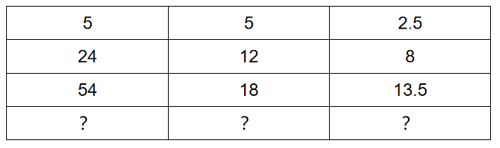

A. 55，11，5.5

B. 40，10，2.5

C. 75，15，10

D. 60，15，12

第 35 题 · 答案与解析

**参考答案（粉笔题库参考内容）**

D

**解析**

第一列与第二列结合看，可以发现5=5×1，24=12×2，54=18×3，故第四行第一项=第二项×4，排除A、C两项。第二列与第三列结合看，可以发现5 ÷ 2.5 = 2/1，12÷8=3/2，18÷13.5=4/3，故第四行第二项÷第三项 = 5/4，只有D项符合。

故正确答案为D。

**考点**：图形数阵

**来源**：2025年广东省公务员录用考试《行测》题（网友回忆版）第35题

### 第 36 题

箱子里装有红、蓝、绿、白、黑五种颜色的小球各20个。如果从箱子里取出若干个小球，且确保其中有10个小球颜色相同，则至少要取出（ ）个小球。

A. 56

B. 51

C. 50

D. 46

第 36 题 · 答案与解析

**参考答案（粉笔题库参考内容）**

D

**解析**

根据题干要求“确保······则至少······”，可判定为最不利构造题型。当红色、蓝色、绿色、白色、黑色各取9个球时为最不利情况，共需取5×9=45个球；此时再取1个球，可以确保有10个小球的颜色相同，则至少要取出45+1=46个球。

故正确答案为D。

**考点**：最不利构造

**来源**：2025年广东省公务员录用考试《行测》题（网友回忆版）第36题

### 第 37 题

某服务大厅设有若干个服务窗口，其中1个是快捷服务窗口，某日服务窗口的平均业务量为29单，其中快捷服务窗口的业务量为41单，其余窗口的平均业务量为28单，则服务大厅共有（ ）个窗口。

A. 13

B. 14

C. 15

D. 16

第 37 题 · 答案与解析

**参考答案（粉笔题库参考内容）**

A

**解析**

设服务大厅共有n个窗口，根据题意可列方程为：41+（n-1）×28=29×n，解得n=13。

故正确答案为A。

**考点**：和差倍比问题

**来源**：2025年广东省公务员录用考试《行测》题（网友回忆版）第37题

### 第 38 题

父子两人在百米赛道上匀速跑步，两人从赛道起点同时出发，父亲跑到终点时，儿子距离终点还有40米，若父亲立即折返跑向赛道起点，则两人相遇时，儿子距离终点还有（ ）米。

A. 35

B. 30

C. 25

D. 15

第 38 题 · 答案与解析

**参考答案（粉笔题库参考内容）**

C

**解析**

根据题干“父亲跑到终点时，儿子距离终点还有40米”可得，父亲跑完100米时，儿子跑了60米。根据“时间相同，路程与速度成正比”可得：v_父/v_儿 = S_父1/S_儿1 = 100/60 = 5/3；由于两人保持匀速，故在后续的40米相遇过程中，v父/v儿=S父2/S儿2=5/3，则儿子距离终点的距离即为此过程中父亲所走的距离，S_父2 = 40 × 5/(3+5) = 25米。

故正确答案为C。

**考点**：相遇追及

**来源**：2025年广东省公务员录用考试《行测》题（网友回忆版）第38题

### 第 39 题

甲、乙两个工程队合作实施某项工程，原计划30天完成，但工作5天后甲被抽调到其他工程，又过了15天该工程正好完成一半，此时丙工程队加入，3天后甲工程队返回，最终该工程比原计划提前2天完成，则丙工程队的效率是甲工程队的（ ）倍。

A. 1.5

B. 2

C. 2.5

D. 3

第 39 题 · 答案与解析

**参考答案（粉笔题库参考内容）**

D

**解析**

根据题意可知：工作总量=30（甲+乙）=2×\[5×（甲+乙）+15乙\]，整理可得：20甲=10乙，即甲：乙=1：2。赋值甲、乙的效率分别为1、2，则工作总量=30×（1+2）=90。

根据题干“该工程比原计划提前2天完成”可知，实际完成该项工程需要30-2=28天，当丙工程队加入时，时间已经过了5+15=20天，即完成工程的后一半中乙、丙工程队的工作时间为28-20=8天，根据“3天后甲工程队返回”可知，甲工程队的工作时间为28-20-3=5天。

综上可列式：1/2×90+(30-2-5-15)×(2+丙)+(30-2-5-15-3)×1=90，整理可得：8×（2+丙）+5×1=45，解得：丙=3，则丙工程队的效率是甲工程队的3/1=3倍。

故正确答案为D。

**考点**：给效率比例型

**来源**：2025年广东省公务员录用考试《行测》题（网友回忆版）第39题

### 第 40 题

某单位计划在一块直角三角形的绿地周边栽种树木，先在3个顶点各栽种1棵，再从顶点开始每隔4米栽种1棵，如果两条直角边（包含顶点）分别栽种4棵和5棵，则该绿地周边一共栽种了（ ）棵树。

A. 12

B. 13

C. 14

D. 15

第 40 题 · 答案与解析

**参考答案（粉笔题库参考内容）**

A

**解析**

根据两条直角边（包含顶点）分别栽种4棵和5棵树木，间隔距离为4米，根据两端植树可知段数=棵数-1，因此两条直角边长分别为：（4-1）×4=12米，（5-1）×4=16米，根据勾股定理可得斜边长= √(12^2 + 16^2) = 20米。根据两端都不植树公式：棵数= 长度/间隔 - 1，则斜边（不包含顶点）可栽种树木20/4 - 1 = 4棵。综上，绿地周边一共栽种了4+5+4-1=12棵。

故正确答案为A。

**考点**：植树问题

**来源**：2025年广东省公务员录用考试《行测》题（网友回忆版）第40题

### 第 41 题

某商场在售的四款家电产品能效、标价及折扣等信息如下表所示。根据补贴规则，二级能效的家电产品可获得最终销售价格15%的补贴，一级能效的家电产品可获得最终销售价格20%的补贴，如果家电产品的最终销售价格=标价×折扣，则购买以下家电中的（ ）获得的补贴金额最多。

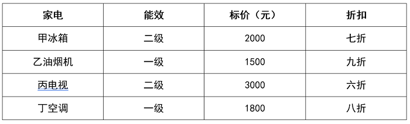

| 家电 | 能效 | 标价（元） | 折扣 |
| --- | --- | ---: | --- |
| 甲冰箱 | 二级 | 2000 | 七折 |
| 乙油烟机 | 一级 | 1500 | 九折 |
| 丙电视 | 二级 | 3000 | 六折 |
| 丁空调 | 一级 | 1800 | 八折 |

A. 甲冰箱

B. 乙油烟机

C. 丙电视

D. 丁空调

第 41 题 · 答案与解析

**参考答案（粉笔题库参考内容）**

D

**解析**

根据题意，要确定哪个家电的补贴金额最多，需要分别计算该产品的最终销售价格，再计算出对应的补贴金额：

甲冰箱（二级能效）：最终售价=2000×0.7=1400元；补贴金额：1400×15%=210元；

乙油烟机（一级能效）：最终售价=1500×0.9=1350元；补贴金额：1350×20%=270元；

丙电视（二级能效）：最终售价=3000×0.6=1800元；补贴金额：1800×15%=270元；

丁空调（一级能效）：最终售价=1800×0.8=1440元；补贴金额：1440×20%=288元。

比较补贴金额，丁空调的补贴金额最多。

故正确答案为D。

**考点**：经济利润问题

**来源**：2025年广东省公务员录用考试《行测》题（网友回忆版）第41题

### 第 42 题

某企业技术部门有7名员工，其中，有3人只能提供软件支持，有2人只能提供硬件支持，另外2人能同时提供软、硬件支持。现该部门向甲、乙两个客户派驻技术团队，要求每个团队中正好有2人能提供软件支持、2人能提供硬件支持。则不同的派驻方式共有（ ）种。

A. 30

B. 42

C. 70

D. 144

第 42 题 · 答案与解析

**参考答案（粉笔题库参考内容）**

A

**解析**

要求每个团队中正好有2人能提供软件支持、2人能提供硬件支持，对分队情况进行分类讨论：

（1）2个团队分别有3人：一队有1人能同时提供软、硬件支持，1人只能提供软件支持，1人只能提供硬件支持，有C_3^1 C_2^1 C_2^1 = 12种情况；另一队选人情况与之相同，同时提供软、硬件支持的只剩一人不用选，只能提供硬件支持的也只剩一人不用选，只需从剩余的只能提供软件支持的2人中选1人，有C_2^1=2种情况。故此时共有12×2=24种情况；

（2）2个团队分别有2人、4人：2人队有2人能同时提供软、硬件支持，有C_2^2=1种情况；4人队有2人只能提供软件支持，2人只能提供硬件支持，有C3^2 C2^2 = 3种情况；且分为甲、乙两个客户，需要考虑哪个客户是2人队，则此时共有1 × 3 × A_2^2 = 6种情况。

最后分类用加法，共有24+6=30种情况。

故正确答案为A。

**考点**：基础排列组合

**来源**：2025年广东省公务员录用考试《行测》题（网友回忆版）第42题

### 第 43 题

某助农电商企业销售柠檬、蜜柚两种水果，由于季节变化，这个月蜜柚的销量比上月增加了40%，而柠檬的销量降低了20%，最终当月这两种水果的总销量比上个月增加4%，则蜜柚上月销量占这两种水果上月销量的（ ）。

A. 60%

B. 50%

C. 40%

D. 30%

第 43 题 · 答案与解析

**参考答案（粉笔题库参考内容）**

C

**解析**

方法一：设上月蜜柚的销量为x，柠檬的销量为y。根据“这个月蜜柚的销量比上月增加了40%，而柠檬的销量降低了20%”，可知这个月蜜柚的销量为（1+40%）x=1.4x，柠檬的销量为（1-20%）y=0.8y。根据“当月这两种水果的总销量比上个月增加4%”，则有：(1.4x + 0.8y)/(x + y) − 1 = 4%，解得x/y=2/3，所求= x/(x + y) = 2/(2 + 3) = 40%。

方法二：根据“这个月蜜柚的销量比上月增加了40%，而柠檬的销量降低了20%”，及“这两种水果的总销量比上个月增加4%”，涉及增长率的混合，可以考虑使用线段法进行解答。设上月蜜柚的销量为a，柠檬的销量为b，根据线段法：距离与量成反比，可知a/b=(4%-(-20%))/(40%-4%)=24/36=2/3，所求= a/(a+b) = 2/(2+3) = 40%。

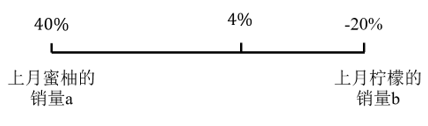

故正确答案为C。

**考点**：和差倍比问题

**来源**：2025年广东省公务员录用考试《行测》题（网友回忆版）第43题

### 第 44 题

小王参加工作时的年龄，和他弟弟现在的年龄相同，小王工作两年后，弟弟也正式参加工作，现在兄弟俩的年龄之和，正好是他们工龄之和的8倍。如果弟弟20岁正式参加工作，则小王比弟弟大（ ）岁。

A. 3

B. 4

C. 5

D. 6

第 44 题 · 答案与解析

**参考答案（粉笔题库参考内容）**

B

**解析**

设小王弟弟现在的工龄为x年，则小王和他弟弟的年龄情况如下表：

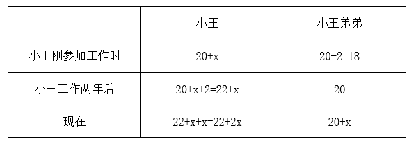

则现在小王的工龄为（22+2x）-（20+x）=（2+x）年，根据“现在兄弟俩的年龄之和，正好是他们工龄之和的8倍”可得22+2x+20+x=8×（2+x+x），解得x=2，则小王比弟弟大20+x-18=2+x=4岁。

故正确答案为B。

**考点**：年龄问题

**来源**：2025年广东省公务员录用考试《行测》题（网友回忆版）第44题

### 第 45 题

3名求职者参加某企业的面试，每人在6道面试题中随机抽取2道题作答，则有且仅有1道题没有被任何人抽到的概率（ ）。

A. 不到20%

B. 在20%到25%之间

C. 在25%到30%之间

D. 超过30%

第 45 题 · 答案与解析

**参考答案（粉笔题库参考内容）**

D

**解析**

根据公式：概率= 满足条件的情况数/总情况数，分析如下：

根据题意，3人面试每人在6道面试题中随机抽取2道题作答，每人的选择有C_6^2种情况，则总的情况数有C_6^2×C_6^2×C_6^2=3375种情况；

满足条件的情况数为有且仅有1道题没有被任何人抽到，则被抽取的5道题目情况数为C_6^5种情况，每人2道题目且5道题目均被抽取则题目被抽取次数为（2,1,1,1,1），即其中一道题目被2名求职者各抽取1次，有C5^1×C3^2情况数，从剩下4道题目中抽取2道题目补齐2名求职者剩余题目，并且有顺序，则满足条件的情况数为C6^5 × C5^1 × C3^2 × A4^2 = 1080种情况。

综上，所求概率为：1080/3375 = 32%。

故正确答案为D。

**考点**：给情况求概率

**来源**：2025年广东省公务员录用考试《行测》题（网友回忆版）第45题

### 第 46 题

如图所示，四棱锥的底面为矩形，其中一条棱垂直于底面，那么该四棱锥的俯视图最有可能是（ ）。

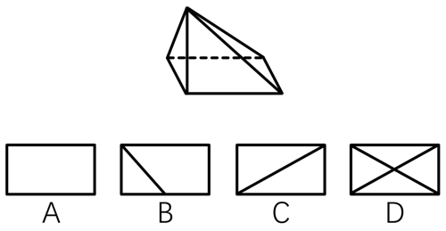

A. A

B. B

C. C

D. D

第 46 题 · 答案与解析

**参考答案（粉笔题库参考内容）**

C

**解析**

本题考查三视图中的俯视图，即从四棱锥的正上方向下观察得到的视图。已知四棱锥中有一条棱垂直于底面，其余三条棱与这条棱相交，因此从俯视角度观察，其余三条棱中应有两条棱与底面矩形边重合，另外一条棱为底面矩形的斜对角线，只有C项符合。

故正确答案为C。

**考点**：空间类-三视图

**来源**：2025年广东省公务员录用考试《行测》题（网友回忆版）第46题

### 第 47 题

下列选项中最符合所给图形规律的是（ ）。

A. A

B. B

C. C

D. D

第 47 题 · 答案与解析

**参考答案（粉笔题库参考内容）**

D

**解析**

元素组成相似，优先考虑样式规律。观察第一组图形发现，图1与图2叠加后保留相同部分得到图3，第二组图形应用此规律，故？处图形应为图1与图2叠加后保留相同部分得到的图形，只有D项符合。

故正确答案为D。

**考点**：样式规律-加减同异

**来源**：2025年广东省公务员录用考试《行测》题（网友回忆版）第47题

### 第 48 题

下列选项中最符合所给图形规律的是（ ）。

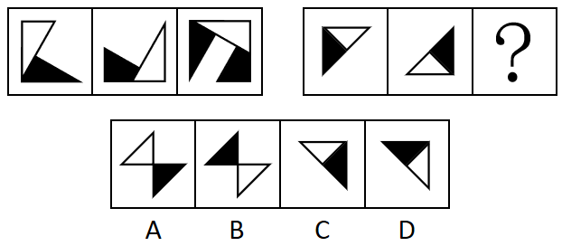

A. A

B. B

C. C

D. D

第 48 题 · 答案与解析

**参考答案（粉笔题库参考内容）**

D

**解析**

元素组成相似，且相同部分重复出现，优先考虑样式规律中的加减同异。第一组图中，图1顺时针旋转90°与图2逆时针旋转90°相加得到图3；第二组图也应满足此规律，图1顺时针旋转90°与图2逆时针旋转90°相加得到图3，只有D项符合。

故正确答案为D。

**考点**：样式规律-加减同异

**来源**：2025年广东省公务员录用考试《行测》题（网友回忆版）第48题

### 第 49 题

从所给的四个选项中，选择最合适的一个填在问号处，使之呈现一定的规律性（ ）。

A. A

B. B

C. C

D. D

第 49 题 · 答案与解析

**参考答案（粉笔题库参考内容）**

B

**解析**

元素组成相同，优先考虑位置规律。题干图形均出现了十六宫格，考虑内外分开看。如下图所示，内圈的黑块1每次逆时针平移1格，外圈的黑块2每次顺时针平移1格，外圈的黑块3每次逆时针平移1格，只有B项符合。

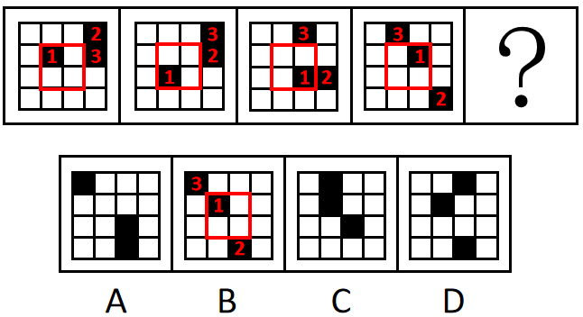

故正确答案为B。

**考点**：位置规律-平移

**来源**：2025年广东省公务员录用考试《行测》题（网友回忆版）第49题

### 第 50 题

下列选项中，最有可能与所给的两个不规则立体图形形成正方体的是（ ）。

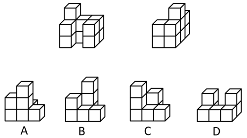

A. A

B. B

C. C

D. D

第 50 题 · 答案与解析

**参考答案（粉笔题库参考内容）**

C

**解析**

本题考查立体拼合。先将图2进行旋转，如下图所示：

再和图1以及C项可以拼合形成正方体，如下图所示：

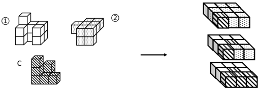

故正确答案为C。

**考点**：空间类-立体拼合

**来源**：2025年广东省公务员录用考试《行测》题（网友回忆版）第50题

### 第 51 题

具身智能是能感知决策并与物理世界互动的人工智能系统，目前具身智能机器人强调“大脑”和“小脑”的协同工作，它能精准的完成细节操作，且能合理规划任务。因此，外科手术机器人“达芬奇”，虽具备精密操作能力，但仍不能算是具身智能机器人。

要使上述结论成立，需要补充的前提是（ ）。

A. 只有具备规划任务能力的机器人才是具身智能机器人

B. 外科手术机器人“达芬奇”不能做到合理规划任务

C. 具身智能机器人的核心特征体现在能够感知并作出决策

D. 具身智能赋予传统机器人“大脑”和“小脑”协同工作的能力

第 51 题 · 答案与解析

**参考答案（粉笔题库参考内容）**

B

**解析**

第一步：找出论点和论据。

论点：外科手术机器人“达芬奇”，虽具备精密操作能力，但仍不能算是具身智能机器人。

论据：目前具身智能机器人强调“大脑”和“小脑”的协同工作，它能精准的完成细节操作，且能合理规划任务。

论点说的是“外科手术机器人‘达芬奇’具备精密操作能力，但不是具身智能机器人”，论据说的是“具身智能机器人能精准的完成细节操作，且能合理规划任务”，二者话题不一致，且提问方式为“前提”，加强优先考虑搭桥，即在“合理规划任务”和“外科手术机器人‘达芬奇’”之间建立联系。

第二步：逐一分析选项。

A项：选项说的是只有具备规划任务能力的机器人才是具身智能机器人，说明具身智能机器人能规划任务，补充论据，可以加强，但不是论证成立的前提，排除；

B项：选项说的是外科手术机器人“达芬奇”不能做到合理规划任务，在“合理规划任务”和“外科手术机器人‘达芬奇’”之间建立联系，搭桥项，可以加强，当选；

C项：选项说的是具身智能机器人能够感知和作出决策，并未提及外科手术机器人，话题不一致，无法加强，排除；

D项：选项说的是具身智能赋予传统机器人“大脑”和“小脑”协同工作的能力，补充论据，可以加强，但不是论证成立的前提，排除。

故正确答案为B。

**考点**：搭桥

**来源**：2025年广东省公务员录用考试《行测》题（网友回忆版）第51题

### 第 52 题

某地共享单车采用阶段收费模式，第一小时收费1.5元，其后每半小时收费1元。最近，共享单车运营商调整了收费标准，第一小时收费不变，其后每半小时收费2元，涨幅高达100%，但当地共享单车月均使用人次并未因价格调整而减少。

对上述现象，以下解释最为合理的是（ ）。

A. 与多次换乘公交相比，使用共享单车的花费更低

B. 随着生活水平的提高，人们的消费意愿逐步增强

C. 单次使用共享单车时长超过一小时的当地市民微乎其微

D. 当地仅有一家共享单车运营商，市场缺乏竞争

第 52 题 · 答案与解析

**参考答案（粉笔题库参考内容）**

C

**解析**

第一步：找出题干矛盾。

某地共享单车一小时后的收费大幅上涨，但共享单车月均使用人次并未减少。

第二步：逐一分析选项。

A项：选项指出与多次换乘公交相比，使用共享单车的花费更低，但有可能还有其他比共享单车更便宜的交通工具，不能解释为什么共享单车收费大幅上涨后，月均使用人次并未减少，不能解释题干矛盾，排除；

B项：选项指出随着生活水平的提高，人们的消费意愿逐步增强，但不明确人们能否接受共享单车收费大幅上涨，不能解释为什么共享单车收费大幅上涨后，月均使用人次并未减少，不能解释题干矛盾，排除；

C项：选项指出单次使用共享单车时长超过一小时的当地市民微乎其微，说明共享单车一小时后的收费大幅上涨并不会对使用者产生影响，可以解释为什么共享单车一小时后的收费大幅上涨，但月均使用人次并未减少，能解释题干矛盾，当选；

D项：选项指出当地仅有一家共享单车运营商，市场缺乏竞争，但除了共享单车外，人们还可以选择其他交通工具，不能解释为什么共享单车收费大幅上涨后，月均使用人次并未减少，不能解释题干矛盾，排除。

故正确答案为C。

**考点**：原因解释

**来源**：2025年广东省公务员录用考试《行测》题（网友回忆版）第52题

### 第 53 题

研究所计划从7名在读研究生中，推选2名男生、2名女生到企业实习。已知：（1）赵、钱、孙是男生；（2）李、刘、王、吴是女生；（3）如果推选刘、吴其中一人，那么孙也会被推选。

根据上述陈述，可以得知（ ）。

A. 赵、李中至少有1人被推选

B. 孙、王中至少有1人被推选

C. 钱、王中至少有1人被推选

D. 孙、刘中至少有1人被推选

第 53 题 · 答案与解析

**参考答案（粉笔题库参考内容）**

B

**解析**

第一步：分析题干条件。

（1）赵、钱、孙是男生；

（2）李、刘、王、吴是女生；

（3）刘 或 吴→孙；

（4）从7名在读研究生中，推选2名男生、2名女生到企业实习。

第二步：根据题干条件进行推理。

本题没有确定信息，可根据条件（3）进行假设。

情况一：推选刘或吴，结合条件（3）可得推选孙；

情况二：不推选刘也不推选吴，结合条件（2）（4）可得一定推选李和王。

综上，只有B项说法正确。

故正确答案为B。

**考点**：假设

**来源**：2025年广东省公务员录用考试《行测》题（网友回忆版）第53题

### 第 54 题

某种贫血症属于遗传性疾病，患者的血红蛋白分子结构异常，从而影响红细胞正常功能。目前，科学家已能够利用基因组编辑技术，治疗因基因突变导致的遗传性疾病。因此，这种贫血症患者有望通过基因组编辑技术被治愈。

要使上述结论成立，需要补充的前提是（ ）。

A. 血红蛋白分子结构异常是这种贫血症的主要表现

B. 这种贫血症是一种由基因突变导致的遗传性疾病

C. 这种贫血症患者的红细胞可由直系亲属的代替

D. 血红蛋白基因是导致这种贫血症的相关基因

第 54 题 · 答案与解析

**参考答案（粉笔题库参考内容）**

B

**解析**

第一步：找出论点和论据。

论点：这种贫血症患者有望通过基因组编辑技术被治愈。

论据：科学家已能够利用基因组编辑技术，治疗因基因突变导致的遗传性疾病。

本题论点讨论的是利用“基因组编辑技术”治疗“这种贫血症”，论据讨论的是利用“基因组编辑技术”治疗“因基因突变导致的遗传性疾病”，话题不一致，加强优先考虑搭桥，即在“这种贫血症”和“因基因突变导致的遗传性疾病”之间建立联系。

第二步：逐一分析选项。

A项：指出这种贫血症的主要表现，但论点讨论的是“这种贫血症患者有望通过基因组编辑技术被治愈”，话题不一致，不能加强，排除；

B项：指出这种贫血症是一种由基因突变导致的遗传性疾病，即在“这种贫血症”和“因基因突变导致的遗传性疾病”之间建立联系，为搭桥项，可以加强，当选；

C项：指出这种贫血症患者的红细胞可由直系亲属的代替，但论点讨论的是“这种贫血症患者有望通过基因组编辑技术被治愈”，话题不一致，不能加强，排除；

D项：指出血红蛋白基因是导致这种贫血症的相关基因，但并未提及“血红蛋白基因”是否受到基因突变的影响，也未提及“血红蛋白基因”能否被“基因组编辑技术”治愈，为不明确项，不能加强，排除。

故正确答案为B。

**考点**：搭桥

**来源**：2025年广东省公务员录用考试《行测》题（网友回忆版）第54题

### 第 55 题

如果没有强健的体魄，就不会有好的学习状态，如果学习状态不好，学习成绩就不可能提升。因此，学校要提升学生的学习成绩，就必须开设体育课。

要使上述结论成立，必需补充的前提是（ ）。

A. 体育课是增强学生体魄的必要途径

B. 所有学生都能通过体育课强健体魄

C. 没有学生不希望提升自己的成绩

D. 学生在课余时间也会进行体育锻炼

第 55 题 · 答案与解析

**参考答案（粉笔题库参考内容）**

A

**解析**

第一步：找出论点和论据。

论点：学校要提升学生的学习成绩，就必须开设体育课。翻译为：提升学习成绩→开设体育课。

论据：如果没有强健的体魄，就不会有好的学习状态，如果学习状态不好，学习成绩就不可能提升。翻译为：①好的学习状态→强健的体魄，②提升学习成绩→好的学习状态，串联为：提升学习成绩→好的学习状态→强健的体魄。

本题需要找出论点成立的前提，优先考虑搭桥，即在“强健的体魄”与“开设体育课”之间建立联系。

第二步：逐一分析选项。

A项：该项翻译为：增强体魄→开设体育课，论据已经推出“提升学习成绩→强健的体魄”，根据该项可以推出“提升学习成绩→开设体育课”，为搭桥项，是论点成立的前提，当选；

B项：该项翻译为：学生通过体育课→增强体魄，论据已经推出“提升学习成绩→强健的体魄”，此时无法根据该项得出“提升学习成绩→开设体育课”，不是论点成立的前提，排除；

C项：该项讨论的是学生是否希望提升自己的成绩，而论点讨论的是学习成绩是否与开设体育课有关，话题不一致，不能加强，排除；

D项：该项说的是学生在课余时间会进行体育锻炼，讨论的是进行体育锻炼的时间，而论点讨论的是学习成绩是否与开设体育课有关，话题不一致，不能加强，排除。

故正确答案为A。

**考点**：搭桥

**来源**：2025年广东省公务员录用考试《行测》题（网友回忆版）第55题

### 第 56 题

庑殿顶是中国古代建筑的一种屋顶形式，由一条正脊和四条垂脊组成，而中国古代许多皇宫大殿有庑殿顶，因此许多皇宫大殿的屋顶只有一条正脊。

以下选项的推理逻辑与题干最相似的是（ ）。

A. 现代主义建筑通常没有复杂的装饰，追求功能属性与简约美，而西班牙的许多建筑造型奇特，装饰繁复，因此这些建筑不属于现代主义建筑

B. 哥特式建筑都有尖形拱门，而欧洲中世纪的建筑多数属于哥特式建筑，因此部分欧洲中世纪的建筑有尖形拱门

C. 古罗马时期的建筑多数都有穹顶，而同一时期的建筑多为砖石结构，因此有的砖石结构建筑有穹顶

D. 客家围屋都设有用于防御土匪侵扰的炮楼，因此有客家围屋的地区，都需要防御土匪侵扰

第 56 题 · 答案与解析

**参考答案（粉笔题库参考内容）**

B

**解析**

第一步：分析题干推理形式。

题干翻译为：庑殿顶→一条正脊和四条垂脊，许多皇宫大殿→庑殿顶，因此，许多皇宫大殿→一条正脊，即1→2，3→1，因此3→2。

第二步：逐一分析选项。

A项：翻译为：现代主义建筑→没有复杂的装饰，西班牙许多建筑→装饰繁复，因此，西班牙许多建筑→-现代主义建筑，即1→2，3→-2，因此3→-1，与题干推理形式不一致，排除；

B项：翻译为：哥特式建筑→尖形拱门，多数欧洲中世纪建筑→哥特式建筑，因此，多数欧洲中世纪建筑→尖形拱门，即1→2，3→1，因此3→2，与题干推理形式一致，当选；

C项：翻译为：多数古罗马时期的建筑→有穹顶，多数古罗马时期的建筑→砖石结构，因此，有的砖石结构→有穹顶，即1→2，1→3，因此有的3→2，与题干推理形式不一致，排除；

D项：翻译为：客家围屋→防御土匪侵扰的炮楼，因此，有客家围屋的地区→防御土匪侵扰，即1→2，因此3→4，与题干推理形式不一致，排除。

故正确答案为B。

**考点**：推理形式

**来源**：2025年广东省公务员录用考试《行测》题（网友回忆版）第56题

### 第 57 题

网络购物平台的数据分析显示，网店为商品提供免费的运费险能够增加销量，但其商品退费率远高于不提供这项服务的网店，从而增加了运营成本。但提供免费运费险的很多网店仍未关闭这一服务。

如果以下选项为真，最有可能解释这一现象的是（ ）。

A. 提供这一服务的网店比其他网店获得了更高的净利润

B. 商品销量和运费成本是衡量网店经营状况的两项关键指标

C. 人工、场地等成本不受退货率影响，且占运营成本的比重不低

D. 提供免费的运费险能够显著提升消费者的信任度

第 57 题 · 答案与解析

**参考答案（粉笔题库参考内容）**

A

**解析**

第一步：找出题干矛盾。

网店为商品提供免费的运费险能够增加销量，但其商品退费率远高于不提供这项服务的网店，从而增加了运营成本。但提供免费运费险的很多网店仍未关闭这一服务。

第二步：逐一分析选项。

A项：该项指出提供这一服务的网店比其他网店获得了更高的净利润，所以即使成本增加，但整体上该服务带来的收益大于成本，很多网店也不会关闭这一服务，可以解释题干矛盾，当选；

B项：商品销量和运费成本是衡量网店经营状况的重要指标，但并未说明这两项指标与网店不关闭免费运费险服务之间的联系，不能解释为什么即使增加运营成本，很多网店仍未关闭这一服务，不能解释题干矛盾，排除；

C项：人工、场地等成本不受退货率影响，且占运营成本的比重不低，说明这些成本与免费运费险导致的退费率增加没有直接关系，不能解释为什么即使增加运营成本，很多网店仍未关闭这一服务，不能解释题干矛盾，排除；

D项：该项指出提供免费的运费险能够显著提升消费者的信任度，但是消费者的信任度提升未必可以转化成实际的利润，不能解释为什么即使增加运营成本，很多网店仍未关闭这一服务，不能解释题干矛盾，排除。

故正确答案为A。

**考点**：原因解释

**来源**：2025年广东省公务员录用考试《行测》题（网友回忆版）第57题

### 第 58 题

古丝绸之路之所以举世闻名，靠的不仅是经济互利，更是丰富物产和多元文化交流，所以，只有经济互利，不可能重现古丝绸之路的辉煌。

以下选项推理逻辑与题干最相似的是（ ）。

A. 我国要实现高水平科技自立自强，归根结底是要靠高水平创新人才，所以，创新能力培养应该成为人才培养的核心

B. 粮食丰收，及时收割和晒干入库都是关键环节，所以，天气连续晴好有助于实现粮食丰收

C. 高水平大学不仅要有完整的设施设备，更要有高水平的教师队伍，因此，仅靠完善设施设备并不能成为高水平大学

D. 体育活动需要合适的运动场所，因此，如果城市缺少合适的运动场所，居民就难以积极参加体育活动

第 58 题 · 答案与解析

**参考答案（粉笔题库参考内容）**

C

**解析**

第一步：分析题干的推理结构。

古丝绸之路之所以举世闻名（c），靠的不仅是经济互利（a），更是丰富物产和多元文化交流（b），所以，只有经济互利（a），不可能重现古丝绸之路的辉煌（c）。

题干论证结构为：经济互利（a）和物产、文化交流（b）两个原因共同影响了古丝绸之路举世闻名（c）这一个结果，所以，只有经济互利（a），没有物产、文化交流（b）无法重现古丝绸之路的辉煌（c）。

第二步：逐一分析选项。

A项：创新能力（a）能够影响高水平科技自立自强的实现（b），所以，创新能力（a）成为人才培养（c）的核心，与题干推理逻辑不同，排除；

B项：及时收割（a）和晒干入库（b）都能影响粮食丰收（c），所以，天气连续晴好（d）有助于实现粮食丰收（c），与题干推理逻辑不同，排除；

C项：完整的设施设备（a）和高水平的教师队伍（b）都能影响高水平大学的建设（c），因此，仅靠完善设施设备（a），没有高水平的教师队伍（b）并不能成为高水平大学（c），与题干推理逻辑最为相似，当选；

D项：合适的运动场所（a）能够影响体育活动的开展（b），因此，如果城市缺少合适的运动场所（a），居民就难以积极参加体育活动（b），与题干推理逻辑不同，排除。

故正确答案为C。

**考点**：推理形式

**来源**：2025年广东省公务员录用考试《行测》题（网友回忆版）第58题

### 第 59 题

在一次技能竞赛中，甲、乙、丙、丁4人排名前四且无人并列，已知甲和第三名是好友且名次比该好友高；丁和甲不是好友但和第一名是好友；乙的名次比丙高。

根据上述信息，以下判断错误的是（ ）。

A. 丙的名次不高于第三名

B. 甲的名次一定高于丙

C. 乙和丁是好友

D. 乙不可能是第一名

第 59 题 · 答案与解析

**参考答案（粉笔题库参考内容）**

D

**解析**

第一步：分析题干条件。

（1）甲和第三名是好友且名次比该好友高；

（2）丁和甲不是好友但和第一名是好友；

（3）乙的名次比丙高。

第二步：根据题干条件进行推理。

题干条件（1）和（2）均提到“甲”，可优先从“甲”入手进行推理。

由条件（1）可知，甲要么是第一名要么是第二名，结合条件（2）可知，甲不是第一名、丁不是第一名也不是第三名，则甲是第二名，丁是第四名，因此乙和丙只能是第一名和第三名，再结合条件（3）可知乙是第一名，丙是第三名。

综上所述，乙是第一名，甲是第二名，丙是第三名，丁是第四名，A、B、C三项判断正确，D项判断错误。

本题为选非题，故正确答案为D。

**考点**：从最大信息开始推

**来源**：2025年广东省公务员录用考试《行测》题（网友回忆版）第59题

### 第 60 题

某研究者选取同一年级的两个班级进行教学实验，第一个班级的学生在听课过程中被鼓励随时提问，而第二个班级的学生没有受到同样的鼓励，结果显示，第一个班级学生的课堂专注度明显高于第二个班级。研究者据此建议在教学过程中学生应随时提问，以提升知识掌握效果。

如果以下选项为真，最能支持研究者建议的是（ ）。

A. 学生在课堂上随时主动提问能活跃课堂气氛

B. 课堂专注度是影响知识掌握效果的重要因素

C. 这两个班级的学生在实验前的学习成绩相当

D. 随时提问能帮助学生增强自我认同感和自信

第 60 题 · 答案与解析

**参考答案（粉笔题库参考内容）**

B

**解析**

第一步：找出论点和论据。

论点：在教学过程中学生应随时提问，以提升知识掌握效果。

论据：第一个班级学生的课堂专注度明显高于第二个班级。

论据讨论的是 “随时提问的班级课堂专注度更高”，论点说的是“随时提问能提升知识掌握效果”，论点论据话题不一致，优先考虑搭桥，即建立“课堂专注度”和“知识掌握效果”的联系。

第二步：逐一分析选项。

A项：该项指出随时提问能活跃课堂气氛，而论点讨论的是知识掌握效果，话题不一致，无法加强，排除；

B项：该项指出课堂专注度是影响知识掌握效果的重要因素，建立了“课堂专注度”和“知识掌握效果”的联系，为搭桥项，可以加强，当选；

C项：该项指出两个班级实验前学习成绩相当，但论据讨论的是课堂专注度，话题不一致，无法加强，排除；

D项：该项指出随时提问能增强自我认同感和自信，但自我认同感与知识掌握效果的关系不清楚，无法加强，排除。

故正确答案为B。

**考点**：搭桥

**来源**：2025年广东省公务员录用考试《行测》题（网友回忆版）第60题

### 第 61 题

作为高端羽毛球的必备原料，羽毛切片是鸭鹅养殖的副产品，其供应量上要取决于养殖规模，如果养殖规模有所下降，羽毛切片价格将会一路走高，进而导致高端羽毛球生产成本高企、厂家将因此被迫提高出厂价格，所以，如果近期鸭鹅养殖规模保持平稳，则高端羽毛球的出厂价格将不会明显上涨。

上述论证的主要逻辑错误在于（ ）。

A. 忽视了其他因素对高端羽毛球出厂价格的影响

B. 忽视了影响鸭鹅养殖规模的其他因素

C. 默认了高端羽毛球生产所需的羽毛切片没有替代品

D. 默认了鸭鹅养殖规模严重影响高端羽毛球的生产

第 61 题 · 答案与解析

**参考答案（粉笔题库参考内容）**

A

**解析**

第一步：找出论点和论据。

论点：如果近期鸭鹅养殖规模保持平稳，则高端羽毛球的出厂价格将不会明显上涨。

论据：作为高端羽毛球的必备原料，羽毛切片是鸭鹅养殖的副产品，其供应量上要取决于养殖规模，如果养殖规模有所下降，羽毛切片价格将会一路走高，进而导致高端羽毛球生产成本高企、厂家将因此被迫提高出厂价格。

本题论点和论据都说的是鸭鹅养殖规模会影响高端羽毛球的出厂价格，二者话题一致，要指出论证缺陷只要指出仅通过鸭鹅养殖规模无法决定高端羽毛球的出厂价格即可。

第二步：逐一分析选项。

A项：该项指出忽视了其他因素对高端羽毛球出厂价格的影响，提出会影响高端羽毛球出厂价格的其他因素，说明仅通过鸭鹅养殖规模无法决定高端羽毛球的出厂价格，可以指出论证缺陷，当选；

B项：该项指出忽视了影响鸭鹅养殖规模的其他因素，而题干论点讨论的是高端羽毛球出厂价格的影响因素，话题不一致，无法指出论证缺陷，排除；

C项：该项指出默认了高端羽毛球生产所需的羽毛切片没有替代品，是对题干第一句话的重复，无法指出论证缺陷，排除；

D项：该项指出默认了鸭鹅养殖规模严重影响高端羽毛球的生产，而题干论点讨论的是高端羽毛球的出厂价格，话题不一致，无法指出论证缺陷，排除。

故正确答案为A。

**来源**：2025年广东省公务员录用考试《行测》题（网友回忆版）第61题

### 第 62 题

根据法律，公共场所禁止吸烟，因此，如果有人在某个区域吸烟却不违法，说明该区域不属于公共场所。

以下选项的推理逻辑与题干最相似的是（ ）。

A. 长时间室内活动是近视的主要原因，因此近视的人都缺乏户外运动

B. 优秀的工匠在学徒时期就追求精益求精，如果某学徒自我要求不高，那他就无法成为优秀的工匠

C. 超过9层的楼房都会配建电梯，因此，如果某住宅楼低于9层，那么住户只能走楼梯

D. 织物表面的纳米涂层可以阻止液体渗入，因此，某种面料防水，说明它有纳米涂层

第 62 题 · 答案与解析

**参考答案（粉笔题库参考内容）**

B

**解析**

第一步：分析题干推理形式。

题干理解为：公共场所都满足吸烟违法，翻译为：公共场所→吸烟违法，因此，-吸烟违法→公共场所，逻辑结构为“否后推否前”。

第二步：逐一分析选项。

A项：选项中未体现逻辑关联词，主要原因为因果关联词，不能翻译，若理解为：长时间室内活动都会导致近视，翻译为：长时间室内活动→近视，因此，近视→长时间室内活动，逻辑结构为“肯后推肯前”，与题干推理形式不一致，排除；

B项：选项理解为：在学徒时期追求精益求精才能成为优秀的工匠，翻译为：优秀的工匠→学徒时期追求精益求精，因此，-学徒时期追求精益求精→优秀的工匠，逻辑结构为“否后推否前”，与题干推理形式一致，当选；

C项：选项翻译为：超过9层的楼房→配建电梯，因此，-超过9层的楼房→配建电梯，逻辑结构为“否前推否后”，与题干推理形式不一致，排除；

D项：选项翻译为：有纳米涂层→阻止液体渗入，因此，阻止液体渗入→有纳米涂层，逻辑结构为“肯后推肯前”，与题干推理形式不一致，排除。

故正确答案为B。

**考点**：推理形式

**来源**：2025年广东省公务员录用考试《行测》题（网友回忆版）第62题

### 第 63 题

某厂家用“除菌去残留，效果看得见”这一广告语，宣传其生产的果蔬清洗机，并展示该产品与其他果蔬清洗机清洗同一种水果的视频，视频显示，该清洗机清洗产生的泡沫最多。该厂家宣称泡沫是被清洗机清洗出来的有害残留，故其产品除菌去残留效果更好。

如果下列选项为真，最能反驳上述推论的是（ ）。

A. 用果蔬清洗机清洗食材，不管清洗多少遍，都会出现泡沫

B. 市面上绝大部分果蔬的农药残留均未超标，有害物质极少

C. 用普通烹饪方式加工肉类食材，或多或少也会产生泡沫

D. 专业化学检测是检验果蔬除菌去残留效果的唯一有效手段

第 63 题 · 答案与解析

**参考答案（粉笔题库参考内容）**

D

**解析**

第一步：找出论点和论据。

论点：其产品（某厂家生产的果蔬清洗机）除菌去残留效果更好。

论据：某厂家用“除菌去残留，效果看得见”这一广告语，宣传其生产的果蔬清洗机，并展示该产品与其他果蔬清洗机清洗同一种水果的视频，视频显示，该清洗机清洗产生的泡沫最多，该厂家宣称泡沫是被清洗机清洗出来的有害残留。

本题论据讨论的是该厂家的果蔬清洗机产生的泡沫最多，而泡沫是清洗出的有害残留，论点说的是该产品除菌去残留效果更好，二者话题一致，削弱优先考虑削弱论点。

第二步：逐一分析选项。

A项：该项指出用果蔬清洗机清洗食材，不管清洗多少遍，都会出现泡沫，说明泡沫不一定能反映食材的有害残留情况，可以削弱，保留；

B项：该项指出市面上绝大部分果蔬的农药残留均未超标，有害物质极少，而论点说的是因为泡沫是清洗出的有害残留，所以该产品除菌去残留效果更好，话题不一致，无法削弱，排除；

C项：该项指出用普通烹饪方式加工肉类食材，也会有泡沫，而论点说的是因为泡沫是清洗出的有害残留，所以该产品除菌去残留效果更好，话题不一致，无法削弱，排除；

D项：该项指出专业化学检测是检验除菌去残留效果的唯一有效手段，说明清洗时有泡沫不能证明产品的除菌去残留效果更好，可以削弱，保留。

比较A、D两项，D项中有“唯一有效手段”，表述更绝对更明确，削弱力度更强。

故正确答案为D。

**考点**：削弱论点

**来源**：2025年广东省公务员录用考试《行测》题（网友回忆版）第63题

### 第 64 题

小陈计划假期前往某市旅游，他的设想如下：

①欢乐世界，动物园至少会去一个；

②艺术中心，欢乐世界和人民公园至少会去一个；

③动物园，人民公园和博物馆至少会去两个；

④如果去动物园，则不去艺术中心。

根据上述设想，可以得出小陈（ ）。

A. 一定会去博物馆

B. 动物园，艺术中心至少会去一个

C. 人民公园，欢乐世界至少会去一个

D. 至少会去3个景点

第 64 题 · 答案与解析

**参考答案（粉笔题库参考内容）**

C

**解析**

第一步：分析题干条件。

①欢乐世界或动物园至少会去一个；

②艺术中心，欢乐世界和人民公园至少会去一个；

③动物园，人民公园和博物馆至少会去两个；

④去动物园→不去艺术中心。

第二步：根据题干条件进行推理。

题干没有确定信息，且涉及多种情况，故考虑假设法。

题干中动物园出现次数最多，优先考虑假设去不去动物园。

关于是否去动物园有两种情况：

第一种情况：假设去动物园，根据条件④可知，不去艺术中心，再根据条件②可知，欢乐世界和人民公园至少会去一个，再根据条件③可知，人民公园和博物馆中至少去一个，此时不确定欢乐世界是否去；

第二种情况：假设不去动物园，根据条件①可知，一定去欢乐世界，再根据条件③可知，人民公园和博物馆都要去，此时不确定艺术中心是否去。

综合上述两种情况，可以推出人民公园和欢乐世界至少会去一个成立，对应C项。

故正确答案为C。

**考点**：假设

**来源**：2025年广东省公务员录用考试《行测》题（网友回忆版）第64题

### 第 65 题

鉴于漂流项目偶尔会出现游客落水伤亡的情况，某旅游景区为每一位参加漂流项目的游客购买了意外保险，并要求游客必须穿上景区配备的救生衣，有游客对此提出疑问，既然景区已经购买了意外保险，游客出现意外伤亡由保险公司赔付，那么游客为寻求刺激的漂流体验，可以选择不穿救生衣。

如果以下选项为真，最能反驳这一质疑的是（ ）。

A. 如果未穿救生衣的游客出现意外伤亡，保险公司将不予赔付

B. 该景区为参加蹦极、过山车等项目的游客也购买了意外保险

C. 该景区在免费为游客提供了救生衣的同时，还配备了救生员

D. 保障游客的人身安全是景区经营方的基本职责之一

第 65 题 · 答案与解析

**参考答案（粉笔题库参考内容）**

A

**解析**

第一步：找出论点和论据。

论点：游客为寻求刺激的漂流体验，可以选择不穿救生衣。

论据：景区已经购买了意外保险，游客出现意外伤亡由保险公司赔付。

本题论点说的是游客为寻求刺激的漂流体验，可以选择不穿救生衣，论据说的是景区已经购买了意外保险，游客出现意外伤亡由保险公司赔付，论点论据话题不一致，削弱优先考虑拆桥。

第二步：逐一分析选项。

A项：选项说的是如果未穿救生衣的游客出现意外伤亡，保险公司将不予赔付，说明虽然景区已经购买了意外保险，但漂流时必须穿救生衣，拆断了论据和论点间的联系，拆桥项，可以削弱，当选；

B项：选项说的是该景区为参加蹦极、过山车等项目的游客也购买了意外保险，但论点讨论的是漂流时是否穿救生衣，话题不一致，无法削弱，排除；

C项：选项说的是该景区在免费为游客提供了救生衣的同时，还配备了救生员，那漂流时是否还需要穿救生衣不明确，无法削弱，排除；

D项：选项说的是保障游客的人身安全是景区经营方的基本职责之一，但游客为寻求刺激的漂流体验是否还需要穿救生衣不明确，无法削弱，排除。

故正确答案为A。

**考点**：拆桥

**来源**：2025年广东省公务员录用考试《行测》题（网友回忆版）第65题

### 第 66 题

下表为一些常见溶液的酸碱度，根据表中的信息，以下说法不恰当的是（ ）。

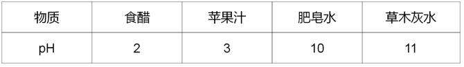

A. 草木灰水能改良酸性土壤

B. 食醋能中和皮蛋中的碱性物质

C. 肥皂水能中和蚂蚁叮咬皮肤时分泌的蚁酸

D. 胃酸过多的人适宜多喝苹果汁

第 66 题 · 答案与解析

**参考答案（粉笔题库参考内容）**

D

**解析**

常温下，当溶液的pH小于7时，说明该溶液为酸性溶液；当溶液的pH等于7时，说明该溶液为中性溶液；当溶液的pH大于7时，说明该溶液为碱性溶液。根据表中的信息可知，食醋的pH等于2，为酸性溶液；苹果汁的pH等于3，为酸性溶液；肥皂水的pH等于10，为碱性溶液；草木灰水的pH等于11，为碱性溶液。

A项：草木灰是碱性溶液，该溶液能中和酸性土壤中的酸性物质，从而改善土壤，正确；

B项：食醋是酸性溶液，该溶液能中和皮蛋中的碱性物质，正确；

C项：肥皂水是碱性溶液，该溶液能中和蚂蚁叮咬皮肤时分泌的蚁酸，正确；

D项：胃酸过多是指胃液中盐酸过多，需要碱性溶液中和胃液中的盐酸，而苹果汁是酸性溶液，错误。

本题为选非题，故正确答案为D。

**来源**：2025年广东省公务员录用考试《行测》题（网友回忆版）第66题

### 第 67 题

如图所示，通过夹物器匀速夹起表面粗糙的木块M1、M2、M3，木块M1、M2、M3始终保持相对静止，关于M1、M2、M3的受力情况，下列说法不正确的是（ ）。

A. 木块M2受到的摩擦力的方向竖直向上

B. 木块M1、M3受到的摩擦力数量相等

C. 木块M1、M2、M3都受到两个方向相同的摩擦力

D. 木块M2作用于M1、M3的摩擦力方向与重力方向相同

第 67 题 · 答案与解析

**参考答案（粉笔题库参考内容）**

C

**解析**

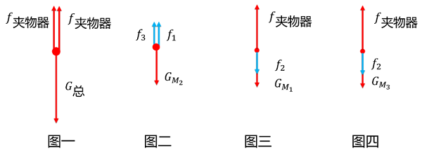

由于三个木块均匀速向上运动，且保持相对静止，故三个木块均受力平衡。先将三个木块看成整体，进行受力分析，再隔离分析木块M_1 、M_2、M_3的受力情况。

整体的受力情况如图一所示，在竖直方向上，整体受到向下的重力G_总和夹物器两侧对整体向上的摩擦力f_夹物器的作用。

木块M_2的受力情况如图二所示，在竖直方向上，受到自身向下的重力GM_2的作用，为了保持受力平衡状态，木块M_2还受到木块M_1、M_3对其向上的摩擦力f_1、f_3的作用。

木块M_1、M_3的受力情况如图三、图四所示，在竖直方向上，均受到夹物器对它们向上的摩擦力f_夹物器和它们自身向下的重力的作用，根据牛顿第三定律可知，木块M_1、M_3还受到木块M_2对它们向下的摩擦力f_2的作用。

A项：由以上分析可知，木块M_2受到木块M_1、M_3对其的摩擦力方向均竖直向上，正确；

B项：由以上分析可知，木块M_1、M_3均受到2个摩擦力的作用，正确；

C项：由以上分析可知，木块M_1、M_3受到的两个摩擦力方向均相反，木块M_2受到的两个摩擦力方向相同，错误；

D项：由以上分析可知，木块M_2对木块M_1、M_3的摩擦力方向均向下，与重力方向相同，正确。

本题为选非题，故正确答案为C。

**来源**：2025年广东省公务员录用考试《行测》题（网友回忆版）第67题

### 第 68 题

图示为海陆风示意图，昼夜交替过程中海洋与陆地间的气温差，造成了近地面大气的密度和气压差，推动气流由高压（低温）区域向低压（高温）区域运动，从而形成了海陆风，下列关于海陆风的说法正确的是（ ）。

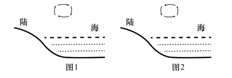

A. 日间海面上气温低于陆地，而夜间则高于陆地

B. 日间，近地面气流由陆地向海面移动

C. 海面上的昼夜温差较陆地大

D. 图1是夜间海陆风示意图

第 68 题 · 答案与解析

**参考答案（粉笔题库参考内容）**

A

**解析**

根据题意可知，气流由高压（低温）区域向低压（高温）区域运动，从而形成了海陆风；由于陆地的比热容小，海水的比热容大，所以吸收相同热量后，陆地升温快，海水升温慢，反之释放相同热量后，陆地降温快，海水降温慢，因此在日间，陆地和海面吸收相同热量后，陆地温度高于海面温度，继而陆地形成低压（高温）区域，海面形成高压（低温）区域，近地面气流由海面向陆地移动，如图1所示，B、D两项均错误；反之在夜间，陆地和海面释放相同热量后，陆地温度低于海面温度，继而陆地形成高压（低温）区域，海面形成低压（高温）区域，近地面气流由陆地向海洋移动，如图2所示，A项正确；根据以上分析可知，由于海水的比热容较陆地大，所以海面上的昼夜温差较陆地小，C项错误。

故正确答案为A。

**来源**：2025年广东省公务员录用考试《行测》题（网友回忆版）第68题

### 第 69 题

如图所示，R_1是热敏电阻，其电阻值随温度升高而减小，已知电源电压不变，闭合开关S后，随着R_1温度升高，下列说法不正确的是（ ）。

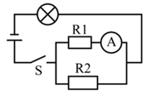

A. 通过电阻R_2的电流变小

B. 电流表的读数增大

C. 灯泡亮度增大

D. 电路总电阻变大

第 69 题 · 答案与解析

**参考答案（粉笔题库参考内容）**

D

**解析**

分析电路可知，R_1与R_2并联后和灯泡串联，电流表测的是通过R_1的电流。由题干可知，当R_1温度升高时，R_1的阻值减小。

根据并联电阻的特点1/R并=1/R1+1/R2，R_1减小，R_2不变，则R_并减小。根据串联分压的规律可知，电源电压不变，R_并减小，则并联部分分到的电压U_并也减小，所以灯泡分到的电压增大，根据P=U^2/R可知，灯泡的电阻不变，电压增大，则电功率增大，即灯泡亮度增大，C项正确；

根据电路总电阻R_总 = R_灯 + R_并，且R_灯不变、R_并减小，可知R_总减小，即电路总电阻变小，D项错误；

并联部分分到的电压等于各支路两端的电压，由上述分析可知，U_并减小，则电阻R_2分到的电压U_2减小，根据欧姆定律I=U/R，R_2的阻值不变，U_2减小，则通过电阻R_2的电流I_2变小，A项正确；

根据欧姆定律I=U/R，电源电压不变，总电阻R_总减小，则总电流I_总增大。总电流等于各支路的电流之和，即I总 = I1+I2，由A项分析可知，I_2变小，则通过R_1的电流I_1增大，即电流表的读数增大，B项正确。

本题为选非题，故正确答案为D。

**来源**：2025年广东省公务员录用考试《行测》题（网友回忆版）第69题

### 第 70 题

在日常生活中，人们总是难以避免与细菌接触，以下有关细菌的说法错误的是（ ）。

A. 我国甲类传染病中的鼠疫是由细菌引发的

B. 有的细菌可用于食品生产、废水处理或生物分解

C. 细菌是微生物也是细胞，可以自行分裂繁殖

D. 杀灭细菌，只能依靠人体自身免疫力

第 70 题 · 答案与解析

**参考答案（粉笔题库参考内容）**

D

**解析**

A项：鼠疫是由鼠疫耶尔森菌引起的甲类传染病，鼠疫耶尔森菌是一种细菌，正确；

B项：细菌能够通过发酵、分解等代谢活动参与物质转化。比如乳酸菌能进行乳酸发酵生成乳酸，用于制作酸奶，而一些好氧细菌在有氧条件下能把废水中的机物分解成二氧化碳和水等，从而净化污水。此外还有腐生细菌，作为生态系统中的分解者，能将动植物的遗体分解成二氧化碳、水和无机盐，促进生态系统的物质循环，正确；

C项：细菌是微生物，具有细胞结构，主要通过二分裂的方式自行分裂繁殖，正确；

D项：杀灭细菌的方法有很多，除了依靠人体自身免疫力外，还可以通过物理方法（如高温、紫外线照射等）、化学方法（如使用消毒剂等）和生物方法（如使用抗生素等）来实现，错误。

本题为选非题，故正确答案为D。

**来源**：2025年广东省公务员录用考试《行测》题（网友回忆版）第70题

## 材料 1

### 第 71 题

2023年1~11月，G省社会消费品零售额约为（ ）万亿元。

A. 4.34

B. 4.43

C. 4.54

D. 4.63

第 71 题 · 答案与解析

**参考答案（粉笔题库参考内容）**

A

**解析**

定位统计表可得，2023 年1~12月、12月G省社会消费品零售额分别为47494.86亿元、4055.97亿元。则2023年1~11月G省社会消费品零售额=1~12月零售额-12月零售额= 47494.86−4055.97≈43439亿元≈4.34万亿元。

故正确答案为A。

**考点**：统计表、简单加减计算

**来源**：2025年广东省公务员录用考试《行测》题（网友回忆版）第71题

### 第 72 题

2023年，G省社会消费品零售额同比增长（ ）。

A. 不到5%

B. 在5%到10%之间

C. 在10%到15%之间

D. 超过15%

第 72 题 · 答案与解析

**参考答案（粉笔题库参考内容）**

B

**解析**

根据题干“2023年······同比增长”，结合选项为百分数，可判定本题为一般增长率问题。定位统计表可得：2022年1~12月、2023年1~12月G省社会消费品零售额分别为44882.92亿元、47494.86亿元。根据公式：增长率= (现期量 − 基期量)/基期量，可得2023年G省社会消费品零售额同比增长率=(47494.86−44882.92)/44882.92≈ 2612/45000 ≈ 5.8%，在B项范围内。

故正确答案为B。

**考点**：一般增长率、统计表

**来源**：2025年广东省公务员录用考试《行测》题（网友回忆版）第72题

### 第 73 题

2023年，G省城镇社会消费品零售额约占社会消费品零售额的（ ）。

A. 79.8%

B. 83.4%

C. 87.1%

D. 90.0%

第 73 题 · 答案与解析

**参考答案（粉笔题库参考内容）**

C

**解析**

根据题干“2023年······占······”，结合材料给出2023年相关数据，可判定本题为现期比重问题。定位统计表可得：2023年1-12月，G省社会消费品零售额为47494.86亿元， G省城镇社会消费品零售额为41385.83亿元。根据公式：比重=部分/整体，则题干所求= 41385.83/47494.86 ≈ 41385.83/47500 ≈ 87.1%。

故正确答案为C。

**考点**：现期比重、统计表

**来源**：2025年广东省公务员录用考试《行测》题（网友回忆版）第73题

### 第 74 题

2023年，G省下列指标的社会消费品零售额同比增长率最高的是（ ）。

A. 城镇

B. 乡村

C. 商品零售

D. 餐饮收入

第 74 题 · 答案与解析

**参考答案（粉笔题库参考内容）**

D

**解析**

根据题干“2023年·····同比增长率最高的是”，可判定本题为一般增长率问题。定位表格可得2022年、2023年G省城镇、乡村、商品零售、餐饮收入等指标的社会消费品零售额。根据公式：增长率= (现期量 − 基期量)/基期量，则四个指标的社会消费品零售额同比增长率分别为：

A项，城镇：(41385.83-39286.68)/39286.68≈ 2100/39000 = 5^+%；

B项，乡村：(6109.03 − 5596.24)/5596.24≈ 510/5600 = 9^+%；

C项，商品零售：(41731.42−40327.74)/40327.74≈ 1400/40000 = 3^+%；

D项，餐饮收入：(5763.44 − 4555.64)/4555.64≈ 1200/4600 = 20^+%。

综上，同比增长率最高的是餐饮收入。

故正确答案为D。

**考点**：一般增长率、统计表

**来源**：2025年广东省公务员录用考试《行测》题（网友回忆版）第74题

### 第 75 题

根据资料，以下说法有误的是（ ）。

A. 2023年12月G省社会消费品零售额高于当年月平均数

B. 2023年12月G省餐饮收入社会消费品零售额同比增长率超过50%

C. 2022年12月G省城镇社会消费品零售额中，城区占比超过九成

D. 2022年12月G省社会消费品零售额中，餐饮收入占比不足一成

第 75 题 · 答案与解析

**参考答案（粉笔题库参考内容）**

C

**解析**

A项：定位统计表，2023年12月G省社会消费品零售额为4055.97亿元，1-12月G省社会消费品零售额为47494.86亿元。2023年G省平均每月社会消费品零售额为47494.86/12 ＜48000/12 = 4000亿元 ＜4055.97亿元（2023年12月），正确；

B项：定位统计表，2022年12月、2023年12月G省餐饮收入社会消费品零售额分别为348.35亿元、533.54亿元。根据公式：增长率= (现期量 − 基期量)/基期量，可得2023年12月G省餐饮收入社会消费品零售额同比增长率= (533.54-348.35)/348.35 = 185.19/348.35 = 50%^+，即同比增长率超过50%，正确；

C项：定位统计表，2022年12月G省城镇社会消费品零售额为3218.27亿元，其中城区社会消费品零售额为2680.11亿元。根据公式：比重=部分/整体，可得题干所求= 2680.11/3218.27 = 90%^-，即占比不到90%，错误；

D项：定位统计表，2022年12月G省社会消费品零售额为3741.65亿元，餐饮收入社会消费品零售额为348.35亿元。根据公式：比重=部分/整体，可得题干所求= 348.35/3741.65 = 10%^-，即占比不足一成，正确。

本题为选非题，故正确答案为C。

**考点**：综合分析、统计表

**来源**：2025年广东省公务员录用考试《行测》题（网友回忆版）第75题

## 材料 2

2013~2023年，中国深入推进能源生产和消费方式变革，能源绿色低碳发展实现历史性突破。2023年，清洁能源消费占比26.4%，较2013年提高10.9个百分点，煤炭消费比率累计下降12.1个百分点，发电总装机容量达29.2亿千瓦。其中，清洁能源发电装机容量达17亿千瓦，清洁能源发电约3.8万亿千瓦时，占总发电量的39.7%，比2013年提高约15个百分点。十年来，新增清洁能源发电量占全社会用电增量一半以上。

中国能源转型支撑经济社会高质量发展。十年来，能源领域固定资产投资39万亿元，推动上下游产业链及相关产业的投资增长。一系列能源领域，重大工程建成投产，建立起完备的能源装备制造产业链，新能源、水电、核电、输变电、新型储能等领域技术创新加快，推动清洁能源产业成长为现代化产业体系新支柱。

中国能源转型保障人民美好生活需要，十年来，14亿多人的能源安全得到有效保障。全国人均生活用电量从约500千瓦时增至接近1000千瓦时，天然气用户达5.6亿人，农村电网改造升级中央预算内总投资超千亿元。2015年历史性解决全国无电人口用电问题。农村地区户用光伏规模达到1.2亿千瓦。每年可为农户增收110亿元，增加就业岗位约200万个。2023年底，全国充电基础设施从不到10万台增至近860万台。

中国能源转型为全球能源转型作出重要贡献，2023年中国能源转型投资达6760亿美元，是全球能源转型投资最多的国家。十年来，中国向全球提供优质的清洁能源产品和服务，有力促进全球风电，光伏成本大幅下降，中国与100多个国家和地区开展绿色能源项目合作，2023年出口风电光伏产品助力其他国家减排二氧化碳约8.1亿吨。中国新能源产业丰富了全球供给，缓解了全球通胀压力，助力全球应对气候变化和绿色转型。

### 第 76 题

以下判断正确的是（ ）。

A. 我国清洁能源消费比重已经超过煤炭消费比重

B. 我国清洁能源发电装机容量不到发电总装机容量的一半

C. 我国清洁能源发电量占总发电量的比重较10年前翻了一番

D. 我国总发电量超过9万亿千瓦时

第 76 题 · 答案与解析

**参考答案（粉笔题库参考内容）**

D

**解析**

A项：定位文字材料第一段可得：2023年，清洁能源消费占比26.4%，未给出2023年煤炭消费占比，无法比较两者比重大小，错误；

B项：定位文字材料第一段可得：2023年，发电总装机容量达29.2亿千瓦。其中，清洁能源发电装机容量达17亿千瓦。由于17亿千瓦＞ 29.2亿千瓦/2 = 14.6亿千瓦，即我国清洁能源发电装机容量超过发电总装机容量的一半，错误；

C项：定位文字材料第一段可得：2023年清洁能源发电量占总发电量的39.7%，比2013年提高约15个百分点。则2013年清洁能源发电量占总发电量的39.7%-15%=24.7%，39.7%<24.7%×2=49.4%，即不到翻一番，错误；

D项：定位文字材料第一段可得：2023年清洁能源发电约3.8万亿千瓦时，占总发电量的39.7%。根据公式：整体=部分/比重，则2023年我国总发电量= 3.8/39.7% = 9^+万亿千瓦时，正确。

故正确答案为D。

**考点**：文字资料、综合分析

**来源**：2025年广东省公务员录用考试《行测》题（网友回忆版）第76题

### 第 77 题

根据资料，以下说法有误的是（ ）。

A. 农村地区户用光伏可为农户增加收入和就业岗位

B. 2023年我国已有超过1/2的人口用上了天然气

C. 2013~2023年，我国人均生活用电量几乎翻了一番

D. 2013~2023年，新增清洁能源发电量占全社会用电增量一半以上

第 77 题 · 答案与解析

**参考答案（粉笔题库参考内容）**

B

**解析**

A项：定位文字材料第三段可得：农村地区户用光伏规模达到1.2亿千瓦。每年可为农户增收110亿元，增加就业岗位约200万个。即农村地区户用光伏可为农户增加收入和就业岗位，正确；

B项：定位文字材料第三段可得：2023年我国天然气用户达5.6亿人，总人数为14亿多人。根据公式：比重=部分/整体，可得所求为5.6/14^+ ＜ 1/2，错误；

C项：定位文字材料第三段可得：2013~2023年十年来，全国人均生活用电量从约500千瓦时增至接近1000千瓦时。接近1000/约500=接近2倍，即2013~2023年，我国人均生活用电量几乎翻了一番，正确；

D项：定位文字材料第一段可得：2013~2023年十年来，新增清洁能源发电量占全社会用电增量一半以上，正确。

本题为选非题，故正确答案为B。

**考点**：文字资料、综合分析

**来源**：2025年广东省公务员录用考试《行测》题（网友回忆版）第77题

### 第 78 题

2013-2023年，全国充电基础设施年均增加约（ ）万台。

A. 60

B. 75

C. 85

D. 95

第 78 题 · 答案与解析

**参考答案（粉笔题库参考内容）**

C

**解析**

根据题干“2013-2023年······年均增加约······万台”，可判定本题为年均增长量问题。定位文字材料第三段可得：十年来······2023年底，全国充电基础设施从不到10万台增至近860万台。根据公式：年均增长量= (现期量-基期量)/年份差，可得所求=(860^-−10^-)/(2023−2013)≈850/10=85万台。

故正确答案为C。

**考点**：文字资料、年均增长量

**来源**：2025年广东省公务员录用考试《行测》题（网友回忆版）第78题

### 第 79 题

中国新能源产业对世界的影响，主要包括（ ）。

①丰富全球供给

②缓解全球通胀压力

③应对气候变化和绿色转型

④支撑经济社会高质量发展

A. ①②③

B. ①③④

C. ②③④

D. ①②③④

第 79 题 · 答案与解析

**参考答案（粉笔题库参考内容）**

A

**解析**

定位文字材料第四段可知，中国能源转型为全球能源转型作出重要贡献，中国新能源产业丰富了全球供给，缓解了全球通胀压力，助力全球应对气候变化和绿色转型。

故正确答案为A。

**考点**：文字资料、直接找数

**来源**：2025年广东省公务员录用考试《行测》题（网友回忆版）第79题

### 第 80 题

根据材料，以下说法不正确的是（ ）。

A. 2023年，我国已建立起完备的能源装备制造产业链

B. 2023年，我国是全球能源转型投资最多的国家

C. 2013-2023年，我国累计出口的清洁能源产品助力其他国家减排二氧化碳约8.1亿吨

D. 2013-2023年，我国与100多个国家和地区开展绿色能源项目合作

第 80 题 · 答案与解析

**参考答案（粉笔题库参考内容）**

C

**解析**

A项：定位文字材料第二段可得，（2013~2023年）我国一系列能源领域重大工程建成投产，建立起完备的能源装备制造产业链，正确；

B项：定位文字材料第四段可得，2023年中国能源转型投资达6760亿美元，是全球能源转型投资最多的国家，正确；

C项：定位文字材料第四段可得，2023年我国出口风电光伏产品助力其他国家减排二氧化碳约8.1亿吨，而非2013-2023年累计出口的清洁能源产品，错误；

D项：定位文字材料第四段可得，十年来（2013-2023年）······中国与100多个国家和地区开展绿色能源项目合作，正确。

本题为选非题，故正确答案为C。

**考点**：文字资料、综合分析

**来源**：2025年广东省公务员录用考试《行测》题（网友回忆版）第80题

## 材料 3

2023年，G省博物馆系统落实国家文物局、G省人民政府关于推进文物事业高质量发展战略合作协议，锚定博物馆事业高质量发展任务，全省博物馆事业发展取得明显成效。

截至2023年来，G省备案博物馆385家。其中，国有博物馆257家，非国有博物馆128家。国有博物馆中，文物系统国有博物馆227家，行业国有博物馆30家。G省国家一、二、三级博物馆共82家，数量位居全国第二。

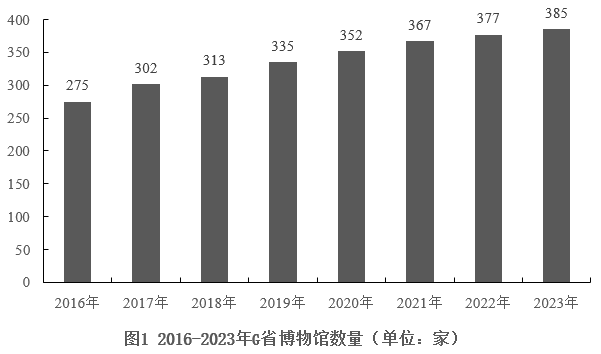

### 第 81 题

2023年，G省博物馆数量同比增长约（ ）。

A. 2.1%

B. 4.2%

C. 6.3%

D. 8.4%

第 81 题 · 答案与解析

**参考答案（粉笔题库参考内容）**

A

**解析**

根据题干“2023年，······同比增长约”，结合选项为百分数，可判定本题为一般增长率问题。定位图1可得：2022年、2023年G省博物馆数量分别为377家、385家。根据公式：增长率= (现期量 − 基期量)/基期量，则所求=(385−377)/377≈8/380≈2.1%。

故正确答案为A。

**考点**：一般增长率、综合资料

**来源**：2025年广东省公务员录用考试《行测》题（网友回忆版）第81题

### 第 82 题

2016～2022年，G省博物馆年均增加（ ）家。

A. 15

B. 16

C. 17

D. 18

第 82 题 · 答案与解析

**参考答案（粉笔题库参考内容）**

C

**解析**

根据题干“2016～2022年······年均增加（ ）家”，可判定本题为年均增长量问题。定位图1可知：2016年、2022年G省博物馆数量分别为275家、377家。根据公式：年均增长量= (现期量-基期量)/年份差，则所求= (377-275)/(2022-2016) = 102/6 = 17家。

故正确答案为C。

**考点**：年均增长量、综合资料

**来源**：2025年广东省公务员录用考试《行测》题（网友回忆版）第82题

### 第 83 题

2023年，G省文物系统国有博物馆约占国有博物馆总量的（ ）。

A. 55%

B. 66%

C. 77%

D. 88%

第 83 题 · 答案与解析

**参考答案（粉笔题库参考内容）**

D

**解析**

根据题干“2023年······约占······”，结合材料时间为2023年，可判定本题为现期比重问题。定位文字材料第二段可得， 2023年G省国有博物馆257家；国有博物馆中，文物系统国有博物馆227家。根据公式：比重=部分/整体，可得所求比重为227/257≈227/260=80%^+，满足的只有D项。

故正确答案为D。

**考点**：现期比重、综合资料

**来源**：2025年广东省公务员录用考试《行测》题（网友回忆版）第83题

### 第 84 题

2017~2023年间，G省国有博物馆同比增加数量最多的是（ ）。

A. 2017年

B. 2018年

C. 2019年

D. 2020年

第 84 题 · 答案与解析

**参考答案（粉笔题库参考内容）**

A

**解析**

据题干“2017-2023年间······同比增加数量最多的是”，可判定本题为增长量比较问题。定位统计图1可知2016-2023年各年G省博物馆数量；定位统计图2可知2016-2023年各年G省国有博物馆数量占比。根据公式：部分=整体×比重，结合选项时间，可知2016-2020年，G省国有博物馆分别为：

2016年，275×73.1%≈275×0.73≈201家；

2017年，302 × 73.2%≈302×0.73≈220家；

2018年，313×72.5%≈ 313 × 0.73 ≈ 228家；

2019年，335 × 71.0% ≈ 238家；

2020年，352 × 70.2%≈352×0.7≈246家。

根据公式：增长量=现期量-基期量，则2017-2020年G省国有博物馆同比增量分别为：

2017年，220-201=19家；

2018年，228-220=8家；

2019年，238-228=10家；

2020年，246-238=8家。

综上可知，同比增加数量最多的是2017年。

故正确答案为A。

**考点**：增长量比较、综合资料

**来源**：2025年广东省公务员录用考试《行测》题（网友回忆版）第84题

### 第 85 题

根据资料，以下说法正确的是（ ）。

A. 2017～2023年，G省国有博物馆数量逐年增加

B. 2017～2023年，G省非国有博物馆数量逐年增加

C. 2019年，G省非国有博物馆首次超过100家

D. 2023年，按G省常住人口1.27亿计算，每40万人拥有1家博物馆

第 85 题 · 答案与解析

**参考答案（粉笔题库参考内容）**

B

**解析**

A项：定位统计图1、2可得：2017～2023年G省博物馆数量及国有博物馆所占比重。根据公式：部分=整体×比重，可得国有博物馆数量为：2020年：352 × 70.2% ≈ 247.1；2021年：367×67.3% ≈ 247.0。则2021年国有博物馆数量<2020年国有博物馆数量，并非逐年增加，错误；

B项：定位统计图1、2可得：2017～2023年，G省博物馆数量及非国有博物馆所占比重。根据公式：部分=整体×比重，2017～2023年G省博物馆数量逐年增加，非国有博物馆所占比重也逐年增加（2022年与2023年所占比重相同），故2017～2023年，G省博物馆数量×非国有博物馆所占比重=非国有博物馆数量也逐年增加，正确；

C项：定位统计图1、2可得：2019年G省博物馆数量为335家，非国有博物馆所占比重为29%。根据公式：部分=整体×比重，可得2019年非国有博物馆数量为：335 × 29% ≈ 97.2 ＜ 100，错误；

D项：定位统计图1可得：2023年G省博物馆数量为385家；结合题干条件：2023年，按G省常住人口1.27亿计算。根据公式：平均数=总数/个数，则题干所求为：1.27亿/385 ≈ 33万，错误。

故正确答案为B。

**考点**：综合分析、综合资料

**来源**：2025年广东省公务员录用考试《行测》题（网友回忆版）第85题

## 材料 4

2023年，我国铁路客运创历史最好水平，服务保障国家重大战略成效显著旅客运输。国家铁路旅客发送量完成36.85亿人，比上年增加20.75亿人；国家铁路旅客周转量（旅客周转量=旅客发送量×旅客平均运送距离）完成14717.12亿人公里，比上年增加8145.36亿人公里。

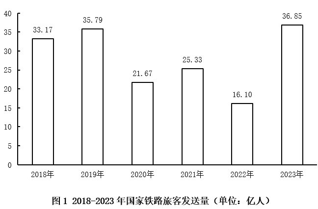

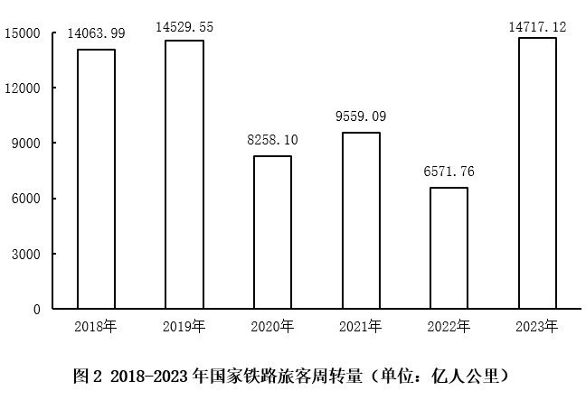

### 第 86 题

2023年，国家铁路旅客发送量同比增长约（ ）。

A. 30%

B. 55%

C. 130%

D. 155%

第 86 题 · 答案与解析

**参考答案（粉笔题库参考内容）**

C

**解析**

根据题干“2023年······同比增长约”，结合选项为百分数，可判定本题为一般增长率问题。定位文字资料可得，2023年国家铁路旅客发送量完成36.85亿人，比上年增加20.75亿人；定位图1可得，2022年国家铁路旅客发送量为16.10亿人。根据公式：增长率= 增长量/基期量，则2023年国家铁路旅客发送量同比增长率= 20.75/16.10 ≈ 130%。

故正确答案为C。

**考点**：一般增长率、综合资料

**来源**：2025年广东省公务员录用考试《行测》题（网友回忆版）第86题

### 第 87 题

2018~2023年，国家铁路旅客发送量年均增长约（ ）万人。

A. 6130

B. 7360

C. 8280

D. 9200

第 87 题 · 答案与解析

**参考答案（粉笔题库参考内容）**

B

**解析**

根据题干“2018~2023年······年均增长约（ ）万人”，可判定本题为年均增长量问题。定位统计图1可得：2018年、2023年国家铁路旅客发送量分别为33.17亿人、36.85亿人。根据公式：年均增长量= (现期量-基期量)/年份差，则题干所求= (36.85-33.17)/(2023-2018) = 3.68/5 = 0.736亿人=7360万人。

故正确答案为B。

**考点**：年均增长量、综合资料

**来源**：2025年广东省公务员录用考试《行测》题（网友回忆版）第87题

### 第 88 题

2021~2023年，国家铁路旅客周转量年均增长率（ ）。

A. 不到15%

B. 在15%到30%之间

C. 在30%到45%之间

D. 超过45%

第 88 题 · 答案与解析

**参考答案（粉笔题库参考内容）**

B

**解析**

根据题干“2021~2023年······年均增长率”，可判定本题为年均增长率问题。定位图2可得：2021年、2023年国家铁路旅客周转量分别为9559.09亿人公里、14717.12亿人公里。根据公式：(1+年均增长率)^n=现期量/基期量（n为年份差），可得(1+年均增长率)² = 14717.12/9559.09 ≈ 1.54。由于1.2^2=1.44，1.3^2 = 1.69，可知1.2^2 ＜ (1+年均增长率)^2 ＜ 1.3^2，因此20%<年均增长率<30%，在B项范围内。

故正确答案为B。

**考点**：年均增长率、综合资料

**来源**：2025年广东省公务员录用考试《行测》题（网友回忆版）第88题

### 第 89 题

在2020~2023年间，国家铁路旅客平均运送距离量最短的年份是（ ）。

A. 2020年

B. 2021年

C. 2022年

D. 2023年

第 89 题 · 答案与解析

**参考答案（粉笔题库参考内容）**

B

**解析**

根据题干“在2020~2023年间······平均运送距离量最短的年份是”，结合材料给出2020-2023年相关数据，可判定本题为现期平均数问题。定位图1可得：2020-2023年国家铁路旅客发送量分别为21.67亿人、25.33亿人、16.10亿人、36.85亿人；定位图2可得：2020-2023年国家铁路旅客周转量分别为8258.10亿人公里、9559.09亿人公里、6571.76亿人公里、14717.12亿人公里。根据公式：旅客周转量=旅客发送量×旅客平均运送距离，则铁路旅客平均运送距离=铁路旅客周转量/铁路旅客发送量，故2020-2023年，国家铁路旅客平均运送距离分别为：

2020年：8258.10/21.67≈8258.10/21.7=380^+公里；

2021年：9559.09/25.33 ≈ 9559.09/25.3 = 370^+公里；

2022年：6571.76/16.10 = 400^+公里；

2023年：14717.12/36.85 ≈ 14717.12/36.9 = 390^+公里。

比较可知，2021年国家铁路旅客平均运送距离量最短。

故正确答案为B。

**考点**：现期平均数、综合资料

**来源**：2025年广东省公务员录用考试《行测》题（网友回忆版）第89题

### 第 90 题

根据材料，以下说法不正确的是（ ）。

A. 2019~2023年，国家铁路旅客发送量与周转量的同比变化趋势基本一致

B. 2023年，国家铁路旅客发送量较2019年增长不到3%

C. 2018年~2023年，国家铁路旅客发送量增速高于周转量

D. 2018~2023年，国家铁路旅客年均周转量超过12000亿人公里

第 90 题 · 答案与解析

**参考答案（粉笔题库参考内容）**

D

**解析**

A项：定位图1可知2019~2023年国家铁路旅客发送量的同比变化趋势为上升-下降-上升-下降-上升；定位图2可知2019~2023年国家铁路旅客周转量的同比变化趋势也为上升-下降-上升-下降-上升，变化趋势一致，正确；

B项：定位图1可知：2023年和2019年国家铁路旅客发送量分别为36.85亿人、35.79亿人。根据公式：增长率= (现期量 − 基期量)/基期量，则2023年国家铁路旅客发送量较2019年的增长率=(36.85−35.79)/35.79≈1.06/35.8＜3%，正确；

C项：定位图1可知2023年和2018年国家铁路旅客发送量分别为36.85亿人、33.17亿人；定位图2可知2023年和2018年国家铁路旅客周转量分别为14717.12亿人公里、14063.99亿人公里。根据公式：增长率= (现期量 − 基期量)/基期量，则2023年国家铁路旅客发送量较2018年的增速= (36.85-33.17)/33.17 ≈ 3.68/33.2 ＞ 10%，2023年国家铁路旅客周转量较2018年的增速=(14717.12−14063.99)/14063.99≈ 653.13/14100 ＜ 10%，则2018年-2023年国家铁路旅客发送量增速高于周转量，正确；

D项：定位图2可知：2018～2023年国家铁路旅客周转量分别为14063.99亿人公里、14529.55亿人公里、8258.10亿人公里、9559.09亿人公里、6571.76亿人公里、14717.12亿人公里。则2018-2023年国家铁路旅客年均周转量=(14063.99+14529.55+8258.10+9559.09+6571.76+14717.12)/6≈ (14100+14500+8300+9600+6600+14700)/6=67800/6=11300亿人公里，未超过12000亿人公里，错误。

本题为选非题，故正确答案为D。

**考点**：综合分析、综合资料

**来源**：2025年广东省公务员录用考试《行测》题（网友回忆版）第90题

## 未自动迁移的旧版答案

旧版完整内容保留在本地候选目录中的 legacy-original.md。因题目身份未唯一确认，这些答案没有按旧题号附加到新题目。
