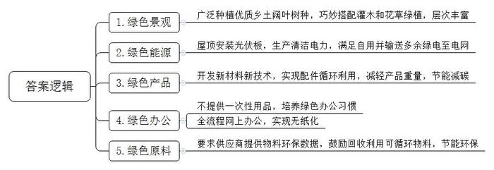
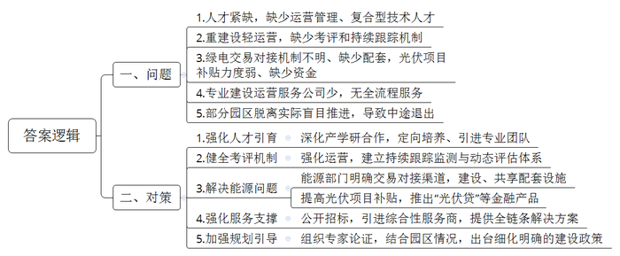
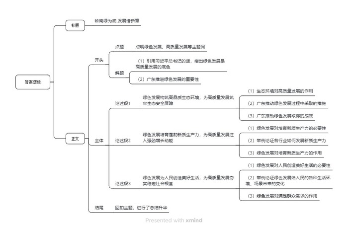

# 2026年广东省公考《申论》题（省市）

> 候选采集稿。参考答案及解析来自粉笔页面，不代表官方答案或真实高分答卷；来源使用许可与原卷对应关系仍需人工核实。

## 给定材料

### 材料 material-af3e467d8141fa65

走进位于D县的智能耳机生产企业H电子，宛如闯入一座生机勃勃的植物园。

办公楼里，员工工位绿植环绕；车间内，阳光透过层层枝叶洒在工人身上。在绿意与机器的交响中，一副副耳机“走”下生产线，共同展现出一幅“绿意赛博朋克”画卷。

多种树！这是H电子董事长陈先生对于建造一座“绿色工厂”最朴素的认知。“小时候老人常讲，房前屋后要多种树，这是一种财富。在规划时，我就想用绿树把厂房内外的空间填满，让环境更美。”陈先生说。

这家工厂种有5000多株树木，除了广泛种植优质乡土阔叶树种外，还通过巧妙搭配灌木和花草绿植，充分利用植物的光合作用来吸收二氧化碳，大面积的生态植被与垂直绿墙构建起层次丰富的绿色景观，成为当地一道靓丽的风景线。

“现在一进入这个园区，感觉比外面凉快好多。”作为县里派驻H电子的“首席服务官”，曾女士全程参与并见证了H电子项目从荒山荒地到秀美园区的巨变。据她介绍，县里高度重视这个“绿色工厂”的建设，将其视为绿美广东生态建设与“百千万工程”的创新契合点，全力支持其打造成为D县首个“绿色工厂示范点”。

作为广东首批碳达峰碳中和试点企业，绿色低碳理念早已融入H电子企业的基因里。

“我们不是简单种树，而是让生态成为生产中的好伙伴。”H电子总经理叶先生说。他们生产大楼的屋顶上，光伏板整齐地排列着，在阳光的照耀下默默地“生产”着清洁的电力，年平均发电量可达91万千瓦时，每年减碳数百万吨。这不仅能满足自用，还能将多余的绿电输送至电网，为D县的能源绿色转型贡献一份力量。

“我们主要生产高端智能开放式耳机。前两代产品中，为实现防水防汗，电路板需要喷一层胶，但这样一来，耳机听筒在维修时就变得难以拆解，只能整体更换，会造成较大的浪费，在做第三代产品时，我们开发了新的纳米涂层，不仅能防水，出现问题后还不用整体更换，有利于产品配件循环利用。”H电子研发工程师李先生介绍道。

“第三代产品克服了技术难题，单只耳机减轻了2克重量。别小看这2克，它极大地提高了耳机佩戴的舒适度，还成功实现了节能、减碳。”李先生自豪地说。

绿色低碳的理念，还体现在办公管理的细微处。厂里不提供一次性纸杯和其他一次性用品，让每位员工都养成绿色办公习惯；所有办公流程都在网上完成，实现了无纸化办公，相当于每年节约了数百万张A4纸……

H电子还将绿色低碳理念延伸至原材料领域，H电子每一款新产品背后，都连接着数百家供应商，涵盖原料、辅料及包材等类型的企业。H电子要求供应商提供物料的相关环保数据，保证生产原材料绿色低碳；鼓励他们对可循环使用的产品及包材、线圈等物料进行回收利用，既节能环保，又降本增效。

2024年，H电子国际订单增长20%，年产值从上一年的6.76亿元突破至11亿元，成为D县首家产值超10亿元的企业，创造就业岗位数千个。H电子成为D县产业绿色转型升级的一个缩影，在D县，像H电子这样的“绿色工厂”还有很多，为县域经济增添了一股强大的“绿色动力”。

H电子的实践证明，含“绿”量越高，含“金”量越足，绿色低碳投入并非成本负担，而是竞争力的源泉。

### 材料 material-fc19ca592820ffbc

零碳园区是指通过规划、设计、技术、管理等方式，使园区内生产生活活动产生的二氧化碳排放降至“近零”水平，并具备进一步达到“净零”条件的园区。零碳园区并非追求绝对的零碳排放，而是通过综合运用节能减排、可再生能源利用等多种手段，实现园区内碳排放量与吸收量或碳减排量之间的动态平衡，使净碳排放量趋近于零。

加快零碳园区建设是党中央、国务院对“双碳”工作的最新部署，也是深入推进绿色转型的重要抓手。2025年6月底，国家发展改革委等三部门印发了《关于开展零碳园区建设的通知》，首次在国家层面明确建设路径，为零碳园区科学有序推进提供权威指引。

近年来，S市加大零碳园区建设力度，一批零碳园区落地见效，但在推进过程中也遇到了一些问题。

A园区是S市最早开展零碳升级改造的产业园，目前已成功建立了“风光储”一体化系统，园区80%的生产能源已实现绿电自供。园区还引进了碳智慧管理平台，实现碳排放核算、碳减排分析、碳排放交易、能源管理等功能，打造基于数字化、智能化、精细化的园区“双碳”管理新模式。

然而，随着园区智慧运营系统的不断完善，人才缺乏越来越成为A园区负责人张主任苦恼的事，他表示：“这个系统再完善，也不能完全替代人。园区运营管理还需要更多人才来支撑，尤其需要更多零碳园区运营管理相关专业的人才。”

“国内各地零碳园区建设正在不断推进，能源管理、数字技术、信息工程等领域的复合型技术人才的紧缺程度更加突出。”S市能源研究中心李教授指出。

谈到零碳园区运营管理时，李教授还指出零碳园区建成后，如何确保园区“零碳”是关键。他了解到目前有些园区前期大搞建设，后期没有实质性的运营，并不一定能够达到“零碳”，而相关评价考核还没有跟上，还有一些园区运营一段时间后，园区内企业数量、门类有所变化，是否能够符合零碳标准也需要政府持续跟踪。

B园区是S市2010年建成的高新工业区，以生产新能源汽车零部件、动力电池为主。据园区负责人范主任反映，园区已经确定零碳升级改造方案，采用“绿电直连+光伏发电”双驱动模式，但在实施中却遇到了一些困难。

“园区附近就有一个很大的光伏发电厂，我们想从他们那里直接买电，但是怎么买，怎么连，现在还在想办法。”范主任说。

绿电直连通过“点对点”专用线路，跳过公共电网中转环节，实现新能源与用户直接对接、能源共享，为零碳园区提供稳定可靠的绿色电能供给，是园区实现零碳的关键路径。

李教授指出，零碳园区建设并非孤岛建设，需要协同周边区域实现绿色能源互济、设施共享。但是，绿电市场交易如何对接、配套设施如何完善，都是当前本市必须解决的现实问题。

范主任还介绍了园区安装光伏板和配套电网的情况。园区内的办公建筑和厂房质量比较好，经过测算，可以在建筑顶层安装光伏板。但是，要完成光伏板以及配套电网、储电系统的安装，园区需要投入一大笔资金。“虽然市政府在这方面有一些相关的补贴，对于园区光伏发电项目来说是远远不够的。其实，不少园区都面临这样的情况，影响了园区建设的推进。”

C园区是S市规模最大的制造业工业区，有意申报零碳园区建设项目。C园区以传统制造业为产业主体，亟需加快绿色低碳转型。

然而，建设零碳园区绝非易事，零碳园区建设涉及新能源供给、产业转型升级、碳减排测算与长期运营效益等方面，不是单一的设备改造或者基础设施更新。

C园区负责人王主任说：“我们前期做了一些工作，感觉难度还是很大，特别是在园区综合供能方案的设计、论证等方面。当地提供零碳园区建设和运营服务的专业公司比较少，也咨询过，但都不能提供全流程服务。”

李教授介绍说：“零碳园区建设前期需要做好‘规划—设计—建设—运营—碳服务’全链条覆盖的解决方案，这必将催生一批具备竞争力的综合能源服务商。各类园区的具体情况不同，只有通过专业指导，有针对性、有计划、分步骤地推进零碳化改造，才能保证零碳园区建设的整体质量。”

“除了上面提到的问题，还有一些园区退出了零碳园区建设，这也值得关注。”李教授补充道，“有的园区认为建零碳园区就是装几块光伏板，并没有充分考虑自身产业特点、周边基础设施等情况，导致零碳园区建设难以推进，最后不得不半路退出。”

“零碳园区建设应科学规划、稳妥推进，关于园区建设的政策需要细化和明确，摸清家底之后探索适合的发展模式。”李教授表示。

### 材料 material-9d9b41af179b834e

党的十八大以来，以习近平同志为核心的党中央从中华民族永续发展的高度出发，深刻把握生态文明建设在新时代中国特色社会主义事业中的重要地位和战略意义，大力推动生态文明理论创新、实践创新、制度创新，提出一系列新理念新思想新战略，引领我国生态文明建设从理论到实践都发生了历史性、转折性、全局性变化，美丽中国建设迈出重大步伐，形成了习近平生态文明思想。①

党的二十届四中全会通过的《中共中央关于制定国民经济和社会发展第十五个五年规划的建议》，总结“十四五”时期绿色低碳转型取得的重大成就，对“十五五”时期加快经济社会发展全面绿色转型作出战略部署，持续深入推进污染防治攻坚和生态系统优化，加快建设新型能源体系，积极稳妥推进和实现碳达峰，加快形成绿色生产生活方式。这充分彰显了以习近平同志为核心的党中央走生态优先、绿色发展之路的坚强意志和坚定决心，必将对全面推进美丽中国建设、加快推进人与自然和谐共生的现代化产生重大而深远的影响。

绿色发展是高质量发展的底色②。党的二十大报告指出，“高质量发展是全面建设社会主义现代化国家的首要任务”，“推动经济社会发展绿色化、低碳化是实现高质量发展的关键环节”。习近平总书记指出，“高质量发展，就是能够很好满足人民日益增长的美好生活需要的发展，是体现新发展理念的发展，是创新成为第一动力、协调成为内生特点、绿色成为普遍形态、开放成为必由之路、共享成为根本目的的发展”，要“坚持把绿色低碳发展作为解决生态环境问题的治本之策，加快形成绿色生产方式和生活方式，厚植高质量发展的绿色底色”。

①摘自《习近平生态文明文选》（第一卷）

②摘自习近平总书记2024年1月在主持中共二十届中央政治局第十一次集体学习的重要讲话

## 题目

### 第 1 题

**请根据材料**3**，谈谈“绿色工厂”的“绿”体现在哪些方面。（20分）**

关联材料：material-af3e467d8141fa65

作答要求：

要求：概括全面、准确，条理清晰，篇幅不超过200字。

### 第 2 题

**假如你是****S市发展和改革局工作人员，请根据材料**5**，梳理S市零碳园区建设遇到的问题，并就进一步推进零碳园区建设提出对策建议。****（****30分****）**

关联材料：material-fc19ca592820ffbc

作答要求：

要求：

（1）问题梳理全面、准确；

（2）对策建议合理、有针对性、具体明确；

（3）紧扣材料，条理清晰；

（4）篇幅不超过300字。

### 第 3 题

**请结合给定材料，联系广东实际，围绕****“绿色发展是高质量发展的底色”进行深入思考，自拟题目，撰写一篇议论文。（50分）**

关联材料：material-9d9b41af179b834e

作答要求：

要求：

（1）文章主题与给定材料联系紧密，观点正确，思想深刻；

（2）论点鲜明，论据确凿，论证严密，逻辑性强；

（3）结构完整，条理清晰，表述准确，行文流畅；

（4）篇幅1000字左右。

## 答案与解析

第 1 题

**参考答案（粉笔题库参考内容）**

1.绿色景观。广泛种植优质乡土阔叶树种，巧妙搭配灌木和花草绿植，层次丰富。

2.绿色能源。屋顶安装光伏板，生产清洁电力，满足自用并输送多余绿电至电网。

3.绿色产品。开发新材料新技术，实现配件循环利用，减轻产品重量，节能减碳。

4.绿色办公。不提供一次性用品，培养绿色办公习惯；全流程网上办公，实现无纸化。

5.绿色原料。要求供应商提供物料环保数据，鼓励回收利用可循环物料，节能环保。

**解析**

**参考答案说明**：本参考答案从“绿色景观”“绿色能源”“绿色产品”“绿色办公”“绿色原料”五个方面进行了分条撰写。各条答案要点之间在内容上相互并列，没有交叉。

**考点**：考点特点类

**来源**：来源2026年广东省公考《申论》题（省市）

粉笔申论页面对本题只提供「解析视频」入口，该入口是会员推广位，页面无视频地址与文字解析。

第 2 题

**参考答案（粉笔题库参考内容）**

一、问题：1.人才紧缺，缺少运营管理、复合型技术人才。2.重建设轻运营，缺少考评和持续跟踪机制。3.绿电交易对接机制不明、缺少配套，光伏项目补贴力度弱、缺少资金。4.专业建设运营服务公司少，无全流程服务。5.部分园区脱离实际盲目推进，导致中途退出。

二、对策：1.强化人才引育。深化产学研合作，定向培养、引进专业团队。2.健全考评机制。强化运营，建立持续跟踪监测与动态评估体系。3.解决能源问题。能源部门明确交易对接渠道，建设、共享配套设施；提高光伏项目补贴，推出“光伏贷”等金融产品。4.强化服务支撑。公开招标，引进综合性服务商，提供全链条解决方案。5.加强规划引导。组织专家论证，结合园区情况，出台细化明确的建设政策。

**解析**

**参考答案说明：**本参考答案分为“问题”和“对策”两个部分。其中“问题”部分从“人才”“考评”“能源”“服务”“规划”五个方面展开；“对策”部分从“强化人才引育”“健全考评机制”“解决能源问题”“强化服务支撑”“加强规划引导”五个方面展开。本参考答案做到了分类分条撰写，各条答案要点之间在内容上相互并列，没有交叉。

**考点**：考点提出对策类

**来源**：来源2026年广东省公考《申论》题（省市）

粉笔申论页面对本题只提供「解析视频」入口，该入口是会员推广位，页面无视频地址与文字解析。

第 3 题

**参考答案（粉笔题库参考内容）**

**岭南绿为底** **发展谱新章**

习近平总书记深刻指出：“绿色发展是高质量发展的底色。”作为改革开放的排头兵、先行地、实验区，广东在追求高质量发展的壮阔征程中，坚定走生态优先、绿色发展之路，以绿美生态建设为牵引，协同推进降碳、减污、扩绿、增长，深刻改变着岭南大地的生产生活方式，让高质量发展成果惠及千家万户。

**绿色发展构筑高品质生态环境，为高质量发展筑牢生态安全屏障。**生态环境是高质量发展的基础支撑，也是高质量发展的必然要求。失去优质的环境承载，高质量发展便名不副实，也难以为继。广东系统推进绿美生态建设，森林质量与生态功能显著提升，山水林田湖草沙系统更加健全；深入打好污染防治攻坚战，使空气质量创历史最优，水环境质量接近发达国家水平；统筹推进生态修复与保护，自然保护地体系持续完善，生物多样性得到有效维护。绿色发展创造的优质生态环境，正让广东呈现青山常在、绿水长流的生机景象，成为有效防范化解生态风险、保障高质量发展的坚实屏障。

**绿色发展培育蓬勃新质生产力，为高质量发展注入强劲增长动能。**高质量发展的核心在于创新引领，而绿色转型正通过技术革新与模式重构培育新质生产力，为其提供关键支撑。看省内，陶瓷业企业数量大幅优化而产值显著增长，电子“绿色工厂”实现了产值与“含绿量”双跃升，证明绿色改造能通过提效降本重塑竞争力。新能源产业集群突破万亿规模，“海上风电+海上牧场”等融合新赛道开辟，都彰显着绿色科技对产业体系的重构力……可见，绿色发展不仅不会削弱增长，反而能通过驱动产业革新与系统优化，为高质量发展注入更可持续、更富韧性的深层动力。

**绿色发展为人民创造美好生活，为高质量发展夯实稳定社会根基。**随着物质生活水平提升，人民群众对优美生态环境的需求日益增长，绿色发展成为顺应民心的必然选择。从昔日脏乱差的“空心村”到今日的美丽乡村，人居环境实现蝶变；从传统赛事场馆到赛后社区公园，绿色空间功能持续拓展；从单一绿化到“体育健身、休闲露营、森林音乐会”等多元绿美新场景，生态产品供给更加丰富……绿色发展切实回应了人民群众日益增长的美好生活需要，让“绿水青山”成为可感可及的幸福源泉，生动诠释了增进民生福祉正是高质量发展的根本归宿。

青山常在映南粤，绿水长流润民心。展望新征程，广东必将持续擦亮绿色底色，让高质量发展成色更足、生态画卷更美，谱写中国式现代化的崭新篇章。

**解析**

**文章分析**

**岭南绿为底 发展谱新章**

【**标题的优点：**标题中包含“绿色发展”等主题词，使文章主题更突出、清晰。】

（1）习近平总书记深刻指出：“绿色发展是高质量发展的底色。”（2）作为改革开放的排头兵、先行地、实验区，广东在追求高质量发展的壮阔征程中，坚定走生态优先、绿色发展之路，以绿美生态建设为牵引，协同推进降碳、减污、扩绿、增长，深刻改变着岭南大地的生产生活方式，让高质量发展成果惠及千家万户。

【**开头的优点：**★内容方面。范文的开头是紧扣“绿色发展”“高质量发展”等主题词展开的。（1）引用习近平总书记的话，指出绿色发展是高质量发展的底色；（2）广东推进绿色发展的重要性。★文字表达方面。使用了“让……”等关联词，使语言表达有逻辑性；长短句配合使用，使得语言表达有节奏感。】

**绿色发展构筑高品质生态环境，为高质量发展筑牢生态安全屏障**。（1）生态环境是高质量发展的基础支撑，也是高质量发展的必然要求。失去优质的环境承载，高质量发展便名不副实，也难以为继。（2）广东系统推进绿美生态建设，森林质量与生态功能显著提升，山水林田湖草沙系统更加健全；深入打好污染防治攻坚战，使空气质量创历史最优，水环境质量接近发达国家水平；统筹推进生态修复与保护，自然保护地体系持续完善，生物多样性得到有效维护。（3）绿色发展创造的优质生态环境，正让广东呈现青山常在、绿水长流的生机景象，成为有效防范化解生态风险、保障高质量发展的坚实屏障。

【**论述段****1的优点：**★观点句：范文的观点句是紧扣“绿色发展”“高质量发展”等主题词提出的。形式上，它在段首处直接写出，位置突出，容易发现。内容上，关键词突出，内容要点明确，可以明显看出主要论述“绿色发展需要高品质生态环境”。★论述内容：（1）生态环境对高质量发展的作用；（2）广东推动绿色发展过程中采取的措施；（3）广东推动绿色发展取得的成效。注意：以上几个方面的内容都是紧扣“绿色发展构筑高品质生态环境，为高质量发展筑牢生态安全屏障”这个观点句进行分析论述的，论述的针对性强，内容层次丰富。在论述方法上主要采用了讲道理、举例子相结合的方式，论述充实深刻。】

**绿色发展培育蓬勃新质生产力，为高质量发展注入强劲增长动能**。（1）高质量发展的核心在于创新引领，而绿色转型正通过技术革新与模式重构培育新质生产力，为其提供关键支撑。（2）看省内，陶瓷业企业数量大幅优化而产值显著增长，电子“绿色工厂”实现了产值与“含绿量”双跃升，证明绿色改造能通过提效降本重塑竞争力。新能源产业集群突破万亿规模，“海上风电+海上牧场”等融合新赛道开辟，都彰显着绿色科技对产业体系的重构力……可见，（3）绿色发展不仅不会削弱增长，反而能通过驱动产业革新与系统优化，为高质量发展注入更可持续、更富韧性的深层动力。

【**论述段****2****的优点：**★观点句：范文的观点句是紧扣“绿色发展”“高质量发展”等主题词提出的。形式上，它在段首处直接写出，位置突出，容易发现。内容上，关键词突出，内容要点明确，可以明显看出主要论述“绿色发展培育新质生产力”。★论述内容：（1）绿色发展对培育新质生产力的必要性；（2）举例论证各行业如何发展新质生产力；（3）绿色发展对培育新质生产力的作用。注意：以上几个方面的内容都是紧扣“绿色发展培育蓬勃新质生产力，为高质量发展注入强劲增长动能”这个观点句进行分析论述的，论述的针对性强，内容层次丰富。在论述方法上主要采用了讲道理、举例子相结合的方式，论述充实深刻。】

**绿色发展为人民创造美好生活，为高质量发展夯实稳定社会根基**。（1）随着物质生活水平提升，人民群众对优美生态环境的需求日益增长，绿色发展成为顺应民心的必然选择。（2）从昔日脏乱差的“空心村”到今日的美丽乡村，人居环境实现蝶变；从传统赛事场馆到赛后社区公园，绿色空间功能持续拓展；从单一绿化到“体育健身、休闲露营、森林音乐会”等多元绿美新场景，生态产品供给更加丰富……（3）绿色发展切实回应了人民群众日益增长的美好生活需要，让“绿水青山”成为可感可及的幸福源泉，生动诠释了增进民生福祉正是高质量发展的根本归宿。

【**论述段****3****的优点：**★观点句：范文的观点句是紧扣“绿色发展”“高质量发展”等主题词提出的。形式上，它在段首处直接写出，位置突出，容易发现。内容上，关键词突出，内容要点明确，可以明显看出主要论述“绿色发展为人民创造美好生活”。★论述内容：（1）绿色发展对人民创造美好生活的必要性；（2）举例论证绿色发展给人民的各种生活环境、场景带来的变化；（3）绿色发展对满足群众需求的作用。注意：以上几个方面的内容都是紧扣“绿色发展为人民创造美好生活，为高质量发展夯实稳定社会根基”这个观点句进行分析论述的，论述的针对性强，内容层次丰富。在论述方法上主要采用了讲道理、举例子相结合的方式，论述充实深刻。】

【**论述段之间的关系**：★内在逻辑上：文章先论述“绿色发展需要高品质生态环境”，再论述“绿色发展培育新质生产力”，最后论述“绿色发展为人民创造美好生活”，并列逻辑清晰严谨。】

青山常在映南粤，绿水长流润民心。展望新征程，广东必将持续擦亮绿色底色，让高质量发展成色更足、生态画卷更美，谱写中国式现代化的崭新篇章。

【**结尾的优点：**范文的结尾回扣了“绿色发展”“高质量发展”等主题词，并且进行了展望。】

**考点**：考点文章写作题

**来源**：来源2026年广东省公考《申论》题（省市）

粉笔申论页面对本题只提供「解析视频」入口，该入口是会员推广位，页面无视频地址与文字解析。

