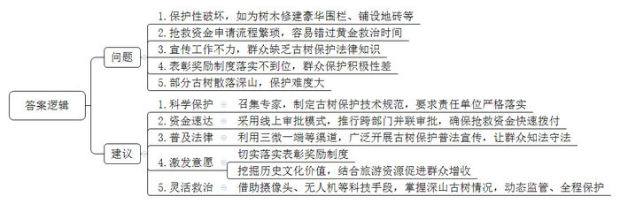
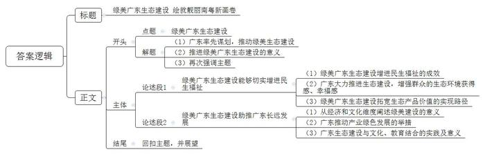

# 2026年广东省公考《申论》题（县镇）

<!-- gwy:overview:start -->
> **广东 · 2026 · 申论 · 县镇** ｜ 3 题 · 图片 3 处 · 答案随题折叠

导航：[题目](#题目) · [材料 1](#材料-1)
<!-- gwy:overview:end -->

> 候选采集稿。参考答案及解析来自粉笔页面，不代表官方答案或真实高分答卷；来源使用许可与原卷对应关系仍需人工核实。

## 给定材料

### 材料 1

走进位于D县的智能耳机生产企业H电子，宛如闯入一座生机勃勃的植物园。

办公楼里，员工工位绿植环绕；车间内，阳光透过层层枝叶洒在工人身上。在绿意与机器的交响中，一副副耳机“走”下生产线，共同展现出一幅“绿意赛博朋克”画卷。

多种树！这是H电子董事长陈先生对于建造一座“绿色工厂”最朴素的认知。“小时候老人常讲，房前屋后要多种树，这是一种财富。在规划时，我就想用绿树把厂房内外的空间填满，让环境更美。”陈先生说。

这家工厂种有5000多株树木，除了广泛种植优质乡土阔叶树种外，还通过巧妙搭配灌木和花草绿植，充分利用植物的光合作用来吸收二氧化碳，大面积的生态植被与垂直绿墙构建起层次丰富的绿色景观，成为当地一道靓丽的风景线。

“现在一进入这个园区，感觉比外面凉快好多。”作为县里派驻H电子的“首席服务官”，曾女士全程参与并见证了H电子项目从荒山荒地到秀美园区的巨变。据她介绍，县里高度重视这个“绿色工厂”的建设，将其视为绿美广东生态建设与“百千万工程”的创新契合点，全力支持其打造成为D县首个“绿色工厂示范点”。

作为广东首批碳达峰碳中和试点企业，绿色低碳理念早已融入H电子企业的基因里。

“我们不是简单种树，而是让生态成为生产中的好伙伴。”H电子总经理叶先生说。他们生产大楼的屋顶上，光伏板整齐地排列着，在阳光的照耀下默默地“生产”着清洁的电力，年平均发电量可达91万千瓦时，每年减碳数百万吨。这不仅能满足自用，还能将多余的绿电输送至电网，为D县的能源绿色转型贡献一份力量。

“我们主要生产高端智能开放式耳机。前两代产品中，为实现防水防汗，电路板需要喷一层胶，但这样一来，耳机听筒在维修时就变得难以拆解，只能整体更换，会造成较大的浪费，在做第三代产品时，我们开发了新的纳米涂层，不仅能防水，出现问题后还不用整体更换，有利于产品配件循环利用。”H电子研发工程师李先生介绍道。

“第三代产品克服了技术难题，单只耳机减轻了2克重量。别小看这2克，它极大地提高了耳机佩戴的舒适度，还成功实现了节能、减碳。”李先生自豪地说。

绿色低碳的理念，还体现在办公管理的细微处。厂里不提供一次性纸杯和其他一次性用品，让每位员工都养成绿色办公习惯；所有办公流程都在网上完成，实现了无纸化办公，相当于每年节约了数百万张A4纸……

H电子还将绿色低碳理念延伸至原材料领域，H电子每一款新产品背后，都连接着数百家供应商，涵盖原料、辅料及包材等类型的企业。H电子要求供应商提供物料的相关环保数据，保证生产原材料绿色低碳；鼓励他们对可循环使用的产品及包材、线圈等物料进行回收利用，既节能环保，又降本增效。

2024年，H电子国际订单增长20%，年产值从上一年的6.76亿元突破至11亿元，成为D县首家产值超10亿元的企业，创造就业岗位数千个。H电子成为D县产业绿色转型升级的一个缩影，在D县，像H电子这样的“绿色工厂”还有很多，为县域经济增添了一股强大的“绿色动力”。

H电子的实践证明，含“绿”量越高，含“金”量越足，绿色低碳投入并非成本负担，而是竞争力的源泉。

### 材料 2

古树名木是珍贵的自然遗产和独特的历史文化资源，被称为绿色“活化石”，承载着中华文明悠久的历史和灿烂的文化。保护古树名木，不仅是建设生态文明的内在要求，也是传承中华优秀传统文化的重要途径。

广东省S市历史文化悠久，古树资源丰富。近年来S市深入实施绿美广东生态建设“六大行动”，以古树名木保护提升行动为着力点，促进古树名木与城乡基础设施和谐共存，留住绿美广东乡愁记忆。

为进一步提升区域古树名木保护管理水平，市林业部门联合自然资源部门组成调研组，深入辖区开展专题调研。

白水景区是S市著名的历史文化景点，古树资源丰富。在这里，老树与老城，相伴相生。古树是城市发展的见证者，也成了城市里不可或缺的景观地标。调研组走访了景区内部，发现古树树干周围都修建了豪华围栏，铺设了地砖，有树洞的地方还拿材料填补。

S市东方区的江心岛是古树密集区域，130多株古树与周围的欧式建筑相映成趣，共同见证S市近现代对外开放的历史变迁。

自1984年首次开展古树普查以来，这里一直是重点保护地。调研组来到岛上，向街道负责古树保护工作的小王了解情况。“政府非常重视古树保护，严厉打击故意破坏古树的行为，古树的生存环境已经好了许多。不过岛上有些古树树冠又大又高，每次刮台风都有不同程度的受损，需要花钱雇专业团队及时抢救。但是申请这笔钱太麻烦了，跟区里要钱得跑好几个部门，填好几张表，等好几天，很多时候就错过了古树抢救的黄金时间。”小王无奈地说。

调研组还去了M县最偏远的一个深山小镇——乐业镇。这里背靠南岭山脉，林业资源丰富，山林中有许多珍稀树种，村落里也有些上百年的古树。古树名木保护提升行动开展以来，镇里成立了专职护林员队伍。但在走访过程中，调研组发现村民张大爷正在给自家院子铺水泥地，院子里一株古树的根部都快要被盖住了。调研组立即制止住张大爷并告知其行为涉嫌违法，张大爷却说：“我在自家院子里修水泥地，又没有把树挖了卖钱，哪里违法了？”沟通无果后，调研组找来村里护林员协调解决。护林员表示：“在我们山区，房前屋后长着古树并不少见，我们也号召村民一起保护古树，但大家的积极性似乎并不高。如何激发大家的护树热情，我们也在想办法。”

“城里、村里的古树照看方便，山里的古树可就难了。”在崎岖的山路上，护林员老马边走边跟调研组说，“这片山头有很多珍贵的古树，但都散落在深山各处，而且林间坡陡崎岖难行，我有次巡山时不小心滑了一跤，滚了下去，幸好被两棵树拦住了。这几年生态好了，野生动物越来越多，单野猪我都碰到过两次。”

走访调研结束后，调研组召开座谈会，邀请相关领域专家学者和有关部门工作人员，共商古树名木保护工作。与会人员摘录如下：

市司法局廖局长：今年3月，《古树名木保护条例》就正式实施了，这个《条例》对很多破坏古树名木的行为都明确了处罚措施，比如违法采伐、违法移植，还有损害树木和生长环境的行为，等等。《条例》虽然是实施了，但更重要的是要让群众知道，他们才是保护古树名木的“基本盘”，只有他们知法守法，知道这树应该保护、有责任保护，这项工作才能更好地开展。

林业大学刘教授：各种形式的“保护性破坏”是当前我国古树名木保护中较为突出的问题。有些地方好心办坏事，本来有些保护措施出发点是好的，但却起到了反作用。目前各地保护性破坏的案例有增多趋势，值得我们重视。

市林业局曾主任：古树抢救单靠政府的力量是不够的。我们也正在探索更灵活的救治模式。全市不少古树都生长在深山老林里，保护难度确实大，护林员巡山也有一定的危险。我们要充分借助科技手段，及时掌握深山古树的长势状况，做到动态监管、全程保护。

调研组郭组长：对在古树名木保护管理工作中作出突出贡献的单位和个人，按照《古树名木保护条例》，是可以给予表彰和奖励的，我们要贯彻落实好。我们也有必要挖掘和讲好古树名木背后的历史文化故事，与周边旅游资源相结合，让群众靠保护古树也能致富，从而激发全民护树热情，推进古树名木保护工作再上新台阶。

### 材料 3

党的十八大以来，以习近平同志为核心的党中央从中华民族永续发展的高度出发，深刻把握生态文明建设在新时代中国特色社会主义事业中的重要地位和战略意义，大力推动生态文明理论创新、实践创新、制度创新，提出一系列新理念新思想新战略，引领我国生态文明建设从理论到实践都发生了历史性、转折性、全局性变化，美丽中国建设迈出重大步伐，形成了习近平生态文明思想。

2018年5月，全国生态环境保护大会明确新时代推进生态文明和美丽中国建设必须坚持“六项原则”：一是坚持人与自然和谐共生，二是绿水青山就是金山银山，三是良好生态环境是最普惠的民生福祉，四是山水林田湖草是生命共同体，五是用最严格制度最严密法治保护生态环境，六是共谋全球生态文明建设。其中，“良好生态环境是最普惠的民生福祉”这一原则深刻阐明环境与民生的关系。习近平总书记指出，“生态环境没有替代品，用之不觉，失之难存，不仅关系经济发展质量，而且攸关每个人的生活品质”，“发展经济是为了民生，保护生态环境同样也是为了民生”，“把解决突出生态环境问题作为民生优先领域”。习近平总书记强调，“生态文明建设最能给老百姓带来获得感，环境改善了，老百姓体会也最深”，“让人民群众在美丽家园中共享自然之生命之美、生活之美”，“为子孙后代留下可持续发展的‘绿色银行’”。

2024年1月，习近平总书记在主持中共二十届中央政治局第十一次集体学习时强调，“绿色发展是高质量发展的底色”，“我们必须加快发展方式绿色转型，助力碳达峰碳中和”。

2025年10月，《中共中央关于制定国民经济和社会发展第十五个五年规划的建议》全文公布，对“加快经济社会发展全面绿色转型，建设美丽中国”进行专章部署，明确提出“绿色发展是中国式现代化的鲜明底色”。

## 题目

### 第 1 题

**请根据材料**5**，谈谈“绿色工厂”的“绿”体现在哪些方面。（20分）**

关联材料：材料 1

作答要求：

要求：概括全面、准确，条理清晰，篇幅不超过200字。

第 1 题 · 答案与解析

**参考答案（粉笔题库参考内容）**

1.绿色景观。广泛种植优质乡土阔叶树种，巧妙搭配灌木和花草绿植，层次丰富。

2.绿色能源。屋顶安装光伏板，生产清洁电力，满足自用并输送多余绿电至电网。

3.绿色产品。开发新材料新技术，实现配件循环利用，减轻产品重量，节能减碳。

4.绿色办公。不提供一次性用品，培养绿色办公习惯；全流程网上办公，实现无纸化。

5.绿色原料。要求供应商提供物料环保数据，鼓励回收利用可循环物料，节能环保。

**解析**

**参考答案说明**：本参考答案从“绿色景观”“绿色能源”“绿色产品”“绿色办公”“绿色原料”五个方面进行了分条撰写。各条答案要点之间在内容上相互并列，没有交叉。

**考点**：特点类

**来源**：2026年广东省公考《申论》题（县镇）

粉笔申论页面对本题只提供「解析视频」入口，该入口是会员推广位，页面无视频地址与文字解析。

### 第 2 题

**S市调研组经过实地走访和召开座谈会，了解了当地古树名木的保护情况。假如你是调研组成员****，****请根据材料**7**，梳理****S****市古树名木保护遇到的问题，并就做好全市古树名木保护工作提出对策建议。（****30分）**

关联材料：材料 2

作答要求：

要求：

（1）问题梳理全面、准确；

（2）对策建议合理、有针对性、具体明确；

（3）紧扣材料，条理清晰；

（4）篇幅不超过300字。

第 2 题 · 答案与解析

**参考答案（粉笔题库参考内容）**

问题：

1.保护性破坏，如为树木修建豪华围栏、铺设地砖等。

2.抢救资金申请流程繁琐，容易错过黄金救治时间。

3.宣传工作不力，群众缺乏古树保护法律知识。

4.表彰奖励制度落实不到位，群众保护积极性差。

5.部分古树散落深山，保护难度大。

建议：

1.科学保护。召集专家，制定古树保护技术规范，要求责任单位严格落实。

2.资金速达。采用线上审批模式，推行跨部门并联审批，确保抢救资金快速拨付。

3.普及法律。利用三微一端等渠道，广泛开展古树保护普法宣传，让群众知法守法。

4.激发意愿。切实落实表彰奖励制度；挖掘历史文化价值，结合旅游资源促进群众增收。

5.灵活救治。借助摄像头、无人机等科技手段，掌握深山古树情况，动态监管、全程保护。

**解析**

**参考答案说明：**本参考答案整体上分为“问题”和“建议”两个要素，其中，“问题”部分从“保护不当”“资金”“宣传”“积极性”“保护难度”五个方面展开，“建议”部分与“问题”部分相对应。各条答案要点之间在内容上相互并列，没有交叉。

**考点**：提出对策类

**来源**：2026年广东省公考《申论》题（县镇）

粉笔申论页面对本题只提供「解析视频」入口，该入口是会员推广位，页面无视频地址与文字解析。

### 第 3 题

**习近平总书记指出：****“良好生态环境是最普惠的民生福祉。”请结合给定材料，联系实际，围绕“绿美广东生态建设是关系广东长远发展和民生福祉的重要工程”进行深入思考，自拟题目，撰写一篇议论文。****（****50分）**

关联材料：材料 3

作答要求：

要求：

（1）文章主题与给定材料联系紧密，观点正确，思想深刻；

（2）论点鲜明，论据确凿，论证严密，逻辑性强；

（3）结构完整，条理清晰，表述准确，行文流畅；

（4）篇幅在800-1000字。

第 3 题 · 答案与解析

**参考答案（粉笔题库参考内容）**

**绿美广东生态建设** **绘就靓丽南粤新画卷**

在生态文明建设成为时代命题的今天，广东率先谋划，将“绿美”擘画为发展的鲜明底色。2022年以来，省委深入推进绿美广东生态建设，这不仅是对人民群众优美生态环境期待的积极回应，更是夯实高质量发展根基、赢得长远未来的关键战略。这项关乎民生福祉与区域长远发展的系统工程，正以其生动的实践，在岭南大地徐徐展开一幅时代新画卷。

**绿美广东生态建设能够切实增进民生福祉。**其最直观的成效，在于营造了优美宜居的生态环境，同时有效带动了富民增收，让生态红利惠及千家万户。近年来，在绿美广东生态建设的引领下，广东大力推进万里碧道建设，持续创建美丽河湖、美丽海湾。珠江两岸、东江流域呈现水清岸绿景美之态，大鹏湾等海域焕发新颜，城市公园绿地与乡村小微湿地星罗棋布，“推窗见绿、出门入园”日益成为生活常态，人民群众的生态环境获得感、幸福感显著增强。此外，绿美广东生态建设还拓宽了生态产品价值实现的路径。依托丰富的森林、湿地资源，广东积极培育林下经济、生态旅游、森林康养等绿色产业，不仅有力促进了群众增收，也让绿水青山的守护者获得了实实在在的经济回报。

**绿美广东生态建设助推广东长远发展。**在经济维度上，它驱动了绿色转型，为高质量发展蓄积了持久动力；在文化维度上，绿美建设深刻滋养了岭南文化的生态内涵，生态不仅作为文化的载体，更成为其创新发展的活水源泉。广东以碳达峰碳中和为目标，加速培育新能源产业；制造业绿色化改造持续深化，佛山、东莞等地“绿色工厂”借节能降耗提升竞争力，绿色日益成为产业体系鲜明底色。广州白云山林海与千年人文遗迹相映，生态为历史叙事增添自然语境，活化文化记忆；遍布全省的自然教育基地将生态转化为可体验的文化课堂，观鸟识木、自然笔记等活动培育生态美学与生命伦理。这些实践有效保护生物多样性与自然遗产，丰富岭南文化时代意蕴，筑牢永续发展文化根基。

绿满南粤，福泽绵长。展望未来，广东必将迈出更加坚实的步伐，让绿色成为高质量发展的亮丽底色，绘就人与自然和谐共生的现代化新图景。

**解析**

**文章分析**

**绿美广东生态建设** **绘就靓丽南粤新画卷**

【**标题的优点：**首先，标题中含有主题词，使文章主题更突出、清晰。其次，采用对称式结构，使标题更加完整、饱满。】

（1）在生态文明建设成为时代命题的今天，广东率先谋划，将“绿美”擘画为发展的鲜明底色。（2）2022年以来，省委深入推进绿美广东生态建设，这不仅是对人民群众优美生态环境期待的积极回应，更是夯实高质量发展根基、赢得长远未来的关键战略。（3）这项关乎民生福祉与区域长远发展的系统工程，正以其生动的实践，在岭南大地徐徐展开一幅时代新画卷。

【**开头的优点：**★内容方面。范文的开头是紧扣“绿美广东生态建设”这一主题展开的。首先，开头点出主题，做到了主题明确。其次，对“绿美广东生态建设”这一主题进行了分析阐述，指出了：（1）广东率先谋划，推动绿美生态建设；（2）推进绿美广东生态建设的意义；（3）再次强调主题。★文字表达方面。使用了“不仅……更是……”等关联词，语言表达有逻辑性。】

**绿美广东生态建设能够切实增进民生福祉。**（1）其最直观的成效，在于营造了优美宜居的生态环境，同时有效带动了富民增收，让生态红利惠及千家万户。（2）近年来，在绿美广东生态建设的引领下，广东大力推进万里碧道建设，持续创建美丽河湖、美丽海湾。珠江两岸、东江流域呈现水清岸绿景美之态，大鹏湾等海域焕发新颜，城市公园绿地与乡村小微湿地星罗棋布，“推窗见绿、出门入园”日益成为生活常态，人民群众的生态环境获得感、幸福感显著增强。（3）此外，绿美广东生态建设还拓宽了生态产品价值实现的路径。依托丰富的森林、湿地资源，广东积极培育林下经济、生态旅游、森林康养等绿色产业，不仅有力促进了群众增收，也让绿水青山的守护者获得了实实在在的经济回报。

【**论述段****1的优点：**★观点句：范文的观点句是紧扣“绿美广东生态建设”这一文章主题提出的。形式上，它在段首处直接写出，位置突出，容易发现。内容上，关键词突出，内容要点明确，可以明显看出是从“增进民生福祉”方面展开论述。★论述内容：（1）介绍绿美广东生态建设增进民生福祉的成效；（2）指出广东大力推进生态建设，增强群众的生态环境获得感、幸福感；（3）指出绿美广东生态建设拓宽生态产品价值的实现路径。注意：以上三个方面的内容都是紧扣“绿美广东生态建设能够切实增进民生福祉”这个观点句进行分析论述的，论述的针对性强，内容层次丰富。在论述方法上采用了讲道理与举例子相结合的方式，论述清晰深刻。】

**绿美广东生态建设助推广东长远发展。**（1）在经济维度上，它驱动了绿色转型，为高质量发展蓄积了持久动力；在文化维度上，绿美建设深刻滋养了岭南文化的生态内涵，生态不仅作为文化的载体，更成为其创新发展的活水源泉。（2）广东以碳达峰碳中和为目标，加速培育新能源产业；制造业绿色化改造持续深化，佛山、东莞等地“绿色工厂”借节能降耗提升竞争力，绿色日益成为产业体系鲜明底色。（3）广州白云山林海与千年人文遗迹相映，生态为历史叙事增添自然语境，活化文化记忆；遍布全省的自然教育基地将生态转化为可体验的文化课堂，观鸟识木、自然笔记等活动培育生态美学与生命伦理。这些实践有效保护生物多样性与自然遗产，丰富岭南文化时代意蕴，筑牢永续发展文化根基。

【**论述段****2的优点：**★观点句：范文的观点句是紧扣“绿美广东生态建设”这一文章主题提出的。形式上，它在段首处直接写出，位置突出，容易发现。内容上，关键词突出，内容要点明确，可以明显看出是从“助推长远发展”方面展开论述。★论述内容：（1）从经济和文化维度阐述绿美建设的意义；（2）介绍广东推动产业绿色发展的举措；（3）介绍广东生态建设与文化、教育结合的实践及意义。注意：以上三个方面的内容都是紧扣“绿美广东生态建设助推广东长远发展”这个观点句进行分析论述的，论述的针对性强，内容层次丰富。在论述方法上采用了讲道理与举例子相结合的方式，论述深刻有力。】

【**论述段之间的关系：**★内容的内在逻辑：范文的论述段之间是依照“并列”的逻辑展开的。论述段1先写了“绿美广东生态建设能够切实增进民生福祉”，论述段2再写了“绿美广东生态建设助推广东长远发展”。每个论述段均以“绿美广东生态建设……”的句式开始，使文章观点明确，思路清晰。】

绿满南粤，福泽绵长。展望未来，广东必将迈出更加坚实的步伐，让绿色成为高质量发展的亮丽底色，绘就人与自然和谐共生的现代化新图景。

【**结尾的优点：**范文的结尾回扣了“绿美广东生态建设”这一主题，并且进行了展望。】

**考点**：文章写作题

**来源**：2026年广东省公考《申论》题（县镇）

粉笔申论页面对本题只提供「解析视频」入口，该入口是会员推广位，页面无视频地址与文字解析。

