# 2026 广东省公务员录用考试 行测（统考）

> 行测 · 86 题 · 广东 2026

## 第 1 题　qid 12019710 · 新思想 · 判断题

广东增创新优势、实现新突破，必须大力弘扬改革开放精神、特区精神，以全面深化改革开放推动高质量发展。（    ）

> 题型说明：本题为判断题，请判断上述表述是否正确。

## 第 2 题　qid 12019708 · 新思想 · 判断题

农业农村现代化关系中国式现代化全局和成色。（    ）

> 题型说明：本题为判断题，请判断上述表述是否正确。

## 第 3 题　qid 12019709 · 新思想 · 判断题

现代化产业体系是中国式现代化的物质技术基础。（    ）

> 题型说明：本题为判断题，请判断上述表述是否正确。

## 第 4 题　qid 12019713 · 马克思主义 · 判断题

生产关系是人类社会发展的根本动力，也是一切社会变迁和政治变革的终极原因。（    ）

> 题型说明：本题为判断题，请判断上述表述是否正确。

## 第 5 题　qid 12019727 · 新思想

习近平总书记指出：“必须坚持守正创新。我们从事的是前无古人的伟大事业，守正才能不迷失方向，不犯颠覆性错误，创新才能把握时代、引领时代。”关于守正创新，以下说法有误的是（    ）。

- **A**. 创新是守正的基础和前提
- **B**. 创新是守正的目的和路径
- **C**. 守正创新揭示了“变”与“不变”、继承与发展的辩证统一
- **D**. 守正就是坚持实事求是，坚持真理性认识，坚持正确的政治方向

## 第 6 题　qid 12019726 · 新思想

推进碳达峰碳中和是党中央作出的重大战略决策，是我们对国际社会的庄严承诺，也是推动经济结构转型升级、形成绿色低碳产业竞争优势，实现高质量发展的内在要求。以下有关推进碳达峰碳中和的表述，最准确的是（    ）。

- **A**. 实现碳达峰碳中和，时间紧任务重，各地应加快步调，通过“碳冲锋”“运动式减碳”尽快实现目标
- **B**. 对于碳排放较高的传统行业，应优先关停、清退，确有较高经济价值的，逐步引导实现绿色低碳转型
- **C**. 积极落实《联合国气候变化框架公约》，与世界各国协商确定达到“双碳”目标的路径和方式、节奏和力度
- **D**. 要优化调整产业结构，大力发展绿色低碳产业，使发展建立在高效利用资源、严格保护生态环境、有效控制温室气体排放的基础上

## 第 7 题　qid 12019711 · 马克思主义

习近平总书记指出：“宪法作为上层建筑，一定要适应经济基础的变化而变化。任何国家都不可能制定一部永远适用的宪法。”下列古语与这一观点最为契合的是（    ）。

- **A**. 理国要道，在于公平正直
- **B**. 法与时转则治，治与世宜则有功
- **C**. 盖天下之事，不难于立法，而难于法之必行
- **D**. 举直错诸枉，则民服；举枉错诸直，则民不服

## 第 8 题　qid 12019724 · 新思想

水是生存之本、文明之源，水安全是涉及国家长治久安的大事。为了解决好水安全问题，下列说法有误的是（    ）。

- **A**. 要按照“节水优先、空间均衡、系统治理、两手发力”的方针治水
- **B**. 要统筹做好水灾害防治、水资源节约、水生态保护修复、水环境治理
- **C**. 要树立节约用水就是保护生态、保护水源就是保护家园的意识，坚决抑制不合理用水需求
- **D**. 要根据人口、城市和产业发展规划，因地制宜发掘更多水资源，避免水资源成为发展的约束条件

## 第 9 题　qid 12019714 · 时事政治

中国共产党在领导人民进行革命、建设、改革的长期实践中，逐步形成和确定了一条正确的思想路线······这条思想路线是中国共产党对马克思主义理论发展作出的重大贡献，其核心是实事求是。关于“实事求是”，以下表述正确的有（    ）。

- **A**. 想问题、做决策、办事情，应当从本本出发
- **B**. 实事求是是中国共产党人的基本思想方法、工作方法和领导方法
- **C**. 坚持实事求是，最基础的工作在于“求是”，关键在于搞清楚“事实”
- **D**. 实事求是是党领导人民推动中国革命、建设、改革事业不断取得胜利的重要法宝

## 第 10 题　qid 12019725 · 马克思主义

物质范畴是一切唯物主义哲学的理论基石。马克思主义的物质范畴是一个高度抽象的哲学概念，是对世界上客观存在的各种事物共同本质的概括。关于马克思主义的物质范畴，下列选项正确的有（    ）。

- **A**. 物质的根本属性是运动
- **B**. 世界的本原是多种物质的集合
- **C**. 物质是标志客观实在的哲学范畴
- **D**. 物质资料的生产方式构成了人类社会存在的基础

## 第 11 题　qid 12019712 · 人文常识

科学制定和接续实施五年规划，是我们党治国理政一条重要经验。下列有关五年规划（计划）的表述，正确的是（    ）。

- **A**. 2024年是“十四五”规划收官之年
- **B**. 1949年起，我国实施第一个五年计划
- **C**. 从“十三五”开始，“五年计划”更名为“五年规划”
- **D**. 一以贯之的主题是把我国建设成为社会主义现代化国家

## 第 12 题　qid 12019715 · 人文常识

“十四五”时期，我国经济社会发展取得了非凡成就。下列有关“十四五”时期我国取得的成就，说法不准确的是（    ）。

- **A**. 建成了全球数量最多的5G基站
- **B**. 成为全球“增绿”最多最快的国家
- **C**. 拥有世界上规模最大的高等收入群体
- **D**. 制造业增加值连续15年稳居世界第一

## 第 13 题　qid 12019716 · 人文常识

近年来，港珠澳大桥、深中通道等粤港澳大湾区跨江跨海通道相继开通，推动形成大湾区“路相连、人相通、心相融”的融合面貌。关于粤港澳大湾区跨江跨海通道，以下说法有误的是（    ）。

- **A**. 黄茅海大桥是珠江口首座跨江大桥
- **B**. 港珠澳大桥是连接粤港澳三地的超大型跨海交通工程
- **C**. 虎门大桥是中国自行设计建造的第一座特大型悬索桥
- **D**. 深中通道是集“桥、岛、隧、水下互通”为一体的跨海集群工程

## 第 14 题　qid 12019718 · 法律常识

根据《中华人民共和国国歌法》，中华人民共和国国歌是中华人民共和国的象征和标志。一切公民和组织都应当尊重国歌，维护国歌的尊严。下列场合对国歌的使用，违反我国国歌法的是（    ）。

- **A**. 某小学每周举行升国旗仪式时奏唱国歌
- **B**. 某省级重大综合体育赛事开幕式奏唱国歌
- **C**. 某市中心广场将国歌用作公共场所的背景音乐
- **D**. 某市级机关举行先进工作者表彰仪式时奏唱国歌

## 第 15 题　qid 12019717 · 科技常识

党的二十届四中全会通过的《中共中央关于制定国民经济和社会发展第十五个五年规划的建议》提出“培育壮大新兴产业和未来产业”。以下不属于新兴产业的是（    ）。

- **A**. 船舶
- **B**. 新材料
- **C**. 低空经济
- **D**. 航空航天

## 第 16 题　qid 12019720 · 科技常识

如图所示，几颗棋子叠放在一起，其中一颗突然被水平方向的外力击打，飞了出去。忽略空气阻力，则以下判断正确的有（    ）项。

①棋子飞出的一瞬间，上方棋子所受合外力为0；

②下方棋子所受的合外力始终为0；

③棋子飞出的一瞬间，上方最下面的棋子受到了向下的压力；

④在落地前，飞出去的棋子在水平方向上的速度恒定。

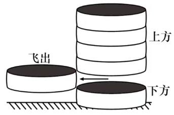

- **A**. 1
- **B**. 2
- **C**. 3
- **D**. 4

## 第 17 题　qid 12019719 · 科技常识

如图所示，实心铜方块放置在容器底部，沿容器内壁往容器内加入水，直至杯中完全装满水。下列选项中，最有可能正确反映方块对容器底部压力（p）随水深（h）变化情况的是（    ）。

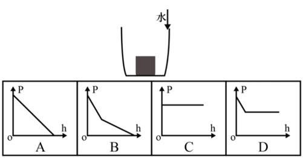

- **A**. A
- **B**. B
- **C**. C
- **D**. D

## 第 18 题　qid 12019722 · 科技常识

某款电热毯有3个档位，由一个开关控制。其中，0档为关机，1档为低功率加热，2档为高功率加热，则以下选项最可能是该款电热毯电路示意图的是（    ）。

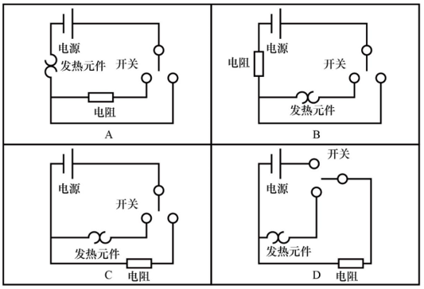

- **A**. A
- **B**. B
- **C**. C
- **D**. D

## 第 19 题　qid 12019721 · 科技常识

锋面雨的形成与夏季风的暖湿气流和冬季风干冷气流相遇有关，是冷暖空气交汇形成的降雨现象，主要在每年的4到5月影响我国华南地区。下列示意图最有可能正确反映锋面雨形成原理的是（    ）。

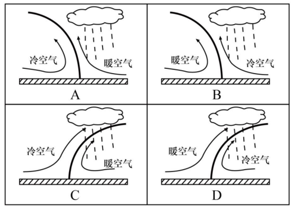

- **A**. A
- **B**. B
- **C**. C
- **D**. D

## 第 20 题　qid 12019723 · 科技常识

下图为海洋生态系统中部分生物之间的捕食关系，则以下有关说法正确的是（    ）。

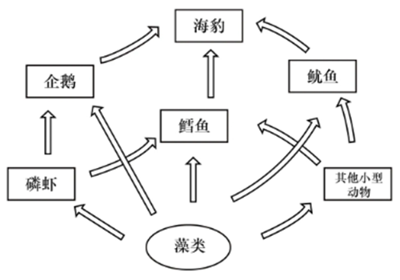

- **A**. 磷虾大量减少会对该系统产生毁灭性的影响
- **B**. 该食物网中包括了生产者、消费者以及分解者
- **C**. 图中最短的食物链有3个营养级
- **D**. 该食物网共涉及6条食物链

## 第 21 题　qid 18643995 · 逻辑填空

创新从来都是九死一生，但我们必须有“亦余心之所善兮，虽九死其犹未悔”的豪情。我国广大科技工作者要有强烈的创新信心和决心，既不            ，也不妄自尊大，勇于攻坚克难、追求卓越、赢得胜利，积极抢占科技竞争和未来发展制高点。
填入画横线部分最恰当的一项是：

- **A**. 固步自封
- **B**. 骄傲自满
- **C**. 妄自菲薄
- **D**. 甘居人后

## 第 22 题　qid 18643996 · 逻辑填空

从广袤的海洋到无垠的天空，从复杂的陆地战场到神秘的电磁空间，每一个角落都        着高科技的较量。其中，数据链宛如一条无形却坚韧的纽带，将各个作战单元紧密相连，成为现代战争中            的关键要素，深刻地影响甚至决定着战争的走向与胜负。
依次填入画横线处最正确的一项是：

- **A**. 弥漫 举足轻重
- **B**. 交织 毋庸置疑
- **C**. 充斥 当之无愧
- **D**. 遍布 不可偏废

## 第 23 题　qid 18643998 · 逻辑填空

星间链路技术，让北斗系统实现了“一星通，星星通”。从一片空白、奋力追赶，再到和世界领先的全球导航系统            ，一代代科研人员自立自强、自主创新、拼搏超越，蹚出了一条            的卫星导航探索之路。
依次填入画横线处最恰当的一项是：

- **A**. 不分伯仲 别无二致
- **B**. 不期而遇 独具匠心
- **C**. 并行不悖 别开生面
- **D**. 并驾齐驱 独具一格

## 第 24 题　qid 18644003 · 逻辑填空

树立正确的政绩观，既要以“立说立行”的锐气抢抓机遇，又要以“久久为功”的韧劲夯实发展根基。“立说立行”强调机遇            的紧迫感，“久久为功”则注重            的战略定力，二者看似矛盾，实则统一于高质量发展的实践逻辑中。
依次填入画横线部分最恰当的一项是：

- **A**. 白驹过隙 稳扎稳打
- **B**. 稍纵即逝 持之以恒
- **C**. 千载难逢 坚如磐石
- **D**. 时不我待 安之若素

## 第 25 题　qid 12019682 · 逻辑填空

全球发展倡议提出以来，理念内涵不断        ，落实机制不断健全，推进路径更加        ，务实合作逐步落地，推动国际社会聚焦发展问题，培育面向未来的高质量发展动能，为全球南方国家        发展鸿沟、共建美好世界提供中国方案。
依次填入画横线部分最恰当的一项是：

- **A**. 升华 明确 修补
- **B**. 丰富 清晰 弥合
- **C**. 扩展 宽阔 跨越
- **D**. 深化 通达 消弭

## 第 26 题　qid 18644005 · 片段阅读

当前，中国经济已转向高质量发展阶段，旧的生产函数组合方式已经难以持续，不可能像高速增长阶段那样主要依靠要素投入驱动经济增长，必须转向更多依靠科技创新和全要素生产率的提高。面对新一轮科技革命和产业变革深入发展，中国既要摆脱传统增长方式下粗放扩张、低效发展的生产力发展路径，又要拓展先进生产力发展空间。以科技创新为核心，培育和发展新质生产力，才能为高质量发展开辟新路径、注入新动力。
这段文字主要讲了（    ）。

- **A**. 重大技术变革驱动中国经济高速增长
- **B**. 高质量发展离不开培育和发展新质生产力
- **C**. 每一次科技革命都会带来生产力质的飞跃
- **D**. 科技创新是培育和发展新质生产力的核心

## 第 27 题　qid 18644008 · 语句表达

服务群众，用“家常话”将政策解释清楚只是第一步，更需要读懂群众“家常话”背后的喜怒哀乐。“家常话”里，有群众的关切点，也有推动政策落地的发力点，在这里，“社会救助”不是抽象名词，而是张大爷的医药费有着落；“产业振兴”不只是报告里的概念，而是李大姐柑橘园里的累累硕果。                    ，服务群众才会更加精准、更有实效。
填入上文画横线处的语句，最恰当的一句是（    ）。

- **A**. 找准大家的关切事
- **B**. 将群众的需求装心里
- **C**. 多下笨功夫、多啃硬骨头
- **D**. 常进老乡门、常聊家里事

## 第 28 题　qid 18644006 · 片段阅读

改革不可能一蹴而就，特别是许多重大改革任务需要一年接着一年推进。党员干部特别是领导干部对于前任领导推进的改革任务，只要是贯彻党中央精神的、切合实践要求的、符合人民群众愿望的，就要坚持一张蓝图绘到底，一茬接着一茬干。对于改革任务的落实，不能“新官不理旧账”，这是确保干一件成一件的内在要求。新时代，许许多多改革任务的落实，都是一茬接着一茬干的结果。
以下干事创业精神，最贴合上文要求的是（    ）。

- **A**. 时不我待、只争朝夕
- **B**. 抓铁有痕、踏石留印
- **C**. 功成不必在我、功成必定有我
- **D**. 踏平坎坷成大道，斗罢艰险又出发

## 第 29 题　qid 18644007 · 片段阅读

近年来，多地鼓励市民通过“随手拍”反映市政设施损坏、不文明行为等城市治理问题。作为庞大复杂的有机体，城市运转涉及经济、文化、民生等多个领域和部门，规划、政策、制度等即便再完善细密也难以穷尽城市治理的每一个细节、每一处角落。城市理想蓝图与现实场景之间的微小“空白”，特别需要广大市民主动作为、共同“填补”。看似简单的市民“随手拍”，反映出市民变被动接受公共服务为主动参与城市治理的积极意识。
上述文字意在说明（    ）。

- **A**. 城市文明建设人人有责
- **B**. 城市运转体系庞大且复杂
- **C**. 城市治理需要市民主动参与
- **D**. 城市理想蓝图需要全民共绘

## 第 30 题　qid 12019680 · 片段阅读

从“村BA”到“村超”，从乡村博物馆到美术馆、音乐会，一批乡村文体活动开展得有声有色。这些乡村公共文化服务衍生出的新业态，正在成为推动乡村全面振兴的重要动力。乡村公共文化服务提升和乡村文化产业发展要充分考虑乡土特征，聚焦乡村资源优势和文化特色，提炼乡村的文化主题和品牌定位，打造集村史馆、乡村书屋等功能于一体的复合体空间，采用多元化、艺术化和高新技术的场景营造手段，建设乡土美学生活体验中心，注重乡村本土节日的挖掘，从而推动文化创意赋能乡村可持续发展。
根据这段文字，作者最有可能认同（    ）。

- **A**. 乡村公共文化服务是推动乡村全面振兴的重要动力
- **B**. 村字头的文体活动是乡村公共文化服务的典型代表
- **C**. 复合体空间的主要价值在于合理利用乡村空间资源
- **D**. 挖掘乡村本土文化资源有利于推动乡村可持续发展

## 第 31 题　qid 12019681 · 片段阅读

“发展是人类社会永恒的主题”“贫穷是实现人权的最大障碍”······这些朴素而深刻的论断，构成了中国人权观的重要认知基础。正如习近平主席所强调的，对于发展中国家来说，“生存权、发展权是首要的基本人权”，要“在发展中保障和改善民生，保护和促进人权”。离开了发展，其他一切权利的实现便如同空中楼阁、无源之水。正是基于这一根本遵循，中国走出了一条将人权的普遍性原则与本国实际相结合、以发展促进和保障人权的特色道路。
以下选项中，最适合作为这段文字标题的是（    ）。

- **A**. 以发展之钥，启人权之门
- **B**. 发展：人权治理的全球方案
- **C**. 生存和发展——人类的基本权利
- **D**. 发展权优先：人权保障的基本共识

## 第 32 题　qid 12019683 · 片段阅读

文化重在化人，但能否真正用文化引导人们坚定理想、塑造灵魂、涵养品德、砥砺人格等，要看“化”的水平。如何使以文化人“化”得合情理、“化”得受欢迎、“化”得效果好，考验着我们的文化工作水平。习近平总书记强调：“要润物细无声，运用各类文化形式，生动具体地表现社会主义核心价值观，用高质量高水平的作品形象地告诉人们什么是真善美，什么是假恶丑，什么是值得肯定和赞扬的，什么是必须反对和否定的。”
根据这段文字，作者意在强调：

- **A**. 文化工作的目的和意义
- **B**. 文化工作水平的重要性
- **C**. 以文化人要注重文化传播的方式方法
- **D**. 以文化人要坚持社会主义核心价值观

## 第 33 题　qid 12019684 · 语句表达

在中华文明滋养的神州大地上，                    。袁隆平院士一生扎根稻田，用“粒粒皆辛苦”的执着培育出杂交水稻；“时代楷模”张玉滚坚守深山小学二十余载，以“桃李不言”的奉献点亮山村孩子的未来；“大国工匠”高凤林焊接火箭发动机，用“毫厘不差”的精准诠释工匠精神；“人民楷模”王继才32年坚守开山岛，用“孤岛不孤”的信念诠释守岛人的担当······一位位先进典型、一次次精神洗礼，不断激发全社会的思想认同、情感共鸣和效仿意愿，营造出崇德向善、见贤思齐、德行天下的浓厚氛围。
据材料内容，填入横线处最合适的句子是（    ）。

- **A**. 处处可见光彩绽放的职业道德之花
- **B**. 职业道德建设开创新局面、展现新气象
- **C**. “敬事而信”“鞠躬尽瘁”的敬业精神代代相传
- **D**. 每个行业都践行着用心钻研、追求极致的工匠精神

## 第 34 题　qid 12019701 · 片段阅读

造纸术和印刷术的发明，为文学提供了物质载体与传播媒介，催生了图书出版业，电气技术使得记录影像和声音成为可能，带动广播、电影、电视等的发展，在新一轮科技革命和产业变革加快孕育的今天，人工智能、5G、区块链等新技术得到普及应用，科技进步对文化创新的驱动作用日益显著，极大地激发文化创新创造活力，为文化繁荣发展提供了新的载体和机遇。
对上述文段内容概括最准确的是（    ）。

- **A**. 文化创新与科技革命始终深度融合
- **B**. 文化产业发展为科技创新带来澎湃动力
- **C**. 文化领域的发展变革与科技进步息息相关
- **D**. 科技进步充分激发大众文化创新创造活力

## 第 35 题　qid 12019698 · 语句表达

将以下句子重新排列，顺序最恰当的是（    ）。
①中国倡导平等有序的世界多极化和普惠包容的经济全球化，这两大主张有着极强的现实针对性和战略指导性。
②世界多极化是历史发展的大势，也是历史进步的方向。
③这两大主张契合大多数国家和各国民众的普遍诉求，为国际社会从变乱交织走向长治久安指明了方向，为推动构建人类命运共同体注入源源不断的动力。
④经济全球化是生产力发展的客观要求，也是人类社会前进的必由之路。
⑤平等有序的世界多极化强调坚持大小国家一律平等，并确保多极化进程总体稳定和具有建设性，为推动构建更加公正合理的全球治理体系提供了重要路径。
⑥普惠包容的经济全球化强调解决好资源全球配置造成的国家间和各国内部发展失衡问题，并支持各国走出符合自身国情的发展道路，携手推进全人类的共同发展。

- **A**. ①④⑥②③⑤
- **B**. ①③②⑤④⑥
- **C**. ①③⑤⑥②④
- **D**. ①②⑤④⑥③

## 第 36 题　qid 18643976 · 数学运算

，，，，，，（    ）

- **A**. 
1

- **B**. 

- **C**. 

- **D**. 

## 第 37 题　qid 18643978 · 数学运算

未来五年，某市计划新增风电装机容量占新能源总装机容量的40%，光伏装机容量占新能源总装机容量的35%，其余为生物质能，已知光伏装机容量比生物质能多120兆瓦，则未来五年，该市新能源总装机容量为（    ）兆瓦。

- **A**. 600
- **B**. 800
- **C**. 1000
- **D**. 1200

## 第 38 题　qid 18643980 · 数学运算

某厂家在广交会期间获得了大量的订单，其中，周六签约的客户数量是周日的1.5倍，签约总金额是周日的80%，如果周六、周日共与40家客户定成了签约，订单总金额为720万元（没有重复签约的客户），则周日平均每家客户的签约金额为（    ）万元。

- **A**. 15
- **B**. 20
- **C**. 25
- **D**. 10

## 第 39 题　qid 18643979 · 数学运算

某蓄电池可以同时供20台设备运行5天，在供20台设备运行12小时后，又新增了5台设备。如果所有设备每天的耗电量相等，则该蓄电池还可以供这些设备运行（    ）天。

- **A**. 3.5
- **B**. 3.6
- **C**. 3.8
- **D**. 4.0

## 第 40 题　qid 18643972 · 数学运算

某企业每生产一台能耗高的服务器，能获得5万元的利润，但要扣除4单位碳配额；每生产一台能耗低的终端，能获得2万元的利润，并增加1单位碳配额。若该企业每月最多生产服务器和终端共2000台，且每月的碳配额总量不低于零，则该企业每月最大利润为（    ）万元。

- **A**. 4800
- **B**. 5000
- **C**. 5200
- **D**. 6000

## 第 41 题　qid 18643971 · 数学运算

雨季期间，某市单日的暴雨发生率为30%，暴雨出现时当地市区主干道拥堵的概率为70%，其余时间拥堵的概率为20%，则雨季期间当地市区主干道拥堵的平均概率为（    ）。

- **A**. 25%
- **B**. 35%
- **C**. 45%
- **D**. 55%

## 第 42 题　qid 18643981 · 数学运算

某块不规则的四边形菜地被沿着对角线分为四个区域，分别种上青菜、毛豆、番茄和茄子。已知青菜的种植面积比毛豆多40%，番茄的种植面积比茄子多40平方米，比青菜少了140平方米。则毛豆的种植面积比茄子多了（    ）平方米。

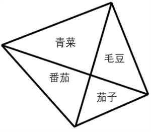

- **A**. 60
- **B**. 70
- **C**. 90
- **D**. 100

## 第 43 题　qid 18643973 · 数学运算

某街道计划在本周的周一至周日中选取3天开展社区活动。如果要求每次活动之间至少间隔1天，则可行的活动时间安排有（    ）种。

- **A**. 3
- **B**. 5
- **C**. 10
- **D**. 15

## 第 44 题　qid 18643974 · 数学运算

甲、乙、丙、丁四人参加知识竞赛，得分均为正整数，得分从高到低依次是甲、乙、丙、丁。如果甲和乙的总得分为100分，乙和丙的总得分为96分，丙和丁的总得分为80分，则丁的得分为：

- **A**. 33
- **B**. 36
- **C**. 39
- **D**. 不能确定

## 第 45 题　qid 18643975 · 数学运算

有4批原材料存放在同一个仓库，工厂每次会从仓库中运出一整批原材料进行加工，加工完成后才能从仓库提取下一批原材料。已知一批原材料在仓库内每存放满1小时需要支付100元的费用，且工厂加工这4批原材料需要的时间分别为4、6、7、8小时，则工厂为这些原材料支付的仓库存放费用至少为（    ）元。

- **A**. 2800
- **B**. 3100
- **C**. 3300
- **D**. 3500

## 第 46 题　qid 18643977 · 数学运算

甲、乙两人在小区内晨跑，速度分别是140米/分钟和100米/分钟。他们同时从小区跑道的起点向终点匀速跑步，各自不停地在起点和终点往返。如果该跑道的长度为200米，则当甲第二次追上乙时，距离起点（    ）米。

- **A**. 0
- **B**. 50
- **C**. 100
- **D**. 200

## 第 47 题　qid 18643986 · 图形推理

下列选项中最符合所给图形规律的是（    ）。

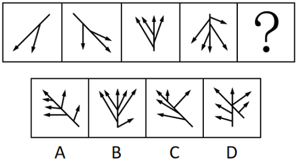

- **A**. A
- **B**. B
- **C**. C
- **D**. D

## 第 48 题　qid 18643988 · 图形推理

下列选项中最符合所给图形规律的是（    ）。

- **A**. A
- **B**. B
- **C**. C
- **D**. D

## 第 49 题　qid 18643983 · 图形推理

下列4个所给图形不经过旋转或翻转，可以拼接构成（    ）。

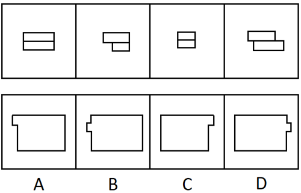

- **A**. A
- **B**. B
- **C**. C
- **D**. D

## 第 50 题　qid 18643993 · 图形推理

下列选项中最符合所给图形规律的是（    ）。

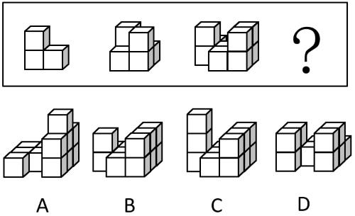

- **A**. A
- **B**. B
- **C**. C
- **D**. D

## 第 51 题　qid 12019707 · 图形推理

下列选项中，可以由给定平面图折叠而成的是（    ）。

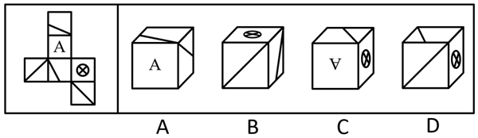

- **A**. A
- **B**. B
- **C**. C
- **D**. D

## 第 52 题　qid 18643984 · 逻辑判断

如果一座城市采用集约高效的发展方式，那么其资源消耗量必然会减少。只要这种减少速度非常缓慢，就不会对城市经济发展造成负面影响。
由此可以推出：

- **A**. 如果资源消耗量没有减少，说明该城市没有采用集约高效的发展方式
- **B**. 如果城市没有采用集约高效的发展方式，其资源消耗量必然没有减少
- **C**. 如果资源消耗量减少，说明该城市采用了集约高效的发展方式
- **D**. 如果资源消耗量减少的速度很快，必然会对该城市的经济发展造成负面影响

## 第 53 题　qid 18643982 · 逻辑判断

甘蔗是生产加工食糖的重要原料。近年来，世界范围内甘蔗种植面积不断扩大，在一定程度上改变了土地利用的格局。由于全球食糖需求不断增长，有人因此认为，随着食糖的生产加工规模进一步扩大，甘蔗种植会进一步改变土地利用的格局。
要使上述推论成立，需要补充的前提是（    ）。

- **A**. 甘蔗种植用水量较大，会给当地水资源造成压力
- **B**. 甘蔗的种植周期较短，能够为食糖的生产快速提供原料
- **C**. 随着全球食糖需求的增长，种植者会扩大甘蔗的种植面积
- **D**. 适宜种植甘蔗的区域，其土壤条件也适合种植其他富含糖分的作物

## 第 54 题　qid 18643985 · 逻辑判断

某种水毛茛是A市特有的野生植物，对水质要求极高，其仅生长于清澈、流动的水体中，因此被誉为优良水质的“指示物种”。2023年受特大暴雨影响，A市某自然保护区内的水毛茛大面积消失，其所依赖的自然条件难以自行恢复，因而面临灭绝的风险。但在今年春季，有人发现，该自然保护区内重新出现了这种水毛茛，且群落规模远超以往。
下列选项如果为真，最能解释上述现象的是（    ）。

- **A**. 这种水毛茛的分布范围已扩展至与自然保护区相邻的多处水域
- **B**. 即使经历了暴雨，该自然保护区的水质仍然优于周边河流水域
- **C**. 这种水毛茛同时具备有性繁殖和无性繁殖的能力，繁殖能力较强
- **D**. 近两年，通过水系修复等人工措施，该自然保护区的水质大幅提高了

## 第 55 题　qid 18643987 · 逻辑判断

某单位计划组织职工参观科技馆、文化馆、博物馆和美术馆。但由于时间有限，这4个场馆不能都去。有职工提出了如下建议并被采纳：
（1）由于相距较远，不建议既去文化馆又去博物馆；
（2）美术馆和文化馆的展览都很有吸引力，至少参观其中的一个；
（3）去年已经去过美术馆，今年就不去了。
补充下列选项中的（    ），可以得出“该单位一定会去科技馆”的结论。

- **A**. 如果不去科技馆，就去博物馆
- **B**. 只有不去科技馆，才去博物馆
- **C**. 只有不去博物馆，才不去科技馆
- **D**. 如果要去博物馆，不去科技馆

## 第 56 题　qid 18643991 · 逻辑判断

太空环境具有高真空、高辐射、微重力、极端温度变化等特点，对人造卫星的材料和电子元件提出了极高的要求。近日，我国成功发射了太空计算卫星。由于太空计算卫星具备强大的数据实时处理能力，有专家据此认为，未来太空计算卫星将广泛应用于应急安全、城市治理等领域。
下列选项最有可能是上述推论暗含前提的是（    ）。

- **A**. 太空计算卫星能够同时适应地面环境和太空环境
- **B**. 太空计算卫星在太空中的数据处理速度显著快于地面
- **C**. 我国目前亟需采集应急安全、城市治理等领域的实时数据
- **D**. 应急安全、城市治理等领域存在大量需要实时处理的数据

## 第 57 题　qid 18643989 · 逻辑判断

针对某款即将上市的新产品，商家开展了预售活动，预订的人数远超预期。但在产品正式发货前，许多顾客却取消了该产品的预订。
下列选项如果为真，最不能解释上述现象的是（    ）。

- **A**. 因为产能问题，该产品发货日期一再延后
- **B**. 收到货后，许多顾客反映该产品质量欠佳
- **C**. 预售还未结束，商家就对新预订的用户给予了更大的优惠
- **D**. 产品预售期间，其他商家推出了多款设计接近但价格更低的竞品

## 第 58 题　qid 18643992 · 类比推理

不建立主体明确、要求清晰的责任体系，就不能压紧压实安全生产责任。当前主体明确、要求清晰的责任体系已经建立，因此安全生产责任已经压紧压实。
下列选项与题干逻辑结构最为相似的是（    ）。

- **A**. 只有实行多元共治，才能构建和谐社区。某社区建成了和谐社区，因此该社区实行了多元共治
- **B**. 不实现教育资源的公平分配，就无法提高全民素质。当前全民素质还有待提高，所以教育资源的公平分配还未实现
- **C**. 如果某地区深入推进生态文明建设，那么该地区已经实现了资源循环利用。这是因为不深入推进生态文明建设，就无法实现资源循环利用
- **D**. 如果合理开采资源，就能实现自然资源的可持续利用。多地政府已经出台法律法规禁止过度开采，因此许多地区已经实现了自然资源的可持续利用

## 第 59 题　qid 18643994 · 逻辑判断

湖泊在北极的面积占比达到四成，为动植物生存提供了不可或缺的淡水资源。近年来，全球变暖使得北极的永冻土层逐渐融化，融化的水随之流入湖泊和海洋。有人据此推测，北极现存的湖泊面积应该扩张，然而观测数据显示，大部分北极湖泊面积都有所缩减。
下列选项如果为真，最能解释上述现象的是（    ）。

- **A**. 据统计，大部分处于逐渐融化状态的冰山位于海洋中
- **B**. 近年来北极动植物数量不断增加，淡水资源的需求量不断增大
- **C**. 由于冰川消融，北极地区的部分湖泊相互连接成了一个更大的湖泊
- **D**. 永冻土层消融使北极地区的湖泊底部出现大量孔隙，湖水从孔隙渗漏

## 第 60 题　qid 18643990 · 逻辑判断

对于研发型企业来说，获得突破性的研发成果至关重要。某研发型企业在回顾其发展历程后发现，企业大多数突破性的研发成果都源自新手研发人员。该企业因此认为，要想获得更多的突破性研发成果，在组建新的研发团队时应当只考虑新手研发人员。
以下选项如果为真，最能反驳这一结论的是（    ）。

- **A**. 该企业现有的多数重要研发成果尚未成功转化应用
- **B**. 对于大多数的新手研发人员，该企业目前的薪资吸引力不高
- **C**. 突破性的研究设想都需要经过经验丰富的研发人员改进才能实现
- **D**. 将新手研发人员培养成经验丰富的研发人员需要投入大量的资源

## 第 61 题　qid 18643997 · 逻辑判断

研究团队开发了一种新型抗衰老水凝胶材料，为了验证这一材料的实际效果，研究团队开展了系列实验。结果发现，与未注入该材料的实验鼠相比，注入该材料的实验鼠肌肉组织中细胞的代谢水平显著提高，细胞端粒长度平均延长15%，且肌肉再生能力提升40%。由此可以推断，该材料能在一定程度上抗衰老。
以下选项如果为真，最不能支持这一结论的是（    ）。

- **A**. 细胞的代谢水平往往与其衰老程度呈负相关
- **B**. 老年动物的肌肉再生能力显著低于青壮年动物
- **C**. 将该材料注入小鼠体内后，小鼠未产生明显的免疫反应
- **D**. 端粒长度延长是细胞分裂激活的伴随现象，表明细胞恢复了“年轻”

## 第 62 题　qid 18644000 · 类比推理

绿化率高的小区，居民幸福感强。居民幸福感强的小区，环境卫生状况好。因此，绿化率高的小区环境卫生状况好。
下列选项与上述推理的逻辑结构最为相似的是（    ）。

- **A**. 粉尘浓度高的区域遇明火易发生爆炸，易发生爆炸的区域都应严禁烟火。因此粉尘浓度不高的区域无需禁止烟火
- **B**. 员工满意度较高的公司离职率较低，而绩效考核合理的公司员工满意度较高。因此绩效考核合理的公司离职率较低
- **C**. 利润增长快的企业都进行了技术创新，这是因为企业通过技术创新可以提高生产效率，而生产效率的提高可以促进利润增长
- **D**. 双减政策的落实减轻了学生的学习压力，课外活动时间的增加也减轻了学生的学习压力。因此，课外活动时间的增加体现了双减政策的落实

## 第 63 题　qid 18643999 · 类比推理

某市召开年度经济工作会议，根据安排，某一排是教育局、住建局、交通局、农业局、人社局、财政局6个职能局的座位。已知：
①财政局在人社局的右手边并与之相邻，在住建局的左手边但与之不相邻；
②教育局与交通局之间隔着一个职能局。
如果农业局和财政局相邻，则下列选项必然正确的是（    ）。

- **A**. 教育局在从右到左第三位
- **B**. 住建局在从右到左第二位
- **C**. 交通局在从左到右第三位
- **D**. 人社局在从左到右第二位

## 第 64 题　qid 18644002 · 类比推理

某次“特色示范村”评选活动设立了文化旅游、非遗传承、生态农业、数字农业示范村4个奖项，甲、乙、丙、丁4个村庄各获其中之一。已知：
①文化旅游示范村的经济收入高于丙村；
②甲村和数字农业示范村的经济收入相当，且都不是最高的；
③生态农业示范村的经济收入比丁村高；
④丙村的经济收入高于非遗传承示范村。
根据上述条件，下列选项必然正确的是（    ）。

- **A**. 甲村的经济收入在4个村庄中位列第二
- **B**. 乙村获评文化旅游示范村
- **C**. 丙村获评数字农业示范村
- **D**. 丁村获评非遗传承示范村

## 第 65 题　qid 18644001 · 逻辑判断

某古生物学研究小组在一处白垩纪晚期地层中发现了保存完整的恐龙皮肤化石。通过高分辨率显微镜，研究人员发现该恐龙皮肤表面存在大量微小的中空管状结构。由于这些结构类似于现代鸟类羽毛中用于体温调节的羽茎，研究人员推测，这些微小的中空管状结构是恐龙用于调节体温的特殊结构。
以下选项如果为真，最能支持上述推测的是（    ）。

- **A**. 这些中空管状结构能够增强生物体表的散热能力
- **B**. 其他恐龙化石之中也发现了类似的中空管状结构
- **C**. 现代爬行类动物的皮肤表面不存在类似的中空管状结构
- **D**. 由于白垩纪晚期气候异常，恐龙需要体温调节机制维持生存

## 第 66 题　qid 18644004 · 类比推理

企业节能减排必须通过购买碳配额或自主开发减排项目实现。某企业未购买碳配额，因此该企业要节能减排需自主开发减排项目。
下列选项与题干逻辑结构最为相似的是（    ）。

- **A**. 申请绿色产品认证的公司需通过专家评审或提交检测报告。某公司未提交过检测报告，因此该公司应当组织开展专家评审
- **B**. 有的地区支持企业购买碳汇，有的地区则支持企业使用清洁能源。某地区支持企业使用清洁能源，因此该地区不支持企业购买碳汇
- **C**. 企业申请创业补贴或者通过线上申请，或者通过线下窗口办理。某企业已经通过线上渠道提交了申请，因此无需前往线下窗口办理
- **D**. 重点排放单位应通过安装监测设备或委托第三方核查排放情况。某企业属重点排放单位且未委托第三方核查排放情况，因此该企业需安装监测设备核查排放情况

## 材料 1

        广东既是经济大省，也是人口大省、就业大省，数据显示，2024年广东净增74万人，新出生113.3万人；城镇新增就业超143万人，超额完成国家下达的110万人的年度就业任务，并且实现4386万异地务工人员稳定就业，是名副其实的就业超级“蓄水池”。

        今年以来，广东按照省委、省政府关于实施“百万英才汇南粤”行动计划的部署安排，围绕“粤聚英才、粤见未来”主题，广泛募集岗位、强化精准对接、提升优质服务、持续扩大声势。截至7月中旬，全省已吸纳超过100万应届高校毕业生留粤来粤就业创业，进一步夯实广东现代化产业体系的人才基座，充分彰显经济大省挑大梁的责任担当。

        “百万英才汇南粤”行动计划紧紧围绕广东现代化产业体系建设需要，聚焦20个战略性产业集群，突出新兴产业未来产业，充分发动知名科技企业拿出大量优质岗位，组织发动各类企事业单位动态募集120多万优质岗位，以具有竞争力的薪酬和岗位吸纳优秀高校毕业生，今年3至7月，累计组织2.1万家重点企业在“粤就业”小程序发布62.5万个岗位。其中，面向博士、硕士的8.6万个，面向本科生25.6万个，面向大专和各类技工学校学生28.3万个，年薪10万元以上岗位约26万个，年薪20万元以上岗位超6.5万个，年薪50万元以上甚至百万年薪的岗位超5000个。

        从留粤就业的省内应届高校毕业生情况看，今年1至7月，制造业吸纳毕业生约10万人，人数占比从2020年的14.72%提升到2025年的19.21%。其中，人工智能、机器人、半导体与集成电路、高端装备制造、新能源汽车、低空经济相关专业毕业生占四分之一，对发展新质生产力、建设现代化产业体系的人才支撑作用明显提升。

### 第 67 题　qid 12019685 · 综合

“百万英才汇南粤”行动计划围绕的主题是（    ）。

- **A**. “好岗配优才”
- **B**. “粤聚英才、粤见未来”
- **C**. “魅力大湾区，活力新广东”
- **D**. “经济大省挑大梁，再造一个新广东”

### 第 68 题　qid 12019686 · 综合

关于“百万英才汇南粤”行动计划，资料未提及（    ）。

- **A**. 紧紧围绕广东现代化产业体系建设需要
- **B**. 突出新兴产业未来产业
- **C**. 鼓励应届毕业生跨省就业创业
- **D**. 充分发动知名科技企业拿出大量优质岗位

### 第 69 题　qid 12019687 · 比重

2025年3至7月“粤就业”小程序发布的62.5万个岗位中，年薪10万元以上岗位占比（    ）。

- **A**. 在1成到2成之间
- **B**. 在2成到3成之间
- **C**. 在3成到4成之间
- **D**. 在4成到5成之间

### 第 70 题　qid 12019688 · 综合

2025年1至7月，留粤就业的人工智能、机器人、半导体与集成电路、高端装备制造、新能源汽车、低空经济相关专业省内应届高校毕业生约有（    ）万人。

- **A**. 2.5
- **B**. 5
- **C**. 7.5
- **D**. 10

### 第 71 题　qid 12019690 · 综合

根据资料，以下说法可以判断属实的是（    ）。

- **A**. 2024年，广东新出生人口超百万
- **B**. 2024年，广东省内应届高校毕业生中，本科生占比超40%
- **C**. 2025年上半年，广东超额完成国家下达的年度就业任务
- **D**. 2025年上半年，广东吸纳超百万应届高校毕业生留粤来粤就业创业

## 材料 2

        标准物质与尺子、砝码一样，是测量中必不可少的参照工具。它是已提前获得准确测量结果、均匀稳定的样品，待测样品以其为标准，确保不同时间、人员、实验室的测量结果可比。标准物质研制生产机构在开展具体品种标准物质的生产供应前，须通过技术审评并取得定级证书，这些取得定级证书的标准物质，统称为“国家标准物质”。根据计量溯源性、准确度和用途等，国家标准物质目前分为两类，即一级标准物质和二级标准物质。

        国家标准物质数量快速增长的原因有四个方面：一是用途广泛、涉及经济、社会发展的各个领域；二是需求大幅增加，检测部门和行业主管部门日益重视测量结果的准确性；三是产业发展迅速，除了中国计量科学研究院等机构之外，越来越多的企业积极申报国家标准物质；四是政策支持，国家市场监管总局出台了一系列措施，比如将国家标准物质纳入国务院计量发展规划、发布建设和管理指导意见，并优化审评制度，提高审批效率。

        截至2025年上半年，市场监管总局累计批准建立国家标准物质18982项。2025年上半年，我国新批准建立国家标准物质524项，同比增长78.8%，涉及研制单位51家。从研制单位类型看，企业申报标准物质379项，同比增长86.7%；科研事业单位申报145项，同比增长61.1%。从地域分布看，华北地区新建标准物质234项，华东地区新建标准物质124项，东北地区新建标准物质62项，西北地区新建标准物质48项，华南地区新建标准物质32项，西南地区新建标准物质24项，华中地区未新建标准物质。

### 第 72 题　qid 12019695 · 综合

根据计量溯源性、准确度和用途等，国家标准物质目前分为（    ）类。

- **A**. 两
- **B**. 三
- **C**. 四
- **D**. 五

### 第 73 题　qid 12019696 · 增长

根据资料，国家标准物质数量快速增长的原因不包括（    ）。

- **A**. 用途广泛
- **B**. 需求大幅增加
- **C**. 产业链完整
- **D**. 政策支持

### 第 74 题　qid 12019697 · 综合

截至2024年末，市场监管总局累计批准建立国家标准物质（    ）项。

- **A**. 17934
- **B**. 18458
- **C**. 18982
- **D**. 19506

### 第 75 题　qid 12019699 · 综合

2024年上半年，我国新批准建立的国家标准物质中，企业申报的标准物质项目数约占（    ）。

- **A**. 40%
- **B**. 50%
- **C**. 60%
- **D**. 70%

### 第 76 题　qid 12019700 · 综合

下列选项中，最有可能准确反映2025年上半年我国新建标准物质地域分布情况的是（    ）。

- **A**. 

- **B**. 

- **C**. 

- **D**. 

## 材料 3

        截至2024年末，广东省共有体育场地35.3万个，较上年增长3.58%；体育场地面积3.72亿平方米，较上年增长4.49%；人均体育场地面积2.91平方米（按常住人口计算），较上年增长3.93%。

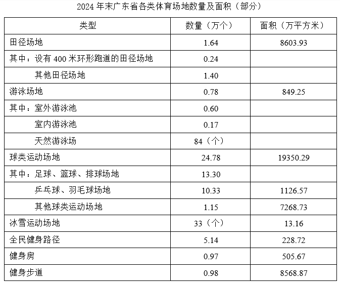

### 第 77 题　qid 12019689 · 增长

2024年，广东省体育场地数量增加约（    ）万个。

- **A**. 0.1
- **B**. 1.2
- **C**. 2.3
- **D**. 3.4

### 第 78 题　qid 12019691 · 比重

2024年末，广东省田径场地中，设有400米环形跑道的田径场地数量占比（    ）。

- **A**. 不到15%
- **B**. 在15%-20%之间
- **C**. 在20%-25%之间
- **D**. 超过25%

### 第 79 题　qid 12019692 · 综合

2024年末，广东省足球、篮球、排球“三大球”场地面积约为（    ）亿平方米。

- **A**. 0.10
- **B**. 0.11
- **C**. 1.04
- **D**. 1.10

### 第 80 题　qid 12019693 · 综合

2024年末，广东省下列运动场地单位面积排序正确的是：

- **A**. 冰雪运动场地>田径场地>游泳场地>健身房
- **B**. 田径场地>冰雪运动场地>健身房>游泳场地
- **C**. 田径场地>游泳场地>健身房>冰雪运动场地
- **D**. 田径场地>冰雪运动场地>游泳场地>健身房

### 第 81 题　qid 12019694 · 综合

根据材料，以下说法不正确的是（    ）。

- **A**. 2023年末，广东省体育场地面积超过了3亿平方米
- **B**. 2024年末，广东省常住人口超过1亿
- **C**. 2024年末，广东省天然游泳场数量在游泳场地数量中的占比不到1%
- **D**. 2024年末，广东省球类运动场地面积在全省体育场地面积中的占比超过50%

## 材料 4

        新中国成立以来，我国的城镇化建设不断推进，城市规模不断扩大，综合实力显著增强，基础设施持续改善，城市更加宜业宜居。

        从城市数量看，1948年末，我国城市共有58个，新中国成立后，大批县城改设为城市。1949年末，全国城市共有129个，其中，地级以上城市68个，县级市61个，建制镇2000个左右。改革开放前，我国的城镇化经历了一段比较曲折的发展历程，小城市和小城镇发展缓慢。1978年末，全国城市共有193个，其中，地级以上城市101个，县级市92个，建制镇2173个。改革开放以来，城市数量快速增加。2023年末，城市个数达到694个，其中，地级以上城市297个，县级市397个，建制镇21421个。

        从城市人口规模看，1949年末，城市人口共3949万人，百万人口以上城市仅5个，九成的城市人口在50万以下。改革开放后，城市人口规模不断扩大，人口集聚效应更加明显。2023年末，我国地级以上城市常住人口达到67313万人，常住人口超过500万的城市有29个，超过1000万的城市有11个。

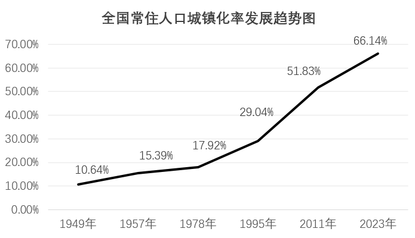

### 第 82 题　qid 12019702 · 增长

根据材料，下列时间段我国常住人口城镇化率增加最多的是：

- **A**. 1957—1978年
- **B**. 1978—1995年
- **C**. 1995—2011年
- **D**. 2011—2023年

### 第 83 题　qid 12019703 · 平均数

2023年末，我国地级以上城市的常住人口规模平均约为（    ）。

- **A**. 216.6万人
- **B**. 226.6万人
- **C**. 236.6万人
- **D**. 246.6万人

### 第 84 题　qid 12019704 · 比重

与1949年末相比，2023年末我国城市中，地级以上城市数量占比（    ）。

- **A**. 减少了约10个百分点
- **B**. 增加了约10个百分点
- **C**. 减少了约1个百分点
- **D**. 增加了约1个百分点

### 第 85 题　qid 12019705 · 增长

与1978年末相比，2023年末我国各类型城镇数量增幅排序正确的是（    ）。

- **A**. 地级以上城市>县级市>建制镇
- **B**. 建制镇>地级以上城市>县级市
- **C**. 地级以上城市>建制镇>县级市
- **D**. 建制镇>县级市>地级以上城市

### 第 86 题　qid 12019706 · 综合

根据资料，以下说法错误的是（    ）。

- **A**. 1949年末，我国非城镇常住人口数量不超过4亿
- **B**. 1978年末，我国县级市的数量在全国城市中的占比不到一半
- **C**. 2023年末，我国有5%以上的城市达到常住人口超500万的规模
- **D**. 2023年末，我国常住人口超1000万的地级以上的城市共容纳了超过15%的地级以上城市常住人口

## 答案与解析

第 1 题

**答案**：A

**来源参考解析（非官方标准答案）**

本题考查时政热点。
2025年11月7日至8日，习近平总书记在广东考察时强调，广东增创新优势、实现新突破，必须大力弘扬改革开放精神、特区精神，以全面深化改革开放推动高质量发展。要坚持有效市场和有为政府相结合，促进各种所有制经济优势互补、共同发展。着眼发展新质生产力，强化科技创新和产业创新深度融合，建设具有国际竞争力的现代化产业体系。
故表述正确。

---

第 2 题

**答案**：A

**来源参考解析（非官方标准答案）**

本题考查理论与政策。
2025年10月23日，中国共产党第二十届中央委员会第四次全体会议通过的《中共中央关于制定国民经济和社会发展第十五个五年规划的建议》中“八、加快农业农村现代化，扎实推进乡村全面振兴”部分指出：“农业农村现代化关系中国式现代化全局和成色。坚持把解决好‘三农’问题作为全党工作重中之重，促进城乡融合发展，持续巩固拓展脱贫攻坚成果，推动农村基本具备现代生活条件，加快建设农业强国。”
故表述正确。

---

第 3 题

**答案**：A

**来源参考解析（非官方标准答案）**

本题考查理论与政策。
2025年10月23日，中国共产党第二十届中央委员会第四次全体会议通过的《中共中央关于制定国民经济和社会发展第十五个五年规划的建议》中“三、建设现代化产业体系，巩固壮大实体经济根基”部分指出：“现代化产业体系是中国式现代化的物质技术基础。坚持把发展经济的着力点放在实体经济上，坚持智能化、绿色化、融合化方向，加快建设制造强国、质量强国、航天强国、交通强国、网络强国，保持制造业合理比重，构建以先进制造业为骨干的现代化产业体系。”
故表述正确。

---

第 4 题

**答案**：B

**来源参考解析（非官方标准答案）**

生产力决定生产关系，生产关系对生产力具有反作用。生产力是人类在生产实践中形成的改造和影响自然以使其适合社会需要的物质力量，表现的是人与自然的关系。历史唯物主义认为，生产力是人类社会发展的根本动力，也是一切社会变迁和政治变革的终极原因。故“生产关系”表述错误，应为“生产力”。
故表述错误。

---

第 5 题

**答案**：A

**来源参考解析（非官方标准答案）**

本题考查理论与政策。
2023年4月，中国社会科学网发表文章《深刻把握守正创新的核心意涵》（以下简称文章）。
A项错误，B项正确，文章指出：“守正是创新的前提和基础，创新是守正的目的和路径。守正并不是墨守成规、循规蹈矩，而是守住本和源、根和魂；创新也不是凭空幻想、恣意妄为，而是在把握事物发展规律的基础上充分发挥人的主观能动性。”故A项“创新是守正的基础和前提”表述错误，应为“守正是创新的基础和前提”。
C项正确，文章指出：“习近平总书记在学习贯彻党的二十大精神研讨班开班式上，深刻阐述了推进中国式现代化要处理好若干个重大关系，其中一个就是守正与创新的关系。守正与创新相辅相成，深刻彰显了‘变’与‘不变’、继承与发展、原则性与灵活性的辩证统一。”
D项正确，文章指出：“所谓守正，就是坚持实事求是，坚持真理性认识，坚持正确政治方向。守正是创新的基本前提，也是创新的可靠保障。”
本题为选非题，故正确答案为A。

---

第 6 题

**答案**：D

**来源参考解析（非官方标准答案）**

本题考查理论与政策。
D项正确，A、B两项错误，2023年7月17日至18日，全国生态环境保护大会在北京召开。习近平总书记在讲话中指出：“实现碳达峰碳中和，等不得也急不得，不可能毕其功于一役，必须坚持稳中求进、逐步实现，决不能搞‘碳冲锋’、‘运动式减碳’。要立足国情，坚持先立后破，加快规划建设新型能源体系，确保能源安全。要优化调整产业结构，大力发展绿色低碳产业，使发展建立在高效利用资源、严格保护生态环境、有效控制温室气体排放的基础上。对于传统行业，不能简单当成‘低端产业’一退了之、一关了之，而是要推动工艺、技术、装备升级，实现绿色低碳转型。要以更加积极的姿态参与全球气候治理，形成更加主动有利的新局面。”故A项“通过‘碳冲锋’‘运动式减碳’尽快实现目标”和B项“对于碳排放较高的传统行业，应优先关停、清退”均为错误表述。
C项错误，2023年7月17日，习近平总书记在全国生态环境保护大会上的讲话中指出：“推进碳达峰碳中和是党中央经过深思熟虑作出的重大战略决策，是我们对国际社会的庄严承诺，也是推动经济结构转型升级、形成绿色低碳产业竞争优势，实现高质量发展的内在要求。我们承诺的‘双碳’目标是确定不移的，但达到这一目标的路径和方式、节奏和力度则应该而且必须由我们自己作主，决不受他人左右。”故选项“与世界各国协商确定达到‘双碳’目标的路径和方式、节奏和力度”说法错误，应是“必须由我们自己作主，决不受他人左右”。
故正确答案为D。

---

第 7 题

**答案**：B

**来源参考解析（非官方标准答案）**

本题考查马克思主义。
题干强调宪法作为上层建筑，会随着经济基础的变化而变化，强调了马克思主义哲学中经济基础决定上层建筑的观点。
A项错误，“理国要道，在于公平正直”出自唐代吴兢的《贞观政要·卷五·论公平》，意为治理国家的关键，在于坚守公平正义、秉持公正无私的原则，主要涉及执政理念，属于上层建筑内部的思想观念层面。与题干观点不符。
B项正确，“法与时转则治，治与世宜则有功”出自战国时期韩非子的《韩非子·心度》，意为法度需随时代发展而调整，治理方式要与社会实际相适配，才能实现有效治理并取得成效。与题干观点相符。
C项错误，“盖天下之事，不难于立法，而难于法之必行”出自明代张居正的《请稽查章奏随事考成以修实政疏》，意为治理国家的事务，制定法律并不困难，难的是将法律切实贯彻执行，强调实践的重要性。与题干观点不符。
D项错误，“举直错诸枉，则民服；举枉错诸直，则民不服”出自《论语·为政》，意为提拔任用正直贤能的人，罢免贬斥奸邪不端的人，百姓就会信服；反之，任用奸邪的人、排挤正直的人，百姓就不会信服，强调“任人唯贤”是凝聚民心、稳定社会的关键。与题干观点不符。
故正确答案为B。

---

第 8 题

**答案**：D

**来源参考解析（非官方标准答案）**

本题考查理论与政策。
A、B两项正确，2015年2月10日，习近平总书记主持召开中央财经领导小组第九次会议时讲话指出，保障粮食安全，要加快转变农业发展方式······保障水安全，关键要转变治水思路，按照“节水优先、空间均衡、系统治理、两手发力”的方针治水，统筹做好水灾害防治、水资源节约、水生态保护修复、水环境治理。
C项正确，D项错误，2014年3月14日，习近平总书记在中央财经领导小组第五次会议上讲话指出，要大力宣传节水和洁水观念。树立节约用水就是保护生态、保护水源就是保护家园的意识，营造亲水、惜水、节水的良好氛围，消除水龙头上的浪费，倡导节约每一滴水，使爱护水、节约水成为全社会的良好风尚和自觉行动。2019年9月18日，习近平总书记在黄河流域生态保护和高质量发展座谈会上讲话指出，要坚持以水定城、以水定地、以水定人、以水定产，把水资源作为最大的刚性约束，合理规划人口、城市和产业发展，坚决抑制不合理用水需求，大力发展节水产业和技术，大力推进农业节水，实施全社会节水行动，推动用水方式由粗放向节约集约转变。故D项中“避免水资源成为发展的约束条件”表述错误，应为“把水资源作为最大的刚性约束”。
本题为选非题，故正确答案为D。

---

第 9 题

**答案**：BD

**来源参考解析（非官方标准答案）**

本题考查理论与政策。
2012年5月16日，时任中央政治局常委、中央党校校长的习近平在中央党校发表了题为《坚持实事求是的思想路线》的重要讲话。
A项错误，讲话指出：“坚持实事求是，就必须坚持一切从实际出发。为什么想问题、作决策、办事情必须从实际出发，而不能从本本出发呢？因为实际事物是具体的，而本本是对实际事物研究、抽象的结果，不能成为研究问题和作决策的出发点，出发点只能是客观实际。 ”故选项“从本本出发”说法错误，应是“从实际出发”。
B、D两项正确，讲话指出：“实事求是作为党的思想路线，它始终是马克思主义中国化理论成果的精髓和灵魂，即是毛泽东思想的精髓和灵魂，是包括邓小平理论、‘三个代表’重要思想以及科学发展观在内的中国特色社会主义理论体系的精髓和灵魂；它始终是中国共产党人认识世界和改造世界的根本要求，是我们党的基本思想方法、工作方法和领导方法，是党带领人民推动中国革命、建设、改革事业不断取得胜利的重要法宝。”
C项错误，讲话指出：“坚持实事求是，最基础的工作在于搞清楚‘实事’，就是了解实际、掌握实情。坚持实事求是，关键在于‘求是’，就是探求和掌握事物发展的规律。”故选项“最基础的工作在于‘求是’，关键在于搞清楚‘事实’”说法错误，应是“最基础的工作在于搞清楚‘实事’，关键在于‘求是’”。
故正确答案为BD。

---

第 10 题

**答案**：ACD

**来源参考解析（非官方标准答案）**

本题考查马克思主义。
A项正确，马克思主义哲学明确指出，运动是物质的根本属性和存在方式。物质和运动是不可分割的统一体，不存在脱离运动的物质，也不存在脱离物质的运动。任何物质都处于永恒的运动变化之中，静止只是运动的特殊状态。
B项错误，马克思主义坚持唯物主义一元论，认为世界的本原只有一个，即客观实在的物质，而非“多种物质的集合”。该项的表述属于多元论的错误观点，违背了马克思主义物质观的核心立场。
C项正确，列宁对马克思主义物质范畴给出了经典定义：物质是标志客观实在的哲学范畴，这种客观实在是人通过感觉感知的，它不依赖于我们的感觉而存在，为我们的感觉所复写、摄影、反映。这一定义精准概括了物质的本质属性。
D项正确，物质资料的生产方式由生产力和生产关系构成，它是人类社会存在和发展的基础。人类的第一个历史活动就是生产满足自身生存需要的物质资料，生产方式决定着社会的性质、结构和面貌，也决定着社会形态的更替。
故正确答案为ACD。

---

第 11 题

**答案**：D

**来源参考解析（非官方标准答案）**

本题考查人文常识。
A项错误，“十四五”规划是我国在2021年至2025年期间的国民经济和社会发展战略，故2025年是“十四五”规划的收官之年。
B、C两项错误，五年规划，全称为中华人民共和国国民经济和社会发展五年规划纲要，是中国国民经济计划的重要部分，属长期计划。中国从1953年开始制定实施第一个“五年计划”。从“十一五”起，“五年计划”改为“五年规划”。故B项中“1949年”表述有误，应为“1953年”；C项中“十三五”表述有误，应为“十一五”。
D项正确，2020年10月29日，习近平总书记在党的十九届五中全会第二次全体会议上的讲话中指出：“从第一个五年计划到第十四个五年规划，一以贯之的主题是把我国建设成为社会主义现代化国家。”
故正确答案为D。

---

第 12 题

**答案**：C

**来源参考解析（非官方标准答案）**

本题考查科技常识。
2025年7月9日，国务院新闻办公室举行“高质量完成‘十四五’规划”系列主题新闻发布会。
A、D两项正确，C项错误，国家发展改革委主任郑栅洁在发布会上表示，中国还是全球第一制造业大国、第一货物贸易大国、第一外汇储备大国、第一能源生产大国、第一人力资源大国，拥有世界上规模最大的中等收入群体、社会保障体系，建成了全球数量最多的5G基站······我国连续15年稳坐全球制造业“头把交椅”，200多种主要工业品产量世界第一，中国不能造的越来越少、能造的越来越好。故选项“拥有世界上规模最大的高等收入群体”说法错误，应是“拥有世界上规模最大的中等收入群体”
B项正确，国家发展改革委主任郑栅洁在发布会上表示，绿水青山就是金山银山理念深入人心，绿色已经成为当代中国的鲜明底色，这五年的成效集中体现在增绿、治污、用能、循环四个方面。“增绿”全球最多，森林覆盖率提高到25%以上，新增森林面积相当于1个陕西省的面积，贡献了全球新增绿化面积的四分之一。
本题为选非题，故正确答案为C。

---

第 13 题

**答案**：A

**来源参考解析（非官方标准答案）**

本题考查地理国情。
A项错误，C项正确，珠江口首座跨江大桥是虎门大桥，而非黄茅海大桥。黄茅海大桥是连接珠海与江门的跨海通道，于2024年通车，是大湾区西部重要交通枢纽。虎门大桥是中国自主设计建造的首座特大型大跨度钢箱梁悬索桥，全长15.6公里，主航道跨径888米，于1997年6月9日通车。
B项正确，港珠澳大桥是连接中国香港、广东珠海和中国澳门的一项横跨珠江口伶仃洋海域的超大型跨海交通工程。港珠澳大桥东起香港国际机场附近的香港口岸人工岛，向西横跨南海伶仃洋水域接珠海和澳门人工岛，止于珠海洪湾立交。桥隧全长55千米，其中主桥29.6千米、香港口岸至珠澳口岸41.6千米。
D项正确，深中通道集桥梁、人工岛、海底隧道、水下互通（“桥、岛、隧、水下互通”）于一体，是目前世界上技术难度最高的跨海集群工程之一，首次在超宽、超深、强台风海域建设的沉管隧道，攻克“深海无作业面对接”等技术难题。2024年6月30日全线通车。
本题为选非题，故正确答案为A。

---

第 14 题

**答案**：C

**来源参考解析（非官方标准答案）**

本题考查法律常识。
A项正确，根据《中华人民共和国国歌法》第四条第四项规定：“在下列场合，应当奏唱国歌：（四）升国旗仪式；”因此，某小学每周举行升国旗仪式时奏唱国歌符合我国国歌法。
B项正确，根据《中华人民共和国国歌法》第四条第八项规定：“在下列场合，应当奏唱国歌：（八）重大体育赛事；”因此，某省级重大综合体育赛事开幕式奏唱国歌符合我国国歌法。
C项错误，根据《中华人民共和国国歌法》第八条规定：“国歌不得用于或者变相用于商标、商业广告，不得在私人丧事活动等不适宜的场合使用，不得作为公共场所的背景音乐等。”因此，某市中心广场将国歌用作公共场所的背景音乐违反我国国歌法。
D项正确，根据《中华人民共和国国歌法》第四条第五项规定：“在下列场合，应当奏唱国歌：（五）各级机关举行或者组织的重大庆典、表彰、纪念仪式等；”因此，某市级机关举行先进工作者表彰仪式时奏唱国歌符合我国国歌法。
本题为选非题，故正确答案为C。

---

第 15 题

**答案**：A

**来源参考解析（非官方标准答案）**

本题考查经济常识。
A项错误，新兴产业是以重大技术突破和重大发展需求为基础，对经济社会全局和长远发展具有引领带动作用，知识技术密集、物质资源消耗少、成长潜力大、综合效益好的先进产业。船舶业以制造加工为主，属于传统制造业。
B、C、D三项正确，2025年10月23日，二十届四中全会通过的《中共中央关于制定国民经济和社会发展第十五个五年规划的建议》中“三、建设现代化产业体系，巩固壮大实体经济根基”部分指出：“（8）培育壮大新兴产业和未来产业。着力打造新兴支柱产业······加快新能源、新材料、航空航天、低空经济等战略性新兴产业集群发展。完善产业生态，实施新技术新产品新场景大规模应用示范行动，加快新兴产业规模化发展。”
本题为选非题，故正确答案为A。

---

第 16 题

**答案**：B

**来源参考解析（非官方标准答案）**

①：对上方棋子整体进行受力分析可知，其受到竖直向下的重力，由于中部棋子飞出故上方整体不受支持力，所以其合外力不为0，错误；

②：由于下方棋子始终处于静止状态，故其所受合外力始终为0，正确；

③：根据①的分析可知，棋子飞出的一瞬间，上方棋子整体仅受重力作用，即将做自由落体运动，此时上方各棋子均只受重力，彼此之间没有压力或支持力的作用，故上方最下面的棋子不受向下的压力，错误；

④：飞出去的棋子在落地前，具有水平方向的初速度，且只受重力作用，故做平抛运动，将其速度分解后可知，其水平方向做匀速直线运动，速度恒定，正确。

综上所述，判断正确的有②④，共2项。

故正确答案为B。

---

第 17 题

**答案**：D

**来源参考解析（非官方标准答案）**

由于铜的密度比水大，根据物体浮沉条件的特点可知，实心铜方块在装满水的容器中稳定时会处于沉底的状态，因此在加入水的过程中，原本静止在容器底部的方块会始终保持静止状态，不会浮起来。对方块进行受力分析，其受到竖直向下的重力G，容器底部对其竖直向上的支持力，水对其竖直向上的浮力，由于方块静止，则其处于受力平衡状态，即。

在水未完全浸没方块之前，方块排开水的体积逐渐变大，根据浮力公式：可知，其受到的浮力逐渐变大，而其受到重力G不变，根据可知，方块受到的支持力逐渐变小，根据相互作用力大小相等的特点可知，方块对容器底部的压力逐渐变小。

在水完全浸没方块之后，方块排开水的体积不变，根据浮力公式：可知，其受到的浮力不变，其受到重力G也不变，根据可知，方块受到的支持力不变，根据相互作用力大小相等的特点可知，方块对容器底部的压力不变。

综上可知，方块对容器底部的压力先减小后不变，D项正确，A、B、C三项均错误。

故正确答案为D。

---

第 18 题

**答案**：A

**来源参考解析（非官方标准答案）**

家庭电路中电压U恒定，根据电功率公式可知，电阻越大，功率越小；电阻越小，功率越大。电热毯有3个档位，0档为关机，即电路断开，无电流；1档为低功率加热，即总电阻大，功率小；2档为高功率加热，即总电阻小，功率大。

A项：开关保持不动时，电路断开，无电流，为0档关机；开关接左边时，发热元件与电阻串联，根据总电阻越串越大可知，此时总电阻大，功率小，为1档低功率加热；开关接右边时，只有发热元件工作，电阻不接入电路，此时总电阻小，功率大，为2档高功率加热。符合“0档关机、1档低功率、2档高功率”的要求，正确；

B项：开关保持不动时，电路断开，无电流，为0档关机；开关接左边时，发热元件与电阻串联，根据总电阻越串越大可知，此时总电阻大，功率小，为1档低功率加热；开关接右边时，只有电阻工作，发热元件不接入电路，但电热毯的发热元件是核心发热部件，此情况不符合“发热”需求，错误；

C项：开关保持不动时，电路断开，无电流，为0档关机；开关接左边时，只有发热元件工作，电阻不接入电路，此时总电阻小，功率大，为2档高功率加热；开关接右边时，只有电阻工作，发热元件不接入电路，但电热毯的发热元件是核心发热部件，此情况不符合“发热”需求，错误；

D项：开关保持不动时，电路断开，无电流，为0档关机；开关接上边时，只有电阻工作，发热元件不接入电路，但电热毯的发热元件是核心发热部件，此情况不符合“发热”需求，错误。

故正确答案为A。

---

第 19 题

**答案**：D

**来源参考解析（非官方标准答案）**

锋面雨的形成原理：暖湿气流（夏季风）和干冷气流（冬季风）相遇时，暖湿气流被迫沿锋面（冷暖气流的交界面）缓慢上升，冷却液化形成雨滴。
由于冷空气密度大，暖空气密度小，当两者相遇时，冷空气位于锋面的下方，暖空气位于锋面的上方，B、C两项错误；锋面雨的形成地点是冷暖气团交汇的“锋面”区域，A项错误，D项正确。
故正确答案为D。

---

第 20 题

**答案**：C

**来源参考解析（非官方标准答案）**

由图可知，该食物网中的食物链有“藻类企鹅海豹”、“藻类磷虾企鹅海豹”、“藻类鳕鱼海豹”、“藻类磷虾鳕鱼海豹”、“藻类鱿鱼海豹”、“藻类其他小型动物鱿鱼海豹”、“藻类其他小型动物鳕鱼海豹”，共计7条食物链。

A项：生态系统具有自我调节能力，这是生态系统稳定性的基础，通常来说，生态系统中的生物多样性越丰富，其形成的食物链和食物网越复杂，该生态系统的自我调节能力和稳定性越强，越不容易被破坏。由上述分析可知，该食物网有7条食物链，且生物丰富多样，若磷虾大量减少，则只会影响“藻类磷虾企鹅海豹”和“藻类磷虾鳕鱼海豹”2条食物链，仍有5条食物链可以正常运行，即该生态系统的自我调节能力和稳定性较强，不容易被破坏，因此磷虾大量减少不会对该系统产生毁灭性的影响，错误；

B项：食物网由食物链组成，而食物链只包括生产者和消费者，不包括分解者，错误；

C项：由上述分析可知，图中最短的食物链为“藻类企鹅海豹”、“藻类鳕鱼海豹”和“藻类鱿鱼海豹”，均只有3个营养级，正确；

D项：由上述分析可知，该食物网共涉及7条食物链，错误。

故正确答案为C。

---

第 21 题

**答案**：C

**来源参考解析（非官方标准答案）**

根据“既不······也不······”可知，横线处成语与“妄自尊大”语义相反，应体现出过分看轻自己之意，C项“妄自菲薄”指毫无根据地过分看轻自己，符合文意，当选。
A项“固步自封”比喻守着老一套，不求进步，反义应为“革故鼎新”等，D项“甘居人后”指愿意处于落后的地位，不求上进，反义应为“奋勇争先”等，均无法与“妄自尊大”构成反义并列，排除；B项“骄傲自满”指自高自大、满足于已有的成绩，与“妄自尊大”语义相近，无法构成反义并列，排除。
故正确答案为C。
【文段出处】《习近平：在中国科学院第十九次院士大会、中国工程院第十四次院士大会上的讲话》

---

第 22 题

**答案**：C

**来源参考解析（非官方标准答案）**

本题可先从第二空入手，根据“关键要素”“深刻地影响甚至决定着战争的走向与胜负”可知，数据链对现代战争非常重要，是关键要素，A项“举足轻重”比喻能起到影响全局的关键作用，C项“当之无愧”指完全够条件承当某种荣誉，不用惭愧，均可以体现数据链的重要作用，保留。B项“毋庸置疑”指事实非常明显或理由非常充足，没有必要持怀疑态度，正确用法为“数据链成为现代战争中的关键要素毋庸置疑”，置于此处用法错误，排除；D项“不可偏废”指不可只顾一面而不顾另一面，要两方面兼顾，文段并未涉及兼顾两方面，与文意不符，排除。
第一空，横线处搭配“较量”，且根据“从广袤的海洋到无垠的天空，从复杂的陆地战场到神秘的电磁空间”可知，横线处应体现每个角落都有高科技的较量之意，C项“充斥”指充满，到处都是，符合文意，当选。A项“弥漫”指布满，到处充斥着，常搭配气味、烟雾等，与“较量”搭配不当，排除。
故正确答案为C。
【文段出处】学习时报《数据链：现代战争的“神经中枢”》

---

第 23 题

**答案**：D

**来源参考解析（非官方标准答案）**

第一空，根据“从一片空白、奋力追赶，再到和世界领先的全球导航系统”可知，横线处成语应与“一片空白、奋力追赶”表意相反，体现出和世界领先的全球导航系统水平相当之意。A项“不分伯仲”指分不出第一第二，水平相当，D项“并驾齐驱”指并排套着的几匹马一齐快跑，比喻彼此的力量或才能不分高下或地位相当，均符合文意，保留。B项“不期而遇”指没有约定而意外地相遇，C项“并行不悖”指同时进行而互相不违背，互不冲突，均与文意不符，排除。
第二空，根据“一代代科研人员自立自强、自主创新、拼搏超越”可知，横线处成语应体现出走出了一条属于自己的路之意。D项“独具一格”指拥有与众不同的独特风格，符合文意，当选。A项“别无二致”意为完全一样，没有区别，与自主创新的文意相悖，排除。
故正确答案为D。
【文段出处】人民网 人民日报 《北斗：远在天外，近在身边》

---

第 24 题

**答案**：B

**来源参考解析（非官方标准答案）**

第一空，搭配“机遇”，且根据“以‘立说立行’的锐气抢抓机遇”以及“紧迫感”可知，横线处应体现机遇容易消逝、需及时把握之意。B项“稍纵即逝”指稍微一放松就溜过去了，形容时间、机会等极易失去，D项“时不我待”形容时间不等人，指要抓紧时间，均强调要抓紧时间，及时把握，符合文意，保留。A项“白驹过隙”指白马在细小的缝隙前一闪而过，形容时间过得飞快，侧重时间流逝快，与“机遇”搭配不当，排除；C项“千载难逢”形容机会难得，侧重强调“难得”，无法体现“紧迫感”，与文意不符，排除。
第二空，根据“‘久久为功’的韧劲”和“战略定力”可知，横线处需体现长期坚持、不松懈之意。B项“持之以恒”指长久地坚持下去，强调坚持，与文意相符，当选。D项“安之若素”指（遇到不顺利情况或反常现象）像平常一样对待，毫不在意，无法体现坚持、不松懈之意，排除。
故正确答案为B。
【文段出处】人民日报《“立说立行”与“久久为功”（思想纵横）》

---

第 25 题

**答案**：B

**来源参考解析（非官方标准答案）**

第一空，搭配“理念内涵”，且根据“理念内涵不断······落实机制不断健全”相同句式表并列可知，横线处应该与“健全”语义接近，B项“丰富”指充裕的，很多的，C项“扩展”指向外伸展，均符合文意，保留。A项“升华”指通过某种方式将一种低级、粗俗、庸俗的事物或观念提升至高尚、纯洁、美好的境界，D项“深化”指向更深的阶段发展，二者均侧重纵向的发展，与“健全”语义无关，无法构成并列关系，排除。
第二空，搭配“推进路径”，B项“清晰”指清楚、明确，放入文段表达推进全球发展的方法、路径更加清楚，符合文意，保留。C项“宽阔”指宽广、广阔，与“推进路径”搭配不当，排除。
第三空，代入验证，搭配“发展鸿沟”，且根据“培育面向未来的高质量发展动能”“共建美好世界”可知，横线处应体现使全球南方国家之间的发展差距缩小甚至消失之意，B项“弥合”指使愈合，与“发展鸿沟”搭配恰当，且为热词搭配，符合文意，当选。
故正确答案为B。
【文段出处】新华网《在现代化道路上一起加速奔跑——全球发展倡议唱响共同发展的时代强音》

---

第 26 题

**答案**：B

**来源参考解析（非官方标准答案）**

文段开篇指出中国经济已转向高质量发展阶段，经济增长需要依靠科技创新和全要素生产率的提高，接着指出既要摆脱传统增长方式下粗放扩张、低效发展的生产力发展路径，又要拓展先进生产力发展空间，尾句通过必要条件提出对策，强调培育和发展新质生产力才能为高质量发展开辟新路径、注入新动力。故文段重点强调高质量发展需要培育和发展新质生产力，对应B项。
A项，缺少文段主题词“新质生产力”“高质量发展”，偏离文段核心，排除；
C项，缺少文段主题词“新质生产力”“高质量发展”，偏离文段核心，且“都会带来生产力质的飞跃”表述过于绝对，排除；
D项，缺少文段主题词“高质量发展”，偏离文段核心，文段重点强调通过培育和发展新质生产力实现高质量发展，选项并未提及“高质量发展”这一最终目标，排除。
故正确答案为B。
【文段出处】人民日报《新质生产力，如何在实践中成长（高质量发展故事汇·第2期）》

---

第 27 题

**答案**：A

**来源参考解析（非官方标准答案）**

横线位于文段结尾，需对前文内容进行总结。文段开头指出服务群众时，用“家常话”解释政策只是第一步，更要读懂群众“家常话”背后的喜怒哀乐，接着强调“家常话”里包含群众的关切点和政策落地的发力点，并通过具体事例加以说明。因此，横线处所填语句应体现找准群众需求点，对应A项。
B项，“将群众的需求装心里”侧重把需求装心里记着，文段强调的不是仅仅“把需求装心里记着”，而是强调“找准群众需求点”切实行动，话题不一致，排除；
C项，“多下笨功夫、多啃硬骨头”强调要攻坚克难，文段未提及相关内容，无法衔接，排除；
D项，“常进老乡门、常聊家里事”侧重的是跟群众多沟通，而文段强调“找准群众需求点”，无法衔接，排除。
故正确答案为A。
【文段出处】人民日报《在火热实践中增本领、长才干（大家谈·选择西部 扎根西部 建功西部⑦）》

---

第 28 题

**答案**：C

**来源参考解析（非官方标准答案）**

文段开篇介绍改革不可能一蹴而就，许多重大改革任务需要持续推进。之后指出党员干部对于前任领导符合党中央精神、实践要求和群众愿望的改革任务，要坚持 “一张蓝图绘到底，一茬接着一茬干”，不能 “新官不理旧账”。尾句再次指出新时代许多改革任务的落实都是一茬接着一茬干的结果。故文段主要强调领导干部对于改革任务要放眼长远，不追求个人短期政绩，要注重持续接力，确保改革成功。C项“功成不必在我” 体现了不把成功完全归于自己，不追求短期个人政绩，“功成必定有我” 则表明在改革接力过程中，自己也是推动改革成功的一份子，与文段中强调的持续推进改革、一茬接着一茬干的精神相符，当选。
A项，“时不我待、只争朝夕”强调时间紧迫，要抓住当下、争分夺秒推进工作，与文段侧重改革的持续推进和接力的语境不符，排除；
B项，“抓铁有痕、踏石留印”比喻做事踏实有力、求真务实，留下实实在在的成效，没有涉及到改革任务的持续接力以及对长远改革成果的追求，不符合文意，排除；
D项，“踏平坎坷成大道，斗罢艰险又出发”强调直面困难、不畏艰险，攻克阻碍后继续奋勇前进与应对挑战的勇气，与文段所强调的精神不符，排除。
故正确答案为C。
【文段出处】人民日报《确保干一件成一件（思想纵横）》

---

第 29 题

**答案**：C

**来源参考解析（非官方标准答案）**

文段先引出“随手拍”参与城市治理的现象，接着指出问题“城市运转复杂，制度规划难以覆盖所有治理细节”，随后通过程度词“特别”强调对策，即需要广大市民主动作为。文段末尾再次强调“随手拍”反映出市民主动参与城市治理。故文段重点强调对策“需要市民主动作为”，且文段主题词为“城市治理”，对应C项。
A项“城市文明建设人人有责”、D项“城市理想蓝图需要全民共绘”均缺少文段核心话题“主动作为”，文段并非仅强调全民参与，而是强调全民的主动参与，排除；
B项，“城市运转体系庞大且复杂”为问题阐述，文段重点强调对策，非重点，排除。
故正确答案为C。
【文段出处】新华社新媒体《“随手拍”折射治理新增量》

---

第 30 题

**答案**：D

**来源参考解析（非官方标准答案）**

文段开篇以乡村文体活动为例，引出乡村公共文化服务新业态对乡村全面振兴的推动作用。接着通过“要”指出对策，强调乡村公共文化服务提升与文化产业发展需立足乡土特征，聚焦乡村特色，提炼乡村定位，打造乡村复合体空间，建设乡土美学生活体验中心，挖掘乡村本土节日，最终赋能乡村可持续发展。故文段重在强调通过挖掘乡村本土文化资源赋能乡村可持续发展，对应D项。
A项，对应文段开头“乡村公共文化服务衍生出的新业态成为推动乡村全面振兴的重要动力”的内容，非重点，且“乡村公共文化服务”偷换概念，排除；
B项，“村字头的文体活动”对应文段开篇的例子，非重点，排除；
C项，“复合体空间”仅是具体对策中的一部分，表述片面，排除。
故正确答案为D。
【文段出处】人民日报《澎湃的国潮 生动的文化自信（年终特别报道）》

---

第 31 题

**答案**：A

**来源参考解析（非官方标准答案）**

文段首句通过举例引出中国人权观的认知基础，随后引用总书记的讲话指出，对发展中国家来说，要在发展中保护和促进人权，接着从反面进行论证发展对人权的重要性。尾句通过“正是”进行强调得出结论，即中国走出一条以发展促进和保障人权的特色道路。故文段重点强调发展是保障人权的基础，中国通过发展来促进和保障人权。A项“以发展之钥，启人权之门”对应“以发展促进和保障人权”这一中国特色道路，形象概括文段主旨，当选。
B项，“全球方案”与文段“与中国实际相结合”“中国特色道路”不符，范围扩大，排除；
C项，只提到“生存和发展是基本权利”，但文段重点是中国通过发展保障人权，该选项未突出“发展促进人权”的实践路径，排除；
D项，“发展权优先”并非文段强调的重点，且“基本共识”与“中国特色道路”不符，排除。
故正确答案为A。
【文段出处】新华社《以发展之钥 启人权之门》

---

第 32 题

**答案**：C

**来源参考解析（非官方标准答案）**

文段开篇指出以文化人的效果关键在于“化”的水平，接着指出如何让以文化人合情理、受欢迎、效果好，考验着我们的文化工作水平，之后引用总书记的话给出对策，即以文化人要“润物细无声”，运用各类文化形式，以高质量作品生动表现价值观，实现潜移默化的引导，故整个文段重在强调做好以文化人的方法，对应C项。
A、B两项，均缺少“以文化人”的核心话题，偏离文段重点，排除；
D项，文段重点强调的是做好以文化人的方法，而“社会主义核心价值观”为以文化人要传递的内容，非文段重点，排除。
故正确答案为C。
【文段出处】人民日报《离开人，文化建设就会失去最根本的意义（思想纵横）》

---

第 33 题

**答案**：A

**来源参考解析（非官方标准答案）**

横线出现在文段开头，且为首句中的分句，需结合首句及后文内容分析。文段开篇引出神州大地这一背景，后文以袁隆平院士、“时代楷模”张玉滚等先进典型为例，涉及农业、教育、工业等不同职业领域，最后强调这些榜样激发全社会的认同和效仿意愿，最终促成“崇德向善、见贤思齐、德行天下”的正向社会氛围。根据后文内容可知，这些不同行业的事例共同彰显了敬业、奉献、担当等高尚职业道德，故横线处应体现神州大地上各行业普遍存在践行良好职业道德的典型，A项“职业道德之花”与前文“神州大地”构成形象表达，“光彩绽放”呼应后文人物的光辉事迹，当选。
B项，“开创新局面、展现新气象”强调职业道德建设的阶段性突破与发展成果，但文段仅客观罗列各行业先进典型的职业操守与精神风貌，未提及“创新突破”“局面革新”等相关表述，与后文衔接不当，排除；
C项，“敬业精神代代相传”，一方面仅强调“敬业”，例子中的精神不限于“敬业”，还包括奉献、担当等，表述片面；另一方面“代代相传”强调代际传承，而后文内容未体现精神的传承脉络，仅聚焦当下典型的示范效应，与后文衔接不当，排除；
D项，“用心钻研、追求极致的工匠精神”仅对应“大国工匠”高凤林这一个例子，表述片面，排除。
故正确答案为A。
【文段出处】光明日报《培厚职业道德，增强人民精神力量》

---

第 34 题

**答案**：C

**来源参考解析（非官方标准答案）**

文段开篇指出古代造纸术和印刷术的发明催生了图书出版业。接着说明电气技术带动电影、电视等文化产业发展。最后强调如今人工智能、5G等新技术驱动文化创新，为文化繁荣提供机遇。故整个文段为沿着时间顺序展开的并列结构，围绕“科技”与“文化”展开，强调不同时期的科技进步都推动了文化领域的发展，对应C项。
A项，“融合”侧重双向互动，而文段核心是“科技推动文化”，并非双向融合，排除；
B项，强调文化对于科技的作用，逻辑颠倒，排除；
D项，“激发大众文化创新创造活力”仅对应文段最后一句的部分内容，表述片面，排除。
故正确答案为C。
【文段出处】人民网、人民日报《推进文化与科技深度融合》

---

第 35 题

**答案**：D

**来源参考解析（非官方标准答案）**

观察选项，首句均为①句，提出中国倡导的“世界多极化”和“经济全球化”两大主张。
观察题干，②⑤两句均围绕“世界多极化”话题论述。④⑥两句均围绕“经济全球化”话题论述。根据行文逻辑顺序，应先论述“世界多极化”，再论述“经济全球化”，②⑤两句在④⑥两句前，排除A、C两项。
对比B、D两项，观察③句与②⑤④⑥四句的位置关系。③句在论述“两大主张”的作用与意义，②⑤④⑥四句为“两大主张”内容的具体展开，按照行文逻辑顺序，应先论述“两大主张”的内容，再论述其作用与意义，③句适合放在文段结尾，排除B项。
故正确答案为D。
【文段出处】人民网《构建人类命运共同体所体现的世界观秩序观价值观（人民要论）》

---

第 36 题

**答案**：D

**来源参考解析（非官方标准答案）**

数列各项均为分数，考虑分数数列。分子、分母分开看无明显规律，考虑整体看。各项分子减分母得到新数列：24，18，13，9，6，4，（    ），无明显规律；新数列前项减后项得到数列：6，5，4，3，2，（    ），是公差为-1的等差数列，则下一项为2-1=1，新数列下一项为4-1=3，即所求项分子减分母应为3，只有D项53-50=3符合。
故正确答案为D。

---

第 37 题

**答案**：D

**来源参考解析（非官方标准答案）**

由题意可知，生物质能装机容量占新能源总装机容量的比重=1-40%-35%=25%，则光伏装机容量占新能源总装机容量的比重比生物质能高35%-25%=10%，且光伏装机容量比生物质能多120兆瓦，故未来五年，该市新能源总装机容量为兆瓦。

故正确答案为D。

---

第 38 题

**答案**：C

**来源参考解析（非官方标准答案）**

因“周六签约的客户数量是周日的1.5倍”，且“周六、周日共与40家客户定成了签约”，则周日签约客户数量家；同理可得，周日签约总金额万元。故周日平均每家客户的签约金额万元。

故正确答案为C。

---

第 39 题

**答案**：B

**来源参考解析（非官方标准答案）**

赋值每台设备1天的耗电量为1，则蓄电池总电量=20×1×5=100，20台设备运行12小时的耗电量，此时剩余电量=100-10=90，则剩余运行天数天。

故正确答案为B。

---

第 40 题

**答案**：C

**来源参考解析（非官方标准答案）**

设该企业每月生产服务器x台，生产终端y台。根据题意可列方程：······①，且······②。因题目要求总利润最大，因此需要尽可能多的生产，即x+y尽量大，让x+y=2000，则y=2000-x，代入②式可得：，解得。同时，要使总利润最大，则要多生产利润较大的产品，即多生产服务器，也就是x取最大值400，此时y=2000-400=1600。故该企业每月最大利润为万元。

故正确答案为C。

---

第 41 题

**答案**：B

**来源参考解析（非官方标准答案）**

根据题意，雨季期间当地市区主干道拥堵可分为两种情况：
①暴雨出现时当地市区主干道拥堵，概率为30%×70%=21%；
②其余时间当地市区主干道拥堵，概率为（1-30%）×20%=14%。
分类用加法，故雨季期间当地市区主干道拥堵的平均概率为21%+14%=35%。
故正确答案为B。

---

第 42 题

**答案**：D

**来源参考解析（非官方标准答案）**

如图所示，过点B向AC作垂线交AC于点E，则BE是和的高。根据高相同，面积之比等于底边之比，故。同理，和高相等，，即青菜与毛豆的面积比例和番茄与茄子的面积比例相等。根据题意，青菜面积比毛豆多40%，则番茄面积比茄子多40%，又因番茄面积比茄子多40平方米，则茄子种植面积为100平方米，番茄种植面积为140平方米，青菜种植面积为140+140=280平方米，毛豆种植面积为平方米，题干所求为200-100=100平方米。

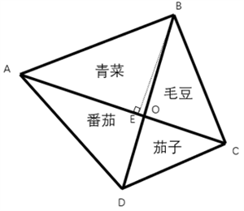

故正确答案为D。

---

第 43 题

**答案**：C

**来源参考解析（非官方标准答案）**

根据题意，要求每次活动之间至少间隔1天，即活动不能相邻，故可用插空法。先排非活动日，再在非活动日的间隙中插入活动日。一周7天，选3天活动，则非活动日有7-3=4天，4天形成5个间隙，需从中任选3个，每个间隙插入1个活动日，则情况数为种。

故正确答案为C。

---

第 44 题

**答案**：A

**来源参考解析（非官方标准答案）**

方法一：根据题意，设甲的得分为x分，则乙的得分为（100-x）分，丙的得分为96-（100-x）=（x-4）分，丁的得分为80-（x-4）=（84-x）分。根据“得分从高到低依次是甲、乙、丙、丁”，可知甲的得分高于乙，即x&gt;100-x，解得x&gt;50；乙的得分高于丙，即100-x&gt;x-4，解得x&lt;52，因每人得分均为正整数，则x=51。故丁的得分为84-51=33分。
方法二：直接计算较复杂，考虑代入排除法。代入A项：丁的得分为33分，则丙的得分为80-33=47分，乙的得分为96-47=49分，甲的得分为100-49=51分，得分从高到低依次是甲（51分）、乙（49分）、丙（47分）、丁（33分），满足题干所有条件，当选。
故正确答案为A。

---

第 45 题

**答案**：B

**来源参考解析（非官方标准答案）**

加工原材料的时间是固定的，要使费用最少，则原材料存放在仓库的时间要最短，则让加工时间最短的原材料最先加工。
最先加工时间为4小时的原材料，则剩下3批原材料等待时间为4×3=12小时；
第二批加工时间为6小时的原材料，则剩下2批原材料等待时间为2×6=12小时；
第三批加工时间为7小时的原材料，则剩下1批原材料等待时间为7小时；
最后加工时间为8小时的原材料，则等待总时间=12+12+7=31小时，每小时支付费用为100元，则工厂为这些原材料支付的仓库存放费用至少为31×100=3100元。
故正确答案为B。

---

第 46 题

**答案**：A

**来源参考解析（非官方标准答案）**

根据两人同时同地同向出发，第n次追及的路程差为，可得：，解得：。则当甲第二次追上乙时，共跑了140×20=2800米，为个全程，即7个来回，此时甲又回到起点处，距离起点0米。

故正确答案为A。

---

第 47 题

**答案**：A

**来源参考解析（非官方标准答案）**

元素组成不同，且无属性规律，优先考虑数量规律。观察发现，题干图形均存在1个长箭头和若干个小箭头。以中间长箭头为标记，图形依次在长箭头右侧增加1个小箭头、左侧增加1个小箭头，左右两侧交替增加，故“？”处图形应在图4基础上左侧增加1个小箭头，由1个长箭头和5个小箭头。B项是右侧增加1个小箭头，C项只有4个小箭头，D项有2个长箭头，且小箭头没有都在1个长箭头上，只有A项符合。

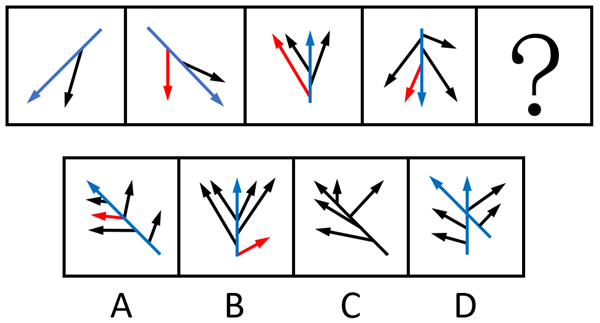

故正确答案为A。

---

第 48 题

**答案**：C

**来源参考解析（非官方标准答案）**

元素组成不同，优先考虑属性规律。观察发现，题干出现全直线、全曲线图形，考虑曲直性。九宫格优先看横行，第一行图形均为全直线图形，第二行图形均为全曲线图形，第三行前两幅图形均为有曲有直图形，故“？”处图形应是有曲有直图形，只有C项符合。
故正确答案为C。

---

第 49 题

**答案**：A

**来源参考解析（非官方标准答案）**

本题考查平面拼合，可采用平行且等长相消的方式解题。4个所给图形不经过旋转或翻转，可以拼接构成A项，如下图所示：

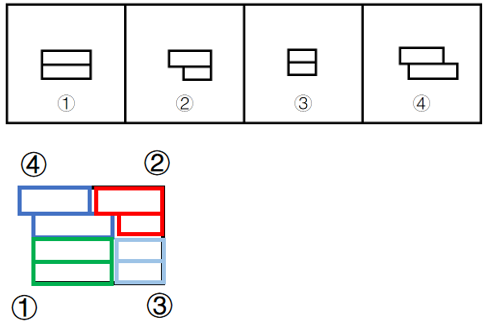

故正确答案为A。

---

第 50 题

**答案**：B

**来源参考解析（非官方标准答案）**

本题考查立体拼合。题干立体图形分别是由1个、2个、3个图1的“L”型小方块拼合而成，故？处应由4个图1的“L”型小方块拼合而成，只有B项符合。具体拼合方式如下图所示：

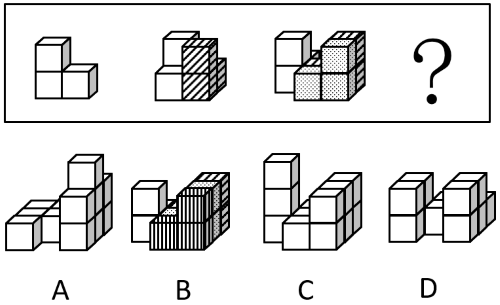

故正确答案为B。

---

第 51 题

**答案**：D

**来源参考解析（非官方标准答案）**

将题干展开图标上序号，如下图所示，逐一进行分析。

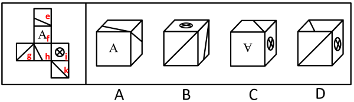

A项：选项由面e、面f和面h构成，题干展开图中，面e和面h为相对面，二者不能同时出现，选项与题干展开图不一致，排除；

B项：选项一定有面i，面i和面g为相对面，所以正面为面k。以面i和面k公共边中引出斜线的点为起点，对面k进行顺时针画边，如下图所示，题干展开图中，边1挨着面i，选项中，边1没有挨着面i，选项与题干展开图不一致，排除；

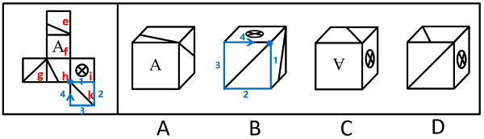

C项：选项一定有面f和面i，若顶面为面e，则题干展开图中，三者的公共点挨着面f的字母“A”的尖，选项中，三者的公共点远离面f的字母“A”的尖；若顶面为面h，则选项中，三者的公共点引出了面h中的斜线，题干展开图中，三者的公共点没有引出面h中的斜线，选项与题干展开图不一致，排除；

D项：选项由面h、面i和面k构成，选项与题干展开图一致，当选。

故正确答案为D。

---

第 52 题

**答案**：A

**来源参考解析（非官方标准答案）**

第一步：翻译题干。

①采用集约高效的发展方式资源消耗量减少；

②减少速度缓慢对经济发展造成负面影响。

第二步：逐一分析选项。

A项：该项翻译为“资源消耗量减少采用集约高效的发展方式”，是对①的否后，否后必否前，可以推出，当选；

B项：该项翻译为“采用集约高效的发展方式资源消耗量减少”，是对①的否前，否前得不到确定性的结论，不能推出，排除；

C项：该项翻译为“资源消耗量减少采用集约高效的发展方式”，是对①的肯后，肯后得不到确定性的结论，不能推出，排除；

D项：该项翻译为“减少速度缓慢对经济发展造成负面影响”，是对②的否前，否前得不到确定性的结论，不能推出，排除。

故正确答案为A。

---

第 53 题

**答案**：C

**来源参考解析（非官方标准答案）**

第一步：找出论点和论据。
论点：由于全球食糖需求不断增长，随着食糖的生产加工规模进一步扩大，甘蔗种植会进一步改变土地利用的格局。
论据：近年来，世界范围内甘蔗种植面积不断扩大，在一定程度上改变了土地利用的格局。
本题论点讨论的是“食糖需求”和“改变土地利用格局”之间的关系，论据讨论的是“甘蔗种植面积”和“改变土地利用格局”之间的关系，二者话题不一致，且提问方式为“前提”，加强优先搭桥，即建立“食糖需求”和“甘蔗种植面积”之间的联系。
第二步：逐一分析选项。
A项：该项指出甘蔗种植会给当地水资源造成压力，而论点说的是甘蔗种植会改变土地利用格局，话题不一致，无法加强，排除；
B项：该项指出甘蔗的种植周期短，能够为食糖的生产快速提供原料，而论点说的是甘蔗种植会改变土地利用格局，话题不一致，无法加强，排除；
C项：该项指出随着食糖需求增长，种植者会扩大甘蔗种植面积，建立了“食糖需求”和“甘蔗种植面积”之间的联系，搭桥项，可以加强，当选；
D项：该项指出适宜种甘蔗的土地也适合种植其他富含糖分的作物，而论点说的是甘蔗种植会改变土地利用格局，话题不一致，无法加强，排除。
故正确答案为C。

---

第 54 题

**答案**：D

**来源参考解析（非官方标准答案）**

第一步：找出题干矛盾。
水毛茛对水质要求极高，2023年受特大暴雨影响，A市某自然保护区内的水毛茛大面积消失，其所依赖的自然条件难以自行恢复，因而面临灭绝的风险。但在今年春季，有人发现，该自然保护区内重新出现了这种水毛茛，且群落规模远超以往。
第二步：逐一分析选项。
A项：选项指出水毛茛的分布范围已扩展至与自然保护区相邻的多处水域，而题干讨论的是本该灭绝的水毛茛为何又重新出现在了该自然保护区内，无法解释题干矛盾，排除；
B项：选项指出该自然保护区的水质优于周边河流水域，即使该自然保护区的水质比周边好，但如果未达到水毛茛生存的最低要求，水毛茛仍然无法存活，无法解释题干矛盾，排除；
C项：选项指出水毛茛繁殖能力较强，但如果未改善水质，再强的繁殖能力也无法让已濒临灭绝的水毛茛重新出现，无法解释题干矛盾，排除；
D项：选项指出近两年，通过水系修复等人工措施，该自然保护区的水质大幅提高，而水质大幅提高不仅能让水毛茛重现，还能为其提供更优越的生长环境，使得群落规模远超以往，可以解释题干矛盾，当选。
故正确答案为D。

---

第 55 题

**答案**：A

**来源参考解析（非官方标准答案）**

第一步：翻译题干。

（1）文化馆 或 博物馆；

（2）美术馆 或 文化馆；

（3）不去美术馆。

第二步：根据题干条件进行推理。

题干条件（3）不去美术馆，是对条件（2）或关系其中一项的否定，根据否一推一，得出去文化馆；去文化馆是对条件（1）或关系其中一项的否定，根据否一推一，得出不去博物馆。

提问为“得出‘该单位一定会去科技馆’的结论”，本题给出了结论，需要补充条件，代入选项分析。

A项：翻译为：科技馆博物馆，根据题干信息不去博物馆，是对选项的否后，否后必否前，能够推出一定去科技馆，可以推出，当选；

B项：翻译为：博物馆科技馆，根据题干信息不去博物馆，是对选项的否前，否前无必然结论，无法推出，排除；

C项：翻译为：科技馆博物馆，根据题干信息不去博物馆，是对选项的肯后，肯后无必然结论，无法推出，排除；

D项：翻译为：博物馆科技馆，根据题干信息不去博物馆，是对选项的否前，否前无必然结论，无法推出，排除。

故正确答案为A。

---

第 56 题

**答案**：D

**来源参考解析（非官方标准答案）**

第一步：找出论点和论据。
论点：未来太空计算卫星将广泛应用于应急安全、城市治理等领域。
论据：太空计算卫星具备强大的数据实时处理能力。
本题论点讨论的是未来太空计算卫星将广泛应用于应急安全、城市治理等领域，论据讨论的是太空计算卫星具备强大的数据实时处理能力，二者话题不一致，加强优先考虑搭桥，即在“应急安全、城市治理等领域”和“强大的数据实时处理能力”之间建立联系。
第二步：逐一分析选项。
A项：选项指出太空计算卫星能够同时适应地面环境和太空环境，但题干没有涉及该卫星是否需要适应地面环境（比如可以在太空接收地面数据并传输结果），无关选项，不能加强，排除；
B项：选项指出太空计算卫星在太空中的数据处理速度显著快于地面，这和它能否应用于应急安全、城市治理等领域无关，无关选项，不能加强，排除；
C项：选项指出我国目前亟需采集应急安全、城市治理等领域的实时数据，但不清楚太空卫星是否可以胜任此工作，无关选项，不能加强，排除；
D项：选项指出应急安全、城市治理等领域存在大量需要实时处理的数据，建立了“应急安全、城市治理等领域”和“强大的数据实时处理能力”之间的联系，为搭桥项，可以加强，当选。
故正确答案为D。

---

第 57 题

**答案**：B

**来源参考解析（非官方标准答案）**

第一步：找出题干矛盾。
某款新产品预售时预订人数远超预期，但在产品正式发货前，许多顾客却取消了该产品的预订。
第二步：逐一分析选项。
A项：选项指出该产品因产能问题发货日期一再延后，发货延迟会导致顾客耐心耗尽，可能在发货前取消预订，可以解释题干矛盾，排除；
B项：选项指出收到货后许多顾客反映该产品质量欠佳，但题干明确顾客取消预订的时间是“正式发货前”，顾客取消了该产品的预订，不能解释题干矛盾，当选；
C项：选项指出预售未结束时商家对新预订用户给予更大优惠，早期预订用户可能会因未享受同等优惠而感觉吃亏，进而导致发货前取消预订，可以解释题干矛盾，排除；
D项：选项指出预售期间其他商家推出设计接近且价格更低的竞品，可能导致客户在发货前取消原预订，转而选择其他商家的竞品，可以解释题干矛盾，排除。
本题为选非题，故正确答案为B。

---

第 58 题

**答案**：C

**来源参考解析（非官方标准答案）**

第一步：分析题干推理形式。

题干翻译为：不建立主体明确、要求清晰的责任体系（a）不能压紧压实安全生产责任（b）。

推理为：建立了主体明确、要求清晰的责任体系（a），因此安全生产责任已经压紧压实（b），逻辑结构为“否前推否后”。

第二步：逐一分析选项。

A项：翻译为：构建和谐社区（a）实行多元共治（b）。推理为：某社区建成了和谐社区（a），因此实行了多元共治（b），逻辑结构为“肯前推肯后”，与题干逻辑关系不一致，排除；

B项：翻译为：不实现教育资源的公平分配（a）无法提高全民素质（b）。推理为：当前全民素质有待提高，即无法提高全民素质（b），因此未实现教育资源的公平分配（a），逻辑结构为“肯后推肯前”，与题干逻辑关系不一致，排除；

C项：翻译为：不深入推进生态文明建设（a）无法实现资源循环利用（b）。推理为：某地区深入推进生态文明建设（a），因此实现了资源循环利用（b），逻辑结构为“否前推否后”，与题干逻辑关系一致，当选；

D项：翻译为：合理开采资源（a）实现自然资源的可持续利用（b）。推理为：多地政府禁止过度开采，即合理开采资源（a），因此实现了自然资源的可持续利用（b），逻辑结构为“肯前推肯后”，与题干逻辑关系不一致，排除；

故正确答案为C。

---

第 59 题

**答案**：D

**来源参考解析（非官方标准答案）**

第一步：找出题干矛盾。
近年来，全球变暖使得北极的永冻土层逐渐融化，融化的水随之流入湖泊和海洋。有人据此推测，北极现存的湖泊面积应该扩张，然而观测数据显示，大部分北极湖泊面积都有所缩减。
第二步：逐一分析选项。
A项：选项指出大部分处于逐渐融化状态的冰山位于海洋中，无法解释为什么大部分北极湖泊面积都有所缩减，不能解释题干矛盾，排除；
B项：选项指出近年来北极动植物数量不断增加，淡水资源的需求量不断增大，但不明确增大的需求量是否足以导致大部分湖泊面积缩减，不能解释题干矛盾，排除；
C项：选项指出由于冰川消融，北极地区的部分湖泊相互连接成了一个更大的湖泊，无法解释为什么大部分北极湖泊面积都有所缩减，不能解释题干矛盾，排除；
D项：选项指出永冻土层消融使北极地区的湖泊底部出现大量孔隙，湖水从孔隙渗漏，解释了为什么大部分北极湖泊面积都有所缩减，可以解释题干矛盾，当选。
故正确答案为D。

---

第 60 题

**答案**：C

**来源参考解析（非官方标准答案）**

第一步：找出论点和论据。
论点：要想获得更多的突破性研发成果，在组建新的研发团队时应当只考虑新手研发人员。
论据：企业大多数突破性的研发成果都源自新手研发人员。
本题论点和论据讨论的都是“突破性研发成果”和“新手研发人员”之间的关系，话题一致，优先考虑削弱论点。
第二步：逐一分析选项。
A项：选项指出该企业现有的多数重要研发成果尚未成功转化应用，讨论的是“现有的研发成果”，而论点讨论的是怎样能获得更多的“突破性研发成果”，话题不一致，无法削弱，排除；
B项：选项指出对于大多数的新手研发人员而言，该企业目前的薪资吸引力不高，讨论的是该企业对新手研发人员的吸引力，而论点讨论的是只有新手研发人员的团队能否获得更多的突破性研发成果，话题不一致，无法削弱，排除；
C项：选项指出突破性的研究设想都需要经过经验丰富的研发人员改进才能实现，说明如果组建的研发团队只有新手研发人员的话，将无法改进并实现突破性的研究设想，即只有新手研发人员无法获得更多的突破性研发成果，削弱论点，可以削弱，当选；
D项：选项指出将新手研发人员培养成经验丰富的研发人员需要投入大量的资源，讨论的是新手研发人员的培养成本，而论点讨论的是只有新手研发人员的团队能否获得更多的突破性研发成果，话题不一致，无法削弱，排除。
故正确答案为C。

---

第 61 题

**答案**：C

**来源参考解析（非官方标准答案）**

第一步：找出论点和论据。
论点：该材料能在一定程度上抗衰老。
论据：与未注入该材料的实验鼠相比，注入该材料的实验鼠肌肉组织中细胞的代谢水平显著提高，细胞端粒长度平均延长15%，且肌肉再生能力提升40%。
本题论点说的是该材料能在一定程度上抗衰老，论据说的是该材料提高细胞的代谢水平，延长15%细胞端粒长度，提升40%肌肉再生能力。论点、论据话题不一致，可以考虑搭桥来加强，且本题为选非题，排除加强项即可。
第二步：逐一分析选项。
A项：细胞代谢水平与衰老程度呈负相关，说明细胞的代谢水平提高则衰老程度就会降低，在论点和论据之间建立了联系，属于搭桥项，可以加强，排除；
B项：老年动物的肌肉再生能力显著低于青壮年动物，说明肌肉再生能力高的动物比肌肉再生能力低的动物年轻，在论点和论据之间建立了联系，属于搭桥项，可以加强，排除；
C项：将该材料注入小鼠体内后，小鼠未产生明显的免疫反应，说明注入该材料不会发生明显的免疫反应，而论点讨论的是该材料是否能抗衰老，话题不一致，无法加强，当选；
D项：端粒长度延长是细胞分裂激活的伴随现象，表明细胞恢复了“年轻”，说明延长细胞端粒代表了细胞更年轻，在论点和论据之间建立了联系，属于搭桥项，可以加强，排除。
本题为选非题，故正确答案为C。

---

第 62 题

**答案**：B

**来源参考解析（非官方标准答案）**

第一步：分析题干推理形式。

翻译为：绿化率高的小区居民幸福感强，居民幸福感强环境卫生状况好，将二者串联可以得到：绿化率高的小区居民幸福感强环境卫生状况好，因此，绿化率高的小区环境卫生状况好，逻辑结构为“肯前推肯后”。

第二步：逐一分析选项。

A项：翻译为粉尘浓度高的区域易发生爆炸，易发生爆炸应严禁烟火，将二者串联可以得到：粉尘浓度高的区域易发生爆炸应严禁烟火，因此，粉尘浓度不高的区域无需禁止烟火，逻辑结构为“否前推否后”，与题干推理形式不一致，排除；

B项：翻译为员工满意度较高的公司离职率较低，绩效考核合理的公司员工满意度较高，将二者串联可以得到：绩效考核合理的公司员工满意度较高离职率较低，因此，绩效考核合理的公司离职率较低，逻辑结构为“肯前推肯后”，与题干推理形式一致，当选；

C项：翻译为企业通过技术创新可以提高生产效率，生产效率的提高可以促进利润增长，将二者串联可以得到：企业通过技术创新可以提高生产效率可以促进利润增长，因此，利润增长快的企业进行了技术创新，逻辑结构为“肯后推肯前”，与题干推理形式不一致，排除；

D项：翻译为双减政策的落实减轻了学生的学习压力，课外活动时间的增加减轻了学生的学习压力，因此，课外活动时间的增加体现了双减政策的落实，逻辑结构不是“肯前推肯后”，与题干推理形式不一致，排除。

故正确答案为B。

---

第 63 题

**答案**：B

**来源参考解析（非官方标准答案）**

第一步：分析题干条件。

（1）财政局在人社局的右手边并与之相邻，在住建局的左手边但与之不相邻；

（2）教育局与交通局之间隔着一个职能局；

（3）农业局和财政局相邻。

第二步：根据题干条件进行推理。

题干条件（1）和（3）均提到“财政局”，可优先从“财政局”入手进行推理。

根据条件（1）和（3）可知，财政局两侧分别为人社局和农业局，且按照从左到右的顺序依次为人社局、财政局、农业局；结合条件（2）教育局与交通局之间隔着一个职能局可知，中间的只能是住建局，故教育局、交通局、住建局按照从左到右的顺序依次为教育局、住建局、交通局或者交通局、住建局、教育局。又根据条件（1），财政局在住建局的左手边，可推出各职能局的座位顺序如下图所示：

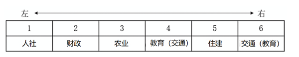

住建局在从右到左第二位，B项当选。

故正确答案为B。

---

第 64 题

**答案**：B

**来源参考解析（非官方标准答案）**

第一步：分析题干条件。

（1）文化旅游＞丙；

（2）甲数字农业，且都不是最高的；

（3）生态农业＞丁；

（4）丙＞非遗传承。

第二步：根据题干条件进行推理。

题干条件中“丙”提及次数最多，可优先从此处入手推理。

根据条件（1）和（4）可知，文化旅游＞丙＞非遗传承，结合条件（2）可知，甲和丙的经济收入关系有3种可能性，①甲＞丙，②甲丙，③丙＞甲，对此可进行假设：

假设①甲＞丙：

根据条件（2）可知，甲数字农业＞丙，结合已推出的“文化旅游＞丙＞非遗传承”，可知甲数字农业＞丙＞非遗传承，此时甲和数字农业的经济收入为4个村中最高的，与条件（2）矛盾，该假设不成立；

假设②甲丙：

根据条件（2）可知，丙是数字农业，结合已推出的“文化旅游＞丙＞非遗传承”可知，甲是生态农业，结合条件（3）可知，丁是非遗传承，剩下的乙是文化旅游，如下图所示：

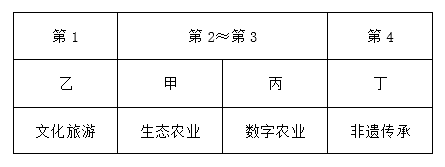

假设③丙＞甲：

根据条件（2）和已推出的“文化旅游＞丙＞非遗传承”，可知甲是非遗传承，结合条件（3）可知，丙是生态农业，丁是数字农业，剩下的乙是文化旅游，如下图所示：

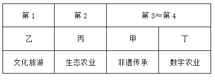

综上，只有B项必然正确。

故正确答案为B。

---

第 65 题

**答案**：A

**来源参考解析（非官方标准答案）**

第一步：找出论点和论据。
论点：这些微小的中空管状结构是恐龙用于调节体温的特殊结构。
论据：通过高分辨率显微镜，研究人员发现该恐龙皮肤表面存在大量微小的中空管状结构。由于这些结构类似于现代鸟类羽毛中用于体温调节的羽茎。
本题通过恐龙皮肤上的中空管状结构与现代鸟类羽茎相似，就推断二者功能相同，此处有漏洞，结构相似也不一定功能一致，所以加强优先考虑搭桥，建立“结构”和“功能”的必然关系。
第二步：逐一分析选项。
A项：该项指出中空管状结构具有增强生物体表的散热能力，结合散热本身就是温度调节的重要表现，说明结构相似必然功能相似，即建立了“恐龙的中空管状结构”与“温度调节”的必然联系，搭桥项，保留；
（注：A项的“散热”并不是片面，“散热”是“温度调节”的重要表现，皮肤不能散热就不能进行温度调节了，所以A项的散热能力，是想表达中空管状结构是有温度调节的能力。）
B项：该项指出其他恐龙具有类似的中空管状结构，没有说明该结构能否调节体温，且论点说的是该结构是恐龙用于调节体温的特殊结构，话题不一致，无法加强，排除；
C项：该项指出现代爬行类动物的皮肤表面不存在类似的中空管状结构，而论点说的是该结构是恐龙用于调节体温的特殊结构，话题不一致，无法加强，排除；
D项：该项指出由于白垩纪晚期气候异常，恐龙需要体温调节机制维持生存，若恐龙不需要体温调节，则中空管状结构就不是恐龙用于调节体温的，此项为论点成立的必要条件，可以加强，保留。
对比A、D两项，A项搭桥是对整个论证的加强，与题干关联度更高，优于D项必要条件，择优选择A项。
故正确答案为A。

---

第 66 题

**答案**：D

**来源参考解析（非官方标准答案）**

第一步：分析题干推理形式。

题干翻译为：企业节能减排通过购买碳配额 或 自主开发减排项目实现（即12 或 3），某企业未购买碳配额（即2），因此该企业要节能减排需自主开发减排项目（即要想1必须3），故逻辑结构为：12 或 3，当2时，要想1必须3。

第二步：逐一分析选项。

A项：选项翻译为：申请绿色产品认证的公司通过专家评审 或 提交检测报告（即12 或 3），某公司未提交过检测报告（即3），因此该公司应当组织开展专家评审（即2），逻辑结构为：12 或 3，32，与题干推理形式不一致，排除；

B项：选项翻译为：有的地区支持企业购买碳汇，有的地区则支持企业使用清洁能源（即有的1，有的2），某地区支持企业使用清洁能源（即2），因此该地区不支持企业购买碳汇（即1），逻辑结构为：有的1、有的2，21，与题干推理形式不一致，排除；

C项：选项翻译为：企业申请创业补贴通过线上申请 或者 通过线下窗口办理（即12 或 3），某企业已经通过线上渠道提交了申请（即2），因此无需前往线下窗口办理（即3），逻辑结构为：12 或 3，23，与题干推理形式不一致，排除；

D项：选项翻译为：重点排放单位核查排放情况委托第三方 或 通过安装监测设备（即12 或 3），某企业属重点排放单位未委托第三方核查排放情况（即2），因此该企业需安装监测设备核查排放情况（即要想1必须3），故逻辑结构为：12 或 3，当2时，要想1必须3，与题干推理形式一致，当选。

（题干逻辑结构为要实现某个目标，必须采用两种方式之一，已知未采取一种方式，因此必须要采取另一种方式，D项中两种方式的换位是为了将逻辑结构更加清晰的呈现出来。）

故正确答案为D。

---

第 67 题

**答案**：B

**来源参考解析（非官方标准答案）**

定位文字材料第二段可得：今年以来，广东按照省委、省政府关于实施“百万英才汇南粤”行动计划的部署安排，围绕“粤聚英才、粤见未来”主题，对应B项。
故正确答案为B。

---

第 68 题

**答案**：C

**来源参考解析（非官方标准答案）**

定位资料第三段可知，“百万英才汇南粤”行动计划紧紧围绕广东现代化产业体系建设需要，对应A项；聚焦20个战略性产业集群，突出新兴产业未来产业，对应B项；充分发动知名科技企业拿出大量优质岗位，组织发动各类企事业单位动态募集120多万优质岗位，对应D项。定位资料第二段，按照省委、省政府关于实施“百万英才汇南粤”行动计划的部署安排，截至7月中旬，全省已吸纳超过100万应届高校毕业生留粤来粤就业创业，未提及鼓励应届毕业生跨省就业创业情况。
本题为选非题，故正确答案为C。

---

第 69 题

**答案**：D

**来源参考解析（非官方标准答案）**

根据题干“2025年3至7月······占比······”，结合材料时间为2025年3至7月，可判定本题为现期比重问题。定位文字材料第三段可得：2025年3至7月，累计组织2.1万家重点企业在“粤就业”小程序发布62.5万个岗位，其中，年薪10万元以上岗位约26万个。根据公式：比重，则题目所求，在D项范围内。

故正确答案为D。 

---

第 70 题

**答案**：A

**来源参考解析（非官方标准答案）**

根据题干“2025年1至7月······省内应届高校毕业生约有······万人”，结合材料时间为2025年1至7月及材料给出题干相关专业省内应届高校毕业生占比，可判定本题为现期比重问题。定位文字材料第四段可得：从留粤就业的省内应届高校毕业生情况看，今年（2025年）1至7月，制造业吸纳毕业生约10万人······其中，人工智能、机器人、半导体与集成电路、高端装备制造、新能源汽车、低空经济相关专业毕业生占四分之一。根据公式：部分=整体×比重，则所求万。

故正确答案为A。

---

第 71 题

**答案**：A

**来源参考解析（非官方标准答案）**

A项：定位文字材料第一段可得：数据显示，2024年广东新出生113.3万人，正确；
B项：材料中并未提及2024年广东省内应届高校毕业生和本科生相关信息，故无法判断，错误；
C项：定位文字材料第一段可得：2024年广东城镇新增就业超143万人，超额完成国家下达的110万人的年度就业任务，非2025年上半年，错误；
D项：定位文字材料第二段可得：截至（2025年）7月中旬，全省已吸纳超过100万应届高校毕业生留粤来粤就业创业，非2025年上半年，错误。
故正确答案为A。

---

第 72 题

**答案**：A

**来源参考解析（非官方标准答案）**

定位文字材料第一段可知，根据计量溯源性、准确度和用途等，国家标准物质目前分为两类，即一级标准物质和二级标准物质。
故正确答案为A。

---

第 73 题

**答案**：C

**来源参考解析（非官方标准答案）**

定位文字材料第二段可得：国家标准物质数量快速增长的原因有四个方面：一是用途广泛······二是需求大幅增加······三是产业发展迅速······四是政策支持······。则国家标准物质数量快速增长的原因不包括产业链完整。
本题为选非题，故正确答案为C。

---

第 74 题

**答案**：B

**来源参考解析（非官方标准答案）**

定位文字材料第三段可得：截至2025年上半年，市场监管总局累计批准建立国家标准物质18982项。2025年上半年，我国新批准建立国家标准物质524项。根据2024年末累计批准数据+2025年上半年新批准数据=2025年上半年累计批准数据，则题干所求为18982-524=18458项。
故正确答案为B。

---

第 75 题

**答案**：D

**来源参考解析（非官方标准答案）**

根据题干“2024年上半年······约占”，结合材料时间为2025年上半年，可判定本题为基期比重问题。定位文字材料第三段可得：2025年上半年我国新批准建立国家标准物质524项（B），同比增长78.8%（b）；企业申报标准物质379项（A），同比增长86.7%（a）。根据公式：基期比重，则所求比重为，与D项最接近。

故正确答案为D。

---

第 76 题

**答案**：A

**来源参考解析（非官方标准答案）**

定位文字材料第三段可得：2025年上半年，我国新批准建立国家标准物质524项。从地域分布看，华北地区新建标准物质234项，华东地区新建标准物质124项，东北地区新建标准物质62项，西北地区新建标准物质48项，华南地区新建标准物质32项，西南地区新建标准物质24项，华中地区未新建标准物质。饼形图未给出图例时，应按材料数据顺序（从前往后或从上往下），从12点钟方向开始顺时针排布。
因华中地区未新建标准物质，可知饼状图只包括6个地区，排除C、D两项。对比A、B两项，最明显的区别为华南地区和西南地区的大小关系（即最后两部分），华南地区32项明显大于西南地区24项，排除B项。
故正确答案为A。

---

第 77 题

**答案**：B

**来源参考解析（非官方标准答案）**

根据题干“2024年······增加约······万个”，可判定本题为增长量计算问题。定位文字材料可得：截至2024年末，广东省共有体育场地35.3万个，较上年增长3.58%。根据公式：增长量，则所求万个，与B项最接近。

故正确答案为B。

---

第 78 题

**答案**：A

**来源参考解析（非官方标准答案）**

根据题干“2024年末，······数量占比”，结合材料时间为2024年末，可判定本题为现期比重问题。定位表格材料可得：2024年末广东省田径场地总数量为1.64万个，设有400米环形跑道的田径场地数量为0.24万个。根据公式：比重，则题目所求，在A项范围内。

故正确答案为A。

---

第 79 题

**答案**：D

**来源参考解析（非官方标准答案）**

定位表格材料可知“球类运动场地=足球、篮球、排球场地+乒乓球、羽毛球场地+其他球类运动场地”，且已知球类运动场地面积为19350.29万平方米；乒乓球、羽毛球场地面积为1126.57万平方米；其他球类运动场地面积为7268.73万平方米，则足球、篮球、排球场地面积亿平方米。

故正确答案为D。

---

第 80 题

**答案**：D

**来源参考解析（非官方标准答案）**

根据题干“2024年末······单位面积排序正确的是”，结合材料时间为2024年末，可判定本题为现期平均数问题。定位统计表可得：2024年末，广东省田径场地的数量为1.64万个，面积为8603.93万平方米；游泳场地的数量为0.78万个，面积为849.25万平方米；冰雪运动场地的数量为33个，面积为13.16万平方米；健身房的数量为0.97万个，面积为505.67万平方米。根据单位面积，则2024年末广东省下列运动场地单位面积分别为：

田径场地，平方米/个；

游泳场地，平方米/个；

冰雪运动场地，平方米/个；

健身房，平方米/个。

综上，运动场地单位面积排序正确的是田径场地&gt;冰雪运动场地&gt;游泳场地&gt;健身房。

故正确答案为D。

---

第 81 题

**答案**：C

**来源参考解析（非官方标准答案）**

A项：定位文字材料可得：截至2024年末，广东省体育场地面积3.72亿平方米，较上年增长4.49%。根据公式：基期量，故所求为亿平方米，正确；

B项：定位文字材料可得：截至2024年末，广东省体育场地面积3.72亿平方米，人均体育场地面积2.91平方米（按常住人口计算）。根据人数，故所求为亿人，正确；

C项：定位统计表可得：2024年末，广东省游泳场地数量为0.78万个，其中，天然游泳场为84个。根据公式：比重，故所求为，即占比超过1%，错误；

D项：定位文字材料和统计表可得：截至2024年末，广东省体育场地面积3.72亿平方米；球类运动场地面积为19350.29万平方米。根据公式：比重，故所求为，正确。

本题为选非题，故正确答案为C。

---

第 82 题

**答案**：C

**来源参考解析（非官方标准答案）**

定位图形材料可知：1957年、1978年、1995年、2011年、2023年全国常住人口城镇化率分别为：15.39%、17.92%、29.04%、51.83%、66.14%。1957—1978年我国常住人口城镇化率增加17.92%-15.39%=2.53%；1978—1995年我国常住人口城镇化率增加29.04%-17.92%=11.12%；1995—2011年我国常住人口城镇化率增加51.83%-29.04%=22.79%；2011—2023年我国常住人口城镇化率增加66.14%-51.83%=14.31%。比较可知，我国常住人口城镇化率增加最多的是1995—2011年。
故正确答案为C。

---

第 83 题

**答案**：B

**来源参考解析（非官方标准答案）**

根据题干“2023年末······常住人口规模平均约为······”，结合材料给出了2023年末的数据，可判定本题为现期平均数问题。定位文字材料二、三段可得：2023年末地级以上城市297个、我国地级以上城市常住人口67313万人。根据公式：平均数，则题目所求万人。

故正确答案为B。

---

第 84 题

**答案**：A

**来源参考解析（非官方标准答案）**

根据题干“与1949年末相比，2023年末······占比”，结合选项为增加了/减少了+百分点，可判定本题为两期比重问题。定位文字材料第二段可得：1949年末，全国城市共有129个，其中，地级以上城市68个；2023年末，城市个数达到694个，其中，地级以上城市297个。根据公式：比重，则题目所求，即减少了10个百分点。

故正确答案为A。

---

第 85 题

**答案**：D

**来源参考解析（非官方标准答案）**

根据题干“与1978年末相比，2023年末······增幅排序正确的是”，可判定本题为一般增长率问题。定位文字材料第二段可得：1978年末，全国共有地级以上城市101个，县级市92个，建制镇2173个；2023年末，全国共有地级以上城市297个，县级市397个，建制镇21421个。根据公式：，因为全都需要减1，因此比较大小只需要比较即可。地级以上城市为；县级市为；建制镇为。因此各类型城镇数量增幅排序为：建制镇&gt;县级市&gt;地级以上城市。

故正确答案为D。

---

第 86 题

**答案**：C

**来源参考解析（非官方标准答案）**

A项，材料中只给出了1949年全国常住人口城镇化率，未给出1949年全国常住总人口或城镇常住人口相关数据，故无法计算非城镇常住人口数量，错误；

B项：定位文字材料第二段可得：1978年末，全国城市共有193个，县级市92个。根据公式：比重，则所求，即不到一半，正确；

C项：定位文字材料第二段和第三段可得：2023年末，城市个数达到694个，常住人口超过500万的城市有29个。根据公式：比重，则所求，即不到5%，错误； 

D项：定位文字材料第三段可得：2023年末，我国地级以上城市常住人口达到67313万人，超过1000万的城市有11个。根据公式：部分=整体×比重，则2023年末我国15%的地级以上城市常住人口为万人。而常住人口超过1000万的城市至少共容纳了1000万×11=11000万人，11000万人&gt;10097万人，正确。

本题为选非题，故正确答案为C。

备注：本题A项材料数据不全无法判断，但本题题干明确要求选择“说法错误”的，A项、C项对比，C项错误更明确，故粉笔认为本题正确答案为C。

---

