# 2012年广州市公务员录用考试《行测》题

> 候选采集稿。参考答案及解析来自粉笔页面，不代表官方答案或真实高分答卷；来源使用许可与原卷对应关系仍需人工核实。

## 题型与作答说明

言语理解与表达

（25题）

本部分包含言语表达和阅读理解两种类型的试题

常识判断

（15题）

请你依据常识作出判断。注意：似乎合理的答案可能有多种，你应选择最为合理的一个。

逻辑推理

（30题）

本部分包含类比推理、逻辑判断、推行推理三种类型的试题。

数量关系

（15题）

请根据每题题干中提供的信息计算出正确答案。

资料分析

（15题）

请根据以下给出的图表、文字资料进行分析，选出符合题目要求的正确答案。

## 给定材料

### 材料 dom-material-992e31aa351ca1dc

2011年末我国大陆总人口为134735万人，比上年末增加644万人，其中城镇人口为69079万人，占总人口比重首次超过50%，达到51.3%。全年出生人口1604万人，出生率为11.93‰，自然增长率为4.79‰。

2011年末我国大陆共有医疗卫生机构953432个，其中医院21638个，乡镇卫生院37374个，社区卫生服务中心（站）32812个，诊所（卫生所、医务室）177754个，村卫生室659596个。卫生技术人员620万人，其中执业医师和执业助理医师251万人，注册护士224万人。医疗卫生机构床位515万张，其中医院368万张，乡镇卫生院103万张。

### 材料 dom-material-df93c5cacf353ec7

有研究者在2011年调查了659名没有当地户口的外来人员，询问他们“认为自己属于本地人还是外地人”的问题，结果如下图所示。

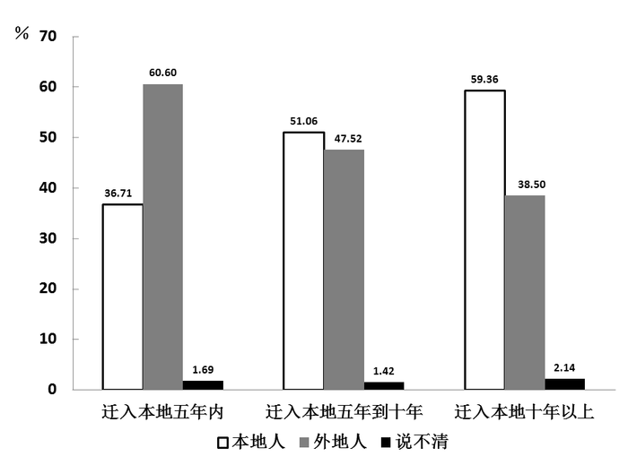

**外来人口对自己是否属于本地人的认同情况**

### 材料 dom-material-483647e5be1b0694

**中国私营企业基本情况（1990****—2010****年）**

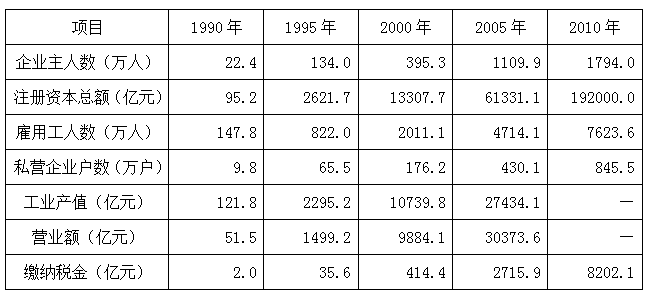

**中国私营企业的组织类型、产业结构和空间分布（1990****—2010****年）（单位：%****）**

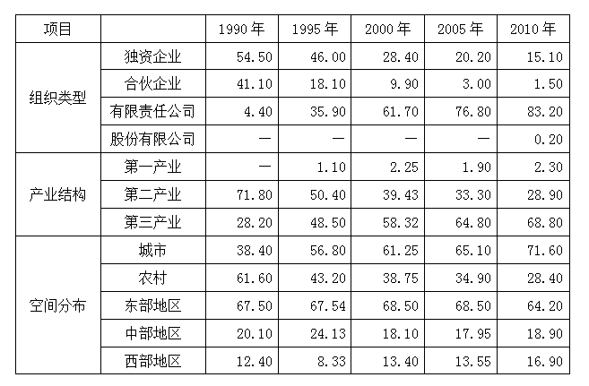

\*表中数据指各类型私营企业户数占私营企业总户数的比率。

## 题目

### 第 1 题

农民工在精神文化上“营养不良”，时间和消费能力只是一部分原因，城乡二元结构带来的城乡文化            ，也许是他们难以迅速融入城市文化生活的一个重要原因。

填入画横线部分最恰当的一项是：

A. 差异

B. 差距

C. 障碍

D. 隔阂

### 第 2 题

只要能献智出力，创造业绩，作出贡献，都是社会发展所需要的人才，均当\_\_\_\_\_\_、大胆使用。

填入画横线部分最恰当的一项是：

A. 不遗余力

B. 不拘一格

C. 不落窠臼

D. 不折不扣

### 第 3 题

以“直面医患关系”为宣传卖点的电视剧《心术》在各大卫视播出后，不但收视率不俗，且引起各界热议，主要是因为该剧所选取的题材令人           。

填入画横线部分最恰当的一项是：

A. 侧目

B. 瞩目

C. 瞠目

D. 刮目

### 第 4 题

一场激烈紧张的围棋赛事结束了，选手张行以微弱优势险胜对手，赛后面对媒体的采访时，张行          道：“好险好险，赢得真不容易。”

填入画横线部分最恰当的一项是：

A. 弹冠相庆

B. 举杯相庆

C. 额手称庆

D. 扶手称颂

### 第 5 题

①“广州精神”不是文人\_\_\_\_\_\_写出来的，它来源于广大人民群众的生动实践，是上千年文化、历史精髓的传承。

②贫困是世界各国和国际社会面临的挑战。促进发展，消除贫困，实现共同富裕，是人类\_\_\_\_\_\_的理想。

依次填入画横线部分最恰当的一项是：

A. 闭门造车 孜孜以求

B. 纸上谈兵 梦寐以求

C. 空口无凭 日思夜想

D. 闭耳塞听 矢志不渝

### 第 6 题

证监会主席郭树清“铁腕”推动改革，令市场\_\_\_\_\_\_。但是要革除多年的\_\_\_\_\_\_，显然非一日之功。

依次填入画横线部分最恰当的一项是：

A. 如雷贯耳 问题

B. 闻风丧胆 弊病

C. 为之振奋 阵痛

D. 耳目一新 积弊

### 第 7 题

在传统的社会中，            没有当下所谓“诚信档案”，            一个人的诚信档案存在于全体社区成员的心里与口碑中，            可以代际相传，诚信缺失的风险成本很高。

依次填入画横线部分最恰当的一项是：

A. 虽然 但是 而且

B. 不但 而且 所以

C. 因为 所以 并且

D. 即使 但是 甚至

### 第 8 题

我们的文化过多地被一些学者误会成了文明间斗争和冲突的工具，          被民间崇尚的“知识积累”、“名校学历”和“文人风范”，          都是一种虚饰和夸大了的人生制胜之途径。          ，胜败输赢之术远远压倒了善恶是非之道，成了当代文化中的主流话语。

依次填入画横线部分最恰当的一项是：

A. 因为 所以 却 因此

B. 如果 那么 就 因而

C. 由于 即便 也 结果

D. 虽然 但是 仍 所以

### 第 9 题

熊十力先生在给自己学生的信中不止一次提到过从古人那里得到的启发：“            于天，          于地，          诸物，          诸身”。在他看来，这是做学问的必须之力和根本态度。

依次填入画横线部分最恰当的一项是：

A. 仰观 俯察 远征 近取

B. 远眺 近抚 外求 内观

C. 仰观 俯察 外求 内观

D. 远眺 近抚 远征 近取

### 第 10 题

中国政法大学历史研究所所长郭世佑教授曾给浙大学子书写赠言：燃烧的是\_\_\_\_\_\_，飞翔的是\_\_\_\_\_\_，说服人的是\_\_\_\_\_\_，征服人的是\_\_\_\_\_\_。

依次填入画横线部分最恰当的一项是：

A. 梦想 激情 权威 权杖

B. 激情 梦想 权威 权杖

C. 思想 激情 真诚 真理

D. 激情 思想 真理 真诚

### 第 11 题

房龙文笔生动，擅长讲故事。干燥无味的科学常识经他那么一写，无论大人、小孩，都觉得娓娓忘倦了。将文学家的手法拿来讲述科学，确实高妙。

关于这段文字，以下理解准确的是：

A. 房龙开创了以文学方式讲述科学常识的先河

B. 房龙能将干燥无味的科学常识讲述得很生动

C. 房龙文笔生动，拥有数量庞大的读者群

D. 房龙讲述的科学常识激发了读者对科学的兴趣

### 第 12 题

美丽的脸往往只是平均化的结果。科学研究发现，用计算机把越多人的面孔合成在一起，新面孔就越有吸引力。两张脸合成出来的只是普通人，32张脸就可以合成出美女。这可能因为平均脸遮掩了原有的不协调，也可能因为这张平均脸非常对称，而对称正是健康的标志之一。

关于这段文字，以下理解准确的是：

A. 普通人因为脸型常见而成为长相一般的人

B. 独具个性的脸常常因为非平均化而显得不够美丽

C. 人脸具有吸引力可能是因为协调，也可能是因为健康

D. 美是一种主观感受，不是所有的人都喜欢计算机合成的面孔

### 第 13 题

1958年，IBM错过了收购一家新企业的机会，这家公司发明了一种新技术叫做复印。两年后，施乐公司诞生，从此以后IBM每天都追悔莫及。10年后，DEC公司发明了小型机，IBM认为太小的家伙不足以进行像样的运算，可当IBM最终进入小型机市场时，DEC已经发展成为一家市值几亿美元的公司。又过了10年，苹果公司发明了Apple Ⅱ，IBM认为个人电脑算不上什么发明，对自己的事业无足轻重。5年后，IBM凭借IBM PC机进入个人电脑市场时，已经需要和50多家争夺市场份额的对手展开惨烈的竞争。

对这段文字概括最准确的是：

A. IBM多次错过了创新发展的良机

B. IBM是一家决策缓慢、屡次失败的公司

C. 有50多家公司错过了个人电脑进入市场的最佳时机

D. 如果IBM抓住文中所说的三次机会，它将成为最强大的科技公司

### 第 14 题

《曹全碑》是东汉郃阳县令曹全的纪功碑，明代万历时在陕西合阳县莘里庄出土，今存西安碑林。《曹全碑》书法秀雅，是汉碑的典范；碑文涉及疏勒叛乱、黄巾起义、党锢之祸，尤其可补史志之缺。这些情况，明清以来的金石学家讨论已详，稍可补充的，是碑文中有关医学史的一项小问题。

这段文字接下来最可能讨论：

A. 《曹全碑》中关于医学的一些史实

B. 《曹全碑》对医学史的贡献

C. 《曹全碑》受医学史关注的情况

D. 《曹全碑》可补史志之缺的医学内容

### 第 15 题

传统的史学研究，由于其对象大都是“不能说话的”档案和文献资料，因而在研究过程中，它们只是扮演“法官”角色的研究者们审判的“被告”，而这个“被告”在法庭上没有任何为自己辩护的权利。所以，不同的“法官”由于其使用的审判规则不一样，尽管这个规则非常科学和准确，但是造成对相同问题的研究结果却大相径庭。

这段文字所表达的主要意思是：

A. 运用同样的档案和文献资料进行史学研究却可能得出不一样的结果

B. 运用档案和文献资料进行史学研究应当谨慎，而不能武断

C. 研究历史还应注重运用“能说话的”史料

D. 应当制定统一的规则来规范对档案和文献资料的研究

### 第 16 题

生命意义的问题不可能还原为经验研究。如果所有认识论上的问题都可以由科学探究在实践中得到解决，那么，我们可能会觉得，即便所有这些问题在一觉醒来都得到了解决，这仍然与生命的意义这一问题毫无瓜葛，与美好的人类生活究竟包含着什么这个问题无关。

这段文字所表达的主要意思是：

A. 认识论的问题可以通过经验研究获得解答

B. 科学的进步并不必然带来美好的人类生活

C. 生命的意义就是使人类生活变得更加美好

D. 寻求生命的意义无法使用科学探究的方法

### 第 17 题

17世纪的英国学者托马斯·富勒说：“知识使好人更好，坏人更坏。”塞缪尔·约翰逊则说：“有知识而不正直是可怕的。”罗素说：“科学是一种权力，而任何权力都可善可恶。”而爱因斯坦说得更加简洁：“刀子有用，但也能用来杀人。”

最适合作为这段文字标题的是：

A. 知识需要人文控制

B. 知识就是力量

C. 知识与道德

D. 知识就是刀子

### 第 18 题

将下列句子组成一段逻辑严谨、语言流畅的文字，排列顺序最合理的是：

①来自实验室和现场观察的结果都表明，饮酒有利于缓解社会约束，使人们比平日更容易放松警惕。

②欧阳修说：“醉翁之意不在酒。”

③社交场上的活跃分子心里有数，酒是手段，而非目的。

A. ①②③

B. ②③①

C. ③②①

D. ③①②

### 第 19 题

在牛顿眼中，时间是绝对的，超越自然的，统摄万物而万物不能增减之。常见的量子力学接受了这种绝对的时间观念。与之相对，相对论认为，在引力场中，时间以及其他所有随时间变化的事物，都会运转得更慢。在相对论中，时间不再是一个外部参数，而是宇宙构成的主动参与者。

关于这段文字，以下理解准确的是：

A. 相对论发展了人类对时间的认识

B. 客观的时间是相对和绝对的统一

C. 离开引力场，时间也会随之消失

D. 牛顿不认为时间主动参与了宇宙的构成

### 第 20 题

说到“宫斗戏”对现实社会中的价值观的破坏，那多少有些夸大其词了。影视作品本来就有“写实”的功能，现实中存在的“黑影”为什么不能放到影视作品中去呢？何况，在价值观的培养与引导上，影视作品的说教与熏陶并不是万能的。

对这段文字理解准确的一项是：

A. 影视作品应对现实社会中的价值观有良好的引导作用

B. “宫斗戏”对现实社会中的价值观不会有影响

C. 影视作品不应该有价值观的说教与熏陶

D. 文中的“黑影”指社会中的一些阴暗丑陋的现象

### 第 21 题

减少死刑并不是意味着可以钻空子或漏洞，实际上任何国家废除死刑的条件之一就是这个国家的司法公正达到一个程度，否则人们对司法没有信心，人们就会希望判处更多的死刑，所以说这是相辅相成的。

上述文字中的“这”指的是：

A. 减少死刑和钻空子

B. 减少死刑和国家的司法公正

C. 司法公正和人们对司法的信心

D. 废除死刑的条件和司法公正

### 第 22 题

基因组学研究表明，人体基因组内含有2万到2.5万个基因，但至今，运用基因检测技术，只能发现一千多种疾病基因，而且都是单基因疾病。人类罹患的多基因疾病却依然是技术检测的盲区。对此，现有基因检测的结果，都采用“高”、“中”、“低”或某一百分比范围来表示个体患某种疾病的风险概率，根本达不到所谓100%的准确率。另外，即便基因检测结果正常，也不能排除得病的可能。

作者通过这段文字意在说明：

A. 人类罹患疾病是非常复杂的过程

B. 现有的基因检测结果不够精细化

C. 现在的基因检测有其技术应用的局限性

D. 基因检测结果不能排除人类患病的可能

### 第 23 题

新教派的理论认为，儿童是未成形的人。唯有通过识字、教育、理性、自我控制、羞耻感的培养，才能将儿童改造成一个文明的成人。浪漫主义派的理论则认为，未成形不是儿童的问题，问题完全出在畸形的成人身上。儿童拥有与生俱来的坦率、理解、好奇、自发的能力，但这些能力被识字、教育、理性、自我控制和羞耻感淹没了。

关于这段文字，以下理解准确的是：

A. 新教派与浪漫主义派在如何教育儿童的问题上是根本对立的

B. 新教派认为，儿童必须通过培养才能成为文明的成人

C. 浪漫主义派认为，不能保持与生俱来的能力的成人是畸形的人

D. 对儿童的培养应该保持儿童与生俱来的能力

### 第 24 题

提高自身价值要通过修身，修身才能使人超越原生状态而进入自觉追求崇高的境界。修身离不开克己。克己并不是叫人一味逆来顺受、忍让退避。要知道一切进德修业的积极行为都免不了要克服自己身上的弱点。例如，见义勇为要克服怯懦之心，坚持原则要克服患得患失之心，做学问、创事业要克服怠惰之心。这些都是“克己”的表现。

这段文字所表达的主要意思是：

A. 克己复礼是使自己进入崇高境界的重要途径

B. 克己就能克服自己身上的弱点，就是进德修业的积极行为

C. 提高自身价值需要修身，而修身离不开克己

D. 一味逆来顺受、忍让退避不能使自己超越原有的水平

### 第 25 题

文艺的完整形态，从根本上是创作主体和接受客体的双向生成。文艺家对客观世界和现实生活的艺术反映，总是要有自己的立场和出发点，总是要以唤起一定对象的审美体验为创作归宿，进而实现创作的意义。有抱负的文艺家，总是要致力去描写、服务和影响创造历史的中坚构成和主体力量，推动美好社会理想的实现，从而获得深广的社会效应和艺术价值。

关于这段文字，以下理解准确的是：

A. 推动美好社会理想的实现，是文艺家应持有的创作立场和出发点

B. 文艺家在文艺中反映的立场和出发点与他的审美体验是相一致的

C. 脱离接受客体的文艺就是脱离创造历史的中坚构成和主体力量

D. 不能获得深广社会效应和艺术价值的文艺创作的形态是缺损的

### 第 26 题

当一种动物对所生存的环境、所食用的食物有着特定的要求时，这种动物往往被认为是脆弱的、容易消亡的。

以下动物属于这一类的是：

A. 海鸥

B. 野猪

C. 华南虎

D. 眼镜蛇

### 第 27 题

在铅笔上，常常印着“6B”“4H”或者“HB”的字样，这些字样代表着铅笔的软硬。“B”代表软，“H”代表硬，前边的阿拉伯数字代表软硬的程度，“HB”则代表软硬适中。如果你要选择铅笔分别用来画画、写字、制图，相应选择的铅笔类型分别为：

A. 6H 4B HB

B. HB 6H 4B

C. 4B HB 6H

D. HB 4B 6H

### 第 28 题

张某有一株珍稀兰花，后不慎遗失。李某无意中捡到后，带回家自行种养。李某的朋友关某在其家中见到此兰花，十分喜爱，李某便送给了他。后来张某发现后向关某索取。

对此，以下说法正确的是：

A. 兰花属于遗失物，张某有权索回

B. 兰花属于无主物，所有权属于李某

C. 兰花已被李某赠与关某，故所有权属于关某

D. 兰花虽然已赠与关某，但所有权仍属于李某

### 第 29 题

下面的诗句中所描述的典故，发生时间最早的是：

A. 东风不与周郎便，铜雀春深锁二乔

B. 生当作人杰，死亦为鬼雄

C. 只识弯弓射大雕

D. 但使龙城飞将在，不教胡马度阴山

### 第 30 题

下列选项所指的行业与其他三项不同的是：

A. 杏林

B. 梨园

C. 仁心仁术

D. 悬壶济世

### 第 31 题

传统中药柜常设有“匣”、“斗”、“瓶”、“暗柜”几种容器。

以下药品适合在“暗柜”中存放的是：

A. 质轻量大的药物

B. 容易挥发的药物

C. 粉面类的药物

D. 毒性强的药物

### 第 32 题

苋菜的细胞液中有一些红色物质，无论用普通清水怎么冲洗，红色物质不会溶出。但如果把苋菜放在沸水中一烫，水立即变成红色。

这是因为：

A. 沸水使细胞膜失去选择透过性

B. 在清水中细胞膜没有选择透过性

C. 沸水中色素分解成小分子物质

D. 在清水中没有物质出入

### 第 33 题

浴室的玻璃门在使用一段时间之后，淋水的一面总会结下一些白色的物质，难以清洗。

以下清洗方法能较好去除这些物质的是：

A. 将食用碱洒在微湿抹布上擦洗

B. 将酒精浇在抹布上擦洗

C. 用钢丝球擦洗

D. 在白醋中加入食盐用抹布擦洗

### 第 34 题

以下城市夏季的白昼时间由长到短排列的是：

A. 长沙—郑州—天津—沈阳

B. 杭州—西安—武汉—合肥

C. 海口—兰州—上海—太原

D. 长春—北京—南京—广州

### 第 35 题

“朝辞白帝彩云间，千里江陵一日还。”李白在诗句里描述自己的行程是从现在的（ ）到（ ）。

A. 重庆 湖北

B. 湖南 四川

C. 重庆 江苏

D. 湖南 江苏

### 第 36 题

有哲学史家认为，1920年以后，哲学的核心问题变成了在语言的日常使用中对语言的理解。

以下哲学家中，对这个核心问题有着深入研究的是：

A. 柏拉图

B. 培根

C. 维特根斯坦

D. 黑格尔

### 第 37 题

日前网络上兴起了“杜甫很忙”的恶搞创意，一时间众说纷纭。

下列诗句作者不是杜甫的是：

A. 朱门酒肉臭，路有冻死骨

B. 冠盖满京华，斯人独憔悴

C. 安得广厦千万间，大庇天下寒士俱欢颜

D. 落魄江湖载酒行，楚腰纤细掌中轻

### 第 38 题

牙膏中最重要的成分是摩擦剂、洗涤剂与香料，其中洗涤剂的主要成分通常与（ ）的主要成分相同。

A. 漂白粉

B. 洗衣粉

C. 肥皂

D. 碳酸钙

### 第 39 题

京剧世家“谭门”至今已历七代人物。“70后”的谭正岩是谭门的第七代传人。他的高祖谭鑫培处在艺术高峰的时期约在：

A. 清朝道咸年间

B. 清朝同光年间

C. 二十世纪30年代

D. 二十世纪40年代

### 第 40 题

“一骑红尘妃子笑，无人知是荔枝来”讲的是唐玄宗为取悦杨贵妃而不惜命人从现在的广东和（ ）乘驿马兼程运送新鲜荔枝。

A. 浙江

B. 四川

C. 海南

D. 福建

### 第 41 题

对立：和谐

A. 创新：变革

B. 依赖：独立

C. 专家：骗子

D. 准确：失败

### 第 42 题

感冒药：胶囊

A. 汽水：吸管

B. 汉堡：三明治

C. 音乐：唱片

D. 土豆：薯条

### 第 43 题

无影灯：（ ）之于（ ）：老师

A. 医生 黑板

B. 护士 讲台

C. 医生 讲座

D. 护士 课本

### 第 44 题

充电：手机

A. 冷藏：雪糕

B. 加油：汽车

C. 电池：闹钟

D. 热水：茶壶

### 第 45 题

对比：分析

A. 欣赏：评鉴

B. 种植：养殖

C. 繁荣：发展

D. 援助：资金

### 第 46 题

品牌：忠诚

A. 标签：标注

B. 精品：价值

C. 谣言：谎言

D. 文化：认同

### 第 47 题

锦上添花：雪中送炭

A. 见死不救：落井下石

B. 衣锦夜行：光宗耀祖

C. 安居乐业：背井离乡

D. 满目疮痍：百废待兴

### 第 48 题

成本：价格

A. 油耗：功率

B. 产量：需求

C. 工艺：质量

D. 成绩：培训

### 第 49 题

贷款：银行

A. 病历：病人

B. 邮件：邮局

C. 火灾：消防车

D. 罚单：交警

### 第 50 题

镰刀：农夫：水稻

A. 机器：工人：印刷

B. 奶牛：奶农：牛奶

C. 兵法：将军：战役

D. 银行卡：客户：存钱

### 第 51 题

所有操作、携带方便的移动电话显示屏尺寸不可能大于3.5英寸，而所有注重阅读效果的移动电话显示屏尺寸都要大于3.5英寸。S品牌的移动电话的显示屏有4英寸。

基于以上事实，以下判断一定正确的是：

A. S品牌的移动电话不注重阅读效果

B. S品牌的移动电话既不便于操作和携带，也不注重阅读效果

C. S品牌的移动电话不便于操作和携带

D. S品牌的移动电话便于操作和携带

### 第 52 题

某次医学调查发现，对同一类病的治疗，使用价格较低的药物与在同一时间内使用价格较高的药物的疗效相当。因此，应该大力推广价格较低的药物，以降低医疗成本。

以下哪项为真，最能削弱上述结论？

A. 价格较低的药物的副作用比价格较高的药要小

B. 价格较低的药物在单位时间内服药的次数和每次要服用的剂量都要高于价格较高的药物

C. 价格较低的药物的利润空间比较小，不利于制药公司的生存

D. 中产阶级及富人阶级在医疗过程中比较倾向于使用价格比较高的药物

### 第 53 题

要使一个人真正戒烟成功，至少必须解决两个关键问题：一是减少接触烟草的机会，二是家人的支持。如果以上两个方面不能确实解决，那么即使个人有再强的意志力，也不可能戒断烟瘾。

由此不能推出：

A. 只要减少了接触烟草的机会，得到了家人的支持，并具备强大的意志力，就一定能戒烟成功

B. 只有减少接触烟草的机会，才能戒断烟瘾

C. 除非减少了接触烟草的机会并得到家人支持，否则不可能成功戒烟

D. 一个意志力强大的人戒烟成功肯定得到了家人的支持

### 第 54 题

近年来，A凉茶饮料的销量有了明显的增长，同时，生产该饮料的公司用于该饮料的保健效用的研发费也同样明显的增长。业内人士认为，A凉茶饮料销量的增长，得益于其保健效用的提升。

以下哪项为真，最能削弱上述结论？

A. 在饮料消费市场中，凉茶饮料所占的份额只有10%

B. 市面上保健效用被公认为最好的B凉茶饮料的销量并不如A凉茶饮料

C. 近年来，市面上不少品牌的凉茶饮料的销售量都有了大幅度提升

D. 消费者购买A凉茶饮料，是因为该饮料的口味宜人、包装时尚

### 第 55 题

一方面希望能通过信息技术中的“云服务”带来更多生活的便利，一方面又不想承担个人信息会被泄露的风险，这是不可能的。

以下哪项最准确地说明了题干所描述的情况？

A. 有人不需要承担个人信息泄露的风险，也享受了“云服务”带来的生活便利，这是可能的

B. 或者选择不选用“云服务”，或者选择承担个人信息被泄露的风险，这是必然的

C. 如果不使用“云服务”，那么不承担个人信息被泄露的风险是可能的

D. 每个人都不想承担个人信息被泄露的风险，这是必然的

### 第 56 题

科学界最近发现了一种α拟菌病毒，这种病毒会寄生于β变形虫体内。被这种病毒寄生的β变形虫会在哺乳类动物体内释放某种γ刺激物，这种刺激物会导致该动物的呼吸系统产生剧烈反应，严重时会造成呼吸困难。目前在临床中发现有呼吸困难症状的动物体内都能找到α拟菌病毒。

由此可以推出：

A. 在呼吸正常的哺乳类动物体内不可能发现γ刺激物

B. β变形虫在哺乳类动物体内会使哺乳类动物的呼吸系统产生剧烈反应

C. β变形虫在没有α拟菌病毒寄生的情况下，不会产生导致哺乳类动物呼吸困难的刺激物

D. 如果某个哺乳类动物感染了α拟菌病毒，该动物肯定有呼吸困难的症状

### 第 57 题

某单位要编排一个歌唱节目，在成员的选择上，要考虑以下原则：A的表演经验丰富，必须入选；B与C配合得最好，要么一起去，要么都不去；D的歌唱技巧需要C的指导，D去了，C一定要去；E与B都是唱高音的，只需要去其中一个。

那么这个节目的成员人数可能是多少个？

A. 1或2

B. 1或3

C. 5

D. 2、3或4

### 第 58 题

最近有消费者传言M公司的汽车的动力系统存在技术问题。技术问题的存在会对M公司的声誉造成伤害。如果M公司不试图去检验这一问题，消费者就会对M公司的产品失去信心。但如果M公司去检验并证明汽车的动力系统没有问题，反而会使消费者更加怀疑该公司汽车的动力系统确实存在技术问题。

由此可以推出：

A. M公司应该向外界承认自己公司的小部分汽车的动力系统存在技术问题

B. 面对这种传言，M公司最好的策略是召回消费者传言有问题的汽车

C. M公司已经无法阻止这种传言对M公司的声誉造成的伤害

D. 如果有消费者传言M公司的汽车的动力系统不存在技术问题，这种传言也会损害M公司的声誉

### 第 59 题

用水超标家庭指的是日均用水量超过所在地区70%家庭的水平的家庭。近五年来，甲地区的用水超标家庭数量明显逐年增加。

由此可以推知以下哪项陈述也必定属实：

①今年甲地区任何一个用水超标家庭的日均用水量都高于地区的日均耗水量。

②近五年来，甲地区的日用水总量逐年明显增加。

③近五年来，甲地区用水不超标的家庭数量明显逐年增加。

A. 只有①

B. 只有②

C. 只有③

D. 只有①和②

### 第 60 题

尽管人们急需更好的新型药物来治疗神经退行类疾病，但对大型制药公司来说，研发相关药物却过于复杂和昂贵，花费数百万美元的研发随时可能失败，投资风险巨大。因此，不能指望大型制药公司会投资研发治疗神经退行类疾病的药物。

以下哪项为真，最能够反驳上述推理？

A. 大部分神经退行类疾病不具备传染性，而且对生命的危害是缓慢、长期的

B. 癌症药物的研发成本和复杂度是所有药物研发中最高的，但很多大型制药公司依然对此大力投入

C. 尽管目前部分神经退行类疾病可以通过非药物方式治疗，但治疗方式非常残酷，容易对病人造成永久伤害

D. 一般药物的研发周期平均只需要1.2年，而神经退行类药物的研发周期却长达6至10年

### 第 61 题

请选择最适合的一项填入问号处，使之符合之前四个图形的变化规律：

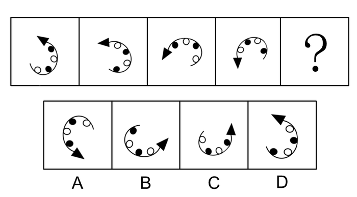

A. A

B. B

C. C

D. D

### 第 62 题

请选择最适合的一项填入问号处，使右边图形的变化规律与左边图形一致：

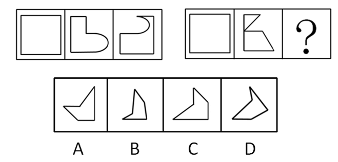

A. A

B. B

C. C

D. D

### 第 63 题

请选择最适合的一项填入问号处，使右边图形的变化规律与左边图形一致：

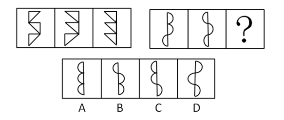

A. A

B. B

C. C

D. D

### 第 64 题

以下选项是从上方图片中截取出来的是：

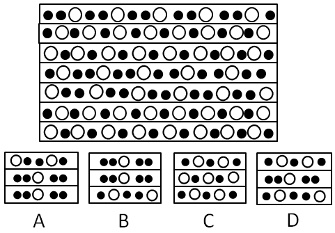

A. A

B. B

C. C

D. D

### 第 65 题

请选择最适合的一项填入问号处，使之符合整个图形的变化规律：

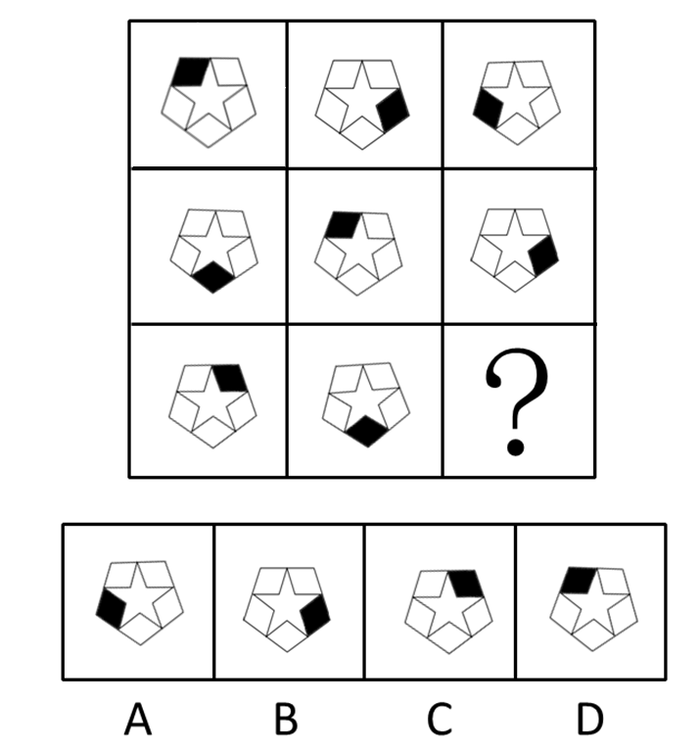

A. A

B. B

C. C

D. D

### 第 66 题

请选择最适合的一项填入问号处，使之符合整个图形的变化规律：

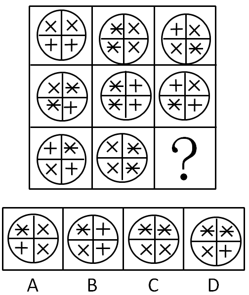

A. A

B. B

C. C

D. D

### 第 67 题

请选择最适合的一项填入问号处，使右边图形的变化规律与左边图形一致：

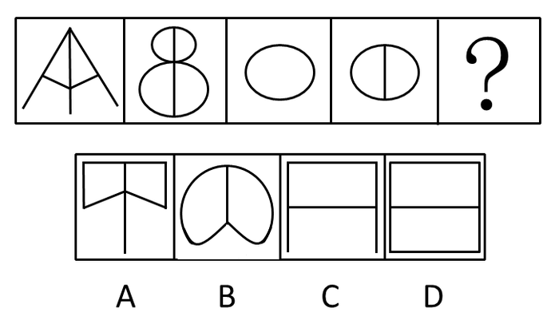

A. A

B. B

C. C

D. D

### 第 68 题

请选择最适合的一项填入问号处，使之符合之前四个图形的变化规律：

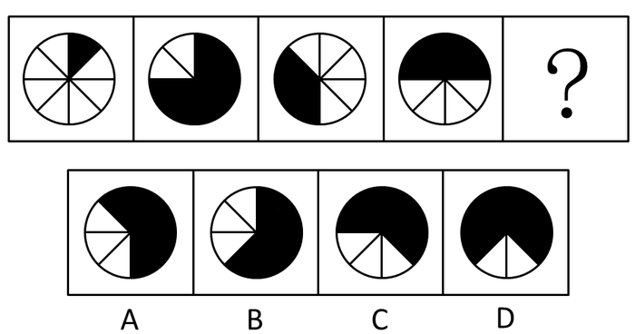

A. A

B. B

C. C

D. D

### 第 69 题

请选择最适合的一项填入问号处，使之符合之前四个图形的变化规律：

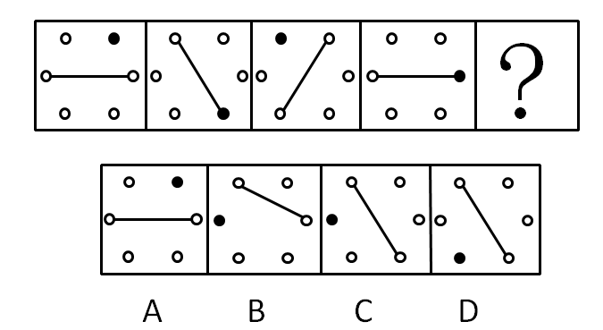

A. A

B. B

C. C

D. D

### 第 70 题

请选择最适合的一项填入问号处，使之符合整个图形的变化规律：

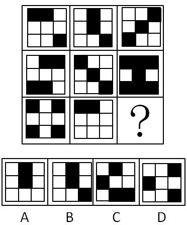

A. A

B. B

C. C

D. D

### 第 71 题

已知33×34=1122，333333×333334=111111222222，那么33333×33334=

A. 111122222

B. 111112222

C. 11112222

D. 1111122222

### 第 72 题

将5个大小相同的正方形按下图的方式叠放，两个正方形重叠的位置刚好为边的中点。如果正方形的边长为8厘米，则这个组合图形的外周（下图粗线条）长度为：

A. 72厘米

B. 80厘米

C. 88厘米

D. 96厘米

### 第 73 题

今年（2012）3月份的最后一天是星期六，则2013年3月份的最后一天是：

A. 星期日

B. 星期四

C. 星期五

D. 星期六

### 第 74 题

某单位组织员工外出活动，所有员工刚好坐满10辆客车。已知大客车每辆坐50人，小客车每辆坐30人，大客车比小客车一共多坐了260人。则大客车有多少辆？

A. 3

B. 4

C. 6

D. 7

### 第 75 题

某公司去年有员工350人。与去年相比，今年本科及以上学历员工增加25人，本科以下学历员工减少了2%，总人数增加20人。则该公司今年本科及以上学历员工有多少人？

A. 75

B. 100

C. 125

D. 150

### 第 76 题

M、N两地之间要架设电缆，已知两地之间地势复杂，电缆的架设需要绕道，绕道线路和相应的线路会导致的电量损耗（即所示数字，单位略）见右图。则从M到N架设电缆的电量损耗最低为：

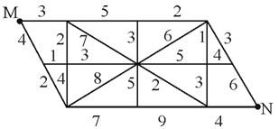

A. 14

B. 16

C. 17

D. 18

### 第 77 题

某次会议需要印制会议材料，参会人员共计300人，每人发放一份会议议程，每5人共用一份会议讨论资料，每间客房（每间住2人，无单人）发放一份本地出行提示。会议材料的印制价格如下，则印制会议材料一共需要花费多少元：

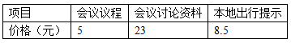

A. 3390

B. 3875

C. 4155

D. 5430

### 第 78 题

将一个表面积为18平方厘米的正方体沿对角线切成两块对称的三棱柱（见下图），并将这两块三棱柱重新拼接成一个大的三棱柱。则这个大三棱柱的表面积最大为多少平方厘米？

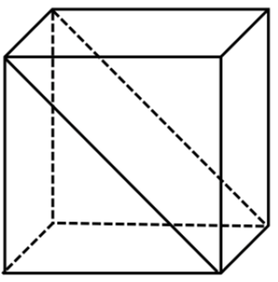

A. 

B. 

C. 

D. 

### 第 79 题

小李用几天时间看完了一本400页的书，第一天看30页，然后每天比前一天多看20页。在小李看书这几天的前半段时间（按整天计算），小李一共看了多少页？

A. 130

B. 150

C. 170

D. 190

### 第 80 题

某机构要派工作人员到9个乡镇进行业务检查。工作人员每到一个乡镇进行业务检查后必须返回单位汇报，这一行程的总时间见下表。如果这项工作要在16个小时内完成，则该单位至少要派出多少名业务员：

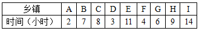

A. 4

B. 5

C. 6

D. 7

### 第 81 题

某水果店销售一批水果，按原价出售，利润率为25%。后来按原价的九折销售，结果每天的销量比降价前增加了1.5倍。

则打折后每天销售这批水果的利润比打折前增加了：

A. 15%

B. 20%

C. 25%

D. 30%

### 第 82 题

某晚会计划设置抽奖环节，能用于购买奖品的总金额固定，且要求每名一等奖奖品的金额是二等奖的两倍，每名二等奖奖品的金额是三等奖的两倍。如果一、二、三等级各设置两名，则一等奖奖品金额为每名720元。若一等奖设一名、二等奖两名、三等奖四名，则一等奖的奖品金额为每名多少元？

A. 780

B. 840

C. 880

D. 940

### 第 83 题

有8人进行围棋赛。第一轮比赛，8人随机组成4组对弈。之后每一轮比赛由前一轮比赛中所有获胜者随机组成2组对弈，所有失败者也随机组成2组对弈。则3轮比赛后，战绩为1胜2负的棋手最多有多少人？（本次围棋比赛没有和局）

A. 3

B. 2

C. 5

D. 4

### 第 84 题

甲公司的马经理从本公司坐车到乙公司洽谈，以30千米/时的速度出发20分钟后，马经理发现文件忘带了，便让司机以原来1.5倍的速度回甲公司拿，而他自己则以5千米/时的速度步行到乙公司。结果司机和马经理同时到达乙公司。甲乙两公司的距离是多少千米？

A. 12.5

B. 13

C. 13.5

D. 14

### 第 85 题

公司安排6位新员工共同参加一次为期两天的活动，6个人围成一个圆桌进行交流。为促进新员工间的互动，如果要求第二天每个人身边坐着的两个人都与第一天不同，则新员工们有多少种座位安排方式：

A. 5

B. 6

C. 7

D. 8

### 第 86 题

2011年，我国大陆死亡人口约为多少万人？

关联材料：dom-material-992e31aa351ca1dc

A. 960

B. 980

C. 1000

D. 1200

### 第 87 题

2011年，我国大陆平均约多少人便拥有一位执业医师或者执业助理医师？

关联材料：dom-material-992e31aa351ca1dc

A. 400

B. 500

C. 600

D. 1000

### 第 88 题

2011年，我国大陆下列医疗机构中，数量最多的是：

关联材料：dom-material-992e31aa351ca1dc

A. 医院

B. 乡镇卫生院

C. 诊所（卫生所、医务室）

D. 村卫生室

### 第 89 题

如果与2010年相比，2011年我国大陆城镇人口约增长5%，则2010年我国大陆非城镇人口约为多少万人？

关联材料：dom-material-992e31aa351ca1dc

A. 67000

B. 68500

C. 70000

D. 71500

### 第 90 题

下列说法正确的是：

关联材料：dom-material-992e31aa351ca1dc

A. 2011年我国大陆出生人口1604万人，同比增长4.79‰

B. 从出生人口就可以判断，2011年我国医疗机构的床位资源非常紧张

C. 2011年我国大陆卫生技术人员中，群体人数最小的不可能是注册护士

D. 2011年，我国大陆医院数量约占医疗卫生机构数量的20%

### 第 91 题

迁入本地五年到十年的受调查人群中，有百分之多少的人认为自己依然属于外地人：

关联材料：dom-material-df93c5cacf353ec7

A. 38.50%

B. 47.52%

C. 51.06%

D. 60.60%

### 第 92 题

受调查人群中，有最大比率人员认为“自己已属于本地人”的群体是：

关联材料：dom-material-df93c5cacf353ec7

A. 迁入本地五年内的群体

B. 迁入本地五年到十年的群体

C. 迁入本地十年以上的群体

D. 无法判断

### 第 93 题

受调查人群中，约有百分之多少的人认为“自己已属于本地人”：

关联材料：dom-material-df93c5cacf353ec7

A. 48

B. 49

C. 50

D. 无法计算

### 第 94 题

受调查人群中，认为自己是外地人的比率，迁入本地十年以上的群体比迁入本地五年内的群体：

关联材料：dom-material-df93c5cacf353ec7

A. 约少22个百分点

B. 约多22个百分点

C. 约少36个百分点

D. 约多36个百分点

### 第 95 题

以下说法，正确的是：

关联材料：dom-material-df93c5cacf353ec7

A. 总的来说，虽然没有当地户口，但外来人员希望获得“自己属于本地人”的身份认同

B. 随着迁入年限的增加，有越来越多的没有当地户口的外来人员不知道自己到底是属于本地人还是属于外地人

C. 迁入之初认为自己是外地人的没有当地户口的外来人员中，十年之后依然有超过一半的人认为自己是外地人

D. 无法判断是否会有越来越多的外来人员会随着迁入年限的增加而认为自己属于本地人

### 第 96 题

关于我国私营企业的情况，1990年到2010年年均增长速度最快的是：

关联材料：dom-material-483647e5be1b0694

A. 注册资本总额

B. 雇用工人数

C. 私营企业户数

D. 缴纳税金

### 第 97 题

1990年到2010年，我国的私营企业主人数年均约增加多少万人：

关联材料：dom-material-483647e5be1b0694

A. 88

B. 90

C. 92

D. 94

### 第 98 题

组织类型为有限责任公司的私营企业，2010年比1990年增加了约多少万户：

关联材料：dom-material-483647e5be1b0694

A. 600

B. 650

C. 700

D. 750

### 第 99 题

关于我国私营企业的情况，从1990年到2010年并非呈现持续增长趋势的是：

关联材料：dom-material-483647e5be1b0694

A. 中部地区的私营企业户数

B. 农村的私营企业户数

C. 组织类型为合伙企业的私营企业户数

D. 第二产业的私营企业户数

### 第 100 题

以下说法正确的是：

关联材料：dom-material-483647e5be1b0694

A. 1995年到2010年间，从企业户数的年均增长率来看，第三产业的私营企业快于第一产业的私营企业

B. 总的来说，1990年到2010年，私营企业主要分布在东部地区

C. 我国私营企业的工业产值与营业额越来越趋于一致

D. 2010年第二产业的私营企业注册资本额约占私营企业注册资本总额的30%

## 答案与解析

第 1 题

**参考答案（粉笔题库参考内容）**

D

**解析**

搭配“城乡文化”，且根据后文“难以迅速融入城市文化生活”可知，横线处表达城乡文化之间存在一定的隔膜，D项“隔阂”指彼此之间有距离，符合文意。

A项“差异”仅能体现出城乡文化不同，无法体现距离之意，排除；B项“差距”指事物之间的差别程度，强调程度大小，但文段只强调有距离，排除；C项“障碍”指阻挡，使其不能顺利通过，文段强调城乡文化有隔膜，而不是城乡二元结构阻挡了城乡文化的发展，故与文意不符，排除。

故正确答案为D。

第 2 题

**参考答案（粉笔题库参考内容）**

B

**解析**

本题考查成语的应用。对应前文“人才”及空后的“大胆使用”可知，应填入“不拘一格”，二者表意一致。因此，结合选项应该选择B项。

“不遗余力”是指把全部力量都使出来，文段强调范围，而不是力度；“不落窠臼”比喻有独创风格，不落旧套，多用来指文章和文艺作品的风格；“不折不扣”指没有折扣，表示完全、十足的意思。

故正确答案为B。

第 3 题

**参考答案（粉笔题库参考内容）**

B

**解析**

本题考查实词的应用。

从前面的“不俗”和“热议”可以看出人们对《心术》的关注，“瞩目”就有令人关注的意思。

因此，结合选项应该选择B。

“侧目”指不敢正视，多形容畏惧；“瞠目”多用来形容惊呆的样子；“刮目”多用来形容某人取得显著进步。三项均与句意不符。

故正确答案为B。

第 4 题

**参考答案（粉笔题库参考内容）**

C

**解析**

本题考查成语的应用。

“额手称庆”指把手放在额上，表示庆幸。形容高兴和喜悦。用在句中与“险胜对手”相呼应。

因此，结合选项应该选择C。

A项“弹冠相庆”指官场中一人当了官或升了官，同伙就互相庆贺将有官可做，含贬义，指坏人得意的样子，首先排除；B项“举杯相庆”指大家一起庆祝；D项的“扶手称颂”指赞扬别人，均与句意不符。

故正确答案为C。

第 5 题

**参考答案（粉笔题库参考内容）**

A

**解析**

本题考查成语的应用。根据第一空后的“来源于广大人民群众的生动实践”可以判断，此处应为不脱离实践之意，排除C、D两项；B项“纸上谈兵”强调的是“谈”理论，A项“闭门造车”强调的是“造”，即“实践”的结果，由第一空后的“写”可知，“闭门造车”更为合适。

故正确答案为A。

第 6 题

**参考答案（粉笔题库参考内容）**

D

**解析**

第一空，根据文意可知，横线处表达改革对市场产生了积极的效果，C项“为之振奋”、D项“耳目一新”均能体现市场出现的良好局面。A项“如雷贯耳”形容人的名声大，文段强调市场发生积极的变化，而非名声大，排除；B项“闻风丧胆”形容对某种力量非常恐惧，与文段感情色彩不符，排除。

第二空，根据后文“非一日之功”可知，横线处表达存在时间很长之意，D项“积弊”指积久相沿的弊病，符合文意。C项“阵痛”无法体现时间长久之意，排除。

故正确答案为D。

第 7 题

**参考答案（粉笔题库参考内容）**

A

**解析**

第一、二空，根据“在传统的社会中······没有当下所谓‘诚信档案’”和“一个人的诚信档案存在于全体社区成员的心里与口碑中”可知，前后语义相反，构成转折关系。A项“虽然······但是”为转折关联词，符合文意，保留。B项“不但······而且”表递进关系，C项“因为······所以”表因果关系，均与文段逻辑关系不符，排除；D项“即使”常与“也”搭配，和“但是”搭配不当，排除。

第三空，代入验证，横线后“可以代际相传”是对诚信档案存在形式的进一步补充说明。A项“而且”表递进，承接前文语义，符合文段逻辑关系，当选。

故正确答案为A。

第 8 题

**参考答案（粉笔题库参考内容）**

C

**解析**

本题从第二、三空入手，“民间崇尚的知识、学历、文人风范”和后文“是虚饰夸大的制胜途径”构成让步假设关系，即就算是大众推崇的这些东西，也只是夸大的取胜手段。四个选项中，只有C项“即便······也······”表示让步假设，符合逻辑关系，当选。

第一空和第四空，分别代入验证。第一空，前文指出文化被误当作文明冲突工具，构成因果关系。C项“由于”引导原因，符合逻辑关系；第四空，前文陈述两方面的误解，最终引出“胜败之术压倒善恶之道”这一最终局面，C项“结果”引出最终形成的局面，符合逻辑关系，当选。

故正确答案为C。

第 9 题

**参考答案（粉笔题库参考内容）**

A

**解析**

本题考查实词的应用。

“天”和“地”对应，一个在上，一个在下，因此要“仰”和“俯”，排除B、D两项；“诸物”指所有的物，“诸身”指所有的人，因此可以排除C项的只用来表自身的“内观”。

故正确答案为A。

**【出处】**“古者包羲氏之王天下也，仰观象于天，俯观法于地，观鸟兽之文，与地之宜，近取诸身，远取诸物，于是始作八卦，以通神明之德，以类万物之情。”

第 10 题

**参考答案（粉笔题库参考内容）**

D

**解析**

本题考查实词的应用。先看第一空，“燃烧”应搭配“激情”，排除A、C两项。再看第三空，说服人的应该是“真理”而不是“权威”，排除B项。

故正确答案为D。

第 11 题

**参考答案（粉笔题库参考内容）**

B

**解析**

本题考查细节判断。

B项是对文段的准确概括。

因此，结合选项应该选择B。

A项的“开创了……先河”属于无中生有；C项表述不当，文段并没有提及读者群的规模；D项，文段没有提到读者对科学的兴趣这一点。

故正确答案为B。

第 12 题

**参考答案（粉笔题库参考内容）**

C

**解析**

本题考查细节判断。

文段第一句点明观点，第二句说明观点，第三句则对首句观点进一步解释和补充说明。C项与文段主要意思一致。

因此，结合选项应该选择C。

A项的“脸型常见”在文段中没有提及；B项，文段没有对“独具个性的脸”进行评价；D项偷换概念，文段是说“美丽的脸”，而不是说“美”，且文段没有提到人们喜欢什么样的面孔。

故正确答案为C。

第 13 题

**参考答案（粉笔题库参考内容）**

A

**解析**

本题为中心理解题。

文段分别用三个分句说明IBM公司三次决策失误导致的后果——追悔莫及、看不上眼的小公司发展成市值几亿美元的公司、与50多家企业展开惨烈的竞争。这都是为了说明同一个意思——IBM公司多次错过了发展、创新的机会。

因此，结合选项应该选择A。

B项的“决策缓慢”“屡次失败”是对文意的错误理解，扩大了范围；C项的“有50多家公司”与文段的主体不一致；D项的“将成为最强大的科技公司”在文段中没有提及，且说法过于绝对，高估了三次机会的重要性。

故正确答案为A。

第 14 题

**参考答案（粉笔题库参考内容）**

A

**解析**

本题考查接语选择。

由最后一句“稍可补充的，是碑文中有关医学史的一项小问题”，因此下文应是关于医学史的一些内容。

因此，结合选项应该选择A。

B项的“贡献”、C项的“关注”在文段中没有提及；D项，文段中说的是可补史志之缺的内容是“疏勒叛乱、黄巾起义、党锢之祸”这些内容，而不是指医学内容。

故正确答案为A。

第 15 题

**参考答案（粉笔题库参考内容）**

A

**解析**

本题为中心理解题。题干是表示因果关系的一段文字，第一句是因，指出传统史学研究的对象的特点——不能说话，不能为自己辩护。第二句是果——对相同问题的研究结果却大相径庭。重点在果，A项准确地概括了文意。因此，结合选项应该选择A项。

B项的“应当谨慎，不能武断”是对文段内容的引申理解。文段并没有说传统的史学研究不谨慎、比较武断；C项为主观臆断，文段没有提及“‘能说话的’史料”对史学研究的作用；D项是对文段最后一句话的曲解。

故正确答案为A。

第 16 题

**参考答案（粉笔题库参考内容）**

D

**解析**

本题考查中心理解。首句即为主旨句。生命意义的问题不能由经验研究，第二句是对主旨句的解释说明。因此，结合选项应该选择D项。

A项，文段中关于“认识论”问题的解决只是一种假设，并没有说可以由经验研究获得解答；B项，文段没有将科技进步与美好的人类生活进行联系；C项，文段没有提及生命的意义的定义和内容。三项均属于无中生有，并非文中应有之意。

故正确答案为D。

第 17 题

**参考答案（粉笔题库参考内容）**

A

**解析**

本题考查标题选择。

文段用四个名人的话说明同一个观点：知识本身没有好坏，重点在于使用它的人的品德、使用方式、意图等。即知识需要人的控制。

因此，结合选项应该选择A。

B项，是对罗素前面半句话的同义转换，不全面，排除；

C项，不够全面且过于笼统，道德只是控制知识的一个方面，且没有体现对知识的运用控制，排除；

D项，是对爱因斯坦的话的转换，不全面，排除。

故正确答案为A。

第 18 题

**参考答案（粉笔题库参考内容）**

B

**解析**

本题考查语句排序。

从三个句子可以看出文段的主要对象是“酒”，因此应该有一个句子先引出这一对象，显然由名言引出最为恰当，故②应为首句。

故正确答案为B。

第 19 题

**参考答案（粉笔题库参考内容）**

A

**解析**

本题考查细节判断。

文段前两句分别说明牛顿和量子力学对时间的理解——统摄万物，后两句讲相对论对时间的理解——宇宙构成的主动参与者。显然，相对论对时间的理解更进一步。

因此，结合选项应该选择A。

B项，文段没有提及客观的时间的内涵；C、D两项在文段中没有提及。

故正确答案为A。

第 20 题

**参考答案（粉笔题库参考内容）**

D

**解析**

文段首句亮明观点：认为“宫斗戏”破坏社会价值观的观点夸大其词，接下来对自己的观点进行解释说明。

因此，结合选项应该选择D。

A项是对文段的过度引申；B项的“不会有影响”错误，文段并没有否认“宫斗戏”对社会价值观的影响；C项显然错误，文中只说“不是万能的”，并未否认影视作品的作用。

故正确答案为D。

第 21 题

**参考答案（粉笔题库参考内容）**

B

**解析**

前半句指出减少死刑和国家司法公正的条件关系，后者是前者的必要条件，并用假设指出这种关系的重要性，而“所以说这是相辅相成的”是对这一关系的补充。故“这”指代的是减少死刑和国家的司法公正。

故正确答案为B。

第 22 题

**参考答案（粉笔题库参考内容）**

C

**解析**

本题为中心理解题。

文段第一句说运用基因检测技术检测疾病存在盲区，第二句说运用基因检测技术检测个体患病的风险概率准确率不能达到100%，第三句说明基因检测结果也存在不可靠性。概括这三句有一个核心意思——基因检测技术在检测疾病方面有局限。进一步引申就得到C项的内容。

故正确答案为C。

第 23 题

**参考答案（粉笔题库参考内容）**

B

**解析**

文段介绍的两种观点并不是“根本对立的”，二者都承认“未成形”这一概念，新教派认为由教育培养缺失造成，浪漫主义派认为是由畸形的成人造成，二者均未否认教育的作用，A项错误，排除；C项是对文段中浪漫主义派的观点的混淆理解，文段只提及“不能保持与生俱来的能力的儿童”和“畸形的成人”，排除；D项扩大了范围，该项内容只是浪漫主义派的观点，主语缺失，排除。

故正确答案为B。

第 24 题

**参考答案（粉笔题库参考内容）**

C

**解析**

文段开篇指出提高自身价值要通过修身，接着指出修身离不开克己，后文对克己的内涵进行解释，之后通过“例如”对“克己”的表现进行举例论证，故文段重在强调修身离不开克己，对应C项。

A、B两项，均缺少文段核心话题“修身”，偏离文段中心，排除；

D项，“一味逆来顺受、忍让退避”对应文段解释“克己”内涵的部分，非重点内容，且缺少文段核心话题“修身” “克己”，偏离文段中心，排除。

故正确答案为C。

第 25 题

**参考答案（粉笔题库参考内容）**

C

**解析**

文段首句指出“文艺的完整形态”应包括“创作主体”和“接受客体”两个方面，接下来指出文艺家创作要以唤起一定对象的审美体验为创作归宿，尾句指出有抱负的文艺家总是要致力于描写、服务和影响创造历史的中坚构成和主体力量，“创造历史的中坚构成和主体力量”即接受客体，因此C项表述正确，当选。A项“推动美好社会理想的实现”，没有提到创作客体，文段强调的是“要以唤起一定对象的审美体验为创作归宿”，排除A项。文艺家在文艺中反映的立场和出发点应与“一定对象”，即接受客体的审美体验相一致，而非“创作主体”，B项表述错误，排除；“获得深广社会效应和艺术价值”只是文艺创作“接受客体”的一种结果，而非形态，如果提到“缺损”，应该是“接受客体”的缺失，D项表述错误，排除。

故正确答案为C。

第 26 题

**参考答案（粉笔题库参考内容）**

C

**解析**

华南虎，是中国的十大濒危动物之一，目前在野外几乎灭绝，仅在各地动物园、繁殖基地里人工饲养着100余只。一般来说，一只老虎的生存至少需要70平方公里的森林，还必须生存有200只梅花鹿、300只羚羊和150只野猪。

题干也强调“所生存的环境”，华南虎由名称可知，主要分布于华南，对于环境依赖度高，符合题意。而海鸥、野猪和眼镜蛇的分布范围更广，相对于其他三种动物而言，华南虎属于“脆弱的、容易消亡的”动物。

故正确答案为C。

第 27 题

**参考答案（粉笔题库参考内容）**

C

**解析**

铅笔的B值越大则越软越浓，H值越大则越硬越淡。软铅笔铅质松，轻附纸面，便于修改，硬铅笔适合深入刻画细部。画画宜用较软的铅笔（4B），制图则应该用较硬的铅笔（6H），写字则适用软硬适中的铅笔（HB）。

故正确答案为C。

第 28 题

**参考答案（粉笔题库参考内容）**

A

**解析**

根据《民法典》第三百一十二条规定：“所有权人或者其他权利人有权追回遗失物。该遗失物通过转让被他人占有的，权利人有权向无处分权人请求损害赔偿，或者自知道或者应当知道受让人之日起二年内向受让人请求返还原物；但是，受让人通过拍卖或者向具有经营资格的经营者购得该遗失物的，权利人请求返还原物时应当支付受让人所付的费用。权利人向受让人支付所付费用后，有权向无处分权人追偿。”题中，兰花属于遗失物，张某有权索回。

故正确答案为A。

第 29 题

**参考答案（粉笔题库参考内容）**

B

**解析**

A 项错误，此项所述内容发生在三国时期，是对赤壁之战作出了另一种假设；

B 项正确，此项所述内容发生在秦末汉初时期，描写项羽兵败自刎的壮烈；

C 项错误，此项所述内容发生在南宋末年，人物为成吉思汗；

D 项错误，此项所述内容发生在西汉时期，指飞将军李广抗击匈奴的赫赫战绩。  
故正确答案为 B。

第 30 题

**参考答案（粉笔题库参考内容）**

B

**解析**

A、C、D项正确，三项所指均是医学行业；

B项错误，梨园，原是古代对戏曲班子的别称。

本题为选非题，故正确答案为B。

第 31 题

**参考答案（粉笔题库参考内容）**

D

**解析**

中药柜存放药物有一句顺口溜：质轻量大易装匣，常用普通斗中装，挥发粉面细子瓶，暗柜独存贵毒麻。

A项错误，应放在匣中；

B、C项错误，应放在瓶中；

D项正确，应放在暗柜中。

故正确答案为D。

第 32 题

**参考答案（粉笔题库参考内容）**

A

**解析**

活细胞的细胞膜的功能特性为选择透过性，即只能让一些物质通过，不能让其他物质通过的性质。用清水冲洗时，苋菜的细胞膜具有选择透过性，阻拦色素流出细胞。而用沸水煮过后，死亡的细胞失去选择透过性，其中的物质会进入外界溶液。

故正确答案为A。

第 33 题

**参考答案（粉笔题库参考内容）**

D

**解析**

水垢是指硬水煮沸后所含矿质附着在容器（如锅、壶等）内逐渐形成的白色块状或粉末状的物质。醋中的醋酸可以分解水垢。如烧水壶有了水垢，可将几勺醋放入水中，烧一二个小时，水垢即除。因此在白醋中加入食盐用抹布擦洗可以很好地祛除水垢。

故正确答案为D。

相关知识点：食用碱加水浸泡水垢才能将其去除，A项撒在微湿抹布上擦洗水垢的效果并不好。

第 34 题

**参考答案（粉笔题库参考内容）**

D

**解析**

夏季，阳光直射在北回归线附近，北半球每天太阳照到的时间长，照不到太阳光的时间短，所以夏季日长夜短。而且在夏季，越是往北，白天越长。根据四个选项中所述城市的地理位置，从北到南排列的是D项。

故正确答案为D。

第 35 题

**参考答案（粉笔题库参考内容）**

A

**解析**

白帝城位于重庆奉节县瞿塘峡口的长江北岸，奉节东白帝山上，三峡的著名游览胜地。江陵县位于湖北省中南部，江汉平原腹地、荆江河段北岸。

故正确答案为A。

第 36 题

**参考答案（粉笔题库参考内容）**

C

**解析**

本题所涉及内容比较生僻，宜用排除法作答，题干要求的是“1920年以后”这一时间段。

A项错误，柏拉图是古希腊的伟大哲学家；

B项错误，培根是中世纪文艺复兴时期的哲学家；

D项错误，黑格尔活跃于十八至十九世纪。

故正确答案为C。

第 37 题

**参考答案（粉笔题库参考内容）**

D

**解析**

A、B、C项正确，三项均出自杜甫的作品；

D项错误，“落魄江湖载酒行，楚腰纤细掌中轻”出自唐代诗人杜牧的《遣怀》。

本题为选非题，故正确答案为D。

第 38 题

**参考答案（粉笔题库参考内容）**

B

**解析**

牙膏和洗衣粉中的洗涤剂的主要成分是烷基磺酸钠；肥皂的主要成分是高级脂肪酸钠；碳酸钙在牙膏中主要充当摩擦剂。

故正确答案为B。

第 39 题

**参考答案（粉笔题库参考内容）**

B

**解析**

谭鑫培，清道光二十七年三月初九出生，其以老生享名剧坛则是光绪十年以后的事了。同光年间是指同治、光绪年间。

故正确答案为B。

第 40 题

**参考答案（粉笔题库参考内容）**

B

**解析**

涪陵地方志记载，“杨妃嗜生荔枝，诏驿自涪陵，由达州，取西乡，入子午谷，至长安才三日，色香俱未变”。从地理位置上看，四川也更容易保鲜。

故正确答案为B。

第 41 题

**参考答案（粉笔题库参考内容）**

B

**解析**

第一步：判断题干词语间逻辑关系。

题干两词为并列关系中的矛盾关系，“对立”与“和谐”是反义词。

第二步：判断各个选项的关系，找出与题干逻辑关系一致的，即为答案。

A项，“创新”和“变革”是近义词，与题干逻辑关系不一致；

B项，“依赖”和“独立”是反义词，与题干逻辑关系一致；

C项，“专家”和“骗子”是反对关系，与题干逻辑关系不一致；

D项，“准确”和“失败”没有明显的逻辑关系，与题干逻辑关系不一致。

故正确答案为B。

第 42 题

**参考答案（粉笔题库参考内容）**

C

**解析**

第一步：判断题干词语间的逻辑关系。

本题考查对应关系，胶囊是感冒药的一种载体。

第二步：判断选项词语间的逻辑关系。

A项，吸管是用来喝汽水的工具，与题干逻辑关系不一致，排除；

B项，汉堡和三明治都是典型的西方快餐食品，属于并列关系，与题干逻辑关系不一致，排除；

C项，唱片是音乐的一种载体，与题干逻辑关系一致，当选；

D项，土豆是制作薯条的原材料，与题干逻辑关系不一致，排除。

故正确答案为C。

第 43 题

**参考答案（粉笔题库参考内容）**

A

**解析**

逐一代入选项。

A项：无影灯是医生开展手术操作时使用的工具，二者为职业与使用工具对应关系；黑板是老师讲课时使用的工具，二者为职业与使用工具对应关系，前后逻辑关系一致，当选；

B项：无影灯是医生开展手术操作时使用的工具，与护士无明显逻辑关系；讲台是老师的授课地点，二者为职业与工作地点对应关系，前后逻辑关系不一致，排除；

C项：无影灯是医生开展手术操作时使用的工具，二者为职业与使用工具对应关系；讲座是老师的授课形式，二者不是职业与使用工具对应关系，前后逻辑关系不一致，排除；

D项：无影灯是医生开展手术操作时使用的工具，与护士无明显逻辑关系；课本是老师教学时使用的工具，二者为职业与使用工具对应关系，前后逻辑关系不一致，排除。

故正确答案为A。

第 44 题

**参考答案（粉笔题库参考内容）**

B

**解析**

第一步：判断题干词语间逻辑关系。

题干两词为对应关系，充电是使用手机的必要条件且充电是动宾结构。

第二步：判断选项词语间逻辑关系。

A项，冷藏是保存雪糕的必要条件，但冷藏不是动宾结构，与题干逻辑关系不一致，排除；

B项，加油是使用汽车的必要条件且加油是动宾结构，与题干逻辑关系一致，当选；

C项，电池与使用闹钟不存在必然的联系，与题干逻辑关系不一致，排除；

D项，茶壶是烧热水的工具，与题干逻辑关系不一致，排除。  

故正确答案为B。

第 45 题

**参考答案（粉笔题库参考内容）**

A

**解析**

第一步：判断题干词语间逻辑关系。

题干两词为对应关系，在对比的基础上进行分析，存在逻辑上的前后关系。

第二步：判断各个选项词语间的逻辑关系，找出与题干逻辑关系一致的，即为答案。

A项与题干逻辑关系一致，在欣赏的基础上进行评鉴，当选；

B项，种植和养殖是并列关系；C项，繁荣和发展没有前后关系；D项，援助是资金的一种用途。三者均与题干逻辑关系不一致，排除。

故正确答案为A。

第 46 题

**参考答案（粉笔题库参考内容）**

D

**解析**

第一步：判断题干词语间逻辑关系。

题干两词为对应关系，忠诚度高低是影响品牌的一个指标。

第二步：判断各个选项的关系，找出与题干逻辑关系一致的，即为答案。

A项，标签用来标注信息；B项，精品的价值高；C项，谣言和谎言是并列关系。三者均与题干逻辑关系不一致，排除；  

只有D项与题干逻辑关系一致，认同度高低是影响文化的一个指标，是答案，当选。

故正确答案为D。

第 47 题

**参考答案（粉笔题库参考内容）**

A

**解析**

第一步：判断题干词语间的逻辑关系。

“锦上添花”比喻使美好的事物更加美好；“雪中送炭”比喻在别人急需的时候给以帮助，两者是近义词。

第二步：判断选项词语间逻辑关系。

A项：“见死不救”是指看见人家有急难而不去救援，形容冷酷无情；“落井下石”是指看见有人要掉进陷阱里，不伸手救他，反而推他下去，又扔下石头，比喻乘人有危难时加以陷害，两者是近义词，与题干逻辑关系一致，当选。

B项：“衣锦夜行”是指夜里穿着锦绣衣服走路，比喻不能在人前显示荣华富贵；“光宗耀祖”意为为宗族争光，使祖先显耀，两者不是近义词，与题干逻辑关系不一致，排除。

C项：“安居乐业”是指安定愉快地生活和劳动；“背井离乡”现指人们出外打工，谋生计，两者是反义词，与题干逻辑关系不一致，排除。

D项：“满目疮痍”指眼睛所看到的都是创伤，形容受到严重破坏的境况；“百废待兴”是指许多被搁置的事情等着要兴办，形容事情都有待重新做起，两者不是近义词，与题干逻辑关系不一致，排除。

故正确答案为A。

第 48 题

**参考答案（粉笔题库参考内容）**

C

**解析**

第一步：判断题干词语间逻辑关系。

题干两词为对应关系，成本是影响价格的因素。

第二步：判断各个选项的逻辑关系，找出与题干逻辑关系一致的，即为答案。

A、B、D三项都是后者影响前者，均与题干逻辑关系不一致，排除；  

只有C项与题干逻辑关系一致，工艺是影响质量的因素，当选。

故正确答案为C。

第 49 题

**参考答案（粉笔题库参考内容）**

B

**解析**

第一步：判断题干词语间逻辑关系。

题干两词为对应关系，银行办理贷款业务，是业务与机构的对应。

第二步：判断各个选项词语间的逻辑关系，找出与题干逻辑关系一致的，即为答案。

只有B项与题干逻辑关系一致，邮局办理邮件业务，当选；

A、D两项后者均为人；C项，消防车是消灭火灾的工具。三项均与题干逻辑关系不一致，排除。

故正确答案为B。

第 50 题

**参考答案（粉笔题库参考内容）**

B

**解析**

第一步：判断题干词语间逻辑关系。

“农夫”用“镰刀”割“水稻”，“农夫”与“水稻”为主宾关系，且“镰刀”是实物。

第二步：判断选项词语间逻辑关系。

A项：“工人”用“机器”“印刷”，但“工人”与“印刷”为主谓关系，与题干逻辑关系不一致，排除；

B项：“奶农”用“奶牛”挤“牛奶”，“奶农”与“牛奶”为主宾关系，且“奶牛”是实物，与题干逻辑关系一致，当选；

C项：“将军”用“兵法”指挥“战役”，但“兵法”不是实物，与题干逻辑关系不一致，排除；

D项：“客户”用“银行卡”“存钱”，但“客户”与“存钱”为主谓宾关系，与题干逻辑关系不一致，排除。

故正确答案为B。

第 51 题

**参考答案（粉笔题库参考内容）**

C

**解析**

本题为关联词推导题型。

第一步：翻译题干。

（1）操作携带方便→不大于3.5英寸；（2）注重阅读效果→大于3.5英寸；（3）S品牌大于3.5英寸（事实信息）。

第二步：从事实信息开始推导并得出结论。

（3）肯定第一步中（2）的后件，肯后件无法推出肯前件，即无法判断是否“注重阅读效果”，排除A、B；（3）否定（1）的后件，根据逆否规则，否后件可以推出否前件，即“不便于操作和携带”，排除D。

故正确答案为C。

第 52 题

**参考答案（粉笔题库参考内容）**

B

**解析**

本题是削弱题型。

第一步：找出论点和论据。

论点：推广价格较低的药物。

论据：价格不同的药物的疗效相当。

第二步：判断削弱方式。

论点和论证存在因果关系，需要削弱论点。

第三步：逐一判断选项。

A项，价格较低的药物副作用小，说明应该推广，支持了论点，排除；  

B项，如果服用次数和剂量高的话，则意味着单位时间内服用价格较低的药物的总价有可能高于价格较高的药物，这样就失去了价格优势，属于他因削弱，当选；

C项，制药公司利润的高低与是否应该使用价格较低的药物无关，属无关选项，排除；

D项，倾向于使用价格比较高的药物，并不意味着不需要推广价格较低的药物，属无关选项，排除。

故正确答案为B。

第 53 题

**参考答案（粉笔题库参考内容）**

A

**解析**

本题为关联词推导题型。

第一步：翻译题干。

（1）戒烟成功→减少接触烟草的机会∧家人的支持。

第二步：逐一翻译选项并判断正确答案。

A项，减少接触烟草的机会∧家人的支持→戒烟成功，肯定（1）的后件，肯后件无法推出肯前件，因此无法推出，当选；

B项，戒烟成功→减少接触烟草的机会，肯定（1）的前件，肯前件可以推出肯后件，在联言命题中，肯定整个命题，则肯定所有的命题肢，即“减少接触烟草的机会”为真，因此可以推出，排除；

C项，等价于（1），可以推出，排除；

D项，“戒烟成功”肯定（1）的前件，同B项，因此可以推出，排除。

本题为选非题，故正确答案为A。

第 54 题

**参考答案（粉笔题库参考内容）**

D

**解析**

第一步：分析题干，找到论点和论据。

论点：保健效用提升引起凉茶饮料销量增长。

论据：A凉茶饮料的销量和用于保健效用的研发费同时有了明显增长。

第二步：逐一分析选项。

A项：市场份额的大小并不影响销量增长，属于无关选项，排除；

B项：B凉茶的销量不如A凉茶并不能说明B凉茶的销量增长不如A凉茶，属于偷换概念，无法削弱，排除；

C项：没有将销量和保健效用联系在一起，与A凉茶没有关系，无法削弱，排除；

D项：以事实说明“消费者购买A凉茶饮料”的真正原因是“该饮料的口味宜人、包装时尚”，直接否定论点，当选。

故正确答案为D。

第 55 题

**参考答案（粉笔题库参考内容）**

B

**解析**

本题为关联词推导中的推出方式类似题型，需要逐一分析题干和选项的结构。

第一步：翻译题干。

－（使用“云服务”∧个人信息不被泄露），等价形式：－P（使用“云服务”）∨－Q（个人信息不被泄露），即：P→－Q，Q→－P。

第二步：逐一翻译选项。

A项推理形式：P∧Q；

B项推理形式：－P∨－Q；

C项推理形式：－P→Q；

D项推理形式：Q。

只有B项与题干逻辑结构完全一致，A、C、D三项均不同。

故正确答案为B。

第 56 题

**参考答案（粉笔题库参考内容）**

A

**解析**

A项：呼吸正常的哺乳动物体内不可能发现刺激物，根据题干中最后一句话：目前在临床中发现有呼吸困难症状的动物体内都能找到α拟菌病毒，即间接表明了呼吸正常的动物体内不存在这种α拟菌病毒，也就不会发现这种刺激物，可以推出，当选；

B项：变形虫在哺乳类动物体内会使哺乳类动物的呼吸系统产生剧烈反应，根据题干可知，是拟菌病毒释放的刺激物使哺乳动物呼吸系统产生剧烈反应，B项无法推出，排除；

C项：根据题干可知，拟菌病毒会寄生于变形虫体内。被这种病毒寄生的β变形虫会在哺乳类动物体内释放某种刺激物，但是没有α拟菌病毒寄生的情况下会不会产生呼吸困难的刺激物无法得知，不能推出，排除；

D项：如果某个哺乳类动物感染了拟菌病毒，该动物肯定有呼吸困难的症状，根据题干可知，病毒寄生的变形虫会在哺乳类动物体内释放某种刺激物，这种刺激物会导致该动物的呼吸系统产生剧烈反应，呼吸困难，D项过于绝对，无法推出，排除。

故正确答案为A。

第 57 题

**参考答案（粉笔题库参考内容）**

D

**解析**

本题属于排列组合题型。

第一步：找突破口。

（1）A必须去（事实信息）；（2）（B∧C）/（－B∧－C）；（3）DC；（4）E/B。

信息量最大的为B，如果B不去，由（2）可知C不去，根据逆否规则，由（3）可知，D不去，由（4）可知，E去，此时只有A、E这1种组合；如果B去，由（2）可知C去，由（3）不确定D，可去可不去，由（4）可知，E不去，此时有A、B、C、D和A、B、C两种组合。

第二步：根据分析，确定答案。

综上，这个节目的成员人数可能是2、3或4个。

故正确答案为D。

第 58 题

**参考答案（粉笔题库参考内容）**

C

**解析**

本题为关联词推导题型。

第一步：翻译题干。

（1）M公司不去检验→消费者对其产品失去信心；（2）M公司去检验→消费者怀疑产品确实存在问题。

第二步：逐一分析选项并得出答案。

A、B两项属于过度推测，排除；

结合（1）和（2）可知，不管M公司是否去检验这一问题，都无法阻止传言对M公司声誉的损害，可知C项正确，当选；

D项无法在题干中找到依据，排除。

故正确答案为C。

第 59 题

**参考答案（粉笔题库参考内容）**

C

**解析**

本题为日常结论题型。

第一步：抓住题干中主要信息。

由题干可知，“用水超标家庭”实际上指的是全部家庭中，用水量排名前30%的家庭。由于其他家庭的具体用水量未知，因此该地区平均的日均耗水量也无法确定，用水超标家庭不一定都超过了平均的日均耗水量，①错误；超标用水家庭的认定是有一个固定比例的，数量的增加，必然是整体基数有所增加，因此不超标家庭的数量也逐年增多，③正确；整体上家庭数量增多，但无法确定日均耗水量的变化，因此无从得知用水总量是否增加，②错误。

第二步：结合分析，得出答案。

故正确答案为C。

第 60 题

**参考答案（粉笔题库参考内容）**

B

**解析**

本题是削弱题型。

第一步：找出论点和论据。

论点：大型制药公司不会投资研发治疗神经退行类疾病的药物。

论据：研发治疗神经退行类药物过于复杂和昂贵。

第二步：判断削弱方式。

论点和论据之间存在明显的因果关系，因此需要削弱论证。

第三步：逐一判断选项。

A、C两项都只对疾病本身而言，并没有涉及到研发成本和复杂性，属于无关选项，无法削弱论证；

B项，癌症药物研发最为复杂和昂贵，但仍然有公司投资研发，同因不同果，直接削弱了论证，当选；

D项，神经退行性药物研发周期更长，一定程度上支持了论点，D项说的是药物研发周期的问题，属于无关选项。

故正确答案为B。

第 61 题

**参考答案（粉笔题库参考内容）**

A

**解析**

元素组成相同，考虑位置变化。题干图形中，箭头依次逆时针旋转45度，四个小圆在同样的位置上黑白交替出现。待选图形也应符合此规律，根据观察，只有A项符合。

故正确答案为A。

第 62 题

**参考答案（粉笔题库参考内容）**

A

**解析**

平面拼图。前一组图形中，第二个图形纵向翻转后与第三个图形拼接，可以得到第一个图形。第二组图形也应符合此规律，显然只有A项符合条件。

故正确答案为A。

第 63 题

**参考答案（粉笔题库参考内容）**

B

**解析**

元素组成相同，考查位置变化-翻转。

前一组图形中，第一幅图的最上面部分经横向翻转后得到第二幅图，第二幅图最下面部分横向翻转后得到第三幅图。同理，后一组图形中，第一幅图最上面的部分横向翻转后得到第二幅图，第二幅图最下面的部分横向翻转后得到第三幅图。

故正确答案为B。

第 64 题

**参考答案（粉笔题库参考内容）**

D

**解析**

观察点与圆的相对位置关系，每一行都有各自的规律，“点、点、圆、点、点、圆”的规律出现在第一、四、五行，相邻的第四、五行并不是上下整齐对应的，首先排除A、B；“点、圆、点、圆、点、圆”的规律出现在第二、三、六、七行，并没有三行相邻的情况，因此排除C。

故正确答案为D。

第 65 题

**参考答案（粉笔题库参考内容）**

D

**解析**

元素组成相同，考查位置规律。

九宫格中，每行三个图形为一组。观察可知，黑色部分顺时针依次平移两格，每行均符合此规律。由此可知，问号处的图形中，黑色部分应在左上角。

故正确答案为D。

第 66 题

**参考答案（粉笔题库参考内容）**

C

**解析**

元素组成相似，符合元素的叠加。

九宫格中，每行三个图形为一组，规律相同。每个图形分为四个部分，每个部分都遵循以下规律：前两幅图形中相同的部分，在第三幅图形中保持不变；前两幅图形中不相同的部分，在第三幅图形中则变为完全不同的第三种图案。依此规律，只有C项符合。

故正确答案为C。

第 67 题

**参考答案（粉笔题库参考内容）**

D

**解析**

考查图形内部特征。元素呈现明显的对称和规则性，通过观察，前四个图形分别为字母A、B、C、D翻转拼接得到的图案，因此待选图形应为字母E翻转后拼接成的图案。

故正确答案为D。

第 68 题

**参考答案（粉笔题库参考内容）**

B

**解析**

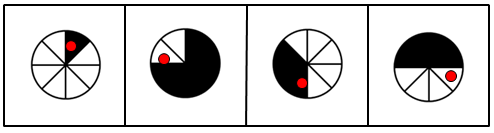

题干图形中，黑、白、黑、白的数量依次为1、2、3、4，数量递增，颜色交替，因此待选图形中黑色的数量应为5，A、B、C三项均符合；

观察黑、白、黑、白的结束位置，如图中红点标示位置，逆时针依次旋转两格，则待选图形中“黑”的结束位置，应再次逆时针旋转两格，得到B项。

故正确答案为B。

第 69 题

**参考答案（粉笔题库参考内容）**

C

**解析**

每个图形中的线段顺时针依次旋转60°，排除A、B；黑色小圆的位置顺时针移动，依次移动2步、3步、2步、（3步），因此所求图形中黑色小圆应在最左边。

故正确答案为C。

第 70 题

**参考答案（粉笔题库参考内容）**

A

**解析**

图形元素组成相似，优先考虑样式规律。观察发现，题干图形均由黑白块构成，考虑黑白运算。经验证，在九宫格中横行和竖列均没有规律，考虑“米”字型。观察发现，“米”字型路径上的三幅图形，任意两幅图形经过运算均可以得到另一幅图形，如下图所示，运算规则为：黑＋黑＝白，白＋白＝白，黑＋白＝黑，白＋黑＝黑，即相同颜色经过运算后变为白色，不同颜色经过运算后变为黑色。根据此规律，只有A项符合。

故正确答案为A。

第 71 题

**参考答案（粉笔题库参考内容）**

D

**解析**

根据已知两个等式的特征，乘积中1和2出现次数一致，且乘数与被乘数的位数之和等于乘积的位数。

故正确答案为D。

第 72 题

**参考答案（粉笔题库参考内容）**

C

**解析**

观察图形可知，外周的长度相当于正方形的11个边长的长度，即88厘米。

故正确答案为C。

第 73 题

**参考答案（粉笔题库参考内容）**

A

**解析**

从今年3月份的最后一天到2013年3月份最后一天正好为一个平年，即365天，一周有7天，因此365天为52周加1天，因此2013年3月份最后一天为星期日。

故正确答案为A。

第 74 题

**参考答案（粉笔题库参考内容）**

D

**解析**

已知两种卡车每辆载客分别为50人和30人，假设大客车有x辆，则共载客50x人；因为共用10辆客车，则小客车用了10-x辆，共载客30（10-x）人。根据大客车比小客车多坐260人，可列出方程：50x-30（10-x）=260，解方程可得x=7。

故正确答案为D。

第 75 题

**参考答案（粉笔题库参考内容）**

C

**解析**

今年本科及以上学历员工增加25人，总人数增加了20人，因此本科以下学历员工减少了5人，则去年本科以下学历员工为人。则今年本科以上学历员工为350-250+25=125人。

故正确答案为C。

第 76 题

**参考答案（粉笔题库参考内容）**

A

**解析**

从M开始，每到一个“节点”均选损耗最低的线路，并且只选择方向为向右、下和右下的线路，则可求得损耗为14的路线。但此方法并不能保证为最低损耗线路，若选项中还有比14小的数值，则应另外验算是否存在比14还小的线路。

故正确答案为A。

第 77 题

**答案状态：unknown（来源未提供）**

**解析状态：unknown（来源未提供）**

第 78 题

**参考答案（粉笔题库参考内容）**

D

**解析**

要使大三棱柱表面积最大，则重合部分表面积应最小，即重合部分为等腰直角三角形所在面。故新的三棱柱表面积为个正方形的面积，即。

故正确答案为D。

第 79 题

**参考答案（粉笔题库参考内容）**

B

**解析**

小李前5天分别看了30、50、70、90、110页，共计70×5＝350页，还剩50页，则第6天即可看完。因此小李前半段时间即3天看了30＋50＋70＝150页。

故正确答案为B。

注：观察天数不多的题目，可直接采用列举法求解，无须列方程。

第 80 题

**参考答案（粉笔题库参考内容）**

B

**解析**

要使派出业务员最少，则每个业务员都应尽可能完成16个小时的工作量，依此原则进行分配：第1名业务员负责A和I，第2名业务员负责B和H，第3名业务员负责C和G，第4名业务员负责E和F，第5名只需要负责D，因此共需要派出5名业务员。

故正确答案为B。

第 81 题

**参考答案（粉笔题库参考内容）**

C

**解析**

设成本价为100元，每天销量为1，则原价为125元，每天的利润为25元；九折销售后每天的利润为元，则打折后每天销售这批水果的利润比打折前增加了，即25%。

故正确答案为C。

第 82 题

**参考答案（粉笔题库参考内容）**

B

**解析**

由题意可知，总奖金为元。如果采用第二种方案，假设一等奖为n元，则有元，解得n=840。

故正确答案为B。

第 83 题

**参考答案（粉笔题库参考内容）**

A

**解析**

【思路一】设8个人分别为ABCDEFGH。假定第一轮比赛的胜者为ABCD，负者为EFGH。则后续比赛分为两组，ABCD为第一组，EFGH为第二组。若第二轮比赛，ABCD中的胜者为AC，EFGH中的胜者为EG。则后续比赛分为四组，AC为第一组，BD为第二组；EG为第三组，FH为第四组。要让一胜两负的人尽量多，则第三轮比赛应使AB胜利，EF胜利。此时共有三人（D、F、G）一胜两负。

具体情况如图所示：

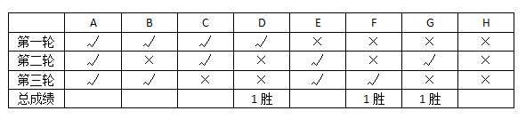

所以选择A答案。

但是，本题为争议题，粉笔更倾向于答案为6，但选项中没有6这个答案。

【思路二】答案为6的解析思路如下：设8个人分别为ABCDEFGH。假定第一轮比赛的胜者为ABCD，负者为EFGH。第二轮比赛中，ABCD中的胜者为AC，EFGH中的胜者为EG。此时ACEG为第一组，BDFH为另一组。要让一胜的人尽量多，则第三轮比赛应尽量使ACEG的胜场集中到同一人身上，即AC两人全胜；同时使BDFH的人尽可能保持一胜，即FH两人胜利。此时共有六人（B、D、E、F、G、H）一胜两负。

具体情况如图所示：

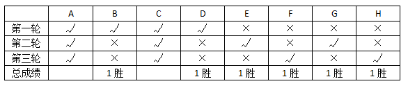

所以选择答案为6。但本题选项没有6，所以本题产生了争议。

综上所述，粉笔给出本题的答案为A。

第 84 题

**参考答案（粉笔题库参考内容）**

A

**解析**

假设马经理步行距离为m千米，则有，解得m=2.5千米，因此甲、乙两公司的距离为千米。

故正确答案为A。

第 85 题

**参考答案（粉笔题库参考内容）**

B

**解析**

将6位新员工编号，第一天的顺序为1，2，3，4，5，6（呈环形排列）；则第二天先确定1的位置，则他两边的人只能安排3，4，5中的两个，即，且两人的位置有两种安排方法；之后还余3人，只有一种安排方式，故新员工们一共有种安排方式。

故正确答案为B。

第 86 题

**参考答案（粉笔题库参考内容）**

A

**解析**

全年出生人口1604万人，比上年末增加644万人，则死亡人口为1604-644=960万人。

故正确答案为A。

第 87 题

**参考答案（粉笔题库参考内容）**

B

**解析**

由题干“2011年，我国大陆平均约······便拥有一位······”，可判定本题为平均数计算问题。定位材料第一段“2011年末我国大陆总人口为134735万人”，第二段“卫生技术人员620万人，其中执业医师和执业助理医师251万人”，可得，与B项最接近。

故正确答案为B。

第 88 题

**参考答案（粉笔题库参考内容）**

D

**解析**

由题干“2011年，我国大陆下列医疗机构中，数量最多的是”，结合材料第二段给出各个医疗机构的数量，判定本题为直接找数问题。定位材料第二段可知，数量最多的是村卫生室，共659596个。

故正确答案为D。

第 89 题

**参考答案（粉笔题库参考内容）**

B

**解析**

由题干“2010年我国大陆非城镇人口约为多少万人”，可判定本题为基期计算问题。定位材料第一段“2011年末我国大陆总人口为134735万人，比上年末增加644万人，其中城镇人口为69079万人，占总人口比重首次超过50%，达到51.3%”，可知2010年末我国大陆总人口=134735-644=134091万人，根据基期公式可得：2010年城镇人口数，故2010年末非城镇人口=134091-65790≈134000-66000=68000，与B项最接近。

故正确答案为B。

第 90 题

**参考答案（粉笔题库参考内容）**

C

**解析**

由文字材料第一段可知，4.79‰为2011年我国大陆人口的自然增长率，并非大陆出生人口的同比增长率，A项说法错误；

出生人口数大于床位数并不能说明床位资源紧张，因为这些人并非同一时间出生，且在院时间也较短，B项说法错误；

在我国大陆卫生技术人员中，除去执业医师和执业助理医师以及注册护士，其他卫生技术人员为620-251-224=145万人，小于注册护士的人数，因此C项说法正确；

2011年我国大陆医院数量占医疗卫生机构数量的比重为，远远小于20%，D项说法错误。

故正确答案为C。

第 91 题

**参考答案（粉笔题库参考内容）**

B

**解析**

由题干“迁入本地五年到十年的受调查人群中，有百分之多少的人认为自己依然属于外地人”，结合柱状图可判定此题为直接找数问题。定位柱状图可知，在迁入本地五年到十年的受调查人群中，认为自己依然属于外地人的百分比为47.52%。

故正确答案为B。

第 92 题

**参考答案（粉笔题库参考内容）**

C

**解析**

从柱状图可以直观看出，迁入本地十年以上的人员中认为“自己已属于本地人”的百分比最大，为59.36%。

故正确答案为C。

第 93 题

**参考答案（粉笔题库参考内容）**

D

**解析**

由于材料中没有给出三个群体的具体人数，因此无法计算出有多少人认为“自己已属于本地人”。

故正确答案为D。

第 94 题

**参考答案（粉笔题库参考内容）**

A

**解析**

定位图形，迁入本地十年以上的群体认为自己是外地人的比率为38.5%，迁入本地五年内的群体认为自己是外地人的比率为60.60%。因此前者比后者少60.60%-38.5%=22.1个百分点。

故正确答案为A。

第 95 题

**参考答案（粉笔题库参考内容）**

D

**解析**

材料中没有提及外来人员对身份认同的态度，A项表述错误；

材料只是对外来人员对自己身份归属地的一个态度调查，没有确定实际情况，B项表述错误；

材料没有给出迁入之初的群体在十年之后的态度对比，C项表述错误；

材料只是一个调查样本，且没有给出样本各部分明确的数据，因此无法得知“认为自己属于本地人”群体的总体比例变化，D项表述正确。

故正确答案为D。

第 96 题

**参考答案（粉笔题库参考内容）**

D

**解析**

由年均增长率公式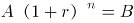得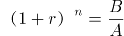，已知题目问“从1990年到2010年”则n的值不变，要想比较年均增长率r的大小，比较即值的大小即可，按选项依次代入表中数据分别为：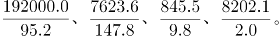观察发现2010年缴纳税金约为1990年的4000倍，比其他三项要高。

故正确答案为D。

第 97 题

**参考答案（粉笔题库参考内容）**

A

**解析**

根据第一个表中的对应数据可得，万人，A最接近。

故正确答案为A。

第 98 题

**参考答案（粉笔题库参考内容）**

C

**解析**

有限责任公司1990年为，2010年为，故可得万人，C项最接近。

故正确答案为C。

第 99 题

**参考答案（粉笔题库参考内容）**

C

**解析**

定位表格一给出了“私营企业总户数”，表格二给出了“中部地区、农村、合伙企业和第二产业”的私营企业户数占私营企业总户数的比率，可知各选项户数=私营企业总户数对应占比。观察发现，从1990年到2010年，私营企业总户数持续增长，四次变化分别为倍，倍，倍，倍。对比选项，A项中部地区占比变化小于私营企业总户数变化，故整体呈现持续增长趋势，排除；B项农村占比变化小于私营企业总户数变化，故整体呈现持续增长趋势，排除；C项合伙企业占比变化在2000年到2005年为倍，大于同期私营企业总户数的变化（倍），因此数量出现下降，具体数据为2000年：万户，2005年：万户，即2005年户数＜2000年户数，并非呈现持续增长趋势，当选；D项第二产业占比变化小于私营企业总户数变化，故整体呈现持续增长趋势，排除。

故正确答案为C。

注：根据常识可知，中部地区、农村地区及第二产业等类别的私营企业发展应为持续向上的趋势。

第 100 题

**参考答案（粉笔题库参考内容）**

B

**解析**

A项：定位表格一可知私营企业总户数，定位表格二可知第一产业和第三产业私营企业户数占私营企业总户数的比率。根据年均增长率公式：，当年份差n相同时，比较年均增长率只需要比较。则第一产业为，第三产业为，由于总户数的比值相同，因此只需要比较和即可，前者（）＞后者（），即第一产业快于第三产业，错误；

B项：定位表格二可知，1990年到2010年，东部地区的私营企业户数占比一直超过60%，占大部分，正确；

C项：定位表格一中的工业产值和营业额数据，并非越来越趋于一致，错误；

D项：定位表格二注释可知，第二产业的占比指“私营企业户数占私营企业总户数的比率”，并没有给出注册资本额占比，无法推出，错误。

故正确答案为B。

