# 2013年广州市公务员录用考试《行测》题

<!-- gwy:overview:start -->
> **广州 · 2013 · 行测 · 统考** ｜ 100 题 · 图片 17 处 · 答案随题折叠

| 题型模块 | 题量 | 题号 |
| --- | ---: | ---: |
| 言语理解与表达 | 25 | 1–25 |
| 数量关系 | 15 | 26–40 |
| 常识判断 | 15 | 41–55 |
| 判断推理 | 30 | 56–85 |
| 资料分析 | 15 | 86–100 |
| **合计** | **100** | |

导航：[题型与作答说明](#题型与作答说明) · [题目](#题目) · [材料 1](#材料-1)
<!-- gwy:overview:end -->

> 候选采集稿。参考答案及解析来自粉笔页面，不代表官方答案或真实高分答卷；来源使用许可与原卷对应关系仍需人工核实。

## 题型与作答说明

言语理解与表达

（25题）

根据题目要求，在四个选项中选出一个最恰当的答案。

数量关系

（15题）

在这部分试题中，每道题呈现一段表述数字关系的文字，要求你迅速、准确地计算出答案。

常识判断

（15题）

单选

判断推理

（30题）

本部分包括常识判断、类比推理、演绎推理、图形推理四种类型的试题。

资料分析

（15题）

所给出的图、表、文字或综合性资料具有若干问题要你回答。你应根据资料提供的信息进行分析、比较、计算和判断处理。

## 题目

### 第 1 题

1989年被汉代前史书记载为“蛮荒腹地”的江西省新干县大洋洲乡，出土了大量精美的青铜器，揭开了这里三千多年前青铜文明的        。

填入画横线部分最恰当的一项是：

A. 面具

B. 面目

C. 面纱

D. 面容

第 1 题 · 答案与解析

**参考答案（粉笔题库参考内容）**

C

**解析**

本题考查实词的应用。“蛮荒腹地”和“出土了大量精美的青铜器”构成对比，前者为文字记载，后者为真实情况，故横线处词语应有掩盖真实情况的含义，显然“面纱”最符合语境，且“揭开面纱”为固定搭配。

故正确答案为C。

**考点**：词的辨析-搭配对象、实词填空、对应关系-前后呼应

**来源**：2013年广州市公务员录用考试《行测》题第1题

### 第 2 题

对于上海“甜爱路”上出现的种种涂鸦图案和文字，是简单地、一味地去阻止或\_\_\_\_\_\_，还是\_\_\_\_\_\_其存在和发展，也在\_\_\_\_\_\_我们的城管理念。

依次填入画横线部分最恰当的一项是：

A. 取消 鼓励 试验

B. 无视 重视 拷问

C. 打击 包容 质问

D. 取缔 允许 考验

第 2 题 · 答案与解析

**参考答案（粉笔题库参考内容）**

D

**解析**

第一空，根据“或”引导并列关系可知，横线处所填词语应与“阻止”语义相近，体现对涂鸦图案和文字的强制管控、明令禁止之意。A项“取消”指使原有的制度、规章、资格、权利等失去效力，C项“打击”指攻击，使受挫折，D项“取缔”指明令取消或禁止，均符合文意，保留。B项“无视”指不放在眼里、不认真对待，无法与“阻止”构成近义并列，排除。

第二空，根据“是······还是······”可知，横线处所填词语与前文 “阻止或······” 形成反义关系，应体现对涂鸦图案和文字持宽容接纳的态度之意。C项“包容”指宽容、容纳，D项“允许”指许可，均符合文意，保留。A项“鼓励”指激发、勉励，对街头涂鸦不可能持主动提倡、鼓励的态度，置于此处程度过重，排除。

第三空，搭配“城管理念”，横线处所填词语应体现对涂鸦的不同处理方式检验或考量着城管理念之意。D项“考验”指通过具体事件、行动或困难环境来检验（是否坚定、忠诚或正确等），与“城管理念”搭配恰当，且符合文意，当选。C项“质问”指依据事实问明是非，前文强调对涂鸦处理方式的不同选择，而非单纯提出疑问，与文意不符，排除。

故正确答案为D。

**考点**：词的辨析-搭配对象、词的辨析-程度轻重、实词填空、对应关系-前后呼应、关联关系-并列关系

**来源**：2013年广州市公务员录用考试《行测》题第2题

### 第 3 题

从当前诸多事件的处理当中，我们可以看到政府在        舆情时表现出越来越        的姿态。

依次填入画横线部分最恰当的一项是：

A. 处置 无畏

B. 应对 开放

C. 对付 包容

D. 控制 谨慎

第 3 题 · 答案与解析

**参考答案（粉笔题库参考内容）**

B

**解析**

第一空，搭配“政府”，并且依据前文可知横线处表达的含义是处理、面对。A、B、D三项填入文段中搭配和语义都是恰当的，保留。C项“对付”后面如果要接对象，往往是敌人、坏人，故这个词多用于消极语境当中，而文段不是一个消极语境，排除。

第二空，文段表述含义为从现在诸多事情的处理中，政府对于舆情的处理是越来越娴熟、越来越熟练的，能够很好地去处理各项舆情。A项“无畏”表示无所畏惧，什么都不怕、什么都不管，第二空搭配主体“政府”，我国政府处理政务是从民众角度出发，并非什么都不管，排除；D项“谨慎”表示的是对外界事物或自己言行密切注意，以免发生不利或不幸的事情，而文段表明政府在处理舆情时是越来越熟练、越来越得心应手的，并非是不利的、不幸的状态，排除。

故正确答案为B。

**考点**：词的辨析-搭配对象、实词填空、对应关系-前后呼应

**来源**：2013年广州市公务员录用考试《行测》题第3题

### 第 4 题

在过去20年间，世界经济经历了重大变化：新兴市场愈发            ，许多发展中国家增速远高于发达经济体。

依次填入画横线部分最恰当的一项是：

A. 举重若轻

B. 举足轻重

C. 举步维艰

D. 举棋不定

第 4 题 · 答案与解析

**参考答案（粉笔题库参考内容）**

B

**解析**

根据“许多发展中国家增速远高于发达经济体”可知，新兴市场地位越来越高、越来越重要。B项“举足轻重”指地位、作用很重要，符合文意，当选。

A项“举重若轻”比喻能力强，能够轻松地胜任繁重的工作或处理困难的问题，不能形容新兴市场，排除；C项“举步维艰”形容处境或行动十分艰难，D项“举棋不定”比喻犹豫不决，拿不定主意，均不能体现出新兴市场的积极作用，排除。

故正确答案为B。

**考点**：对应关系-前后呼应、成语填空

**来源**：2013年广州市公务员录用考试《行测》题第4题

### 第 5 题

《史记》对后世文学影响巨大，其语言被奉为“古文”的最高成就，后世的散文，小说，戏剧等多种文体对《史记》从语言，内容、风格、结构等各个侧面来加以\_\_\_\_\_\_、利用和\_\_\_\_\_\_。

依次填入画横线部分最恰当的一项是：

A. 学习 继承

B. 改良 扬弃

C. 传承 规范

D. 研究 抛弃

第 5 题 · 答案与解析

**参考答案（粉笔题库参考内容）**

A

**解析**

第一空通过“、”以及第二空前通过“和”字，与“利用”这一词语构成了三方面并列，故这两空所填词语感情色彩和“利用”相同，但语义各不相同。文段中表达含义为我们是可以从《史记》中汲取到一些内容，是能够利用《史记》来进行文学的发展，故整个文段感情色彩是积极的。

本题可从第二空入手，C项“规范”表示含义为“使某一行为或活动达到或超越规定的标准”，该词语搭配的是行为或者活动，文段中第二空搭配主体是《史记》，既不是活动也不是行为，故搭配不当，排除；

D项“抛弃”，该词语感情色彩消极，与文段感情色彩不符，排除；

A、B两项感情色彩积极，故保留这两项代入第一空进行验证。B项代入文段中，“改良、利用和扬弃”，“改良”为取其精华去其糟粕的含义，扬弃也为取其精华去其糟粕的语义，故这两个词语语义重复，排除；

A项代入文段中，“学习、利用和继承”三方面感情色彩都是积极的，语义各不相同，符合文意。

故正确答案为A。

**考点**：词的辨析-搭配对象、词的辨析-感情色彩、实词填空、关联关系-并列关系

**来源**：2013年广州市公务员录用考试《行测》题第5题

### 第 6 题

上个世纪40年代，美国的大众媒介处于垄断地位。在商业利益的驱使下，媒体对国内的各类社会矛盾            ，这种状况招致了社会各界的批评与不满，广大民众强烈要求传媒积极发挥正面的舆论导向作用，引导公民树立正确的价值观念。由此，“媒体的社会责任理论”            。

依次填入画横线部分最恰当的一项是：

A. 莫衷一是 纷至沓来

B. 置若罔闻 应运而生

C. 群策群力 风靡一时

D. 人云亦云 横空出世

第 6 题 · 答案与解析

**参考答案（粉笔题库参考内容）**

B

**解析**

第一空，后文“这种状况招致了社会各界的批评与不满”是对于横线处所填词语的解释说明，所以第一空所填词语感情色彩应当是消极的，表现出媒体对于国内社会矛盾不太好的做法。C项“群策群力”表示的含义为发挥集体的作用，大家一起来想办法，贡献力量，感情色彩积极，与文段感情色彩不符，排除。

第二空，前文内容是对于横线处的解释说明，表达含义为“正是因为有了公众的要求，才出现了媒体的社会责任理论”。A项“纷至沓来”中“纷”是多的含义，故该词语强调有多个主体到来，而文段中只有一个主体“媒体的社会责任理论”，排除；B项“应运而生”表示的含义为适应时机而产生，与文段中表示含义一致，符合要求，当选；D项“横空出世”含有突然出现之意，而文段中“媒体社会责任理论”出现是有前提条件的，是民众要求之后才出现的，与文意不符，排除。

故正确答案为B。

【文段出处】《“媒体社会责任理论”视角下的公益广告》

**考点**：词的辨析-搭配对象、词的辨析-感情色彩、对应关系-前后呼应、成语填空

**来源**：2013年广州市公务员录用考试《行测》题第6题

### 第 7 题

有的父母习惯在饭桌上表扬或批评孩子，一边吃饭，一边\_\_\_\_\_\_地说几句，既显得不够重视，孩子也没听进去，效果自然会差一些。

依次填入画横线部分最恰当的一项是：

A. 歇斯底里

B. 浓墨重彩

C. 语重心长

D. 轻描淡写

第 7 题 · 答案与解析

**参考答案（粉笔题库参考内容）**

D

**解析**

本题考查成语的应用。根据后文的“显得不够重视”，可知说的程度不够深，“轻描淡写”更为符合语境，其他三词均强调程度很深。

故正确答案为D。

**考点**：对应关系-前后呼应、成语填空

**来源**：2013年广州市公务员录用考试《行测》题第7题

### 第 8 题

传媒业界认为：中国杂志也存在巨大发展空间的根本原因在于正在          的中产阶级及他们多元化的生活方式将          大量细分杂志。

填入画横线部分最恰当的一项是：

A. 崛起 催生

B. 觉醒 派生

C. 聚集 分化

D. 裂变 衍生

第 8 题 · 答案与解析

**参考答案（粉笔题库参考内容）**

A

**解析**

第一空，修饰“中产阶级”，表达中产阶级的数量和规模不断增长和壮大，C项“聚集”和D项“裂变”与“中产阶级”搭配不当，排除C、D两项。

第二空，表达中产阶级的壮大促使细分杂志的出现，A项“催生”符合文意。B项“派生”比喻从主要事物的演变和延伸中分化出来，不符合文意，排除。

故正确答案为A。

**考点**：实词填空、对应关系-前后呼应

**来源**：2013年广州市公务员录用考试《行测》题第8题

### 第 9 题

理想上，民主尊重缓慢的原则，          要让所有受影响的人有表达机会，然后大家沟通、讨论、决策，         不是一味追求效率。

A. 不仅 更

B. 不仅 而

C. 因为 更

D. 因为 而

第 9 题 · 答案与解析

**参考答案（粉笔题库参考内容）**

D

**解析**

本题考查虚词的应用。

先看第二空，前后分句为转折关系，“更”表递进，排除A、C两项。

再看第一空，B项“不仅”与“而”不能构成搭配，排除；而且第一空后面的分句是对前面分句的阐述和说明，D项“因为”表因果，起到解释说明的作用，当选。

故正确答案为D。

**来源**：2013年广州市公务员录用考试《行测》题第9题

### 第 10 题

交通的拥堵只是一面镜子，\_\_\_\_\_\_出的是面对汽车与人口激增带来的交通压力、环境压力，许多城市还没有做好准备。

依次填入画横线部分最恰当的一项是：

A. 反映

B. 体现

C. 折射

D. 展示

第 10 题 · 答案与解析

**参考答案（粉笔题库参考内容）**

C

**解析**

本题考查实词的应用。与“镜子”搭配，显然只能是“折射”，直接排除A、B、D三项。

故正确答案为C。

**考点**：实词填空、对应关系-前后呼应、对应关系-形象表达

**来源**：2013年广州市公务员录用考试《行测》题第10题

### 第 11 题

公益广告在我国已有20多年的发展历史。但长期以来，我国的公益广告在很大程度上由政府主导，其独立性和自主性不能得到充分体现，媒体多是因为行政命令而制作发布公益广告，主动承担社会责任的意识较差，造成的直接结果就是公益广告活力不足，未能形成广泛的社会影响力。另外，在经济利益的驱使下，媒体将公益广告作为塑造形象的手段，造成公益广告与社会大众脱节。

这段文字主要介绍：

A. 我国公益广告发展历程

B. 我国公益广告的不足和局限性

C. 我国公益广告的特点

D. 我国公益广告的发展方向

第 11 题 · 答案与解析

**参考答案（粉笔题库参考内容）**

B

**解析**

本题为中心理解题。根据转折词“但”可知后面为文段主要表达的内容，主要描述了“公益广告”的几点现状：“政府主导导致独立性和自主性差、活力不足，社会影响力不够；经济利益造成与大众的脱节”。因此，结合选项应该选择B项，文段主要介绍的是公益广告存在的不足和缺陷。

故正确答案为B。

**考点**：关联词-转折

**来源**：2013年广州市公务员录用考试《行测》题第11题

### 第 12 题

“知人论世”作为一种文学批评的原则和方法，最早由战国时期的思想家孟子提出。孟子认为，后人要交结古人，只是读其诗书是不行的，还必须了解他们的为人行事以及他们的生活的时代，这样，才能读懂古人的诗书，才能和古人心契神交，成为知音。

对这段话的理解，不正确的是：

A. 人的心灵是可以互通和共鸣的

B. “知人论世”作为一种文学评论法沿用至今并显现了强大的生命力

C. “知人论世”可以帮助后人交结古人，和古人成为知音

D. 了解古人和他所处的时代，有助于理解他的作品

第 12 题 · 答案与解析

**参考答案（粉笔题库参考内容）**

B

**解析**

由提问可知为细节判断题。

结合选项应该选择B项，“沿用至今并显现了强大的生命力”在文段中没有体现。

A项由“心契神交”可以推断出；C项由“成为知音”推出；D项由“了解他们的为人行事以及他们的生活的时代，这样，才能读懂古人的诗书”推出。

本题为选非题，故正确答案为B。

**考点**：细节判断题

**来源**：2013年广州市公务员录用考试《行测》题第12题

### 第 13 题

在学习压倒一切的评价体系下，孩子们面临着严重的伙伴关系缺失和游戏缺失。中国青少年心理成长基地的专家表示，现实给不了的东西在网络中可以轻松获得，然而孩子一旦接触到网络，便会被其深深吸引。如果缺乏自制力和正确引导，孩子就可能沉迷进去而无法自拔。

文中的“现实给不了的东西”指的是：

A. 自我认可

B. 学习压力下的放松

C. 自制力和正确的引导

D. 伙伴关系和游戏

第 13 题 · 答案与解析

**参考答案（粉笔题库参考内容）**

D

**解析**

由提问可知为词句理解题。

根据就近原则可知，“现实给不了的东西”是指前文中孩子们所“缺失”的“伙伴关系”和“游戏”。

故正确答案为D。

**考点**：句子

**来源**：2013年广州市公务员录用考试《行测》题第13题

### 第 14 题

目前，流动人口虽然进入城市工作生活，但未能真正融入城市社会。制度的隔离客观上强化了人口的地缘、乡缘、亲缘关系，加剧社会分化，在城市内部出现了新的二元结构。一些城市流动人口与户籍人口倒挂，外来人口与本地人口存在经济利益冲突，极易激发社会矛盾。流动人口家庭成员长期分离，造成儿童监护失责、情感缺失、婚姻不稳定、留守老人和妇女受侵害等问题，影响家庭幸福和社会长治久安。

以上文段意在说明：

A. 制度的隔离使流动人口不可能融入城市社会

B. 流动人口的进入会导致市内部出现二元结构

C. 让流动人口真正融入城市，社会才能长治久安

D. 解决流动人口家庭成员分离问题是瓦解城市二元结构的关键所在

第 14 题 · 答案与解析

**参考答案（粉笔题库参考内容）**

C

**解析**

本题为中心理解题。

文段首先提出了流动人口未能真正融入城市社会的现状，然后从三方面来说明这一现状对家庭和社会的危害：制度隔离导致新的二元结构、流动人口与城市人口矛盾激化、流动人口与家人分离造成多种社会问题。显然，要解决这些问题，就要让流动人口真正融入城市社会，这样才能保证家庭幸福和社会长治久安。

因此，结合选项应该选择C，C项表述与文段一致。

故正确答案为C。

**考点**：关联词-对策

**来源**：2013年广州市公务员录用考试《行测》题第14题

### 第 15 题

长期以来，我们把加班加点作为员工爱岗敬业的体现。一个同志加班加点工作，超额完成任务，甚至一个人干三个人的活，当然值得肯定，其精神和热情不容亵渎。我们国家发展快，经济高速增长，与各行各业加班加点“蔚然成风”分不开；说中国的发展成就是中国人勤奋努力、辛辛苦苦干出来的，一点都不为过。这应该是加班加点“利”的一面。

根据以上文段，我们可以得知作者对加班加点的看法不包括：

A. 加班加点是员工爱岗敬业的体现，应大力提倡

B. 员工加班加点的精神和热情值得肯定

C. 加班加点也可能存在着“弊”的一面

D. 加班加点已经成为各行各业的普遍风气

第 15 题 · 答案与解析

**参考答案（粉笔题库参考内容）**

A

**解析**

由提问可知为细节判断题。

因此，结合选项应该选择A项，A项“应大力提倡”显然与作者意图相悖。

由“当然值得肯定，其精神和热情不容亵渎”可知，B项正确；由“这应该是加班加点‘利’的一面”可知，加班加点也可能存在着‘弊’的一面，C项正确；由“与各行各业加班加点‘蔚然成风’分不开”可知，D项正确。

本题为选非题，故正确答案为A。

**考点**：细节判断题

**来源**：2013年广州市公务员录用考试《行测》题第15题

### 第 16 题

好官不光要廉洁奉公，还要能办实事。人民期待的是“改革官”、“有为官”，而不是“庸官”，这可谓切中部分干部不敢干事、不敢创新、怕承担责任的思想障碍。如果没有一个宽容、和谐的干事创业环境，干部在工作上就会畏首畏尾，不敢超越和探索，更不敢改革创新。看到一些同志因失误而被问责，就会心存畏惧。要推动干部敢想敢干，就要坚持“三个区分”即要把先行先试的失误与明知故犯区分开来，把探索性试验与有法不依区分开来，把无意过失与谋取私利区分开来。

以上文段意在说明：

A. 建立明辨官员探索创新行为的机制，才能让干部敢想敢干

B. 建立宽松的干事创业环境，才能让干部在工作上不至于如履薄冰

C. 好官不但要廉洁奉公，而且要敢于创新、有担当

D. 对于官员干部犯错，人民应该有所区分、有所包容

第 16 题 · 答案与解析

**参考答案（粉笔题库参考内容）**

A

**解析**

本题为中心理解题。文段首先指出好官关键要干实事、敢创新，之后提出干部不敢创新的原因，最后提出推动干部敢想敢干的方法，所以文段重点在于说怎样才能“推动干部敢想敢干”。结合选项，应该选择A项。

B项表述不明确，没有指出如何建立宽松的干事创业环境，排除；

C项不是文段重点，排除；

D项对于官员干部犯错不应该用人民区分，而应该用制度和机制区分，且文中并没有体现，排除。

故正确答案为A。

**考点**：关联词-对策

**来源**：2013年广州市公务员录用考试《行测》题第16题

### 第 17 题

文化创意产业是综合文化、创意、科技、资本、制造等要素的一种新业态。美国人靠一杯水（可口可乐），一个面包（麦当劳），一块芯片（英特尔）和一只小老鼠（迪斯尼）做出了创意大产业，这些产业所产生的利润和影响，远远超过了他们的汽车、钢铁等产业。

以下选项符合原文意思的一项是：

A. 文化创意产业是一种前瞻性、综合性的业态

B. 可口可乐和麦当劳是美国文化创意产业的代表之一

C. 文化创意产业在美国已经取代汽车、钢铁产业的地位和作用

D. 美国的汽车、钢铁业正在走向衰亡

第 17 题 · 答案与解析

**参考答案（粉笔题库参考内容）**

B

**解析**

根据“美国人靠一杯水（可口可乐），一个面包（麦当劳），一块芯片（英特尔）和一只小老鼠（迪斯尼）做出了创意大产业”可知，B项“可口可乐和麦当劳是美国文化创意产业的代表之一”与文意相符，当选。

A项，“前瞻性”文段当中没有提及这一内容，排除；

C项，“取代”文段当中没有提及这一内容，排除；

D项，“正在走向衰亡”文段当中没有提及这一内容，排除。

故正确答案为B。

【文段出处】《上海：打造城市经济发展新亮点》

**考点**：细节判断题

**来源**：2013年广州市公务员录用考试《行测》题第17题

### 第 18 题

虽然当下的大学自主招生考试受到的非议颇多，然而，走过十年路程的大学自主招生考试，大概还是要年复一年地继续考下去。毕竟，自主招生考试对于恢复大学人才选拔的功能，真正将符合自身育人理念的可造之才选拔到大学中来，还是有着积极意义和明显功效的。复旦大学表示，占该校本科生30%的自主招生胜出者，他们在学业成绩、创新意识和创新能力等方面的表现大多数要比其他学生胜出一筹。

大学自主招生考试能够继续考下去是因为它：

A. 能够克服非议

B. 能够选拔全能型的综合人才

C. 具备更突出的人才选拔功效

D. 有助于创新大学的人才选拔机制

第 18 题 · 答案与解析

**参考答案（粉笔题库参考内容）**

C

**解析**

C项，根据文段“自主招生考试对于恢复大学人才选拔的功能，真正将符合自身育人理念的可造之才选拔到大学中来，还是有着积极意义和明显功效的”可知，自主招生能够继续下去就是因为在选拔人才方面有积极的功效，故C项表述正确，当选；

A项，根据文段“自主招生受到的非议颇多”可知，“克服非议”与文意相悖，排除；

B项，“全能型的综合人才”在文段中并未提及，无中生有，排除；

D项，“创新大学的人才选拔机制”无中生有，文段仅提到自主招生考试对于选拔人才有意义，并未提及其对于创新人才选拔机制的作用，排除。

故正确答案为C。

【文段出处】《谈谈自主考考题之“难”和多读书之必要》

**考点**：细节判断题

**来源**：2013年广州市公务员录用考试《行测》题第18题

### 第 19 题

因为电子书的盛行，顾客改变了消费习惯，很多书店经营困难。但书店通过卖书还能赚钱，是因为书店不只是一个卖书的地方，还能提供面对面的交流。只有面对面的交流，才是真正的交流，才能不断增进人情。

以下不符合上述文字意思的是：

A. 电子书的出现造成书店经营困难

B. 人们可以在书店进行面对面的交流

C. 书店仍然有继续存在的必要性

D. 书店除了卖书还经营其他业务

第 19 题 · 答案与解析

**参考答案（粉笔题库参考内容）**

D

**解析**

由提问可知为细节判断题。

文段中三句话依次对应A、B、C三项，只有D项文段中没有体现，属于无中生有。

本题为选非题，故正确答案为D。

**考点**：细节判断题

**来源**：2013年广州市公务员录用考试《行测》题第19题

### 第 20 题

美国内战之后，倡导公共健康的人们曾呼吁政府提供更多公共空间——被称作“悬浮池塘”的泳池由此诞生。当时河水清洁，人们可直接在河中洗浴。但随着工业化进程，工厂向河中排污增多，政府最终不得不关停了大部分泳池。即便剩下来的“悬浮池塘”，也由过去直接引入河水，转向关闭闸门从外面引入纯净的水。

根据上述文字，下列说法错误的是：

A. 人们需要更多公共空间是“悬浮池塘”出现的原因

B. “悬浮池塘”刚出现时是直接引入河水

C. 大部分“悬浮池塘”因为环境污染而被迫关闭

D. “悬浮池塘”就是河中的公共洗浴区域

第 20 题 · 答案与解析

**参考答案（粉笔题库参考内容）**

D

**解析**

由提问可知为细节判断题。

因此，结合选项应该选择D项，由文段可知，悬浮池塘只是引入河水，而并非河中的公共洗浴区域，D项表述错误。

由第一句可知，A项正确；由最后一句可知，B项正确；由第三句可知，C项正确。

本题为选非题，故正确答案为D。

**考点**：细节判断题

**来源**：2013年广州市公务员录用考试《行测》题第20题

### 第 21 题

四年前，中国经济受金融危机冲击的时刻，消费券作为刺激内需的政策建议曾被广泛讨论，杭州、成都等地的实践也收到了一定效果。但大规模发行消费券有一定要求，其产生的影响也非常复杂，杭州、成都等局部试点城市取得的效果并不具有普遍的代表意义。

以上文段意在说明：

A. 杭州和成都试点推行消费券取得成效只是偶然事件

B. 消费券对刺激内需有明显作用

C. 我国还不能大规模推行消费券

D. 在其他城市推行消费券不可能取得像杭州、成都一样的成效

第 21 题 · 答案与解析

**参考答案（粉笔题库参考内容）**

C

**解析**

本题为中心理解题。

因此，结合选项应该选择C，C项更为契合文意。

A项表述虽然与文段相符，但通过“影响非常复杂”“不具有普遍的代表意义”可知，文段意在说明我国还不能以杭州、成都为鉴，大范围推广消费券，排除；B项中“明显作用”与文段中“一定效果”不符，排除；D项表述过于绝对，排除。

故正确答案为C。

**考点**：关联词-转折

**来源**：2013年广州市公务员录用考试《行测》题第21题

### 第 22 题

企业应该具有正确的经营观念和使命观。如果公司的基本思想和方针是明确的，那么经营者就能够据此施行强有力的领导，而且每个人都能够根据这一基本思想和方针去判断是非，这样容易培养出人才。反之，经营者对部下的领导就会缺乏一贯性，很可能被每时每刻的情势变化或个人情感所左右，不利于培养人才。

以上文段意在说明：

A. 强有力的领导是企业培养人才的必要条件

B. 明确的使命观和经营观念有利于企业培养人才

C. 经营者应该尽量不让个人感情和情势变化对自己的决策产生影响

D. 企业如果没有明确的经营观念和使命观，经营者将无法施行强有力的领导

第 22 题 · 答案与解析

**参考答案（粉笔题库参考内容）**

B

**解析**

本题为中心理解题。

文段为总分结构，首句为主旨句，指出“企业应该具有正确的经营观念和使命观”，其后从正反两方面论述了正确的经营观念和使命观有利于培养人才。

故正确答案为B。

**考点**：分述句特征-多角度论述

**来源**：2013年广州市公务员录用考试《行测》题第22题

### 第 23 题

利用跨国公司在东道国“技术溢出”效应获得先进的技术，是大多数发展中国家引进跨国公司投资的重要目标之一。然而对于跨国公司来说，技术优势又是其获得垄断地位或竞争优势的关键。因此他们也会采取相应的技术垄断与控制，防止技术过度扩散，以充分发挥其垄断优势，获取高额回报。因此，对于发展中国家来说，                    。

最适合填入上文横线处的语句是：

A. 需要打破跨国公司的垄断地位，消除其垄断优势

B. 应正确认识跨国公司的技术转移可行性

C. 引进跨国公司投资对于东道国的经济发展存在巨大的负面效应

D. 需要采取有效应对措施，提升跨国公司的技术溢出效应

第 23 题 · 答案与解析

**参考答案（粉笔题库参考内容）**

D

**解析**

横线出现在文段末尾，并且横线前还出现了结论词“因此”，故横线上所填内容是对于前文的总结。前文先说明了发展中国家的重要目标是利用跨国公司的技术溢出效应来获得先进技术，紧接着转折之后说明了跨国公司是会采取措施防止技术扩散，跨国公司是不想要出现技术溢出效应的。故可知跨国公司这一做法对于发展中国家是不利的，那文段就是在提出问题，横线上所填内容就是针对前文问题来提对策，故可知文段在强调要采取手段来提升跨国公司的技术溢出效应，对应D项。

A项，没有提到文段主题词“技术溢出效应”，且表述不明确，“消除垄断优势”的做法就是D项中的“提升跨国公司的技术溢出效应”，排除；

B、C两项，均没有提到文段主题词“技术溢出效应”，排除。

故正确答案为D。

【文段出处】《跨国公司研发国际化的“挤出效应”及我国的战略选择》

**考点**：横线在结尾

**来源**：2013年广州市公务员录用考试《行测》题第23题

### 第 24 题

对于以下文段的排序，最合理的是：

①“发思古之幽情”，不仅使人感伤于昔日的兴衰往事，还能使人们从中汲取教益，陶冶性情，抒发情怀。

②多少诗人词家讴歌咏唱，留下了动人的诗篇，更增添了古迹的光彩。

③古往今来，不知拨动了多少人的心弦，引发了多少人的沉思。

④历史文化古迹，有着十分巨大的魅力。

⑤三国时期的魏、蜀、吴赤壁大战，孙、刘联盟以少胜多，击败曹操83万军马，体现这一重大历史事件的赤壁古迹，被世代传下来。

A. ⑤①②④③

B. ④⑤①②③

C. ④③①⑤②

D. ⑤②③④①

第 24 题 · 答案与解析

**参考答案（粉笔题库参考内容）**

C

**解析**

首先对比选项，判断首句。第④句“历史文化古迹，有着十分巨大的魅力”，第⑤句说到了“赤壁古迹”这一具体的历史文化古迹。故应当是第④句在前，先引出“历史文化古迹”这一话题，第⑤句在后论述具体某个历史文化古迹，所以排除A、D两项。

接下来对比B、C两项，发现第④句后接第⑤句、第③句都可以。所以再进行对比，判断第⑤句后面接第①句，还是第③句后面接第①句。第③句提到了“沉思”，第①句当中“发思古之幽情”也提到了“思考”这样一层含义，所以第①句和第③句通过这样一个共同信息构成捆绑，所以C项符合文意。

故正确答案为C。

【文段出处】《文物古迹保护与旅游事业的发展》

**考点**：确定首句-非首句特征、确定顺序

**来源**：2013年广州市公务员录用考试《行测》题第24题

### 第 25 题

对以下文段的排序，最合理的是：

①身负执政责任的政府官员要依法行政，必须学习法律，了解法律

②法治是现代社会最主要的特征之一，敬畏法律是官员起码的执政修养

③如果官员们都能依法行政，自觉、主动地把自己“关进笼子里跳舞”，在法律面前战战兢兢地行使自己的权力，那么，一个法治政府的形象才有可能真正矗立起来，一个真正的法治社会才会逐渐成为现实

④敬畏法律，就要依法行政

⑤但是，依法行政的前提是懂法。如果领导干部自己是法盲，依法行政就无从谈起

A. ②④⑤①③

B. ③⑤②①④

C. ②③④①⑤

D. ④①②③⑤

第 25 题 · 答案与解析

**参考答案（粉笔题库参考内容）**

A

**解析**

②句和④句均提到了“敬畏法律”，故应紧密相连，且②句在④句前，只有A项符合这一顺序。

故正确答案为A。

**考点**：确定顺序

**来源**：2013年广州市公务员录用考试《行测》题第25题

### 第 26 题

少年宫学习美术、舞蹈和唱歌专业的学生共有90人，美术和舞蹈专业的学生比例为2:3，舞蹈和唱歌专业的学生比例为3:4，则学生人数最多的专业有（ ）人。

A. 25

B. 30

C. 35

D. 40

第 26 题 · 答案与解析

**参考答案（粉笔题库参考内容）**

D

**解析**

根据题意可知，学习美术、舞蹈和唱歌专业的学生比例为2：3：4。

方法一：比较可知学生人数最多的专业是唱歌，该专业人数为90 × 4/(2 + 3 + 4) = 40人。

方法二：比较可知学生人数最多的专业是唱歌，根据倍数特性，唱歌专业的学生人数为4的倍数，结合选项，只有D项符合。

故正确答案为D。

**考点**：和差倍比问题

**来源**：2013年广州市公务员录用考试《行测》题第26题

### 第 27 题

某学校组织活动进行队列训练，学生们组成一个25排的队列，后一排均比前一排多4个人，最后一排有125个学生。则这个队列一共有多少个学生？

A. 1925

B. 1875

C. 2010

D. 1765

第 27 题 · 答案与解析

**参考答案（粉笔题库参考内容）**

A

**解析**

由题意可知，每排人数构成等差数列，公差为4，根据等差数列通项公式可知：a_25 = a_1 + (25 − 1) × 4，a_1 = 125 − 4×(25−1) = 29个，根据等差数列求和公式，可知总人数= (29 + 125) ÷ 2 × 25 = 77 × 25 = 1925个。

故正确答案为A。

**考点**：数列问题

**来源**：2013年广州市公务员录用考试《行测》题第27题

### 第 28 题

某工厂生产一批零件，原计划每天生产100个，因技术改进，实际每天生产120个。结果提前4天完成任务，还多生产80个。则工厂原计划生产零件多少个：

A. 2520

B. 2600

C. 2800

D. 2880

第 28 题 · 答案与解析

**参考答案（粉笔题库参考内容）**

C

**解析**

设原计划生产x天，则原计划生产量为100x个，由题意可列方程：100x=120(x-4)-80，解得x=28，故原计划生产零件为100x=2800个。

故正确答案为C。

**考点**：给具体单位型

**来源**：2013年广州市公务员录用考试《行测》题第28题

### 第 29 题

某人将一套房屋以购入价的3倍在房产中介处放盘。他告诉中介，一周内签约的买家其成交价能比放盘价再便宜5万元，并愿意在支付成交价3%的中介费的基础上，再多支付1万元给中介。若该房屋在一周内以100万元的价格成交，那么，此人在这套房屋上盈利多少万元：

A. 66

B. 65

C. 61

D. 58

第 29 题 · 答案与解析

**参考答案（粉笔题库参考内容）**

C

**解析**

因在一周内成交，所以放盘价为100+5=105万元，故原价为105 ÷ 3 = 35万元，而卖家最终到手的钱为100 × (1 - 3%) - 1 = 96万元，所以盈利96-35=61万元。

故正确答案为C。

**考点**：经济利润问题

**来源**：2013年广州市公务员录用考试《行测》题第29题

### 第 30 题

某社区服务中心每个月均对居民进行“社区工作满意度”调查。经对比发现，2月份的居民满意度是85分，比1月份上升了20%，3月份的居民满意度又比2月份下降了20%。则3月份的居民满意度和1月份相比：

A. 两个月持平

B. 3月份比1月份高4%

C. 1月份比3月份高4%

D. 3月份比1月份低4%

第 30 题 · 答案与解析

**参考答案（粉笔题库参考内容）**

D

**解析**

首先要注意，二月的满意度得分85分为无关数据，题目中只涉及比例变化，不需要用到具体数据。

设1月份得分为1。2月份比1月份上升了20%，则2月份得分为1.2，3月份比2月份下降了20%，则3月份得分为1.2 × 0.8 = 0.96，因此3月份的居民满意度得分比1月份低4%。

故正确答案为D。

**考点**：和差倍比问题

**来源**：2013年广州市公务员录用考试《行测》题第30题

### 第 31 题

如图所示，有一块长100米、宽30米的长方形空地需要铺草皮，空地中间预留一条宽2米的走道铺设水泥板。已知草皮每平方米50元，水泥板每平方米40元，草皮和水泥板均可以切割拼装。购买铺完这块空地所需的水泥板和草皮共需花费多少元？

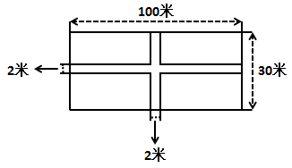

A. 147440

B. 147400

C. 146860

D. 146820

第 31 题 · 答案与解析

**参考答案（粉笔题库参考内容）**

A

**解析**

水泥板的面积为2 × 30 + 2 × 100 - 2 × 2 = 256平方米，水泥板每平米比草皮低50-40=10元，所以比全部铺设草皮便宜了10 × 256 = 2560元，全部铺设草皮需要花费50×30×100=150000元，则实际花费150000-2560=147440元。

故正确答案为A。

**考点**：几何公式类-平面图形、经济利润问题

**来源**：2013年广州市公务员录用考试《行测》题第31题

### 第 32 题

某饼店一种成本为1.4元的点心卖2元一份，每天没卖完的点心会在晚上8点后半价促销，全部卖完。已知一个月30天中，平均有15天每天晚上8点前可卖出100份点心，而其余15天每天晚上8点前只能卖出60份。如果饼店每天做的点心数量相同，一个月能够获得的最大利润是多少元：

A. 1080

B. 1200

C. 1320

D. 1440

第 32 题 · 答案与解析

**参考答案（粉笔题库参考内容）**

B

**解析**

由题意可知，8点前每份利润为2-1.4=0.6元，8点后每份利润为1-1.4=-0.4元，假设每天做n份点心，由题意可得，每月利润为[0.6 × 100 − 0.4 × (n − 100)] × 15 +[0.6×60 - 0.4×(n-60)]×15\=2400-12n，已知n ≥ 100，所以n=100时，利润为最大值，此时为1200元。

故正确答案为B。

**考点**：非典型最值问题、经济利润问题

**来源**：2013年广州市公务员录用考试《行测》题第32题

### 第 33 题

一艘船在河水流速为每小时15公里的河中央抛锚，停在码头下游60公里处。一艘时速为40公里的救援船从码头出发前去拖船，已知救援船拖上另一艘船后，船速将下降1/4。救援船从码头出发，一共需要大约多少小时才能将抛锚的船拖回码头？

A. 3

B. 3.5

C. 4

D. 5.1

第 33 题 · 答案与解析

**参考答案（粉笔题库参考内容）**

D

**解析**

抛锚船停留处为码头下游，故救援船去程为顺流，此时速度为40+15=55公里/小时，返回速度为40 × (1 - 1/4) - 15 = 15公里/小时，故所需时间为60÷55+60÷15＞4小时。

故正确答案为D。

**考点**：流水行船

**来源**：2013年广州市公务员录用考试《行测》题第33题

### 第 34 题

某公司规定，门窗每3天擦拭一次，绿化植物每5天浇一次水，消防设施每2天检查一次。如果上述三项工作刚好集中在星期三都完成了，那么下一次三项工作集中在同一天完成是在：

A. 星期一

B. 星期二

C. 星期四

D. 星期五

第 34 题 · 答案与解析

**参考答案（粉笔题库参考内容）**

D

**解析**

由题意可知，三项工作集中完成两次的间隔天数应为三项工作各自时间的最小公倍数，2、3、5的最小公倍数为30，即下一次集中完成的时间在30天后，30÷7＝4……2。已知该次集中完成时间在星期三，则下次集中完成时间应在星期五。

故正确答案为D。

**考点**：星期日期问题、周期相遇问题

**来源**：2013年广州市公务员录用考试《行测》题第34题

### 第 35 题

如图所示，一个长方形的场地要分割成4块长方形区域进行分区活动。测量得知，区域A、B、C的面积分别是15、27、36平方米。则这块长方形场地的总面积为多少平方米？

A. 84

B. 92

C. 98

D. 100

第 35 题 · 答案与解析

**参考答案（粉笔题库参考内容）**

C

**解析**

设第四块区域面积为n，则有15:27=n:36，解得n=20，所以总面积为15+20+27+36=98平方米。

故正确答案为C。

**考点**：几何公式类-平面图形

**来源**：2013年广州市公务员录用考试《行测》题第35题

### 第 36 题

用混凝土铺设一条宽度为20米的马路，每两包水泥可以制造1立方米混凝土。使用现有的水泥，如果按照20厘米的混凝土厚度铺设马路，工程完成后剩余4600包水泥；如果按照50厘米的混凝土厚度铺设马路，就还缺5000包水泥。则这条马路长多少米：

A. 800

B. 850

C. 920

D. 1000

第 36 题 · 答案与解析

**参考答案（粉笔题库参考内容）**

A

**解析**

设马路长为x米，按照20厘米厚度铺设时，需要0.2 × 20 × x × 2 = 8x包水泥，按照50厘米厚度铺设时，需要0.5×20×x×2 = 20x包水泥，由题意可得8x+4600=20x-5000，解得x=800。

故正确答案为A。

**考点**：和差倍比问题

**来源**：2013年广州市公务员录用考试《行测》题第36题

### 第 37 题

一个杯子最大的容量是500毫升，甲将杯子装满水，喝了部分后又加入了杯子容量1/5的水，之后甲又将杯子里一半的水用来浇花。这时，杯子里还剩下200毫升水。则甲喝了多少毫升水：

A. 100

B. 150

C. 200

D. 250

第 37 题 · 答案与解析

**参考答案（粉笔题库参考内容）**

C

**解析**

假设喝了n毫升，根据题意可得(500−n+500×1/5)÷2=200，解得n=200，即甲喝了200毫升水。

故正确答案为C。

**考点**：和差倍比问题

**来源**：2013年广州市公务员录用考试《行测》题第37题

### 第 38 题

某部队组织新兵从甲地到乙地进行长途拉练。去的时候第一天走25公里，以后每天都比前一天多走5公里，结果最后一天只走25公里便到达了目的地。回程时，第一天走35公里，以后还是每天比前一天多走5公里，结果最后一天只走30公里便回到出发地。则甲乙两地相距多少公里：

A. 175

B. 200

C. 225

D. 250

第 38 题 · 答案与解析

**参考答案（粉笔题库参考内容）**

B

**解析**

去的时候，走的路程就是25、30、35、40、······、25，可以调整为第一天走了30公里，以后每天比前一天多5公里，最后一天走了25+25=50公里；

回的时候，走的路程就是35、40、45、······、30，可以调整为第一天走了30公里，以后每天比前一天多5公里，按此规律，最后一天恰好回到出发地；

因为路程一致，则加和一样，故可知按照调整，回程最后一天应走了50公里，可得路程为30+35+40+45+50=200公里。

故正确答案为B。

**考点**：普通行程

**来源**：2013年广州市公务员录用考试《行测》题第38题

### 第 39 题

某书店按阶梯价格出售一批书，原价每本15元，10本以下部分按原价计算，第11本至第20本按原价九折计算，第21本至第30本部分按原价八折计算，折扣以此类推，但最低只能为五折。则用1000元最多可以买（ ）本书。

A. 66

B. 95

C. 103

D. 111

第 39 题 · 答案与解析

**参考答案（粉笔题库参考内容）**

C

**解析**

根据题意，前10本的价格为150，第11—20的价格就是150 × 0.9元，第21—30的价格为150 × 0.8元，第31—40的价格为150 × 0.7元，第41—50的价格为150 × 0.6元，剩余每本均为7.5元。前50本的总价为150 × (1 + 0.9 + 0.8 + 0.7 + 0.6) = 600元，剩余400元，400/7.5 ≈ 53.33，整数部分为53，所以最多可以买50+53=103本。

故正确答案为C。

**考点**：统筹规划问题、分段计算问题

**来源**：2013年广州市公务员录用考试《行测》题第39题

### 第 40 题

某单位前台有两个窗口，办理业务的人员要先到1号窗口审核资料，审核通过的才可以到2号窗口缴费。已知平均一份资料的审核时间为1.5分钟，且审核通过率仅有1/3，而一份资料的缴费时间仅为50秒。假设前台共有10名工作人员，且各窗口的人员数量固定，则1号窗口应安排多少人，才能使得前台运作效率最高：

A. 9

B. 8

C. 7

D. 6

第 40 题 · 答案与解析

**参考答案（粉笔题库参考内容）**

B

**解析**

要使得前台运作效率最高，那么就意味着1号窗口和2号窗口尽可能的不休息，也就是1、2号的工作时间尽可能相同。

1号窗口审核3份，时间4.5分钟，270秒，设给1号窗口分配x人，则1号窗口270秒处理x份资料，每一份资料是270/x秒。

2号窗口缴费1份，时间50秒，2号窗口分配（10-x）人，则2号窗口处理一份资料要50/(10 - x)秒。

因此270/x = 50/(10 - x)，x≈8.43，1号窗口分8人。

故正确答案为B。

**考点**：统筹规划问题

**来源**：2013年广州市公务员录用考试《行测》题第40题

### 第 41 题

笔墨纸砚的制作历史悠久，历代都有著名的制品和艺人。安徽泾县（旧属宜城邵或宣州）就以生产什么而闻名：

A. 笔

B. 墨

C. 纸

D. 砚

第 41 题 · 答案与解析

**参考答案（粉笔题库参考内容）**

C

**解析**

湖笔、徽墨、宣纸、端砚，是文房四宝中的上品。徽墨，就是产在古徽州的墨，是由安徽省古徽州府所辖歙县、黟县、祁门县、休宁县、绩溪县、婺源县“一府六县”组成的“古徽州”。宣纸原产地为中国安徽省泾县境内的丘陵山区（泾县古时属于宣州府，现属于宣州市管辖），因此称为“宣纸”。端砚之乡广东肇庆（古称端州）。湖笔之乡在浙江湖州善琏镇。

安徽泾县是文房四宝之一——宣纸的原产地，别名“宣纸之乡”，同时也是四大名笔之一的宣笔的原产地，可知A项和C项均符合题意；但题目中四个选项对应文房四宝，可知本题考查范围应限定为文房四宝其中的一大类，宣笔只是笔的一种，而文房四宝的“纸”特指宣纸，后者更为符合题意，排除A项。

故正确答案为C。

**考点**：文化常识

**来源**：2013年广州市公务员录用考试《行测》题第41题

### 第 42 题

以下措施不能起到扩大内需作用的是：

A. 实施国民休闲计划，给予民众更多的节假日

B. 提高银行的存款利率

C. 国家加大基础设施建设力度

D. 政府给予购买家电的民众以旧换新补贴

第 42 题 · 答案与解析

**参考答案（粉笔题库参考内容）**

B

**解析**

提高银行的存款利率会促使国民将更多的钱存进银行，而不是消费，不能起到扩大内需的作用，其他三项均可扩大内需。

本题为选非题，故正确答案为B。

**考点**：市场经济

**来源**：2013年广州市公务员录用考试《行测》题第42题

### 第 43 题

下列个人收入中，与其它三项性质不同的是：

A. 工资

B. 稿费

C. 加班费

D. 存款利息

第 43 题 · 答案与解析

**参考答案（粉笔题库参考内容）**

D

**解析**

工资、稿费和加班费均属于个人劳动所得，在工资概念范畴内；而存款利息属于利息收入，与其他三者不同。

故正确答案为D。

**考点**：微观经济

**来源**：2013年广州市公务员录用考试《行测》题第43题

### 第 44 题

“寒江雪柳日新晴，玉树琼花满目春。历尽天华成此景，人间万事出艰辛。”这首诗描绘的是什么的美景：

A. 吉林雾凇

B. 桂林山水

C. 云南石林

D. 长江三峡

第 44 题 · 答案与解析

**参考答案（粉笔题库参考内容）**

A

**解析**

“雪柳”是说明该美景如柳枝一般下垂，“玉树琼花”形容一种晶莹剔透的白，只有与冰雪相关的雾凇才有如此景象。

故正确答案为A。

**考点**：文学常识

**来源**：2013年广州市公务员录用考试《行测》题第44题

### 第 45 题

法国国歌《马赛曲》原是一名战士创作的战歌，它诞生于哪个时期？

A. 法国资产阶级大革命

B. 第一次世界大战

C. 第二次世界大战

D. 滑铁卢战役

第 45 题 · 答案与解析

**参考答案（粉笔题库参考内容）**

A

**解析**

在法国路易十六时期，各种社会矛盾日益激化，新兴的资产阶级同情农民疾苦，受到巴黎雅各宾派的影响，阿尔诺带领马赛港的市民设计夺取了要塞，得到了武器，并驱逐了公爵，他们举行集会通过决议组织500名义勇军进军巴黎去搭救同情改革的议员，马赛市民积极参军，揭开了法国大革命的序幕。而这个时期创作的进军歌曲《马赛曲》成为了鼓舞斗志的赞歌。

故正确答案为A。

**考点**：世界历史

**来源**：2013年广州市公务员录用考试《行测》题第45题

### 第 46 题

日常生活中有许多省电的技巧。以下做法，不能省电的是：

A. 经常清洗空调进风口处的过滤网

B. 用同等亮度的LED灯代替节能灯

C. 把新、旧电池接在一起使用

D. 冰箱内尽量多放或放满食物

第 46 题 · 答案与解析

**参考答案（粉笔题库参考内容）**

C

**解析**

C选项不正确，如果把新、旧电池接在一起用，旧电池内的电阻实际上就成了电路中的一个电器，会把电白白耗掉，而且一直消耗到新、旧电池的电压相等时才停止，所以此做法不能省电。

本题为选非题，故正确答案为C。

**考点**：生活常识

**来源**：2013年广州市公务员录用考试《行测》题第46题

### 第 47 题

现在人们越来越关注餐桌上的健康。用餐时，使用什么餐具对人体更健康：

A. 铝制餐具

B. 不锈钢餐具

C. 可降解泡沫饭盒

D. 素色的陶瓷餐具

第 47 题 · 答案与解析

**参考答案（粉笔题库参考内容）**

D

**解析**

A项错误，铝制餐具中的铝会加快衰老、影响记忆力；

B项错误，不锈钢餐具中的镍和钛有轻微毒性，对人体有害；

C项错误，可降解泡沫餐盒主要原料仍为聚苯乙烯，是一种致癌物质；

D项正确，素色的陶瓷餐具一般含铅量不会过量，不会对人体造成危害。

故正确答案为D。

**考点**：生活常识

**来源**：2013年广州市公务员录用考试《行测》题第47题

### 第 48 题

以下洗剂用品，最为环保的是：

A. 洗衣液

B. 洗衣粉

C. 肥皂

D. 衣物漂白剂

第 48 题 · 答案与解析

**参考答案（粉笔题库参考内容）**

C

**解析**

洗衣粉、洗衣液是化学合成物，虽然随着技术的进步，洗衣液使用表面活性剂等中性原料后，其生物降解度在90%以上，达到同类物质降解度最高值。但相比之下，肥皂的主要原料是由动植物油脂皂化而成，天然环境下几乎可以百分之百降解（纯化工原料制作的肥皂除外）。

故正确答案为C。

**考点**：生活常识

**来源**：2013年广州市公务员录用考试《行测》题第48题

### 第 49 题

树木的年轮不仅记录着树的年龄，而且指示着方向。年轮一般总是一面稀疏、一面密集。那么，在中国北方平原上的树木，年轮密集的一面指向的是：

A. 东向

B. 西向

C. 南向

D. 北向

第 49 题 · 答案与解析

**参考答案（粉笔题库参考内容）**

D

**解析**

在北半球，树干朝南一面受阳光照射较多，形成层原始细胞分裂也较迅速，径向（沿半径的方向）生长加快，结果茎干南面的年轮也较稀疏。而在茎干背阴朝北的一面，年轮则明显聚集。

故正确答案为D。

**考点**：自然地理

**来源**：2013年广州市公务员录用考试《行测》题第49题

### 第 50 题

人类利用杠杆原理发明了各种各样的工具，使工作生活更加便利。以下工具中，使用杠杆原理的目的与其他三项不同的是：

A. 扫帚

B. 手推车

C. 开瓶器

D. 扳手

第 50 题 · 答案与解析

**参考答案（粉笔题库参考内容）**

A

**解析**

B、C、D均为省力杠杆，A项扫帚为费力杠杆，与其他三项不同。

故正确答案为A。

**考点**：物理常识

**来源**：2013年广州市公务员录用考试《行测》题第50题

### 第 51 题

大马士革刀是古代       等国军队的主要兵器。

A. 波斯

B. 蒙古

C. 俄国

D. 新西兰

第 51 题 · 答案与解析

**参考答案（粉笔题库参考内容）**

A

**解析**

大马士革刀是欧洲人的叫法，用来指伊斯兰诸族（印度、伊朗、阿富汗、布哈拉、土耳其）的大马士革平面花纹刃，上述地区即古代的波斯地区。

故正确答案为A。

**考点**：世界历史

**来源**：2013年广州市公务员录用考试《行测》题第51题

### 第 52 题

第一次世界性的经济危机起源于：

A. 英国

B. 美国

C. 法国

D. 荷兰

第 52 题 · 答案与解析

**参考答案（粉笔题库参考内容）**

B

**解析**

1857年经济危机在资本主义历史上是第一次具有世界性特点的普遍生产过剩危机。这次危机是在美国而不是在英国开始的危机。

故正确答案为B。

**考点**：国际经济及组织

**来源**：2013年广州市公务员录用考试《行测》题第52题

### 第 53 题

根据下列叙述，这位人物是：

（1）他是东汉末年著名医学家

（2）他创造了“五禽戏”

（3）他被历来的医家推崇为“外科鼻祖”

A. 李时珍

B. 华佗

C. 张仲景

D. 孙思邈

第 53 题 · 答案与解析

**参考答案（粉笔题库参考内容）**

B

**解析**

通过（2），可直接确定答案，五禽戏由神医华佗所创。

故正确答案为B。

**知识点注记**：

华佗字元化，又名旉，汉末沛国谯（今安徽亳州）人，是东汉末年著名医学家。少时曾在外游学，钻研医术而不求仕途。他医术全面，尤其擅长外科，精于手术，被后人称为“外科圣手”“外科鼻祖”。精通内、妇、儿、针灸各科，外科尤为擅长，行医足迹遍及河南、安徽、山东、江苏等地。他曾用“麻沸散”使病人麻醉后施行剖腹手术，是世界医学史上应用全身麻醉进行手术治疗的最早记载。又仿虎、鹿、熊、猿、鸟等禽兽的动态创作名为“五禽之戏”的体操，教导人们强身健体。

**考点**：文化常识

**来源**：2013年广州市公务员录用考试《行测》题第53题

### 第 54 题

“晕轮效应”是指人们在评价一样事物时，受事物的某种突出特征影响而产生的以点代面、以偏概全的心理效应。下面能体现这种效应的是：

A. 情人眼里出西施

B. 心有灵犀一点通

C. 柳暗花明又一村

D. 无心插柳柳成荫

第 54 题 · 答案与解析

**参考答案（粉笔题库参考内容）**

A

**解析**

晕轮效应又称“光环效应”，是指人们对他人的认知判断首先主要是根据个人的好恶得出的，然后再从这个判断推论出认知对象的其他品质的现象。如果认知对象被标明是“好”的，他就会被“好”的光环笼罩着，并被赋予一切好的品质；如果认知对象被标明是“坏”的，他就会被“坏”的光环笼罩着，他所有的品质都会被认为是坏的。

显然，“情人眼里出西施”就是“好”的光环的一种表现。

故正确答案为A。

**考点**：原因结果

**来源**：2013年广州市公务员录用考试《行测》题第54题

### 第 55 题

下列成语所描述的历史事件发生时间最早的是：

A. 乌江自刎

B. 挟天子以令诸侯

C. 完璧归赵

D. 焚书坑儒

第 55 题 · 答案与解析

**参考答案（粉笔题库参考内容）**

C

**解析**

A项，“乌江自刎”发生于楚汉争霸时期；

B项，“挟天子以令诸侯”发生于三国时期；

C项，“完璧归赵”发生于战国时期的赵国；

D项，“焚书坑儒”发生于秦始皇时期。

故正确答案为C。

**考点**：中国历史

**来源**：2013年广州市公务员录用考试《行测》题第55题

### 第 56 题

规避：风险

A. 开怀：畅饮

B. 弹冠：相庆

C. 控制：管理

D. 防止：灾害

第 56 题 · 答案与解析

**参考答案（粉笔题库参考内容）**

D

**解析**

第一步：判断题干词语间逻辑关系。

题干两词为语法关系，规避风险，构成动宾结构短语。

第二步：判断选项词语间的逻辑关系。

A、B两项均不构成动宾结构短语，C项两词为并列关系，均与题干逻辑关系不一致，排除；

D项两词为语法关系，防止灾害，构成动宾结构短语，与题干逻辑关系一致，当选。

故正确答案为D。

**考点**：语法关系

**来源**：2013年广州市公务员录用考试《行测》题第56题

### 第 57 题

拉杆箱：手提袋

A. 茶杯：茶叶

B. 球鞋：凉鞋

C. 电脑：书桌

D. 桌子：衣柜

第 57 题 · 答案与解析

**参考答案（粉笔题库参考内容）**

B

**解析**

第一步：判断题干词语间逻辑关系。

拉杆箱和手提袋是并列关系。拉杆箱体积较大，用料多，装的东西多，主要适用于旅行、搬家等场合。手提袋体积小，用料少，容量小，携带轻便，主要适用于逛街、购物等场合。而且从东西放置的位置来说，都是放在拉杆箱和手提袋里面的。

第二步：判断选项词语间的逻辑关系。

A项：茶叶和茶杯是对应关系，用茶杯泡茶叶，与题干逻辑关系不一致，排除；

B项：球鞋和凉鞋是并列关系。球鞋用料多，主要适用于球类运动等场合。凉鞋材料简单，主要适用于夏日、沙滩等场合。球鞋和凉鞋都是穿在脚上的。逻辑关系与题干更加接近，当选；

C项：电脑和书桌是对应关系，电脑可以放在书桌上，与题干逻辑关系不一致，排除；

D项：桌子和衣柜是并列关系。桌子可以放东西，衣柜可以挂衣服，但是前者是放在桌子表面上，后者是挂在衣柜内部，与题干逻辑关系不一致，排除。

故正确答案为B。

**考点**：逻辑关系-并列关系

**来源**：2013年广州市公务员录用考试《行测》题第57题

### 第 58 题

长寿：年龄

A. 时间：速度

B. 距离：长度

C. 炎热：温度

D. 举止：风度

第 58 题 · 答案与解析

**参考答案（粉笔题库参考内容）**

C

**解析**

第一步：判断题干词语间逻辑关系。

题干两词为对应关系，长寿形容年龄比较大。

第二步：判断选项词语间的逻辑关系。

A项：时间和速度没有明显的逻辑关系，与题干逻辑关系不一致，排除；

B项：距离和长度是并列关系，与题干逻辑关系不一致，排除；

C项：两词为对应关系，炎热形容温度比较高，与题干逻辑关系一致，当选；

D项：举止和风度是并列关系，与题干逻辑关系不一致，排除。

故正确答案为C。

**考点**：逻辑关系-对应关系

**来源**：2013年广州市公务员录用考试《行测》题第58题

### 第 59 题

脑袋：心脏

A. 头颅：人体

B. 方向盘：发动机

C. 司令：军队

D. 神经：血清

第 59 题 · 答案与解析

**参考答案（粉笔题库参考内容）**

B

**解析**

第一步：判断题干词语间的逻辑关系。

脑袋和心脏是并列关系，脑袋和心脏都是人体的一部分，且脑袋是人体的指挥器官，心脏是人体的动力器官。

第二步：判断选项词语间的逻辑关系。

A项：头颅和人体是包容关系，头颅是人体的一部分，与题干逻辑关系不一致，排除；

B项：方向盘和发动机是并列关系，方向盘和发动机都是汽车的一部分，方向盘指挥汽车行驶方向，发动机是汽车的动力装置，与题干逻辑关系一致，当选；

C项：司令和军队是对应关系，司令可以控制军队，与题干逻辑关系不一致，排除；

D项：神经和血清没有明显的逻辑关系，与题干逻辑关系不一致，排除。

故正确答案为B。

**考点**：逻辑关系-并列关系

**来源**：2013年广州市公务员录用考试《行测》题第59题

### 第 60 题

空前：规模

A. 有序：市场

B. 配合：默契

C. 激烈：挑衅

D. 协同：发扬

第 60 题 · 答案与解析

**参考答案（粉笔题库参考内容）**

A

**解析**

第一步：判断题干词语间逻辑关系。

造句子：空前的规模，二者为偏正关系，且规模为名词。

第二步：判断选项词语间逻辑关系。

A项：有序的市场，二者为偏正关系，且市场为名词，与题干逻辑关系一致，当选；

B项：默契的配合，二者为偏正关系，但与题干顺序相反，与题干逻辑关系不一致，排除；

C项：激烈地挑衅，二者为偏正关系，但挑衅为动词，与题干逻辑关系不一致，排除；

D项：协同和发扬无法构成偏正关系，与题干逻辑关系不一致，排除。

故正确答案为A。

**考点**：语法关系

**来源**：2013年广州市公务员录用考试《行测》题第60题

### 第 61 题

销量：（ ） 相对于 （ ）：体质

A. 价格：营养

B. 利润：强壮

C. 需求：气质

D. 数量：能力

第 61 题 · 答案与解析

**参考答案（粉笔题库参考内容）**

A

**解析**

第一步：依次代入选项，确定各自逻辑关系。

代入A，销量与价格互相影响，营养与体质互相影响，逻辑关系一致；其他三项代入后均不存在类似的关系。

第二步：确定答案。

故正确答案为A。

**考点**：逻辑关系-对应关系

**来源**：2013年广州市公务员录用考试《行测》题第61题

### 第 62 题

三心：两意

A. 五脏：六腑

B. 朝令：夕改

C. 惊世：骇俗

D. 信誓：旦旦

第 62 题 · 答案与解析

**参考答案（粉笔题库参考内容）**

C

**解析**

第一步：判断题干词语间逻辑关系。

题干两词是同义词，三心和两意都指做事不专心，且二者搭配使用构成同义的成语。

第二步：判断选项词语间逻辑关系。

A项：五脏和六腑是并列关系，都是人体器官的集合统称，与题干逻辑关系不一致，排除；

B项：存在时间上的先后，是对应关系，与题干逻辑关系不一致，排除；

C项：惊世和骇俗都指使一般人感到惊骇，且二者搭配使用构成同义成语，与题干逻辑关系一致，当选；

D项：旦旦可以用来修饰信誓，信誓旦旦构成一个主谓结构成语，与题干逻辑关系不一致，排除。

故正确答案为C。

**考点**：语义关系-近义关系、拆分思维

**来源**：2013年广州市公务员录用考试《行测》题第62题

### 第 63 题

预约：拜访：礼貌

A. 刷卡：签名：密码

B. 评议：考察：廉政

C. 取证：起诉：公正

D. 实习：入职：晋升

第 63 题 · 答案与解析

**参考答案（粉笔题库参考内容）**

C

**解析**

第一步：判断题干词语间逻辑关系。

题干三词为对应关系，先预约再拜访体现了礼貌。

第二步：判断选项词语间逻辑关系。

A项：签名和密码是并列关系，都可以完成刷卡，与题干逻辑关系不一致，排除；

B项：前后顺序错误，应为先考察再评议，与题干逻辑关系不一致，排除；

C项：先取证再起诉体现了公正，与题干逻辑关系一致，当选；

D项：是对应关系，完全按照时间顺序排列，先实习才能入职，入职才可能晋升，与题干逻辑关系不一致，排除。

故正确答案为C。

**考点**：逻辑关系-对应关系

**来源**：2013年广州市公务员录用考试《行测》题第63题

### 第 64 题

烟花：夜空

A. 铅笔：橡皮

B. 财富：银行

C. 胶卷：相片

D. 火车：轨道

第 64 题 · 答案与解析

**参考答案（粉笔题库参考内容）**

D

**解析**

第一步：判断题干词语间逻辑关系。

“烟花”在“夜空”中绽放，“夜空”是“烟花”绽放的地点，二者是地点对应关系，并且烟花只有在夜空中绽放才能看到最绚丽的色彩，更好的发挥其作用。

第二步：判断选项词语间逻辑关系。

A项：铅笔和橡皮是并列关系，都是文具之一，与题干逻辑关系不一致，排除；

B项：“财富”储存在“银行”，二者是地点对应关系，但是财富不是只有在银行才能更好的发挥作用，与题干逻辑关系不一致，排除；

C项：胶卷和相片是对应关系，胶卷可以用来洗照片，与题干逻辑关系不一致，排除；

D项：“火车”在“轨道”上运行，二者是地点对应关系，并且火车只有在轨道上才能运行，更好的发挥它的作用，与题干逻辑关系一致，当选。

故正确答案为D。

**考点**：逻辑关系-对应关系

**来源**：2013年广州市公务员录用考试《行测》题第64题

### 第 65 题

清醒：失眠

A. 健康：病愈

B. 杀戮：血腥

C. 繁衍：生育

D. 探索：发明

第 65 题 · 答案与解析

**参考答案（粉笔题库参考内容）**

A

**解析**

第一步：判断题干词语间逻辑关系。

题干两词是对应关系，“失眠”时是“清醒”的。

第二步：判断选项词语间逻辑关系。

A项：两词是对应关系，“病愈”时是“健康”的，与题干逻辑关系一致，当选；

B项：两词是对应关系，“杀戮”是“血腥”的，但与题干逻辑顺序不一致，排除；

C项：“繁衍”和“生育”是全同关系，与题干逻辑关系不一致，排除；

D项：“探索”和“发明”是并列关系，与题干逻辑关系不一致，排除。

故正确答案为A。

**考点**：逻辑关系-对应关系

**来源**：2013年广州市公务员录用考试《行测》题第65题

### 第 66 题

有数据表明，自“酒驾”入刑以来，由于“酒驾”而导致的交通事故已经下降了40%。因此，刑罚比思想教育在塑造人们的行为方面更有效。

以下信息如果为真，能够最有效反驳上述结论的是：

A. 部分因“酒驾”被判刑的人员在获释后依然还有“酒驾”行为

B. 大部分民众表示自己由于考虑到“酒驾”可能造成的严重后果而放弃了“酒驾”行为

C. 自“酒驾”入刑以来，因“酒驾”而导致的严重交通事故并没有明显减少

D. 自“酒驾”入刑以来，社会各界均加大了对“酒驾”严重后果的宣传和教育力度

第 66 题 · 答案与解析

**参考答案（粉笔题库参考内容）**

D

**解析**

本题是削弱题型。

第一步：找出论点和论据。

论点：刑罚比思想教育在塑造人们的行为方面更有效。

论据：自“酒驾”入刑以来，由于“酒驾”而导致的交通事故已经下降了40%。

第二步：判断削弱方式。

论点和论据之间存在明显的因果关系，需削弱论点。

第三步：逐一判断选项。

A项强调“酒驾”判刑人员的个人行为，C项强调严重交通事故，均与整体交通事故率是否下降无关，属于无关选项；

B项大部分民众因为刑罚的作用而放弃酒驾行为，直接加强了论点；

D项“酒驾”入刑带动社会对“酒驾”严重后果的宣传和教育力度，这就说明刑罚并不比思想教育更有效，后者同样起到了积极作用，直接削弱论点。

故正确答案为D。

**考点**：削弱论点

**来源**：2013年广州市公务员录用考试《行测》题第66题

### 第 67 题

参议员克林顿一直抱怨“男女工资存在差距”，现实情况是男性平均每小时的报酬为1美元，而女性只有78.5美分。有政治家指出男女工资存在差距是由于男权主义造成的，在同样的工作岗位上，企业家愿意为男性付出更多的报酬。

以下哪项叙述为真，则最能反驳以上论证：

A. 平均工资是以所有具备工作能力的从业和待业人员作为基数算出的，而女性选择专职照顾家庭的人数远远超过男性

B. 基于成本考虑，企业家在相同岗位上应该选取岗位报酬更低的女性而不是男性

C. 在同样的工作岗位上，女性企业家也愿意为男性付出更多的报酬

D. 在脑力工作中，男性与女性的工作水平没有差别

第 67 题 · 答案与解析

**参考答案（粉笔题库参考内容）**

A

**解析**

本题是削弱题型。

第一步：找出论点和论据。

论点：男女工资存在差距是由于男权主义造成的。

第二步：判断削弱方式。

本题没有论据，需削弱论点。

第三步：逐一判断选项。

A项指出男女工资差异实质上是由平均工资的计算方式造成的，并非男权主义，直接削弱论点；

B、C项均承认了男权主义的存在，加强了论点；

D项只涉及脑力工作中的工作水平，并不能代表整体情况，削弱程度远弱于A。

故正确答案为A。

**考点**：削弱论点

**来源**：2013年广州市公务员录用考试《行测》题第67题

### 第 68 题

人们常说“品牌瓶装水品质更好”。美国广播电视网做了一个口味测试：把不同品牌的瓶装水和纽约市中心的公用饮用水装入同样的杯子中，要求人们对这些水进行品尝并评定等级，结果评价最低的是一种品质受到广泛认可的某品牌瓶装水。

以下最能解释以上矛盾现象的是：

A. 人们会根据价格因素来判断商品的好坏

B. 不同品牌的瓶装水的口感确实存在着差异

C. 纽约市中心的公用饮用水已经达到了瓶装水的品质

D. 物品包装会影响人们对其品质的评定

第 68 题 · 答案与解析

**参考答案（粉笔题库参考内容）**

D

**解析**

本题是加强题型。

第一步：找出论点和论据。

论点：题干的矛盾之处，在于人们认为品牌瓶装水品质更高，而在相同杯子的水测试中人们对品牌瓶装水的评价最低。

第二步：逐一判断选项。

分析该矛盾之处，前后对比可知，之所以会产生这个矛盾，区别仅仅在容器上，也就是包装，即包装影响了人们对于水品质的认知，D很好的解释了这一点，当选。

A、B、C都没有涉及到包装问题，排除。

故正确答案为D。

**考点**：原因解释

**来源**：2013年广州市公务员录用考试《行测》题第68题

### 第 69 题

研究表明，当前的汽车尾气处理技术已经比以往提升了不少，尾气排放量的污染物几乎全在探测水平之下。但有环保组织依然在设法消除世界上所有的汽车，他们说：“一切都是因为汽车，汽车污染了空气，损害了我们的肺。”

以下信息如果为真，最能对环保组织的行为进行解释的是：

A. 汽车尾气处理技术的提升是环保组织多年来不断努力的结果

B. 根据环保部门绘制的近30年的空气污染图，在这段时间里，汽车行驶里程增加了170%，但空气污染程度下降了54%

C. 随着全球汽车需求量的不断增大，汽车厂商在马不停蹄地生产各类汽车，而每辆汽车的生产过程会产生大量废气

D. 汽车检测中心的数据显示，保养不当的废旧汽车产生的尾气含有大量污染物

第 69 题 · 答案与解析

**参考答案（粉笔题库参考内容）**

C

**解析**

第一步：找出题干矛盾。

题干的矛盾之处在于，尾气排放量的污染物几乎全在探测水平之下，而环保组织仍然坚持汽车污染了空气，也即除了尾气污染，还存在其他方式的空气污染。

第二步：逐一分析选项。

A、B、D都仅就尾气污染以及一些尾气排放的特殊情况作出了说明，没有涉及到其他污染源，不能解释矛盾；

C项很好地解释了对题干的分析，除了尾气污染，还存在制造过程的废气污染。

故正确答案为C。

**考点**：原因解释

**来源**：2013年广州市公务员录用考试《行测》题第69题

### 第 70 题

有媒体报道：近10年来，有关癌症病患者的报道日趋增多。可见我们的生活变得越来越危险了，我们每天都饱受各种机器产生的辐射和各种有害化学物质的侵害，这些辐射和化学侵害都是致癌的祸首。

以下选项如果为真，能够反驳以上论述的是：

A. 机器和化学物质给我们带来了各种便利，让我们节省下更多时间来享受生活

B. 随着工业发展，各种大型厂房进驻某地，附近村落的癌症发病率比以往显著提高

C. 随着医学技术的不断进步，癌症病患者的生存时间更长，而且更多的人愿意谈及癌症这个话题了

D. 媒体总是喜欢报道骇人听闻的言论来吸引眼球，增加销售量

第 70 题 · 答案与解析

**参考答案（粉笔题库参考内容）**

C

**解析**

第一步：分析题干，找到论点和论据。

论点：我们的生活变得越来越危险了。

论据：近10年来，有关癌症病患者的报道日趋增多；机器产生的辐射和各种化学侵害是致癌的祸首。

第二步：逐一分析选项。

A项：提及机器和化学物质带来的好处，与我们的生活是否变得危险无关；

B项：机械化带来癌症发病率提高，其实是间接对论点的支持；

C项：提到了近10年来有关癌症病患者的报道之所以日趋增多的原因是更多的人愿意谈及癌症这个话题，说明不能由报道增多就推出生活变得危险，属于拆桥削弱；

D项：对媒体的评论，与论点无关，且媒体的话虽然骇人听闻，也未必就是假的，不能削弱。

故正确答案为C。

**考点**：拆桥

**来源**：2013年广州市公务员录用考试《行测》题第70题

### 第 71 题

由于网络相亲的方式便捷且有更多选择，如今，不少人热衷于通过相亲网站来寻找自己的另一半。但是，反对者们认为，仅仅通过点击鼠标就能轻易找到伴侣，这段感情的未来也将更加充满变数，因此网络相亲不可取。

下列选项中，最有助于支持反对者们的观点的研究结果是：

A. 个人在情感选择过程中投入的时间、精力越少，其情感的稳固程度越低

B. 据统计，采用熟人介绍相亲方式相识并结婚的成功率最高

C. 当选择更多时，个人倾向于将自己的择偶条件简单化，决定将更加草率

D. 情感选择中过多的“备选项”，容易使人放弃自己已经选定的目标

第 71 题 · 答案与解析

**参考答案（粉笔题库参考内容）**

A

**解析**

第一步：找到论点论据。

论点：网络相亲不可取。

论据：通过点击鼠标就能轻易找到伴侣，这段感情的未来也将更加充满变数。

第二步：逐一分析选项。

A项，情感选择投入少，稳固程度低，是对论据的支持，当选；

B项，熟人介绍相亲方式成功率高与题目的论点无关，为无关项，排除；

C项，择偶条件简单化，决定将更加草率与论证无关，为无关项，排除；

D项，情感选择过多的“备选项”，容易使人放弃已经选定的目标，这是选择过程，与选择结果概念不同，为无关项，排除。

故正确答案为A。

**考点**：补充论据

**来源**：2013年广州市公务员录用考试《行测》题第71题

### 第 72 题

一种经济理论指出，经济增长和环境质量之间呈现一种“倒U型”关系，也就是先恶化，后改进。开始时，随着经济的增长，居民收入不断增加，环境开始恶化；但是当经济增长到一定程度后，环境质量开始逆转，并不断变好。

下列信息如果为真，可以验证这一理论是否成立的是：

A. A国经济发达，其国家的环境质量经历了从恶化到逐渐恢复的过程

B. B国是传统农业国家，近年来由于采用机械作业，国民经济快速发展，但自然环境没有明显变化

C. 为了保证可持续发展，C国政府决定，宁可降低国家经济增长速度，也不再破坏自然环境

D. 由于国际经济形势恶化，近年来，D国国民收入不断下降，但环境质量并没有好转

第 72 题 · 答案与解析

**参考答案（粉笔题库参考内容）**

B

**解析**

第一步：找出论点和论据。

论点：随着经济的增长，环境开始恶化，但是当经济增长到一定程度后，环境质量开始逆转，并不断变好。

第二步：逐一分析选项。

A项：A国经济发达，其环境质量从恶化到逐渐恢复，但是直接就是经济发达的国家，并没有体现出来随着经济的发展环境的具体变化，排除；

B项：B国国民经济快速发展，但自然环境没有明显变化，说明经济发展和环境质量之间并没有必然联系，可以说明“随着经济的增长，环境先恶化后变好”这个理论是不成立的，当选；

C项：只是政府的一个决定，并没有体现出来经济和环境质量之间的关系，排除；

D项：说的是国民收入和环境质量，并没有体现题干中的“倒U型”关系，排除。

故正确答案为B。

（注意：根据这道题的问法，其实就是要选择一个能证明这个理论成立或不成立的选项。B项就是证明“随着经济的增长，环境先恶化后变好”这个理论不成立。）

**来源**：2013年广州市公务员录用考试《行测》题第72题

### 第 73 题

为了避免商业机密外泄，企业会与核心技术员工签订劳动协议，约定员工在离开本企业后的三年内不得在其他企业的同类技术岗位中从业。可以预见，核心技术员工们为了保住工作，只能在一个企业一直干下去。

要作出上述推论，必需的前提是：

A. 企业不会给离职后由于协议约定而无法从业的核心技术员工经济补偿

B. 除了同类技术岗位，核心技术员工无法获得其他岗位的工作机会

C. 在其他条件相同的情况下，核心技术员工倾向于选择熟悉的工作环境

D. 所有的核心技术员工都愿意与企业签订此类协议

第 73 题 · 答案与解析

**参考答案（粉笔题库参考内容）**

B

**解析**

第一步：找到论点论据。

论点：核心技术员工们为了保住工作，只能在一个企业一直干下去。

论据：企业会与核心技术员工签订劳动协议，约定员工在离开本企业后的三年内不得在其他企业的同类技术岗位中从业。

第二步：逐一分析选项。

根据论点和论据，因“不得在其他企业的同类技术岗位中从业”而只能“在一个企业一直干下去”，代入B项，这些技术员工只能在同类技术岗位从业，是论证必要的前提。

A项的经济补偿，C项的选择工作环境倾向，D项的愿意签订都不是必要前提。

故正确答案为B。

**考点**：必要条件

**来源**：2013年广州市公务员录用考试《行测》题第73题

### 第 74 题

购买了商业医疗保险的人，因为可以报销医疗费，就会放任那些可能导致疾病发生的不良行为和嗜好，比如酗酒、不运动等。

以下哪项最能构成对于上述结论的质疑：

A. 人们普遍认为，疾病所造成的损失远非报销医疗费所能弥补

B. 从保险公司报销的金额不足以支付全部的医疗费

C. 商业医疗保险的报销范围包括因不良行为和嗜好导致的疾病

D. 有不良行为和嗜好的人群几乎不会购买商业医疗保险

第 74 题 · 答案与解析

**参考答案（粉笔题库参考内容）**

A

**解析**

第一步：找出论点和论据。

论点：购买了商业医疗保险的人，因为可以报销医疗费，就会放任那些可能导致疾病发生的不良行为和嗜好，比如酗酒、不运动等。

论据：无。

本题只有论点，没有论据，削弱优先考虑削弱论点。

第二步：逐一分析选项。

A项：该项指出人们普遍认为，疾病所造成的损失远非报销医疗费所能弥补，说明人们不会因为可以报销医疗费，就放任疾病的发生，削弱论点，可以削弱，当选；

B项：该项指出从保险公司报销的金额不足以支付全部的医疗费，但不明确具体报销的金额比例，为不明确项，排除；

C项：该项指出商业医疗保险的报销范围包括因不良行为和嗜好导致的疾病，说明保险确实可以报销医疗费，为加强项，排除；

D项：该项指出有不良行为和嗜好的人群几乎不会购买商业医疗保险，但论点讨论的是购买了商业医疗保险的人，主体不一致，为无关项，排除。

故正确答案为A。

**考点**：削弱论点

**来源**：2013年广州市公务员录用考试《行测》题第74题

### 第 75 题

城市水网的管理是个难题，要发现城市水网的问题，只能通过水管工人们的个人经验判断或者是他们的实地调查，此外别无他法。

根据以上信息，我们可以确定：

A. 没有水管工人将无法发现城市水网的问题

B. 如果不进行实地调查就不可能发现城市水网的问题

C. 水管工人的个人经验判断足以发现城市水网的问题

D. 进行实地调查就可以发现城市水网的问题

第 75 题 · 答案与解析

**参考答案（粉笔题库参考内容）**

A

**解析**

第一步：翻译题干。

发现城市水网的问题⇒通过水管工人们的个人经验判断或者是他们的实地调查。

第二步：逐一判别选项。

A项否认了水管工，等于否认了他们的个人经验和他们的实地调查，否定了后件，推出无法发现问题，是逆否规则的应用，当选；

B项否定后件的一支，并不能否定后件，无法推出否定前件，排除；

C项后推前，排除；

D项后推前，排除。

故正确答案为A。

**考点**：常规翻译

**来源**：2013年广州市公务员录用考试《行测》题第75题

### 第 76 题

请选择最合适的一项填入问号处，使之符合之前四个图形的变化规律：

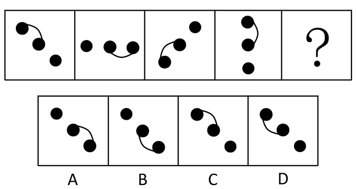

A. A

B. B

C. C

D. D

第 76 题 · 答案与解析

**参考答案（粉笔题库参考内容）**

B

**解析**

元素组成相同，考位置。

图形整体依次顺时针旋转135度，只有B符合此规律。

故正确答案为B。

**考点**：位置规律-旋转

**来源**：2013年广州市公务员录用考试《行测》题第76题

### 第 77 题

请选择最合适的一项填入问号处，使右边图形的变化规律与左边图形一致：

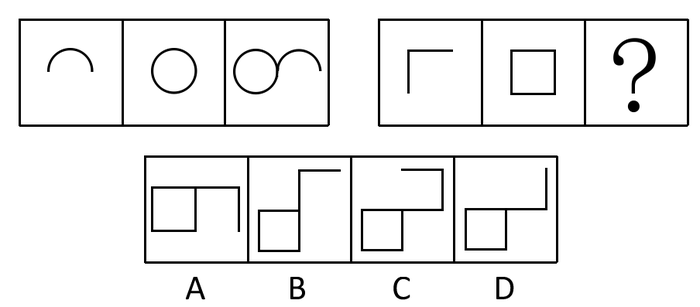

A. A

B. B

C. C

D. D

第 77 题 · 答案与解析

**参考答案（粉笔题库参考内容）**

A

**解析**

元素组成相似，考叠加。

题干前两个图形组合后左右翻转得到第三幅图；所以第二组图形也应遵循此规律，前两个图形组合后左右翻转得到A中图形。

故正确答案为A。

**考点**：样式规律-加减同异

**来源**：2013年广州市公务员录用考试《行测》题第77题

### 第 78 题

请选择最合适的一项填入问号处，使右边图形的变化规律与左边图形一致：

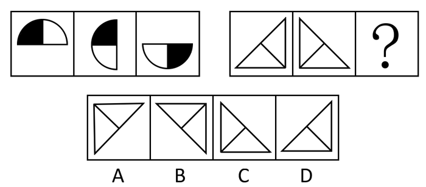

A. A

B. B

C. C

D. D

第 78 题 · 答案与解析

**参考答案（粉笔题库参考内容）**

A

**解析**

元素组成相同，考位置。

两组式的图形，先看第一组找规律，第一个图形顺时针旋转90度，左右翻转得到第二个图形；第二个图形顺时针旋转90度，上下翻转得到第三个图形，两次变化的规律一致，都是先顺时针旋转90度再翻转。第二组图形的规律与第一组相似或者相同，观察发现第一个图形顺时针旋转90度得到第二个图形，与第一组一样，一组内两次变化一致，后面也应遵循这一规律，第二个图形顺时针旋转90度得到A。

故正确答案为A。

注： 两组式的图形，两组间的规律是一致或者相似，并不都是相同。

**考点**：位置规律-综合

**来源**：2013年广州市公务员录用考试《行测》题第78题

### 第 79 题

请选择最合适的一项填入问号处，使右边图形的变化规律与左边图形一致：

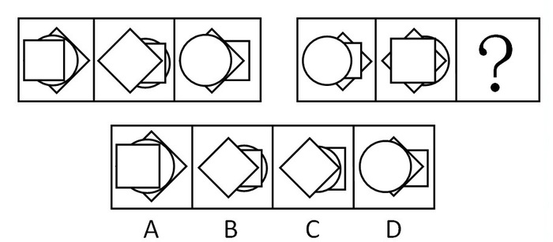

A. A

B. B

C. C

D. D

第 79 题 · 答案与解析

**参考答案（粉笔题库参考内容）**

C

**解析**

元素组成相似，考叠加，具体考查图形的遍历。

题干中方块、菱形和圆圈分别在上、中、下位置各出现一次；第二组图形也应遵循这一规律，观察前两个图形的叠加顺序，可知C符合规律。

故正确答案为C。

**考点**：样式规律-遍历

**来源**：2013年广州市公务员录用考试《行测》题第79题

### 第 80 题

请选择最合适的一项填入问号处，使之符合之前四个图形的变化规律：

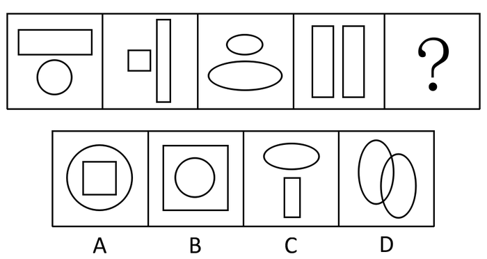

A. A

B. B

C. C

D. D

第 80 题 · 答案与解析

**参考答案（粉笔题库参考内容）**

C

**解析**

都是两个元素构成，看二者间的关系，考静态位置。

都是由两个互不包含的部分组成，且相对位置依次为上下、左右、上下、左右，故下一幅图应该由上下位置的两个互不包含部分组成，只有C符合此规律。

故正确答案为C。

**考点**：特殊规律-图形间关系

**来源**：2013年广州市公务员录用考试《行测》题第80题

### 第 81 题

请选择最合适的一项填入问号处，使之符合之前四个图形的变化规律：

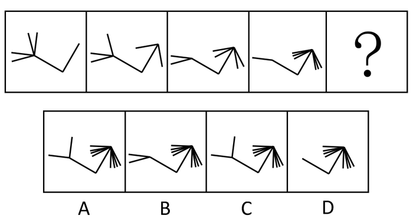

A. A

B. B

C. C

D. D

第 81 题 · 答案与解析

**参考答案（粉笔题库参考内容）**

D

**解析**

题干图形左侧部分线条数量依次为4、3、2、1，等量递减，故下一幅图左边部分线条数应为0；题干图形右边部分线条数量依次为0、2、4、6，等量递增，故下一幅图右边部分线条数应为8；观察选项，D符合此规律。

故正确答案为D。

**考点**：数量规律-线

**来源**：2013年广州市公务员录用考试《行测》题第81题

### 第 82 题

请选择最合适的一项填入问号处，使右边图形的变化规律与左边图形一致：

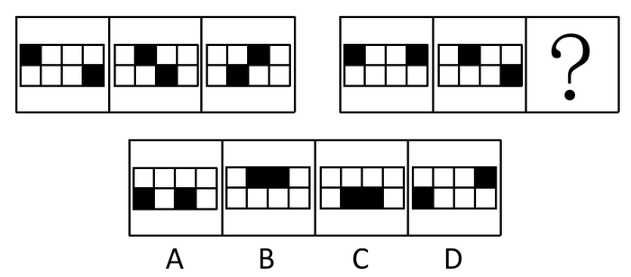

A. A

B. B

C. C

D. D

第 82 题 · 答案与解析

**参考答案（粉笔题库参考内容）**

C

**解析**

元素组成相同，考查内部元素位置的变化。

将题干每个图形都分为左右两个四宫格，左边宫格中的黑方块依次顺时针移动一个格子。如下图所示：

右边部分与之规律一致。第二组图也应遵循此规律，第二个图形左右宫格中黑方块各顺时针移动一个格子后，得到C中图形。

故正确答案为C。

**考点**：位置规律-平移

**来源**：2013年广州市公务员录用考试《行测》题第82题

### 第 83 题

请选择最合适的一项填入问号处，使之符合之前四个图形的变化规律：

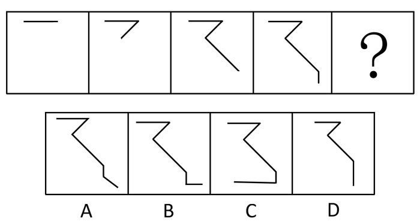

A. A

B. B

C. C

D. D

第 83 题 · 答案与解析

**参考答案（粉笔题库参考内容）**

D

**解析**

综合考查数量和位置。

通过观察可知，题干图形依次增加一条线段，且所递增的线条与所衔接线条所成角度分别为45度、90度、135度，也即依次递增45度，因此待选图形中所增加的线条与所衔接线条的度数应为180度。

故正确答案为D。

**考点**：数量规律-复合

**来源**：2013年广州市公务员录用考试《行测》题第83题

### 第 84 题

从所给的四个选项中，选择最合适的一个填入问号处。使之呈现一定的规律性。

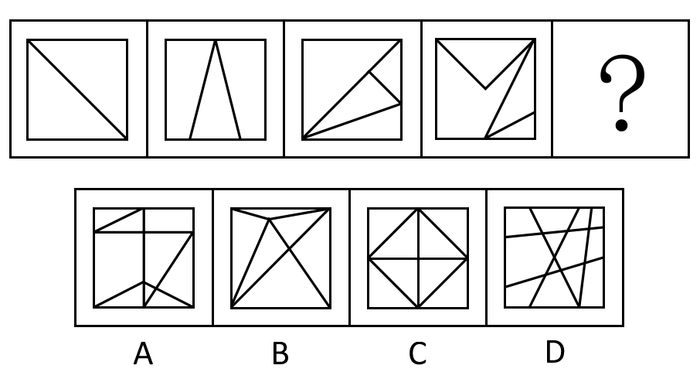

A. A

B. B

C. C

D. D

第 84 题 · 答案与解析

**参考答案（粉笔题库参考内容）**

B

**解析**

元素组成不同，无明显属性规律，考虑数量规律。观察题干，图1为日字变形图，C项为田字变形图，考虑笔画数，题干图形都是一笔画图形，排除C、D。比较A、B两项发现，都有正方形外框，但内部直线数不一样。观察题干，题干图形均有正方形外框，内部直线数依次递增，分别为1、2、3、4，故“？”处应该选一个内部直线数为5的图形，排除A项。

故正确答案为B。

**考点**：数量规律-线

**来源**：2013年广州市公务员录用考试《行测》题第84题

### 第 85 题

请选择最合适的一项填入问号处，使之符合之前四个图形的变化规律：

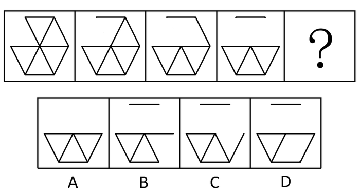

A. A

B. B

C. C

D. D

第 85 题 · 答案与解析

**参考答案（粉笔题库参考内容）**

C

**解析**

元素组成相似，题干图形依次递减一条线条，且所递减的线条与前一条递减的线条成60度夹角。

A、B、D项都少一条线，但是角度不符合。

故正确答案为C。

**考点**：数量规律-复合

**来源**：2013年广州市公务员录用考试《行测》题第85题

## 材料 1

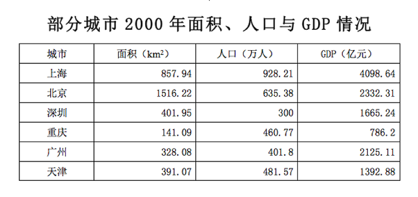

| 城市 | 面积（km^2） | 人口（万人） | GDP（亿元） |
| --- | ---: | ---: | ---: |
| 上海 | 857.94 | 928.21 | 4098.64 |
| 北京 | 1516.22 | 635.38 | 2332.31 |
| 深圳 | 401.95 | 300 | 1665.24 |
| 重庆 | 141.09 | 460.77 | 786.2 |
| 广州 | 328.08 | 401.8 | 2125.11 |
| 天津 | 391.07 | 481.57 | 1392.88 |

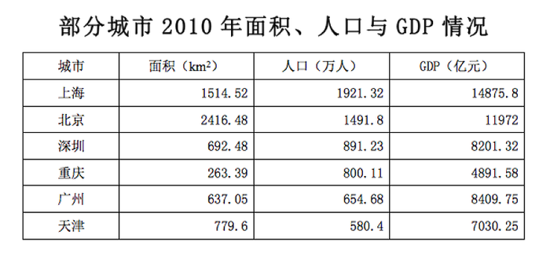

| 城市 | 面积（km^2） | 人口（万人） | GDP（亿元） |
| --- | ---: | ---: | ---: |
| 上海 | 1514.52 | 1921.32 | 14875.8 |
| 北京 | 2416.48 | 1491.8 | 11972 |
| 深圳 | 692.48 | 891.23 | 8201.32 |
| 重庆 | 263.39 | 800.11 | 4891.58 |
| 广州 | 637.05 | 654.68 | 8409.75 |
| 天津 | 779.6 | 580.4 | 7030.25 |

### 第 86 题

2000年GDP总量最高城市的人均GDP约为多少元？

A. 44000

B. 61000

C. 80000

D. 128000

第 86 题 · 答案与解析

**参考答案（粉笔题库参考内容）**

A

**解析**

读取表中数据，2000年GDP总量最高的城市为上海，故可得4098.64 ÷ 928.21，单位为万元，直除首位为4。

故正确答案为A。

**考点**：现期平均数、统计表

**来源**：2013年广州市公务员录用考试《行测》题第86题

### 第 87 题

相对于2000年，2010年面积增加最多的城市是：

A. 上海

B. 北京

C. 深圳

D. 广州

第 87 题 · 答案与解析

**参考答案（粉笔题库参考内容）**

B

**解析**

读取表中“面积”一列的数据，简单估算，显然北京面积增加最多。

故正确答案为B。

**考点**：统计表、简单加减计算

**来源**：2013年广州市公务员录用考试《行测》题第87题

### 第 88 题

2010年单位面积人口密度最大的城市是：

A. 上海

B. 北京

C. 深圳

D. 重庆

第 88 题 · 答案与解析

**参考答案（粉笔题库参考内容）**

D

**解析**

读取对应四个选项的数据，简单直除，比较量级，显然重庆最大，即人口密度最高。

故正确答案为D。

**考点**：现期平均数、统计表

**来源**：2013年广州市公务员录用考试《行测》题第88题

### 第 89 题

2010年比2000年单位面积GDP增长率最高的城市是：

A. 重庆

B. 北京

C. 上海

D. 天津

第 89 题 · 答案与解析

**参考答案（粉笔题库参考内容）**

A

**解析**

由题干“2010年比2000年单位面积GDP增长率最高的是······”可知本题为增长率的比较问题。r=(现期−基期)/基期=现期/基期−1，倍数关系明显，直接比较现期/基期的倍数关系即可。

重庆：4891.58/263.39 ÷ 786.2/141.09 ≈ 4900/260 × 140/800 ≈ 3.30；

北京：11972/2416.48 ÷ 2332.31/1516.22 ≈ 12000/2400 × 1500/2300 ≈ 3.26；

上海：14875.8/1514.52 ÷ 4098.64/857.94 ≈ 15000/1500 × 900/4100 ≈ 2.20；

天津：7030.25/779.6 ÷ 1392.88/391.07 ≈ 7000/800 × 400/1400 = 2.50；

由计算结果可得，重庆现期是基期的3.30倍，r=倍数-1，故重庆增长率最高。

故正确答案为A。

**考点**：平均数的增长率、统计表

**来源**：2013年广州市公务员录用考试《行测》题第89题

### 第 90 题

下述说法中不能从材料中得出的是：

A. 2000年和2010年广州的GDP总量在六个城市中均排在第三位

B. 2010年天津的面积比2000年增加了约388km^2

C. 从2000年到2010年，六个城市的单位面积GDP排名没有变化

D. 相对于2000年，2010年天津的人口数量在六个城市中的排名出现下降

第 90 题 · 答案与解析

**参考答案（粉笔题库参考内容）**

C

**解析**

对比两个表中数据，可知A、B两项说法正确；

C项较复杂，先跳过，验证D项，对比两个表中数据，2000年天津人口数量排第三，2010年排第六，排名下降，可知D项说法正确。

故正确答案为C。

**考点**：综合分析、统计表

**来源**：2013年广州市公务员录用考试《行测》题第90题

## 材料 2

根据以下资料，回答下列问题。

2012年，某区60岁以上户籍老年人口（下简称户籍老年人口）23.61万，占户籍总人口的22.6%。2012年户籍老年人口规模比2000年翻了一番，占户籍总人口的比重比2000年上升了5.4个百分点。80岁以上的户籍高龄老年人口达到3.89万人，人口规模比2000年翻了两番。

2012年，该区共有公办、民营两种性质的养老机构42家，比2006年增加了14家。共有养老床位8141张，其中公办养老床位数4401张。2006年以来，公办养老机构床位数平均每年增加523张，民办床位数平均每年增加190张。

2012年，该区养老机构共有入住老人5179名；从2006年到2012年，养老机构入住老人数量平均每年增加327名。

预计到2015年末，该区户籍老年人口将增长至31万，约占全区户籍人口的28%；同时，户籍高龄老年人口占户籍老年人口比重也将进一步上升。

### 第 91 题

2000年户籍老年人口占户籍总人口的比重是：

A. 14.7%

B. 16.5%

C. 17.2%

D. 22.6%

第 91 题 · 答案与解析

**参考答案（粉笔题库参考内容）**

C

**解析**

2012年，60岁以上户籍老年人口占户籍总人口的22.6%，占户籍总人口的比重比2000年上升了5.4%，因此2000年户籍老年人口占户籍总人口的比重为22.6%-5.4%=17.2%。

故正确答案为C。

**考点**：文字资料、简单加减计算

**来源**：2013年广州市公务员录用考试《行测》题第91题

### 第 92 题

2006年，该区共有养老床位数多少张：

A. 3150

B. 3863

C. 4231

D. 4576

第 92 题 · 答案与解析

**参考答案（粉笔题库参考内容）**

B

**解析**

根据“2012年共有养老床位8141张······2006年以来，公办养老机构床位数平均每年增加523张，民办床位数平均每年增加190张”可得，2006年养老床位数为8141−(523+190)×6，根据加减定位法计算尾数，41 − 3×6 = 23，尾数为3。

故正确答案为B。

**考点**：文字资料、简单加减计算

**来源**：2013年广州市公务员录用考试《行测》题第92题

### 第 93 题

2012年，该区养老机构的床位入住率大约为：

A. 64%

B. 69%

C. 75%

D. 84%

第 93 题 · 答案与解析

**参考答案（粉笔题库参考内容）**

A

**解析**

2012年，该区养老机构共有入住老人5179名，共有养老床位8141张。故可得床位入住率为5179 ÷ 8141 ＜ 52 ÷ 80 = 65%。

故正确答案为A。

**考点**：文字资料、现期比重

**来源**：2013年广州市公务员录用考试《行测》题第93题

### 第 94 题

如果该区计划到2015年每千户籍人口所拥有的养老床位数量比2012年翻倍，则到2015年养老机构还需要增加约多少张养老床位：

A. 8000

B. 9000

C. 11000

D. 13000

第 94 题 · 答案与解析

**参考答案（粉笔题库参考内容）**

B

**解析**

2012年户籍总人口为23.61 ÷ 22.6%，2015年户籍总人口为31 ÷ 28%，2012年养老床位为8141张。由题意可得8141/(23.61 ÷ 22.6%) × 2 × (31 ÷ 28%) − 8141≈ 8141 × 2 × 110.71/104.47 − 8141≈ 9117.92，B项最接近。

故正确答案为B。

**考点**：增长量计算、文字资料

**来源**：2013年广州市公务员录用考试《行测》题第94题

### 第 95 题

根据上述材料，以下选项错误的是：

A. 2000年以来，该区户籍老年人口的增速要高于户籍人口的增速

B. 预计到2015年末，该区户籍高龄老年人口的增速将快于户籍老年人口的增速

C. 2006年以来，该区公办养老床位的增速要快于民办养老床位的增速

D. 2006年以来，该区入住养老机构的老人增速要高于该区养老床位的增速

第 95 题 · 答案与解析

**参考答案（粉笔题库参考内容）**

D

**解析**

由第一段资料可知，2012年户籍老年人口占户籍总人口的比重比2000年上升了，说明户籍老年人口的增速高于户籍人口增速，A项说法正确；

由最后一段可知，户籍高龄老年人口占户籍老年人口比重将进一步上升，说明户籍高龄老年人口的增速将高于户籍老年人口增速，B项说法正确；

由第二段材料可知，2012年公办床位略多于民办床位，而2006年来，年均增长数量公办床位远高于民办床位数，可判断公办养老床位的增速要快于民办养老床位的增速，C项说法正确；

由上面题目可知，2006年共有养老床位数3863张，年均增长量为523+190=713张；由第三段资料可知，2006年入住人数为5179−327×6=5179−1962=3217名，年均增长量327名。对比前后数据，显然养老床位增速高于入住老人增速，D项说法错误。

本题为选非题，故正确答案为D。

**注：**D项计算步骤略多，如果时间不够，可根据对前三项的判断直接选择。

**考点**：文字资料、综合分析

**来源**：2013年广州市公务员录用考试《行测》题第95题

## 材料 3

**F县旅游经济数据**

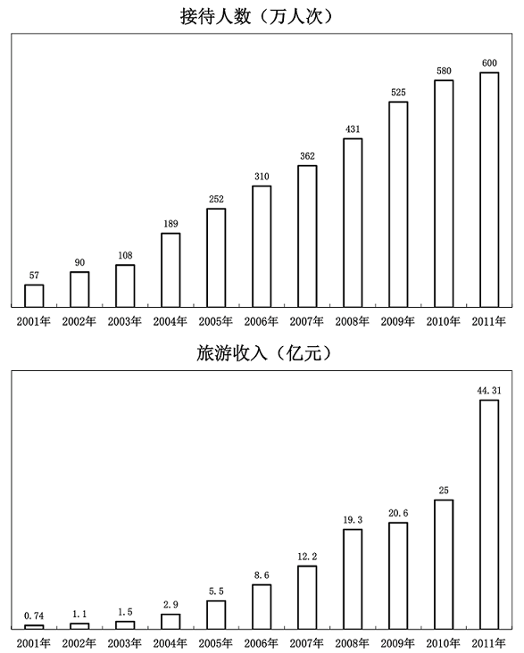

**旅游收入占全县GDP比重**

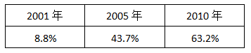

| 2001年 | 2005年 | 2010年 |
| --- | --- | --- |
| 8.8% | 43.7% | 63.2% |

### 第 96 题

相比较于2005年，2010年该县的GDP值：

A. 增长了12.6亿元

B. 增长了21.4%

C. 增长了27亿元

D. 增长了314%

第 96 题 · 答案与解析

**参考答案（粉笔题库参考内容）**

C

**解析**

根据图中数据可得，2010年GDP为25 ÷ 63.2% ≈ 25 ÷ 0.625 = 40亿元，2005年GDP为5.5 ÷ 43.7% ≈ 5.5 ÷ 0.44 = 12.5亿元，40 ÷ 12.5 - 1 = 220%，排除B、D两项；增长量为40-12.5=27.5亿元，C项最接近，排除A项。

故正确答案为C。

**考点**：增长量计算、综合资料

**来源**：2013年广州市公务员录用考试《行测》题第96题

### 第 97 题

到该县的游客中，人均旅游费用支出（旅游收入/接待人数）增长最快的一年是：

A. 2001年

B. 2004年

C. 2008年

D. 2011年

第 97 题 · 答案与解析

**参考答案（粉笔题库参考内容）**

D

**解析**

图中无2000年数据，所以2001年的无从比较，首先排除；

2004年：2.9/189 ÷ 1.5/108 − 1；

2008年：19.3/431 ÷ 12.2/362 − 1；

2011年：44.31/600 ÷ 25/580 − 1。

显然2011年最大。

故正确答案为D。

**考点**：平均数的增长率、综合资料

**来源**：2013年广州市公务员录用考试《行测》题第97题

### 第 98 题

假设2001~2005年间，该县GDP逐年稳定增长且每年增幅相同，那么2004年该县GDP约比2001年增长了：

A. 40%

B. 35%

C. 30%

D. 25%

第 98 题 · 答案与解析

**参考答案（粉笔题库参考内容）**

B

**解析**

2005年GDP为5.5÷43.7%，2001年GDP为0.74÷8.8%，则有(1+r)^4=(5.5÷43.7%)/(0.74÷8.8%)≈5.55/0.74×8.8/44=1.5，(1+r) ≈ 1.1，则(1 + r)^3 - 1 = 1.5/1.1 - 1 ≈ 36%。

故正确答案为B。

**考点**：年均增长率、综合资料

**来源**：2013年广州市公务员录用考试《行测》题第98题

### 第 99 题

根据材料，下列说法正确的是：

A. 2007年该县旅游接待人数比2002年翻了四番

B. 2005年来该县旅游的人均支出约为740元

C. 同比前一年，只有2009年来该县旅游的人均支出是有所减少的

D. 同比前一年，2003年是该县旅游接待人数增加最少的一年

第 99 题 · 答案与解析

**参考答案（粉笔题库参考内容）**

D

**解析**

2007年接待人数362万，2002年为90万，362 ÷ 90 ≈ 4倍，即两番，并非四番，A项说法错误；

2005年人均旅游支出为55000 ÷ 252 ≈ 5500 ÷ 25 = 220元，B项说法错误；

2002年人均旅游支出为1.1÷90，2001年为0.74 ÷ 57 = 1.11 ÷ 85.5，显然2001年更大，可知C项说法错误；

观察接待人数的柱状图，显然2003年增加最少，为108-90=18万人，D项说法正确。

故正确答案为D。

**考点**：综合分析、综合资料

**来源**：2013年广州市公务员录用考试《行测》题第99题

### 第 100 题

根据材料，能得出的结论是：

A. 该县旅游的生态环境不断改善，吸引力日益增强

B. 该县的旅游收入占全县GDP的比重日益上升

C. 2012年该县旅游收入将保持2011年的增速，实现高增长

D. 生态环境日益受重视，人均旅游花费呈稳步上升的态势

第 100 题 · 答案与解析

**参考答案（粉笔题库参考内容）**

B

**解析**

统计图中不能体现生态环境对旅游收入的影响，首先排除A、D两项；

统计图中没有体现2012年旅游收入数据，因此无法确定增速，排除C项；

由最后一个表格可知，2001年到2010年，旅游收入所占比重日益上升，B项说法正确。

故正确答案为B。

**考点**：综合分析、综合资料

**来源**：2013年广州市公务员录用考试《行测》题第100题

