# 2014年广州市公务员录用考试《行测》题

<!-- gwy:overview:start -->
> **广州 · 2014 · 行测 · 统考** ｜ 100 题 · 图片 64 处 · 答案随题折叠

| 题型模块 | 题量 | 题号 |
| --- | ---: | ---: |
| 言语理解与表达 | 25 | 1–25 |
| 数量关系 | 15 | 26–40 |
| 常识判断 | 15 | 41–55 |
| 判断推理 | 30 | 56–85 |
| 资料分析 | 15 | 86–100 |
| **合计** | **100** | |

导航：[题型与作答说明](#题型与作答说明) · [题目](#题目) · [材料 1](#材料-1)
<!-- gwy:overview:end -->

> 候选采集稿。参考答案及解析来自粉笔页面，不代表官方答案或真实高分答卷；来源使用许可与原卷对应关系仍需人工核实。

## 题型与作答说明

言语理解与表达

（25题）

根据题目要求，在四个选项中选出一个最恰当的答案。

数量关系

（15题）

在这部分试题中，每道题呈现一段表述数字关系的文字，要求你迅速、准确地计算出答案。

常识判断

（15题）

根据题目要求，在四个选项中选出一个最恰当的答案。

判断推理

（30题）

本部分包括常识判断、类比推理、演绎推理、图形推理四种类型的试题。

资料分析

（15题）

所给出的图、表、文字或综合性资料具有若干问题要你回答。你应根据资料提供的信息进行分析、比较、计算和判断处理。

## 题目

### 第 1 题

科学家必须在\_\_\_\_\_\_的经验事实中抓住某些可用精密公式来表示的普遍特性，由此探求自然界的普遍原理。

填入画横线部分最恰当的一项是：

A. 偶发

B. 零散

C. 庞杂

D. 系统

第 1 题 · 答案与解析

**参考答案（粉笔题库参考内容）**

C

**解析**

根据“在\_\_\_\_\_\_的经验事实中抓住某些可用精密公式来表示的普通特性”可知，横线处词语应与“精密公式、普遍原理”的规律性形成对比，体现经验事实的初始状态，突出需要从大量无序的事实中筛选提炼的过程，C项“庞杂”指庞大而杂乱，强调量多而繁杂，符合文意，当选。A项“偶发”指偶然发生的，侧重“发生的偶然性、非规律性”，B项“零散”指分散、不集中，强调分散、零碎，D项“系统”指有条理、有体系，强调整体性，均不符合语境，排除。

故正确答案为C。

【文段出处】英文原稿：爱因斯坦《On the Method of Theoretical Physics》

《爱因斯坦文集》第一卷（商务印书馆1976年版）（许良英等编译）

**考点**：实词填空、对应关系-前后呼应

**来源**：2014年广州市公务员录用考试《行测》题第1题

### 第 2 题

在物联网、云计算等新技术日趋进步之时，管理软件厂商如何提升自身的市场洞察力和创新能力已经\_\_\_\_\_\_。

A. 迫不及待

B. 迫不得已

C. 迫在眉睫

D. 时不我待

第 2 题 · 答案与解析

**参考答案（粉笔题库参考内容）**

C

**解析**

本题是强调在新技术日趋进步的大背景下，提高软件厂商市场洞察力和创新力的急迫性。A项迫不及待的意思是，急得不能再等待了，形容心情急切，强调的是主观心理所想，排除；B项迫不得已的意思是，被逼不得不这样做，强调无可奈何，排除；C项迫在眉睫的意思是，形容事情已到眼前，情势十分紧迫，强调的是一种客观上的紧迫，符合题意，当选；D项时不我待的意思是，时间不会等待我们，指要抓紧时间，并未体现出紧迫感，排除。

故正确答案为C。

**考点**：对应关系-前后呼应、成语填空

**来源**：2014年广州市公务员录用考试《行测》题第2题

### 第 3 题

依次填入下列横线处的词语，最恰当的一组是：

成功的流行文化作品具有共性，它们通俗，却并不\_\_\_\_\_\_，它们浅显，却并不\_\_\_\_\_\_。

A. 俗套 短浅

B. 庸俗 短浅

C. 俗套 浅薄

D. 庸俗 浅薄

第 3 题 · 答案与解析

**参考答案（粉笔题库参考内容）**

D

**解析**

本题考查的是近义词的辨析。关键词是“却并不”，表转折，关联词前后意思相对。

第一空：“通俗”指浅显易懂。俗套：①世俗的习惯和礼节；②陈旧的格调、程式。庸俗指平庸鄙陋，不高尚。因转折前后描述对象一致，都是修饰思想方面的，故而选“庸俗”，排除A、C项。

第二空：“浅显”指简明易懂的事物和道理。浅薄多指人的学识、修养等不深厚，很浅显、浅薄的议论。短浅指（对事物的认识和分析）狭窄而肤浅，常用来形容目光短浅，排除B项。

故正确答案为D。

**考点**：词的辨析-词义侧重、实词填空、关联关系-转折关系

**来源**：2014年广州市公务员录用考试《行测》题第3题

### 第 4 题

党的十八大以来，高压反贪腐很好地\_\_\_\_\_\_了腐败官员，在很大程度上\_\_\_\_\_\_了官场风气，但对权力的监督不能光靠运动，正如王岐山同志所言，治标是在为治本赢得宝贵时间。

依次填入下列横线处的词语，最恰当的一组是：

A. 震撼 转换

B. 威慑 扭转

C. 震撼 扭转

D. 威慑 转换

第 4 题 · 答案与解析

**参考答案（粉笔题库参考内容）**

B

**解析**

本题考查的是近义词的辨析。

第一空考查感情色彩。震撼：①指土地剧烈摇动（这层意思多指自然灾害）；②指内心受到强烈的冲击或感动，精神或情绪剧烈起伏或波动。威慑：是指凭借力量或势力使对方感到恐惧。高压反贪腐就应让腐败的官员畏惧，因此，选择“威慑”最为恰当，排除A、C两项。

第二空：转换：①指改变，改换；②从一种能量形式变成另一种能量形式。扭转：纠正或改变事物的发展方向或不正常的情况。贪污腐败是不正之风，因而用“扭转”符合文意，排除D项。

故正确答案为B。

**考点**：词的辨析-词义侧重、词的辨析-感情色彩、实词填空

**来源**：2014年广州市公务员录用考试《行测》题第4题

### 第 5 题

依次填入下列横线处的词语，最恰当的一组是：

这种困局，不仅\_\_\_\_\_\_着政府的公信与权威，也\_\_\_\_\_\_着不菲的社会成本和发展机遇。

A. 消减 消耗

B. 消减 浪费

C. 消损 浪费

D. 消损 消耗

第 5 题 · 答案与解析

**参考答案（粉笔题库参考内容）**

C

**解析**

本题考查的是近义词的辨析。

第一空：“消减”，指减少，降低标准，侧重于数量上的减少，多指具体事物；“消损”，形容消减、磨损，多指抽象的事物，排除A、B两项。

第二空：“消耗”，多指（精神、东西、力量等）因使用或受损失而逐渐减少；“浪费”多表示由于管理和配置的失误，导致消耗的资源超出了完成某项活动本身所需资源的数量。本题所修饰的对象是社会成本和发展机遇，是种资源，故“浪费”最为恰当，排除D项。

故正确答案为C。

**考点**：词的辨析-词义侧重、词的辨析-搭配对象、实词填空

**来源**：2014年广州市公务员录用考试《行测》题第5题

### 第 6 题

在危机出现之前，不少美国大银行由于在住房抵押贷款方面提供不实信息，\_\_\_\_了投资者，因此投资者提出了上千亿美元的巨额现金赔偿要求，相关的法律诉讼和监管调查给这些经营刚刚有所好转的银行带来了新的\_\_\_\_\_ 。

依次填入下列横线处的词语，最恰当的一组是：

A. 误导 压力

B. 诱导 阻力

C. 误导 阻力

D. 诱导 压力

第 6 题 · 答案与解析

**参考答案（粉笔题库参考内容）**

A

**解析**

第一空，“误导”指错误的指导，含贬义。“诱导”指劝诱，引导。根据文中“提供不实信息”可知，这是种错误的导向，故选“误导”，B、D两项排除。

第二空，“阻力”：①妨碍物体运动的作用力；②泛指阻碍事物发展或前进的外力。“压力”：①指情况的紧迫或紧张；②社会或经济负担的增加。“压力”符合文意，“巨额现金赔偿要求”使银行的经济负担加重，“相关的法律诉讼和监管调查”使银行所面临的形势紧张，A项当选。

故正确答案为A。

**考点**：词的辨析-词义侧重、词的辨析-感情色彩、实词填空、关联关系-因果关系

**来源**：2014年广州市公务员录用考试《行测》题第6题

### 第 7 题

广州战略性新兴产业的产品有的是按国家标准生产，尚未与国际标准\_\_\_\_\_\_，与国际同类相关产品技术不\_\_\_\_\_\_，导致这些产品只能销往国内市场。

依次填入下列横线处的词语，最恰当的一组是：

A. 对接 兼容

B. 接轨 兼容

C. 接轨 融合

D. 对接 融合

第 7 题 · 答案与解析

**参考答案（粉笔题库参考内容）**

B

**解析**

第一空，“对接”指两个或两个以上航行中的航天器（航天飞机、宇宙飞船等）靠拢后接合成为一体，强调的是具体事物的结合。“接轨”本是一个交通术语。引申为把一件事情与另一件事情连接起来，强调的是抽象的结合。这里指把国家标准与国际标准连接到一个“轨道”上。同时，“与国际接轨”也是固定搭配。排除A、D两项。

第二空，“兼容”指同时容纳几个方面。“融合”指将两种或多种不同的事物合成一体。这里强调的是技术上的匹配，而不是合成一体，排除C项。

故正确答案为B。

**考点**：词的辨析-词义侧重、词的辨析-搭配对象、实词填空、关联关系-因果关系

**来源**：2014年广州市公务员录用考试《行测》题第7题

### 第 8 题

依次填入下列横线处的词语，最恰当的一组是：

\_\_\_\_\_\_\_\_《现代世界的诞生》《政治秩序的起源》等书并未冠以“现代化”的字眼，\_\_\_\_\_\_\_\_都是紧紧围绕现代化的某些侧面展开的，\_\_\_\_\_\_\_\_它们也都出于各自的理论视角重点探讨了中国现代化问题。

A. 因为 所以 并且

B. 尽管 但是 而且

C. 既然 并非 虽然

D. 如果 除非 那么

第 8 题 · 答案与解析

**参考答案（粉笔题库参考内容）**

B

**解析**

本题是对虚词中关联词的考查。

第二空考查转折关系，是本题的破题点。第二个空格前一句提到“未冠以‘现代化’的字眼”，后一句提到“紧紧围绕现代化的某些侧面展开的”，前后两句是矛盾的，故应用表转折的关联词“但是”，B项当选。

第一空考查关联词的固定搭配。“尽管”表示姑且承认某种事实，后一小句用“但是”“然而”“却”等呼应。“尽管······但是······”是固定搭配。

第三空考查递进关系，进一步说明这些书是围绕现代化问题展开的，“而且”表递进且符合文意。

故正确答案为B。

**考点**：词的辨析-搭配对象、词的辨析-程度轻重、关联关系-转折关系

**来源**：2014年广州市公务员录用考试《行测》题第8题

### 第 9 题

依次填入下列横线处的词语，最恰当的一组是：

命与运\_\_\_\_\_\_\_如骨肉之不可剥离，然而倘作理性研究，\_\_\_\_\_\_\_\_医学上的生理解剖，\_\_\_\_\_\_\_\_需先就骨论骨，就肉论肉。

A. 必然 如 也

B. 必然 同 则

C. 固然 同 也

D. 固然 如 则

第 9 题 · 答案与解析

**参考答案（粉笔题库参考内容）**

D

**解析**

本题是对虚词中关联词的考查。

第一空，“固然······然而······”是表转折关系的固定搭配。此处“固然”表示承认某个事实，引起下文转折，指出理性研究不是这样。“必然”表述太过绝对，排除A、B两项。

第三空，“则”表顺承关系，所连接的前一部分表原因，后一部分表结果。因为理性研究不是这样，所以要就骨论骨，就肉论肉。

第二空，是插入生理解剖的例子来做例证，举例子应用“如”。

故正确答案为D。

**考点**：词的辨析-搭配对象、关联关系-转折关系

**来源**：2014年广州市公务员录用考试《行测》题第9题

### 第 10 题

依次填入下列横线处的词语，最恰当的一组是：

践行群众路线、倾听民声，党员干部应该做到：倾听“赞许”，            ；倾听“牢骚”，            ；倾听“建议”，             。

A. 谦虚谨慎 平心静气 去糟取精

B. 平心静气 谦虚谨慎 去糟取精

C. 去糟取精 平心静气 谦虚谨慎

D. 谦虚谨慎 去糟取精 平心静气

第 10 题 · 答案与解析

**参考答案（粉笔题库参考内容）**

A

**解析**

本题为对策类文段，横线处所填均为倾听民声时，党员干部所要做到的。“赞许”易使人飘飘然，因而要戒骄戒躁，谦虚谨慎对待。“牢骚”易使人怒火中烧，因此要平心静气地对待。采纳“建议”时，要去糟取精，选择好的、适用的。
故正确答案为A。

词汇拓展：

谦虚谨慎：形容人虚心礼让，小心谨慎。

平心静气：心情平和，态度冷静。

去糟取精：吸取事物中最好的东西，舍弃事物中坏的，无用的东西。

**考点**：对应关系-前后呼应、成语填空

**来源**：2014年广州市公务员录用考试《行测》题第10题

### 第 11 题

在社会经济尚不发达时，传统建筑遭受的主要是自然的破坏。而在经济发展的起步阶段，人们急于改变物质生活条件，忽视精神生活的需求，对传统建筑的人为破坏大大超过自然的破坏。待经济发展到一定水平，价值观起了变化，进而追求精神生活的丰富时，传统建筑将重新受到重视。但传统建筑是不可再生的，任凭今后有多么强大的经济实力，对已遭受破坏而不复存在的传统建筑及其历史环境来说，留下的只能是无法挽回的遗憾。

以上文字最主要想说明：

A. 传统建筑的保留是一种精神生活的需要

B. 在社会经济发展的过程中，要重视对传统建筑的保护

C. 对于传统建筑来说，人为破坏的程度往往大于自然的破坏

D. 在社会经济发展的过程中，传统建筑的破坏是一个不可避免的过程

第 11 题 · 答案与解析

**参考答案（粉笔题库参考内容）**

B

**解析**

第一步，读文段找到主旨句。

文段一开始通过对比提出在经济不发达时“传统建筑遭受的主要是自然的破坏”，而在经济发展起步阶段“人为破坏大大超过自然的破坏”，通过两个转折关联词“而”“但”语义后置，转折后是重点，因此重点落在“但传统建筑是不可再生的······”这一句，这一句主要强调传统建筑破坏的危害性。

第二步，在主旨的基础上适当延伸得到答案。

由提问方式可知这是一道隐含主旨题，因此要选解决问题的对策。B项“在社会经济发展的过程中，要重视对传统建筑的保护”为对策，正确；D项对应文段最后一句，但表述有误，文段强调的是“遗憾”而并非“不可避免”，错误。

故正确答案为B。

**考点**：关联词-转折

**来源**：2014年广州市公务员录用考试《行测》题第11题

### 第 12 题

利用身体的免疫系统来对抗癌症是最有潜力的治疗方法之一。免疫系统是身体内一套由细胞、组织和器官组成的网络，是人的健康保镖，保护人免于疾病的威胁。自然，这套免疫系统也会像雷达一样，时时刻刻监视着是否有癌细胞出现。科学家们很早已经认识到，这套免疫系统在预防癌症方面也起着关键的作用。有丰富的证据可以说明这一点，而且，那些免疫系统受到抑制的病人比别的病人更容易罹患癌症更是让这一点不言自明。

关于这段文字，以下理解准确的是：

A. 人体可以利用自身的免疫系统治愈癌症

B. 免疫系统受到抑制的人很可能罹患癌症

C. 免疫系统一旦发现癌细胞就会向大脑传递信息

D. 未来的抗癌技术可能产生于对免疫系统的研究

第 12 题 · 答案与解析

**参考答案（粉笔题库参考内容）**

D

**解析**

A项，“人体可以利用自身的免疫系统治愈癌症”曲解题意，文中只说“是最有潜力的治疗方法之一”，并未说能否治愈的问题，排除；

B项，“免疫系统受到抑制的人很可能罹患癌症”无中生有，文中只说“免疫系统受到抑制的病人比别的病人更容易罹患癌症”，排除；

C项，“就会向大脑传递信息”无中生有，文中没有提及，排除；

D项，由文段第一句话可以推出，当选。

故正确答案为D。

**考点**：细节判断题

**来源**：2014年广州市公务员录用考试《行测》题第12题

### 第 13 题

国际人才竞争远比物质资源争夺更为复杂。目前各国争夺人才的手段日渐多样化，但从根本来说，吸引并留住人才，依靠的不仅仅是薪酬待遇，更重要的是创造适合人才长远发展的基础和环境，以及优化相关基本政策体系。目前，各国都日益重视建立人才使用、评估、成长的开放环境，从过去注重人才使用的短期政策过渡到有利于人才长期发展的制度建设上来。

关于这段文字，以下理解准确的是：

A. 争夺人才已经成为各国政府一项十分重要的工作

B. 提供优厚的薪酬待遇不再是吸引人才的重要手段

C. 吸引和留住人才需要一系列的综合配套措施

D. 人才的长远发展是各国人才政策的终极目标

第 13 题 · 答案与解析

**参考答案（粉笔题库参考内容）**

C

**解析**

A项，“争夺人才已经成为各国政府一项十分重要的工作”无中生有，文段讲的是各国“争夺人才的手段日渐多样化”，排除；

B项，“提供优厚的薪酬待遇不再是吸引人才的重要手段”曲解题意，文段没有讲薪酬不重要，而是要多种手段相结合，排除；

C项，“一系列的综合配套措施”即文段提到的各种措施的同义替换，当选；

D项，“人才的长远发展是各国人才政策的终极目标”，无中生有，排除。

故正确答案为C。

**考点**：细节判断题

**来源**：2014年广州市公务员录用考试《行测》题第13题

### 第 14 题

实施大数据战略，对于政府部门来说，不仅意味着要上马多少高新科技项目，也意味着调整自身运作的机制，进行一次政府理念的创新、政府职能的转变、政府流程的再造。要打好这套组合拳，必须经过以下考验：政府所拥有数据是否丰富和开放？政府的管理和运作方式能否适配数据化决策？在区域和国家层面，是否拥有强大的数据分析产业和人才队伍作为支撑？

关于这段文字，以下理解准确的是：

A. 政府要实施大数据战略，并不需要高新科技的支撑，而需调整运作机制

B. 政府的理念、职能和流程中存在太多制约政府运作机制良性发展的因素

C. 管理理念、运作方式适配，产业、人才的支撑是实施大数据的必要条件

D. 高新科技项目是政府实施大数据战略的基础条件

第 14 题 · 答案与解析

**参考答案（粉笔题库参考内容）**

C

**解析**

A项对应文段第一句话，不仅······也······，说明两者都需要，错误；

B项对应第二句话，但文中只是说需要再造，没有说是不是存在太多制约因素，错误；

C项大数据战略需要组合拳，而组合拳需要三个方面，因此是必要条件，正确；

D项对应文段第一句话，但文段强调的是递进之后，而不是递进之前，同时“基础条件”文段没有提及，错误。

故正确答案为C。

**考点**：细节判断题

**来源**：2014年广州市公务员录用考试《行测》题第14题

### 第 15 题

公共危机发生之后，网民经常会在网络上发表对事件的看法，同时凭个人经验进行主观判断，甚至会存在一些人借危机事件表达对社会或者政府的不满，使网络舆论呈现复杂化。政府作为危机管理机构，在网络舆论出现不当情况时，应当适当加以引导。这种引导，不是人为控制人们情绪的宣泄和意见的发表，而是让更多的意见参与进来，特别是使一些专业人士参与其中，使整个舆论能相对保持理性。

关于这段文字，以下理解准确的是：

A. 在公共危机发生之后，政府应该容忍舆论中更多不同的意见

B. 处理公共危机时，政府应该引导舆论意见往理性的方向发展，控制情绪的宣泄

C. 公共危机中网络舆论的复杂化，主要是因为人们对社会或者政府的不满

D. 在公共危机发生后，政府应该第一时间发布有关消息，引导舆论方向

第 15 题 · 答案与解析

**参考答案（粉笔题库参考内容）**

A

**解析**

A项对应文段最后一句“让更多的意见参与进来”，正确；

B项对应最后一句，但文段说的是“不是人为控制人们情绪的宣泄”，错误；

C项对应文段中第一句，但“主要”文段中没有提及，错误；

D项“第一时间发布消息”无中生有，错误。

故正确答案为A。

**考点**：细节判断题

**来源**：2014年广州市公务员录用考试《行测》题第15题

### 第 16 题

大城市和小城市，各有各的优势，也各有各的劣势。留在大城市还是到小城镇生活，依然是困扰人们的问题。在发展比较均衡的地区，这只是个体和群体的偏好，在很多发展中国家，则更像是个结构性问题。但无论是在哪里，关键是要给年轻人一个“向上的发展空间”。城市发展的意义，是给所有人更多选择，而不是主导他们的选择。否则，大城市过度扩展和地区发展不均衡，会让整个社会的梦想破碎。

关于这段文字，以下理解准确的是：

A. 在发展比较均衡的地区，在哪里生活不再是困扰人们的问题

B. 所有人有更多的选择空间，城市的发展才具有真正的意义

C. 年轻人只要有一颗追逐梦想的心，无论在哪里都能收获成功

D. 整个社会的梦想破碎，是因为大城市过度扩张和地区发展不均衡

第 16 题 · 答案与解析

**参考答案（粉笔题库参考内容）**

B

**解析**

A项对应文段第二句，但文段说依然是困扰人们的问题，只是不是结构性的，错误；

B项对应文段第五句“城市发展的意义，是给所有人更多选择”，正确；

C项无中生有，文段没有提及，错误；

D项对应最后一句，“否则”引导反面论证，因此前面是原因，原因是城市发展主导了人们的选择，错误。

故正确答案为B。

**考点**：细节判断题

**来源**：2014年广州市公务员录用考试《行测》题第16题

### 第 17 题

科普创作历来就是一个复杂的系统工程，不仅需要相应的人力物力投入，而且还需要作者巨大的精力和时间投入。要培养青年科普作者，解决人才断层问题，就需要遵循科普创作的特点和规律。比如，进一步明确科普创作的地位，将其放到与科学研究、科技推广等同等的地位予以重视，或者建立科普人才的培养机制等。

关于这段文字，以下理解准确的是：

A. 科普创作需要多方面的巨大投入

B. 科普作者应当遵循科普创作的特点和规律

C. 科学研究、科技推广比科普创作更重要

D. 建立科普人才的培养机制是不可或缺的环节

第 17 题 · 答案与解析

**参考答案（粉笔题库参考内容）**

A

**解析**

从文段第一句“科普创作历来就是一个复杂的系统工程，不仅需要相应的人力物力投入，而且还需要作者巨大的精力和时间投入”可知，A项与文段的意思相符；

B项偷换了主体，把“培养青年科普作者，解决人才断层问题”偷换成“科普作者”，错误；

C项对应文段最后一句“进一步明确科普创作的地位，将其放到与科学研究、科技推广等同等的地位予以重视”，而不是更重要，错误；

D项文段没有提及，属于无中生有，错误。

故正确答案为A。

**考点**：细节判断题

**来源**：2014年广州市公务员录用考试《行测》题第17题

### 第 18 题

工作或职位的内涵，本来就是一个复杂的组合，每一项工作都有它创意、趣味、多元的一面，更有它辛苦、无聊、重复发生、令人讨厌的一面。许多有才气的人，最后一事无成，不是他才气不足，只是他耐心不够，无法通过无聊、无趣的考验，以至于才气被怨气蒸发了。多少才气纵横但怨气冲天的人，最后成为组织边缘人，成为组织的问题人物，成为领导不得不放弃的马谡。

作者通过这段文字所表达的主要观点是：

A. 人在工作中往往不会一帆风顺

B. 对工作存在怨气是失败的根本

C. 有才华的人不一定能在工作中取得成功

D. 我们应该耐心对待工作中的无聊与无趣

第 18 题 · 答案与解析

**参考答案（粉笔题库参考内容）**

D

**解析**

第一步，读文段找到主旨句。第一句介绍工作或者职位的内涵特点，引出工作无聊、无趣这个话题。第二句和第三句意思是许多有才气的人由于耐不住工作的无聊、无趣而一事无成。文段是围绕工作的无聊、无趣展开的，也就是说工作中如何面对无聊、无趣。

第二步，选择与主旨含义相同的选项。D项为文段主旨的同义替换，最符合文段表达的观点，当选。

故正确答案为D。

**考点**：关联词-对策

**来源**：2014年广州市公务员录用考试《行测》题第18题

### 第 19 题

人们的负面情绪增多，首先是社会制度、社会生活秩序发生病变的反映。如果社会制度能够让大多数人受益，如果社会弘扬社会公平正义有明显成效，就不可能出现较多公众不信任、不相信政府的情况。所以，一旦有公众表达了不信任、不相信政府的意见，政府就应该看作是一个危险的信号——自己的工作出问题了，就应当立即深刻检讨，查找工作中的问题，承担责任，并努力解决问题。

关于这段文字，以下理解准确的是：

A. 政府的工作出了问题人们就会产生负面情绪

B. 不信任、不相信政府的人主要是利益受损的人

C. 政府查找、解决自己的问题能换取公众的信任

D. 化解人们的负面情绪是政府改进工作的契机

第 19 题 · 答案与解析

**参考答案（粉笔题库参考内容）**

D

**解析**

A项语气过于绝对，排除；

B、C两项文段没有提及，属于无中生有，排除；

从最后一句“所以，一旦有公众表达了不信任、不相信政府的意见，政府就应该看作是一个危险的信号——自己的工作出问题了，就应当立即深刻检讨，查找工作中的问题，承担责任，并努力解决问题”可以判断，D项是正确的。

故正确答案为D。

**考点**：细节判断题

**来源**：2014年广州市公务员录用考试《行测》题第19题

### 第 20 题

城乡价值观念和行为规范的诸多差异，给进城务工的农民带来了极大的文化冲击。他们中有很多人通过社会学习，积极地参与社会生活，掌握城市社会的知识、技能和规范，逐步适应和融入了城市社会。但在这个过程中也有不少人成了“双重边缘人”，他们对家乡农村的依恋在减退，不愿意或无法回归农村社会，但同时又未能真正适应、融入城市。

关于这段文字，以下理解准确的是：

A. 很多农民因对家乡农村和农村不再依恋而进城务工

B. 融入城市失败导致很多进城务工农民无法回归到农村社会

C. 进城务工农民可以通过学习等方式克服城乡文化差异带来的冲击

D. 城乡文化差异是很多进城务工农民无法适应、融入城市的直接原因

第 20 题 · 答案与解析

**参考答案（粉笔题库参考内容）**

C

**解析**

A项偷换概念，文段提到“他们对家乡农村的依恋在减退”，选项讲“不再依恋”，与原文不符，错误；

B项偷换逻辑关系，文段讲“不愿意或无法回归农村社会，但同时又未能真正适应、融入城市”，“无法回归农村社会”和“未能真正适应、融入城市”是并列关系，而不是因果关系，错误；

C项可以从文段第二句得出，正确；

D项偷换概念，文段讲受到“冲击”，并没有说“无法适应、融入”，错误。

故正确答案为C。

**考点**：细节判断题

**来源**：2014年广州市公务员录用考试《行测》题第20题

### 第 21 题

人类智力是无法获得完美认知的，一个开放的社会，应该承认人类容易犯错的特征，而封闭社会则会否认这一点。封闭社会也在努力消除或者不想承认不确定性，它会为历史设定一个单线性的目标。与之相比，开放社会承认不确定性，也承认整个社会目的的不确定性。如果我们承认未来是变化或者不确定的，那么对此我们或者接受，或者否定。前者为人们带来批判式思维模式，并且能够带领我们走向开放社会，后者则会导致教条式思维模式以及封闭的社会。

关于这段文字，以下理解准确的是：

A. 如果我们能接受未来是变化的，那么就有可能获得批判性的思维模式

B. 人们可以通过不断的批判和否定来确定社会的目的

C. 封闭社会的教条式思想能消弭社会的不确定性，并使人们获得完美的认知

D. 人类容易犯错的特征使我们不得不接受未来是变化的、不确定的

第 21 题 · 答案与解析

**参考答案（粉笔题库参考内容）**

A

**解析**

A项对应最后一句，“前者为人们带来批判式思维模式”，正确；

B、C项无中生有，错误；

D项偷换逻辑，并列关系偷换成因果关系，“容易犯错的特征”和“承认不确定性”是两个并列的关系，错误。

故正确答案为A。

**考点**：细节判断题

**来源**：2014年广州市公务员录用考试《行测》题第21题

### 第 22 题

当前“科学技术是一把双刃剑”成为一种越来越被认可的说法。科学转化为技术，再通过人的运用对自然产生影响，如果运用不当或者超过适用条件，势必会出现负面影响。科学本身哪怕是纯洁的、无辜的，但是在它的基础上延伸出来的技术应用所带来的负面影响是很难避免的。所以，这种说法被着重强调的时候，人们关注的其实是科学的负面作用，它削弱了“科学是正确”的传统形象，从而也影响了科学在大众中的公信力，给科学发展带来了障碍。

关于这段文字，以下理解准确的是：

A. 人们应该关注科学给人类社会带来的负面作用

B. “科学技术是一把双刃剑”这种说法越来越被认可，这种趋势有碍科学发展

C. 科学技术应用延伸出来的负面影响反映出科学并不是绝对正确的

D. 人们总是将自己运用不当或者超过使用条件上的后果归结为科学的错

第 22 题 · 答案与解析

**参考答案（粉笔题库参考内容）**

B

**解析**

A项，由“人们关注的其实是科学的负面作用······给科学发展带来了障碍”可知，人们关注科学的负面作用会带来障碍，因此无法得出“应该关注科学的负面作用”这一对策，排除；

B项，由“当前‘科学技术是一把双刃剑’成为一种越来越被认可的说法”“这种说法被着重强调的时候······给科学发展带来了障碍”可知，这一说法越来越被认可，且被认可确实会阻碍科学发展，表述正确，当选；

C项，由“它削弱了‘科学是正确’的传统形象”可知，是“科学是正确”这一形象被削弱，并不代表“科学并不是绝对正确的”，偷换概念，排除；

D项，“总是将自己运用不当或者超过使用条件上的后果归结为科学的错”，文段并未提及，无中生有，排除。

故正确答案为B。

**考点**：细节判断题

**来源**：2014年广州市公务员录用考试《行测》题第22题

### 第 23 题

将下列句子组成一段逻辑连贯、语言流畅的文字，排列顺序最合理的是：

①目前来看，我们的工作已经取得了阶段性成就，老百姓在改革中拓宽了融资渠道，赢得了发展资金，有了更加多样化的选择和发展空间。

②改革成功与否，第一判断标准就是能否让老百姓得到实惠。

③在下一步的改革中，我们将在先行先试的基础上，重点探索农民土地承包经营权股份经营，农民对集体“三资”股份占有、使用、担保、抵押、继承等。

④我们的改革成功迈出了第一步，但还面临着新型农业经营主体培育、特色产业扶持、职业农民培育等诸多问题。

A. ③①②④

B. ②①④③

C. ④②③①

D. ①④③②

第 23 题 · 答案与解析

**参考答案（粉笔题库参考内容）**

B

**解析**

②为总括性语句，根据首尾句原则，可确定答案为B项。

①句中提到工作取得阶段性成就，百姓赢得资金，发展多样化，实为②句的例证，故①句应承接在②句之后。④句中“迈出了第一步”，与③句中“下一步”构成逻辑关系，故④句应在③句前。

故正确答案为B。

**考点**：确定首句-首句特征、确定捆绑、确定顺序

**来源**：2014年广州市公务员录用考试《行测》题第23题

### 第 24 题

将下列句子组成一段逻辑严谨、语言流畅的文字，排列顺序最合理的是：

①“快”似乎成了一种躲避不开的生活潮流，“快”也许是每个中国人对自己生活的最真切感受。

②究其原因，与我们快速发展的生活节奏不无关系。

③从容作为一种悠然、宽缓的生活态度，已然成为一种稀缺的东西且离我们的生活渐行渐远。

④中国速度催生了我们生活的快节奏，我们在有意无意间做着压缩时间的工作。

A. ①②④③

B. ①④③②

C. ③②④①

D. ④①②③

第 24 题 · 答案与解析

**参考答案（粉笔题库参考内容）**

C

**解析**

④句中的“有意无意”与①句中的“躲避不开”相照应，且①和④之间存在逻辑关系，④句是在描述生活快节奏的现象，①句说出了快节奏带给我们的感受，故④①应为前后句。排除A、B选项。

②句中“究其原因”后面常跟对前文所提到的事情的解释说明，因为快速发展致使生活节奏改变，故其前一句应讲述的是生活节奏的改变。由③句提出悠然宽缓的生活离我们渐行渐远，所以③②应为前后句。

故正确答案为C。

**考点**：确定捆绑、确定顺序

**来源**：2014年广州市公务员录用考试《行测》题第24题

### 第 25 题

将下列句子组成一段逻辑连贯、语言流畅的文字，排列顺序最合理的是：

①然而，繁华盛景背后的旧制度却已是风烛残年、百孔千疮

②德国总理默克尔赠给了中国贵宾的一幅古老地图，在无数国人心中激起波澜

③在当时已经踏上现代化之路的欧洲人眼里，君主专制的中华帝国“翻来覆去只是一座雄伟的废墟”

④那幅绘于乾隆年间的中国地图，刻画的是中国封建史上最后一个辉煌的年代

A. ②③①④

B. ①②④③

C. ②④①③

D. ③②④①

第 25 题 · 答案与解析

**参考答案（粉笔题库参考内容）**

C

**解析**

浏览选项，我们发现①句中“然而”，表转折，说明该句不是首句，排除B项；转折之后提到风烛残年的旧制度，根据转折前后话题一致、意思相反的原则，其前一句应为辉煌的时代，故④①应为前后句，排除A项；由④句中出现指示代词“那幅地图”，故前文应提到“地图”。③描述了当时中华帝国是一座废墟，接连①中的风烛残年、百孔千疮，排除D项。

故正确答案为C。

**考点**：确定首句-非首句特征、确定捆绑

**来源**：2014年广州市公务员录用考试《行测》题第25题

### 第 26 题

5，6，8，12，12，20，17，30，（ ）

A. 19

B. 23

C. 26

D. 30

第 26 题 · 答案与解析

**参考答案（粉笔题库参考内容）**

B

**解析**

数列项数较多，优先考虑分组。间隔分组后，两组新数列分别为：5、8、12、17、( )；6、12、20、30。前一组作差后为连续自然数列3、4、5、(6)，故所求项为17+6=23。

故正确答案为B。

**考点**：多重数列

**来源**：2014年广州市公务员录用考试《行测》题第26题

### 第 27 题

2，-8，24，-48，48，( )

A. \-96

B. \-32

C. 0

D. 64

第 27 题 · 答案与解析

**参考答案（粉笔题库参考内容）**

C

**解析**

原数列两两作商后得到新数列为：-4、-3、-2、-1、( )，为公差为1的等差数列，则括号内应为0。故所求项应为：48×0=0。

故正确答案为C。

**考点**：作商数列

**来源**：2014年广州市公务员录用考试《行测》题第27题

### 第 28 题

8，32，4，1/8，( )

A. 1/32

B. 1/4

C. 8

D. 32

第 28 题 · 答案与解析

**参考答案（粉笔题库参考内容）**

A

**解析**

数列包含整数和分数，优先考虑相邻两项之商。，，可以得出规律：后一项除以前一项的商等于第三项。则所求项为：。

故正确答案为A。

**考点**：基础数列

**来源**：2014年广州市公务员录用考试《行测》题第28题

### 第 29 题

1，3，2，3，4，9，( )

A. 13

B. 18

C. 29

D. 32

第 29 题 · 答案与解析

**参考答案（粉笔题库参考内容）**

D

**解析**

数列起伏较小，考虑作差后无规律，考虑递推。观察可以发现，；；；，即。故所求项为：。

故正确答案为D。

**考点**：递推数列

**来源**：2014年广州市公务员录用考试《行测》题第29题

### 第 30 题

0，4，18，( )

A. 48

B. 46

C. 36

D. 28

第 30 题 · 答案与解析

**参考答案（粉笔题库参考内容）**

A

**解析**

题干数列项数较少，不能考虑两项之间的运算关系，只能考虑单项分解。观察可以发现：；；，故下一项应为：3×4²=48。

故正确答案为A。

**考点**：幂次数列、因数分解数列

**来源**：2014年广州市公务员录用考试《行测》题第30题

### 第 31 题

某海鲜档口出售一批总共150斤的鲜鱼，按原售价每卖出一斤可赚5元。由于较为畅销，在卖出三分之一后，档主将售价上调20%。卖完所有鲜鱼后，档主一共赚了1250元，则原售价是每斤多少元：

A. 20

B. 25

C. 30

D. 35

第 31 题 · 答案与解析

**参考答案（粉笔题库参考内容）**

B

**解析**

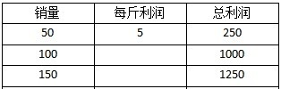

通过上表可以推出，后2/3出售的100斤，每斤的利润为1000÷100=10元，比前1/3出售的50斤每斤的利润提高了5元。即售价提高了5元，上调了20%，则原售价每斤为：元。

故正确答案为B。

**考点**：经济利润问题

**来源**：2014年广州市公务员录用考试《行测》题第31题

### 第 32 题

某公交线路从起点到终点共25个站点，每天早上6点分别从起点站和终点站同时出发首班车，晚上10点开出末班车，每班车发车时间间隔10分钟。假设每辆车从一个站点行驶到下一个站点所需时间为5分钟，则该线路至少需要配备多少辆车：

A. 24

B. 13

C. 12

D. 26

第 32 题 · 答案与解析

**参考答案（粉笔题库参考内容）**

A

**解析**

公交线路全程25个站点，即全程共24段分段线路，每分段线路行驶的时间为5分钟，则全程需要24×5=120分钟。因每班车发车时间间隔10分钟，故要保证发车数量，每侧最少需要120÷10=12辆车，两侧发车则一共需要12×2=24辆车。

故正确答案为A。

**考点**：普通行程

**来源**：2014年广州市公务员录用考试《行测》题第32题

### 第 33 题

吴老师到商店买篮球和足球共56个。篮球每个定价90元，足球每个定价80元。由于购买的数量较多，该商店老板就给吴老师八折优惠，结果吴老师付的钱比按定价买少付了960元，那么他买了多少个篮球：

A. 24

B. 26

C. 30

D. 32

第 33 题 · 答案与解析

**参考答案（粉笔题库参考内容）**

D

**解析**

设吴老师购买了x个篮球，则购买了足球56-x个，打八折优惠后比实际定价少付960元，即优惠的2折为960元。依据题意可列方程：\[90x+80(56-x)\]×0.2=960，解得x=32，故吴老师买了32个篮球。

故正确答案为D。

**考点**：经济利润问题

**来源**：2014年广州市公务员录用考试《行测》题第33题

### 第 34 题

往一个空的正方体鱼缸里装水，装完第一次水后，水面的高度为5厘米，之后每次的装水量都是上一次的两倍。当装完第四次水后，水面距离鱼缸顶部还有15厘米，则该鱼缸的高度是多少厘米：

A. 50

B. 75

C. 90

D. 105

第 34 题 · 答案与解析

**参考答案（粉笔题库参考内容）**

C

**解析**

因鱼缸为正方体鱼缸，底面积不变，故每次加水的体积与高度成正比。第一次加水后，水面高度为5cm；第二次加水是第一次加水的2倍，则第二次水面高度增加了10cm；第三次加水是第二次加水的2倍，则第三次水面高度增加了20cm；第四次加水又是第三次的2倍，则第四次水面高度增加了40cm。此时水面距离鱼缸顶部还有15cm，则鱼缸的总高度为：5+10+20+40+15=90cm。

故正确答案为C。

**考点**：几何公式类-立体图形

**来源**：2014年广州市公务员录用考试《行测》题第34题

### 第 35 题

有七位考官对一位应聘者评分，如果去掉一个最高分和一个最低分，则平均分为7分；如果只去掉一个最高分，则平均分为6.75分；如果只去掉一个最低分，则平均分为7.25分。那么，这位应聘者所得的7个分数中，最高分与最低分的差值为多少分：

A. 1.5

B. 2

C. 3

D. 3.5

第 35 题 · 答案与解析

**参考答案（粉笔题库参考内容）**

C

**解析**

设最高分为x，最低分为y，根据七位考官所评分的总和不变，则可列式为：6.75×6+x=7.25×6+y。化简后得：x-y=7.25×6-6.75×6=3。

故正确答案为C。

**考点**：平均数问题

**来源**：2014年广州市公务员录用考试《行测》题第35题

### 第 36 题

有一项工程，甲公司花6天，乙公司再花9天可以完成；或者甲公司花8天，乙公司再花3天可以完成。如果这项工程由甲公司或乙公司单独完成，则甲公司所需天数比乙公司少多少天：

A. 15

B. 18

C. 24

D. 27

第 36 题 · 答案与解析

**参考答案（粉笔题库参考内容）**

B

**解析**

设甲的工作效率为甲，乙的工作效率为乙，则根据条件可列等式为：6甲+9乙=8甲+3乙，转化后得：甲=3乙。赋值乙的工作效率为1，则甲的工作效率为3，总工程量为27。则甲单独完成需要天；乙单独完成需要27÷1=27天。甲比乙少27-9=18天。

故正确答案为B。

**考点**：给效率比例型

**来源**：2014年广州市公务员录用考试《行测》题第36题

### 第 37 题

某办公室接到15份公文的处理任务，分配给甲、乙、丙三名工作人员处理。假如每名工作人员处理的公文份数不得少于3份，也不得多于10份，则共有（ ）种分配方式。

A. 15

B. 18

C. 21

D. 28

第 37 题 · 答案与解析

**参考答案（粉笔题库参考内容）**

D

**解析**

先给每人分两份，则剩下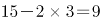份，此时只要每人至少分一份即可保证每人至少三份且不多于10份的条件，根据插板法，在9份公文中间的八个空中插入两个板即可满足条件，共有种方法。

故正确答案为D。

**考点**：同素分堆问题

**来源**：2014年广州市公务员录用考试《行测》题第37题

### 第 38 题

某航空公司所有机票一律七折，在此基础上，教师可以再享受八折优惠，学生可以再享受六折优惠，学生小丁与父亲和当老师的妈妈用2520元购得机票三张一起外出旅游，则小丁一家所购机票原价为每张多少元：

A. 800

B. 1000

C. 1250

D. 1500

第 38 题 · 答案与解析

**参考答案（粉笔题库参考内容）**

D

**解析**

根据题干条件可知，在购买的机票中小丁在七折的基础上又打了六折；妈妈在七折的基础上又打了八折；爸爸打了七折。设机票原价为每张x元，则可列方程：0.7x×0.6+0.7x×0.8+0.7x=0.42x+0.56x+0.7x=2520，解得x=1500。

故正确答案为D。

**考点**：经济利润问题

**来源**：2014年广州市公务员录用考试《行测》题第38题

### 第 39 题

货车A由甲城开往乙城，货车B由乙城开往甲城，它们同时出发并以各自恒定的速度行驶，在途中第一次相遇时，它们离甲城为35千米。相遇后两车继续以原来的速度行驶至目的地城市后立即折返，途中再一次相遇，这时它们离乙城为25千米。则甲乙两城相距多少千米：

A. 80

B. 85

C. 90

D. 95

第 39 题 · 答案与解析

**参考答案（粉笔题库参考内容）**

A

**解析**

第一次相遇时，两车共行走了一个全程；第二次相遇时，两车共行走了三个全程。第二次相遇所走路程是第一次相遇所走路程的3倍，所走时间与速度不变，故货车A第二次相遇所走的路程也是第一次相遇所走路程的3倍。第一次相遇时，货车A走了35千米，则在第二次相遇时货车A共走了35×3=105千米，这时离乙城25千米，则全程共105-25=80千米。

故正确答案为A。

**考点**：相遇追及

**来源**：2014年广州市公务员录用考试《行测》题第39题

### 第 40 题

甲乙两人在玩一个沙盘游戏，比赛的规则是：在一个分为50个单位的区域上，每人轮流去划定这些区域作为自己的领地，每次可以划定1到5个单位，谁作为最后划定区域的人则为胜利者，如果由甲划定，那么甲一开始要划定多少个单位，才能保证自己获胜：

A. 1

B. 2

C. 3

D. 4

第 40 题 · 答案与解析

**参考答案（粉笔题库参考内容）**

B

**解析**

若要甲最后划定取得胜利，则只能在最后6个区域时，由乙先划定才可实现。

则可设定为：甲先划定2个单位，剩余48个单位，转为由乙划定，每次划定1~5个单位。然后甲只需根据乙划定的单位数，每次划定（6-乙）个单位即可。

乙若划定1个单位，则甲划定5个；

乙若划定2个单位，则甲划定4个；

乙若划定3个单位，则甲划定3个；

乙若划定4个单位，则甲划定2个；

乙若划定5个单位，则甲划定1个。

经过7轮后还剩下6个单位，仍然乙先划定，无论划定几个（不能超过5个），甲都是最后的划定者。

故正确答案为B。

**考点**：统筹规划问题

**来源**：2014年广州市公务员录用考试《行测》题第40题

### 第 41 题

近3000年来，我国经历了三个气候温暖湿润时期和三次大规模的变冷时期，每次气候变冷，北方游牧民族政权南部疆域的版图都必须扩大，如果不能扩大，这些游牧民族政权就会灭亡。由此可以得知，下列哪个时期出现了气候变冷的情况？

A. 战国

B. 西汉

C. 隋唐

D. 南宋

第 41 题 · 答案与解析

**参考答案（粉笔题库参考内容）**

D

**解析**

中国历史上第一次大规模变冷发生在西周。《竹书纪年》中有公元前903年长江、汉江结冰的记载。冷到长江、汉江会在冬天结冰，在今天是人们难以想象的。西周青铜器铭文中随处可见“中国”与夷、狄、戎、羌、狁交战的记录，这些“侵略者”大多是北方游牧民族。

第二次大规模变冷发生在魏晋南北朝。当时的年平均气温比现在低~。这个时代出现的是“五胡乱华”之后的十六国割据局面。

第三次大规模变冷发生在宋元之间。经历长时段的气候变冷、草木凋零、粮食减产和连年瘟疫与战争，中国的政权达到了一个新的临界点。在公元1234年这个临界点，和宋代赵家王朝征战百年的游牧民族大金国瞬间崩溃，被新兴壮大的蒙古人政权消灭。而南宋的赵家王朝，也不过是在苟延残喘。蒙古人随后建立的牧者王朝，随后为中国建立了有史以来最大的疆域版图。

故正确答案为D。

**考点**：中国历史

**来源**：2014年广州市公务员录用考试《行测》题第41题

### 第 42 题

甲因与乙发生互殴，受伤入院治疗。两周后，甲即将痊愈出院，但在最后一次换药时，因主治医生丙操作医疗器具失误，甲伤口被感染而需继续留院治疗。第二天，医院病房因电线老化短路而引发火灾，甲不幸在火灾中遇难。按照法律，谁应对甲的死亡承担法律责任（ ）

A. 乙

B. 丙

C. 医院

D. 乙、丙和医院共同

第 42 题 · 答案与解析

**参考答案（粉笔题库参考内容）**

C

**解析**

构成民事责任的要件为：1.损害事实的客观存在。损害是指因一定的行为或事件使民事主体的权利遭受某种不利的影响。2.行为的违法性。指对法律禁止性或命令性规定的违反。3.违法行为与损害事实之间的因果关系。作为构成民事责任要件的因果关系指行为人的行为及其物件与损害事实之间所存在的前因后果的必然联系。4.行为人的过错。行为人的过错是行为人在实施违法行为时所具备的心理状态，是构成民事责任的主观要件。本题中，造成甲死亡的主要因素为医院病房因电线老化短路而引发火灾，主治医生丙的失误对甲的死亡不构成直接因素。所以医院应对甲的死亡承担法律责任。

故正确答案为C。

**考点**：民法典

**来源**：2014年广州市公务员录用考试《行测》题第42题

### 第 43 题

一篇名人传记里介绍这位名人：“他出生于英国贵族家庭”、“他在20世纪20年代到北京大学讲学”、“他提倡离婚手续简化”、“他以九十八岁高龄离世”······由此可以得知，这位名人是：

A. 培根

B. 康德

C. 罗素

D. 杜威

第 43 题 · 答案与解析

**参考答案（粉笔题库参考内容）**

C

**解析**

A项错误，弗朗西斯·培根（1561—1626），英国文艺复兴时期最重要的散文家、哲学家。他不但在文学、哲学上多有建树，在自然科学领域里，也取得了重大成就；

B项错误，伊曼努尔·康德(1724—1804)，德国哲学家、天文学家、星云说的创立者之一、德国古典哲学的创始人、唯心主义者、不可知论者、德国古典美学的奠定者；

C项正确，罗素（1872—1970）是英国世袭贵族之子，他在1920年访问俄国和中国，并在北京讲学一年，与美国人文哲学家杜威同时间在中国讲学，在长沙时期，青年毛泽东曾经担任记录员。他提倡离婚手续简化，进一步解放了人们的思想；

D项错误，约翰·杜威（1859—1952）是实用主义的集大成者。他的著作很多，涉及科学、艺术、宗教伦理、政治、教育、社会学、历史学和经济学诸多方面，使实用主义成为美国特有的文化现象。

故正确答案为C。

**考点**：文学常识

**来源**：2014年广州市公务员录用考试《行测》题第43题

### 第 44 题

佛教有“大乘佛教”和“小乘佛教”的分别。其中，“乘”指的是：

A. 车辆

B. 智慧

C. 超度

D. 佛法僧

第 44 题 · 答案与解析

**参考答案（粉笔题库参考内容）**

A

**解析**

A项正确，大乘的相应梵语是“Mahayana”，是大的车乘或行程之意；“小乘”的相应梵文为“Hinayana”，是小的、低等的车乘或行程之意。说小乘，显然有贬抑之意；相应地，说大乘，有显扬之意。现代的佛教学者，沿袭此用法，已是中性，并无显扬或贬抑的意味。

故正确答案为A。

**考点**：文化常识

**来源**：2014年广州市公务员录用考试《行测》题第44题

### 第 45 题

以下诗句诗意连贯且对仗工整的是：

A. 绿蚁新醅酒，洗手作羹汤

B. 空山松子落，幽人应未眠

C. 河山北枕秦关险，驿路西连汉畤平

D. 漠漠水田飞白鹭，朝朝马策与刀环

第 45 题 · 答案与解析

**参考答案（粉笔题库参考内容）**

C

**解析**

C项正确，“河山北枕秦关险，驿路西连汉畤平”出自《行经华阴》，唐代诗人崔颢的作品。此诗描写了诗人途经华阴时所见的华山三峰雄奇险峻的景色，表现了祖国山河的壮美瑰丽，抒发了诗人对奔走名利者的不齿以及对学道求仙的向往之情。全诗打破了律诗的起承转合的格式，别具神韵。诗境雄浑壮阔，对仗工整，寓意深刻。

A项错误，应为“绿蚁新醅酒，红泥小火炉。”B项错误，诗句对仗不工整。D项错误，应为“漠漠水田飞白鹭，阴阴夏木啭黄鹂。”

故正确答案为C。

**考点**：文学常识

**来源**：2014年广州市公务员录用考试《行测》题第45题

### 第 46 题

在我国古代，二姓结为婚姻，一般要经过六道程序，称为“六礼”，包括“亲迎”“纳吉”“纳彩”“问名”“请期”“纳征”。关于六礼，以下说法正确的是：

A. “问名”在“纳彩”之前

B. “亲迎”是指男家迎请女家父母参加婚礼

C. “纳吉”和“纳征”分别指男家向女家提亲及送聘礼

D. “请期”是指男家择定完婚吉日，向女家征求同意

第 46 题 · 答案与解析

**参考答案（粉笔题库参考内容）**

D

**解析**

A项错误，“六礼”即六个礼法，指纳彩、问名、纳吉、纳征、请期和亲迎，因此“问名”应在“纳彩”之后。

B项错误，亲迎（或迎亲）：在结婚吉日，穿着礼服的新郎会偕同媒人、亲友亲自往女家迎娶新娘。新郎在到女家前需到女家的祖庙行拜见礼，之后才用花轿将新娘接到男家。在男家完成拜天、地、祖先的仪式后，便送入洞房。

C项错误，问名结束后，男方占卜得到吉兆，媒人就重新到女方家里，婚姻就正式地确定下来，这就是纳吉。纳吉结束后，男方向女方送彩礼，无论贫富，彩礼是不可少的，这叫纳征。

D项正确，请期（又称乞日）：即男家择定合婚的良辰吉日，并征求女家的同意。

故正确答案为D。

**考点**：文化常识

**来源**：2014年广州市公务员录用考试《行测》题第46题

### 第 47 题

当在建筑物内发生火灾时，在逃生过程中，不应该：

A. 一直朝着有亮光的方向逃生

B. 通过天窗爬上屋顶

C. 利用建筑物的落水管等竖直管线下滑至地面

D. 利用阳台、毗邻平台逃生

第 47 题 · 答案与解析

**参考答案（粉笔题库参考内容）**

A

**解析**

本题为争议题。

A项，在火场内确实不能朝着有亮光的地方跑，因为亮光的地方极有可能正在发生燃烧，但脱离火场之后可以朝着其他灯光的地方跑，有灯光的地方一般会有人经过，容易得救。

B项，建筑物发生火灾首先要判断自己所处的楼层位置，如果自己在火灾楼层的下方且距离较近，不要往上跑，如果自己在火灾楼层的上方且距离较近，不要往下跑，以免误入火场。如果处于火灾楼层上方，又无其他办法，情况紧急在四周已被烟雾包围的情况下，应积极自造或寻找避难处所，如高层露台、楼顶平台、可打开的窗户等处，但由于天窗等闭锁造成伤亡也时有发生。

C项，有些建筑物外侧有落水管等竖直的管线，确保自身安全的情况下可沿该管至地面，然后安全逃生。

D项，阳台以及毗邻的平台关键时刻也可以用以躲避火灾进行逃生。

火场逃生一定要结合当时的实际情况结合进行，切勿生搬硬套，弄巧成拙，但就本题而言AB都有不正确的地方，综合比较A项更符合题意。

本题为选非题，故正确答案为A。

**考点**：生活常识

**来源**：2014年广州市公务员录用考试《行测》题第47题

### 第 48 题

以下民间谚语与所描述的节气的对应关系中，错误的是：

A. 蓄水如屯粮，水足粮满仓——雨水

B. 春雷一响，惊动万物——惊蛰

C. 晚稻就怕霜来早——立秋

D. 春节前后少农活，莫忘鱼塘常巡逻——大寒

第 48 题 · 答案与解析

**参考答案（粉笔题库参考内容）**

C

**解析**

每年的10月23日是我国传统节气“霜降”，霜降节气含有天气渐冷、初霜出现的意思，是秋季的最后一个节气，也意味着冬天的开始，霜降时节，养生保健尤为重要，民间有谚语“一年补透透，不如补霜降”，足见这个节气对我们的影响。“晚稻就怕霜来早”就是描述的霜降节气。立秋，是二十四节气中的第13个节气，在每年七月初一前后（公历8月7-9日之间）。“秋”就是指暑去凉来，意味着秋天的开始。到了立秋，梧桐树开始落叶，因此有“落一叶而知秋”的成语。从文字角度来看，“秋”字由禾与火字组成，是禾谷成熟的意思。秋季是天气由热转凉，再由凉转寒的过渡性季节，立秋是秋季的第一个节气。

由上述可知，C项错误。

本题为选非题，故正确答案为C。

**考点**：文化常识

**来源**：2014年广州市公务员录用考试《行测》题第48题

### 第 49 题

以下现象，产生的原因与其他选项不一样的是：

A. 同一种花，山上的比山脚下的开得要晚

B. 任何季节，中午时分，只要有太阳照射的地方，影子都指向北

C. 在我国夏季，长春的日照时间比广州要长得多

D. 地球分为五个气候带，分别是热带、南温带、北温带、南寒带、北寒带

第 49 题 · 答案与解析

**参考答案（粉笔题库参考内容）**

A

**解析**

A项，因为山上的气温比较低一些，海拔平均每升高100米，气温就下降0.6摄氏度左右。植物的花一般都是气温达到一定的值才会开放；

B项，中午12时，太阳位于正南，无论什么季节，影子都会指向北方；

C项，由于黄道平面与赤道平面有夹角，所以，地球是斜着转的。而太阳是不变的，因此，越往北白昼越长，赤道始终昼夜平分，夏日，北极极昼；

D项，太阳辐射（简单来说就是太阳光照）是气候带形成的基本因素。太阳辐射量随纬度增高而递减，使地球气候呈现出五大不同的带状气候区，分别是热带、南温带、北温带、南寒带、北寒带。

A项与气温有关；B、C、D三项均与太阳照射有关。

本题为选非题，故正确答案为A。

**考点**：自然地理

**来源**：2014年广州市公务员录用考试《行测》题第49题

### 第 50 题

苏轼在《赤壁赋》中写到：“壬戌之秋，七月既望，苏子与客泛舟游于赤壁之下。”在一阕《水调歌头》的序中说：“丙辰中秋，欢饮达旦，大醉，作此篇，兼怀子由。”文中所述的“夜游赤壁”和“中秋夜饮”：

A. “夜游赤壁”发生在前

B. “中秋夜饮”发生在前

C. 两者同年发生

D. 两者发生时间相隔了四年

第 50 题 · 答案与解析

**参考答案（粉笔题库参考内容）**

B

**解析**

天干地支，简称“干支”。在中国古代的历法中，甲、乙、丙、丁、戊、己、庚、辛、壬、癸被称为“十天干”，子、丑、寅、卯、辰、巳、午、未、申、酉、戌、亥叫作“十二地支”。十干和十二支依次相配，组成六十个基本单位，两者按固定的顺序互相配合，组成了干支纪法。天干地支60年一循环，通过先后顺序，可知苏轼一生经历的“丙辰”肯定在“壬戌”之前。即“中秋夜饮”发生在前。

故正确答案为B。

**考点**：文化常识

**来源**：2014年广州市公务员录用考试《行测》题第50题

### 第 51 题

《来自星星的你》一剧中，都敏俊在地球已经生活了四百多年。在刚刚过去的四百多年里，地球上未曾发生的事件或不能观测到的现象是：

A. 受印第安人启发，西方人发明了治疗疟疾的特效药

B. 哥德巴赫猜想提出，并被德国人证明

C. 日本侵略朝鲜，中国出兵救援

D. 哈雷彗星出现在地球上空

第 51 题 · 答案与解析

**参考答案（粉笔题库参考内容）**

B

**解析**

本题考查世界历史知识，结合选项具体分析。

A项正确，最早治疗疟疾的药物是奎宁，一种取自于金鸡纳树树皮的药物。南美洲的印第安人发现了金鸡纳树的树皮能治疟疾病。他们将树皮剥下，晾干后研成粉末，用以治疗疟疾。17世纪末，奎宁由欧洲传入我国，曾被称为“金鸡纳霜”，1934年科学家合成了疟疾特效药之一氯喹，因其毒副作用至少被搁置了10年，直到1945年，奎宁才实现了人工合成。

B项错误，1742年6月7日，哥德巴赫写信给欧拉，提出了著名的哥德巴赫猜想：任一大于2的偶数都可以写成两个素数之和。就其研究历史而言，目前最佳的结果是中国数学家陈景润于1966年证明的，1924年，德国的拉特马赫只是证明了一部分“7 + 7”。直到现在哥德巴赫猜想都没有被证实。

C项正确，日本侵略朝鲜，发生于四百多年前。具体发生于1592年—1598年。万历朝鲜战争起到了重新整合东亚各国政治军事力量的作用，奠定了之后三百年的东亚的和平局面。

D项正确，哈雷彗星每隔大约76年都会按时回归。最近的一次回归是公元1985年底至1986年5月。

本题为选非题，故正确答案为B。

注：本题有认为选C的，我们注意题干问的是：过去400多年来“未曾发生或不能观测到”。而C项“抗日援朝”在过去400多年里是发生过的，所以不选。

**考点**：世界历史

**来源**：2014年广州市公务员录用考试《行测》题第51题

### 第 52 题

以下做法中，所运用的科学原理与其他三项不同的是：

A. 烹饪海鲜时加入柠檬汁以去除腥味

B. 服用小苏打可以治疗某些类型的胃痛

C. 在蜜蜂蜇后的伤口涂抹氨水以减轻疼痛

D. 在被污染的湖泊中培育水藻吸收过量的氮和磷

第 52 题 · 答案与解析

**参考答案（粉笔题库参考内容）**

D

**解析**

A项：海鲜汁呈酸性，加入柠檬汁后由于柠檬汁为碱性，起到了中和作用，以便达到去除腥味的目的；

B项：小苏打为弱碱，胃痛主要由胃酸引起，服用小苏打后，与胃酸发生中和反应，降低了胃酸的浓度；

C项：蜜蜂毒液呈酸性，涂抹氨水后与毒液发生中和反应，能够起到缓解疼痛的作用；

D项：被污染的湖泊中培育水藻吸收过量的氮和磷，是自然的分解过程。

A、B、C都属于中和反应。

本题为选非题，故正确答案为D。

**考点**：生活常识

**来源**：2014年广州市公务员录用考试《行测》题第52题

### 第 53 题

《说文解字》里说：“鼎，三足两耳，和五味之宝器也。”作为中华文化的象征之一，鼎在古代原本是用于（ ）的器具。

A. 祭祀

B. 观赏

C. 行刑

D. 烹饪

第 53 题 · 答案与解析

**参考答案（粉笔题库参考内容）**

D

**解析**

D项正确，鼎是青铜器的最重要器种之一，是用以烹煮肉和盛贮肉类的器具。夏、商、周三代及秦汉延续两千多年，后来因用于烹饪祭祀给神的牲畜，而上升为礼器，成为国家政权中君主、大臣等的权力象征。

《滕王阁序》中有“钟鸣鼎食”的说法，汉武帝时，大臣主父偃亦云：“丈夫生不五鼎食，死即五鼎烹耳。”说明活着就要用鼎吃饭。

故正确答案为D。

**考点**：文化常识

**来源**：2014年广州市公务员录用考试《行测》题第53题

### 第 54 题

婴儿的以下行为属于本能的是：

A. 说话

B. 走路

C. 笑

D. 吸奶

第 54 题 · 答案与解析

**参考答案（粉笔题库参考内容）**

D

**解析**

本能是指一个生物体趋向于某一特定行为的内在倾向。其固定的行为模式非学习得来，也不是继承而来。固定行为模式的实例可从动物的行为观察得到。觅食反射：用手指或乳头抚摸一下新生儿的面颊或接触其嘴唇，他（她）就会转头张嘴，开始吸吮动作。这个重要的反射能使新生儿找到或吃到食物。在出生仅半小时的，醒着的新生儿身上可观察到这种反射。

A、B、C三项均为后天学习的行为，排除；

D项是本能反应，当选。

故正确答案为D。

**考点**：生物常识

**来源**：2014年广州市公务员录用考试《行测》题第54题

### 第 55 题

由于地理位置、宗教信仰、历史文化等方面的差异，世界各地存在截然不同的饮食习惯。

下列情况中，符合现实的是：

A. 在新德里的餐厅里，咖喱牛肉拌饭十分受当地人欢迎

B. 在慕尼黑啤酒节上，当地人一边喝着啤酒一边吃着咸猪手

C. 在梵蒂冈当地家庭的餐桌上，通常会有来自当地港口的海鲜

D. 在北海道的冬天，当地人自古以来都食用胡椒以抵御严寒

第 55 题 · 答案与解析

**参考答案（粉笔题库参考内容）**

B

**解析**

A项错误，新德里是印度共和国首都。在印度，牛被印度教教徒视为“圣兽”，印度教教徒认为，牛既是繁殖后代的象征，又是人类维持生存的基本保证。所以印度不可能吃咖喱牛肉拌饭；

B项正确，在慕尼黑啤酒节上，当地人一边喝着啤酒一边吃着咸猪手；

C项错误，梵蒂冈是一个内陆的小国家，因此不会有港口；

D项错误，胡椒原产地不在日本，没有自古以来的说法。

故正确答案为B。

**考点**：世界地理

**来源**：2014年广州市公务员录用考试《行测》题第55题

### 第 56 题

左手：右手

A. 黑色：白色

B. 幸存者：遇难者

C. 晴天：阴天

D. 老人：孩子

第 56 题 · 答案与解析

**参考答案（粉笔题库参考内容）**

B

**解析**

第一步：判断题干词语间逻辑关系。

题干“左手：右手”，一个人除了左手就是右手，两词是并列关系中的矛盾关系。

第二步：判断选项词语间逻辑关系。

A选项，除了黑色和白色外还有其他颜色，属于并列关系中的反对关系，排除；

B选项，只有幸存者和遇难者，与题干逻辑关系相同，即为并列关系中的矛盾关系，当选；

C选项，除了阴天和晴天还有其他天气，属于并列关系中的反对关系，排除；

D选项，除了老人和孩子还有青年，也是并列关系中的反对关系，排除。

故正确答案为B。

**考点**：逻辑关系-并列关系

**来源**：2014年广州市公务员录用考试《行测》题第56题

### 第 57 题

振动：频率与（ ）在内在逻辑关系上最为相似

A. 价值：价格

B. 时间：金钱

C. 移动：速度

D. 太阳：温度

第 57 题 · 答案与解析

**参考答案（粉笔题库参考内容）**

C

**解析**

第一步：判断题干词语间逻辑关系。

题干两词是对应关系，单位时间振动的次数即为频率，频率是反映振动快慢的。

第二步：判断选项词语间逻辑关系。

A项：“价格”在一定程度上能够反映出物品的“价值”，属于对应关系，但不唯一，排除；

B项：“时间”和“金钱”无明显的逻辑关系，排除；

C项：“单位时间移动的快慢即为速度”，“速度”是反映人或物体移动快慢的；而且“振动”与“移动”都是动词，而“价值”“时间”与“太阳”都是名词，因此该项当选；

D项：“太阳”具有高温的特点，“太阳”和“温度”是属性关系，排除。

故正确答案为C。

**考点**：逻辑关系-对应关系

**来源**：2014年广州市公务员录用考试《行测》题第57题

### 第 58 题

罪犯：监狱与（ ）在内在逻辑关系上最为相似

A. 书本：书柜

B. 教师：学校

C. 运动员：体育馆

D. 病人：医院

第 58 题 · 答案与解析

**参考答案（粉笔题库参考内容）**

D

**解析**

第一步：判断题干词语间逻辑关系。

题干两词是对应关系，“罪犯”在“监狱”里，罪犯是人物，监狱是地点。

第二步：判断选项词语间逻辑关系。

A项：“书本”在“书柜”里，但书本不是人物，与题干逻辑关系不一致，排除；

B项：“教师”在“学校”里，教师是人物，学校是地点，与题干逻辑关系一致，保留；

C项：“运动员”在“体育馆”里，运动员是人物，体育馆是地点，与题干逻辑关系一致，保留；

D项：“病人”在“医院”里，病人是人物，医院是地点，与题干逻辑关系一致，保留。

比较B、C、D三项，题干的“罪犯”和D项的“病人”不是职业，而B项的“教师”和C项的“运动员”都是一种职业，相比之下，D项与题干逻辑关系更为接近。

故正确答案为D。

**考点**：逻辑关系-对应关系

**来源**：2014年广州市公务员录用考试《行测》题第58题

### 第 59 题

旋律：歌词与（ ）在内在逻辑关系上最为相似

A. 形状：色彩

B. 食物：生命

C. 义务：责任

D. 目的：动机

第 59 题 · 答案与解析

**参考答案（粉笔题库参考内容）**

A

**解析**

第一步：判断题干词语间逻辑关系。

“旋律”和“歌词”是一首歌的组成部分，是一个事物具备的两个要素，属于并列关系。

第二步：判断选项词语间逻辑关系。

A项：“形状”和“色彩”是并列关系，是一幅画具备的两个要素，与题干逻辑关系一致，当选。

B项：“食物”是“生命”的保障，构成了必要条件，与题干逻辑关系不一致，排除。

C项：“义务”是指在道德或伦理上的一般强制的应尽责任，“责任”是指应尽的义务，二者是近义关系，与题干逻辑关系不一致，排除。

D项：“动机”是达成“目的”的内在动力，是对应关系，与题干逻辑关系不一致，排除。

故正确答案为A。

**考点**：逻辑关系-并列关系

**来源**：2014年广州市公务员录用考试《行测》题第59题

### 第 60 题

喷洒器：农药与（ ）在内在逻辑关系上最为相似

A. 电动车：电池

B. 剑鞘：利剑

C. 光盘：资料

D. 书柜：书籍

第 60 题 · 答案与解析

**参考答案（粉笔题库参考内容）**

B

**解析**

第一步：判断题干词语间逻辑关系。

农药需要使用喷洒器，同时农药可以存放在喷洒器中，二者为配套使用关系和存放的对应关系。

第二步：判断选项词语间逻辑关系。

A项：电池是电动车的组成部分，二者为组成关系，与题干逻辑关系不一致，排除；

B项：利剑与剑鞘搭配使用，同时利剑可以存放在剑鞘中，二者为配套使用关系和存放的对应关系，与题干逻辑关系一致，当选；

C项：资料可以存储在光盘里，二者为存放的对应关系，但并不是配套使用关系，与题干逻辑关系不一致，排除；

D项：书籍可以放在书柜里，二者为存放的对应关系，但并不是配套使用关系，与题干逻辑关系不一致，排除。

故正确答案为B。

**考点**：逻辑关系-对应关系

**来源**：2014年广州市公务员录用考试《行测》题第60题

### 第 61 题

风扇：空调与（ ）在内在逻辑关系上最为相似

A. 潜艇：航母

B. 雨衣：雨伞

C. 宣纸：电脑

D. 蜡烛：电灯

第 61 题 · 答案与解析

**参考答案（粉笔题库参考内容）**

D

**解析**

第一步：判断题干词语间逻辑关系。

“风扇”与“空调”是并列关系，都具有制冷功能，并且后者出现的时间更晚，技术更先进。

第二步：判断选项词语间逻辑关系。

A项：两者是并列关系，“航母”是一种以舰载机为主要作战武器的大型水面舰艇；“潜艇”是能够在水下运行的舰艇，“航母和潜艇”是船的两种形态。与题干逻辑关系不一致，排除；

B项：“雨衣”和“雨伞”是并列关系，二者都是遮雨的工具，但二者无谁的技术更先进之分，与题干逻辑关系不一致，排除；

C项：“宣纸”和“电脑”无必然联系，与题干逻辑关系不一致，排除；

D项：“蜡烛”和“电灯”是并列关系，两者都具备照明功能，并且后者出现的时间更晚，技术更先进，与题干逻辑关系一致，当选。

故正确答案为D。

**考点**：逻辑关系-并列关系

**来源**：2014年广州市公务员录用考试《行测》题第61题

### 第 62 题

螺丝：螺母与（ ）在内在逻辑关系上最为相似

A. 门板：门框

B. 天台：地板

C. 时针：齿轮

D. 水泥：沙浆

第 62 题 · 答案与解析

**参考答案（粉笔题库参考内容）**

A

**解析**

第一步：判断题干词语间逻辑关系。

“螺丝”和“螺母”是对应关系，“螺丝”是装在“螺母”上的。

第二步：判断选项词语间逻辑关系。

A项中“门板”与“门框”是对应关系，“门板”装在“门框”里，与题干逻辑关系一致，当选；

B项中“天台”与“地板”是并列关系，排除；

C项中“时针”与“齿轮”是钟表的组成部分，二者是并列关系，排除；

D项中“水泥”是制作“沙浆”的材料，二者是原材料与成品的对应关系，排除。

故正确答案为A。

**考点**：逻辑关系-对应关系

**来源**：2014年广州市公务员录用考试《行测》题第62题

### 第 63 题

冷嘲：热讽与（ ）在内在逻辑关系上最为相似

A. 风刀：霜剑

B. 绿肥：红瘦

C. 谈古：论今

D. 寒耕：暑耘

第 63 题 · 答案与解析

**参考答案（粉笔题库参考内容）**

D

**解析**

第一步：判断题干词语间逻辑关系。

“冷”与“热”构成反义关系，“嘲”与“讽”构成近义关系。

第二步：判断选项词语间逻辑关系。

A项：“风”和“霜”不构成反义关系，“刀”和“剑”不构成近义关系，与题干逻辑关系不一致，排除；

B项：“绿”和“红”不构成反义关系，“肥”和“瘦”构成反义关系，与题干逻辑关系不一致，排除；

C项：“谈”和“论”构成近义关系，“古”和“今”不构成近义关系，与题干逻辑关系不一致，排除；

D项：“寒”与“暑”构成反义关系，“耕”与“耘”构成近义关系，与题干逻辑关系一致，当选。

故正确答案为D。

**考点**：语义关系-反义关系、拆分思维

**来源**：2014年广州市公务员录用考试《行测》题第63题

### 第 64 题

开心：笑盈盈与（ ）在内在逻辑关系上最为相似

A. 自私：假惺惺

B. 腼腆：羞答答

C. 透明：亮晶晶

D. 虚弱：软绵绵

第 64 题 · 答案与解析

**参考答案（粉笔题库参考内容）**

B

**解析**

第一步：判断题干词语间逻辑关系。

“开心”与“笑盈盈”是对应关系，“笑盈盈”表示“开心”。

第二步：判断选项词语间逻辑关系。

A项中“假惺惺”不是表示“自私”，是表示虚伪，排除；

B项中“羞答答”与“腼腆”是对应关系，“羞答答”表示“腼腆”，当选；

C项中“亮晶晶”不是表示“透明”，而是表示闪亮，排除；

D项中“软绵绵”不代表“虚弱”，只表示物品的一种属性，排除。

故正确答案为B。

**考点**：逻辑关系-对应关系

**来源**：2014年广州市公务员录用考试《行测》题第64题

### 第 65 题

歌剧院：图书馆

A. 控制塔：飞行跑道

B. 衣服：裤子

C. 菜篮子：皮箱子

D. 水杯：水池

第 65 题 · 答案与解析

**参考答案（粉笔题库参考内容）**

C

**解析**

第一步：判断题干词语间逻辑关系。

歌剧院与图书馆是并列关系中的反对关系，歌剧院是举办歌剧会的，图书馆是藏书看书的，作用不同但都是城市中的公共设施。

第二步：判断选项词语间逻辑关系。

A项，控制塔和飞行跑道不具备相同的属性，排除；

B项，衣服和裤子是种属关系，排除；

C项，菜篮子和皮箱子，装的东西不同，但都是用于装物品的，与题干逻辑关系一致，当选；

D项，水杯和水池都是用来装水的，作用相同，排除。

故正确答案为C。

**考点**：逻辑关系-并列关系

**来源**：2014年广州市公务员录用考试《行测》题第65题

### 第 66 题

绝大多数受过教育的父母是负责任的父母，当然，一些未受过良好教育的父母也是负责任的父母，然而，所有负责任的父母都有一个共同特征，那就是他们都善于和孩子沟通。

如果上述陈述都是正确的，那么下列陈述中也必然正确的是：

A. 所有善于和孩子沟通的父母都是负责任的父母

B. 绝大多数负责任的父母是受过良好教育的父母

C. 一些善于和孩子沟通的父母是未受过良好教育的父母

D. 一些善于和孩子沟通的父母不是负责任的父母

第 66 题 · 答案与解析

**参考答案（粉笔题库参考内容）**

C

**解析**

第一步：翻译题干。利用充分条件。

①“绝大多数受过教育的父母”→“负责任的父母”②“一些未受过良好教育的父母”→“负责任的父母”③“负责任的父母”→“善于和孩子沟通”。

第二步：由事实信息推理得出结论。

A项，所有善于和孩子沟通的父母→负责任的父母，属于肯后，无法推出绝对化的结论，排除；

B项，绝大多数负责任的父母→受过良好教育的父母，属于肯后，无法推出绝对化的结论，排除；

D项，一些善于和孩子沟通的父母→不是负责任的父母，属于肯后，无法推出绝对化的结论，排除。

故正确答案为C。

**考点**：集合推理

**来源**：2014年广州市公务员录用考试《行测》题第66题

### 第 67 题

某宾馆VIP休息室门外贴着一张醒目的提示语“吸烟者禁止入内”。一天，来了三位客人，他们都是不抽烟的。

如果上述提示语得到准确理解和严格执行，那么以下哪一项陈述一定是正确的：

A. 他们一定会被允许进入

B. 他们可能会被允许进入

C. 他们一定不会被允许进入

D. 他们不可能被允许进入

第 67 题 · 答案与解析

**参考答案（粉笔题库参考内容）**

B

**解析**

第一步：翻译题干。吸烟者→—入内。“他们都是不抽烟的”是事实信息。

第二步：由事实信息推理得出结论。

他们都是不抽烟的，属否前；由逆否规则推论可知，无法推出绝对化结论，但可推出可能性结论，即可能入内，也可能不入内。

故正确答案为B。

**考点**：常规翻译

**来源**：2014年广州市公务员录用考试《行测》题第67题

### 第 68 题

近年来，农民的收入水平不断上升，而支出占收入的比重持续上涨，这表示他们挣得越多反而花得越多；相反，近年来城镇居民支出占收入的比重持续下降。所以，我们可以得出“农村居民比城市居民更敢花钱”的结论。

以下哪个选项如果为真，能够反驳上述结论：

A. 城市居民的收入远高于农村居民

B. 城市生活成本高，城市居民在消费时会比农村居民更加谨慎

C. 由于家庭人口的差异，农村家庭支出比城市家庭高得多

D. 基本生存成本的上升速度高于农民收入的增长速度

第 68 题 · 答案与解析

**参考答案（粉笔题库参考内容）**

D

**解析**

第一步：找到论点和论据。

论点：农村居民比城市居民更敢花钱。

论据：农民支出占收入的比重持续上涨，城镇居民支出占收入的比重持续下降。关键词是“支出占收入的比重”。

第二步：判断削弱方式。

A项“城市居民的收入远高于农村居民”比较了收入的绝对值情况，但是跟支出和收入的比重无关，属无关项；

B项是消费态度问题，城市生活成本高，表明城市居民确实没有农村居民敢花钱，支持结论；

C项比较了支出的绝对值大小，但是跟支出和收入的比重无关，属无关项；

D项分别比较了支出和收入的增长量情况，在题干重点分析农民收入的情况下，D项重点论述了农民的收入增长跟不上基本生存成本的上升使得农民支出占收入的比重较高，而跟是否敢花钱无关，削弱结论。

故正确答案为D。

**考点**：削弱论点

**来源**：2014年广州市公务员录用考试《行测》题第68题

### 第 69 题

某律师事务所共有6名工作人员，这里有三个陈述：所里有的人会用Win8操作系统，所里有的人不会用Win8操作系统，主任不会用Win8操作系统。已知其中只有一个陈述为真，可以推出该所会用Win8操作系统的人数为：

A. 6人

B. 1人

C. 0人

D. 不能确定

第 69 题 · 答案与解析

**参考答案（粉笔题库参考内容）**

A

**解析**

本题属于真假破案题型，且为一真题型。

第一步：找突破口。

本题突破口为“所里有的人会用Win8操作系统”与“所里有的人不会用Win8操作系统”这两句话之间的反对关系，根据“有的有的，必有一真”，这两句间必有一真。

第二步：看其余的话。

本题为一真题型，故“主任不会用Win8操作系统”为假，由这句话可得主任会使用Win8操作系统。

第三步：判断突破口中两句话的真假。

由“主任会使用Win8操作系统”可知，“所里有的人会用Win8操作系统”为真，又因是一真题型，因此“所里有的人不会用Win8操作系统”为假，从而得到所有的人都会使用Win8操作系统。

故正确答案为A。

**考点**：只有一真/一假

**来源**：2014年广州市公务员录用考试《行测》题第69题

### 第 70 题

只有当我能够做出其他选择时，我对我的行为才负有道德责任。因为一个人若无力避免某行为，就不应被认为对该行为负有道德责任。对上述论述最为正确的理解是：

A. 如果我对我的行为负有道德责任，那么我做出的行为是可以选择的

B. 只要我能够做出其他选择，我就对我的行为负有道德责任

C. 一个人如果能避免某种行为，那么，就应该认为他对该行为负有道德责任

D. 一个人如果能做出行为选择，那么，某种行为就是他能避免的

第 70 题 · 答案与解析

**参考答案（粉笔题库参考内容）**

A

**解析**

第一步：翻译题干。（1）我对我的行为负有道德责任→我能够做出其他选择；②一个人无力避免某行为→不应被认为对该行为负有道德责任。（2）②的逆否命题为：被认为对该行为负有道德责任→一个人可避免某行为。

第二步：逐一翻译选项并判断其正误。

A项：我对我的行为负有道德责任→我做出的行为是可以选择的，符合题干信息，正确；

B项：我能够做出其他选择→我对我的行为负有道德责任，属肯后，无法推出绝对化结论，错误；

C项：一个人可避免某行为→就应该认为他对该行为负有道德责任，属否前，无法推出绝对化表达的结论，错误；

D项：一个人能做出行为选择→他能避免某种行为，无法从题干关系推得。

故正确答案为A。

**考点**：常规翻译

**来源**：2014年广州市公务员录用考试《行测》题第70题

### 第 71 题

尽管家长、老师都大力宣扬体育运动能有效改善孩子的健康情况，但是他们还是会把运动和学业对立起来，认为孩子应该把更多的时间放在学业上，以提高学习成绩。而有专家表示，运动时间越多的孩子，学习成绩越高，建议家长、老师给孩子更多的时间去运动。

以下哪个选项如果为真，则最能削弱专家的推论：

A. 体育运动能让孩子在上课精神更集中，从而提高学习成绩

B. 家长、老师倾向于让学习成绩好的孩子有更多自由活动的时间

C. 体育锻炼能促进脑细胞之间建立新的联结，从而提高思维反应速度

D. 身体健康的孩子比不健康的孩子更能获得老师的关心

第 71 题 · 答案与解析

**参考答案（粉笔题库参考内容）**

B

**解析**

第一步：找到论点和论据。

论点：孩子多运动可以提高学习成绩。

论据：运动时间越多的孩子，学习成绩越高。

第二步：判断削弱方式。

本题论点和论据间存在因果关系，所以需削弱论点。

第三步：逐一判断选项的作用。

A项,是对题干结论的加强，排除；

B项,因果倒置，削弱了论点，即证明先学习好，后有更多自由活动的时间，当选；

C项,“提高思维反应速度”与学习好之间无直接联系，属无关项，排除；

D项,“身体健康”与运动时间无直接联系，是偷换概念，更没有与学习好坏建立联系，属无关项，排除。

故正确答案为B。

**考点**：因果倒置

**来源**：2014年广州市公务员录用考试《行测》题第71题

### 第 72 题

某市市长在媒体发布会上说：近年来，我们提倡在外工作的年轻人回家乡工作，为家乡的发展做贡献。目前，这项工作已经取得实效。现在越来越多的大学毕业生愿意回到家乡工作，而不像以前，他们中的大部分都去了一线城市。

以下哪个选项如果为真，则最能削弱该市市长关于“这项工作已经取得实效”的推论：

A. 一线城市生活成本越来越高，很多大学毕业生无法留在那里参加工作和生活

B. 同时期，全国各地都在提倡“大学生回乡做贡献”

C. 一线城市是时尚潮流和信息的集中地，大学生毕业后都向往在一线城市生活

D. 与该地区毗邻的另外一个地区没有出现越来越多大学生回家乡工作的情况

第 72 题 · 答案与解析

**参考答案（粉笔题库参考内容）**

A

**解析**

第一步：找出论点和论据。

论点：提倡年轻人回家乡发展的工作已经取得实效。

论据：越来越多的大学毕业生愿意回到家乡工作。

本题论点和论据都在讨论近年来，某市年轻人愿意回家乡工作，话题一致，削弱可优先考虑否定论点，其次削弱论据。

第二步：逐一分析选项。

A项：该项指出很多大学毕业生其实并不是因为自己愿意而回家乡工作，而是因为在一线城市生活成本太高，无法继续留在那里才回来的，削弱论据，可以削弱，当选；

B项：该项指出全国各地都在提倡，但这并不代表该市这项工作取得实效，话题不一致，无法削弱，排除；

C项：该项只提到了大学生毕业后，“向往”在一线城市生活，与题干讨论的提倡年轻人回乡发展的工作是否取得实效无关，话题不一致，无法削弱，排除；

D项：该项给出另一个地区的情况，不能说明该地区的情况，主体不一致，无法削弱，排除。

故正确答案为A。

**考点**：削弱论据

**来源**：2014年广州市公务员录用考试《行测》题第72题

### 第 73 题

某公司发出通知，要求下属的连锁便利店增加同类但不同品牌的商品。公司管理层认为，这样做让任何消费者进来买某类商品时，总能挑到他想买的，从而使公司获得更多的利润。

以下哪个选项如果为真，则最能削弱该公司的推论：

A. 在增加同类但不同品牌的商品后，其下属的连锁便利店的消费者数量并没有显著增加

B. 消费者在面临更多的同类但不同品牌的商品时，往往不知道如何挑选

C. 自从公司实施了增加同类但不同品牌的商品这一措施后，员工流失率有所提高

D. 增加同类但不同品牌的商品导致管理成本大大增加，从而降低总体利润

第 73 题 · 答案与解析

**参考答案（粉笔题库参考内容）**

D

**解析**

第一步：找出论点和论据。

论点：这样做让任何消费者进来买某类商品时，总能挑到他想买的，从而使公司获得更多的利润。

论据：某公司发出通知，要求下属的连锁便利店增加同类但不同品牌的商品。

本题论点和论据共同指出增加同类但不同品牌的商品能让任何消费者进来买某些商品时，总能找到他想要的，从而使公司获得更多的利润，论点和论据话题一致，削弱优先考虑削弱论点。

第二步：逐一分析选项。

A项：选项指出在增加同类但不同品牌的商品后，其下属的连锁便利店的消费者数量并没有显著增加，“消费者数量”没有显著增加不代表“消费金额”没有显著增加，因此不代表公司不能获得更多的利润，无法削弱，排除；

B项：选项指出消费者在面临更多的同类但不同品牌的商品时，往往不知道如何挑选，“不知道如何挑选”不代表“不购买”，因此不代表公司不能获得更多的利润，无法削弱，排除；

C项：选项指出自从公司实施了增加同类但不同品牌的商品这一措施后，员工流失率有所提高，讨论的是“员工流失率”，而论点讨论的是“公司利润”，话题不一致，无关项，排除；

D项：选项指出增加同类但不同品牌的商品导致管理成本大大增加，从而降低总体利润，直接否定论点中“使公司获得更多的利润”，削弱论点，可以削弱，当选。

故正确答案为D。

**考点**：削弱论点

**来源**：2014年广州市公务员录用考试《行测》题第73题

### 第 74 题

俄罗斯某研究机构的调查结果显示，在处理乌克兰危机过程中，俄罗斯总统普京的支持率稳步上升，并且在三月中旬克里米亚加入俄罗斯时达到普京执政以来的新高。

以下哪一项陈述最准确地解释了上述现象：

A. 在国内民众中支持普京以强硬手段解决乌克兰危机的人多于不支持的人

B. 在普京以强硬手段解决乌克兰危机后，先前不支持他的人现在转而支持他

C. 在乌克兰发生危机之前，支持普京的人现在仍然继续支持他

D. 普京以强硬手段解决乌克兰危机是其支持率飙升的唯一原因

第 74 题 · 答案与解析

**参考答案（粉笔题库参考内容）**

B

**解析**

第一步：找出题干矛盾。

在处理乌克兰危机过程中，俄罗斯总统普京的支持率稳步上升，达到普京执政以来的新高。

第二步：逐一分析选项。

A项：支持的人多于不支持的人，只能说明普京获得的支持率高，并不能解释支持率稳步上升这一动态变化，排除；

B项：先前不支持他的人现在转而支持他，可以很好地解释支持率上升这一变化，当选；

C项：支持普京的人现在仍然继续支持他，与支持率升高无直接关系，只能说明支持率不变，排除；

D项：题干讨论的是“稳步上升”，而选项说的是“飙升”，话题不一致，不能解释，排除。

故正确选项为B。

**考点**：原因解释

**来源**：2014年广州市公务员录用考试《行测》题第74题

### 第 75 题

有小利、小美、小景、小真、小珑五个孩子在一起玩耍，有的孩子额头上沾了泥巴。显然，每个孩子只能看见别人头上有没有泥巴，而看不见自己头上有没有泥巴。头上沾有泥巴的孩子只说假话，只说假话的孩子头上一定沾有泥巴。同样，头上没泥巴的孩子只说真话，只说真话的孩子头上一定没有泥巴。已知：

小利说：我看见三个人头上没泥巴，一个人头上有泥巴。

小美说：我看见四个人头上都有泥巴。

小景说：我看见四个人头上都没泥巴。

小珑说：我看见一个人头上没泥巴，三个人头上有泥巴。

由此，以下陈述一定为真的是：

A. 小景头上没有泥巴

B. 小利和小真头上没有泥巴

C. 小美头上有泥巴

D. 小真和小珑头上有泥巴

第 75 题 · 答案与解析

**参考答案（粉笔题库参考内容）**

C

**解析**

（1）假设小利说的是真话，则有4人头上没泥巴，1人有泥巴的，即4人说真话，1人说假话。此时小美、小景说的都是假话，与假设推出的只有1人说假话相矛盾，故小利说的是假话，排除B选项。（2）假设小美说的是真话，则有4人说假话，小美1人说真话。此时小利和小景说的的确是假话，但是小珑说的是真话，与只有一个人说真话矛盾，故小美说的是假话，头上有泥巴。

故正确答案为C。

**考点**：假设

**来源**：2014年广州市公务员录用考试《行测》题第75题

### 第 76 题

从所给四个选项中，选择最合适的一个填入问号处，使之呈现一定的规律性：

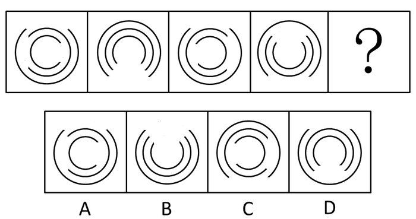

A. A

B. B

C. C

D. D

第 76 题 · 答案与解析

**参考答案（粉笔题库参考内容）**

A

**解析**

本题考点为图形推理中的位置规律—旋转，观察图中图形，发现内环每次顺时针旋转90°，中间环每次逆时针旋转90°，外环每次顺时针旋转180°。按照此规律，旋转以后应该内环开口朝右，中间环开口朝左，外环开口朝上，只有A项符合。

故正确答案为A。

**考点**：位置规律-旋转

**来源**：2014年广州市公务员录用考试《行测》题第76题

### 第 77 题

从所给四个选项中，选择最合适的一个填入问号处，使之呈现一定的规律性：

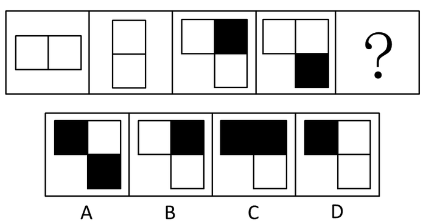

A. A

B. B

C. C

D. D

第 77 题 · 答案与解析

**参考答案（粉笔题库参考内容）**

D

**解析**

本题考点是元素叠加类的黑白叠加。由题干可以看出同色叠加为黑，异色叠加为白，1、2图叠加得第3图，2、3图叠加得第4图，3、4图叠加得D选项图形。

故正确答案为D。

**考点**：样式规律-黑白运算

**来源**：2014年广州市公务员录用考试《行测》题第77题

### 第 78 题

请从所给的四个选项中，选择最合适的一项填在问号处，使之呈现一定的规律性：

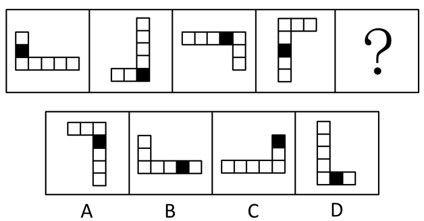

A. A

B. B

C. C

D. D

第 78 题 · 答案与解析

**参考答案（粉笔题库参考内容）**

B

**解析**

本题考点为图形推理中的位置类－旋转和平移。观察题中所含图形，发现整体每个图形每次逆时针旋转90°，黑格每次移动一格，只有B项符合。

故正确答案为B。

**考点**：位置规律-综合

**来源**：2014年广州市公务员录用考试《行测》题第78题

### 第 79 题

请从所给的四个选项中，选择最合适的一项填在问号处，使之呈现一定的规律性：

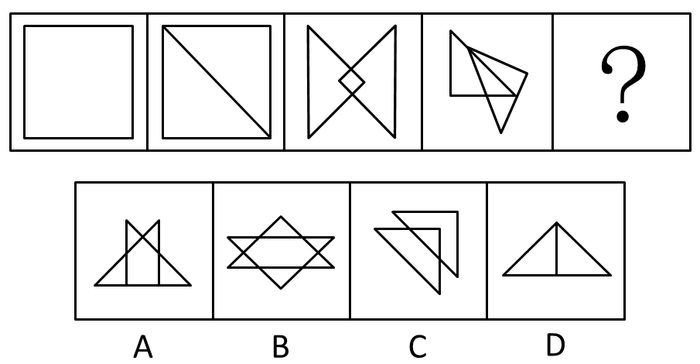

A. A

B. B

C. C

D. D

第 79 题 · 答案与解析

**参考答案（粉笔题库参考内容）**

A

**解析**

本题考点为图形推理中的数数——数面，观察发现图形中面的个数分别为1、2、3、4，问号处应选5个面的。

故正确答案为A。

**考点**：数量规律-面

**来源**：2014年广州市公务员录用考试《行测》题第79题

### 第 80 题

从所给四个选项中，选择最合适的一个填入问号处，使之呈现一定的规律性：

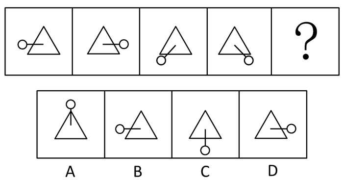

A. A

B. B

C. C

D. D

第 80 题 · 答案与解析

**参考答案（粉笔题库参考内容）**

C

**解析**

元素组成相同，考查位置规律。

观察图中图形，三角形保持不动，直线和圆以直线在三角形内部的端点为轴旋转。第一个图形逆时针/顺时针旋转180度得到第二个图形，第二个图形顺时针旋转135度得到第三个图形，第三个图形逆时针旋转90度得到第四个图形，将第一个图形的旋转方向确定为逆时针，那旋转方向分别为逆、顺、逆、？，所以？处图形的旋转方向应为顺时针；旋转角度分别为180度、135度、90度、？，所以？处图形的旋转角度应为45度。因此？处图形应由第四个图形顺时针旋转45度所得，只有C选项符合。

故正确答案为C。

**考点**：位置规律-旋转

**来源**：2014年广州市公务员录用考试《行测》题第80题

### 第 81 题

从所给四个选项中，选择最合适的一个填入问号处，使之呈现一定的规律性：

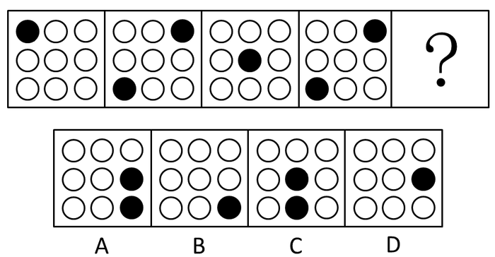

A. A

B. B

C. C

D. D

第 81 题 · 答案与解析

**参考答案（粉笔题库参考内容）**

B

**解析**

通过题干可以发现本题考点为图形推理中的位置－平移，由题干可以发现黑点较明显，而且数量变化为1、2、1、2，而且单数时点在对角线上移动。

故正确答案为B。

**考点**：数量规律-复合

**来源**：2014年广州市公务员录用考试《行测》题第81题

### 第 82 题

从所给四个选项中，选择最合适的一个填入问号处，使之呈现一定的规律性：

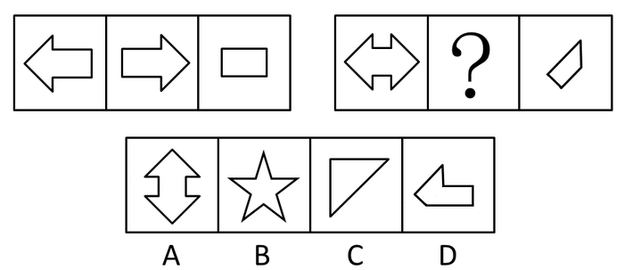

A. A

B. B

C. C

D. D

第 82 题 · 答案与解析

**参考答案（粉笔题库参考内容）**

D

**解析**

题干组成相似，考虑样式规律。观察第一组图可知，前两个图形相重合，第三个图是其中完全重合的部分的外框，如下图：

因此，根据这个规律分别将ABCD四个选项与第一个图相重合，得到D选项的图形可以得到第三个图（第一个图中间的两横宽度宽于D选项，因此这两横是不能重合上的），如下图：

如果把这个红线标注的图形外框补全的话，正好得到第三个图。

故正确答案为D。

**考点**：样式规律-加减同异

**来源**：2014年广州市公务员录用考试《行测》题第82题

### 第 83 题

从所给四个选项中，选择最合适的一个填入问号处，使之呈现一定的规律性：

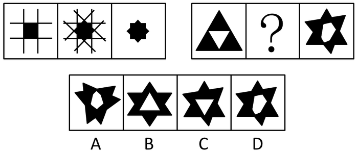

A. A

B. B

C. C

D. D

第 83 题 · 答案与解析

**参考答案（粉笔题库参考内容）**

D

**解析**

第一组图规律为：第一幅图旋转45度后，与原来图形叠加得到第二幅图，然后留下阴影部分得到第三幅图。同样第二组图中第一幅图也要先旋转45度后与原图叠加得到第二幅图，排除A、B项，旋转45度后，内部白色三角形也要旋转，排除C项。

故正确答案为D。

**考点**：样式规律-加减同异

**来源**：2014年广州市公务员录用考试《行测》题第83题

### 第 84 题

从所给四个选项中，选择最合适的一个填入问号处，使之呈现一定的规律性：

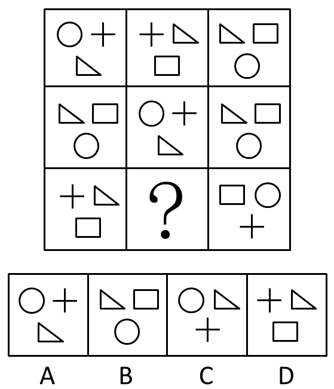

A. A

B. B

C. C

D. D

第 84 题 · 答案与解析

**参考答案（粉笔题库参考内容）**

B

**解析**

解法一：元素组成相似，有相同的小图形重复出现，优先考虑遍历。九宫格优先横行看，如图所示，第一行中，前一幅图中下面的小图形，逆时针移动到后一幅图右上角的位置；第二行中，前一幅图中下面的小图形，顺时针移动到后一幅图左上角的位置；第三行应用此规律，只有B项可以满足同样的遍历规律，使前一幅图中下面的小图形，逆时针移动到后一幅图右上角的位置。

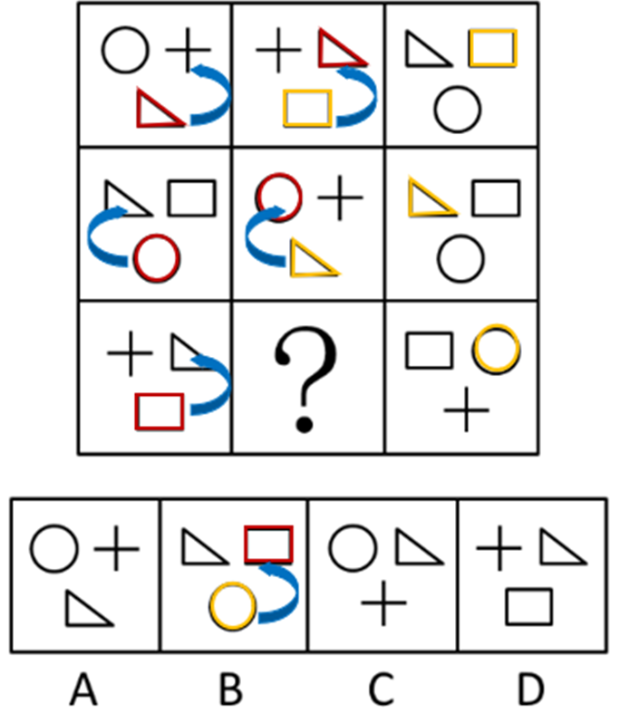

解法二：观察九宫格发现，第一列中，交点个数分别为4、7、8，交点数之和为19；第三列中，交点个数分别为7、7、5，交点数之和为19；第二列应用此规律，交点个数分别为8、4、？，故问号处应选择交点个数为7的图形，只有B项符合。

解法三：观察九宫格发现，第一列中，线数量分别为6、8、9，线数之和为23；第三列中，线数量分别为8、8、7，线数之和为23；第二列应用此规律，线数量分别为9、6、？，故问号处应选择线数量为8的图形，只有B项符合。

故正确答案为B。

**考点**：样式规律-遍历

**来源**：2014年广州市公务员录用考试《行测》题第84题

### 第 85 题

请从所给的四个选项中，选择唯一的一个答案，使之呈现一定的规律性：

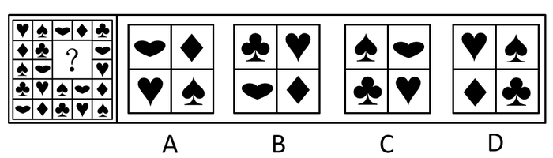

A. A

B. B

C. C

D. D

第 85 题 · 答案与解析

**参考答案（粉笔题库参考内容）**

D

**解析**

此题需要一列一列地看，观察到每一列中各种花色排列顺序一定，交替出现。

故正确答案为D。

**考点**：样式规律-遍历

**来源**：2014年广州市公务员录用考试《行测》题第85题

## 材料 1

某社区通过随机发放问卷的方式对社区居民的业余生活进行了调查，问卷回收率为96.7%，在所有回收的问卷中，18岁及以下居民40人，19—36岁居民440人，37—59岁居民380人，60岁及以上居民107人，调查结果如下表所示：

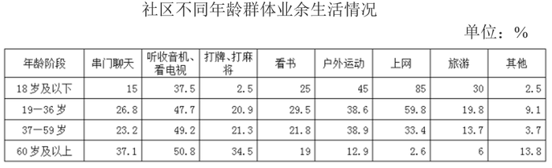

### 第 86 题

本次调查一共发放了多少份问卷：

A. 500

B. 800

C. 1000

D. 1200

第 86 题 · 答案与解析

**参考答案（粉笔题库参考内容）**

C

**解析**

根据材料可知共收回问卷：40+440+380+107=967，问卷回收率为96.7%，所以共发放问卷份。

故正确答案为C。

**考点**：现期比重、综合资料

**来源**：2014年广州市公务员录用考试《行测》题第86题

### 第 87 题

本次调查中，年龄阶段越大，选取比例越高的选项共有多少个：

A. 1

B. 2

C. 3

D. 4

第 87 题 · 答案与解析

**参考答案（粉笔题库参考内容）**

B

**解析**

查找材料图表可知，只有听收音机、看电视（各年龄段比例依次为37.5、47.7、49.2、50.8）和打牌、打麻将（各年龄段比例依次为2.5、20.9、21.3、34.5）这两个业余生活中各年龄阶段的比例依次升高。

故正确答案为B。

**考点**：直接找数、综合资料

**来源**：2014年广州市公务员录用考试《行测》题第87题

### 第 88 题

19—36周岁年龄段选取比例最高的业余生活选项，被该年龄段共约多少人选取：

A. 260

B. 230

C. 210

D. 180

第 88 题 · 答案与解析

**参考答案（粉笔题库参考内容）**

A

**解析**

查找材料表格可知，19~36周岁年龄段最高的业余生活选项是上网，为59.8%，人数为，观察选项可知与A项最接近。

故正确答案为A。

**考点**：现期比重、综合资料

**来源**：2014年广州市公务员录用考试《行测》题第88题

### 第 89 题

所有受调查者中，最多人选择的业余生活选项是：

A. 户外运动

B. 上网

C. 看书

D. 听收音机、看电视

第 89 题 · 答案与解析

**参考答案（粉笔题库参考内容）**

D

**解析**

此题用各个年龄段的居民数，分别乘以他们各项业余活动的比例。

方法一：

根据答案选项分别计算：

A项：户外运动：人

B项：上网：人

C项：看书：人

D项：听收音机、看电视：人

方法二：

按照方法一的计算过程太过繁琐，由材料可知，19~36周岁和37~59周岁的人数多。人数多，其比例越大者，相乘的结果越大，通过粗略估算即可得到听收音机、看电视的人数最多。

故正确答案为D。

**考点**：综合资料、简单加减计算

**来源**：2014年广州市公务员录用考试《行测》题第89题

### 第 90 题

关于本次调查，以下说法正确的是：

A. 该社区全部居民中，所占比例最高的是19—36周岁居民

B. 看书在各年龄段中的选取比例比旅游更相近

C. 上网的选取比例在各年龄阶段中均排在前三位

D. 户外运动的选取比例随着年龄阶段的上升而下降

第 90 题 · 答案与解析

**参考答案（粉笔题库参考内容）**

B

**解析**

A项，材料中是随机发放的问卷，并非社区的全部居民，错误；

B项，根据材料中的表格内容，看书的比例平均在20%左右，而旅游的变化幅度较大，看书的比例比旅游更为接近，正确；

C项，60岁及以上的上网比例未排在前三，错误；

D项，户外运动的比例随着年龄阶段的上升先下降再上升再下降，错误。

故正确答案为B。

**考点**：综合分析、综合资料

**来源**：2014年广州市公务员录用考试《行测》题第90题

## 材料 2

（二）根据以下材料，回答91-95题。

根据第六次全国人口普查数据，农村16岁及以上劳动年龄人口数为5.12亿，其中，农业劳动力数为2.94亿。

农村16岁及以上劳动年龄人口中，16-20岁年龄组人口比重为9.1%，21-30岁为17.4%，31-40岁为18.4%，41-50岁为20.4%，50岁以上为34.7%。

农村农业劳动力中，16-20岁年龄人口比重为3.4%，21-30岁为16.7%，31-40岁为19.2%，41-50岁为26.3%，50岁以上为34.4%。

### 第 91 题

农村16岁及以上劳动年龄人口中，41岁及以上年龄组的人口数约为（ ）亿。

A. 1.04

B. 1.78

C. 2.39

D. 2.82

第 91 题 · 答案与解析

**参考答案（粉笔题库参考内容）**

D

**解析**

农村16岁及以上劳动年龄人口数为5.12亿，41-50岁占20.4%，50岁以上占34.7%，则41岁及以上年龄组的人口约为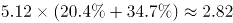亿。

故正确答案为D。

**考点**：文字资料、现期比重

**来源**：2014年广州市公务员录用考试《行测》题第91题

### 第 92 题

农村16岁及以上劳动年龄人口中，不属于农业劳动力的人口数为（ ）亿。

A. 1.46

B. 2.18

C. 2.94

D. 5.12

第 92 题 · 答案与解析

**参考答案（粉笔题库参考内容）**

B

**解析**

农村16岁及以上劳动年龄人口数为5.12亿，农业劳动力数为2.94亿，则不属于农业劳动力的人口数为5.12-2.94=2.18亿。

故正确答案为B。

**考点**：文字资料、简单加减计算

**来源**：2014年广州市公务员录用考试《行测》题第92题

### 第 93 题

农村16岁及以上劳动年龄人口中，不属于农业劳动力的人口数以（ ）年龄组为最多。

A. 50岁以上

B. 41-50岁

C. 31-40岁

D. 16-20岁

第 93 题 · 答案与解析

**参考答案（粉笔题库参考内容）**

A

**解析**

A选项，农村50岁以上非农业劳动力人数为：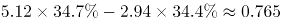亿，当选；

B选项，41-50岁非农业劳动力人数为：亿，排除；

C选项，31-40岁非农业劳动力人数为：亿，排除；

D选项，16-20岁非农业劳动力人数为：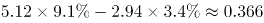亿，排除。

故正确答案为A。

**考点**：文字资料、现期比重

**来源**：2014年广州市公务员录用考试《行测》题第93题

### 第 94 题

农村16岁及以上劳动年龄人口中，21-30岁的农业劳动力约：

A. 占9.6%

B. 占16.7%

C. 6000万人

D. 8900万人

第 94 题 · 答案与解析

**参考答案（粉笔题库参考内容）**

A

**解析**

由问题所求“······21-30岁的农业劳动力约”，以及选项中出现“占9.6%”等表述，可判定此题为现期比重问题。定位文字材料可得，“农业劳动力数为2.94亿，其中21-30岁为16.7%；农村16岁及以上劳动年龄人口数为5.12亿”。则21-30岁的农业劳动力人数约为万人。排除C、D两项。

21-30岁的农业劳动力占比约为。与A项最接近。

故正确答案为A。

**考点**：文字资料、现期比重

**来源**：2014年广州市公务员录用考试《行测》题第94题

### 第 95 题

农村16岁及以上劳动年龄人口中，下列说法正确的是：

A. 农村人口老龄化越来越严重

B. 进城务工农民以40岁及以下人口为主

C. 16-50岁人口中，分组年龄越大从事农业的人口比重越大

D. 农业劳动力的老龄化程度远远大于农村非农就业者及外出农民工

第 95 题 · 答案与解析

**参考答案（粉笔题库参考内容）**

C

**解析**

A项，材料中没有给出老龄化的相关数据，无法判断，排除；

B项，进城务工农民数据没有给出，无法判断，排除；

C项，16-20岁年龄组人口从事农业的人口比重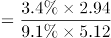、21-30岁年龄组人口从事农业的人口比重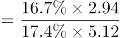、31-40岁年龄组人口从事农业的人口比重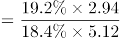、41-50岁年龄组人口从事农业的人口比重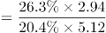。每个比重右边部分相同，因此只需要比较左边部分。16-20岁年龄组人口从事农业的人口比重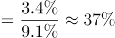、21-30岁年龄组人口从事农业的人口比重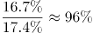、31-40岁年龄组人口从事农业的人口比重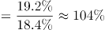、41-50岁年龄组人口从事农业的人口比重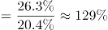。可以看出比重越来越大，正确，当选；

D项，农业劳动力与非农就业者及外出农民工的老龄化的数据没有给出，无法判断，排除。

故正确答案为C。

**考点**：文字资料、综合分析

**来源**：2014年广州市公务员录用考试《行测》题第95题

## 材料 3

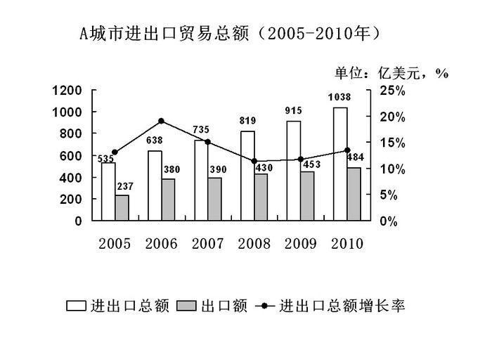

### 第 96 题

2005年-2010年，A城市的进出口有多少年呈现贸易顺差：

A. 3

B. 4

C. 5

D. 6

第 96 题 · 答案与解析

**参考答案（粉笔题库参考内容）**

A

**解析**

通过材料图表中的数据，先求出进口额，再与出口额比较计算：

2005年，进出口总额为535亿美元，出口额为237亿美元，则进口额为298亿美元，出口小于进口，贸易逆差；

2006年，进出口总额为638亿美元，出口额为380亿美元，则进口额为258亿美元，出口大于进口，贸易顺差；

2007年，进出口总额为735亿美元，出口额为390亿美元，则进口额为345亿美元，出口大于进口，贸易顺差；

2008年，进出口总额为819亿美元，出口额为430亿美元，则进口额为389亿美元，出口大于进口，贸易顺差；

2009年，进出口总额为915亿美元，出口额为453亿美元，则进口额为462亿美元，出口小于进口，贸易逆差；

2010年，进出口总额为1038亿美元，出口额为484亿美元，则进口额为554亿美元，出口小于进口，贸易逆差。

故有3年呈现贸易顺差。

故正确答案为A。

**考点**：统计图、简单加减计算

**来源**：2014年广州市公务员录用考试《行测》题第96题

### 第 97 题

A城市的2010年进口额比2005年增长了多少亿美元：

A. 247

B. 256

C. 298

D. 503

第 97 题 · 答案与解析

**参考答案（粉笔题库参考内容）**

B

**解析**

根据材料图中的数据可直接列出式子：（1038-484）-（535-237）=554-298=256，尾数为6。

故正确答案为B。

**考点**：统计图、简单加减计算

**来源**：2014年广州市公务员录用考试《行测》题第97题

### 第 98 题

2010年，A城市的进口额增长率与出口额增长率相差：

A. 7%

B. 9%

C. 11%

D. 13%

第 98 题 · 答案与解析

**参考答案（粉笔题库参考内容）**

D

**解析**

2010年，A城市的出口额增长率为：，进口额增长率为：，进口额增长率与出口额增长率相差为20%-6.7%=13.3%。与D项最接近。

故正确答案为D。

**考点**：一般增长率、统计图

**来源**：2014年广州市公务员录用考试《行测》题第98题

### 第 99 题

2005—2010年，A城市的进出口总额增长率最高值与最低值相差约：

A. 4%

B. 6%

C. 8%

D. 10%

第 99 题 · 答案与解析

**参考答案（粉笔题库参考内容）**

C

**解析**

根据材料图计算：进出口总额增长率最高的年份是2006年，最低的年份为2008年，最高为：，最低为：，相差约8%。

故正确答案为C。

**考点**：一般增长率、统计图

**来源**：2014年广州市公务员录用考试《行测》题第99题

### 第 100 题

根据材料，以下说法错误的有几个：

①2007年开始，A城市的进出口总额开始有所回落

②2005年到2010年间，A城市的进口额不断增长

③2005年到2010年间，A城市出口额的增长幅度不断增大

④2009年开始，A城市的进出口总额增长幅度开始有所回升

A. 1

B. 2

C. 3

D. 4

第 100 题 · 答案与解析

**参考答案（粉笔题库参考内容）**

C

**解析**

①，进出口总额一直上升，错误；

②，2005年进口额：535-237=298；2006年进口额：638-380=258，并非是不断增长，错误；

③，2005年的增长幅度无法计算，错误；

④，从表中折线图可以看出，从2009年开始，A城市的进出口总额增长幅度开始有所回升，正确。

综上所述，①②③错误，④正确。

故正确答案为C。

**考点**：综合分析、统计图

**来源**：2014年广州市公务员录用考试《行测》题第100题

