# 2015年广州市公务员录用考试《行测》题

> 候选采集稿。参考答案及解析来自粉笔页面，不代表官方答案或真实高分答卷；来源使用许可与原卷对应关系仍需人工核实。

## 题型与作答说明

常识判断

（15题）

根据题目要求，在四个选项中选出一个最恰当的答案。

言语理解与表达

（25题）

本部分包括表达与理解两方面的内容。请根据题目要求，在四个选项中选出一个最恰当的答案。

数量关系

（15题）

在这部分试题中，包含数字推理和数学运算两个部分，要求你迅速、准确地计算出答案。

判断推理

（30题）

本部分包括图形推理、类比推理、逻辑判断与图形推理四种类型的试题，在四个选项中选出一个最恰当的答案。

资料分析

（15题）

所给出的图、表、文字或综合性资料均有若干个问题要你回答。你应根据资料提供的信息进行分析、比较、计算和判断处理。

## 给定材料

### 材料 dom-material-2686b0b03bd14d37

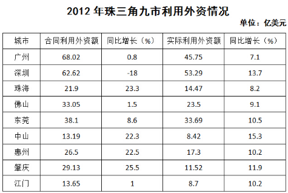

### 材料 dom-material-dbf2afd30ca41530

根据海关统计，2014年，我国共出口铁路设备267.7亿元，比上年（下同）增长22.6%。统计显示，2014年我国铁路设备出口呈现5个特点：

一是出口呈现快速增长态势。2014年，我国铁路设备出口整体呈现快速增长态势，其中，有9个月同比增速保持在20%以上。12月当月出口铁路设备28.1亿元，同比增长42.3%，环比增长22%。

二是主要出口东盟、阿根廷、澳大利亚和美国。2014年，我国对东盟出口铁路设备38.4亿元，增长1.2倍；对阿根廷出口34.5亿元，增长45.9%；对澳大利亚出口33.5亿元，减少40%；对美国出口31.7亿元，增长47.2%；对上述四者出口合计占同期我国铁路设备出口总值的（下同）51.6%。此外，在其他前10大市场中，对巴西、南非和埃塞俄比亚出口倍增。

三是主要出口品种为铁道及电车道机车、车辆。2014年，我国出口铁道及电车道机车、车辆154.5亿元，增长13.3%，占57.7%，其中，出口铁道及电车道机动客、货、敞车77.7亿元，增长47%。同期，出口铁道及电车道机车、车辆零件66.8亿元，增长34.2%，占24.9%；出口钢轨25.8亿元，增长61.8%；出口轨道固定装置和机械交通管理等设备及零附件8.3亿元，增长13.3%。

四是加工贸易方式出口占比过半，一般贸易方式出口大幅增长。2014年，加工贸易方式出口铁路设备146.2亿元，增长12.9%，占54.6%；以一般贸易方式出口111.3亿元，增长35.8%，占41.6%。此外，以对外承包工程出口货物方式出口8.1亿元，增长30.4%。

五是以国有企业出口为主，外商投资企业出口大幅增长。2014年，我国国有企业出口铁路设备187.5亿元，增长18.2%，占70.1%；外商投资企业出口41亿元，增长46.6%，占15.3%；民营企业出口39.2亿元，增长23.3%，占14.6%。

### 材料 dom-material-6342b36ed448a72b

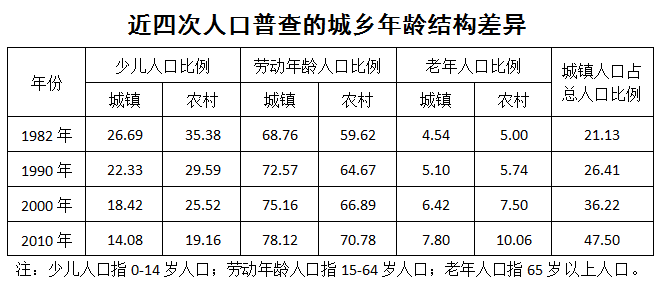

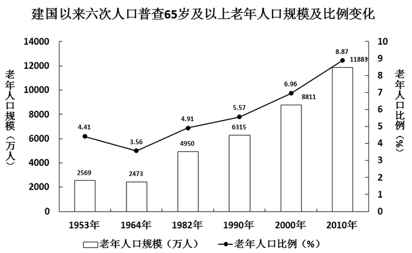

## 题目

### 第 1 题

1516年，英国空想社会主义者莫尔出版了《乌托邦》一书，描绘了一个叫做“乌托邦”的岛国，在那里，人人平等，人人参加劳动。在中国魏晋南北朝时期，也有一部文学作品描写了类似情境，这部作品是（ ）。

A. 《桃花源记》

B. 《礼记》

C. 《大同书》

D. 《世说新语》

### 第 2 题

早在400年前，西班牙等国商人就将中国的丝绸以及茶树、柑橘等农作物运往拉丁美洲，又将一些农作物从拉丁美洲引入中国，形成了一条横跨太平洋的“海上丝绸之路”。请问以下哪些农作物不是从拉丁美洲引入中国的？

A. 玉米

B. 红薯

C. 花生

D. 水稻

### 第 3 题

王某在公园与李某发生言语冲突，用小刀刺伤李某，强行抢走李某身上财物后逃跑。此时，李某紧追不舍，追出500米后用砖头将王某砸成轻伤，并夺回了自己的财物。李某的行为应当属于（ ）。

A. 故意伤害

B. 正当防卫

C. 防卫过当

D. 紧急避险

### 第 4 题

2014年12月，钟某将名下的一处房屋出售给梁某，双方签订了买卖合同并约定于2015年6月付清全部房款后办理过户手续。2015年1月，该处房屋价格上涨，钟某后悔过早出售该房屋，又将该房屋出售给张某并约定在2015年5月办理过户手续。2015年4月，钟某将房屋重复出售的行为暴露，此时该房屋属于（ ）。

A. 钟某所有

B. 梁某所有

C. 张某所有

D. 梁某与张某共同所有

### 第 5 题

2015年五一国际劳动节是星期五，甲工厂因生产需要安排5月1日至3日加班，那么该工厂下列向员工支付加班费的计算方式中，正确的是（ ）。

A. 1号至3号的加班费按工资的150%计算

B. 1号至3号的加班费按工资的200%计算

C. 1号的加班费按工资的200%计算，2号至3号的加班费按工资的150%计算

D. 1号的加班费按工资的300%计算，2号至3号的加班费按工资的200%计算

### 第 6 题

我国古代创造了灿烂的青铜文明，司母戊鼎和四羊方尊是青铜器的代表。以下关于青铜的说法，不正确的是（ ）。

A. 青铜属于纯净物

B. 青铜属于金属材料

C. 青铜的硬度比铜大

D. 青铜耐腐蚀，易铸造成形

### 第 7 题

在日常生活当中，我们要关照老年人的行走和坐车安全，特别要防止老年人跌倒，这是因为老年人的骨骼（ ）。

A. 有机物增多，硬度小，易骨折

B. 有机物增多，硬度小，易变形

C. 无机物增多，弹性小，易骨折

D. 无机物增多，弹性大，易变形

### 第 8 题

党的十八大后，党的群众路线教育实践活动的总要求是“照镜子、正衣冠、洗洗澡、治治病”，其中“洗洗澡”蕴含着的深刻内涵与下列哪一项选项相似？

A. 《礼记·中庸》：莫见乎隐，莫显乎微，故君子慎其独也

B. 《庄子·逍遥游》：水之积也不厚，则其负大舟也无力

C. 《周易·益卦》：凡益之道，与时偕行

D. 《礼记·大学》：苟日新，日日新，又日新

### 第 9 题

在中国传统文化里，儒释道三家的学说都产生了重要影响，以下哪项主张不是道家提出的？

A. 上善若水

B. 缘起性空

C. 无为而治

D. 道法自然

### 第 10 题

今年是世界反法西斯战争胜利70周年。在第二次世界大战中召开了四次重要国际会议，其中（ ）决定成立联合国，确定了战后出现的两极格局。

A. 开罗会议

B. 雅尔塔会议

C. 德黑兰会议

D. 波茨坦会议

### 第 11 题

魏某因曾被赵某当众羞辱，一直对赵某怀恨在心，时时想着报复赵某，一天，魏某在外喝酒后驾车回家，不料在路上撞死一行人，下车查看后发现此人正是赵某。那么，魏某的行为应当属于（ ）。

A. 故意杀人

B. 过失致人死亡

C. 交通肇事

D. 报复陷害

### 第 12 题

歌手甲和乙一起参加某歌唱比赛，为在比赛中获胜，甲在网上公开宣称乙生活作风有问题，且在比赛场下不尊重其他参赛歌手。该言论一出就引起了媒体热议，乙因此受到了众多网民的辱骂，退出了歌唱比赛，也失去了许多广告代言机会，经济受到巨额损失。那么，甲的行为侵害了乙的（ ）。

A. 财产权

B. 名誉权

C. 荣誉权

D. 隐私权

### 第 13 题

习近平同志重要讲话（文章）中引用了很多经典名句，以下引用的诗句，按其被创作的时间先后顺序，排序正确的是（ ）。

①苟利国家生死以，岂因祸福避趋之。

②橘生淮南则为橘，生于淮北则为枳。

③不识庐山真面目，只缘身在此山中。

④安得广厦千万间，大庇天下寒士俱欢颜。

A. ④③①②

B. ④②③①

C. ②④③①

D. ②④①③

### 第 14 题

飞机起飞时，乘客容易出现耳朵不舒服甚至些许疼痛的感觉，为缓解这一症状，乘务人员往往让乘客咀嚼口香糖，这可以起到的作用是（ ）。

A. 保证外界声波传之内耳

B. 防止听觉感受器受损

C. 保证听小骨的正常振动

D. 保持鼓膜内外气压平衡

### 第 15 题

科举是我国古代通过考试选拔官吏的一种制度。假如古代某位考生在参加某级科举考试中获得“解元”，即该级考试第一名，那么，他之后通常应参加的更高一级考试是（ ）。

A. 乡试

B. 殿试

C. 会试

D. 童试

### 第 16 题

我国经济进入由高速增长转向中高速增长的速度换挡期，是经济发展进入新常态的一个重要特征，但不能把新常态理解为经济增速一路下行。事实上，经济新常态将为经济发展        新空间、        新活力。

依次填入下列横线处的词语，最恰当的一组是：

A. 拓展，增添

B. 增长，提速

C. 增加，提高

D. 发展，添加

### 第 17 题

在中国，约有百分之七十的人为了工作将孩子交给父母帮带，但付给父母帮带费还是个比较生疏的概念。有专家认为，从法律上讲，父母确无给子女带孩子的义务。        并无义务，        有收取一定报酬的权利。反对者则认为，        亲情账都一笔笔算清，变现为金钱，        父母与子女之间就会沦为最肤浅、最可怕的市场关系。

依次填入下列横线处的词语，最恰当的一组是：

A. 虽然，但是，因为，所以

B. 虽然，但是，如果，那么

C. 既然，就，因为，所以

D. 既然，就，如果，那么

### 第 18 题

海盗们对权力有种天生的警惕。为了避免船长握有太大的权力，海盗们选举产生了“舵手”，他负责分发战利品、仲裁船员冲突等等，正因为舵手这一职位的\_\_\_\_\_，使得船长无法开展所有得不到舵手同意的活动。

填入下列横线处的词语，最恰当的一组是（ ）。

A. 制衡

B. 制止

C. 遏制

D. 抑制

### 第 19 题

习近平总书记说：“把改革方案的含金量充分展示出来，让人民群众有更多获得感。”再高远的改革，也必须回到地上，切切实实考虑群众的获得感，否则就有可能失去群众支持而\_\_\_\_\_\_，\_\_\_\_\_\_，\_\_\_\_\_\_。

依次填入下列横线处的词语，最恰当的一组是（ ）。

A. 错失时机，贻误大业，寸步难行

B. 寸步难行，错失时机，贻误大业

C. 贻误大业，错失时机，寸步难行

D. 错失时机，寸步难行，贻误大业

### 第 20 题

民族文化是一个民族区别于其他民族的独特\_\_\_\_\_\_。

填入画横线处的词语最恰当的一项是（ ）。

A. 身份

B. 象征

C. 标识

D. 标志

### 第 21 题

脱离国情和实际的立法，即使搞出来，也只是\_\_\_\_\_\_、纸上谈兵，解决不了我国发展面临的实际问题。

填入画横线部分最恰当的一项是（ ）。

A. 镜中水月

B. 空中楼阁

C. 雾里看花

D. 空话连篇

### 第 22 题

法律作为上层建筑，其产生和发展都要受到经济基础的决定和社会发展的\_\_\_\_\_\_，因此依法治国也不可能\_\_\_\_\_\_、\_\_\_\_\_\_地推进，必然要受到经济、政治、社会、文化、科技等各方面因素的影响。

依次填入画横线处的词语，最恰当的一组是（ ）。

A. 牵绊，孤独，静态

B. 约束，独立，静止

C. 限制，单独，片面

D. 制约，孤立，静止

### 第 23 题

“宝剑锋从磨砺出，梅花香自苦寒来。”人类的美好理想，都不可能\_\_\_\_\_\_，都离不开\_\_\_\_\_\_、\_\_\_\_\_\_的艰苦奋斗。

依次填入下列横线处的词语，最恰当的一组是（ ）。

A. 一蹴而就，百废待兴，不屈不挠

B. 唾手可得，筚路蓝缕，手胼足胝

C. 易如反掌，一穷二白，卓尔不凡

D. 一步登天，峰回路转，坚忍不拔

### 第 24 题

政府信息公开\_\_\_\_\_\_要在“量”上扩展，更要在“质”上发力。\_\_\_\_\_\_逐年在进步，\_\_\_\_\_\_许多政府信息的完整性、详尽性仍显不足。

依次填入下列横线处的词语，最恰当的一组是（ ）。

A. 因为，尽管，但是

B. 不仅，哪怕，并且

C. 不仅，尽管，但是

D. 因为，哪怕，并且

### 第 25 题

建成小康社会、\_\_\_\_\_\_改革精神、\_\_\_\_\_\_法治观念、\_\_\_\_\_\_从严治党，这一战略布局，统一于民族复兴的伟大梦想，统一于中国特色社会主义伟大事业。

依次填入下列横线处的词语，最恰当的一组是（ ）。

A. 焕发，增强，落实

B. 继承，弘扬，保持

C. 创造，坚守，加强

D. 强化，保持，加快

### 第 26 题

观察日本和欧洲部分国家的情况，经济持续低迷的直接后果是年轻人就业困难、失业率高、收入减少等。年轻一代经济难以独立，还衍生出另一个后果：父母增加对子女的支持。这些国家的共同经验说明，一旦年轻人缺乏经济独立，父母对子女生活的介入便会加深。在中国已经出现了类似的趋势。

根据这段文字，可以推出作者支持的观点不可能是（ ）。

A. 父母一向都喜欢插手孩子的事情，跟经济好坏没关系

B. 父母的介入会延伸至年轻人择偶和择业取向

C. 父母对生活的介入不仅体现在资金支持上，还包括影响子女决策

D. 经济发展缓慢，出现家庭力量逆向增长，产生新的社会问题

### 第 27 题

“中国民间可能隐藏着7000个梅西”，有外媒如此形容足改方案激发的人才潜能。但仅以发掘球星、培养职业球员为标尺，反倒背离了校园足球的真谛。让足球真正扎根，取决于孩子们的“获得感”，快乐足球比精英足球更有生命力。

关于这段文字，以下理解正确的是（ ）。

A. 剥离足球功利性，潜移默化植入兴趣，校园足球才有发展后劲

B. 校园足球可以打破部门壁垒，理顺管理体制，为“体教结合”注入动力

C. 让足球进校园，可以迅速撬动学校体育改革，夯实足球人才根基

D. 校园足球的成败决定着中国足球的未来

### 第 28 题

一深一浅的两种阅读路径，并没有随着传播技术的提升、书籍载体的变迁而并轨。甚至，浅阅读更胜一筹了，阅读碎片化就是重要的表现形式之一。诚然，零珠散玉也有价值，但阅读求知若一味追求省事，大脑沟回会变浅的。其实，用什么阅读不是核心，真正的读书人是不在乎书的形式的，不管是印在纸上，还是映射在手机屏幕上，只要它还是《论语》。电子化不一定让阅读变浅，关键是所读文本浅不浅。

关于这段文字，以下理解正确的是（ ）。

A. 电子化阅读比纸质阅读更便捷、更有效

B. 浅阅读比深阅读更胜一筹，更有利于提高人们的思考能力

C. 用什么载体读书并不是阅读的关键，最重要的是所读文本是否深刻

D. 看爱情小说与看人文经典，收获是一样的

### 第 29 题

发轫于泥土间的许多传统戏曲门类都离不开田土间的那方舞台，和舞台下与这个剧种同宗同源的乡里乡亲。黄土高原上的信天游，离不开那片高天厚土；烟雨朦胧中的黄梅戏，离不开白墙黑瓦的徽派风情；川剧就该根植于川蜀的青山绿水；花鼓戏也离不开三湘四水一地一乡音······那是孕育这一剧种的山水，台下是最懂得这一剧种的戏迷，他们或许很少有机会走进“高大上”的剧场，但他们是最懂这门戏曲艺术的行家。

关于这段文字，以下理解正确的是（ ）。

A. 与戏曲研究专家相比，乡里乡亲才是最懂传统戏曲艺术的行家

B. 川剧一旦离开川蜀的青山绿水，就无法生存和发展

C. 传统戏曲门类只有在田土间的那方舞台上演出，才有最广泛的受众

D. 很多传统戏曲门类都与当地的风土人情紧密相连，反映了地域文化的特色

### 第 30 题

“互联网＋”，是一种科学地驾驭技术、利用技术基础上的提速、提质、提效。作为先进技术、先进工具的互联网，用于建设和发展是积极正面的，用于攻击和毁损是消极负面的。既要积极有效地使用互联网这一先进工具，推动经济社会发展，又要建立良好秩序，采取安全保护措施，防范由于破坏性运用所带来的被动和伤害。

关于这段文字，以下理解正确的是（ ）。

A. 互联网有利于推动经济社会发展，是利大于弊的

B. 互联网是一把双刃剑，“互联网＋”就是对互联网辩证地趋利避害

C. “互联网＋”的出现就是为了消除互联网的消极负面作用

D. 互联网使得不少青年人沉溺其中，耽误了学业，是弊大于利的

### 第 31 题

一些贪官落马后，或痛斥权力让其堕落，或后悔当初入错行选错道、不该当官，或以官场“险恶”告诫子女“千万不要从政”。从政真的是“高危职业”吗？分明是为民服务尽责的公职岗位，怎么就成了误己误人的“陷阱”，甚至是杀人于无形的“凶器”？一朝腐败被捉便把所有的过错归罪于“权力”本身，暴露的是抵不住诱惑、守不住清廉、容易自我腐化蜕变的本性。

关于这段文字，以下理解正确的是（ ）。

A. 从政者应当以坚守清廉作为立身之本

B. “绝对的权力导致绝对的腐败”，人一旦有了权力，必然走向腐败

C. 从政是一种高危职业，容易让官员走向腐化堕落

D. 与医生、教师等职业相比，从政者责任更大，风险更大

### 第 32 题

“坏人”该不该有律师？在法治原则尚未确立的社会，可能会是一场无休止的争论，但现代法治环境中，作为最基本的底线共识，却不应有撕裂。任何社会成员，在未经法院判决之前，都不得认定为有罪，这是无罪推定原则的核心内容，由此出发设计并运转的法治秩序，对任何一个公民的罪与非罪，认定需要有非常严苛的法律程序。在此之前，律师为公民提供法律帮助、为其合法权益进行辩护，都不该被非议，更不能暴力相向。

关于这段文字，以下理解准确的是（ ）。

A. 律师不该为“坏人”辩护

B. 只有律师能保障无罪推定原则的平等实施

C. 无罪推定原则适用任何犯罪嫌疑人

D. 公民的罪与非罪，由律师辩护而定

### 第 33 题

当中国还处在古典的地方主义文化中时，一方面家乡观念牢固地限制了人口迁徙，另一方面人口迁徙又是自由的。人口的迁徙未必一定会令被迁徙地获得发展，但是，考察人类历史，可以认为：凡是发展了的地区，一定是人口迁徙进入的结果。有西亚人口的迁入，才有了古希腊的辉煌。有欧洲大陆人口的迁入，才有了英伦三岛的崛起。有了潮水般的闯关东，才有了清朝晚期以后东北地区的富饶。地区的繁荣，离不开迁徙而来的人口的创造与建设。

关于这段文字，以下理解准确的是（ ）。

A. 地区间的流动、迁徙人口就是“外来人口”

B. 在中国的古代，人口迁徙是受到限制的

C. 对于迁徙而来的人口，不应该歧视和排斥

D. 没有人口迁入，就不会有地区的发展

### 第 34 题

环保部约谈地市一把手官员，开启了环境治理新模式。但公开约谈不是一种长久的环境治理模式。就目前来看，公开约谈都是针对一些具体的环境问题。特定的环境治理固然重要，但环境治理不仅是个特定环境问题的解决，而是关系到整个环境系统，关系到环保部与地方环境治理的目标和策略，关系到政府环境治理与公众权益的关系。公开约谈后，表面的环境问题可能很快解决，但地方建设深层次的问题不解决，环境问题的触发因素始终存在。

关于这段文字，以下理解准确的是（ ）。

A. 公开约谈能从根本上治理环境污染问题

B. 环境治理的关键还是靠地市一把手官员

C. 环保部的环境治理目标与地市的环保目标不一致

D. 环保约谈不能只限于解决特定的环境问题

### 第 35 题

哈丁在《公地的悲剧》一书中提出的一个概念：一群牧民一同在一块公共草场放牧。一个牧民想多养一只羊增加个人收益，虽然他明知草场上羊的数量已经太多了，多养后将使草场的质量下降，但他不增加别人也会增加，所以，他肯定会选择多养羊获取收益，因为草场退化的代价由大家负担。如果每一位牧民都如此思考时，草场退化，所有牧民都会遭到损失，“公地悲剧”就上演了。解决公地悲剧的办法就是给草场找一个主人，主人自然会采取措施保护草场。

关于这段文字，以下理解准确的是（ ）。

A. 所有的牧民都是自私的，只考虑个人利益

B. 要避免“公地悲剧”，就要设置和落实岗位管理责任

C. 解决“公地悲剧”的办法，就是实现草地的私有化

D. 大家共同负担草地退化的代价，体现了社会的公平正义

### 第 36 题

将下列句子组成一段逻辑严谨、语言流畅的文字，排列顺序最合理的是（ ）。

①有人认为，考生在教育发达地区求学，参加高考，再以这一成绩回原籍所在地录取，这也是不公平的

②全国统一试卷对于外来工子弟众多的广东省来说，无疑有积极作用

③因此要解决公平问题，最终还取决于录取制度是否改革

④但外来工子弟在广东参加全国统考，回原籍录取同样也遭到当地人的反对

A. ②③①④

B. ①②④③

C. ②④①③

D. ③②④①

### 第 37 题

将下列句子组成一段逻辑严谨、语言流畅的文字，排列顺序最合理的是（ ）。

①但我们必须在鼓励创业的同时，也树立起高度的风险意识

②如果说减税等鼓励创业的政策能够燃起大众创业热情的话，那么降低创业风险，及时为创业失败“止损”则能促使更多人真正迈出创业的第一步

③创业需要不断试错，只有当失败不是创业者不能承受之重时，他们才不会对失败产生畏惧，最终找到成功的道路

④创业既是推动国家经济向前发展的重要动力，也是实现个人梦想的最佳途径

A. ①②④③

B. ②④③①

C. ③②④①

D. ④①②③

### 第 38 题

将下列句子组成一段逻辑严谨、语言流畅的文字，排列顺序最合理的是（ ）。

①五千年来中国人做的最为一致的梦就是强国梦

②有一首歌里就唱到：五千年的风和雨，藏了多少梦

③中华民族是一个有梦想且为梦想而不断开拓的民族

④在这个强国梦的激励下，中国历史上先后兴替的朝代都创造过时距不一的盛世，让中国人长期沉浸在泱泱大国的自豪梦境之中

A. ①②④③

B. ③②①④

C. ②③①④

D. ④①②③

### 第 39 题

将下列句子组成一段逻辑严谨、语言流畅的文字，排列顺序最合理的是（ ）。

①亚投行的成立，受益最大的是这些能够从亚投行获得建设资金的发展中国家和地区

②对于亚洲发展中国家来说，每年区域内国家都有巨大的基础设施投资需求，也同样存在巨大的基础设施投资资金缺口

③但与此同时，发达国家也会从中受益，因为基础设施项目建好了，能够进一步带动经济发展，推动国际贸易，发达国家也会从国际贸易扩张中获益

④亚投行的发起，不管对发展中国家还是对发达国家来说，都是一个共赢的选择

A. ①②④③

B. ③②①④

C. ②③④①

D. ④②①③

### 第 40 题

将下列句子组成一段逻辑严谨、语言流畅的文字，排列顺序最合理的是（ ）。

①富强、民主、文明、和谐作为国家层面的价值目标，体现国家在经济、政治、文化、社会、生态文明建设方面的总体诉求

②社会主义核心价值观，高度概括和充分体现了当代中国发展要求、中华优秀文化命脉和人类文明成果

③爱国、敬业、诚信、友善作为公民个人层面的价值准则，是社会主义公民必须恪守的基本道德规范，构成了中国人的道德形象

④自由、平等、公正、法治作为社会层面的价值取向，是中国社会谋求全面进步的基本原则和方向

A. ③②④①

B. ②③①④

C. ②①④③

D. ④②③①

### 第 41 题

324，333，360，441，（ ）

A. 346

B. 462

C. 559

D. 684

### 第 42 题

、、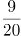、（ ）

A. 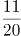

B. 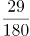

C. 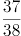

D. 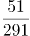

### 第 43 题

0，0，6，24，60，120，（ ）

A. 180

B. 196

C. 210

D. 216

### 第 44 题

9.6，48，12，36，18，（ ）

A. 4.5

B. 9

C. 18

D. 24

### 第 45 题

3，4，7，11，18，（ ）

A. 21

B. 25

C. 29

D. 35

### 第 46 题

某单位花费98元采购了一批型号分别为大、中、小的文件袋，它们的单价分别为4元、3元、2元。已知大号文件袋的数量是中号文件袋的一半，中号文件袋与大号文件袋加起来的数量比小号文件袋少一个。则该单位采购的大、中、小号文件袋共（ ）个。

A. 33

B. 37

C. 39

D. 42

### 第 47 题

某运动品牌商城举行节日促销，顾客购物满368元即可获赠一张面值为100元的代金券，该代金券可在下一次消费时，用于购买单件价格在129元以上的商品。小张想在该商城购买4件商品，价格分别为299元、199元、119元、69元，则他至少需要支付（ ）元。

A. 386

B. 486

C. 586

D. 686

### 第 48 题

在一幅比例尺为1:200的地图上标注有一个长方形的鱼塘，该鱼塘的长与宽之比为3:2，在地图上量得的周长为30厘米。则该鱼塘的实际面积是（ ）平方米。

A. 216

B. 432

C. 864

D. 900

### 第 49 题

某种福利彩票有二处刮奖区，刮开刮奖区会显示数字1、2、3、4、5、6、7、8、9、0中的一个，当二处刮奖区所显示数字之和等于8时才为中奖，则这种福利彩票的中奖概率为（ ）

A. 1/10

B. 9/100

C. 2/25

D. 11/100

### 第 50 题

学校运动会4×400米比赛，甲班最后一名选手起跑时，乙班最后一名选手已经跑出20米。已知甲班选手跑8步的路程乙班选手只需要跑5步，但乙班选手跑2步的时间甲班选手能跑4步，则当甲班选手跑到终点时，乙班选手距离终点（ ）米。

A. 30

B. 40

C. 50

D. 60

### 第 51 题

股民甲和乙分别持有同一家公司的股票。如果乙将自己的10000股转给甲，则此时甲持有该股票的份额是乙的3倍；如果甲将自己的1000股转给乙，则此时乙持有该股票的份额比甲多6倍。那么，甲乙二人共持有（ ）股该公司股票。

A. 6400

B. 17600

C. 18000

D. 28800

### 第 52 题

甲、乙、丙三人参加满分为100分的英语口语考试。结果是：甲的成绩比乙、丙二人的平均分多7.5分，乙的成绩比甲、丙二人的平均分少6分。已知丙的成绩为80分，则这次考试三人的平均分是（ ）分。

A. 75

B. 78

C. 81

D. 84

### 第 53 题

某农户在鱼塘里放养了一批桂花鱼苗。过了一段时间，为了得知鱼苗存活数量，他先从鱼塘中捕出200条鱼，做上标记之后，再放回鱼塘，过几天后，再从鱼塘捕出500条鱼，其中有标记的鱼苗有25条。假设存活的鱼苗在这几天没有死，则这个鱼塘里存活鱼苗的数量最有可能是（ ）条。

A. 1600

B. 2500

C. 3400

D. 4000

### 第 54 题

下图为某大厦走火通道逃离路线。某大厦集中所有的人员开展火灾逃生演习，从入口A点出发，要沿某几条线段才到出口F点。逃离中，同一个点或同一线段只能经过1次。假设所有逃离路线都是安全的，则不同的逃离路线最多有（ ）种。

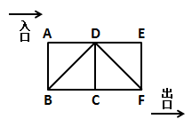

A. 8

B. 9

C. 10

D. 11

### 第 55 题

下图为某公园花展的规划图。其中，正方形面积的3/4是玫瑰花展区，圆形面积的6/7是郁金香花展区，且郁金香花展区比玫瑰花展区多占地450平方米。那么，水池占地（ ）平方米。

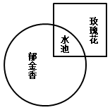

A. 100

B. 150

C. 225

D. 300

### 第 56 题

尺子：距离与（ ）在内在逻辑关系上最为相似。

A. 钟表：时间

B. 钢铁：硬度

C. 子弹：速度

D. 天平：砝码

### 第 57 题

高大：矮小 与（ ）在内在逻辑关系上最为相似。

A. 黑色：白色

B. 男人：女人

C. 明亮：昏暗

D. 失去：得到

### 第 58 题

杯：碗 与（ ）在内在逻辑关系上最为相似。

A. 锯：刀

B. 灯：光

C. 木：椅

D. 火：炉

### 第 59 题

教师：学生（ ）

A. 裁判：运动员

B. 律师：法官

C. 医生：护士

D. 厨师：饲养员

### 第 60 题

雨水：干旱（ ）

A. 阳光：潮湿

B. 雾霾：寒冷

C. 飓风：灾害

D. 冰雹：农田

### 第 61 题

玻璃：透明（ ）

A. 花卉：颜色

B. 钻石：坚硬

C. 天空：阴沉

D. 绿叶：生机

### 第 62 题

牙刷：牙膏（ ）

A. 车厢：司机

B. 斧头：树木

C. 钢笔：纸张

D. 火焰：温度

### 第 63 题

河流：水（ ）

A. 沙漠：泥

B. 森林：树木

C. 草原：动物

D. 山脉：冰雪

### 第 64 题

质量：重力（ ）

A. 年龄：幼稚

B. 电源：电阻

C. 海拔：气压

D. 压力：摩擦

### 第 65 题

榜样：楷模（ ）

A. 诋毁：诽谤

B. 论证：论据

C. 决策：决定

D. 即刻：时刻

### 第 66 题

在一项关于商业广告的研究中，研究人员将被试人员分为两组，均为他们提供相同的零食。其中一组被试人员先观看10分钟的热门喜剧短片，然后再观看5分钟关于食品的商业广告；另外一组被试人员则充当参照小组，他们一直观看15分钟的热门喜剧短片。研究发现，观看食品商业广告的被试人员消耗的零食量显著高于另外一组被试人员。研究认为，食品商业广告能有效提升人们对零食的消耗。

下面哪项如果为真，最能削弱以上研究的推论？

A. 当被试人员观看与食品无关的广告时，零食消耗量与观看食品广告时无显著差别

B. 当研究人员将播放的热门喜剧短片改为悲剧短片时，观看食品广告的小组被试人员的零食消耗量仍然高于参照小组

C. 食品广告的播放时间越长，该小组的零食消耗量就越大

D. 当研究人员将播放的热门喜剧短片改为悲剧短片时，两个小组的零食消耗量都下降了

### 第 67 题

最近上映了一部很受欢迎的电影，小刘购买了4张座位连在一起的电影票，邀请小马、小杨、小廖一同去观看。四人各自随机拿了一张电影票，此时他们分别猜了一下座位情况：

小刘说：“我好像是坐在小马旁边。”

小马说：“我的左手边不是小刘就是小杨。”

小杨说：“我肯定是坐在小廖旁边。”

小廖说：“小刘应该是坐在我的左手边。”

假如他们四人都猜错了，那么他们面向银幕从左到右的正确座位可能是：

A. 小廖、小马、小杨、小刘

B. 小刘、小杨、小廖、小马

C. 小马、小廖、小杨、小刘

D. 小杨、小刘、小廖、小马

### 第 68 题

2013年公布的结果显示，全球已探明的天然气储量总计220亿立方米。天然气对全球能源的贡献占四分之一，以现在的消耗速率估算，仅能提供65年的能源供给。因此，为避免遭遇无天然气可用的困境，必须开发更多的替代性能源。

以下哪项如果为真，最能够反驳上述结论?

A. 近年来，天然气对全球能源的贡献率正逐步下降

B. 随着探测技术的发展，全球已探明的天然气储量大大高于以往

C. 由于新技术的应用，能源的使用效率比以往已经有了一定提高

D. 鉴于现代机械的设计习惯，天然气的能源地位无可替代

### 第 69 题

E市开展一项公共政策的民意调查，随机抽取了一千名市民回答有关问题。一个月后，再次随机抽取了一千名市民回答相同问题，但问题的顺序设置与上次不同。结果发现，两次市民样本对许多问题得出了不同的回答。这证明同一组问题，因为其问题顺序的改变，有时就会得出不一样的回答。

上述论证依赖于下面哪一个假设？

A. 有些市民两次都被随机抽中而参加了两次调查

B. 调查的问题内容并不会因为时间推移而影响回答

C. 第二次调查把第一次匿名调查方式改为实名调查

D. 第二次调查并没有把所有问题的顺序全部打乱

### 第 70 题

在某公司年终晚会上，主持人在3个小箱中各放了一个奖品，让小李、小郭、小杨、小黎四人猜一下各个箱子中放了几等奖的奖品。

小李说：“1号箱是三等奖，2号箱是特等奖，3号箱是一等奖。”

小郭说：“1号箱是二等奖，2号箱是特等奖，3号箱是四等奖。”

小杨说：“1号箱是安慰奖，2号箱是三等奖，3号箱是五等奖。”

小黎说：“1号箱是二等奖，2号箱是四等奖，3号箱是安慰奖。”

如果有一个人恰好猜对了两个，其余三人都只猜对了一个。那么第二个箱子中放的是（ ）。

A. 特等奖

B. 二等奖

C. 五等奖

D. 安慰奖

### 第 71 题

一个企业只有一直在吸纳人才和培养人才，才能建立起战略性的人才梯队。而战略性的人才梯队，是一个企业不断扩展其规模所必须的。

以下哪种情况如果存在，最能削弱以上断定？

A. 甲企业不断扩展其规模，但没有一直在吸纳人才

B. 乙企业一直在培养人才，并建立起战略性的人才梯队

C. 丙企业建立起战略性的人才梯队，但并没有不断扩展其规模

D. 丁企业没有不断扩展其规模，但一直在吸纳人才和培养人才

### 第 72 题

有商业调查表明，A城市的滑雪运动器材销售量高于B城市，可见A城市的居民比B城市的居民更喜欢滑雪运动。

下面如果哪项为真，最能削弱以上调查的推论？

A. B城市的人口多于A城市

B. A城市的滑雪运动器材均在B城市进行生产

C. 多届国家级滑雪运动比赛的冠军均来自A城市

D. 近年来A城市大力发展旅游业，许多旅游人员在A城市学习滑雪运动

### 第 73 题

与普通消费品以产品成本为基础的定价方式相异，奢侈品品牌通常会根据不同的市场期望值制定出欧洲、美国、亚洲3个不同的零售价格区域。在以法国、意大利为主要原产地的欧洲，奢侈品的定价往往最低。而欧洲品牌到了美国市场，通常也只会把价格稍微提高一些，因为那里的消费者对奢侈品的消费心理已经成熟。而在亚洲市场，奢侈品品牌的定价是最高的。

以下哪项最能解释奢侈品品牌在亚洲市场定价最高这一现象？

A. 亚洲远离奢侈品品牌原产地，物流成本高

B. 亚洲地区的人工及店铺租金等经营成本相对较高

C. 亚洲市场的消费者对奢侈品品牌怀有过高的期望值

D. 亚洲市场拥有比欧洲、美国市场更为庞大的奢侈品消费群体

### 第 74 题

在对一种健脑产品的测试实验中，第一组被试者每天服用该种保健产品，第二组则没有服用。结果发现，第一组被试者的大脑认知能力果然比第二组被试者好。因此，实验证明这种保健产品确实对大脑具有明显的保健效果。

以下哪项如果为真，最能支持上述结论？

A. 在测试实验前两组被试者的大脑认知能力是相当的

B. 该健脑产品所含的成分在一些日常食物中也存在

C. 两组被试者的人数相等，且家庭经济能力类似

D. 该健脑产品已经获得许可生产和销售，并取得很好的市场份额

### 第 75 题

某企业家说：“初创的互联网公司只有建立用户思维，才能发展壮大为一家成功的互联网公司。”

如果该企业家所述为真，则以下不可能出现的情况是？

A. 某家初创互联网公司有用户思维，没有成为成功的互联网公司

B. 某家初创互联网公司没有用户思维，成为一家成功的互联网公司

C. 某家初创互联网公司没有用户思维，没有成为成功的互联网公司

D. 某家初创互联网公司有用户思维，成为一家成功的互联网公司

### 第 76 题

从所给四个选项中，选择最合适的一个填入问号处，使之呈现一定的规律性：

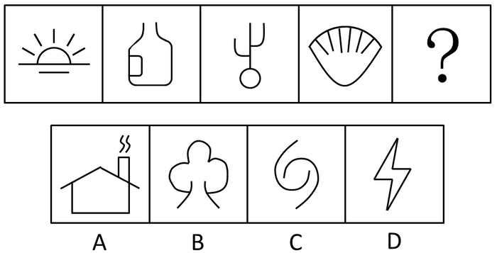

A. A

B. B

C. C

D. D

### 第 77 题

从所给四个选项中，选择最合适的一个填入问号处，使之呈现一定的规律性：

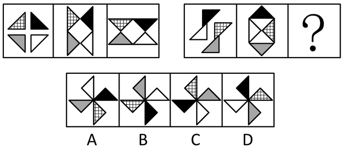

A. A

B. B

C. C

D. D

### 第 78 题

从所给四个选项中，选择最合适的一个填入问号处，使之呈现一定的规律性：

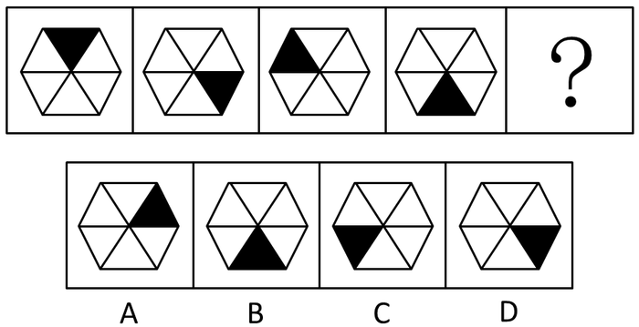

A. A

B. B

C. C

D. D

### 第 79 题

从所给四个选项中，选择最合适的一个填入问号处，使之呈现一定的规律性：

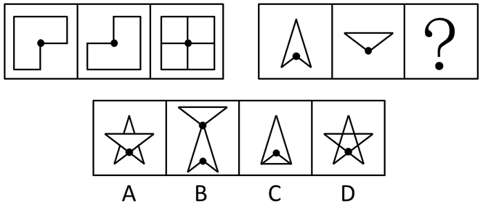

A. A

B. B

C. C

D. D

### 第 80 题

从所给四个选项中，选择最合适的一个填入问号处，使之呈现一定的规律性：

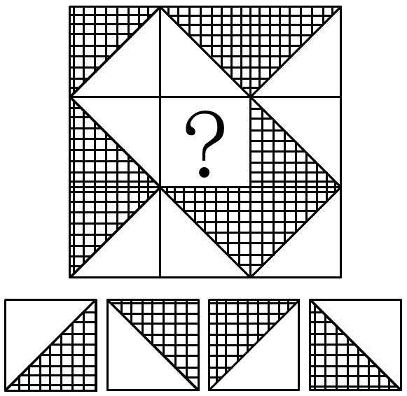

A. A

B. B

C. C

D. D

### 第 81 题

从所给四个选项中，选择最合适的一个填入问号处，使之呈现一定的规律性：

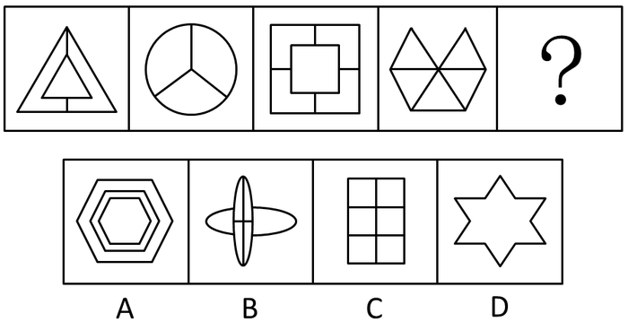

A. A

B. B

C. C

D. D

### 第 82 题

从所给四个选项中，选择最合适的一个填入问号处，使之呈现一定的规律性：

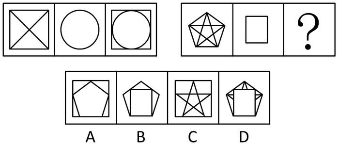

A. A

B. B

C. C

D. D

### 第 83 题

从所给四个选项中，选择最合适的一个填入问号处，使之呈现一定的规律性：

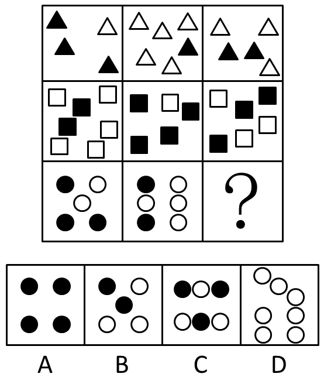

A. A

B. B

C. C

D. D

### 第 84 题

从所给四个选项中，选择最合适的一个填入问号处，使之呈现一定的规律性：

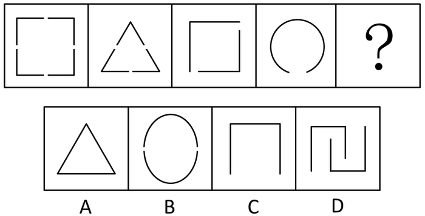

A. A

B. B

C. C

D. D

### 第 85 题

从所给四个选项中，选择最合适的一个填入问号处，使之呈现一定的规律性：

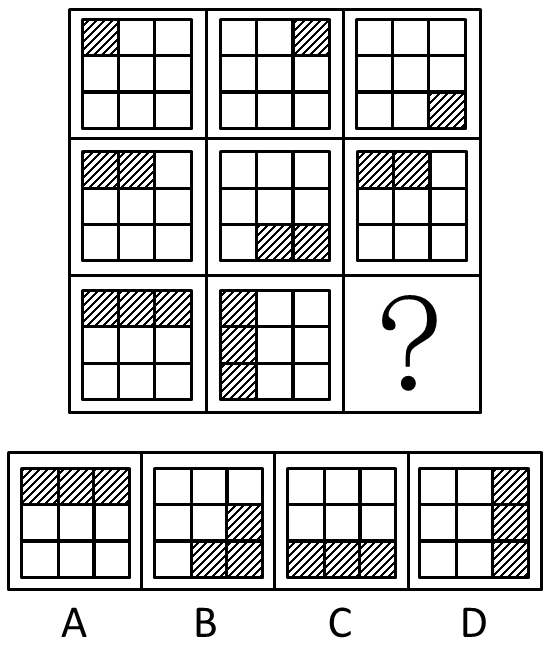

A. A

B. B

C. C

D. D

### 第 86 题

2011年，广州实际利用外资额约( )亿美元。

关联材料：dom-material-2686b0b03bd14d37

A. 37.01

B. 39.95

C. 42.72

D. 44.69

### 第 87 题

2012年，珠三角九市合同利用外资额最高的城市约是最低城市的( )倍。

关联材料：dom-material-2686b0b03bd14d37

A. 3.1

B. 4.9

C. 5.2

D. 6.3

### 第 88 题

2012年，珠三角九市中实际利用外资额占合同利用外资额比例最高的城市是（ ）。

关联材料：dom-material-2686b0b03bd14d37

A. 广州

B. 深圳

C. 佛山

D. 东莞

### 第 89 题

2012年，珠三角九市中合同利用外资额和实际利用外资额增长速度均高于10%的城市有（ ）个。

关联材料：dom-material-2686b0b03bd14d37

A. 2

B. 3

C. 4

D. 5

### 第 90 题

根据材料，以下说法错误的是（ ）。

关联材料：dom-material-2686b0b03bd14d37

A. 2012年珠三角九市合同利用外资总额不超过300亿美元

B. 2012年珠三角九市中仅有1市合同利用外资额出现下降

C. 2012年珠三角九市实际利用外资总额同比增长速度超过10%

D. 相比实际利用外资额，2012年珠三角九市合同利用外资额增长速度差异较大

### 第 91 题

2014年12月我国铁路设备出口值约占全年的（ ）。

关联材料：dom-material-dbf2afd30ca41530

A. 7.4%

B. 8.6%

C. 9%

D. 10.5%

### 第 92 题

下列关于2014年我国铁路设备各出口品种增长率的对比关系中，正确的是（ ）。

关联材料：dom-material-dbf2afd30ca41530

A. 铁道及电车道机动客、货、敞车<铁道及电车道机车、车辆零件

B. 轨道固定装置和机械交通管理等设备及零附件>钢轨

C. 铁道及电车道机车、车辆零件<轨道固定装置和机械交通管理等设备及零附件

D. 铁道及电车道机动客、货、敞车<钢轨

### 第 93 题

2013年，我国铁路设备对东盟、阿根廷、澳大利亚和美国四者中出口值最高的是（ ）。

关联材料：dom-material-dbf2afd30ca41530

A. 东盟

B. 阿根廷

C. 澳大利亚

D. 美国

### 第 94 题

2013年，我国铁路设备出口方式中，以加工贸易方式出口比以一般贸易方式出口（ ）。

关联材料：dom-material-dbf2afd30ca41530

A. 约多35亿元

B. 约多47.5亿元

C. 约少35亿元

D. 约少47.5亿元

### 第 95 题

根据材料，以下说法错误的是（ ）。

关联材料：dom-material-dbf2afd30ca41530

A. 2013年，我国铁路设备出口中，民营企业所占比例高于外商投资企业

B. 2014年12月我国铁路设备出口值高于2014年11月

C. 2013年，我国铁路设备出口值超过200亿元

D. 2014年，我国铁路设备出口方式中，一般贸易方式出口增长率最低

### 第 96 题

1964年我国总人口数比1953年多（ ）。

关联材料：dom-material-6342b36ed448a72b

A. 14.8%

B. 19.2%

C. 10065万人

D. 14089万人

### 第 97 题

1990年，我国城镇人口约为（ ）万人。

关联材料：dom-material-6342b36ed448a72b

A. 21302

B. 25498

C. 29942

D. 36795

### 第 98 题

从近四次人口普查的城乡年龄结构看，比例逐次下降的年龄段人口是（ ）。

关联材料：dom-material-6342b36ed448a72b

A. 少儿人口

B. 劳动年龄人口

C. 老年人口

D. 无从得知

### 第 99 题

老年抚养比是指老年人口数量与劳动年龄人口数量的比值，2010年，我国农村的老年抚养比约为（ ）

关联材料：dom-material-6342b36ed448a72b

A. 10.0%

B. 12.5%

C. 14.2%

D. 17.3%

### 第 100 题

根据材料，关于近四次人口普查的以下说法，不正确的有（ ）。

①城乡的少儿人口规模均出现逐次下降

②2000年，农村老年人口已经突破6000万人

③劳动年龄人口比例的城乡差距逐次缩小

④城镇的老年抚养比值逐次增长

关联材料：dom-material-6342b36ed448a72b

A. ②

B. ①②

C. ③④

D. ①③

## 答案与解析

第 1 题

**参考答案（粉笔题库参考内容）**

A

**解析**

A项：《桃花源记》是东晋伟大文人陶渊明的代表作之一，是《桃花源诗》的序言，选自《陶渊明集》。借武陵渔人行踪这一线索，把现实和理想境界联系起来，通过对世外桃源的安宁和乐、自由平等生活的描绘，表现了作者追求美好生活的理想和对当时的现实生活不满。

B项：《礼记》亦称《小戴礼记》或《小戴记》，儒家经典之一，乃秦汉以前各种礼仪论著之选集，相当于《仪礼》的“易传”，据说为西汉戴圣所编纂。戴圣，字次君，礼学博士，生平不详，曾任九江太守。

C项：清末政治家、思想家康有为《大同书》主要描述的是自己天下大同的政治理想。

D项：《世说新语》是中国魏晋南北朝时期“志人小说”的代表作，由南朝宋刘义庆召集门下食客共同编撰。

故正确答案为A。

第 2 题

**参考答案（粉笔题库参考内容）**

D

**解析**

水稻原产中国，七千年前中国长江流域就种植水稻。按照不同的方法，水稻可以分为籼稻和粳稻、早稻和中晚稻，糯稻和非糯稻，故不是从拉丁美洲引进。

本题为选非题，故正确答案为D。

第 3 题

**参考答案（粉笔题库参考内容）**

B

**解析**

根据《刑法》第二十条第一款规定：“为了使国家、公共利益、本人或者他人的人身、财产和其他权利免受正在进行的不法侵害，而采取的制止不法侵害的行为，对不法侵害人造成损害的，属于正当防卫，不负刑事责任。”

又因法律规定，在财产犯罪的场合，即使犯罪既遂，只要能够当场挽回财物，就视为不法侵害尚未结束，可以实行防卫。

本题案例属于财产性犯罪，即使王某已经夺走财物并逃跑，只要现场能挽回，李某仍然可以进行防卫。故李某用砖头将王某砸成轻伤拿回财物属于正当防卫，不负刑事责任。B项正确。

A项错误，正当防卫不属于犯罪，不负刑事责任，故不构成故意伤害。

C项错误，防卫过当，是指防卫明显超过必要限度造成重大损害的，而本题中，仅仅造成王某轻伤，不属于防卫过当。

D项错误，紧急避险，是指为了使国家、公共利益、本人或者他人的人身、财产和其他权利免受正在发生的危险，不得已采取的紧急避险行为，造成损害的。紧急避险造成的是无辜第三方的损害，而本题中，李某针对的是不法侵害人王某本人，不属于紧急避险。

故正确答案为B。

第 4 题

**参考答案（粉笔题库参考内容）**

A

**解析**

根据我国《中华人民共和国民法典》第二百零九条第一款规定，“不动产物权的设立、变更、转让和消灭，经依法登记，发生效力；未经登记，不发生效力，但法律另有规定的除外。”题中截至2015年4月，该房产未办理过户登记手续，因此仍旧属于原所有人钟某所有。不管梁某还是张某都没有办理过户手续，所以BCD三项均错误。

故正确答案为A。

第 5 题

**参考答案（粉笔题库参考内容）**

D

**解析**

根据《劳动法》第四十四条有下列情形之一的，用人单位应当按照下列标准支付高于劳动者正常工作时间工资的工资报酬：（一）安排劳动者延长工作时间的，支付不低于工资的百分之一百五十的工资报酬；（二）休息日安排劳动者工作又不能安排补休的，支付不低于工资的百分之二百的工资报酬；（三）法定休假日安排劳动者工作的，支付不低于工资的百分之三百的工资报酬。2015年5月1日是法定节假日，而5月2日与3日是公休日，5月1号的工资按照300%支付，5月2日和5月3日的工资按照200%计算，所以A、B、C三项错误，D项正确。

故正确答案为D。

第 6 题

**参考答案（粉笔题库参考内容）**

A

**解析**

青铜是金属冶铸史上最早的合金，在纯铜（红铜）中加入锡或铅的合金，因此青铜是混合物而非纯净物，所以A项错误，B项正确。青铜具有熔点低、硬度大、可塑性强、耐磨、耐腐蚀、色泽光亮等特点，适用于铸造各种器具、机械零件、轴承、齿轮等，所以C、D两项正确。

本题为选非题，故正确答案为A。

第 7 题

**参考答案（粉笔题库参考内容）**

C

**解析**

幼儿的骨有机物和无机质各占，这样的骨骼柔韧，弹性大，不易发生骨折，但易变形。成年人的骨有机物和无机物的比例为3：7，这样的骨骼既坚韧，又有弹性。老年人的骨无机质占比超过75%，这样的骨骼硬、脆，易发生骨折。综上所述，老年人跌倒后容易发生骨折，这是因为老年人骨骼无机物增多，弹性小，易骨折，C项符合题意，当选。A、B两项有机物比较多的是少年儿童的骨骼，D项易变形的是少年儿童的骨骼。

故正确答案为C。

第 8 题

**参考答案（粉笔题库参考内容）**

D

**解析**

A项“莫见乎隐，莫显乎微，故君子慎其独也”意指即使一个人独处、无人注意的时候，也要谨言慎行，不做失道失德的事，与题意不符，排除；B项“水之积也不厚，则其负大舟也无力”指的是水不够深，那就没有能够担负大船的力量，强调量的积累，与题意不符，排除；C项“凡益之道，与时偕行”强调变通趋时，当着时机，做出正确的判断和选择，与题意不符，排除；D项“苟日新，日日新，又日新”是商汤王刻在洗澡盆上的箴言，意思是“如果能够一天新，就应保持天天新，新了还要更新”，是从动态的角度来强调不断革新，精神上的洗礼，品德上的修炼，思想上的改造都要不断进步，与“洗洗澡”意思相符。

故正确答案为D。

第 9 题

**参考答案（粉笔题库参考内容）**

B

**解析**

道家以“道”为核心，认为天道无为、主张道法自然，提出无为而治、以柔克刚、刚柔并济等政治、军事策略，具有朴素的辩证法思想，是“诸子百家”中一门极为重要的哲学流派，“上善若水”、“无为而治”、“道法自然”都是道家思想，所以A、C、D三项均排除。B选项“缘起性空”是佛教用语。所谓“缘起”，就是说：世间上没有独存性的东西，也没有常住不变的东西，一切都是因缘和合所生起。所谓“性空”，就是说：因缘和合所生起的所有，本性是空的；如果自性不空，则不能有，这就是“真空生妙有”的意义。

本题为选非题，故正确答案为B。

第 10 题

**参考答案（粉笔题库参考内容）**

B

**解析**

A项，开罗会议于1943年11月在埃及开罗召开，是第二次世界大战期间14次高峰会议之一，商讨反攻日本的战略及战后国际局势的安排，制定盟军合作反攻缅甸的战略及援华方案，会后公布开罗宣言，要求日本无条件投降，归还一切侵占的土地，塑造战后东亚的新局势，排除；

B项，雅尔塔会议是1945年2月由美国、英国和苏联三个大国在雅尔塔举行的一次关于制定战后世界新秩序和列强利益分配问题的一次关键性的首脑会议。这次会议决定成立联合国，确定了战后出现的两极格局，当选；

C项，德黑兰会议1943年在伊朗首都德黑兰召开，丘吉尔、斯大林和罗斯福决定在欧洲开辟第二战场，排除；

D项，1945年７月至８月，苏、美、英三国首脑斯大林、杜鲁门和丘吉尔在波茨坦举行会议。会议期间，三国首脑发布了敦促日本无条件投降的《波茨坦公告》，签订了有关处理战后德国原则的《波茨坦协定》，排除。

故正确答案为B。

第 11 题

**参考答案（粉笔题库参考内容）**

C

**解析**

赵某在此次事故中不存在故意杀人的行为，排除A项。最高人民法院《关于审理交通肇事刑事案件具体应用法律若干问题的解释》第八条规定：在实行公共交通管理的范围内发生重大交通事故的，依照交通肇事罪处理。在公共交通管理的范围外，驾驶机动车辆或者使用其他交通工具致人死亡或者致使公共财产或者他人财产遭受重大损失，构成犯罪的，分别依照刑法过失致人死亡罪定罪处罚，此题中并没有提出是在公共交通管理的范围外，所以排除B项；D选项虽然魏某曾经对赵某有怀恨之心，但是并没有付诸实施，此次事故主观上也并没有故意的想法，排除D项。交通肇事罪是指从事交通运输的人员，由于违反交通运输规章制度，发生重大事故，致人重伤、死亡或者使公私财产遭受重大损失的行为。题中魏某酒后驾车，撞死行人，属于交通肇事罪，对应C项。

故正确答案为C。

第 12 题

**参考答案（粉笔题库参考内容）**

B

**解析**

A选项财产权包括物权和债权两大类，题中没有侵犯财产权，排除A选项；题中甲妄自在网上发布对乙不利的言论，侵害了对方的名誉权，B选项正确；C选项荣誉权，是指公民、法人所享有的，因自己的突出贡献或特殊劳动成果而获得的光荣称号或其他荣誉的权利，题中没有侵犯荣誉权，排除C选项；D选项隐私权是指自然人享有的私人生活安宁与私人信息秘密依法受到保护，不被他人非法侵扰、知悉、收集、利用和公开的一种人格权，题中没有涉及到，排除D选项。

故正确答案为B。

第 13 题

**参考答案（粉笔题库参考内容）**

C

**解析**

①出自晚清林则徐《赴戍登程口占示家人》一诗；②相传出自西汉刘向所整理的《晏子春秋》，是记载春秋时期齐国政治家晏婴言行的一部历史典籍；③出自北宋苏轼的《题西林壁》；④出自唐代杜甫的《茅屋为秋风所破歌》。

故正确答案为C。

第 14 题

**参考答案（粉笔题库参考内容）**

D

**解析**

听觉的形成过程：外界的声波经过外耳道传到鼓膜，引起鼓膜的振动；振动通过听小骨传到内耳，刺激耳蜗内的听觉感受器，产生神经冲动；神经冲动通过与听觉有关的神经传递到大脑皮层的听觉中枢，就形成了听觉，内耳耳蜗含有听觉感受器。A选项飞机起飞时声音非常大，不需要保证传至内耳，错误；B选项听觉感受器已经到了内耳，咀嚼口香糖不会产生影响；C选项听小骨能把鼓膜的振动传给内耳，传导过程还像放大器一样，把声音信号放大十倍，所以即使很轻微的声音人们也能听到，是一种正常行为，与题意无关；D选项咀嚼口香糖的目的是使咽鼓管张开，以保持鼓膜内外的气压平衡，防止其损伤。

故正确答案为D。

第 15 题

**参考答案（粉笔题库参考内容）**

C

**解析**

明清科举制度正式科举考试分为童生试、乡试、会试和殿试，乡试为省一级考试，考试合格者为举人，第一名为解元；会试是举人在京城参加的全国统一考试，考试合格者为贡士，第一名为会元；殿试是由皇帝亲自主持的进士考试，分三甲第一甲三人第一名叫状元，第二名叫榜眼，第三名叫探花，赐进士及第。第二甲人数若干第一名称传胪，赐进士出身。第三甲人数最多赐同进士出身。本题考查的是乡试上一级的考试。

故正确答案为C。

第 16 题

**参考答案（粉笔题库参考内容）**

A

**解析**

本题属于实词辨析。第一空，要体现和空间有关的增加，与“空间”搭配的有A项的“拓展”和C项的“增加”，B项的“增长”一般搭配数值，D项的“发展”往往形容事物不断进步变化的过程，B、D两项均不能与空间搭配，排除。

第二空，C项“提高”一般也是与数值搭配，或形容等级的上升，与“活力”搭配不当，排除；将A项“增添”代入原文，符合文意和语境，当选。

故正确答案为A。

【文段出处】《人民要论-我国有阻止经济下行的足够力量》

第 17 题

**参考答案（粉笔题库参考内容）**

D

**解析**

第一空，文段提到“父母确无给子女带孩子的义务”，表达了“既然无义务，收取报酬也是合理的”的意思，因此“无义务”与“收取报酬”之间并无转折关系，排除A、B两项。第二空，文段最后“父母与子女之间就会沦为最肤浅、最可怕的市场关系”只是假设，为了突出反对者不赞成收取报酬的观点，并非是真实情况，因此最后两空需要填入表示假设含义的关联词，对应D项。

故正确答案为D。

【文段出处】《帮带费》

第 18 题

**参考答案（粉笔题库参考内容）**

A

**解析**

由文段中提到的“海盗们对权力有种天生的警惕”“ 为了避免船长握有太大的权力”可知，海盗们选举产生“舵手”的原因就是为了保证权力相对的平衡，避免一家独大的状态出现。A项“制衡”意在制约平衡，充分说明舵手这个职位能够对船长的权力进行约束，对应到后文中“船长无法开展所有得不到舵手同意的活动”，四个选项中只有A项能体现出对权力约束之意。

故正确答案为A。

第 19 题

**参考答案（粉笔题库参考内容）**

B

**解析**

文段侧重强调改革要考虑群众的获得感，如果不这样可能造成一系列严重后果，按照逻辑，失去群众支持，事情将不能良好地向前推进，故寸步难行搭配最为恰当，接着两处横线所填成语应该是程度依次加重的，因此B选项更合适。

故正确答案为B。

【文段来源】《群众获得感要真切实在》

第 20 题

**参考答案（粉笔题库参考内容）**

C

**解析**

民族文化是每个民族所特有的、与其他民族有着明显不同的、各自迥异的本民族固有属性，文段围绕的主题词是民族文化，民族文化显然不能与“身份”相搭配，A项排除；B项“象征”指用具体的东西借指抽象的不可见的某种物（如白色象征纯洁），而文段并未存在这种借指关系，排除；D项“标志”一般修饰搭配较为具体的事物，C项“标识”意为标志识记，较D项的“标志”含义更为丰富，搭配范围更加广泛，与“民族文化”搭配更为恰当，故C项更合适，当选。

故正确答案为C。

第 21 题

**参考答案（粉笔题库参考内容）**

B

**解析**

文段强调脱离国情和实际的立法不能解决发展面临的实际问题，由顿号可知，横线处所填内容应与纸上谈兵内容相近，即空谈理论，不能解决实际问题。B项“空中楼阁”比喻脱离实际的理论、计划及空想，符合文意，当选。

A项“镜中水月”比喻虚无缥缈的东西或者不切实际的幻想，C项“雾里看花”比喻看事情不真切，D项“空话连篇”强调缺乏具体内容，均不符合文意，排除。

故正确答案为B。

【文段出处】《完善以宪法为核心的中国特色社会主义法律体系》

第 22 题

**参考答案（粉笔题库参考内容）**

D

**解析**

第一空，文中表达法律的产生和发展受到社会发展的影响，A项牵绊是指纠缠使不能脱开，不符合法律与社会发展的关系，排除。而D项中的制约正是“限制、约束”之意，语义相较于B、C两项更为丰富，D项为优选项，基本锁定答案为D。将答案代入二、三空验证，由最后一句话“必然要受到经济、政治、社会、文化、科技等各方面因素的影响。”可知，依法治国的推进要考虑方方面面，不是单一的开展，“孤立、静止”符合文意和语境，D项当选。

故正确答案为D。

第 23 题

**参考答案（粉笔题库参考内容）**

B

**解析**

第一空，形容所有的美好理想均是来之不易的，D项“一步登天”比喻人突然得志，爬上高位，不能形容理想，排除。

第二空和第三空，由文段中“宝剑锋从磨砺出，梅花香自苦寒来”可知，这些美好理想的实现都需要付出努力、艰苦奋斗才行，因此横线所填词语要对应到“艰苦奋斗”，A项“百废待兴”形容许多被搁置的事情等着要兴办，C项“卓尔不凡”指才德超出寻常，与众不同，均不能体现出艰苦之意，排除。B项“筚路蓝缕”形容创业艰难，“手胼足胝”形容经常地辛勤劳动，与文意相符，当选。

故正确答案为B。

来源：《习主席“五四”讲话》

第 24 题

**参考答案（粉笔题库参考内容）**

C

**解析**

第一空，由“更要在‘质’上发力”可知，第一句话是一个递进关系，因此排除A、D两项。后面内容意在强调政府信息公开固然有进步但是仍然存在完整性、详尽性不足的问题，所以二、三空应该意含转折，对应到C选项。

故正确答案为C。

【文段出处】《不断增强政府信息公开的实效》

第 25 题

**参考答案（粉笔题库参考内容）**

A

**解析**

第一空，要搭配的词是“精神”，D项“强化”是增强加强的意思，不能形容精神，排除；而改革精神是一直都存在的，不是新生的事物，而C项“创造”指想出或做出前所未有的事情，排除。第二空，区分度不大。第三空，B项“保持”指维持某种状态使不消失或减弱，而从严治党不仅是停留在思想层面不衰弱，还要在行动中去践行，因此B项中的“保持”不如A项中的“落实”能体现出对从严治党理念的践行，排除B项。

故正确答案为A。

来源：《人民日报评论员：引领民族复兴的战略布局》

第 26 题

**参考答案（粉笔题库参考内容）**

A

**解析**

由文中“年轻一代经济难以独立，还衍生出另一个后果：父母增加对子女的支持”可知，经济低迷会造成父母增加对子女的支持，故A选项错误，且选项中“父母一向”未提及。由文中“父母对子女生活的介入便会加深”可推出BC两项。文段讲述的就是经济低迷给年轻人带来了一系列的问题，并且由此衍生出来了父母对子女生活进一步介入的社会问题，D选项正确。

本题是选非题，故正确答案为A。

来源：《经济发展放缓下的家庭逆生长》

第 27 题

**参考答案（粉笔题库参考内容）**

A

**解析**

文段引用外媒观点说明中国有足球人才可挖，接着用“但”引出转折，指出单纯以发掘球星、培养职业球员为标尺背离了校园足球的真谛，提出要让足球扎根才能让足球更有生命力，因此A项当选。B项文段中并未提及到校园足球的好处，“打破部门壁垒，理顺管理体制”无中生有，排除；C项“迅速撬动学校体育改革，夯实足球人才根基”文段中也未提及，排除；D项“校园足球的成败决定着中国足球的未来”并未提及，且“决定”一词过于绝对，排除。

故正确答案为A。

来源：《扎实有为，推动落实足改方案》

第 28 题

**参考答案（粉笔题库参考内容）**

C

**解析**

由最后一句“电子化不一定让阅读变浅，关键是所读文本浅不浅”可知，读书载体不是关键，重要的是所读文本的深浅与否，对应到C选项。A选项中的“电子化阅读更便捷、更有效”并未提及到，排除；B选项中的“浅阅读更胜一筹、利于提高人们的思考能力”并未提及到，排除；D选项将“看爱情小说与看人文经典”进行对比，也并未提到，而且爱情小说和人文经典明显不同，正好是对应作者的一浅一深，因此即使比较收获肯定是不同的，D选项排除。

故正确答案为C。

来源：《让阅读回归为享受》

第 29 题

**参考答案（粉笔题库参考内容）**

D

**解析**

细节判断题，根据文段判断选项正误。

A项，可知文段并没有提及戏曲研究专家，故“与戏曲研究专家相比”为无中生有，排除；B项，文段只是说明许多传统戏曲门类离不开田土间的舞台，并未说明其离开后的后果，故表述过于绝对，排除；C项，文段表明在田土间的舞台上演出的传统戏曲门类，具有最懂这门艺术的行家，“最广泛”无中生有，且两者间并不存在逻辑关系，排除；D项根据文段“传统戏曲门类都离不开田土间的那方舞台”，可知戏曲与当地风土有关，再结合后文所举的黄梅戏川剧等例子，可知确是乡土人情孕育了当地的戏曲，当选。

故正确答案为D。

第 30 题

**参考答案（粉笔题库参考内容）**

B

**解析**

A项，根据“作为先进技术、先进工具的互联网，用于建设和发展是积极正面的，用于攻击和毁损是消极负面的”可知，文段并未对互联网的利弊进行对比，“利大于弊”无中生有，排除；

B项，根据“用于建设和发展是积极正面的，用于攻击和毁损是消极负面的”以及“既要······推动经济社会发展，又要……采取安全保护措施防范伤害”可知，选项表述正确，当选；

C项，文段仅对“互联网+”的概念进行了阐述，但并未介绍其产生的目的，因此“就是为了消除消极负面作用”表述无中生有，排除；

D项，根据“作为先进技术、先进工具的互联网，用于建设和发展是积极正面的，用于攻击和毁损是消极负面的”可知，文段并未对互联网的利弊进行对比，“弊大于利”无中生有，排除。

故正确答案为B。

【文段出处】《“互联网+”：到底能够加什么》

第 31 题

**参考答案（粉笔题库参考内容）**

A

**解析**

细节判断题，根据文段判断选项正误。

根据文段的几句反问可知，作者对于从政是高危职业持有否定态度，腐败的过错不在于权力，而是抵不住诱惑等的本性使然，故可推知A项，从政者应从自身找原因，不要以当官为借口，自觉抵制腐败诱惑，以坚守清廉为立身之本。C、D两项与文段表意相悖，排除。B项，表述过于绝对，排除。

故正确答案为A。

【文段出处】《从政真的是“高危职业”吗》

第 32 题

**参考答案（粉笔题库参考内容）**

C

**解析**

细节判断题，根据文段判断选项正误。

A项，根据文段可知，认定一个公民是否有罪，需要非常严苛的法律程序，而在此之前，律师为任何一个公民提供辩护都是合法的，即使是“坏人”，故A项错误，排除。B项，表述过于绝对，文段并没有对于律师作用的唯一性进行表述，排除。C项，根据“任何社会成员，在未经法院判决之前，都不得认定为有罪，这是无罪推定原则的核心内容”可知正确。D项，可知公民是否有罪，需要由非常严苛的法律程序决定，而不是单由律师辩护决定，排除。

故正确答案为C。

【文段出处】《遏制庭外暴力，激活庭上对抗》

第 33 题

**参考答案（粉笔题库参考内容）**

D

**解析**

细节判断题，根据文段判断选项正误。

A项，文段并没有对外来人口下定义，故无中生有，排除；B项，根据“当中国还处在古典的地方主义文化中时，一方面家乡观念牢固地限制了人口迁徙，另一方面人口迁徙又是自由的”可知，人口迁徙只是在某种程度上受到了观念的限制，而并非实际的限制，故偷换概念，排除；C项，文段并没有表明对迁徙而来的人口，应是何种态度，故无中生有，排除；D项，根据“凡是发展了的地区，一定是人口迁徙进入的结果”可知正确。

故正确答案为D。

【文段出处】《顾则徐：没有“外来人口”就没有繁荣》

第 34 题

**参考答案（粉笔题库参考内容）**

D

**解析**

细节判断题，根据文段判断选项正误。

A项，根据“公开约谈后，表面的环境问题可能很快解决，但地方建设深层次的问题不解决，环境问题的触发因素始终存在”可知，“从根本上治理”错误，排除；B项，可知如果地方建设深层次的问题不解决，环境问题的触发因素始终存在，但文段并没有表明这种深层次的问题需靠地市一把手官员解决，故无中生有，排除；C项，文段并没有表明环保部和地市的具体目标是什么，故“目标不一致”无中生有，排除；D项，可知除了特定的环境问题，还有地方建设深层次的问题需要解决，正确。

故正确答案为D。

【文段出处】《邓线平：公开约谈不是一种长久的环境治理模式》

第 35 题

**参考答案（粉笔题库参考内容）**

C

**解析**

A项，“所有的”表述过于绝对，文段只是假设每一位牧民都如此思考，排除；

B项，可知解决“公地悲剧”的对策在于给草场找一个主人，即实现私有化，“设置和落实岗位管理责任”并不等同于草地归一个人所属，假如政府各个部门都有岗位管理，但是并不代表政府就私有了，故偷换概念，排除；

C项，根据文段“解决公地悲剧的办法就是给草场找一个主人”可知，C项表述正确；

D项，可知文段对于大家共同负担草地退化的代价，持有消极态度，而D项表述偏积极，且“社会的公平正义”无中生有，无法从文段得出，故错误，排除。

故正确答案为C。

【文段出处】《武大樱花收费与公地悲剧》

第 36 题

**参考答案（粉笔题库参考内容）**

C

**解析**

本题共被作答201790次，正确率为76.72%，易错项为B

语句排序题，根据选项判断首句可能为②、①、③。根据①句“这也是不公平”的可知，上文应还有对于不公平事情的表述，故不适合做首句，排除B项。根据“因此”可知，③句为总结类的对策，适合放于文段末尾，故不适合做首句，排除D项。又可知④句存在转折词“但”，转折前后表相反，它后面提到遭到当地人的反对，因此④句之前应当描述积极内容，对比①、②两句，②句提到积极作用，符合转折关系，故C项当选。验证可知，文段先表明广东全国统一试卷对外来工子弟政策的问题，再通过分析给出结论，即取决于录取制度的改革，验证正确。

故正确答案为C。

【文段出处】《恢复“全国一张卷”迈开教育公平第一步》

第 37 题

**参考答案（粉笔题库参考内容）**

D

**解析**

语句排序题，根据选项判断首句可能为①、②、③、④。①句以“但”开头，可知不适合做首句，排除A项。②句、③句、④句均可能作为首句。又①句、②句存在共同信息“风险”，且可知①句为转折后引出了“风险”话题，故①②两句捆绑，且①句在②句前，排除BC项，锁定正确答案为D。验证可知，文段先引出话题“创业”，说明其好处，接着转折后强调，要树立对创业的风险意识并加以解释说明，最后提出对策，即不断试错，找到成功的道路。验证逻辑顺序正确。

故正确答案为D。

【文段出处】《用“社会安全网”为创业梦想兜底》

第 38 题

**参考答案（粉笔题库参考内容）**

B

**解析**

语句排序题，根据选项判断首句可能为①、②、③、④四句。②句“有一首歌里就唱到”，可知前文应该已经引出了这一话题，故不适合做首句，排除C项。④句“在这个强国梦的激励下”可知为指代上文内容的句子，故不适合做首句，排除D项。只有①、④两句存在共同信息“强国梦”，故①、④两句捆绑，排除A项，B项当选。验证可知，文段先说明中华民族是一个有梦想的民族，并以歌加以证明，接着表明中国人最为一致的梦想就是强国梦，最后说明强国梦的意义。验证逻辑顺序正确。

故正确答案为B。

第 39 题

**参考答案（粉笔题库参考内容）**

D

**解析**

语句排序题，根据选项判断首句可能为①、②、③、④四句。③句“但”表转折，故不适合做首句，排除B项。④句提到了发展中国家和发达国家，①、②两句只提到发展中国家，③句提到发达国家，根据逻辑顺序，①、②两句应在③句之前，排除C项。且④句作为总结，应处于①、②、③三句之前或之后，而不是中间，排除A项，D项当选。再验证可知，文段先介绍亚投行发起的好处，并加以解释说明，最后通过转折强调亚投行不仅能使发展中国家受益，对发达国家也存在很多好处，进一步说明亚投行的作用。验证逻辑顺序正确。

故正确答案为D。

【文段出处】《中美英三国专家论亚投行：中国给各国提供了机遇》

第 40 题

**参考答案（粉笔题库参考内容）**

C

**解析**

语句排序题，根据选项判断首句可能为③、②、④三句。②句是对社会主义核心价值观的总体概说，而①、③、④三句均是社会主义核心价值观的具体内容阐述，故②更适合做首句，排除A、D两项。又可知①句为国家层面的表述，③句为公民层面的表述，④句为社会层面的表述，而社会主义核心价值观的层面顺序为国家、社会、公民，故C项符合逻辑。

故正确答案为C。

【文段出处】《社会主义核心价值观》

第 41 题

**参考答案（粉笔题库参考内容）**

D

**解析**

方法一：总体呈现递增趋势，作差可得新数列9，27，81，（ ），是公比为3的等比数列，故未知项为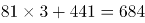。

方法二：数列中每一项均能被9整除，查看选项，只有D项满足规律。

故正确答案为D。

第 42 题

**参考答案（粉笔题库参考内容）**

B

**解析**

分数数列为、、、（ ），可得前一项分子与分母的乘积为后一项的分母，前一项分子与分母的和为后一项的分子，故未知项为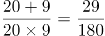。

故正确答案为B。

第 43 题

**参考答案（粉笔题库参考内容）**

C

**解析**

方法一：项数较多，优先考虑分组，无规律。选择作差得到新数列：0，6，18，36，60，（ ），再次作差可得6，12，18，24，（ ），是公差为6的等差数列，则未知项为24+6+60+120=210。

方法二：数列中除“0”以外，其他各项均为合数，考虑因式分解，原数列转化为0×（–1），1×0，2×3，3×8，4×15，5×24，（ ）；其中0，1，2，3，4，5构成等差数列，-1，0，3，8，15，24为二级等差数列，则未知项为6×（24+11）=210。

故正确答案为C。

第 44 题

**参考答案（粉笔题库参考内容）**

C

**解析**

前后项存在明显倍数关系，后项除以前项可得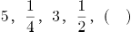，则未知项为18×1=18。

故正确答案为C。

第 45 题

**参考答案（粉笔题库参考内容）**

C

**解析**

呈现递增趋势，发现前两项之和等于第三项，即3+4=7，4+7=11，7+11=18，则未知项为11+18=29。

故正确答案为C。

第 46 题

**参考答案（粉笔题库参考内容）**

B

**解析**

方法一：假设大号文件袋数量为x，中号的为2x，则小号的为x+2x+1，总花费98=4x+3×2x+2(x+2x+1)，解得x=6，文件袋总数为6+2×6+6+2×6+1=37。

方法二：假设总袋数为x，根据题意，中号文件袋与大号文件袋加起来的数量比小号文件袋少一个，则（x-1）是2的倍数。大号文件袋的数量是中号文件袋的一半，即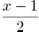是3的倍数，代入发现，只有B项满足。

故正确答案为B。

第 47 题

**参考答案（粉笔题库参考内容）**

C

**解析**

要想支付的钱最少，则尽可能得到代金券并使用代金券，总价为299+199+119+69<2×368，则最多获得1张代金券，且只能用于下次购买199元商品时才能使用，故至少支付686-100=586元。

故正确答案为C。

第 48 题

**参考答案（粉笔题库参考内容）**

A

**解析**

已知周长为30cm，则在地图上的鱼塘的长为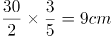，实际的长为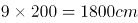，即鱼塘长为18m，宽为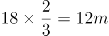，实际面积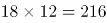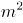。

故正确答案为A。

第 49 题

**参考答案（粉笔题库参考内容）**

B

**解析**

数字之和为8的二处数字组合情况为（0,8），（1,7），（2,6），（3,5），（4,4），满足条件的情况数为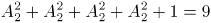,总情况数为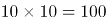，故中奖概率为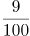。

故正确答案为B。

第 50 题

**参考答案（粉笔题库参考内容）**

D

**解析**

由条件可知，甲乙两班选手每步跨出的距离之比为 5：8，相同时间内跨出的步数之比为4：2，则二者的速度之比为(5×4)：(8×2)=5：4，即相同时间，甲跑400米时，乙跑了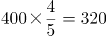米，此时乙距离终点400-20-320=60米。

故正确答案为D。

第 51 题

**参考答案（粉笔题库参考内容）**

B

**解析**

假设甲乙原来持股数分别为x、y，则(x+10000)=3(y-10000)，7(x-1000)=y+1000，联立方程解得x=3200，y=14400，则共持股数为17600。

故正确答案为B。

第 52 题

**参考答案（粉笔题库参考内容）**

C

**解析**

假设甲的成绩为x，乙的成绩为y，则有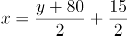，即①2x=y+95；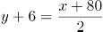；即②2y=x+68，①+②可得x+y=163，三人平均分为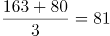分。

故正确答案为C。

第 53 题

**参考答案（粉笔题库参考内容）**

D

**解析**

假设鱼苗总数量为x，则可构成等式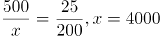，最有可能为4000条。

故正确答案为D。

第 54 题

**参考答案（粉笔题库参考内容）**

C

**解析**

枚举法，逃离路线情况数为（A-B-C-F），(A-B-C-D-F)，(A-B-C-D-E-F)，（A-B-D-F），（A-B-D-C-F），(A-B-D-E-F)，(A-D-B-C-F)，(A-D-C-F)，(A-D-F)，(A-D-E-F)，共10种。

故正确答案为C。

第 55 题

**参考答案（粉笔题库参考内容）**

B

**解析**

假设水池占地面积为a，则正方形面积为4a，圆形面积为7a，则(7a-a)-(4a-a)=3a=450，a=150平方米。

故正确答案为B。

第 56 题

**参考答案（粉笔题库参考内容）**

A

**解析**

第一步：分析题干词语的逻辑关系。

尺子的功能是测量距离，为对应关系。

第二步：逐一分析选项。

A项：钟表的功能是显示时间，对应关系，和题干逻辑一致，当选；

B项：钢铁是有硬度的，两者为属性关系，和题干逻辑不一致，排除；

C项：射出去的子弹是有速度的，但是子弹本身和速度并无逻辑关系，和题干逻辑不一致，排除；

D项：砝码是天平的一个组成零部件，和题干逻辑不一致，排除。

故正确答案为A。

第 57 题

**参考答案（粉笔题库参考内容）**

C

**解析**

第一步：分析题干词语的逻辑关系。

高大和矮小是反义词的关系，且两者都是形容词。

第二步：逐一分析选项。

A项：黑色和白色都是名词，且不是反义词，只是颜色里面的其中两种，并列关系，和题干逻辑关系不一致；

B项：人的性别不是男人就是女人，矛盾关系，和题干逻辑关系不一致；

C项：明亮和昏暗是反义词，且两者都是形容词，和题干逻辑关系一致；

D项：失去和得到虽然是反义词，但是两者都是动词，题干是形容词，和题干逻辑关系不一致。

故正确答案为C。

第 58 题

**参考答案（粉笔题库参考内容）**

A

**解析**

第一步：分析题干词语的逻辑关系

杯和碗都是容器的两种，并列关系，且功能类似。

第二步：逐一分析选项

A项：锯和刀都是工具里面的两种，并列关系，功能也类似，和题干逻辑关系一致；

B项：发光是灯的属性，和题干逻辑关系不一致；

C项：木是椅子的其中一种可能性原材料，属于对应关系，和题干逻辑关系不一致；

D项：炉里面生火属于对应关系，和题干逻辑关系不一致。

故正确答案为A。

第 59 题

**参考答案（粉笔题库参考内容）**

A

**解析**

第一步：分析题干词语的逻辑关系

教师和学生是两个对应的身份，教师教学生，两个主体构成工作上的主宾关系。

第二步：逐一分析选项

A项：裁判对应运动员，裁判判罚运动员，两个主体构成工作上的主宾关系，和题干逻辑关系一致；

B项：律师在法庭上进行辩护，法官在法庭上进行审判，二者并列关系，不构成工作上的主宾关系，和题干逻辑关系不一致；

C项：医生与护士是医院里两种分工不同的职业，二者是并列关系，两个主体不构成工作上的主宾关系，和题干逻辑关系不一致；

D项：厨师是做饭的，饲养员是饲养动物的，二者是并列关系，不构成工作上的主宾关系，和题干逻辑关系不一致。

故正确答案为A。

第 60 题

**参考答案（粉笔题库参考内容）**

A

**解析**

第一步：分析题干词语的逻辑关系。

缺乏雨水，会导致干旱。

第二步：逐一分析选项。

A项：缺乏阳光会导致潮湿，和题干逻辑关系一致，当选；

B项：雾霾和寒冷之间没有必然联系，和题干逻辑关系不一致，排除；

C项：飓风会导致灾害，和题干逻辑关系不一致，排除；

D项：冰雹和农田之间也没有必然联系，和题干逻辑关系不一致，排除。

故正确答案为A。

第 61 题

**参考答案（粉笔题库参考内容）**

B

**解析**

第一步：分析题干词语的逻辑关系。

透明是玻璃的属性，玻璃是名词，透明是形容词。

第二步：逐一分析选项。

A项：花卉具有颜色，颜色是名词，和题干逻辑关系不符，排除；

B项：坚硬是钻石的属性，且钻石是名词，坚硬是形容词，符合题干逻辑关系，当选；

C项：阴沉不能说是天空的属性，是跟天气的变化有关系，和题干逻辑关系不符，排除；

D项：绿叶具有生机，但生机是名词，和题干逻辑关系不符，排除。

故正确答案为B。

第 62 题

**参考答案（粉笔题库参考内容）**

C

**解析**

第一步：判断题干词语间逻辑关系。

刷牙时，牙刷和牙膏是配套使用的工具。

第二步：判断选项词语间逻辑关系。

A项：司机是人，“车厢”和“司机”不是配套使用的工具，和题干逻辑关系不一致，排除；

B项：斧头砍树木，对应关系，树木也不是工具，是植物，和题干逻辑关系不一致，排除；

C项：写字时，钢笔和纸张也是配套使用的工具，和题干逻辑关系一致，当选；

D项：火焰有温度，属性关系，和题干逻辑关系不一致，排除。

故正确答案为C。

第 63 题

**参考答案（粉笔题库参考内容）**

B

**解析**

第一步：分析题干词语的逻辑关系。

河流里面必然有水，组成关系。

第二步：逐一分析选项。

A项：沙漠里必然有沙子，而不是泥，与题干不一致，排除；

B项：森林里必然有树木，组成关系，和题干一致，当选；

C项：草原的必然组成部分是草，而不是动物，与题干不一致，排除；

D项：山脉里必然有土和石头，而不是冰雪，与题干不一致，排除。

故正确答案为B。

第 64 题

**参考答案（粉笔题库参考内容）**

C

**解析**

第一步：分析题干词语的逻辑关系。

重力的公式为G=mg，m为质量，g为不变量。因此，质量决定重力，前者决定后者，且都是名词。

第二步：逐一分析选项。

A项：各个年龄层次都会有幼稚的人，而且幼稚是个形容词，与题干逻辑关系不一致，排除；

B项：电源与电阻是两个完全不同的概念，没有关系，与题干逻辑关系不一致，排除；

C项：海拔决定气压高低，前者决定后者，且都是名词，与题干逻辑关系一致，当选；

D项：压力和摩擦力有关，而题干说的不是摩擦力，而是摩擦，与题干逻辑关系不一致，排除。

故正确答案为C。

第 65 题

**参考答案（粉笔题库参考内容）**

A

**解析**

第一步：分析题干词语的逻辑关系。

榜样和楷模是近义词，而楷模的程度比榜样更深。

第二步：逐一分析选项。

A项：诋毁和诽谤是近义词，诽谤的程度更深，符合题意，当选；

B项：论据是论证的组成部分，不符合题干逻辑，排除；

C项：决策与决定是近义词，但决策更适用于正式和重大的场合，不符合题干逻辑，排除；

D项：即刻和时刻的含义完全不同，不符合题干逻辑，排除。

故正确答案为A。

第 66 题

**参考答案（粉笔题库参考内容）**

A

**解析**

第一步：分析论点论据。

论点：食品商业广告能有效提升人们对零食的消耗。

论据：两组被试人员的情况，既看喜剧又看食品商业广告的被试人员消耗的零食量显著高于只看喜剧的被试人员。

第二步：逐一分析选项。

A项：说明看的广告是不是食品商业广告，与零食消耗没有必然联系，削弱论点，当选；

B项：短片是悲剧还是喜剧对零食消耗的影响与论点中食品商业广告对于零食消耗的影响没有关系，无关选项，排除；

C项：观看食品广告越长消耗的零食越多，证明了食品商业广告能提升对零食的消耗，加强论点，排除；

D项：该项指出喜剧变成悲剧导致零食消耗下降，但选项中的两组被试人员均观看了悲剧片，无法说明实验中两组被试人员零食消耗量存在差异的原因，无关项，排除。

故正确答案为A。

第 67 题

**参考答案（粉笔题库参考内容）**

A

**解析**

第一步：分析题干条件。

（1）小刘：小刘坐在小马旁；

（2）小马：小马左手边不是小刘就是小杨；

（3）小杨：小杨坐在小廖旁边；

（4）小廖：小刘坐在小廖的左手边；

（5）四人都猜错。

第二步：根据题干条件进行推理。

提问方式为“可能”，优先考虑代入法。

代入A项：此时满足条件（5）四人都猜错，当选；

代入B项：此时小杨坐在小廖旁边，故小杨的猜测正确，与题干条件（5）矛盾，排除；

代入C项：此时小杨坐在小廖旁边，故小杨的猜测正确，与题干条件（5）矛盾，排除；

代入D项：此时小刘坐在小廖的左手边，故小廖的猜测正确，与题干条件（5）矛盾，排除。

故正确答案为A。

第 68 题

**参考答案（粉笔题库参考内容）**

B

**解析**

第一步：分析题干，找出论点和论据。

论点：为避免遭遇无天然气可用的困境，必须开发更多的替代性能源。

论据：全球已探明的天然气储量总计220亿立方米。天然气对全球能源的贡献占四分之一，以现在的消耗速率估算，仅能提供65年的能源供给。

第二步：逐一分析选项。

A项：“天然气对全球能源的贡献率正逐步下降”与消耗速率是两个概念，即如果全球能源总消耗量在上升的话，即便贡献率低，那么消耗的总量也有可能比上一年高，因此A项属于不明确选项，排除；

B项：储量大大高于以往说明按照现在的消耗速率能够供给更长的时间，而不是现在说的65年，削弱论据，保留；

C项：天然气的使用效率提高了，说明在产出相同的情况下消耗的天然气变少了，那么消耗的速率也就变低了，那么就不会只在65年消耗殆尽，属于对论据的削弱，保留；

D项：指出是设计习惯问题导致天然气无法替代，但是习惯是可以改变的，也就是说，因为天然气储量有限、消耗速率高而研发出消耗新能源的机械，因此通过选项是无法判断天然气是不是够用的，排除。

比较B选项和C选项。我们发现，B选项的表述为“天然气储量大大高于以往”，而C选项的表述为“有了一定提高”，从程度的角度来看，“大大高于”的程度强于“一定提高”，所以B选项的力度要强于C选项。

故正确答案为B。

第 69 题

**参考答案（粉笔题库参考内容）**

B

**解析**

第一步：找出论点和论据。

论点：同一组问题，因为其问题顺序的改变，有时就会得出不一样的回答。

论据：一个月后，再次随机抽取了一千名市民回答相同问题，但问题的顺序设置与上次不同。结果发现，两次市民样本对许多问题得出了不同的回答。

第二步：逐一分析选项。

A项：题干论点是题目顺序与题目回答之间的关系，并不需要保证相同的市民参加，市民的随机性具有较弱的加强作用，但本题问题为前提假设类，A项并不是论点成立的前提条件，排除；

B项：题干中两次调查除了题目顺序有区别，还存在时间的差异，B项排除了时间对回答的干扰，强调了顺序这个原因的唯一性，加强论点，当选；

C项：调查是匿名或实名与题干结论无关，排除；

D项：题干中仅支持打乱了顺序，并没有强调是所有的顺序，属于无关项，排除。

故正确答案为B。

第 70 题

**参考答案（粉笔题库参考内容）**

A

**解析**

根据最后“有一个人恰好猜对了两个，其余三人都只猜对了一个”可以推出，四个人的12个猜测一共对了5个，而1号的猜测最多同时对2个，3号的猜测最多对1个，为了满足条件对五个，2号最少猜对2个，那2号只能是特等奖。

故正确答案为A。

第 71 题

**参考答案（粉笔题库参考内容）**

A

**解析**

第一步：找出论点和论据。

论点：战略性的人才梯队吸纳人才和培养人才，企业不断扩展其规模战略性的人才梯队。根据递推关系可以得出，企业不断扩展其规模吸纳人才和培养人才。

论据：无。

本题只有论点，没有论据，优先考虑削弱论点。

第二步：逐一分析选项。

A项：甲企业不断扩展其规模且非（吸纳人才），与题干中推出的逻辑关系企业不断扩展其规模吸纳人才和培养人才是矛盾关系，即“AB”与“A且非B”，选项A是成立的，那企业不断扩展其规模吸纳人才和培养人才就是不成立的，否定了题干逻辑关系，削弱力度最强，当选；

B项：培养人才与战略性的人才梯队同时成立，对题干中的逻辑关系没有作用，不能削弱，排除；

C项：建立起战略性的人才梯队与没有不断扩展其规模同时成立，对题干中的逻辑关系没有作用，不能削弱，排除；

D项：没有不断扩展其规模与吸纳人才和培养人才同时成立，对题干中的逻辑关系没有作用，不能削弱，排除。

故正确答案为A。

第 72 题

**参考答案（粉笔题库参考内容）**

D

**解析**

第一步：分析题干的论点与论据。

论点：A城市的居民比B城市的居民更喜欢滑雪运动。

论据：A城市的滑雪运动器材销售量高于B城市。

第二步：逐一分析选项作用。

A项：B城市的人口比A城市多，而滑雪运动器材A城市销售的更多，无法削弱，排除；

B项：题干中涉及的是滑雪运动器材的销售，与生产无关，无关选项，排除；

C项：滑雪运动比赛的冠军来自哪里与当地人是否喜欢滑雪运动无关，无关选项，排除；

D项：A城市滑雪运动器材销量更高是由于旅游人员的增加而不是当地居民的喜爱，不能由A城市滑雪运动器材销量高得出A城市居民更喜欢滑雪，拆断了论点论据之间的联系，属于拆桥项，当选。

故正确答案为D。

第 73 题

**参考答案（粉笔题库参考内容）**

C

**解析**

第一步：找出题干矛盾。

奢侈品品牌通常会根据不同的市场期望值制定出欧洲、美国、亚洲3个不同的零售价格区域，而在亚洲市场，奢侈品品牌的定价是最高的。

第二步：逐一分析选项。

A项：从原产地、物流的角度影响亚洲市场奢侈品定价，具有解释作用，保留；

B项：从人工及店铺租金等经营成本的角度影响亚洲市场奢侈品定价，具有解释作用，保留；

C项：从市场期望值的角度影响亚洲市场奢侈品定价，具有解释作用，保留；

D项：亚洲市场奢侈品消费群体更为庞大，与奢侈品定价无关，不能解释，排除。

对比A、B、C三项，A项和B项分别是从题干中没有涉及的角度对亚洲市场奢侈品品牌定价最高进行解释，而C项是从题干中给的市场期望值的角度进行解释，所以C项比A项和B项与题干的中心话题更接近，优选C项。

故正确答案为C。

第 74 题

**参考答案（粉笔题库参考内容）**

A

**解析**

第一步，分析题干的论点论据。

论点：这种保健产品确实对大脑具有明显的保健效果。

论据：第一组被试者每天服用该种保健产品，第二组则没有服用，结果发现，第一组被试者的大脑认知能力果然比第二组被试者好。

第二步：逐一分析选项作用。

A项：指出测试实验前两组被试者的大脑认知能力是相当的，那么两组实验者认知能力的差别就是实验中的差异条件保健产品造成的，属于对比实验当中的起点一致，具有加强作用，当选；

B项：日常食物中具有与保健品的相同成分与保健品是否对大脑具有保健作用无关，属于无关项，排除；

C项：两组实验对象的人数以及经济能力与保健品是否对大脑具有保健作用无关，属于无关项，排除；

D项：健脑产品已经获得许可生产和销售，并取得很好的市场份额与保健品是否对大脑具有保健作用无关，属于无关项，排除。

故正确答案为A。

第 75 题

**参考答案（粉笔题库参考内容）**

B

**解析**

对题干进行翻译，“只有······才······”为必要条件，后推前，得到逻辑关系：成功的互联网公司建立用户思维，一定不可能出现的情况只有他的矛盾：“成功的互联网公司且没有建立用户思维”。

A项：翻译为“具有用户思维是肯后且没有成为成功的互联网公司”，不是题干的矛盾，是可能的，排除；

B项：翻译为“没有用户思维且成为成功的互联网公司”，此项为矛盾，一定不可能出现，当选；

C项：翻译为“没有用户思维是且没有成为成功的互联网公司”，不是题干的矛盾，是可能的，排除；

D项：翻译为“具有用户思维且成为成功的互联网公司”，不是题干的矛盾，是可能的，排除。

本题为选非题，故正确答案为B。

第 76 题

**参考答案（粉笔题库参考内容）**

D

**解析**

规律一：元素组成不同，优先考虑属性规律。题干中四个图形均由直线和曲线构成，选项中只有A选项是由直线和曲线构成，B项和C项为全曲线构成的图形，D项为全直线构成的图形。

故正确答案为A。

规律二：题干中四个图形中面的数量均为1，选项中具有1个面的只有D选项。

故正确答案为D。

本题为争议题，粉笔倾向把答案定为D项。原因有以下两点：第一：面数量的考频相对较高；第二：图二线条比较平滑，也可以看成是全曲线图，基于以上两点，粉笔倾向将答案定为D。

第 77 题

**参考答案（粉笔题库参考内容）**

D

**解析**

元素组成相同，优先考虑位置规律。第一组图中，图1到图2方格三角形与白色三角形逆时针旋转，黑色三角形与灰色三角形顺时针旋转，图2到图3方格三角形与白色三角形顺时针旋转，黑色三角形与灰色三角形逆时针旋转；第二组图应遵循相同的规律，只有D项符合。

故正确答案为D。

第 78 题

**参考答案（粉笔题库参考内容）**

D

**解析**

图形元素组成相同，考查位置。黑色三角形平移方向是顺时针，步数分别为2,3,4，？，第5个图形应为第4个黑色三角形顺时针移动5步得到，只有D项符合。

故正确答案为D。

第 79 题

**参考答案（粉笔题库参考内容）**

D

**解析**

图形组成相似，考查元素样式。前一组第1个图形与第2个图形直接叠加互相不遮盖得到第三个图形，按照相同规律，后一组进行叠加，黑点重合，不遮盖，只有D项符合。

故正确答案为D。

第 80 题

**参考答案（粉笔题库参考内容）**

A

**解析**

元素组成相同，考查位置。第一行前两个图形之间竖轴对称，左右翻转，后两个图形之间竖轴对称，也是左右翻转而来，第三行遵循同样的规律，？处应由第二行第1个图形左右翻转而来，只有A项符合。

故正确答案为A。

第 81 题

**参考答案（粉笔题库参考内容）**

C

**解析**

图形较为凌乱，且无明显属性规律，考查数量。题干中第一个图扣除中间三角形后，左右两个封闭空间轮廓相同，第二个图三个扇形，第三个图扣除中间正方形，四个角的封闭区间构成的图形相同，第四个图五个三角形，因此问号处应为有六个相同封闭空间形状的图形，只有C项符合。

故正确答案为C。

第 82 题

**参考答案（粉笔题库参考内容）**

B

**解析**

图形组成相似，考查元素样式。前一组第1个图形的外围图形与第2个图形直接叠加得到第三个图形，按照相同规律，后一组第1个图形的外围图形五边形与第2个图形直接叠加得到B选项。

故正确答案为B。

第 83 题

**参考答案（粉笔题库参考内容）**

A

**解析**

元素组成不同，且属性无明显规律，考虑数量规律。题干均为独立的小元素，元素的个数和种类无法选出唯一的答案，再次观察发现，题干每一行都只出现了形状相同、黑白颜色不同的两种元素，故可考虑元素换算。通过分析第一行的小元素可知“1黑=2白”，故第一行为7白、7白、7白；第二行验证规律 “1黑=2白”，分别是9白、9白、9白；第三行运用规律“1黑=2白”，分别是8白、8白、？，故？处应该选一个黑白换算后是8白的选项，只有A项符合。

故正确答案为A。

第 84 题

**参考答案（粉笔题库参考内容）**

A

**解析**

图形较为凌乱，考查数量。题干中图形的间断空白位置分别为4、3、2、1、？，？处应为0处间断空白位置，即无间断，只有选项A符合。

故正确答案为A。

第 85 题

**参考答案（粉笔题库参考内容）**

C

**解析**

图形每一行组成相同，考查位置。符合两种规律。

（1）第一行每个图形沿外围圆圈顺时针每次走2步，第二行每个图形沿外围圆圈顺时针每次走4步，第三行每个图形沿外围圆圈顺时针每次走6步，只有C项符合。

（2）第一行每个图形顺时针旋转90度，第二行每个图形顺时针旋转180度，第三行每个图形顺时针旋转270度（逆时针90度），只有C项符合。

故正确答案为C。

第 86 题

**参考答案（粉笔题库参考内容）**

C

**解析**

定位表格广州一栏可知，2012年广州实际利用外资额为45.75亿美元，同比增长7.1%，故求2011其值可判定此题为基期量计算问题。2011年实际利用外资额=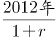＝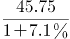≈42.7。

故正确答案为C。

第 87 题

**参考答案（粉笔题库参考内容）**

C

**解析**

查看表格可知，2012年九市中合同利用外资额最高的城市为广州（68.02），最低的为中山（13.19），故求二者的倍数关系可判定此题为现期倍数计算问题。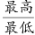＝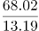≈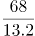≈5.1。

故正确答案为C。

第 88 题

**参考答案（粉笔题库参考内容）**

D

**解析**

定位表中各城市，实际利用外资占合同利用外资所占比例分别为：

广州：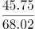；深圳：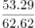；佛山：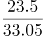＝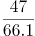；东莞：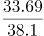。

故求所占比例最高的一个，可判定此题为现期比重比较问题。首先对比深圳和广州，深圳分子大、分母小，为大分数，排除广州；其次对比深圳和佛山，同样深圳要大，排除佛山；最后对比深圳和东莞，深圳直除≈0.85，东莞直除≈0.88，故比例最高的为东莞。

故正确答案为D。

第 89 题

**参考答案（粉笔题库参考内容）**

B

**解析**

结合图表读题可知，本题为直接查找问题。观察发现，九市中只有中山、惠州、肇庆三市的两项利用外资额同比增速都高于10%。

故正确答案为B。

第 90 题

**参考答案（粉笔题库参考内容）**

A

**解析**

因需找出说法错误的一项，故应逐项分析判断选择。

A项：2012年九市合同利用外资总额≈68+63+22+33+38+13+27+29+13=131+93+82=306＞300，表述错误，当选；

B项：2012年九市中合同利用外资额同比增速出现下降的只有深圳一市，表述正确，排除；

C项：九市实际利用外资总额中，多数城市同比增速超过10%，且基数最大的深圳市同比增速也超过10%，故可推定九市实际利用外资总额同比增长速度超过10%，表述正确，排除；

D项：直接观察图表即可发现，实际利用外资额同比增速差异明显较合同利用外资额要小，表述正确，排除。

本题为选非题，故正确答案为A。

第 91 题

**参考答案（粉笔题库参考内容）**

D

**解析**

定位文字材料第一段与第二段可知，2014年12月我国铁路设备出口值为28.1亿元，全年为267.7亿元，故求12月份占全年的比重可判定此题为现期比重计算问题。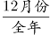＝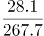＞10%，只有D项满足。

故正确答案为D。

第 92 题

**参考答案（粉笔题库参考内容）**

D

**解析**

材料中均可查到选项中各出口品种的增长率，故可判定此题为直接找数及比较问题。

定位材料第四段可知：

A项：铁道及电车道机动客、货、敞车（47%）＞铁道及电车道机车、车辆零件（34.2%），错误；

B项：轨道固定装置和机械交通管理等设备及零附件（13.3%）＜钢轨（61.8%），错误；

C项：铁道及电车道机车、车辆零件（34.2%）＞轨道固定装置和机械交通管理等设备及零附件（13.3%），错误；

D项：铁道及电车道机动客、货、敞车（47%）＜钢轨（61.8%），正确。

故正确答案为D。

第 93 题

**参考答案（粉笔题库参考内容）**

C

**解析**

定位文字材料第三段可知，2014年我国铁路设备对四个出口地区当年的出口值及增长率，故求2013年出口值最高的地区，可判定本题为基期量的比较问题。

2013年对东盟出口值＝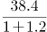；2013年对阿根廷出口值＝；2013年对澳大利亚出口值＝；2013年对美国出口值＝。

四个地区的基期量中，分子近似相等，但澳大利亚地区的分母远小于其他三个地区，故可直接推知2013年对澳大利亚的出口值最高。

故正确答案为C。

第 94 题

**参考答案（粉笔题库参考内容）**

B

**解析**

定位材料第五段可知，2014年我国以加工贸易方式出口的铁路设备出口值，与以一般贸易方式出口的出口值，故求2013年二者之差可判定此题为基期和差问题。2013年以加工贸易方式出口的出口值＝，2013年以一般贸易方式出口的出口值＝，二者之差＝－≈－≈129-81=48，即约多48亿元。

故正确答案为B。

第 95 题

**参考答案（粉笔题库参考内容）**

D

**解析**

因需找出说法错误的一项，故应逐项分析判断选择。

A项：2014年我国铁路设备出口中，民营企业与外商投资企业所占比例基本持平，而外商投资企业的同比增长率远大于民营企业，故可推知2013年民营企业所占比例应高于外商投资企业，表述正确；

B项：12月当月出口铁路设备28.1亿元，环比增长22%，环比增长，故12月出口值应高于11月，表述正确；

C项：2014年我国出口铁路设备267.7亿元，比上年增长22.6%，故2013年出口值＝，直除首位可以商2，表述正确；

D项：定位材料第五段可知，以加工贸易方式出口设备的同比增长率12.9%，低于以一般贸易方式的增长率35.8%，表述错误。

故正确答案为D。

第 96 题

**参考答案（粉笔题库参考内容）**

B

**解析**

根据柱状图可知我国各年份老年人口数量以及所占人口比例，故可求出1964年与1953年的人数总量。1964年人口总量＝，1953年人口总量＝，故二者之差＝≈69500-58300=11200万人，C、D两项均不符合。1964年相比1953年增长率＝≈19.2%，B项满足。

故正确答案为B。

第 97 题

**参考答案（粉笔题库参考内容）**

C

**解析**

根据柱状图可知我国1990年老年人口数量以及所占人口比例，故可求出1990年的人数总量，根据表格可知1990年我国城镇人口所占总人口比例，故可求出1990年我们城镇人口总量。1990年人口总量，略小于6315×5=31575，C项满足。

故正确答案为C。

第 98 题

**参考答案（粉笔题库参考内容）**

A

**解析**

根据表格可知，近四次人口普查我国各年龄段人口的比例变化情况。观察发现，城镇少儿人口比例是逐次下降的，农村少儿人口所占比例也是逐次下降的，因此比例逐次下降的是少儿人口。

故正确答案为A。

第 99 题

**参考答案（粉笔题库参考内容）**

C

**解析**

根据定义可知，2010年我国农村的老年抚养比=\=\=\=≈≈14.3%。

故正确答案为C。

第 100 题

**参考答案（粉笔题库参考内容）**

D

**解析**

①：表格只给出近四年城乡少儿人口比例，近四年少儿人口规模的计算量太大，先查看其余几项；

②：2000年农村老年人口数量=2000年农村人口数量农村老年人口比例，正确；

③1982年劳动年龄人口比例的城乡差距为68.76%-59.62%=9.14%，1990年差距为72.57%-64.67%=7.9%，2000年差距为75.16%-66.89%=8.27%，2000年差距变大，并非逐次缩小，错误；

④城镇老年抚养比值\=\=，1982年城镇老年抚养比值=，1990年城镇老年抚养比值，2000年城镇老年抚养比值=，2010年城镇老年抚养比值，依次增大，正确；

②④正确，排除A、B、C三项，只能选择D项；

故正确答案为D。

