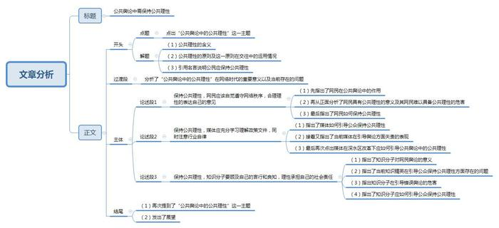

# 2016年广州市公考《申论》题

<!-- gwy:overview:start -->
> **广州 · 2016 · 申论 · 统考** ｜ 1 题 · 图片 1 处 · 答案随题折叠

导航：[题目](#题目)
<!-- gwy:overview:end -->

> 候选采集稿。参考答案及解析来自粉笔页面，不代表官方答案或真实高分答卷；来源使用许可与原卷对应关系仍需人工核实。

## 给定材料

### 材料 material-6c905e0aca2df4ec

牢牢把握正确舆论导向，健全社会舆情引导机制，传播正能量。加强网上思想文化阵地建设，实施网络内容建设工程，发展积极向上的网络文化，净化网络环境。推动传统媒体和新兴媒体融合发展，加快媒体数字化建设，打造一批新型主流媒体。优化媒体结构，规范传播秩序。加强国际传播能力建设，创新对外传播、文化交流、文化贸易方式，推动中华文化走出去。

——摘自《中共中央关于制定国民经济和社会发展第十三个五年规划的建议》

中共十八届五中全会提出了创新、协调、绿色、开放、共享的发展理念。“十三五”时期，中国将大力实施网络强国战略、国家大数据战略、“互联网+”行动计划，发展积极向上的网络文化，拓展网络经济空间，促进互联网和经济社会融合发展。我们的目标，就是要让互联网发展成果惠及13亿多中国人民，更好造福各国人民。

构建良好秩序。网络空间同现实社会一样，既要提倡自由，也要保持秩序。自由是秩序的目的，秩序是自由的保障。我们既要尊重网民交流思想、表达意愿的权利，也要依法构建良好的网络秩序，还有利于保障广大网民合法权益。网络空间不是“法外之地”。网络空间是虚拟的，但运用网络空间的主体是现实的，大家都应遵守法律，明确各方权利义务。要坚持依法治国、依法办网、依法上网，让互联网在法治轨道上健康运行。同时，要加强网络伦理、网络文明建设，发挥道德教化引导作用，用人类文明优秀成果滋养网络空间、修复网络生态。

——摘自中共中央总书记、国家主席、国家军委主席习近平

《在第二届世界互联网大会开幕式上的讲话》

## 题目

### 第 1 题

**请以“公共舆论中的公共理性”为主题写一篇议论文。（100分）**

关联材料：材料 material-6c905e0aca2df4ec

作答要求：

要求：

（1）参考“给定材料”，可不拘泥于材料；

（2）题目自拟，观点明确，条理清晰，逻辑严密，论证充分，语言流畅；

（3）不必提供政策或改进政府工作的建议；

（4）不要大段摘抄材料；

（5）作答时必须用黑色墨水的签字笔或钢笔在答题卡的指定位置作答，作答在其他位置上的一律无效；

（6）字数在1200-1500字（计入标点与空格）。

第 1 题 · 答案与解析

**参考答案（粉笔题库参考内容）**

**公共舆论中需保持公共理性**

何谓公共理性？公共理性是一种具有主体间性和公共性的交往理性，它往往通过公共舆论的话语方式得以展现。它不是个体的实践理性，而是公共性的理性原则，不是以自我利益为中心、将他人看作自己的对立面，而是在交往中将他人看作是另一个“我”的存在，以同情之理解甚至是“移情”的方式与他人产生交流与共识。**群体社会都应该在公共舆论中保持公共理性**，正如曾国藩所说“养活一团春意思，撑起两根穷骨头”。

现代社会是网络信息发达的社会，目前网络已走入千家万户，QQ、微博、微信等新媒体蓬勃发展。**一方面给以表达政府的政策和意识形态导向的准公共舆论带来机遇，另一方面也对代表着公众意见的大众传媒提出了新的要求。具有公共理性的网民可以通过各种平台积极的向国家建言献策，对推动国家和社会的发展起到重大作用，但同时也出现了不少网络虚假炒作事件**，比如“上海姑娘逃离江西农村”“霸气媳妇回农村掀翻桌子”等杜撰文章广泛流传，引起媒体和网民热议。凸显了我国公民在公共舆论中公共理性的缺失。

**保持公共理性，网民应该自觉遵守网络秩序，合理理性的表达自己的意见。**网民是网络舆论阵地的基石，为公共舆论提供大部分的舆论和方向。如果网民能够具有公共理性，将会给社会带来正能量，将会为政府问政提供有效的依据。相反，如果只是跟风，发泄私人情感，甚至不分是非对错，将会给周围人带来极大的负面情绪，甚至可能造成社会恐慌。因此，网民应该自觉遵守网络秩序和合理规范，在表达自己意见时应该对自己有基本的约束。只有保持公共理性，才能共同营造清朗的网络氛围。

**保持公共理性，媒体应充分学习理解政策文件，同时注意行业自律。**在公共舆论中除了网民还有一个很重要的主体——媒体。一方面，媒体应对自身有更高要求，积极学习政策文件，领会政府精神。另一方面，作为媒体人应更重视自律。媒体人身上本应有更专业的职业精神和媒体责任。反观当下，有些媒体人为博人眼球，甘做“标题党”，给网民错误的指示，引导网民的舆论“剑走偏锋”，这都是媒体人失责的表现。因此，在深水区改革的今天，每一个媒体人更应发挥积极的导向作用，全面全局整体领会政策文件精神，并且时时用职业道德来约束自己。

**保持公共理性，知识分子要顾及自己的言行和良知，理性承担自己的社会责任。**知识分子是国家悉心培育的栋梁，是网民发声的指向标。然而，当今社会却有一些知识精英滥用政府和民众的信任，出现如“微博约架”的不良现象。知识分子本身拥有极高的学历和声望，有的在微博里一呼百应，被称为“网络大V”。这些人本来应该具备公共理性，受到民众的信任，并肩负客观解读政府政策，引导网络正能量的责任。但是在现实中有些人忘却了自身的责任和良知。不顾及自己的身份随意发声可能会让很多网民不明真相盲目追捧，最终导致知识分子的形象受到损害，政府的公信力受到质疑，雷军与周鸿祎的“约架”就是最好的例子。因此，知识分子首先应该肩负起社会责任，用良知去规范自己的言行，客观的发声，为国民谋福利，为政府献言献策。

公共舆论需要自由也需要秩序，而这仅仅依靠政府是远远不够的，需要处在阵地中的每一个主体积极的维护和发声。只有网民、媒体、知识分子们都保持公共理性，才能让我们的公共舆论真正发出“中国好声音”！

**解析**

**文章分析**

**公共舆论中需保持公共理性**

【**标题的优点：**首先，范文的标题“公共舆论中需保持公共理性”突出了“公共舆论中的公共理性”这一主题。其次，形式上，文字简洁明快。】

何谓公共理性？（1）**公共理性**是一种具有主体间性和公共性的交往理性，它往往通过**公共舆论**的话语方式得以展现。（2）它不是个体的实践理性，而是公共性的理性原则，不是以自我利益为中心、将他人看作自己的对立面，而是在交往中将他人看作是另一个“我”的存在，以同情之理解甚至是“移情”的方式与他人产生交流与共识。（3）**群体社会都****应该在公共舆论中保持公共理性**，正如曾国藩所说“养活一团春意思，撑起两根穷骨头”。

【**开头的优点：**★内容方面：范文的开头是紧扣题目给定的“公共舆论中的公共理性”这一主题展开的。首先，开头点出主题，做到了主题明确。其次，对“公共舆论中的公共理性”这一主题进行了分析阐述，指出了（1）公共理性的含义；（2）公共理性的原则及这一原则在交往中的运用情况；（3）引用名言说明公民应保持公共理性。★文字表达方面：使用了关联词“不是……而是……”，使语言表达有逻辑性。】

现代社会是网络信息发达的社会，目前网络已走入千家万户，QQ、微博、微信等新媒体蓬勃发展。一方面给以表达政府的政策和意识形态导向的准公共舆论带来机遇，另一方面也对代表着公众意见的大众传媒提出了新的要求。具有公共理性的网民可以通过各种平台积极的向国家建言献策，对推动国家和社会的发展起到重大作用，但同时也出现了不少网络虚假炒作事件，比如“上海姑娘逃离江西农村”“霸气媳妇回农村掀翻桌子”等杜撰文章广泛流传，引起媒体和网民热议。凸显了我国公民在公共舆论中公共理性的缺失。

【**过渡段的优点：**范文的过渡段分析了“公共舆论中的公共理性”在网络时代的重要意义以及当前存在的问题。此外，还要注意过渡段末尾的“凸显了我国公民在公共舆论中公共理性的缺失”，是用来引起下文对策内容的过渡句。】

**保持公共理性，网民应该自觉遵守网络秩序，合理理性的表达自己的意见。**（1）网民是网络舆论阵地的基石，为公共舆论提供大部分的舆论和方向。（2）如果网民能够具有公共理性，将会给社会带来正能量，将会为政府问政提供有效的依据。相反，如果只是跟风，发泄私人情感，甚至不分是非对错，将会给周围人带来极大的负面情绪，甚至可能造成社会恐慌。（3）因此，网民应该自觉遵守网络秩序和合理规范，在表达自己意见时应该对自己有基本的约束。只有保持公共理性，才能共同营造清朗的网络氛围。

【**论述段****1****的优点**：★观点句：范文的观点句是紧扣“公共舆论中的公共理性”这一文章主题提出的。形式上，它在段首处直接写出，位置突出，容易发现。内容上，关键词突出，内容要点明确，可以明显看出它是从“网民”的角度入手，指出了“保持公共理性的对策”。★论述内容：（1）先指出了网民在公共舆论中的作用；（2）再从正面分析了网民具有公共理性的意义及其网民难以具备公共理性的危害；（3）最后指出了网民如何保持公共理性。注意：以上几个方面的内容都是紧扣“保持公共理性，网民应该自觉遵守网络秩序，合理理性的表达自己的意见”这个观点句进行分析论述的，论述的针对性强，内容层次丰富。★论述方法：采用了讲道理和对比论证相结合，做到了丰富多样。】

**保持公共理性，媒体应充分学习理解政策文件，同时注意行业自律。**在公共舆论中除了网民还有一个很重要的主体——媒体。（1）一方面，媒体应对自身有更高要求，积极学习政策文件，领会政府精神。另一方面，作为媒体人应更重视自律。媒体人身上本应有更专业的职业精神和媒体责任。（2）反观当下，有些媒体人为博人眼球，甘做“标题党”，给网民错误的指示，引导网民的舆论“剑走偏锋”，这都是媒体人失责的表现。（3）因此，在深水区改革的今天，每一个媒体人更应发挥积极的导向作用，全面全局整体领会政策文件精神，并且时时用职业道德来约束自己。

【**论述段****2****的优点**：★观点句：范文的观点句是紧扣“公共舆论中的公共理性”这一文章主题提出的。形式上，它在段首处直接写出，位置突出，容易发现。内容上，关键词突出，内容要点明确，可以明显看出它是从“媒体”的角度入手，指出了“保持公共理性的对策”。★论述内容：（1）指出了媒体如何引导公众保持公共理性；（2）接着又指出了当前媒体在引导舆论方面失责的表现；（3）最后再次点出媒体在深水区改革下应如何引导公共舆论中的公共理性。注意：以上几个方面的内容都是紧扣“保持公共理性，媒体应充分学习理解政策文件，同时注意行业自律”这个观点句进行分析论述的，论述的针对性强，内容层次丰富。★论述方法：采用了讲道理和对比论证相结合，做到了丰富多样。】

**保持公共理性，知识分子要顾及自己的言行和良知，理性承担自己的社会责任。**（1）知识分子是国家悉心培育的栋梁，是网民发声的指向标。（2）然而，当今社会却有一些知识精英滥用政府和民众的信任，出现如“微博约架”的不良现象。知识分子本身拥有极高的学历和声望，有的在微博里一呼百应，被称为“网络大V”。这些人本来应该具备公共理性，受到民众的信任，并肩负客观解读政府政策，引导网络正能量的责任。但是在现实中有些人忘却了自身的责任和良知。（3）不顾及自己的身份随意发声可能会让很多网民不明真相盲目追捧，最终导致知识分子的形象受到损害，政府的公信力受到质疑，雷军与周鸿祎的“约架”就是最好的例子。（4）因此，知识分子首先应该肩负起社会责任，用良知去规范自己的言行，客观的发声，为国民谋福利，为政府献言献策。

【**论述段****3****的优点**：★观点句：范文的观点句是紧扣“公共舆论中的公共理性”这一文章主题提出的。形式上，它在段首处直接写出，位置突出，容易发现。内容上，关键词突出，内容要点明确，可以明显看出它是从“知识分子”的角度入手，指出了“保持公共理性的对策”。★论述内容：（1）指出了知识分子对网民舆论的意义；（2）指出了当前知识精英在引导公众保持公共理性方面存在的问题；（3）指出知识分子在引导错误舆论的危害；（4）指出了知识分子应如何引导公众保持公共理性。注意：以上几个方面的内容都是紧扣“保持公共理性，知识分子要顾及自己的言行和良知，理性承担自己的社会责任”这个观点句进行分析论述的，论述的针对性强，内容层次丰富。★论述方法：采用了讲道理和举例子相结合，做到了丰富多样。】

【**论述段之间的关系**：★内容的内在逻辑：范文的论述段之间是依照“并列”的逻辑展开的。其中论述段1-3从如何引导公众保持“公共理性”出发，论述段1先写了从“网民”的角度讲述如何保持公共舆论中的公共理性，论述段2再写了从“媒体”的角度讲述如何保持公共舆论中的公共理性，论述段3再写了从“知识分子”的角度讲述如何保持公共舆论中的公共理性；★段与段的外在衔接：论述段2段首处的过渡句“在公共舆论中除了网民还有一个很重要的主体——媒体”起到了承接论述段1、引出了论述段2的作用。】

（1）**公共舆论**需要**自由也需要秩序**，而这仅仅依靠政府是远远不够的，需要处在阵地中的每一个主体积极的维护和发声。（2）只有网民、媒体、知识分子们都保持公共理性，才能让我们的公共舆论真正发出“中国好声音”！

【**结尾的优点**：范文的结尾回扣了“公共舆论中的公共理性”这一主题。（1）再次提到了“公共舆论”和“公共理性”。（2）发出了展望。】

**考点**：考点文章写作题

**来源**：来源2016年广州市公考《申论》题

