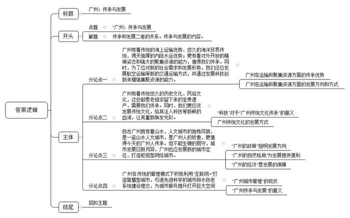

# 2017年广州市公考《申论》题（单考区）

<!-- gwy:overview:start -->
> **广州 · 2017 · 申论 · 单考区** ｜ 1 题 · 图片 1 处 · 答案随题折叠

导航：[题目](#题目) · [材料 1](#材料-1)
<!-- gwy:overview:end -->

> 候选采集稿。参考答案及解析来自粉笔页面，不代表官方答案或真实高分答卷；来源使用许可与原卷对应关系仍需人工核实。

## 给定材料

### 材料 1

我国城市发展已经进入新的发展时期。改革开放以来，我国经历了世界历史上规模最大、速度最快的城镇化进程，城市发展波澜壮阔，取得了举世瞩目的成就。城市发展带动了整个经济社会发展，城市建设成为现代化建设的重要引擎。城市是我国经济、政治、文化、社会等方面活动的中心，在党和国家工作全局中具有举足轻重的地位。

做好城市工作，要顺应城市工作新形势、改革发展新要求、人民群众新期待，坚持以人民为中心的发展思想，坚持人民城市为人民。这是我们做好城市工作的出发点和落脚点。同时，要坚持集约发展，框定总量、限定容量、盘活存量、做优增量、提高质量，立足国情，尊重自然、顺应自然、保护自然，改善城市生态环境，在统筹上下功夫，在重点上求突破，着力提高城市发展持续性、宜居性。

## 题目

### 第 1 题

**请根据全部给定材料，以“广州：传承与发展”为题目，写作一篇议论文。（100分）**

关联材料：材料 1

作答要求：

要求：

（1）观点明确，条理清晰，逻辑严密，论证充分，语言流畅；

（2）不必提供对策；

（3）不要大段摘抄材料；

（4）作答时必须用黑色墨水的签字笔或钢笔，在答题卡的指定位置作答，作答在其他位置上一律无效；

（5）篇幅在1500字—1800字（计入标点与空格）。

第 1 题 · 答案与解析

**参考答案（粉笔题库参考内容）**

**广州：传承与发展**

广州，作为我国的南大门，不仅保持着对外发展的传统优势，还在其基础上大力建设枢纽型网络城市；不仅拥有着宝贵的文化资源，还在保持文化自立的同时融入技术创新和文化创意；不仅拥有着丰富的科教资源，还借互联网之东风大力推进智慧城市的建设。可以说，改革开放以来，广州发展波澜壮阔，取得的成就举世瞩目。

在广州辉煌的发展历史中，我们不难发现其最大的经验在于：在不断坚守传统、传承历史的基础上，顺应时势，进而提高了城市发展持续性、宜居性。今天的广州要想发展，需要遵守其一贯的发展规律：既尊重传统，又不固守传统；既追求发展，又不刻意求新。在传承的基础上发展，在发展中传承。**传承是发展的基础，唯有传承才能更好的发展，同时发展又能反过来促进更好的传承。**

**广州有着传统的海上运输优势、悠久的海洋贸易传统、得天独厚的内陆水运优势；更有着对外开放的精神姿态和强大的聚集资源的能力，值得我们传承** **。同时，为了应对新的社会需求和发展形势，我们还应发展航空运输等新的交通运输方式，并通过发展科技创新来增强集聚资源的能力**。广州作为中国最大、历史最悠久的对外通商口岸和海上丝绸之路的起点之一，秦始皇时期就是奇珍异宝的集散地，即使在闭关锁国的清朝，也是当时唯一的对外贸易口岸，这些无不昭示着广州作为中国最大、历史最悠久的带外通商口岸，有着悠久的海洋贸易传统和得天独厚的内陆水运优势，正是因为这一得天独厚的历史优势，使其在发展的过程中拥有着其他城市难以企及的资源优势，对外交往活跃。而今天，面对新的发展形势和社会需求，传统的水运已远远不够，更需要我们发展航空运输等新的运输模式并通过科技创新来加强资源的聚集。

**广州有着传统悠久的历史文化、民俗文化，这些都是老祖宗留下来的宝贵遗产，需要我们传承。同时，我们更应该发展传统文化，给其注入科技等新鲜的血液，让其重新焕发光彩**。广庙会“吸粉”无数，精彩纷呈，极大的弘扬和发展了传统文化。那是因为其处处体现出科技元素，从VR、AR的登场到千架无人机飞越广州塔，广府庙会刷新了人们对传统文化的认识。我们没有丢弃老旧的传统文化而是为其披上科技的外衣，让传统文化玩出了科技，玩出了时尚，利用现代科技玩出了新花样，满足了当下社会群体的心理需求，让其得以重生。其实，传统文化想要发展，除了与科技“联姻”，也应该走出去，以开放包容的心态与外国文化交流碰撞，乘着“一带一路”的东风，重温当年“海上丝绸之路”第一站的荣光与使命。

**自古广州就有着山水、人文城市的独特风貌，是一座山水人文城市，是广州人的骄傲，更值得今天的广州人传承。但不能生硬的固守，城市发展日新月异，广州也应发展新的城市定位，打造枢纽型网络城市**。《广州市城市总体规划（2011-2020年）》获得国务院批复，意在将广州打造枢纽型网络城市。所谓枢纽型网络城市应是市场网络、交通网络和信息网络这三重网络密集叠合、相互渗透的关键节点。广州具有“山、水、城、田、海”的自然格局，生态要素丰富齐备，城市错落有致。同时，广州经济总量稳居第三，有着在全国排名前列的海港、空港、铁路港和信息港。无论是自然条件还是工作基础，广州建设枢纽型网络城市都是顺应城市发展规律之举，而非凭空产生。

**广州在传统的管理模式下积极利用****“互联网+”打造智慧型城市，引进先进科学的城市排水防老系统建设理念，为城市服务提升打开巨大空间**。正是这些努力，让广州在保持传统优势的同时，还能缔结出新的竞争优势，吸引了越来越多的人们驻足、定居。历史的传承和顺应时势的发展，对于城市的发展具有不可替代的作用，推动文化产业的发展和繁荣，带动经济和人文的又一次振兴的同时，还可以进一步加强广州的国际航运、航空、科技创新枢纽功能，国际综合交通枢纽地位更加稳固，让高端资源要素将会加快集聚。放眼长远，更有利于水资源的循环利用，促进人和自然的谐和可持续发展。

要发展必须有传承，对历史的传承是发展的基础，顺应时势的发展让传统历久弥新，焕发新生。在广州的发展历史中，经济发展、开放包容、文化资源丰富等字眼始终伴随左右。在新时期，面对着互联网的普及，面对着“绿水青山也是金山银山”的事实，面对着“让人民群众共享改革发展成果”的呼声，如何平衡“传承与发展”，值得政府去深究。我们有理由相信，广州在新时期能够仅仅扣住传承与发展的关系，蓬勃发展，不断彰显其魅力，向世人呈现更为美丽的画卷。

**解析**

**文章分析**

**广州：传承与发展**

【**标题的优点：**严格按照题目的要求，以“广州：传承与发展”为标题。】

广州，作为我国的南大门，（1）不仅保持着对外发展的传统优势，还在其基础上大力建设枢纽型网络城市；（2）不仅拥有着宝贵的文化资源，还在保持文化自立的同时融入技术创新和文化创意；（3）不仅拥有着丰富的科教资源，还借互联网之东风大力推进智慧城市的建设。可以说，改革开放以来，广州发展波澜壮阔，取得的成就举世瞩目。

【**开头****的****优****点：**★内容方面。范文的开头是紧扣题目给定的“广州：传承与发展”这一主题展开的，同时突出了对“广州发展”的认识。首先，开头开门见山，对“广州的发展成就”进行了分析阐述，指出了（1）广州在城市定位方面的优势。（2）广州在文化发展方面的优势。（3）广州在资源、管理方面的优势。★文字表达方面 ：使用了“不仅……还在……”等关联词，同时构成了排比句，使语言表达更有文采和逻辑性。】

在广州辉煌的发展历史中，我们不难发现其最大的经验在于：在不断坚守传统、传承历史的基础上，顺应时势，进而提高了城市发展持续性、宜居性。今天的广州要想发展，需要遵守其一贯的发展规律：既尊重传统，又不固守传统；既追求发展，又不刻意求新。在传承的基础上发展，在发展中传承。**传承是发展的基础，唯有传承才能更好的发展，同时发展又能反过来促进更好的传承。**

【**过渡段的优点：**范文过渡段分析了广州“传承与发展”两者之间的关系，并提出了对策。此外，还要注意过渡段末尾的“传承是发展的基础，唯有传承才能更好的发展，同时发展又能反过来促进更好的传承”是用来引起下文的过渡句。】

**广州有着传统的海上运输优势、悠久的海洋贸易传统、得天独厚的内陆水运优势；更有着对外开放的精神姿态和强大的聚集资源的能力，值得我们传承。同时，为了应对新的社会需求和发展形势，我们还应发展航空运输等新的交通运输方式，并通过发展科技创新来增强集聚资源的能力**。（1）广州作为中国最大、历史最悠久的对外通商口岸和海上丝绸之路的起点之一，秦始皇时期就是奇珍异宝的集散地，即使在闭关锁国的清朝，也是当时唯一的对外贸易口岸，这些无不昭示着广州作为中国最大、历史最悠久的带外通商口岸，有着悠久的海洋贸易传统和得天独厚的内陆水运优势，正是因为这一得天独厚的历史优势，使其在发展的过程中拥有着其他城市难以企及的资源优势，对外交往活跃。而今天，面对新的发展形势和社会需求，传统的水运已远远不够，（2）更需要我们发展航空运输等新的运输模式并通过科技创新来加强资源的聚集。

【**论述段****1****的优点：**★观点句：范文的观点句是紧扣“广州：传承与发展”这一文章主题提出的。形式上，它在段首处直接写出，位置突出，容易发现。内容上，关键词突出，内容要点明确，可以明显看出它是从“传统的资源优势”入手，指出了“广州传承传统资源优势”。★论述内容：（1）介绍了“广州在运输和聚集资源方面的优势”；（2）介绍了“广州在运输和聚集资源方面的发展方向和方式”。注意：以上几个方面的内容都是紧扣“广州有着传统的海上运输优势、悠久的海洋贸易传统、得天独厚的内陆水运优势；更有着对外开放的精神姿态和强大的聚集资源的能力，值得我们传承。同时，为了应对新的社会需求和发展形势，我们还应发展航空运输等新的交通运输方式，并通过发展科技创新来增强集聚资源的能力”这个观点句进行分析论述的，论述的针对性强，内容层次丰富。★论述方法：采用了古今事例相结合，做到了丰富多样。】

**广州有着传统悠久的历史文化、民俗文化，这些都是老祖宗留下来的宝贵遗产，需要我们传承。同时，我们更应该发展传统文化，给其注入科技等新鲜的血液，让其重新焕发光彩**。（1）广庙会“吸粉”无数，精彩纷呈，极大的弘扬和发展了传统文化。那是因为其处处体现出科技元素，从VR、AR的登场到千架无人机飞越广州塔，广府庙会刷新了人们对传统文化的认识。我们没有丢弃老旧的传统文化而是为其披上科技的外衣，让传统文化玩出了科技，玩出了时尚，利用现代科技玩出了新花样，满足了当下社会群体的心理需求，让其得以重生。其实，传统文化想要发展，除了与科技“联姻”，（2）也应该走出去，以开放包容的心态与外国文化交流碰撞，乘着“一带一路”的东风，重温当年“海上丝绸之路”第一站的荣光与使命。

【**论述段****2****的优点：**★观点句：范文的观点句是紧扣“广州：传承与发展”这一文章主题提出的。形式上，它在段首处直接写出，位置突出，容易发现。内容上，关键词突出，内容要点明确，可以明显看出它是从“传承传统文化”入手，指出了“广州的文化历史和发展方式”。★论述内容：（1）介绍“科技”对于“广州传统文化传承”的意义；（2）介绍了“广州传统文化发展方式”。注意：以上几个方面的内容都是紧扣“广州有着传统悠久的历史文化、民俗文化，这些都是老祖宗留下来的宝贵遗产，需要我们传承。同时，我们更应该发展传统文化，给其注入科技等新鲜的血液，让其重新焕发光彩”这个观点句进行分析论述的，论述的针对性强，内容层次丰富。★论述方法：采用了事实论证和理论论证相结合，做到了丰富多样。】

**自古广州就有着山水、人文城市的独特风貌，是一座山水人文城市，是广州人的骄傲，更值得今天的广州人传承。但不能生硬的固守，城市发展日新月异，广州也应发展新的城市定位，打造枢纽型网络城市**。（1）《广州市城市总体规划（2011-2020年）》获得国务院批复，意在将广州打造枢纽型网络城市。所谓枢纽型网络城市应是市场网络、交通网络和信息网络这三重网络密集叠合、相互渗透的关键节点。（2）广州具有“山、水、城、田、海”的自然格局，生态要素丰富齐备，城市错落有致。同时，（3）广州经济总量稳居第三，有着在全国排名前列的海港、空港、铁路港和信息港。无论是自然条件还是工作基础，广州建设枢纽型网络城市都是顺应城市发展规律之举，而非凭空产生。

【**论述段****3****的优点：**★观点句：范文的观点句是紧扣“广州：传承与发展”这一文章主题提出的。形式上，它在段首处直接写出，位置突出，容易发现。内容上，关键词突出，内容要点明确，可以明显看出它是从“城市定位”入手，指出了“广州的政策、自然、经济优势”。★论述内容：（1）介绍了“广州的政策”指明发展方向；（2）介绍了“广州的自然格局”为发展提供便利；（3）介绍了“广州的经济”是发展的保障。注意：以上几个方面的内容都是紧扣“自古广州就有着山水、人文城市的独特风貌，是一座山水人文城市，是广州人的骄傲，更值得今天的广州人传承。但不能生硬的固守，城市发展日新月异，广州也应发展新的城市定位，打造枢纽型网络城市”这个观点句进行分析论述的，论述的针对性强，内容层次丰富。★论述方法：采用了讲道理、举例子相结合，做到了丰富多样。】

**广州在传统的管理模式下积极利用****“互联网+”打造智慧型城市，引进先进科学的城市排水防老系统建设理念，为城市服务提升打开巨大空间**。（1）正是这些努力，让广州在保持传统优势的同时，还能缔结出新的竞争优势，吸引了越来越多的人们驻足、定居。（2）历史的传承和顺应时势的发展，对于城市的发展具有不可替代的作用，推动文化产业的发展和繁荣，带动经济和人文的又一次振兴的同时，还可以进一步加强广州的国际航运、航空、科技创新枢纽功能，国际综合交通枢纽地位更加稳固，让高端资源要素将会加快集聚。放眼长远，更有利于水资源的循环利用，促进人和自然的谐和可持续发展。

【**论述段****4****的优点：**★观点句：范文的观点句是紧扣“广州：传承与发展”这一文章主题提出的。形式上，它在段首处直接写出，位置突出，容易发现。内容上，关键词突出，内容要点明确，可以明显看出它是从“城市管理服务”入手，指出了“广州创新传统模式，打开发展空间”。★论述内容：（1）介绍了“广州城市管理”的现状；（2）介绍了“广州传承与发展”的意义。注意：以上几个方面的内容都是紧扣“广州在传统的管理模式下积极利用“互联网+”打造智慧型城市，引进先进科学的城市排水防老系统建设理念，为城市服务提升打开巨大空间”这个观点句进行分析论述的，论述的针对性强，内容层次丰富。★论述方法：采用了讲道理、打比方相结合，做到了丰富多样。】

【**论述段之间的关系：**★内容的内在逻辑：范文的论述段之间是依照并列逻辑展开的。论述段1先写了“广州在交通运输方面的传承和发展”，论述段2再写了“广州在传统文化方面的传承和发展”，论述段3接着写了“广州在城市定位方面的传承和发展”，论述段4最后写了“广州在城市建设方面的传承和发展”。】

（1）要发展必须有传承，对历史的传承是发展的基础，顺应时势的发展让传统历久弥新，焕发新生。在广州的发展历史中，经济发展、开放包容、文化资源丰富等字眼始终伴随左右。在新时期，面对着互联网的普及，面对着“绿水青山也是金山银山”的事实，面对着“让人民群众共享改革发展成果”的呼声，如何平衡“传承与发展”，值得政府去深究。（2）我们有理由相信，广州在新时期能够仅仅扣住传承与发展的关系，蓬勃发展，不断彰显其魅力，向世人呈现更为美丽的画卷。

【**结尾的优点：**范文的结尾回扣了“广州：传承与发展”这一主题。（1）再次提到了“广州的传承与发展”；（2）发出了号召希望。】

**考点**：文章写作题

**来源**：2017年广州市公考《申论》题（单考区）

