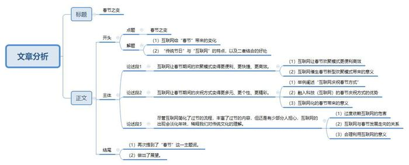

# 2017年广州市公考《申论》题（双考区）

<!-- gwy:overview:start -->
> **广州 · 2017 · 申论 · 统考** ｜ 1 题 · 图片 1 处 · 答案随题折叠

导航：[题目](#题目)
<!-- gwy:overview:end -->

> 候选采集稿。参考答案及解析来自粉笔页面，不代表官方答案或真实高分答卷；来源使用许可与原卷对应关系仍需人工核实。

## 给定材料

### 材料 material-3bbd8078ba020f77

春节是我国民间最隆重、最热闹的一个传统节日。春节的历史很悠久，它起源于殷商时期年头岁尾的祭神祭祖活动。按照我国农历，正月初一古称元日、元辰、元正、元朔、元旦等，俗称年初一，到了民国时期，改用公历，公历的1月1日称为元旦，把农历的一月一日叫为春节。

在春节漫长的历史中，挂灯笼、贴对联、看舞狮、逛庙会、走亲访友等年俗在不断演变。对此，我们将不同时代的年俗记录了下来。

上世纪四五十年代，大年初一早上晨曦初露，父亲点燃一挂鞭炮，短暂的噼里啪啦之后，姊妹们便迫不及待地爬出被窝，梳洗打扮后穿上新衣，父亲带领全家跪在门槛内侧，朝着门外，恭恭敬敬磕几个响头，祈祷来年吉祥安康、人寿年丰。

到了六七十年代，人们走家串户，互道“拜年”“恭喜发财”之类的祝福语，在那物资匮乏的年月，亲朋好友互访时，还免不了要拎点自制的咸鱼、腊肉、炒花生、炸薯片之类的礼物。

八九十年代，孩子们大年初一早上争穿新衣已显得不重要了，红包里几元小票逐年发展为百元大钞，最显著的变化是一家人围坐在电视机前看央视春晚，共同等待新年的到来。

到了21世纪，经济发展、科技发达，电子产品随之充斥于方方面面，人们拜年足不出户，捧着手机滑动手指，瞬间便能成为千里之外的祝福，而且精彩不断。

## 题目

### 第 1 题

**阅读9则资料，以“透视春节之变”为主题，写一篇议论文。（100分）**

关联材料：材料 material-3bbd8078ba020f77

作答要求：

要求：

（1）题目自拟、观点正确、条理清晰、逻辑严密；

（2）不必提供对策；

（3）不要大段摘抄资料；

（4）作答时必须用黑色墨水的签字笔或钢笔，在答题卡的指定位置作答，作答在其他位置上一律无效；

（5）篇幅在1500-1800字之间（计入标点与空格）。

第 1 题 · 答案与解析

**参考答案（粉笔题库参考内容）**

**春节之变**

互联网为传统年俗注入新意，从前谈到春节，脑海中总是会浮现：响鞭炮、贴春联、吃年夜饭、转旺火等场景，参与这些民俗的过程，仿佛就是在演绎习俗背后的故事，传承源远流长的节日文化特色；现如今，用来勾勒春节的笔墨，更多地用在了旅游度假、银幕数量激增、抢红包、剁手族等字眼上，它们是“互联网+传统节日”的新时代产物。传统节日有文化积淀、趣味寓言和道德风尚等特征，互联网有方便快捷、智能高效和时代性等特点，二者通过内容和形式的搭配，谱写阖家团圆、辞旧迎新的新乐章。

民俗是历史积淀的时尚，时尚是与时俱进的民俗。“互联网+”这股时尚东风，改变了人们的消费习惯，催生了新的经济发展模式，这些改变让全民参与到新年俗的重构之中，接纳传统节日的新面貌：更加便利的欢聚模式和更加多元的庆祝方式。

**互联网让春节期间的欢聚模式变得更便利、更快捷、更高效。**五花八门的订票平台，令人眼花缭乱的刷票工具，让人应接不暇的出行工具都大大提高了我们出行的效率，增加了我们订票的几率。复杂繁琐的年货采购过程，只需动动手指头，线上采购一应俱全，让家人空出时间享受珍贵的团聚时光。年夜饭的定制也由传统的家庭“自给自足”，变为“年夜饭送货上门”。过年地点的选择由过去单一方式的“回老家”，变成现如今的“反向探亲”“出门旅游”，变成了只要一家人在一起就是“年”。互联网催生出的各种新型欢聚模式，一方面丰富和方便老百姓生活，提高了幸福指数；另一方面也为传统年俗注入了新的时代内涵，培养大众养成“互联网+春节”的消费习惯。

**互联网让春节期间的庆祝方式变得更多元、更个性、更精彩。**自从微信红包在2014年推出之后，抢红包已然成为“指尖上的新年俗”，成为大众过年的新玩法、新乐趣。支付宝等多家金融APP推出的“集福”活动，春晚推出的网络互动更是掀起了庆祝年俗活动的新高潮，激发了大众相互沟通的积极性，推动企业朝着智能化方向转型升级。还有少部分人选择旅游度假，放松身心。与传统庆祝方式相比，这种融入科技元素的庆祝方式，打破了时间和空间的壁垒，增加了人与人之间的互动与交流，更重要的是，增加了趣味性，贴合大众个性化需求的发展趋势。

互联网化的春节预示着，以互联网为代表的新媒体、高科技正在朝着人性化、人文化的方向发展，倒逼科技与人文的融合，催生更温情的过节方式，解放大众的手脚，腾出更多的时间享受科技和时代发展带来的红利。同时，春节的科技化还激发出了新的经济发展方式，推进各行各业相互跨界、组合，集聚裂变效应，促进整个经济结构的调整。此外，为今后“新技术+传统模式”的发展与创新奠定基础。

**尽管互联网简化了过节的流程，丰富了过节的内容，但还是有少部分人担心，互联网的出现会淡化年味，稀释我们对传统文化的理解。**就拿过度依赖手机的“低头族”来讲，沉迷于发红包、抢红包、刷微博，自然会冷落亲情，何来阖家团圆一说。其实，互联网只是一个工具、一个平台、一个媒介，而过春节本身对于大家而言，是一种珍视亲人、渴望团聚、维系情感的真情流露，所以“互联网+春节”发展走向如何，决定权在于我们。只要用好互联网，完全可以让年味儿愈来愈浓：社交工具可以让异地相处的亲人面对面吃团圆饭，发红包可以增进家人之间的感情，购物平台可以让远在异乡的我们尽孝心……

将来，与时俱进的过节观念在人们心中会愈演愈烈，个体在传情达意的需求上也会越来越多元化、新颖化、独特化。只有积淀深厚的文化底蕴，营造浓烈的过年氛围，全方位、多角度、立体化的传统节日才会“跃然人心”，“互联网+”才能为中华民族文化走出国门提供有效平台，为“春节”等传统文化节日的与时俱进注入新鲜血液，中华民族的优秀文化才能借助互联网传播到全世界。

**解析**

**文章分析**

**春节之变**

【**标题的优点：**首先，范文的标题“春节之变”突出了“透视春节之变”这一主题。其次，在形式上，文字简洁明快。】

（1）互联网为传统年俗注入新意，从前谈到春节，脑海中总是会浮现：响鞭炮、贴春联、吃年夜饭、转旺火等场景，参与这些民俗的过程，仿佛就是在演绎习俗背后的故事，传承源远流长的节日文化特色；现如今，用来勾勒春节的笔墨，更多地用在了旅游度假、银幕数量激增、抢红包、剁手族等字眼上，它们是“互联网+传统节日”的新时代产物。（2）传统节日有文化积淀、趣味寓言和道德风尚等特征，互联网有方便快捷、智能高效和时代性等特点，二者通过内容和形式的搭配，谱写阖家团圆、辞旧迎新的新乐章。

【**开头的优点：**★内容方面：范文的开头是紧扣题目给定的“春节之变”这一标题展开的。首先，开头开门见山的点出主题，做到了主题明确。其次，对“春节之变”这一主题词进行了分析阐述，指出了（1）互联网给“春节”带来的变化。（2）“传统节日”与“互联网”的特点，以及二者结合的好处。★文字表达方面：使用了“从前……现如今……”等逻辑连接词，使语言表达有逻辑性。】

民俗是历史积淀的时尚，时尚是与时俱进的民俗。“互联网+”这股时尚东风，改变了人们的消费习惯，催生了新的经济发展模式，这些改变让全民参与到新年俗的重构之中，接纳传统节日的新面貌：更加便利的欢聚模式和更加多元的庆祝方式。

【**过渡段的优点：**范文的过渡段分析了“互联网+”带来的意义。此外，还要注意过渡段末尾的“这些改变让全民参与到新年俗的重构之中，接纳传统节日的新面貌：更加便利的欢聚模式和更加多元的庆祝方式”是用来引起下文的过渡句。】

**互联网让春节期间的欢聚模式变得更便利、更快捷、更高效。**（1）五花八门的订票平台，令人眼花缭乱的刷票工具，让人应接不暇的出行工具都大大提高了我们出行的效率，增加了我们订票的几率。复杂繁琐的年货采购过程，只需动动手指头，线上采购一应俱全，让家人空出时间享受珍贵的团聚时光。年夜饭的定制也由传统的家庭“自给自足”，变为“年夜饭送货上门”。过年地点的选择由过去单一方式的“回老家”，变成现如今的“反向探亲”“出门旅游”，变成了只要一家人在一起就是“年”。（2）互联网催生出的各种新型欢聚模式，一方面丰富和方便老百姓生活，提高了幸福指数；另一方面也为传统年俗注入了新的时代内涵，培养大众养成“互联网+春节”的消费习惯。

【**论述段****1****的优点：**★观点句：范文的观点句是紧扣“春节之变”这一主题词提出的。形式上，它在段首处直接写出，位置突出，容易发现。内容上，关键词突出，内容要点明确，可以明显看出它是从“互联网改变春节的欢聚模式”方面入手，指出了“互联网便捷了春节的欢聚”。★论述内容：（1）举例论述了“互联网让春节欢聚模式更便利高效”；（2）介绍了“互联网催生春节新型欢聚模式带来的意义”。注意：以上几个方面的内容都是紧扣“互联网让春节期间的欢聚模式变得更便利、更快捷、更高效”这个观点句进行分析论述的，论述的针对性强，内容层次丰富。★论述方法：采取了讲道理、举例子相结合，做到了丰富多样。】

**互联网让春节期间的庆祝方式变得更多元、更个性、更精彩。**（1）自从微信红包在2014年推出之后，抢红包已然成为“指尖上的新年俗”，成为大众过年的新玩法、新乐趣。支付宝等多家金融APP推出的“集福”活动，春晚推出的网络互动更是掀起了庆祝年俗活动的新高潮，激发了大众相互沟通的积极性，推动企业朝着智能化方向转型升级。还有少部分人选择旅游度假，放松身心。（2）与传统庆祝方式相比，这种融入科技元素的庆祝方式，打破了时间和空间的壁垒，增加了人与人之间的互动与交流，更重要的是，增加了趣味性，贴合大众个性化需求的发展趋势。

（3）互联网化的春节预示着，以互联网为代表的新媒体、高科技正在朝着人性化、人文化的方向发展，倒逼科技与人文的融合，催生更温情的过节方式，解放大众的手脚，腾出更多的时间享受科技和时代发展带来的红利。同时，春节的科技化还激发出了新的经济发展方式，推进各行各业相互跨界、组合，集聚裂变效应，促进整个经济结构的调整。此外，为今后“新技术+传统模式”的发展与创新奠定基础。

【**论述段****2****的优点：**★观点句：范文的观点句是紧扣“春节之变”这一主题词提出的。形式上，它在段首处直接写出，位置突出，容易发现。内容上，关键词突出，内容要点明确，可以明显看出它是从“互联网改变了春节的庆祝方式”方面入手，指出了“互联网丰富了春节的庆祝方式”。★论述内容：（1）举例阐述“互联网庆祝春节方式”；（2）介绍了“融入科技（互联网）的春节庆祝方式的优势”；（3）介绍了“互联网化的春节带来的意义”。注意：以上几个方面的内容都是紧扣“互联网让春节期间的庆祝方式变得更多元、更个性、更精彩”这个观点句进行分析论述的，论述的针对性强，内容层次丰富。★论述方法：采取了讲道理、举例子相结合，做到了丰富多样。】

**尽管互联网简化了过节的流程，丰富了过节的内容，但还是有少部分人担心，互联网的出现会淡化年味，稀释我们对传统文化的理解。**（1）就拿过度依赖手机的“低头族”来讲，沉迷于发红包、抢红包、刷微博，自然会冷落亲情，何来阖家团圆一说。（2）其实，互联网只是一个工具、一个平台、一个媒介，而过春节本身对于大家而言，是一种珍视亲人、渴望团聚、维系情感的真情流露，所以“互联网+春节”发展走向如何，决定权在于我们。（3）只要用好互联网，完全可以让年味儿愈来愈浓：社交工具可以让异地相处的亲人面对面吃团圆饭，发红包可以增进家人之间的感情，购物平台可以让远在异乡的我们尽孝心……

【**论述段****3****的优点：**★观点句：范文的观点句是紧扣“春节之变”这一文章主题提出的。形式上，它在段首处直接写出，位置突出，容易发现。内容上，关键词突出，内容要点明确，可以明显看出它是从“互联网对春节的消极影响”方面入手，指出了“互联网淡化了年味，不利于传承传统文化”。★论述内容：（1）举例介绍了“过度依赖互联网的危害”；（2）介绍了“互联网与‘春节’发展走向的关系”；（3）举例介绍了“合理利用互联网的意义”。注意：以上几个方面的内容都是紧扣“尽管互联网简化了过节的流程，丰富了过节的内容，但还是有少部分人担心，互联网的出现会淡化年味，稀释我们对传统文化的理解”这个观点句进行分析论述的，论述的针对性强，内容层次丰富。★论述方法：采取了讲道理、举例子相结合，做到了丰富多样。】

【**论述段之间的关系**：★内容的内在逻辑：范文的论述段之间是依照递进的逻辑展开的。论述观点1、2先写了“互联网为春节带来的积极变化”，论述观点3再写了“互联网对春节产生的消极影响”。】

将来，与时俱进的过节观念在人们心中会愈演愈烈，个体在传情达意的需求上也会越来越多元化、新颖化、独特化。只有积淀深厚的文化底蕴，营造浓烈的过年氛围，全方位、多角度、立体化的传统节日才会“跃然人心”，“互联网+”才能为中华民族文化走出国门提供有效平台，为“春节”等传统文化节日的与时俱进注入新鲜血液，中华民族的优秀文化才能借助互联网传播到全世界。

【**结尾的优点**：范文的结尾回扣了“透视春节之变”这一主题。（1）再次提到了“春节”这一主题词。（2）做出了展望。】

**考点**：考点文章写作题

**来源**：来源2017年广州市公考《申论》题（双考区）

