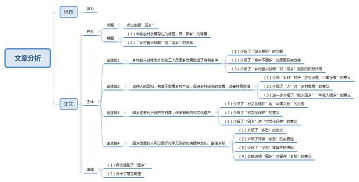

# 2018年广州市公考《申论》题（二）

> 候选采集稿。参考答案及解析来自粉笔页面，不代表官方答案或真实高分答卷；来源使用许可与原卷对应关系仍需人工核实。

## 给定材料

### 材料 material-04dbc76e2fcf0aac

实施乡村振兴战略。农业农村农民问题是关系国计民生的根本性问题，必须始终把解决好“三农”问题作为全党工作重中之重。要坚持农业农村优先发展，按照产业兴旺、生态宜居、乡风文明、治理有效、生活富裕的总要求，建立健全城乡融合发展体制机制和政策体系，加快推进农业农村现代化。巩固和完善农村基本经营制度，深化农村土地制度改革，完善承包地“三权”分置制度。保持土地承包关系稳定并长久不变，第二轮土地承包到期后再延长三十年。深化农村集体产权制度改革，保障农民财产权益，壮大集体经济。确保国家粮食安全，把中国人的饭碗牢牢端在自己手中。构建现代农业产业体系、生产体系、经营体系，完善农业支持保护制度，发展多种形式适度规模经营，培育新型农业经营主体，健全农业社会化服务体系，实现小农户和现代农业发展有机衔接。促进农村一二三产业融合发展，支持和鼓励农民就业创业，拓宽增收渠道。加强农村基层基础工作，健全自治、法治、德治相结合的乡村治理体系。培养造就一支懂农业、爱农村、爱农民的“三农”工作队伍。

——习近平：《决胜全面建成小康社会 夺取新时代中国特色社会主义伟大胜利——在中国共产党第十九次全国代表大会上的报告》

## 题目

### 第 1 题

**请以“回乡”为主题，自拟题目，写一篇议论文，谈谈对乡村振兴战略的认识。（100分）**

关联材料：material-04dbc76e2fcf0aac

作答要求：

要求：

（1）依据给定材料，可不拘泥于给定材料；

（2）观点明确，论证充分，条理清晰，逻辑严密，语言流畅；

（3）不必提供对策；

（4）不要大段摘抄材料；

（5）作答时必须用黑色墨水的签字笔或钢笔，在答题卡的指定位置作答，作答在其他位置上一律无效；

（6）篇幅在1200字-1500字（计入标点与空格）。

## 答案与解析

第 1 题

**参考答案（粉笔题库参考内容）**

**归乡**

曾经，由于城乡收入、基础设施、服务水平差距过大，农村大量青壮年离开农村涌入城市，农村人口的迅速减少，造成了农村老龄化、空心化现象严重，导致乡村社会结构发生巨大变化，乡村文化受到冲击。但进入到深水区改革以来，国家愈发重视三农问题，实施了乡村振兴战略，为外出务工人员提供了返乡发展的有利条件。**乡村振兴，最终旨归是****“人”。毋庸赘言，“人”的回归将为乡村振兴提供无限活力。**

**乡村振兴战略为外出务工人员回乡发展创造了有利条件。**由于存在城乡二元结构问题，农村与城市发展差距较大。迫于生存压力以及对美好生活的向往，农村青壮年开始涌入城市，形成了城乡间的“抽血效应”。但进入新时期以来，政府已愈发重视三农问题，尤其是城乡间人口流动问题，于是逐步出台政策，并最终形成乡村振兴战略，从生产、生态、文明、治理等方面给予全方位支持。战略的出台，将改变农村发展的走向，为返乡发展的村民提供更优质的自然环境，有力的政策支撑，良好的服务水平。从某种程度来说，乡村振兴战略有助于人们返乡发展。人的回归也反过来促进了乡村的振兴。

**这种人的回归，有益于发展乡村产业，促进乡村经济的发展，改善村民生活。**老子曾说：“治人事天，莫若啬”，意思是强调农业的重要性。而农业要发展，就得依托于广袤的乡村。从这个角度而言，乡村决定着中国的发展程度。而乡村要发展，人是关键因素。能人的回归，能为乡村发展带来更多资源的同时，也有利于整合乡村零散资源，使乡村发展奔向产业化之路；年轻人的回归，不仅可以为乡村带来丰富的劳动力，不断完善基础设施建设，更好地营造经济发展环境，也有利于为经济发展带来新点子、新思想。不言而喻，振兴乡村为了人，外出务工人员的回乡也可以促进乡村的经济发展。

**当然，回乡也有利于保护古村落，传承有形的村文化遗产。**中国文化的根在乡村，留住乡村的形态之美是我们的责任。保护古村落的意义，不仅在于守护一段历史，更在于留存一些独特价值，这些价值体现在能为乡村生产提供精神来源；其生态价值和生活价值满足了人们对闲适生活的渴望；其文化价值更是现代文明的源头。留住乡村的样子，就是留住了人类的过去。而回乡的人们，更能意识到古村落、文化遗产的价值。他们当中，有的人利用手中的镜头，让每一帧画面都载着古村落的气息；有的人利用创意产业，让古村落重新焕发活力。可以说，回乡是时代之需，也是文化发展之利。

**除此之外，回乡发展的人可以更好传承无形的传统精神文化，留住乡愁。**什么是乡愁？乡愁是一枚邮票，遥寄了当代中国人对故乡的思念；乡愁是对于质朴、善良、坚韧、执着这些美好品质的坚守。当下，人们尽管在经济上奔跑着，但在情感上，依然呼唤着乡愁。但如若农村人口继续大量外流，载着农村文化精神的人也会慢慢消失。那时候，我们又能靠什么去留住乡愁，留住那些美好呢？从这个意义上来说，只有人的回归，才能让这些优良的传统、美好的品质传承下去；只有人的回归，才能让振兴农村“形神具备”。

振兴农村，最终旨归是“人”。我们呼唤越来越多的外出务工者能够回到乡间，与家人、邻里一起努力，为了更好的生活，为了自己的村落，为了那小小的乡愁……

**解析**

**文章分析**

**归乡**

【**标题的优点：**首先，范文的标题“归乡”体现了“回乡”这一主题。其次，形式上，文字简洁明快。】

（1）曾经，由于城乡收入、基础设施、服务水平差距过大，农村大量青壮年离开农村涌入城市，农村人口的迅速减少，造成了农村老龄化、空心化现象严重，导致乡村社会结构发生巨大变化，乡村文化受到冲击。但进入到深水区改革以来，（2）国家愈发重视三农问题，实施了乡村振兴战略，为外出务工人员提供了返乡发展的有利条件。乡村振兴，最终旨归是“人”。毋庸赘言，“人”的回归将为乡村振兴提供无限活力**。**

【**开头****的****优****点：**★内容方面。范文的开头是紧扣题目给定的“回乡”这一主题展开的，同时突出了对“乡村振兴战略”的认识。首先，开头前三句点出主题，做到了主题明确。其次，对“回乡”这一主题进行了分析阐述，指出了（1）当前农村发展存在的问题，即“回乡”的背景。（2）“乡村振兴战略”与“回乡”的关系。★文字表达方面 ：使用了“但……”等关联词，使语言表达有逻辑性。】

**乡村振兴战略为外出务工人员回乡发展创造了有利条件。**（1）由于存在城乡二元结构问题，农村与城市发展差距较大。（2）迫于生存压力以及对美好生活向往，农村青壮年开始涌入城市，形成了城乡间的“抽血效应”。但进入新时期以来，（3）政府已愈发重视三农问题，尤其是城乡间人口流动问题，于是逐步出台政策，并最终形成乡村振兴战略，从生产、生态、文明、治理等方面给予全方位支持。战略的出台，将改变农村发展的走向，为返乡发展的村民提供更优质的自然环境，有力的政策支撑，良好的服务水平。从某种程度来说，乡村振兴战略有助于人们返乡发展。人的回归也反过来促进了乡村的振兴。

【**论述段****1****的优点：**★观点句：范文的观点句是紧扣“回乡”这一文章主题提出的。形式上，它在段首处直接写出，位置突出，容易发现。内容上，关键词突出，内容要点明确，可以明显看出它是从“乡村振兴战略”这一背景入手，指出了“其对于回乡的意义”。★论述内容：（1）介绍了“城乡差距”的问题；（2）介绍了“青年不回乡”的原因及其危害；（3）介绍了“乡村振兴战略”对“回乡”起到的积极作用。注意：以上几个方面的内容都是紧扣“乡村振兴战略为外出务工人员回乡发展创造了有利条件”这个观点句进行分析论述的，论述的针对性强，内容层次丰富。★论述方法：采用了讲道理、打比方相结合，做到了丰富多样。】

**这种人的回归，有益于发展乡村产业，促进乡村经济的发展，改善村民生活。**（1）老子曾说：“治人事天，莫若啬”，意思是强调农业的重要性。而农业要发展，就得依托于广袤的乡村。从这个角度而言，乡村决定着中国的发展程度。（2）而乡村要发展，人是关键因素。（3）能人的回归，能为乡村发展带来更多资源的同时，也有利于整合乡村零散资源，使乡村发展奔向产业化之路；年轻人的回归，不仅可以为乡村带来丰富的劳动力，不断完善基础设施建设，更好地营造经济发展环境，也有利于为经济发展带来新点子、新思想。不言而喻，振兴乡村为了人，外出务工人员的回乡也可以促进乡村的经济发展。

【**论述段****2****的优点：**★观点句：范文的观点句是紧扣“回乡”这一文章主题提出的。形式上，它在段首处直接写出，位置突出，容易发现。内容上，关键词突出，内容要点明确，可以明显看出它是从“乡村经济”入手，指出了“回乡”的意义。★论述内容：（1）介绍“乡村”对于“农业发展、中国发展”的意义；（2）介绍了“人”对“乡村发展”的意义；（3）进一步介绍了“能人回乡”“年轻人回乡”的意义。注意：以上几个方面的内容都是紧扣“这种人的回归，有益于发展乡村产业，促进乡村经济的发展，改善村民生活”这个观点句进行分析论述的，论述的针对性强，内容层次丰富。并且这几个方面的论述是有递进逻辑顺序的，先讲乡村对于农村、中国发展的意义，然后讲人对于乡村发展很重要，最后进一步说明能人、年轻人回乡对于乡村经济发展的重要性。★论述方法：采用了讲道理、打比方相结合，做到了丰富多样。】

**当然，回乡也有利于保护古村落，传承有形的村文化遗产。**（1）中国文化的根在乡村，留住乡村的形态之美是我们的责任。（2）保护古村落的意义，不仅在于守护一段历史，更在于留存一些独特价值，这些价值体现在能为乡村生产提供精神来源；其生态价值和生活价值满足了人们对闲适生活的渴望；其文化价值更是现代文明的源头。留住乡村的样子，就是留住了人类的过去。（3）而回乡的人们，更能意识到古村落、文化遗产的价值。他们当中，有的人利用手中的镜头，让每一帧画面都载着古村落的气息；有的人利用创意产业，让古村落重新焕发活力。可以说，回乡是时代之需，也是文化发展之利。

【**论述段****3****的优点：**★观点句：范文的观点句是紧扣“回乡”这一文章主题提出的。形式上，它在段首处直接写出，位置突出，容易发现。内容上，关键词突出，内容要点明确，可以明显看出它是从“村文化保护”入手，指出了“回乡”的意义。★论述内容：（1）介绍了“村文化保护”与“中国文化”的关系；（2）介绍了“村文化保护”的意义；（3）介绍了“回乡”对“村文化保护”的意义。注意：以上几个方面的内容都是紧扣“回乡也有利于保护古村落，传承有形的村文化遗产”这个观点句进行分析论述的，论述的针对性强，内容层次丰富。并且这几个方面的论述是有递进逻辑顺序的，先讲中国文化与村文化的关系不可割裂，然后讲保护村文化的意义，最后进一步点出回乡对于保护村文化的意义。★论述方法：采用了讲道理、举例子相结合，做到了丰富多样。】

**除此之外，回乡发展的人可以更好传承无形的传统精神文化，留住乡愁。**什么是乡愁？（1）乡愁是一枚邮票，遥寄了当代中国人对故乡的思念；乡愁是对于质朴、善良、坚韧、执着这些美好品质的坚守。（2）当下，人们尽管在经济上奔跑着，但在情感上，依然呼唤着乡愁。（3）但如若农村人口继续大量外流，载着农村文化精神的人也会慢慢消失。那时候，我们又能靠什么去留住乡愁，留住那些美好呢？（4）从这个意义上来说，只有人的回归，才能让这些优良的传统、美好的品质传承下去；只有人的回归，才能让振兴农村“形神具备”。

【**论述段****4****的优点：**★观点句：范文的观点句是紧扣“回乡”这一文章主题提出的。形式上，它在段首处直接写出，位置突出，容易发现。内容上，关键词突出，内容要点明确，可以明显看出它是从“乡愁”入手，指出了“回乡”的意义。★论述内容：（1）介绍了“乡愁”的含义；（2）介绍了呼唤“乡愁”的必要性；（3）介绍了“乡愁”难留住的原因；（4）总结说明“回乡”对留存“乡愁”的意义。注意：以上几个方面的内容都是紧扣“回乡发展的人可以更好传承无形的传统精神文化，留住乡愁”这个观点句进行分析论述的，论述的针对性强，内容层次丰富。并且这几个方面的论述是有内在逻辑顺序的，先讲乡愁是什么，然后讲留存乡愁的意义与难以留存的原因，最后讲回乡对留住乡愁的意义。★论述方法：采用了讲道理、打比方相结合，做到了丰富多样。】

【**论述段之间的关系：**★内容的内在逻辑：范文的论述段之间是依照并列逻辑展开的。论述段1先写了“乡村振兴战略”对“回乡”的意义，论述段2再写了“回乡”对“乡村经济发展”的意义，论述段3接着写了“回乡”对“乡村文化”的意义，论述段4最后写了“回乡”对“精神文化传承”的意义。★段与段的外在衔接：论述段1的段尾处的过渡句“从某种程度来说，乡村振兴战略有助于人们返乡发展。人的回归也反过来促进了乡村的振兴”，起到了承接论述段1、引出了论述段2的作用。论述段3的段首处的过渡句“当然，回乡也有利于保护古村落，传承有形的村文化遗产”，起到了承接论述段2、引出了论述段3的作用。论述段4的段首处的过渡句“除此之外”，起到了承接论述段3、引出了论述段4的作用。】

振兴农村，最终旨归是“人”。（1）我们呼唤越来越多的**外出务工者能够回到乡间**，与家人、邻里一起努力，（2）为了更好的生活，为了自己的村落，为了那小小的乡愁……

【**结尾的优点：**范文的结尾回扣了“回乡”这一主题。（1）再次提到了“回乡”；（2）发出了号召希望。】

**考点**：考点文章写作题

**来源**：来源2018年广州市公考《申论》题（二）

粉笔申论页面对本题只提供「解析视频」入口，该入口是会员推广位，页面无视频地址与文字解析。

