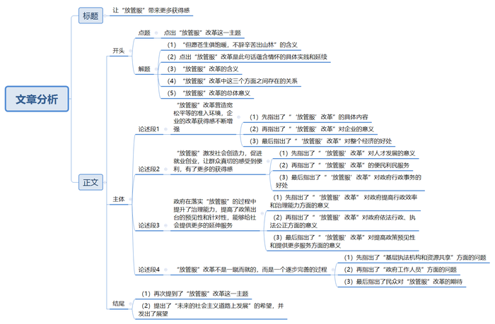

# 2018年广州市公考《申论》题（一）

<!-- gwy:overview:start -->
> **广州 · 2018 · 申论 · 一卷** ｜ 1 题 · 图片 1 处 · 答案随题折叠

导航：[题目](#题目) · [材料 1](#材料-1)
<!-- gwy:overview:end -->

> 候选采集稿。参考答案及解析来自粉笔页面，不代表官方答案或真实高分答卷；来源使用许可与原卷对应关系仍需人工核实。

## 给定材料

### 材料 1

深化“放管服”改革。全面实施市场准入负面清单制度。在全国推开“证照分离”改革，重点是照后减证，各类证能减尽减、能合则合，进一步压缩企业开办时间。大幅缩短商标注册周期，工程建设项目审批时间再压减一半。全面实施“双随机、一公开”监管，决不允许假冒伪劣滋生蔓延，决不允许执法者吃拿卡要。深入推进“互联网+政务服务”，使更多事项在网上办理，必须到现场办的也要力争做到“只进一扇门”、“最多跑一次”。大力推进综合执法机构机制改革，着力解决多头多层重复执法问题。加快政府信息系统互联互通，打通信息孤岛。清理群众和企业办事的各类证明，没有法律法规依据的一律取消。优化营商环境就是解放生产力、提高竞争力，要破障碍、去烦苛、筑坦途，为市场主体添活力，为人民群众增便利。

——摘自国务院总理李克强2018年3月5日在第十三届全国人民代表大会第一次会议上所做的《政府工作报告》

## 题目

### 第 1 题

**请深入思考给定材料**10**中划线句：“但愿苍生俱饱暖，不辞辛苦出山林”，联系“放管服”改革实践，自选角度，自拟题目，写一篇议论文。（100分）**

关联材料：材料 1

作答要求：

要求：

（1）依据给定材料，可不拘泥于给定材料；

（2）观点明确，论证充分，条理清晰，逻辑严密，语言流畅；

（3）不必提供对策；

（4）不要大段摘抄材料；

（5）作答时必须用黑色墨水的签字笔或钢笔，在答题卡的指定位置作答，作答在其他位置上一律无效；

（6）篇幅在1200字—1500字（计入标点与空格）。

第 1 题 · 答案与解析

**参考答案（粉笔题库参考内容）**

**让“放管服”带来更多获得感**

“但愿苍生俱饱暖，不辞辛苦出山林”，一首《咏煤炭》之所以流传千古，就是因为其中蕴含着为民效力的高洁风骨，这种精神承传至今成为我国政府以及广大公务人员实践为民服务的现实写照。**“放管服”改革是我国政府为人民效力的具体实践，正是这种情怀和抱负的延续。**

“放管服”即“简政放权、放管结合、优化服务”改革的简称。三者互为补充，紧密相关，三位一体，助力为民服务。“放管服”改革思路的提出，经历了时间的检验，随着政府改革的深入逐步完善，解放了社会生产力、提高了市场竞争力，破障碍、去烦苛、筑坦途，为市场主体添活力，**为人民群众增便利，实现了市场、政府、社会的多赢局面。**

**“放管服”改革营造宽松平等的准入环境，企业的改革获得感不断增强。**在“放管服”改革施行之后，摒除了过去的陈规旧制、繁文缛节，进而将减少行政审批事项、改革商事制度、清理审批中介、实行减税降费等作为改革的主要内容，具体落实诸如“三照合一，一照一码”的最新政策。据一项调查显示，自此全国各类创业创新主体实现了爆发式增长，“创客族”、“孵化器”、“天使投资”等群体的出现，充分体现了改革对加快新动能发展的巨大成效。在改革的推动之下，企业提升了活力，最终不仅回馈了企业的再发展，也促进了经济的大发展，形成良性循环。

**“放管服”激发社会创造力，促进就业创业，让群众真切的感受到便利，有了更多的获得感。**一方面，“放管服”可以为各类人才提供就业创业、技能培训等方面的服务，扩大就业、培育新动能、提升创新力；另一方面，在“放管服”改革的过程中各地纷纷结合实际，突破常规，推出了多项便民利民服务措施，很多地方都有了便民服务中心，引入大数据，创新技术手段，简化群众办事流程。有些流程电子化，不像以前跑断腿都办不了事。从这个角度来看，更简洁的办事规则，更少的办事要求、更简化的审核流程，已经成为“放管服”改革的新常态，值得肯定和发扬。这些不仅让我们看到了政府在这项工作中所付出的努力，也让政府的行政事务有了质的提升。

**政府在落实“放管服”的过程中提升了治理能力，提高了政策出台的预见性和针对性，能够给社会提供更多的延伸服务。**“放管服”坚持“简”字当头，简政放权，简化流程，精简审批，一切从简。政府不再依靠各种繁杂的证明来确定民众的身份，单纯依靠曾经申办过的数据沉积即可顺利提交申请，这减少了申请时填写的数据项目，节省了工作人员核实多份材料的时间，从而大大缩短了受理时长，提高了行政效率，提升了治理能力。同时用创新的监督方式，贯穿整个行政流程，很好地打破原来监管模式下可能产生的灰色利益链条，让执法权力寻租无门，大大促进了依法行政、执法公正。不仅如此，随着“放管服”改革的深入，政府还利用了大数据妥善解决了“全面两孩”政策落地后“入园难”，居民停车难等问题，大大提高了政策的预见性和针对性，延伸了更多的服务。

**但是，不可否认，“放管服”改革不是一蹴而就的，而是一个逐步完善的过程。**当下，基层执法机构执法人员少和检查对象多、执法水平偏低和监管要求较高的矛盾仍然突出；我国政务信息资源共享仍处于“条块分割、纵强横弱、各自为政、自成体系”的窘境；不少政府工作人员缺乏相关工作经验和专业背景知识的问题显著，甚至还有一些部门还存在“恋权”思想冲突。即便如此，民众依然对“放管服”改革有很多期待，他们期待着诸多好政策、优惠举措尽快落地，期待着将大数据技术真正打破信息共享“最后一公里”。

不负民众的期待，不负肩上的责任，不负历史的使命，始终坚持以群众为本，关注人民群众关心的，提供人民群众需要的，服务人民群众渴望的。牢固树立“简政放权、放管结合、优化服务”观念，积极探索，从实际出发，拿出自我革命的精神和利国利民的情怀，如是，“放管服”改革必将会在未来的社会主义道路上凝聚起更强大的动力，释放出更强大的力量。

**解析**

**文章分析**

**让“放管服”带来更多获得感**

【**标题的优点：**首先，范文的标题“让‘放管服’带来更多获得感”突出了“放管服”这一主题词。其次，形式上，文字简洁明快。】

“但愿苍生俱饱暖，不辞辛苦出山林”，一首《咏煤炭》之所以流传千古，（1）就是因为其中蕴含着为民效力的高洁风骨，这种精神承传至今成为我国政府以及广大公务人员实践为民服务的现实写照。（2）“放管服”改革是我国政府为人民效力的具体实践，正是这种情怀和抱负的延续。

（3）“放管服”即“简政放权、放管结合、优化服务”改革的简称。三者互为补充，紧密相关，三位一体，助力为民服务。（4）“放管服”改革思路的提出，经历了时间的检验，随着政府改革的深入逐步完善，解放了社会生产力、提高了市场竞争力，破障碍、去烦苛、筑坦途，为市场主体添活力，为人民群众增便利，实现了市场、政府、社会的多赢局面。

【**开头的优点：**★内容方面：范文的开头是紧扣题目给定的“放管服”改革这一主题展开的。首先，开头点出主题，做到了主题明确。其次，对“放管服”改革这一主题进行了分析阐述，指出了（1）“但愿苍生俱饱暖，不辞辛苦出山林”的含义；（2）“放管服”改革是对“但愿苍生俱饱暖，不辞辛苦出山林”的具体实践和延续；（3）“放管服”的具体所指及三个方面之间的关系；（4）“放管服”改革的意义。★文字表达方面：使用了关联词“正是……”，使语言表达有逻辑性。】

**“放管服”改革营造宽松平等的准入环境，企业的改革获得感不断增强。**（1）在“放管服”改革施行之后，摒除了过去的陈规旧制、繁文缛节，进而将减少行政审批事项、改革商事制度、清理审批中介、实行减税降费等作为改革的主要内容，具体落实诸如“三照合一，一照一码”的最新政策。（2）据一项调查显示，自此全国各类创业创新主体实现了爆发式增长，“创客族”、“孵化器”、“天使投资”等群体的出现，充分体现了改革对加快新动能发展的巨大成效。（3）在改革的推动之下，企业提升了活力，最终不仅回馈了企业的再发展，也促进了经济的大发展，形成良性循环。

【**论述段****1****的优点**：★观点句：范文的观点句是紧扣“放管服”改革这一文章主题提出的。形式上，它在段首处直接写出，位置突出，容易发现。内容上，关键词突出，内容要点明确，可以明显看出它是从“‘放管服’改革对企业的影响”入手，指出了“‘放管服’改革给企业带来了宽松平等的环境”。★论述内容：（1）先指出了“‘放管服’改革”的具体内容；（2）再指出了“‘放管服’改革”对企业的意义；（3）最后指出了“‘放管服’改革”对整个经济的意义。注意：以上几个方面的内容都是紧扣“‘放管服’改革营造宽松平等的准入环境，企业的改革获得感不断增强”这个观点句进行分析论述的，论述的针对性强，内容层次丰富。最后，在论述方法和论据的选取上做到了讲道理和举例子相结合，做到了丰富多样。】

**“放管服”激发社会创造力，促进就业创业，让群众真切的感受到便利，有了更多的获得感。**（1）一方面，“放管服”可以为各类人才提供就业创业、技能培训等方面的服务，扩大就业、培育新动能、提升创新力；（2）另一方面，在“放管服”改革的过程中各地纷纷结合实际，突破常规，推出了多项便民利民服务措施，很多地方都有了便民服务中心，引入大数据，创新技术手段，简化群众办事流程。（3）有些流程电子化，不像以前跑断腿都办不了事。从这个角度来看，更简洁的办事规则，更少的办事要求、更简化的审核流程，已经成为“放管服”改革的新常态，值得肯定和发扬。这些不仅让我们看到了政府在这项工作中所付出的努力，也让政府的行政事务有了质的提升。

【**论述段****2****的优点**：★观点句：范文的观点句是紧扣“放管服”改革这一文章主题提出的。形式上，它在段首处直接写出，位置突出，容易发现。内容上，关键词突出，内容要点明确，可以明显看出它是从“‘放管服’改革对群众或社会的影响”入手，指出了“‘放管服’改革给群众或社会带来了意义”。★论述内容：（1）先指出了“‘放管服’改革”在人才发展方面的意义；（2）再指出了“‘放管服’改革”便民利民服务方面的意义；（3）最后指出了“‘放管服’改革”对政府行政事务的意义。注意：以上几个方面的内容都是紧扣“‘放管服’激发社会创造力，促进就业创业，让群众真切的感受到便利，有了更多的获得感”这个观点句进行分析论述的，论述的针对性强，内容层次丰富。最后，在论述方法和论据的选取上做到了讲道理和举例子相结合，做到了丰富多样。】

**政府在落实“放管服”的过程中提升了治理能力，提高了政策出台的预见性和针对性，能够给社会提供更多的延伸服务。**“放管服”坚持“简”字当头，简政放权，简化流程，精简审批，一切从简。（1）政府不再依靠各种繁杂的证明来确定民众的身份，单纯依靠曾经申办过的数据沉积即可顺利提交申请，这减少了申请时填写的数据项目，节省了工作人员核实多份材料的时间，从而大大缩短了受理时长，提高了行政效率，提升了治理能力。（2）同时用创新的监督方式，贯穿整个行政流程，很好地打破原来监管模式下可能产生的灰色利益链条，让执法权力寻租无门，大大促进了依法行政、执法公正。（3）不仅如此，随着“放管服”改革的深入，政府还利用了大数据妥善解决了“全面两孩”政策落地后“入园难”，居民停车难等问题，大大提高了政策的预见性和针对性，延伸了更多的服务。

【**论述段****3****的优点**：★观点句：范文的观点句是紧扣“放管服”改革这一文章主题提出的。形式上，它在段首处直接写出，位置突出，容易发现。内容上，关键词突出，内容要点明确，可以明显看出它是从“‘放管服’改革对政府的影响”入手，指出了“‘放管服’改革给政府带来了意义”。★论述内容：（1）先指出了“‘放管服’改革” 对政府提高行政效率和治理能力方面的意义；（2）再指出了“‘放管服’改革”对政府依法行政、执法公正方面的意义；（3）最后指出了“‘放管服’改革”对提高政策预见性和提供更多服务方面的意义。注意：以上几个方面的内容都是紧扣“政府在落实‘放管服’的过程中提升了治理能力，提高了政策出台的预见性和针对性，能够给社会提供更多的延伸服务”这个观点句进行分析论述的，论述的针对性强，内容层次丰富。最后，在论述方法和论据的选取上做到了讲道理和举例子相结合，做到了丰富多样。】

**但是，不可否认，“放管服”改革不是一蹴而就的，而是一个逐步完善的过程。**（1）当下，基层执法机构执法人员少和检查对象多、执法水平偏低和监管要求较高的矛盾仍然突出；我国政务信息资源共享仍处于“条块分割、纵强横弱、各自为政、自成体系”的窘境；（2）不少政府工作人员缺乏相关工作经验和专业背景知识的问题显著，甚至还有一些部门还存在“恋权”思想冲突。（3）即便如此，民众依然对“放管服”改革有很多期待，他们期待着诸多好政策、优惠举措尽快落地，期待着将大数据技术真正打破信息共享“最后一公里”。

【**论述段****4****的优点**：★观点句：范文的观点句是紧扣“放管服”改革这一文章主题提出的。形式上，它在段首处直接写出，位置突出，容易发现。内容上，关键词突出，内容要点明确，可以明显看出它是从“‘放管服’改革存在的问题”入手，指出了“‘放管服’改革是一个逐步完善的过程”。★论述内容：（1）先指出了“基层执法机构和资源共享”方面的问题；（2）再指出了“政府工作人员”存在的问题；（3）最后指出了民众对“放管服”改革的期待。注意：以上几个方面的内容都是紧扣“‘放管服’改革不是一蹴而就的，而是一个逐步完善的过程”这个观点句进行分析论述的，论述的针对性强，内容层次丰富。最后，在论述方法和论据的选取上做到了讲道理和举例子相结合，做到了丰富多样。】

【**论述段之间的关系**：★内容的内在逻辑：范文的论述段之间有两层逻辑。第一层，整体上是从“影响”到“问题”的逻辑展开的。第二层，其中观点1-观点3是从“‘放管服’改革的意义”出发，论述段1先写了“‘放管服’改革对企业的意义”，论述段2再写了“‘放管服’改革对群众或社会的意义”，论述段3再写了“‘放管服’改革对政府的意义”；观点4是从“‘放管服’改革存在的问题”出发，论述段4写了“‘放管服’改革不是一蹴而就的，而是一个逐步完善的过程”。】

不负民众的期待，不负肩上的责任，不负历史的使命，始终坚持以群众为本，关注人民群众关心的，提供人民群众需要的，服务人民群众渴望的。（1）牢固树立“简政放权、放管结合、优化服务”观念，积极探索，从实际出发，拿出自我革命的精神和利国利民的情怀，（2）如是，“放管服”改革必将会在未来的社会主义道路上凝聚起更强大的动力，释放出更强大的力量。

【**结尾的优点**：范文的结尾回扣了“放管服”改革这一主题。（1）再次提到了“放管服”改革这一主题。（2）发出了展望。】

**考点**：考点文章写作题

**来源**：来源2018年广州市公考《申论》题（一）

粉笔申论页面对本题只提供「解析视频」入口，该入口是会员推广位，页面无视频地址与文字解析。

