# 2008年广西壮族自治区公务员录用考试《行测》题

<!-- gwy:overview:start -->
> **广西 · 2008 · 行测 · 统考** ｜ 135 题 · 图片 23 处 · 答案随题折叠

| 题型模块 | 题量 | 题号 |
| --- | ---: | ---: |
| 数量关系 | 15 | 1–15 |
| 常识判断 | 30 | 16–45 |
| 言语理解与表达 | 25 | 46–70 |
| 判断推理 | 50 | 71–120 |
| 资料分析 | 15 | 121–135 |
| **合计** | **135** | |

导航：[题型与作答说明](#题型与作答说明) · [题目](#题目) · [材料 1](#材料-1)
<!-- gwy:overview:end -->

> 候选采集稿。参考答案及解析来自粉笔页面，不代表官方答案或真实高分答卷；来源使用许可与原卷对应关系仍需人工核实。

## 题型与作答说明

数量关系

（15题）

本部分包括数字推理与数学运算两种类型的试题。

常识判断

（30题）

请根据题目要求做出正确选择，要求你依据常识作出判断。请注意，似乎合理的答案可能有多种，你应选择最为合理的一个。

言语理解与表达

（25题）

本部分包括逻辑填空与阅读理解两种类型的试题。

判断推理

（50题）

本部分包括图形推理、演绎推理、定义判断、类比推理与事件排序五种类型的试题。

资料分析

（15题）

针对下列文字、表或图回答问题，所给出的图、表或一段文字均有五个问题要你回答。你应根据资料提供的信息进行分析、比较、计算和判断处理。

## 题目

### 第 1 题

1，6，6，36，（  ），7776

A. 96

B. 216

C. 866

D. 1776

第 1 题 · 答案与解析

**参考答案（粉笔题库参考内容）**

B

**解析**

从前四个数字可以看出规律，即前两项的乘积等于第三项，故6×36=216，再用所给数列中的第六项来进行验证，36×216=7776，也正确。

故正确答案为B。

**来源**：2008年广西壮族自治区公务员录用考试《行测》题第1题

### 第 2 题

2，7，13，20，25，31，（    ）

A. 35

B. 36

C. 37

D. 38

第 2 题 · 答案与解析

**参考答案（粉笔题库参考内容）**

D

**解析**

用后一项减去前一项，分别得到5、6、7、5、6，可见，所给数列中，相邻两项的差是以5、6、7为一个循环，则数列第七项减去第六项应该为7，38-31=7。

故正确答案为D。

**来源**：2008年湖北省公务员录用考试《行测》题（A类）第32题

### 第 3 题

1/9，1/28，（  ），1/126

A. 1/55

B. 1/54

C. 1/65

D. 1/75

第 3 题 · 答案与解析

**参考答案（粉笔题库参考内容）**

C

**解析**

先观察分母9 = 2^3 + 1，28 = 3^3 + 1，126 = 5^3 + 1，则可推出空白项分母为4^3+1=65。

故正确答案为C。

**来源**：2008年广西壮族自治区公务员录用考试《行测》题第3题

### 第 4 题

1/2，1，4/3，19/12，（  ）

A. 133/60

B. 137/60

C. 107/60

D. 147/60

第 4 题 · 答案与解析

**参考答案（粉笔题库参考内容）**

C

**解析**

1 = 1/2 + 1/2，4/3 = 1 + 1/3，19/12 = 4/3 + 1/4，( ) = 19/12+1/5 = 107/60。

故正确答案为C。

**来源**：2008年广西壮族自治区公务员录用考试《行测》题第4题

### 第 5 题

2，12，121，1121，11211，（  ）

A. 11121

B. 11112

C. 112111

D. 111211

第 5 题 · 答案与解析

**参考答案（粉笔题库参考内容）**

D

**解析**

偶数项为前一项在最左边加1得到，奇数项为前一项在最右边加1得到，所以括号中应该是前一项在最左边加1。

故正确答案为D。

**来源**：2008年广西壮族自治区公务员录用考试《行测》题第5题

### 第 6 题

5，4，10，8，15，16，（    ），（    ）

A. 20，18

B. 18，32

C. 20，32

D. 18，64

第 6 题 · 答案与解析

**参考答案（粉笔题库参考内容）**

C

**解析**

数列项数较多且有2个未知项，优先考虑多重数列。交叉来看，奇数项为5，10，15，（20），是公差为5的等差数列；偶数项为4，8，16，（32），是公比为2的等比数列。则未知项分别为20、32。

故正确答案为C。

**来源**：2010年吉林省公务员录用考试《行测》题第3题

### 第 7 题

1，2，2，3，4，（  ）

A. 4

B. 5

C. 6

D. 7

第 7 题 · 答案与解析

**参考答案（粉笔题库参考内容）**

C

**解析**

本数列为作和递推数列。

数列中，相邻两项之和减去1得到下一项，具体规律如下：1+2-1=2，2+2-1=3，2+3-1=4，所以未知项为3＋4－1＝6。

故正确答案为C。

**来源**：2008年广西壮族自治区公务员录用考试《行测》题第7题

### 第 8 题

17，18，22，31，47，（  ）

A. 54

B. 63

C. 72

D. 81

第 8 题 · 答案与解析

**参考答案（粉笔题库参考内容）**

C

**解析**

故正确答案为C。

**来源**：2008年广西壮族自治区公务员录用考试《行测》题第8题

### 第 9 题

一个等腰三角形，一边长是30厘米，另一边长是65厘米，则这个三角形的周长是：

A. 125厘米

B. 160厘米

C. 125厘米或160厘米

D. 无法确定

第 9 题 · 答案与解析

**参考答案（粉笔题库参考内容）**

B

**解析**

已知该三角形是等腰三角形，由三角形任意两边的和大于第三边可知，另一条腰为65cm，因为30+30&lt;65，则其周长为30+65+65=160cm。

故正确答案为B。

**考点**：几何公式类-平面图形、几何结论类-三角形相关

**来源**：2008年广西壮族自治区公务员录用考试《行测》题第9题

### 第 10 题

学校举行运动会，要求按照红、黄、绿、紫的颜色插彩旗于校门口，请问第58面旗是什么颜色？

A. 黄

B. 红

C. 绿

D. 紫

第 10 题 · 答案与解析

**参考答案（粉笔题库参考内容）**

A

**解析**

通过题干可知，彩旗插放顺序是以4为周期，58 ÷ 4 = 14……2，则第57面旗为红色，第58面旗为黄色。

故正确答案为A。

**考点**：周期余数问题

**来源**：2008年广西壮族自治区公务员录用考试《行测》题第10题

### 第 11 题

参加阅兵式的官兵排成一个方阵，最外层的人数是80人，问这个方阵共有官兵多少人？

A. 441

B. 400

C. 361

D. 386

第 11 题 · 答案与解析

**参考答案（粉笔题库参考内容）**

A

**解析**

解析1：

设每一排官兵人数为x，x×4−4=80，x=21，则每排官兵人数为21人，那么方阵人数为21×21=441人。

解析2：

方阵最外层是80人，外层一共4边，但每个顶点上的士兵多计算了一次，得出每一边的人为(80+4) ÷ 4 = 21人。方阵总人数就是21×21=441人。

故正确答案为A。

**来源**：2008年广西壮族自治区公务员录用考试《行测》题第11题

### 第 12 题

（1296-18）÷36的值是：

A. 20

B. 35.5

C. 19

D. 36

第 12 题 · 答案与解析

**参考答案（粉笔题库参考内容）**

B

**解析**

由于36^2 = 1296，则原式=1296÷36−18÷36=36−0.5=35.5。

故正确答案为B。

**来源**：2008年广西壮族自治区公务员录用考试《行测》题第12题

### 第 13 题

2005年7月1日是星期五，那么2008年7月1日是星期几？

A. 星期三

B. 星期四

C. 星期五

D. 星期二

第 13 题 · 答案与解析

**参考答案（粉笔题库参考内容）**

D

**解析**

2005，2006，2007都是平年（365天），2008是闰年（366天），365 = 52 × 7 + 1，所以，每经历一个平年（365天），星期往后推一天，366 = 52 × 7 + 2，所以，每经历一个闰年（366天），星期往后推两天，因为2005年7月1日是星期五，所以2008年7月1日是星期五+1+1+2=星期日+2=星期二。

故正确答案为D。

**考点**：星期日期问题

**来源**：2008年广西壮族自治区公务员录用考试《行测》题第13题

### 第 14 题

小明每天必须做家务，做一天可得3元钱，做得特别好时每天可得5元钱，有一个月（30天）他共得100元，这个月他有多少天做得特别好？

A. 2

B. 3

C. 5

D. 7

第 14 题 · 答案与解析

**参考答案（粉笔题库参考内容）**

C

**解析**

设做得好的天数为n，则有5n+3(30-n)=100，解得n=5。

故正确答案为C。

**考点**：和差倍比问题

**来源**：2008年广西壮族自治区公务员录用考试《行测》题第14题

### 第 15 题

有一种长方形小纸板，长为29毫米，宽为11毫米。现在用同样大小的这种小纸板拼合成一个正方形，问最少要多少块这样的小纸板：

A. 197块

B. 192块

C. 319块

D. 299块

第 15 题 · 答案与解析

**参考答案（粉笔题库参考内容）**

C

**解析**

本题可转化为求29与11的最小公倍数，即为29×11=319，则组成正方形的边长为319，从而可得组成正方形的小纸板数为319 × 319 ÷ (29 × 11) = 319块。

故正确答案为C。

**考点**：公倍数与公约数问题

**来源**：2008年广西壮族自治区公务员录用考试《行测》题第15题

### 第 16 题

解放以来，广西第一任政府主席是：

A. 张云逸

B. 韦国清

C. 覃应机

D. 韦纯东

第 16 题 · 答案与解析

**参考答案（粉笔题库参考内容）**

A

**解析**

本题考查毛中特。

1949年9月22日，中央任命张云逸为中共广西省委书记、省人民政府主席。1955年，韦国清被任命为广西省省长、中共广西省委副书记，1958年任广西壮族自治区政府主席，中共广西壮族自治区委员会第一书记。

故正确答案为A。

**考点**：党的历史

**来源**：2008年广西壮族自治区公务员录用考试《行测》题第16题

### 第 17 题

下列选项中，属于十七大报告首次提出的是：

A. 生态文明

B. 创造条件让群众拥有财产性收入

C. 分配更加注意公平

D. 廉正文化

第 17 题 · 答案与解析

**参考答案（粉笔题库参考内容）**

B

**解析**

十七大报告中的五个“首次”：一、中共党代会报告首次提出2020年人均GDP比2000年翻两番；二、中共首次把“生态文明”写进党代会政治报告；三、十七大报告首次提出“创造条件让更多群众拥有财产性收入”；四、中共首次强调在初次分配中体现公平以遏制贫富差距；五、党与腐败“水火不相容”、“廉政文化”首次出现在报告中。

故正确答案为B。

**考点**：重要文件

**来源**：2008年广西壮族自治区公务员录用考试《行测》题第17题

### 第 18 题

下列属于我军1955年实行军衔制后被授予将级的广西籍将领是：

A. 李天佑

B. 许世友

C. 杨得志

D. 李德生

第 18 题 · 答案与解析

**参考答案（粉笔题库参考内容）**

A

**解析**

本题考查毛中特。

李天佑(1914—1970)，临桂人，上将。1955年首次授衔时，我军共有60余万名干部获得了准尉以上军衔。其中上将55人，李天佑在其中。

故正确答案为A。

本题相关知识点：

李天佑，广西临桂县人，汉族客家人。中国人民解放军高级将领。1934年荣获三等红星奖章，1955年被授予上将军衔，荣获一级八一勋章、二级独立自由勋章、一级解放勋章。

**考点**：党的历史

**来源**：2008年广西壮族自治区公务员录用考试《行测》题第18题

### 第 19 题

在2008年3月7日举行的俄罗斯总统选举中，谁以绝对优势当选俄罗斯新一任总统：

A. 普里马科夫

B. 普京

C. 梅德韦杰夫

D. 久加诺夫

第 19 题 · 答案与解析

**参考答案（粉笔题库参考内容）**

C

**解析**

此题属于时事题，要求考生能够对时事有一定的了解。

故正确答案为C。

本题相关知识点：

俄罗斯曾分别于1991年，1996年和2000年举行总统选举。1999年12月叶利钦总统辞去总统职务后，普京代行总统职务，并于2000年3月26日当选为俄罗斯第三届总统，5月7日正式宣誓就职。2008年5月7日，普京卸任，梅德韦杰夫正式就任俄联邦总统。

**考点**：时事政治-其他

**来源**：2008年广西壮族自治区公务员录用考试《行测》题第19题

### 第 20 题

根据《广西壮族自治区2008考试录用公务员简章》规定，面试采用什么为主的方法进行：

A. 无领导小组

B. 文件筐

C. 非结构化

D. 结构化

第 20 题 · 答案与解析

**参考答案（粉笔题库参考内容）**

D

**解析**

根据《广西壮族自治区2008考试录用公务员简章》规定，面试以结构化方式为主进行。

故正确答案为D。

本题相关知识点：结构化面试，也称标准化面试，是相对于传统的经验型面试而言的，是指按照事先制定好的面试提纲上的问题一一发问，并按照标准格式记下面试者的回答和对他的评价的一种面试方式。

**考点**：行政法

**来源**：2008年广西壮族自治区公务员录用考试《行测》题第20题

### 第 21 题

下列选项中不属于政企分开的措施是：

A. 政府部门与所办经济实体脱钩

B. 取消政府主管部门对所属企业的人、物的控制

C. 加强对企业投资的审批

D. 对国有重点企业试行稽查特派员制度

第 21 题 · 答案与解析

**参考答案（粉笔题库参考内容）**

C

**解析**

政企分开的主要措施：解除政府主管部门与所办经济实体和直属企业的行政隶属关系；大量裁减专业经济部门和各种行政性公司，发展社会中介组织；加强和改善国有企业的监管方式。

C项不属于政企分开的措施。

故正确答案为C。

本题相关知识点：政府与企业的社会职责的分开。政府的社会职责是对国家和社会公共事务进行有效的管理，而企业的社会职责是依照国家法律和市场规则，以最少的投入向社会提供最多最好的产出。

**来源**：2008年广西壮族自治区公务员录用考试《行测》题第21题

### 第 22 题

《行政处罚法》规定，未满14周岁的人违反行政法律规范将：

A. 免予处罚

B. 不予处罚

C. 从轻处罚

D. 减轻处罚

第 22 题 · 答案与解析

**参考答案（粉笔题库参考内容）**

B

**解析**

根据我国《行政处罚法》第三十条规定，不满十四周岁的未成年人有违法行为的，不予行政处罚，责令监护人加以管教；已满十四周岁不满十八周岁的未成年人有违法行为的，应当从轻或者减轻行政处罚。

故正确答案为B。

**考点**：行政法

**来源**：2008年广西壮族自治区公务员录用考试《行测》题第22题

### 第 23 题

《（  ）处分条例》2007年6月1日起正式实施，这预示着我国公职人员纪律处分规范正日趋完善，治贪治庸的惩戒体系正日趋健全。

A. 行政机关公务员

B. 行政事业机关公务员

C. 事业机关公务员

D. 行政企事业机关公务员

第 23 题 · 答案与解析

**参考答案（粉笔题库参考内容）**

A

**解析**

国务院总理温家宝签署第495号国务院令，公布《行政机关公务员处分条例》。这是新中国成立以来第一部全面、系统规范行政惩戒工作的专门行政法规。该条例于2007年6月1日起正式实施，预示着我国的公职人员纪律处分规范正日趋完善，治贪治庸的惩戒体系正日趋健全。

故正确答案为A。

**考点**：行政法

**来源**：2008年广西壮族自治区公务员录用考试《行测》题第23题

### 第 24 题

新华社台北3月22日电，台湾地区领导人选举结束，（  ）籍候选人马英九、萧万长获胜。

A. 民进党

B. 无党

C. 亲民党

D. 国民党

第 24 题 · 答案与解析

**参考答案（粉笔题库参考内容）**

D

**解析**

马英九、萧万长属国民党籍。

故正确答案为D。

本题相关知识点：2012年1月14日，台湾地区领导人选举结果出炉，国民党候选人马英九以689万票战胜民进党候选人蔡英文的609万票，最终以51.6%比45.6%的优势赢得“大选”并获得连任。

**考点**：时事政治-其他

**来源**：2008年广西壮族自治区公务员录用考试《行测》题第24题

### 第 25 题

邓小平坚持马克思主义的思想路线，把“解放思想”和“实事求是”联系起来表述，更鲜明地体现了马克思主义思想体系的开放性，体现它的（  ）的统一。

A. 科学性、理论性和实践性

B. 科学性、理论性和革命性

C. 理论性、实践性和革命性

D. 实践性、科学性和革命性

第 25 题 · 答案与解析

**参考答案（粉笔题库参考内容）**

D

**解析**

邓小平把“解放思想”和“实事求是”联系起来表述，体现了其实践性、科学性和革命性的统一。

故正确答案为D。

本题相关知识点：

实践性是指马克思主义作为一个完整理论体系是在同各国工人运动和革命斗争实践的结合中发展的；

革命性是在同各种错误思潮的斗争中发展的；

科学性是在对时代发展提出的新问题和出现的新情况进行创造性研究过程中不断发展的 。

马克思主义哲学正是在实践中实现了革命性和科学性的统一。马克思主义哲学的科学性是革命性的前提和基础，只有在科学性理论指导下，才能在实践中正确地改造世界，发挥其革命性作用；马克思主义哲学的革命性是科学性的必然结果和归宿，只有在实践中改造世界，才能体现出它的科学价值，并在改造世界的革命实践中丰富和发展其科学性。

**考点**：总论

**来源**：2008年广西壮族自治区公务员录用考试《行测》题第25题

### 第 26 题

下列权利中属于法人应该享有的权利是：

A. 生命健康权

B. 亲权

C. 肖像权

D. 商标权

第 26 题 · 答案与解析

**参考答案（粉笔题库参考内容）**

D

**解析**

法人是具有民事权利能力和民事行为能力，依法独立享有民事权利和承担民事义务的组织。简言之，法人是具有民事权利主体资格的社会组织，不是指具体的个体。故其享有的权利不包括生命健康权、亲权、肖像权。

故正确答案为D。

**考点**：民法典

**来源**：2008年湖北省公务员录用考试《行测》题（B类）第108题

### 第 27 题

在刚刚结束的十一届人大会议上通过和公布的国务院机构的“大部制”改革中，新成立了（  ）个国务院组成部门。

A. 5

B. 6

C. 7

D. 8

第 27 题 · 答案与解析

**参考答案（粉笔题库参考内容）**

A

**解析**

国务院机构的“大部制”改革中，新成立了5个国务院组成部门，分别是工业和信息化部、人力资源和社会保障部、环境保护部、住房和城乡建设部、交通运输部。

故正确答案为A。

本题相关知识点：

1982年至今，国务院进行过5次大的行政管理体制改革。1982年，国务院100个部门裁了39个；1988年，国务院组成部门、直属机构由原有的67个减为60个，国务院人员编制比原来减少9700多人；1993年，国务院组成部门、直属机构从原有的86个减少到59个，人员减少20%；1998年，国务院40个组成部门，仅保留29个；2003年，设立国务院国资委、银监会，组建商务部、国家药监局、安监总局等。

大部门体制，就是指把业务相似、职能相近的部门进行合并，集中由一个大部门统一行使。一方面可以精简政府机构，减少部门之间的职能交叉和权限冲突，简化公务手续；另一方面也可减少横向协调困难，裁撤议事协调机构，有利于建立统一、精简、高效的符合市场经济和民主法治要求的现代化政府体制。

**来源**：2008年广西壮族自治区公务员录用考试《行测》题第27题

### 第 28 题

弦乐在演奏之前，演奏员都要调节自己的乐器——拧紧或放松琴弦，这样做主要是改变乐器发出声音的：

A. 音调

B. 响度

C. 音色

D. 传播方向

第 28 题 · 答案与解析

**参考答案（粉笔题库参考内容）**

A

**解析**

音调反映声音高低特性，响度反映声音大小特性，音色区分不同种乐器发出的声音。

故正确答案为A。

**考点**：生活常识

**来源**：2008年广西壮族自治区公务员录用考试《行测》题第28题

### 第 29 题

近年来，某地的洪水泛滥越来越严重，对民生危害越来越大。造成洪水泛滥的原因之一是人类活动增多所造成的地球环境破坏。从哲学上看：

A. 事物之间存在着因果联系

B. 改造自然和人类活动存在着矛盾的关系

C. 人类活动必将引起自然灾害的出现

D. 洪水和自然灾害之间存在着本质的联系

第 29 题 · 答案与解析

**参考答案（粉笔题库参考内容）**

A

**解析**

题干所反映的哲学道理是事物之间存在着因果联系，因是人类活动对地球环境的破坏，果是洪水泛滥。

故正确答案为A。

**考点**：唯物辩证法

**来源**：2008年广西壮族自治区公务员录用考试《行测》题第29题

### 第 30 题

下列哪些现象属于类似于感觉的反映特征：

A. 葵花向阳

B. 饥餐渴饮

C. 雄鸡报晓

D. 蚂蚁搬家

第 30 题 · 答案与解析

**参考答案（粉笔题库参考内容）**

A

**解析**

从物体的机械运动，到低等原生动物的应激反应，再到高等动物的思维活动，它们在本质上都是一种对外界刺激做出的反应，只不过是反应的形式不一样，即使是与人类相差很大的石头，你踢它一下，它也会改变原来静止的状态，这虽然跟人类对外界做出的反应有很大差别，但没有本质上的区别，这就是所谓的“一切物质在本质上都具有类似感觉的反映特性”，这一观点强调的是意识对物质的依赖性，即物质决定意识，这属于唯物主义。

本题BCD都是现象描述，没有“感觉的反映特征”这个过程。

故正确答案为A。

**考点**：唯物论

**来源**：2008年广西壮族自治区公务员录用考试《行测》题第30题

### 第 31 题

根据我国宪法的规定，下列机关中，（  ）有权制定行政法规。

A. 全国人大常委会

B. 省级人大

C. 省级人民政府

D. 国务院

第 31 题 · 答案与解析

**参考答案（粉笔题库参考内容）**

D

**解析**

《宪法》第八十九条第一款规定：“国务院根据宪法和法律，规定行政措施，制定行政法规，发布决定和命令。”

故正确答案为D。

**考点**：宪法

**来源**：2008年广西壮族自治区公务员录用考试《行测》题第31题

### 第 32 题

下列属于市场构成要素的是：

A. 竞争

B. 技术

C. 资本

D. 企业

第 32 题 · 答案与解析

**参考答案（粉笔题库参考内容）**

D

**解析**

市场是由各种基本要素组成的有机结构体，正是这些要素之间的相互联系和相互作用，决定了市场的形成，推动着市场的现实运动。市场主要构成要素包括(1)一定量的可供交换的商品。(2)向市场提供商品的卖方。(3)商品需求、人格化代表者——买方。（4）微观构成要素如人口、购买力、购买欲望等。

本题中D项企业可以作为买方或者卖方。

故正确答案为D。

**考点**：市场经济

**来源**：2008年广西壮族自治区公务员录用考试《行测》题第32题

### 第 33 题

2008年北京奥林匹克运动会的圣火采集地奥林匹亚位于：

A. 意大利

B. 希腊

C. 埃及

D. 奥地利

第 33 题 · 答案与解析

**参考答案（粉笔题库参考内容）**

B

**解析**

奥运会圣火通常于奥运会开幕前几个月在奥运发源地——希腊奥林匹亚的赫拉神庙前点燃。圣火采集方式遵循古希腊的传统，由首席女祭司在奥林匹亚的赫拉神庙前朗诵太阳神的颂词，然后通过将太阳光集中在凹面镜的中央，产生高温引燃圣火，这是采集奥林匹克圣火的唯一方式。

故正确答案为B。

**考点**：文化常识

**来源**：2008年广西壮族自治区公务员录用考试《行测》题第33题

### 第 34 题

科学发展观的要求是：

A. 发展

B. 以人为本

C. 全面协调可持续

D. 统筹兼顾

第 34 题 · 答案与解析

**参考答案（粉笔题库参考内容）**

C

**解析**

科学发展观第一要义是发展，核心是以人为本，基本要求是全面协调可持续，根本方法是统筹兼顾。

故正确答案为C。

**来源**：2008年广西壮族自治区公务员录用考试《行测》题第34题

### 第 35 题

The only car not yet repaired by that mechanic is：

A. my

B. me

C. him

D. mine

第 35 题 · 答案与解析

**参考答案（粉笔题库参考内容）**

D

**解析**

题干中的英文句子，提取主干为The car is（  ）。此处要填物主代词。

故正确答案为D。

**考点**：文化常识

**来源**：2008年广西壮族自治区公务员录用考试《行测》题第35题

### 第 36 题

“才者，德之资也；德者，才之帅也”是司马光在《资治通鉴》中选拔官吏的标准。用现在的观点来看，与公务员任用所坚持的（  ）原则相一致。

A. 论资排辈

B. 管理与监督并重

C. 唯才是用

D. 任人为贤，德才兼备

第 36 题 · 答案与解析

**参考答案（粉笔题库参考内容）**

D

**解析**

“才者，德之资也；德者，才之帅也”强调的是德才兼备。

故正确答案为D。

本题相关知识点：

党的十七届四中全会通过的《中共中央关于加强和改进新形势下党的建设若干重大问题的决定》强调:“坚持德才兼备、以德为先用人标准。”这是我们党对干部选拔任用工作历史经验的科学总结，是对党的组织路线和干部政策的丰富发展，是新时期党的干部工作的重要指导方针。

**考点**：文学常识

**来源**：2008年广西壮族自治区公务员录用考试《行测》题第36题

### 第 37 题

近年来，一些地方政府经常就出租车和公共汽车票价、水价、电价等与人民群众生活相关的问题举行价格听证会，各界人士积极参与。这表明：

A. 民主与法制要紧密结合

B. 政府决策进一步民主化

C. 人大代表的作用在进一步增强

D. 人民可直接行使权利

第 37 题 · 答案与解析

**参考答案（粉笔题库参考内容）**

B

**解析**

党的十七大提出“要提高党科学执政、民主执政、依法执政水平，保证党领导人民有效治理国家，推进决策科学化、民主化，完善决策信息和智力支持系统，增强决策透明度和公众参与度，制定与群众利益密切相关的法律法规和公共政策原则上要公开听取意见”。

国务院颁布的《关于加强市县政府依法行政的决定》提出，要推行重大行政决策听证制度，并且提出要扩大听证范围，科学遴选听证代表，规范听证程序，尊重听证意见等，这是我国健全和完善听证制度的又一项重要举措。

故正确答案为B。

**来源**：2008年广西壮族自治区公务员录用考试《行测》题第37题

### 第 38 题

职业道德修养是指从业人员在职业活动实践中，按照职业道德基本原则和规范，在职业道德品质方面（  ），得以形成高尚的职业道德品质和达到较高的境界。

A. 环境熏陶和培养教育

B. 管理和监督

C. 外界监督和自我约束

D. 自我锻炼和自我改造

第 38 题 · 答案与解析

**参考答案（粉笔题库参考内容）**

D

**解析**

职业道德修养，是指从事各种职业活动的人员，按照职业道德基本原则和规范，在职业活动中所进行的自我教育、自我改造、自我完善，使自己形成良好的职业道德品质和达到一定的职业道德境界。这是一种自律行为。

故正确答案为D。

基本规范包括：1．爱岗敬业；2．诚实守信；3．办事公道；4．服务群众；5．奉献社会。

**来源**：2008年广西壮族自治区公务员录用考试《行测》题第38题

### 第 39 题

下列属于内部行政行为的是：

A. 行政许可

B. 行政处罚

C. 行政强制

D. 行政处分

第 39 题 · 答案与解析

**参考答案（粉笔题库参考内容）**

D

**解析**

内部行政行为是指行政主体在内部行政组织管理过程中所作的只对行政组织内部产生法律效力的行政行为。

A项错误，行政许可是行政机关根据公民、法人或者其他组织的申请，经依法审查，准予其从事特定活动的行为，是对社会实施的外部管理行为，故排除；

B项错误，行政处罚是指行政机关依法对违反行政管理秩序的公民、法人或者其他组织，以减损权益或者增加义务的方式予以惩戒的行为，并不仅对内，故排除；

C项错误，行政强制是指行政机关或法定授权的组织依照法定权限和程序对公民的人身和公民法人和其他组织的财产加以限制的具体行政行为，故排除；

D项正确，行政处分是指国家机关、企事业单位对所属的国家工作人员违法失职行为尚不构成犯罪给予的一种惩戒。对所属员工，是一种内部行政行为。

故正确答案为D。

本题相关知识点：

内部行政行为与外部行政行为主要区别：

1．行为与相对人之间的关系不同。

实施内部行政行为的行政机关与该行政行为的相对人之间，必定存在一种领导与被领导的隶属关系以及其它隶属关系，或者存在一种监督与被监督的法定的监督关系。实施外部行政行为的行政机关与该行政行为的相对人之间，基本上不存在领导与被领导的隶属关系或者其它隶属关系，而只存在管理与被管理的关系。

2．行政行为的作用力不同。

内部行政行为通常只涉及行政机关的内部行政事务，其作用主要和行政机关的正常运转有关，不影响外部相对人的权利和义务；外部行政行为是行政机关对外行使公共权利的行为，因而直接影响着外部相对人的利益。

**考点**：行政法

**来源**：2008年湖北省公务员录用考试《行测》题（A类）第111题

### 第 40 题

为确保企业、机关单位局域网的信息安全，防止来自Internet的黑客入侵或病毒感染，采用（  ）可以实现一定的防范作用。

A. 网管软件

B. 邮件列表

C. 防火墙软件

D. 防病毒软件

第 40 题 · 答案与解析

**参考答案（粉笔题库参考内容）**

C

**解析**

防火墙软件能极大地提高一个内部网络的安全性，并通过过滤不安全的服务而降低风险。防病毒软件不仅能识别出已知的病毒，提前在病毒获得运行权之前发出警报，还能屏蔽掉病毒程序的传染功能和破坏功能，而不使受感染的程序得不到运行。防火墙侧重于维护网络的安全，防止外来病毒的入侵。而防病毒软件侧重于病毒的查杀功能。

故正确答案为C。

**考点**：物理常识

**来源**：2008年广西壮族自治区公务员录用考试《行测》题第40题

### 第 41 题

在新的发展观下，单一以GDP考核干部政绩的情况将得到改进，新的考核体系将更加全面。这属于：

A. 由现象到本质

B. 由实践到认识

C. 由感性认识上升到理性认识

D. 用理性认识指导实践

第 41 题 · 答案与解析

**参考答案（粉笔题库参考内容）**

D

**解析**

新的发展观属于理性认识，在其指导下采取的新的考核体系属于实践。

故正确答案为D。

**考点**：认识论

**来源**：2008年广西壮族自治区公务员录用考试《行测》题第41题

### 第 42 题

目前唯一能替代化石燃料（煤、石油、天然气）并大规模使用的工业能源是：

A. 太阳能

B. 核能

C. 风能

D. 水能

第 42 题 · 答案与解析

**参考答案（粉笔题库参考内容）**

B

**解析**

核能是目前唯一能替代化石燃料（煤、石油、天然气）并大规模使用的工业能源。与化石燃料相比，核能发电不像化石燃料发电那样排放巨量的污染物质到大气中，因此核能发电不会造成空气污染。核能发电不会产生加重地球温室效应的二氧化碳。

故正确答案为B。

**考点**：化学常识

**来源**：2008年广西壮族自治区公务员录用考试《行测》题第42题

### 第 43 题

下列属于公务员领导职务的是：

A. 市公安局法制科科长

B. 市国土局调研员

C. 省政府巡视员

D. 省政府咨询顾问

第 43 题 · 答案与解析

**参考答案（粉笔题库参考内容）**

A

**解析**

本题考查法律常识。

根据《公务员法》第十八条第二款规定：“公务员领导职务层次分为：国家级正职、国家级副职、省部级正职、省部级副职、厅局级正职、厅局级副职、县处级正职、县处级副职、乡科级正职、乡科级副职。”

故正确答案为A。

本题相关知识点：非领导职务层次在厅局级以下设置，在省部级以上不设置非领导职务。非领导职务由高至低分为巡视员、副巡视员、调研员、副调研员、主任科员、副主任科员、科员、办事员。

**考点**：行政法

**来源**：2008年广西壮族自治区公务员录用考试《行测》题第43题

### 第 44 题

关于平等，以下说法错误的是：

A. 平等是历史的范畴

B. 人人平等这一观念的确立是因为宗教的兴起和不断的传播

C. 平等是人和人的对等对待的社会关系

D. 平等要求采取一视同仁的普遍原则，反对区别对待

第 44 题 · 答案与解析

**参考答案（粉笔题库参考内容）**

D

**解析**

D项说法过于绝对，平等并非采取绝对的一视同仁，而是根据不同情况具体分析。

平等权表达的是权利主体在法律所限定的范围内的平等。范围的限定决定了这种平等是绝对性和相对性的统一。

故正确答案为D。

相对性的理解：

一是现实权利的平等是相对的——法所确定的平等权是一种形式表达上的平等，而不就等于实际平等，或权利实现结果上的公平。究其原因在于，个体本身在能力（素质及其所拥有的实现权利的条件）上，以及社会对权利和义务及其保障在分配上存在着差异。

二是其他基本权利的享有是相对的——就对那些可以在一定条件被限制或剥夺的权利（如人身自由、政治权利和政治自由、财产权等），以及因群体类别不同（如一般群体与特殊群体）而生的不同权利的享有而言，公民之间的平等是相对的。如被剥夺政治权利的公民与未被剥夺政治权利的公民，在政治领域中所享有的权利就不可能是平等的。

**考点**：宪法

**来源**：2008年广西壮族自治区公务员录用考试《行测》题第44题

### 第 45 题

以下属于限制性行政指导的是：

A. 建议科学种田

B. 抑制物价暴涨

C. 提倡晚婚晚育

D. 禁止在公共场合吸烟

第 45 题 · 答案与解析

**参考答案（粉笔题库参考内容）**

D

**解析**

行政指导，是指行政主体在其职责、任务或其所管辖的事物范围内，为适应复杂多变的经济和社会生活的需要，基于国家的法律原则和政策，在行政相对方的同意或协助下，适时灵活地采取非强制手段，以有效地实现一定的行政目的，不直接产生法律效果的行为。

行政指导可以从不同角度加以分类，其中主要的分类方法：

第一，以有无法律根据为标准分为有法律根据的行政指导和无法律根据的行政指导。

第二，行政指导以其指导层次为标准，分为宏观行政指导和个别行政指导。

第三，行政指导以其作用的性质为标准，分为促进性指导和限制性指导。

第四，行政指导以行业或部门管理领域为标准还可分为教育、科技、商业、对外贸易等若干类别。

第五，行政指导以其功能为标准，分为管制性行政指导、调整性行政指导、促进性行政指导。管制性行政指导是指对于妨害秩序或公益的行为加以预防或抑制。

A、C选项错误，并非行政指导；

B选项错误，不具有限制性。

故正确答案为D。

**考点**：行政法

**来源**：2008年广西壮族自治区公务员录用考试《行测》题第45题

### 第 46 题

有了计划，才能人尽其才，物尽其用，财尽其\_\_\_\_；才能预见困难，及早\_\_\_\_，避免失误。填入划横线部分最恰当的一项是：

A. 利，防止

B. 力，防范

C. 利，防范

D. 力，防止

第 46 题 · 答案与解析

**参考答案（粉笔题库参考内容）**

B

**解析**

第一空应该与“人尽其才”“物尽其用”相并列，从“人才”“物用”可知，空格处应体现出“财务的合理利用”之意。“力”与“利”相比，不仅体现出用财所带来的好处，而且体现出“合理利用”之意。

第二空应与后面的“避免失误”相关。“防范”指用“规范”来预防错误的发生，而“防止”是指采取某种措施来“阻止”错误的发生，“避免失误”并非阻止，而是用“计划”来达到规避错误的效果，故用“防范”。

故正确答案为B。

**考点**：实词填空、对应关系-前后呼应、词的辨析-词义侧重

**来源**：2008年广西壮族自治区公务员录用考试《行测》题第46题

### 第 47 题

简报是机关、团体、企事业单位内部\_\_\_的\_\_\_情况、交流经验、揭露问题、沟通信息的事务文书。填入划横线部分最恰当的一项是：

A. 编辑，反映

B. 编发，反映

C. 编辑，反应

D. 编发，反应

第 47 题 · 答案与解析

**参考答案（粉笔题库参考内容）**

B

**解析**

此题考查近义实词不同侧重的辨析。

“编发”为编辑发布之意，简报为文书，除了编辑之外还要发布才能被称为文书，故第一空选“编发”。

“反映”指客观事物作用于人的感官，而使人以观念的形式对客体及其规律和特性模写 、复制和再现；“反应”指有机体受体内或体外的刺激而引起的相应的活动，第二空为主观意愿的“反映”，而非机体活动，应选“反映”。

故正确答案为B。

**考点**：实词填空、词的辨析-词义侧重

**来源**：2008年广西壮族自治区公务员录用考试《行测》题第47题

### 第 48 题

没有蓝天的深邃可以有白云的飘逸；没有大海的壮阔可以有小溪的翠绿。生活中没有旁观者的席位，我们总能找到自己的\_\_\_\_。填入划横线部分最恰当的一项是：

A. 职业

B. 位置

C. 职务

D. 处所

第 48 题 · 答案与解析

**参考答案（粉笔题库参考内容）**

B

**解析**

根据题干，“白云的飘逸”与“蓝天的深邃”，“小溪的翠绿”与“大海的壮阔”是相互对应的，而空格处的词语也应该与“席位”相对应，且意思相近，“席位”主要强调“位”。

因此，结合选项应该选择B，从选项中可以看出“位置”符合。

A选项“职业”范围较广，无法与“席位”相对应；C选项“职务”为“席位”中所从事的具体内容，无法对应；D选项“处所”不符合本句的意境。

故正确答案为B。

**考点**：实词填空、对应关系-前后呼应

**来源**：2008年广西壮族自治区公务员录用考试《行测》题第48题

### 第 49 题

从声学的角度看，对于绝大多数耳朵而言，批评是刺耳的音符，赞颂是动听的\_\_\_\_。填入划横线部分最恰当的一项是：

A. 音乐

B. 节拍

C. 旋律

D. 乐章

第 49 题 · 答案与解析

**参考答案（粉笔题库参考内容）**

C

**解析**

根据题干，空格处的词语应与“音符”相对应。“音符”为乐谱的组成部分，而“音乐”和“乐章”的范围过大，无法与其对应。空格前面的形容词为“动听”，“旋律”可以用其来形容，“节拍”则不可以。

故正确答案为C。

**考点**：关联关系-并列关系、实词填空、词的辨析-搭配对象

**来源**：2008年广西壮族自治区公务员录用考试《行测》题第49题

### 第 50 题

允许媒体发言，是一种文明，\_\_\_\_允许媒体存在一定的出于真实的谬误，也是保证媒体有效发言的文明。\_\_\_\_这种文明，\_\_\_\_祛除任何对于真实的畏惧。填入划横线部分最恰当的一项是：

A. 一旦，只有，才能

B. 甚至，只有，才能

C. 一旦，只要，就能

D. 甚至，只要，就能

第 50 题 · 答案与解析

**参考答案（粉笔题库参考内容）**

B

**解析**

第一空，根据“允许媒体发言”与“允许媒体存在一定的出于真实的谬误”可知，后文是在前文基础上的递进，语义程度更进一步。B、D项“甚至”表递进关系，符合文段逻辑，保留。A、C项“一旦”表假设条件，不能体现递进语义，排除。

第二、三空，“这种文明”是“祛除任何对于真实的畏惧”的必要前提，强调必须依靠这种文明，才能实现后面的结果。B项“只有······才能”引导必要条件关系，符合文意，保留。D项“只要······就能”为充分条件，指有该条件就必然达成结果，表述过于绝对，文段并非拥有文明就一定能祛除畏惧，排除。

故正确答案为B。

**来源**：2008年广西壮族自治区公务员录用考试《行测》题第50题

### 第 51 题

失去的应该争取，得到的要\_\_\_\_珍惜，失去和获得只是暂时，只有拼搏进取才是\_\_\_\_。填入划横线部分最恰当的一项是：

A. 备加，永恒

B. 倍加，永久

C. 倍加，永恒

D. 备加，永久

第 51 题 · 答案与解析

**参考答案（粉笔题库参考内容）**

C

**解析**

此题考查近义实词侧重点不同的辨析和语境填空。

“倍加”与“备加”相比，更加突出了程度的加深，“倍”指加倍，有更加、格外的意思；“备”表示完全。与“失去”相比，得到的更应该珍惜，故选“倍加”，且有固定搭配“倍加珍惜”。

第二个空根据语境可知，其应与“暂时”构成相反的逻辑关系。“永恒”与“永久”都是表时间程度的词语，但“永久”反映的只是时间的维度，而“永恒”除了有表时间的概念之外，还有将“拼搏进取”的状态保持下去之意，更有动态效果，故选“永恒”。

故正确答案为C。

**考点**：关联关系-并列关系、实词填空、词的辨析-搭配对象

**来源**：2008年广西壮族自治区公务员录用考试《行测》题第51题

### 第 52 题

媒体不是审计署，不可能动用那么多注册审计师、会计师，利用几个月甚至半年时间，去\_\_\_\_每一个\_\_\_\_，审查每一张报表。填入划横线部分最恰当的一项是：

A. 核对，数字

B. 审核，数据

C. 核对，数据

D. 审核，数字

第 52 题 · 答案与解析

**参考答案（粉笔题库参考内容）**

C

**解析**

此题考查近义实词的辨析和语境搭配。

先从第二空入手，“数据”与“数字”相比，“数据”所包含的范围更广。“数字”是一种符号，是原始信息；“数据”是经人加工过，有意义的信息，是关于某些方面的一组数字。媒体所报道的肯定是经过媒体自身加工的信息，故用“数据”更为合适。

再看第一空，“审核”表示审查核定，“核对”表示检查或核实以确认，“核对”所适用的范围更小，更具体。“审核”发生在事前，“核对”发生在事中或事后，结合语境本题应填入“核对”。“核对数据”的搭配也更为恰当。

故正确答案为C。

**考点**：实词填空、词的辨析-词义侧重

**来源**：2008年广西壮族自治区公务员录用考试《行测》题第52题

### 第 53 题

目前长春市中级人民法院审理的一起发行债券合同\_\_\_\_案中，四平市财政局为四平市油脂化工厂\_\_\_\_担保，被判承担一千多万元的连带赔偿责任。

填入划横线部分最恰当的一项是：

A. 矛盾，违法

B. 纠纷，违规

C. 纠纷，违法

D. 矛盾，违规

第 53 题 · 答案与解析

**参考答案（粉笔题库参考内容）**

C

**解析**

此题考查近义实词不同侧重和语境搭配。

“纠纷”与“矛盾”相比，更具有法律术语的色彩，“矛盾”不如“纠纷”具有正式性，故选“纠纷”。

根据后半句“四平市财政局······被判承担一千多万元的连带赔偿责任”，可知该担保属于“违法”行为。违法有两层含义：一是违反行政规章，可能受到行政处罚或制裁；二是违反其他法律法规，可能要被追究刑事责任。“违法”包含了“违规”，横线处选择“违法”更为恰当。

故正确答案为C。

**考点**：实词填空、词的辨析-词义侧重

**来源**：2008年广西壮族自治区公务员录用考试《行测》题第53题

### 第 54 题

阅读，才足以体会文章的音韵之美，文字之\_\_\_\_，情感之切，意蕴之\_\_\_\_，风格之\_\_\_\_，手法之\_\_\_\_。

填入划横线部分最恰当的一项是：

A. 精，深，新，巧

B. 深，精，新，巧

C. 深，精，巧，新

D. 精，深，巧，新

第 54 题 · 答案与解析

**参考答案（粉笔题库参考内容）**

A

**解析**

此题考查实词的语境搭配。

在形容文字时，一般用“精”，有准确之意；意蕴即人在素材中所见到的意义，一般说意义深远，故用“深”来形容“意蕴”；形容风格，一般用的是“新”；对于写作手法，更多的是有技巧在里面，用“巧”来形容更能体现写作手法之妙。

故正确答案为A。

**考点**：实词填空、词的辨析-搭配对象

**来源**：2008年广西壮族自治区公务员录用考试《行测》题第54题

### 第 55 题

不受\_\_\_\_的行政\_\_\_\_极易产生腐败。政府\_\_\_\_不仅有党的监督和司法监督，还有社会监督。

填入划横线部分最恰当的一项是：

A. 制约，权利，行为

B. 制约，权力，行政

C. 约束，权利，行政

D. 约束，权力，行为

第 55 题 · 答案与解析

**参考答案（粉笔题库参考内容）**

B

**解析**

此题考查近义实词的侧重点辨析和语境的搭配。

先分析第二空，“权力”是一个政治概念，一般是指有权支配他人的强制之力。“权利”是一个法律概念，一般指法律赋予人们的权力和利益，即自身拥有的维护利益之权。本题中的行政应属于政治范畴，且“权力”而非“权利”易产生腐败，故用“权力”。

“约束”指限制，使不越出范围，多与纪律、协议、道德等搭配。“制约”是指甲事物本身的存在和变化以乙事物本身的存在和变化为条件，则甲事物为乙事物所制约。由下文可知，行政权力受各种监督的制约，而非约束在某个范围内，故选“制约”，更强调限制之意。

第三空，由于前面是政府，而“行政”更符合政府这一主体，故选“行政”。

故正确答案为B。

**考点**：实词填空、词的辨析-词义侧重

**来源**：2008年广西壮族自治区公务员录用考试《行测》题第55题

### 第 56 题

下列各句没有语病的是：

A. 即使看几遍，但我还有很多地方不理解。

B. 顾客总是千方百计地选择漂亮的名牌的。

C. 他整个一上午都在办公室里埋头写作。

D. 对科里某些同志的缺点，科长经常对我们说：“你们要热心帮助啊！”

第 56 题 · 答案与解析

**参考答案（粉笔题库参考内容）**

B

**解析**

B选项中“漂亮的”“名牌的”为并列的名词词组，“的”可以用来代替所指的人或物，可做宾语，故B选项没有错误。

A选项中“即使······但”搭配不当；C选项中“一”和“整个”重复；D选项中“缺点”与“热心帮助”搭配不当。

故正确答案为B。

**来源**：2008年广西壮族自治区公务员录用考试《行测》题第56题

### 第 57 题

选出下列各组语句中句意明确、没有语病的一句：

A. 三年过去了，当记者再次驱车来到这里时，一座气势恢弘的石油化工新城已经耸立在人们面前。

B. 这只是他治愈的患者之一，在他那挂满锦旗和摆放上万张来信的诊室里，治好的病例可信手拈来。

C. 多年的刻苦钻研，精湛的医术和突出的成就，李云阶得到了国内外医学界的关注。

D. 肆意编造一些“趣闻”来迎合部分读者的需要，出版社赚了钱，可是那些书能起到什么样的社会效果呢？

第 57 题 · 答案与解析

**参考答案（粉笔题库参考内容）**

A

**解析**

B选项中成语使用不当，信手拈来多形容写作诗文时运用材料、驾驭语言随意自如；C选项中主语重复，可在第三句前加“使”；D选项中“起到”与“社会效果”搭配不当，可以改为“起到······作用”或“收到······效果”。

故正确答案为A。

**来源**：2008年广西壮族自治区公务员录用考试《行测》题第57题

### 第 58 题

信息科学和医学的结合将产生不可估量的影响。远程医疗将得到普及，智能机器人用于诊断和治疗已初见端倪，生物信息学不仅将用于大量生物医学数据的处理、分析与储存，而且将直接用于医疗技术中。

对这段话理解不准确的是：

A. 远程医疗将得到普及

B. 利用生物学对大量生物医疗数据进行处理、分析与储存

C. 智能机器人用于诊断和治疗已初见端倪

D. 生物信息学将直接用于医疗技术中

第 58 题 · 答案与解析

**参考答案（粉笔题库参考内容）**

B

**解析**

B选项可以定位原文“生物信息学不仅将用于大量生物医学数据的处理、分析与储存”，可知利用的是“生物信息学”，而非“生物学”，B项偷换概念。

A、C、D均可以在文中找到原文。

故正确答案为B。

**考点**：细节判断题

**来源**：2008年广西壮族自治区公务员录用考试《行测》题第58题

### 第 59 题

国民经济是一个有机整体，如同一部机器，各个部件各有功能，其正常运转是由部件和总体性能决定的，能快不快就会浪费机器，盲目求快就会损坏机器。

这段话支持了这样一种观点，即：

A. 国民经济的发展不能过热

B. 国民经济要协调发展

C. 国民经济发展的速度不能过慢

D. 和谐社会的创建依赖经济发展

第 59 题 · 答案与解析

**参考答案（粉笔题库参考内容）**

B

**解析**

根据提问知此题是中心理解题。

该句为“总分”结构，先将国民经济比作机器，说明“其正常运转是由部件和总体性能决定的”，然后从“快”“慢”两方面来具体论证。

因此，结合选项应该选择B，选项B中的“协调发展”是对文段“其正常运转是由部件和总体性能决定的”的同义替换，为正确答案。

选项A、C分别对“盲目求快就会损坏机器”和“能快不快就会浪费机器”进行同义替换，不全面，予以排除。选项D“和谐社会的创建”文段未曾提及，予以排除。

故正确答案为B。

**考点**：特殊问法

**来源**：2008年广西壮族自治区公务员录用考试《行测》题第59题

### 第 60 题

历史的人要办历史的事，既不要超越历史，去干那些办不到的事情；也不要推卸历史的责任，该干的事情也不去办。

对这句话理解正确的是：

A. 办历史的事要量力而为

B. 办事要对历史负责

C. 办历史的事反对冒进

D. 要经得起历史的考验

第 60 题 · 答案与解析

**参考答案（粉笔题库参考内容）**

B

**解析**

细读语句可知，“不要超越历史，去干那些办不到的事情”和“不要推卸历史的责任，该干的事情也不去办”为“对历史负责”的两个方面，既不能“超越历史”，也不能“怠慢历史”。

因此，结合选项应该选择B，B项表述最为全面。

A、C两项的内容是“对历史负责”的表现；D选项与题干无关，材料中并未涉及“历史的考验”。

故正确答案为B。

**考点**：句子

**来源**：2008年广西壮族自治区公务员录用考试《行测》题第60题

### 第 61 题

紫外线是太阳发出的一种射线，它们如果大举入侵地球，人类及各种生物势必遭受极大的危害，因为过量的紫外线会使生物的机能遭到严重的破坏。不过不用担心，我们有大气层中的臭氧层，是它们借助于共振的威力，阻止了紫外线的长驱直入。当紫外线经过大气层时，臭氧层的振动频率恰恰能与紫外线产生共振，因而就使这种振动吸收了大部分的紫外线。所以，共振能使大气中的臭氧层变得如防晒油一样，保证我们不至于被射线伤害。

能最好地概括上文的中心思想的一项是：

A. 臭氧层让我们免受紫外线的伤害

B. 紫外线和共振

C. 紫外线到哪里去了

D. 共振让我们免受紫外线的伤害

第 61 题 · 答案与解析

**参考答案（粉笔题库参考内容）**

D

**解析**

据提问知此题是中心理解题。

根据总结关系词“所以”一词可知材料为“分——总”结构，首句先提出紫外线的破坏性，然后解释臭氧层如何阻止紫外线的进入。从“所以”开始为文章的“总”部分，即为对材料的总结，其强调的是共振能保证我们不受射线的伤害。

因此，结合选项应该选择D。

A、B、C三项均未提及共振的作用，偏离文段中心，均不选。

故正确答案为D。

**考点**：关联词-因果

**来源**：2008年广西壮族自治区公务员录用考试《行测》题第61题

### 第 62 题

在当今国际体系中，民族国家不再是唯一的国际行为体，需要塑造新的认同，而非以旧瓶装新酒，倡导什么温和、理性和开放的“新民族主义”，而应该超越民族主义本身。在当今以主权国家而非民族国家为国际社会的基本单元时，应该以爱国主义代替民族主义，为国家自豪，为未来鼓舞。

这段文字的观点是：

A. 国际体系中的民族国家越来越多

B. 爱国主义是对民族主义的一种超越

C. 主权国家将在国际社会中取代民族国家

D. 国际体系应该向温和、理性和开放的方向发展

第 62 题 · 答案与解析

**参考答案（粉笔题库参考内容）**

B

**解析**

此题是中心理解题。

材料中首句是说，在“民族国家不再是唯一的国际行为体”的国际体系中，需要塑造新的文化认同，超越民族主义本身。第二句中语意加深，进一步提出，要用爱国主义来代替民族主义，可见爱国主义是对民族主义的一种超越。

因此，结合选项应该选择B。

选项A与“在当今以主权国家而非民族国家为国际社会的基本单元时”不符，主权国家代替民族国家成为了基本单元，可见民族国家不会越来越多。选项C断章取义，主权国家取代民族国家成为了国际社会的基本单元，并不代表可以取代民族国家。选项D与文章“而非以旧瓶装新酒，倡导什么温和、理性和开放的‘新民族主义’”相违背。

故正确答案为B。

**考点**：关联词-转折

**来源**：2008年广西壮族自治区公务员录用考试《行测》题第62题

### 第 63 题

门是隐秘、回避的象征，是心灵躲进极乐的静谧或悲伤的秘密搏斗的象征。没有门的屋子不是屋子，而是走廊。无论一个人在哪儿，只要他在一扇关着的门的后面，他就能使自己不受拘束。在关着的门内，头脑的工作最为有效。人不是在一起放牧的马群。

对这段话的准确理解是：

A. 人需要有门排除外界干扰，以提高脑子的思考力

B. 人需要有门，使自己不受拘束，自主地生活

C. 人不是在一起放牧的马群，有赖门作一些必要的回避

D. 人是有思想感情的，需要有自己独立的天地

第 63 题 · 答案与解析

**参考答案（粉笔题库参考内容）**

D

**解析**

文段开篇介绍门的象征意义，接着指出没有门的屋子只是走廊，一人在关着的门的后面，就能够不受拘束，在关着的门内，头脑的工作最为有效，最后通过尾句进行总结升华，指出人不是在一起放牧的马群。故文段以“门”为喻体，重在论述“门”能够使人区别于动物，人有着独立的个体意识、有完整独立的内心世界等，对应D项。

A项“以提高脑子的思考力”，B项“使自己不受拘束”均对应文段尾句之前的内容，非重点，排除；

C项，“有赖门作一些必要的回避”仅论述了门的“回避”功能，表述片面，排除。

故正确答案为D。

**考点**：分述句特征-其他

**来源**：2008年广西壮族自治区公务员录用考试《行测》题第63题

### 第 64 题

城市宾馆、博物馆、影剧院门口“衣冠不整者禁止入内”的告示牌；听证会上不曾见到农民工的身影；金融系统对贷款人担保或抵押的限定；限制小额存款的规定；巨额的择校费把穷人及其子女挡在门外。

这段话支持了这样一种观点，即：

A. 当前中国经济领域广泛存在社会排斥现象

B. 当前中国在公共领域广泛存在排斥穷人现象

C. 公平社会绝对不能排斥穷人

D. 社会不公平最终将导致社会不稳定

第 64 题 · 答案与解析

**参考答案（粉笔题库参考内容）**

B

**解析**

据提问知此题是中心理解题。

材料讲述了一种社会现象。从材料的构成可见，文中的各个分句是隐性并列关系，即分分结构。城市宾馆、博物馆、影剧院、听证会都属于公共领域，而在这些领域穷人都无法很好地参加，故“当前中国在公共领域广泛存在排斥穷人现象”最合适。

因此，结合选项应该选择B。

A选项“经济领域”不合适，博物馆、听证会等都不属于经济领域，故排除。C选项过度引申，与本题的观点无关。D选项所提出的“社会不稳定”本文并没有涉及。

故正确答案为B。

**考点**：关联词-并列

**来源**：2008年广西壮族自治区公务员录用考试《行测》题第64题

### 第 65 题

大脑是一个“电力器官”，利用脉冲磁场激活大脑神经线路，可以缓解压力、增进认知，甚至克服疲劳。

下面哪一项最能概括上文的意思：

A. 大脑是个“电力器官”

B. 脉冲磁场对大脑神经线路的作用

C. 人缓解压力、增进认识、克服疲劳的方法

D. 大脑神经线路和治疗方法

第 65 题 · 答案与解析

**参考答案（粉笔题库参考内容）**

B

**解析**

据提问知此题是中心理解题。

本句首先讲大脑是一个“电力器官”，然后解释大脑如何发挥这一器官的“电力”功能。“利用脉冲磁场激活大脑神经线路，可以缓解压力、增进认知，甚至克服疲劳”描述了脉冲磁场对大脑神经线路的作用，这正是大脑被称为“电力器官”的原因，故该点应为本句的重点，即B选项为该句的主旨。B项既体现了大脑为“电力器官”，又具体解释了如何发挥“电力作用”。

A选项为干扰项，只为题干的一部分，太过片面。C选项没有抓住“电力器官”这一主体。D选项文中并未涉及到“治疗方法”，故排除。

故正确答案为B。

**考点**：关联词-对策

**来源**：2008年广西壮族自治区公务员录用考试《行测》题第65题

### 第 66 题

“中国制造”是中国人的骄傲，“中国制造”开启了走向世界的全新一页。然而，当“世界工厂”的称号落户华夏大地，人们开始反思，“中国制造”难道是“中国加工”（大部分“中国制造”来自加工贸易，是附加值不高的劳动密集型产品）的代名词？

对这段话理解不准确的是：

A. “中国制造”虽然拉高的是我们的GDP，赚鼓的却是别人的腰包

B. “世界工厂”靠的是廉价劳动力成本、环境成本、资源和能源成本，还有粗放式经济发展模式

C. 在全球性经济结构调整中，中国抓住了机遇，一举成为世界工厂

D. 要注重提高经济增长质量和效益

第 66 题 · 答案与解析

**参考答案（粉笔题库参考内容）**

C

**解析**

此题难度较高，属于间接理解型的细节判断题。

题干是典型的转折型结构。在转折关系中，强调和突出的通常是转折词后面的内容。根据“当‘世界工厂’的称号落户华夏大地，人们开始反思……”可知，材料主要强调的是对“中国制造”的反思。C项表述明显不合文意。

从“大部分‘中国制造’来自附加值不高的劳动密集型产品”可知，中国靠“中国制造”所获得的利益只是该产品中很少的一部分利润，赚的多的是控制该产品高附加值部分的国家，故A选项正确；B选项中国获得“世界工厂”的称号靠的是“中国制造”，中国有廉价劳动力成本、环境成本、资源和能源成本，并没有过高的技术，所以是粗放式经济发展模式，切合题意；D选项为反思后的结果，要注重提高经济增长质量和效益，切合题意。

故正确答案为C。

**考点**：细节判断题

**来源**：2008年广西壮族自治区公务员录用考试《行测》题第66题

### 第 67 题

如果要求改革开放一帆风顺，什么失误也不出，这是唯心主义的先验论，因为任何人都没这个本事。如果把改革开放中的一切事物都说成不可避免的，这是不可知论，因为有一部分失误主要是人们的主观因素造成的，是可以避免的，笼统地用“交学费”来辩解，是对人民不负责任的表现。

对这段话的理解不正确的是：

A. 发扬成绩，纠正失误

B. 改革开放能够接受实践的检验

C. 改革开放要对人民负责

D. 改革开放不能空喊，要注重实践

第 67 题 · 答案与解析

**参考答案（粉笔题库参考内容）**

C

**解析**

此题难度很高。材料主要讲怎样来正确地对待改革开放，可以分为两部分，“如果要求改革开放一帆风顺……因为任何人都没这个本事”讲的是改革开放总会遇到困难，不可能一帆风顺；“如果把改革开放中的一切事情都说成不可避免的……是对人民不负责任的表现”讲的是改革开放中一部分由主观因素造成的失误是可以避免的，如果这部分失误一直无法避免，便是对人民不负责任了。

因此，结合选项应该选择C。C选项中的“对人民负责”为改革开放实践的结果，而非态度。

A选项为前后两部分的综述，希望一帆风顺为“发扬成绩”，努力避免错误为“纠正失误”；B、D选项均指出实践的重要性，是切合题意的，“改革开放不是一帆风顺”是在实践中发现的，避免主观错误也是要在实践中注意的。

故正确答案为C。

**考点**：细节判断题

**来源**：2008年广西壮族自治区公务员录用考试《行测》题第67题

### 第 68 题

大千世界真正的统治者是构成我们身体的基因，人类（包括所有生物）除了是暂时幸存于世的机器之外，什么也不是，像汽车那样，是为他人的利益而前进。

根据作者的观点，下列哪项判断是错误的：

A. 人类依靠基因在延续自己

B. 基因统治着我们这个世界

C. 所有生物都是基因得以延续自己的工具

D. 基因对于人就好比人对于汽车

第 68 题 · 答案与解析

**参考答案（粉笔题库参考内容）**

A

**解析**

基因是大千世界真正的统治者，A选项人类依靠基因延续自己，明显不合文意，应是基因依靠人类（包括所有生物）获得延续，与C选项表述相符，故A错误，C正确。

B选项可从“大千世界真正的统治者是构成我们身体的基因”得出；D选项中人是基因延续自己的工具，汽车是人获得利益的工具，两个类比是合适的。

故正确答案为A。

**考点**：细节判断题

**来源**：2008年广西壮族自治区公务员录用考试《行测》题第68题

### 第 69 题

手机垃圾短信息有“骚扰型”，多为恶作剧、“黄段子”、小道消息；有“陷阱型”，多是骗取用户钱财；有广告短信，短信业务的确给运营商们带来了丰厚的利润，但有些短信正成为一种“信息公害”，让人不堪其扰。一些急于开发新客户的新企业群发不少短信广告，绝大多数的垃圾短信制造者是运营商、“三无”产品经营者、诈骗者。现在应尽快完善相关监管法规，先管住短信服务提供者，垃圾短信这颗毒瘤，迟早是会被根除的。

最适合做这段文字标题的是：

A. 垃圾短信成为信息公害

B. 切实治理垃圾短信

C. 垃圾短信为何屡禁不止

D. 法律监管垃圾短信尚未到位

第 69 题 · 答案与解析

**参考答案（粉笔题库参考内容）**

B

**解析**

文段先描述了社会中存在的“垃圾短信”现象，然后解释了出现这一现象的原因，“一些急于开发新客户的新企业群发不少短信广告，绝大多数的垃圾短信制造者是运营商、‘三无’产品经营者、诈骗者”，最后提出了相应的解决办法，即“应尽快完善相关监管法规，先管住短信服务提供者”。故文段为“提出问题——分析问题——解决问题”的结构，解决问题的对策是文段重点，对应B项。

A项“成为信息公害”及D项“尚未到位”均为问题表述，非重点，排除；

C项，“为何屡禁不止”对应原因分析的内容，非重点，排除。

故正确答案为B。

**考点**：标题填入题

**来源**：2008年广西壮族自治区公务员录用考试《行测》题第69题

### 第 70 题

契诃夫有句名言：“小狗不应该因为有大狗的存在而慌乱不安，所有的狗都应该大声叫——就按上帝给的嗓门大声叫好了！”

对这段话理解最准确的是：

A. 法律赋予的民众的表达权，不分三、六、九等

B. 在法律面前人人平等

C. 人天生是会说话的

D. 说话既是民众的能力，也是法律赋予民众的权利

第 70 题 · 答案与解析

**参考答案（粉笔题库参考内容）**

A

**解析**

此题属于非典型的中心理解题，材料是名言警句，提问是细节判断标志，需要考生推断蕴含的道理。

材料“所有的狗都应该大声叫”中的“大声叫”所体现的是“民众的表达权”，“所有的狗都应该大声叫”又反映了“民众的表达权”都应该得到充分的发挥，并不因身份地位不同而分出不同的等级。

因此，结合选项应该选择A。

B选项并非材料所要表达的意思，太过宽泛；C选项所表达的并未在材料中体现出来；D选项未抓住材料的关键，材料主要讲民众表达权的平等，而非讲“说话是一种权利”，故排除。

故正确答案为A。

**来源**：2008年广西壮族自治区公务员录用考试《行测》题第70题

### 第 71 题

从下列四个选项中，选择最合适的一项作为第五个图形，使之呈现一定的规律性：

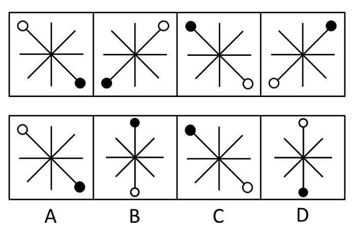

A. A

B. B

C. C

D. D

第 71 题 · 答案与解析

**参考答案（粉笔题库参考内容）**

A

**解析**

元素组成相同，考查位置规律。这道题考查图形的顺时针旋转，通过已知的四个图形不难看出实心圆圈和空心圆圈均在进行顺时针旋转。

故正确答案为A。

**考点**：位置规律-旋转

**来源**：2008年广西壮族自治区公务员录用考试《行测》题第71题

### 第 72 题

从所给四个选项中，选择最合适的一个填入问号处，使之呈现一定的规律性：

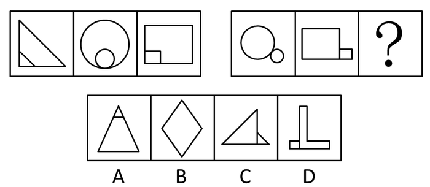

A. A

B. B

C. C

D. D

第 72 题 · 答案与解析

**参考答案（粉笔题库参考内容）**

C

**解析**

元素组成不同，且每幅图均为两个图形拼合而成，优先考虑图形间关系。第一组图形中均存在一个小图形位于大图形内部，且小图形与大图形的形状相似，第二组前两幅图均存在一个小图形位于大图形外部，且小图形与大图形的形状相似，只有C项符合。

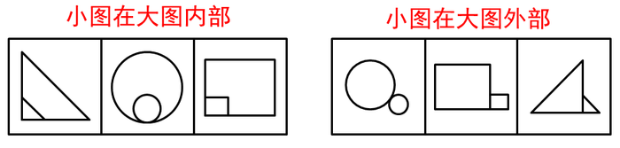

故正确答案为C。

**考点**：特殊规律-图形间关系

**来源**：2008年广西壮族自治区公务员录用考试《行测》题第72题

### 第 73 题

从所给四个选项中，选择最合适的一个填入问号处，使之呈现一定的规律性：

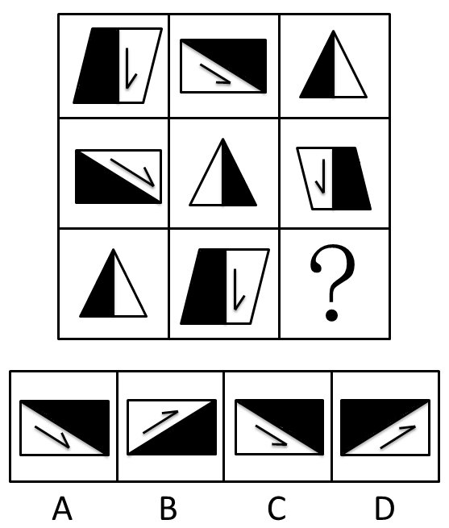

A. A

B. B

C. C

D. D

第 73 题 · 答案与解析

**参考答案（粉笔题库参考内容）**

C

**解析**

元素组成相似，考查元素遍历和位置规律。这道题属于位置类，主要考查图形的平移和翻转。第一行中的每个图形到下一行的时候都进行了位置左移，同时，三个图在下一行均以空白处和阴影处之间的线为中轴进行翻转，从而变成第三行的三个图。

故正确答案为C。

**考点**：位置规律-综合

**来源**：2008年广西壮族自治区公务员录用考试《行测》题第73题

### 第 74 题

从所给四个选项中，选择最合适的一个填入问号处，使之呈现一定的规律性：

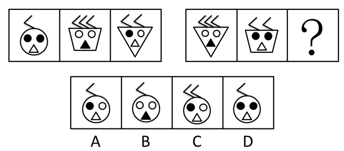

A. A

B. B

C. C

D. D

第 74 题 · 答案与解析

**参考答案（粉笔题库参考内容）**

A

**解析**

这道题主要考查图形元素。已知图形中包括三角形、圆形、梯形，其内部的实心图形分别为两个圆、一个圆和一个三角形，且各图形顶部折线数分别是三个、两个、一个。再看问题图形，内部已经包含了圆形、三角形，实心图形有两个圆和一个三角形，且在其顶部还分别有三个、两个折线，故第三个图形应该是圆形和一个实心圆，其顶部应有一个折线。

故正确答案为A。

**考点**：样式规律-遍历

**来源**：2008年广西壮族自治区公务员录用考试《行测》题第74题

### 第 75 题

从所给四个选项中，选择最合适的一个，使之呈现一定的规律性：

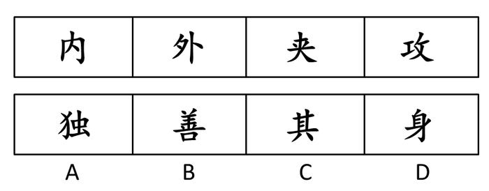

A. A

B. B

C. C

D. D

第 75 题 · 答案与解析

**参考答案（粉笔题库参考内容）**

C

**解析**

这道题属于数量类，主要考查汉字的笔画数量，已知图形中各个字的笔画数分别为4、5、6、7，那么接下来一个字的笔画数应该为8。

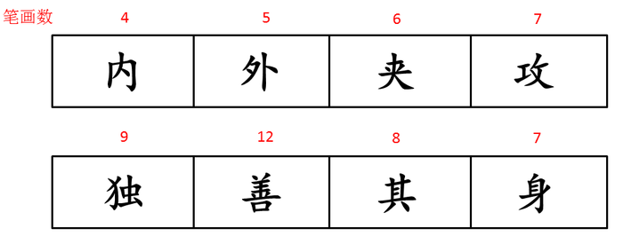

故正确答案为C。

**考点**：数量规律-线、文字/字母/数字类

**来源**：2008年广西壮族自治区公务员录用考试《行测》题第75题

### 第 76 题

从所给四个选项中，选择最合适的一个填入问号处，使之呈现一定的规律性：

A. A

B. B

C. C

D. D

第 76 题 · 答案与解析

**参考答案（粉笔题库参考内容）**

D

**解析**

元素组成相似，考查元素叠加。这道题属于位置类，主要考查图形的叠加变化规律。由已知图形可知，每一行图形中的前两个图形的相同位置在第三个图形中变化为：同连或者同断都得连，一连一断得断。

故正确答案为D。

**考点**：样式规律-黑白运算

**来源**：2008年广西壮族自治区公务员录用考试《行测》题第76题

### 第 77 题

从所给四个选项中，选择最合适的一个填入问号处，使之呈现一定的规律性：

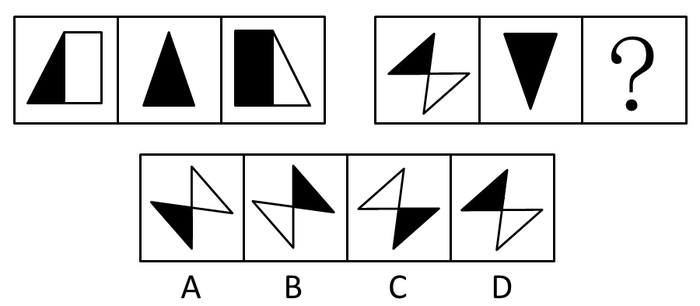

A. A

B. B

C. C

D. D

第 77 题 · 答案与解析

**参考答案（粉笔题库参考内容）**

A

**解析**

元素组成相似，且部分图形形状相同，所以本题综合了样式规律和位置规律。第一组图形中，图一先进行左右翻转，再将黑色部分和白色部分的颜色互换得到图三，图二自身左右翻转后得到本身。第二组运用此规律，先将图一进行左右翻转，再将黑色部分和白色部分的颜色互换得到图三，只有A项符合，当选。

故正确答案为A。

**考点**：位置规律-综合

**来源**：2008年广西壮族自治区公务员录用考试《行测》题第77题

### 第 78 题

从所给四个选项中，选择最合适的一个填入问号处，使之呈现一定的规律性：

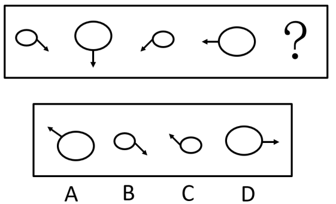

A. A

B. B

C. C

D. D

第 78 题 · 答案与解析

**参考答案（粉笔题库参考内容）**

C

**解析**

间隔元素组成相同，优先考虑位置规律。观察发现，题干第一、三个图中均为小椭圆，第二、四个图中均为大椭圆，故？处图形中应为小椭圆，排除A、D两项；再观察发现，椭圆上的箭头方向每次顺时针旋转45°，只有C项满足此规律。

故正确答案为C。

**考点**：位置规律-旋转

**来源**：2008年广西壮族自治区公务员录用考试《行测》题第78题

### 第 79 题

从所给四个选项中，选择最合适的一个填入问号处，使之呈现一定的规律性：

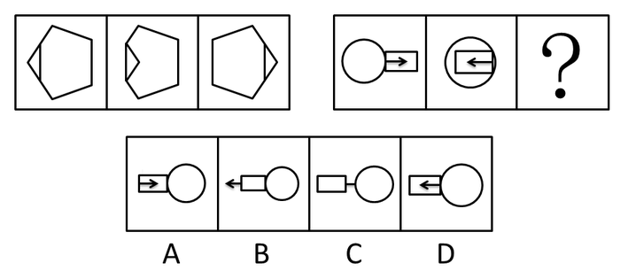

A. A

B. B

C. C

D. D

第 79 题 · 答案与解析

**参考答案（粉笔题库参考内容）**

D

**解析**

元素组成相同，优先考虑位置规律。观察发现，第一组图形中的每个图均可看作是由一个三角形和一个六边形组成，图一到图二，三角形左右翻转，图一到图三，整个图形左右翻转。第二组图应用此规律，图一到图三，整个图形左右翻转，只有D项符合。

故正确答案为D。

**考点**：位置规律-翻转

**来源**：2008年广西壮族自治区公务员录用考试《行测》题第79题

### 第 80 题

将下面左图进行折叠后,得到的图形是（  ）。

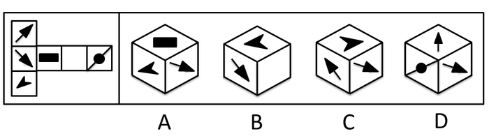

A. A

B. B

C. C

D. D

第 80 题 · 答案与解析

**参考答案（粉笔题库参考内容）**

D

**解析**

这道题主要考查立体图形的折叠，立体图形如下图所示。选项A长方形阴影的各边应该和立方体的棱平行；选项B向下的箭头与空白的一面不能同时出现，因为它们所在的面是对立面；同理，选项C中立方体上面的图形与右边的图形不能同时出现。

故正确答案为D。

**考点**：空间类-空间重构-六面体

**来源**：2008年广西壮族自治区公务员录用考试《行测》题第80题

### 第 81 题

有的电视广告采取同一句广告词反复多次的方式，以期加深观众的印象，让观众记住其所要推销的产品。其实，这种做法是不明智的。调查显示，数家长期做这类广告的商家近来都陷入了经营困境，产品大量积压。可见，商家不仅没有达到预期目的，反而产生了负面效应。

以下哪项如果成立，能最有力的加强以上的论证：

A. 尽管有些电视观众并不在意同一句广告词反复播放，但许多观众觉得广告最好更多地兼顾艺术性

B. 由于观众急于要观看广告之后精彩的电视节目，因此任何广告的播放都会让观众不耐烦

C. 虽然《广告法》并没有禁止同一句广告词反复多次播放，但商家应该考虑不同观众的多样化感受

D. 同一句广告词反复播放会引起电视观众的厌烦，甚至愤怒，从而对商家所要推销的产品产生强烈反感

第 81 题 · 答案与解析

**参考答案（粉笔题库参考内容）**

D

**解析**

第一步：找到论点和论据。

本题论点是商家采取同一句广告词重复多次的方式，不仅没有达到预期目的，反而产生了负面效应，论据是数家长期做这类广告的商家近来都陷入了经营困境，产品大量积压。

第二步：判断加强方式。

本题论点与论据间存在因果关系，所以需加强论点。

第三步：逐一判断选项的作用。

A属于削弱选项；

B、C并没有说明广告对商家所销售产品的影响，属于无关选项；D说明同一句广告词反复播放会引起电视观众的厌烦，甚至愤怒，从而对商家所要推销的产品产生强烈反感，加强了论点。

故正确答案为D。

**考点**：补充论据

**来源**：2008年广西壮族自治区公务员录用考试《行测》题第81题

### 第 82 题

甲：犯罪嫌疑人没有全部交代，但他没有说他不知道的。

甲的意思不包括：

A. 犯罪嫌疑人没有把他知道的全说出来

B. 犯罪嫌疑人说的都是他知道的

C. 犯罪嫌疑人隐瞒了事实真相

D. 犯罪嫌疑人歪曲了事实真相

第 82 题 · 答案与解析

**参考答案（粉笔题库参考内容）**

D

**解析**

第一步：分析题目，找到论点论据。

第一句：犯罪嫌疑人隐瞒了部分事实；

第二句：他说的都是他知道的。

第二步：逐一分析选项。

A项：犯罪嫌疑人没有把他知道的全说出来，由第一步中的第一句可知题干意思包括了A说法；

B项：犯罪嫌疑人说的都是他知道的，由第一步中的第二句可知题干意思包括了B说法；

C项：犯罪嫌疑人隐瞒了事实真相，由第一步中的第一句可知题干意思包括了C说法；

D项：犯罪嫌疑人歪曲了事实真相，“歪曲”事实真相，题干并未涉及，因此题干意思不包括D说法。

故正确答案为D。

**考点**：日常结论

**来源**：2008年广西壮族自治区公务员录用考试《行测》题第82题

### 第 83 题

有人说：只有肯花大价钱的足球俱乐部才进得了中超足球联赛。如果以上判断是真的，可能出现的情况是（    ）。

 ①某足球俱乐部花了大价钱，没有进中超；②某足球俱乐部没有花大价钱，进了中超；③某足球俱乐部没有花大价钱，没有进中超；④某足球俱乐部花了大价钱，进了中超。

A. 仅④

B. 仅①、②、③

C. 仅③、④

D. 仅①、③、④

第 83 题 · 答案与解析

**参考答案（粉笔题库参考内容）**

D

**解析**

第一步：翻译题干。

进中超→足球俱乐部花大价钱

第二步：逐一判断选项。

①，花大价钱是进中超的必要条件，花了大价钱未必一定进中超，没有进中超也是可能的，该项可能出现。

②，花大价钱是进中超的必要条件，不花大价钱是不可能进中超的，该项不可能出现。

③，花大价钱是进中超的必要条件，没花大价钱就进不去中超，该项可能出现。

④，花大价钱是进中超的必要条件，花了大价钱，有可能进中超，该项可能出现。

①③④可能出现，②不可能出现，D项应选。

第三步：再次标注答案。

故正确答案为D。

**考点**：常规翻译

**来源**：2008年广西壮族自治区公务员录用考试《行测》题第83题

### 第 84 题

两个实验大棚里种上相同数量的黄瓜苗，在第一个大棚里施加镁盐但在第二个不加。第一个产出了10千克黄瓜而第二个产出了5千克。由于除了水以外没有向大棚施加任何别的东西，第一个大棚较高的产量一定是由于镁盐。

以下哪项如果为真，最严重地削弱了上述论证：

A. 两个实验大棚的土壤里都有少量镁盐

B. 第三个实验大棚施加了一种高氮肥料但没有加镁盐，产出了7公斤黄瓜

C. 两个实验大棚里都种植了4个不同的黄瓜品种

D. 两个实验大棚的土质和日照量不同

第 84 题 · 答案与解析

**参考答案（粉笔题库参考内容）**

D

**解析**

第一步：分析题干，找到论点和论据。

本题结论为“第一个大棚较高的产量一定是由于镁盐”，条件是“在第一个大棚里施加镁盐但在第二个不加。第一个产出了10千克黄瓜而第二个产出了5千克。由于除了水以外没有向大棚施加任何别的东西”。

题干描述符合类比论证，即两类对象，要保证其他条件均相同，唯一的不同是一个加镁盐，另一个不加镁盐，比较二者的实验结果。

第二步：逐一分析选项。

A项：土壤里都有少量镁盐，是两个实验大棚的相同条件，与施加镁盐与否无直接关系，属无关选项；

B项：第三个实验大棚施加了一种高氮肥料但没有加镁盐，产出了7公斤黄瓜，施加氮肥与施加镁盐与否无直接关系，属无关选项；

C项：种植了4个不同的黄瓜品种，种类与施加镁盐与否无直接关系，属无关选项；

D项：两个实验大棚的土质和日照量不同，说明不是只有镁盐一个因素，其他因素也不同，从而削弱了结论，当选。

故正确答案为D。

**考点**：他因削弱、削弱-实验类

**来源**：2008年广西壮族自治区公务员录用考试《行测》题第84题

### 第 85 题

某宿舍住着四个留学生，分别来自美国、加拿大、韩国和日本。他们分别在中文、国际金融和法律三个系就学，其中：

（1）日本留学生单独在国际金融系；

（2）韩国留学生不在中文系；

（3）美国留学生和另外某个留学生同在某个系；

（4）加拿大学生不和美国学生同在一个系。

以上条件可以推出美国留学生所在的系为：

A. 中文系

B. 国际金融系

C. 法律系

D. 中文系或法律系

第 85 题 · 答案与解析

**参考答案（粉笔题库参考内容）**

C

**解析**

第一步：找突破口。

本题突破口为信息量最明确的对象，通过条件（1）可知，美国留学生、韩国留学生和加拿大留学生只能在法律系或者中文系。通过条件（2）可知，韩国留学生在法律系。

第二步：抄信息于表中，将题干中的信息和第一步的信息放在一个表中。

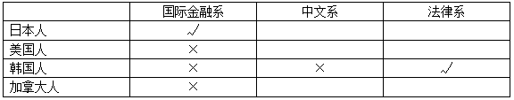

第三步：填空，即填上每个集合的空格。

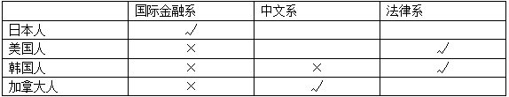

故正确答案为C。

**考点**：排除法

**来源**：2008年广西壮族自治区公务员录用考试《行测》题第85题

### 第 86 题

厂领导：我们厂一直很重视产品质量。

质检领导：这次检查你们厂有产品不合格。

根据质检领导的意思，以下一定为真的是：

A. 是否重视质量我不确定，但这次检查你们厂有产品不合格

B. 多数产品合格了，少数没有合格

C. 有的产品合格了，有的没有合格

D. 重视质量与产品是否合格没有必然联系

第 86 题 · 答案与解析

**参考答案（粉笔题库参考内容）**

A

**解析**

第一步：抓住每句话中的对象及其关系。

第一句：厂领导重视质量；

第二句：有产品不合格。

第二步：逐一分析选项。

A项完整陈述了第二句话的意思，题干中质检领导也没对厂领导提到的重视质量予以回应，所以是否重视质量他不确定，正确；

B、C两项质检领导没有说明不合格产品的比重是多还是少，错误；

D项中重视质量与产品是否合格的关系题干中两句话没有论证，不能说明，也错误。

故正确答案为A。

**考点**：日常结论

**来源**：2008年广西壮族自治区公务员录用考试《行测》题第86题

### 第 87 题

在一次选拔赛中，有评委给所有参赛者都投了通过票，由此可以必然推出的是：

A. 所有参赛者都至少得了一张通过票

B. 所有的参赛者都通过了

C. 有评委没有投参赛者通过票

D. 对所有的参赛者投通过票不只一个评委

第 87 题 · 答案与解析

**参考答案（粉笔题库参考内容）**

A

**解析**

第一步：抓住话中的对象及其关系。

有评委给所有参赛者都投了通过票，指出票数和选手的关系是：每个选手至少有一票。

第二步：逐一判断选项是否正确。

A项符合选手和票数的关系，正确；

B项题干中没有参赛者通过的信息，错误；

C项显然和题干相矛盾；

D项中投全通过票评委的个数题干中没有相关信息，错误。

故正确答案为A。

**考点**：集合推理

**来源**：2008年广西壮族自治区公务员录用考试《行测》题第87题

### 第 88 题

面对日益严峻的环境污染和生态失衡，“我们只有一个地球”这一口号具有强烈的震撼力，它提醒人们注意环境保护的重要性。

以下哪项与这句口号的提出者的想法最接近：

A. 在宇宙中，其他的星球都不可能有生命存在

B. 在宇宙中，即使有其他的星球适宜人类居住，人类也无法迁往那个星球

C. 人类不可能找到比地球更适宜自己居住的星球了

D. 只有地球才有温暖的阳光和充足的雨水

第 88 题 · 答案与解析

**参考答案（粉笔题库参考内容）**

C

**解析**

第一步：抓住题干主要信息。

第一点说明环境污染和生态失衡问题日益严峻，第二点说明“我们只有一个地球”这一口号提醒人们注意环境保护的重要性。

第二步：分析题干信息，并结合选项得出答案。

A项：在宇宙中，其他的星球都“不可能”有生命存在，说法过于绝对，题干并未涉及，属无关选项；

B项：人类无法迁往其他的适宜人类居住的星球，与口号提醒注意环境保护无直接关系，属无关选项；

C项：人类不可能找到比地球更适宜自己居住的星球了，说明了人类只有地球这一个适宜自己居住的星球，从而很好的与题干中口号相符合；

D项：“只有”地球才有温暖的阳光和充足的雨水，说法过于绝对，题干并未涉及，属无关选项。

故正确答案为C。

**考点**：日常结论

**来源**：2008年广西壮族自治区公务员录用考试《行测》题第88题

### 第 89 题

签订技术转让合同必须遵守国家的法律，符合国家政策的要求。否则，即使是当事人双方自愿签订的合同，非但不能受到法律保护，还要根据情况依法追究法律责任。

与以上论述等值的是：

A. 如果双方当事人的行为都是自愿的，就会受到法律的保护

B. 如果双方当事人的行为都是自愿的，就要承担法律责任

C. 只有双方当事人的行为合法，才能产生预期的法律后果，受到法律的保护

D. 如果双方当事人的行为合法，就会产生预期的法律后果，受到法律的保护

第 89 题 · 答案与解析

**参考答案（粉笔题库参考内容）**

C

**解析**

第一步：抓住题干主要信息。

受到法律保护⇒遵守国家的法律∧符合国家政策的要求。

第二步：分析题干信息，并结合选项得出答案。

由题意可知“遵守国家的法律∧符合国家政策的要求⇒行为合法”，再根据第一步中的推导关系可得：受到法律保护⇒遵守国家的法律∧符合国家政策的要求⇒行为合法。

A项：自愿签订⇒受到法律保护，“自愿签订”不是有效条件，无法推出绝对表达的结论；

B项：自愿签订⇒承担法律责任，“自愿签订”不是有效条件，无法推出绝对表达的结论；

C项：受到法律保护⇒行为合法，正是第二步中得到的推导关系，因此C项中说法可以推出；

D项：行为合法⇒受到法律保护，“行为合法”是第二步中得到的推导关系的肯后条件，无法推出绝对表达的结论。

故正确答案为C。

**考点**：常规翻译

**来源**：2008年湖北省公务员录用考试《行测》题（B类）第64题

### 第 90 题

在大型游乐公园里，现场表演是刻意用来引导人群流动的。午餐时间的表演是为了减轻公园餐馆的压力；傍晚时间的表演则有一个完全不同的目的：鼓励参观者留下来吃晚餐。表面上不同时间的表演有不同的目的，但这背后，却有一个统一的潜在目标，即：

以下哪一选项作为本段的结束语最为恰当：

A. 尽可能地减少各游览点的排队人数

B. 吸引更多的人来看现场表演，以增加利润

C. 在尽可能多的时间里最大限度地发挥餐馆的作用

D. 尽可能地找来顾客，希望他们再次来公园游览

第 90 题 · 答案与解析

**参考答案（粉笔题库参考内容）**

C

**解析**

第一步：抓住题干主要信息。

第一点说明现场表演是刻意用来引导人群流动的；第二点说明午餐时间的表演是为了减轻公园餐馆的压力，而傍晚时间的表演则是为了鼓励参观者留下来吃晚餐；第三点说明表面上不同时间的表演有不同的目的，但这背后，却有一个统一的潜在目标。

第二步：分析题干信息，并结合选项得出答案。

“现场表演”和“公园餐馆”两个经营项目，前一个是为后一个服务的，即通过现场表演来引导人群流动，在尽可能多的时间里选择最大限度地发挥餐馆的作用，故C为正确答案。其他的选项断定的都是现场表演的可能目的，不是直接目的。

故正确答案为C。

**考点**：接语选择题

**来源**：2008年广西壮族自治区公务员录用考试《行测》题第90题

### 第 91 题

代理商是受他人(被代理人)委托，在代理权限内，固定地为他人促成交易或以他人名义缔结交易的一种独立的商业主体。其收入来源于被代理人支付的代理服务费。

下列选项中不属于代理商应具有的特点的是：

A. 代理商以促成交易或缔结交易为营业方式

B. 代理商必须固定地从事受人之托促成交易或缔结交易的活动

C. 代理商是一种独立的商务经营者

D. 为委托人的利益从事活动，其行为所带来的经济上的利益和损失由委托人来承担

第 91 题 · 答案与解析

**参考答案（粉笔题库参考内容）**

D

**解析**

第一步：抓住定义中的关键词。

关键词包括“受他人（被代理人）委托”，“固定地为他人促成交易或以他人名义缔结交易”，“独立的商业主体”。

第二步：逐一判断选项。

A中以促成交易或缔结交易为营业方式，符合关键词，因此属于代理商应具有的特点；

B中固定地从事受人之托促成交易或缔结交易的活动，满足关键词，因此属于代理商应具有的特点；

C中一种独立的商务经营者，满足关键词，因此属于代理商应具有的特点；

D中为委托人的利益从事活动，其行为所带来的经济上的利益和损失由委托人来承担，题干中并没有明确界定损失由谁承担，不符合关键词，且用排除法也可做出判断。

故正确答案为D。

**考点**：单定义-其他句式

**来源**：2008年广西壮族自治区公务员录用考试《行测》题第91题

### 第 92 题

虐待罪指对共同生活的家庭成员，经常以打骂、冻饿、禁闭、强迫过度劳动，有病不给治疗或者其他方法进行摧残、折磨的行为。

根据定义，下列不构成虐待罪的是：

A. 王浩的父亲经常生病，王浩觉得其父已是知天命之年，所以也就不给其医治

B. 某企业老板经常强迫员工过度劳动，克扣员工工资

C. 张志看妻子不顺眼，经常对其进行毒打或关禁闭

D. 李某常使用体罚来教育调皮的儿子，有时还不让做错事的孩子吃饭

第 92 题 · 答案与解析

**参考答案（粉笔题库参考内容）**

B

**解析**

第一步：抓住定义中的关键词。

关键词强调“家庭成员”、“摧残、折磨的行为”。

第二步：逐一判断选项。

A中的有病不给医治、C中的毒打或关禁闭、D中的不让吃饭都是对家庭成员进行摧残、折磨，均符合定义；

B中的员工不属于家庭成员，不符合定义关键词。

故正确答案为B。

**考点**：主客体

**来源**：2008年广西壮族自治区公务员录用考试《行测》题第92题

### 第 93 题

重大飞行事故罪是指航空人员违反规章制度，致使发生重大飞行事故，造成严重后果的行为。

根据定义，下列属于重大飞行事故罪的是：

A. 逃犯甲用匕首胁迫飞机驾驶员在某乡镇降落，结果致使大量村民死亡

B. 某客机在滑行途中突遭暴雨，驾驶员作出停止升空的决定，结果导致乘客滞留机场达48小时

C. 驾驶员在和空姐聊天时，飞机偏离原定航线

D. 飞机驾驶员为提神，在驾驶时吸烟，结果导致飞机着火坠毁

第 93 题 · 答案与解析

**参考答案（粉笔题库参考内容）**

D

**解析**

第一步：找出定义关键词。

“航空人员违反规章制度”、“造成严重后果”。

第二步：逐一分析选项。

A项：飞机驾驶员是在被胁迫的情况下将飞机降落，没有违反航空公司的规章制度，不符合“航空人员违反规章制度”，不符合定义，排除；

B项：客机驾驶员遇到不可抗力因素（暴雨）作出停止升空的决定，没有违反航空公司的规章制度，不符合“航空人员违反规章制度”，且乘客滞留机场也不属于严重的后果，不符合“造成严重后果”，不符合定义，排除；

C项：飞机偏离原定航线不属于严重的后果，不符合“造成严重后果”，不符合定义，排除；

D项：飞机驾驶员在驾驶时吸烟是违反航空公司规章制度的行为，符合“航空人员违反规章制度”，飞机坠毁属于严重的后果，符合“造成严重后果”，符合定义，当选。

故正确答案为D。

**考点**：原因结果

**来源**：2016年山东省选调应届优秀高校毕业生到基层工作考试《行测》试卷（精选）第47题

### 第 94 题

质权指为了担保债权的履行，债务人或第三人将其动产或权利移交债权人占有，当债务人不履行债务时，债权人有就其占有的财产优先受偿的权利。

根据以上定义，下列哪项属于质权：

A. 赵某向梁某借款30万元，将自己的房屋作价15万元抵押给梁某，并依法进行了抵押登记

B. 孙某为了向银行借款50万，就找了当地一个声誉很好的陈某作担保，并送给他一条价值500元的好烟

C. 李某在乙处修理电视机，因为钱不够，就将自己的手表放在乙处，说第二天拿钱来，就把电视机取走

D. 钱某向赵某借了辆自行车，并且白纸黑字地写了借据

第 94 题 · 答案与解析

**参考答案（粉笔题库参考内容）**

C

**解析**

第一步：抓住定义中的关键词。

关键词包括“担保债权的履行”、“动产或权利”、“移交”。

第二步：逐一判断选项。

A中房屋是不动产，不符合关键词“动产或权利”，因此不属于质权；

B中陈某作担保，银行借款50万给孙某，并没有涉及孙某的“动产或权利”，因此不属于质权；

C中李某在乙处修理电视机，因钱不够，将手表放在乙处，完全符合关键词，因此属于质权；

D中借自行车写借据，并没有涉及“担保债权的履行”，因此不属于质权。

故正确答案选C。

**考点**：方式目的

**来源**：2008年广西壮族自治区公务员录用考试《行测》题第94题

### 第 95 题

家族是以婚姻和血统关系为基础的社会单位，包括配偶、子女和其他共同生活的亲属在内。

根据以上定义，下列不属于家族成员的是：

A. 由于不务正业，自小被其父赶出家门的小李

B. 老肖老年丧子，侄子见叔叔孤苦伶仃，便将其接到家中，与其共同生活

C. 赵英和赵磊是姐弟，自小父母双亡，二人相依为命，赵英嫁给王某后，赵磊便和其二人居住

D. 李某从小便被老张夫妇收养，后来由于李某经常打架斗殴，赌博嫖娼，老张夫妇便与其解除了收养关系

第 95 题 · 答案与解析

**参考答案（粉笔题库参考内容）**

D

**解析**

第一步：抓住定义中的关键词。

关键词强调“婚姻和血统关系”、“共同生活的亲属”。

第二步：逐一判断选项。

选项A是父子关系；

选项B、C是共同生活的亲属关系；

选项D中的李某与老张夫妇没有血缘、婚姻关系，同时还解除了收养关系，李某不属于共同生活的亲属。

故正确答案为D。

**考点**：单定义-其他句式

**来源**：2008年广西壮族自治区公务员录用考试《行测》题第95题

### 第 96 题

晕轮效应：指个体在评价他人时的一种“以偏概全”的倾向，也就是说当个体对一个人的某种特性形成好或坏的印象后，他还倾向于据此推论该人其他方面的特征。

根据上面的定义，下列哪一个人对他人的评价表现出了典型的晕轮效应：

A. 出门旅游时，妈妈告诉小李旅途上可能会遇上小偷。上了火车后，小李心里就一直忐忑不安，觉得谁都像是坏人

B. 吴某很乐观，他总是把事情往好的方面想，对人的评价也是积极的，认为人都是善良的，犯错误的人都是不小心的过失行为

C. 小王认为同事小吴是个勤劳、热情的人，每天都提前到办公室帮助大家打扫卫生。可有一天，小吴没有帮他送报纸，小王不免心中就嘀咕：原来小吴也不是那么热情

D. 上夜大的第一天，王某发现英语老师漂亮，回家后他就不停地向家人诉说老师漂亮，对学生和蔼、讲课特别有经验

第 96 题 · 答案与解析

**参考答案（粉笔题库参考内容）**

D

**解析**

第一步：抓住定义中的关键词。

关键词强调“事先对一个人的印象”和“推论该人其他方面的特征”。

第二步：逐一判断选项。

A、B两项不是对特定一个人的印象，C项没有推知小吴其他方面的特征，均不符合定义；

D项王某在对英语老师的外表形成了好的印象后，并通过此印象推论老师讲课有经验，对学生和蔼，属于晕轮效应。

故正确答案为D。

**考点**：大前提

**来源**：2008年广西壮族自治区公务员录用考试《行测》题第96题

### 第 97 题

代位继承是指被继承人的子女先于被继承人死亡时，由被继承人子女的晚辈直系血亲代替先死亡的长辈直系血亲继承被继承人遗产的一项法定继承制度。

根据以上定义，下列属于代位继承的是：

A. 继承人甲在继承其父的遗产时突遭车祸死亡，财产由甲的儿子乙继承

B. 甲先于其弟乙死亡，甲的儿子丙代父继承乙的遗产

C. 甲乙系夫妻，在一次意外事故中，甲、乙先后死亡，其子丙继承二人遗产

D. 甲乙系父子，在一次意外事故中，乙被推定先于其父甲死亡，乙的儿子继承了甲的遗产

第 97 题 · 答案与解析

**参考答案（粉笔题库参考内容）**

D

**解析**

第一步：抓住定义中的关键词。

关键词强调“被继承人的子女先于被继承人死亡”且“由被继承人子女的晚辈直系血亲代替继承”。

第二步：逐一判断选项。

选项A中被继承人先于其子女死亡，不属于代位继承；

选项B、C中的甲、乙是同辈关系，不属于代位继承；

D选项“乙被推定先于其父甲死亡，乙的儿子继承了甲的遗产”符合“被继承人的子女先于被继承人死亡”且“由被继承人子女的晚辈直系血亲代替继承”。

故正确答案为D。

**考点**：大前提

**来源**：2008年广西壮族自治区公务员录用考试《行测》题第97题

### 第 98 题

反射指有机体借助神经系统对刺激有规律的应答活动。无条件反射是先天的不学而能的反射。它是一种简单的不加任何条件的反射，属本能行为。条件反射是有机体在后天生活中学习到的，只有在一定条件下出现的反射。

下列哪项符合无条件反射的定义：

A. 经常吃一种叫风风品牌的狗粮的小狗闻到或看到这种狗粮就会流口水

B. 幼儿园的老师总是在音乐声响起的时候让孩子跟着唱歌，有一次音乐响起，老师没有让孩子们唱歌，但是孩子们却跟着唱起来

C. 赛马“海洋饼干”的右侧身体小时候经常被训练师毒打，所以它一见到右侧有人举起鞭子就会发狂

D. 小王外出打工，不小心丢失财物，几天没有饭吃，非常饥饿的时候肚子咕咕叫而且见到食物就直咽口水

第 98 题 · 答案与解析

**参考答案（粉笔题库参考内容）**

D

**解析**

第一步：判断考查的定义。

题目考查“无条件反射”，所以在题干中仅需阅读“无条件反射”和“反射”。

第二步：抓住定义中的关键词。

关键词强调“先天的”且“借助神经系统对刺激有规律的应答”。

第三步：逐一判断选项。

A、B、C项均是后天生活中学习到的反射，属于条件反射；

D项饿的时候见到食物就直咽口水是先天的反射行为；

故正确答案为D。

**考点**：常规问法

**来源**：2008年广西壮族自治区公务员录用考试《行测》题第98题

### 第 99 题

其他存款性公司是指除中央银行以外的所有存款性公司，主要进行吸收存款、发放贷款和创造存款等活动，我国称之为存款货币银行。

下列选项中，不属于其他存款性公司的是：

A. 城市商业银行

B. 保险公司

C. 邮政储汇局

D. 城市信用社

第 99 题 · 答案与解析

**参考答案（粉笔题库参考内容）**

B

**解析**

第一步：抓住定义中的关键词。

定义中强调“除中央银行以外”、“存款性公司”。

第二步：逐一判断选项。

B项的保险公司的主要经济活动不包括创造存款、发放贷款，不是存款性公司，因此不符合定义；

其余A、C、D三项均符合定义。

本题为选非题，故正确答案为B。

**考点**：拆词

**来源**：2008年湖北省公务员录用考试《行测》题（B类）第74题

### 第 100 题

思维是指人脑对客观间接的概括的反映。根据思维过程中的凭借物或者思维状态的不同可以将思维分为（1）动作思维是指在思维过程中以实际动作作为支持的思维。其特点是任务是直观的，以具体形式给予的，解决方式是实际动作；（2）形象思维是指用表象来进行分析、综合、抽象、概括的过程。特点是借助鲜明、生动的客观形象；（3）抽象思维是指借助概念、判断、推理等形式来反映客观事物的运动规律，对事物的本质特征和内部联系加以认识的过程。

下列哪项符合动作思维的定义：

A. 福尔摩斯通过在屋子找不到其他的出口，断定凶手一定是从屋顶的烟囱出去的，尽管烟囱很小

B. 洪熙官的儿子很小的时候就被要求每天看着父亲练功，渐渐地，他也能跟着父亲一起比划起来

C. 刘教授喜欢在他的文章中通过列举大量的实例来说明问题

D. 建筑系的学生在设计建筑方案时有时候需要先根据建筑图纸制作出一个模型来，这样似乎更有助于发现建筑设计的缺陷

第 100 题 · 答案与解析

**参考答案（粉笔题库参考内容）**

B

**解析**

第一步：判断考查的定义。

题目考查“动作思维”，所以在题干中仅需阅读“动作思维”。

第二步：抓住定义中的关键词。

关键词包括“直观的，以具体形式给予的”，“实际动作”。

第三步：逐一判断选项。

A中福尔摩斯通过在屋子找不到其他的出口，就断定凶手一定是从屋顶的烟囱出去的，并没有涉及“实际动作”，因此不属于动作思维，而属于抽象思维；

B中洪熙官的儿子每天看着父亲练功，完全符合关键词，因此属于动作思维；

C中刘教授在他的文章中通过列举大量的实例来说明问题，不符合关键词“实际动作”，因此不属于动作思维，而属于形象思维；

D中建筑系的学生根据建筑图纸制作出一个模型来，也不符合关键词“实际动作”，因此不属于动作思维，而属于形象思维。

故正确答案为B。

**考点**：常规问法

**来源**：2008年广西壮族自治区公务员录用考试《行测》题第100题

### 第 101 题

菡萏：荷花

A. 糖果：果冻

B. 芙蓉：水芙蓉

C. 番茄：土豆

D. 蚍蜉：大蚂蚁

第 101 题 · 答案与解析

**参考答案（粉笔题库参考内容）**

D

**解析**

第一步：判断题干词语间的逻辑关系。

题干两词为全同关系中的同义词关系，前词是后词的古式书面语。

第二步：判断选项词语间的逻辑关系。

A、C两项中两词均不是同义词关系；B项中两词为同义词关系，但二者都是荷花的古代称谓；

D项中两词为同义词关系，且前词是后词的古式书面语，符合题干。

故正确答案为D。

**考点**：逻辑关系-全同关系

**来源**：2008年湖北省公务员录用考试《行测》题（B类）第79题

### 第 102 题

莱茵河：欧洲

A. 多瑙河：北美洲

B. 非洲：尼罗河

C. 亚马逊河：南美洲

D. 亚洲：黄河

第 102 题 · 答案与解析

**参考答案（粉笔题库参考内容）**

C

**解析**

第一步：判断题干词语间逻辑关系。

题干两词是属于对应关系，即河流与其所在地理位置，莱茵河位于欧洲境内。

第二步：判断选项词语间逻辑关系。

A项：多瑙河位于欧洲境内，不在北美洲，与题干逻辑关系不一致，排除；

B项：尼罗河位于非洲境内，但顺序与题干相反，与题干逻辑关系不一致，排除；

C项：亚马逊河位于南美洲境内，与题干逻辑关系一致，当选；

D项：黄河位于亚洲境内，但顺序与题干相反，与题干逻辑关系不一致，排除。

故正确答案为C。

**考点**：逻辑关系-对应关系

**来源**：2008年广西壮族自治区公务员录用考试《行测》题第102题

### 第 103 题

《雷雨》：周朴园

A. 斯佳丽：《飘》

B. 林黛玉：《红楼梦》

C. 《家》：高觉民

D. 《暴风骤雨》：九斤老太

第 103 题 · 答案与解析

**参考答案（粉笔题库参考内容）**

C

**解析**

第一步：判断题干词语间逻辑关系。

题干两词是对应关系，且是作品在前，人物在后的顺序。

第二步：判断选项词语间逻辑关系。

周朴园是《雷雨》中的主人公，高觉民是《家》中的主人公。另外还应注意符合题干作品在前，人物在后的顺序，故A、B选项错误；

D项九斤老太是鲁迅作品《风波》中的人物，不对应《暴风骤雨》。

故正确答案为C。

**考点**：逻辑关系-对应关系

**来源**：2008年广西壮族自治区公务员录用考试《行测》题第103题

### 第 104 题

初级中学：初中

A. 幼儿园：幼稚园

B. 彩电：彩色电视

C. 公共关系：公关

D. 罗曼蒂克：浪漫

第 104 题 · 答案与解析

**参考答案（粉笔题库参考内容）**

C

**解析**

第一步：判断题干词语间的逻辑关系。

题干两词为全同关系中的同义词关系，且后词是前词的简称。

第二步：判断选项词语间的逻辑关系。

A项为同义词，但后词不是前词的简称；

B项为同义词，但两词对应顺序与题干相反；

C项为同义词，且后词是前词的简称；

D项为同义词，但前词是后词的音译，与题干逻辑关系不符。

故正确答案为C。

**考点**：逻辑关系-全同关系

**来源**：2008年湖北省公务员录用考试《行测》题（B类）第77题

### 第 105 题

狐狸：狡猾

A. 忠诚：狗

B. 母鸡：鸡蛋

C. 牛：勤劳

D. 乌鸦：凶兆

第 105 题 · 答案与解析

**参考答案（粉笔题库参考内容）**

C

**解析**

第一步：判断题干词语间的逻辑关系。

题干两词为属性关系，后词是前词的一种特征描述。

第二步：判断选项词语间的逻辑关系。

A项中两词为属性关系，但对应顺序与题干相反；

B项为对应关系；

C项为属性关系，且后词为前词的一种特征描述；

D项为对应关系，是事物与其象征意义的对应。

故正确答案为C。

**考点**：逻辑关系-对应关系

**来源**：2008年湖北省公务员录用考试《行测》题（B类）第76题

### 第 106 题

二氧化碳对于干冰相当于（  ）对于（  ）。

A. 一氧化碳：墨

B. 石墨：金刚石

C. 水：液体

D. 空气：氧气

第 106 题 · 答案与解析

**参考答案（粉笔题库参考内容）**

B

**解析**

逐一代入选项。

干冰和二氧化碳是同一种物质不同状态下的结果，B选项石墨和金刚石是碳元素不同排列顺序下的结果；A、C、D选项前后词均不是同一个物质，只有B项符合。

故正确答案为B。

**考点**：逻辑关系-对应关系

**来源**：2008年广西壮族自治区公务员录用考试《行测》题第106题

### 第 107 题

郭沫若对于（  ）相当于（  ）对于《管锥篇》。

A. 《女神》：钱钟书

B. 《炉中煤》：茅盾

C. 《死城》：鲁迅

D. 《人间词话》：周立波

第 107 题 · 答案与解析

**参考答案（粉笔题库参考内容）**

A

**解析**

第一步：将选项逐一代入，判断各选项前后部分的逻辑关系。

题干中考查对应关系，且是后词对前词的描述关系。A项中《女神》的作者是郭沫若，《管锥篇》的作者是钱钟书；B项中《炉中煤》的作者是郭沫若；C项中《死城》的作者是陈青云；D项中《人间词话》的作者是王国维，B、C、D项都没有做到作品和作者的对应。

第二步：逻辑关系相同即为答案。

只有A选项两组词都是对应关系。

故正确答案为A。

**考点**：逻辑关系-对应关系

**来源**：2008年广西壮族自治区公务员录用考试《行测》题第107题

### 第 108 题

网络日记对于（  ）相当于菠萝对于（  ）。

A. 网络：苹果

B. 电脑：香蕉

C. 博客：凤梨

D. 写手：水果

第 108 题 · 答案与解析

**参考答案（粉笔题库参考内容）**

C

**解析**

第一步：将选项逐一代入，判断各选项前后部分的逻辑关系。

A选项“网络日记”和“网络”是包容关系，“菠萝”和“苹果”是并列关系；

B选项“网络日记”和“电脑”是对应关系，“网络日记”通过“电脑”实现功能；

C选项“网络日记”和“博客”是同一个事物的不同说法，“菠萝”和“凤梨”也是如此，两组词是全同关系，正确；

D项“网络日记”和“写手”是对应关系，“菠萝”和“水果”是包容关系。

第二步：逻辑关系相同即为答案。

只有C选项两组词的逻辑关系相同，都是全同关系。

故正确答案为C。

**考点**：逻辑关系-全同关系

**来源**：2008年广西壮族自治区公务员录用考试《行测》题第108题

### 第 109 题

（  ）对于舞蹈相当于探春对于（  ）。

A. 唱歌：《西厢记》

B. 探戈：《金瓶梅》

C. 杨贵妃：贾宝玉

D. 华尔兹：《红楼梦》。

第 109 题 · 答案与解析

**参考答案（粉笔题库参考内容）**

D

**解析**

第一步：将选项逐一代入，判断各选项前后部分的逻辑关系。

A、B项唱歌、探戈和舞蹈都是并列关系，探春和《西厢记》、《金瓶梅》无联系；C项杨贵妃和舞蹈是对应关系，探春和贾宝玉是并列关系；D项华尔兹是舞蹈中的一种，探春是《红楼梦》中的一个人物，前后两词是包容关系，且后词包容前词。

第二步：逻辑关系相同即为答案。

根据选项知只有D选项两组词逻辑关系相同，都是包容关系，且后词包容前词。

故正确答案为D。

**考点**：逻辑关系-包容关系

**来源**：2008年广西壮族自治区公务员录用考试《行测》题第109题

### 第 110 题

（  ）对于“铁观音”相当于（  ）对于“新闻联播”。

A. 咖啡：报纸

B. 茶：电视

C. 茶：新闻

D. 寺庙：电视

第 110 题 · 答案与解析

**参考答案（粉笔题库参考内容）**

C

**解析**

第一步：将选项逐一代入，判断各选项前后部分的逻辑关系。

A选项“咖啡”对于“铁观音”、“报纸”对于“新闻联播”的并列关系不明显；B选项“铁观音”和“茶”是包容关系，“电视”是播放“新闻联播”的载体，二者为载体对应关系；C选项“铁观音”是茶中的一种，“新闻联播”是新闻中的一种，同属于包容关系，且是包容关系中的种属关系，故C选项正确；D选项“寺庙”和“铁观音”没有明显对应关系，“电视”和“新闻联播”没有明显对应关系。

第二步：逻辑关系相同即为答案。

根据选项确定只有C的两部分均为包容关系。

故正确答案为C。

**考点**：逻辑关系-包容关系

**来源**：2008年广西壮族自治区公务员录用考试《行测》题第110题

### 第 111 题

（1）进行商品市场调查

（2）培训调查员

（3）撰写调查报告

（4）统计数字

（5）成立市场调查小组

A. 5、1、2、4、3

B. 1、3、2、4、5

C. 3、4、5、2、1

D. 5、2、1、4、3

第 111 题 · 答案与解析

**参考答案（粉笔题库参考内容）**

D

**解析**

题目为做市场调查报告的流程。首先必须（5）成立市场调查小组，且（2）培训调查员必须在（1）进行商品市场调查之前；（4）统计数字必须在（3）撰写调查报告之前。

故正确答案选D。

**来源**：2008年广西壮族自治区公务员录用考试《行测》题第111题

### 第 112 题

（1）后卫防守对方进攻

（2）对方前锋禁区假摔

（3）教练员愤怒地离开球场

（4）报纸抨击裁判员黑哨

（5）裁判员判罚对方点球

A. 2、3、5、1、4

B. 2、5、1、3、4

C. 1、2、5、3、4

D. 1、4、5、3、2

第 112 题 · 答案与解析

**参考答案（粉笔题库参考内容）**

C

**解析**

题干是一个足球错判的前后过程。（1）后卫防守对方进攻必须在（2）对方前锋禁区假摔之前，且（5）裁判员误判必须在（4）报纸抨击裁判员之前。

故正确答案为C。

**来源**：2008年广西壮族自治区公务员录用考试《行测》题第112题

### 第 113 题

（1）新一代电视机大受欢迎

（2）电视机市场饱和

（3）效益明显好转

（4）调整电视机的生产策略

（5）某厂电视机部件大量积压

A. 2、5、4、1、3

B. 1、4、2、3、5

C. 2、4、3、5、1

D. 4、2、1、3、5

第 113 题 · 答案与解析

**参考答案（粉笔题库参考内容）**

A

**解析**

题目为电视机厂面对商业危机的复兴过程。（由于）电视机市场饱和，（使得）某厂电视机部件大量积压，（该厂）调整电视机的生产策略，（生产的）新一代电视机大受欢迎，（最终）效益明显好转。

故正确答案为A。

**来源**：2008年广西壮族自治区公务员录用考试《行测》题第113题

### 第 114 题

（1）推广使用可降解的塑料制品

（2）发明塑料

（3）产生白色污染

（4）制成各种塑料制品

（5）弃置成为固体废物

A. 2、4、3、5、1

B. 2、4、5、3、1

C. 1、2、3、4、5

D. 1、2、4、3、5

第 114 题 · 答案与解析

**参考答案（粉笔题库参考内容）**

B

**解析**

题干介绍了白色污染问题的产生和解决。本题突破口在（3）白色污染的产生必须在（5）塑料产品弃置成为固体废物之后。轻易排除A、C、D选项。

故正确答案为B。

**来源**：2008年广西壮族自治区公务员录用考试《行测》题第114题

### 第 115 题

（1）传回月面图像

（2）发射火箭

（3）卫星进入月球轨道

（4）嫦娥一号卫星与火箭分离

（5）卫星进入地球轨道

A. 3、1、2、4、5

B. 2、4、5、3、1

C. 3、4、5、2、1

D. 2、4、3、5、1

第 115 题 · 答案与解析

**参考答案（粉笔题库参考内容）**

B

**解析**

这是一个卫星发射、运行过程。卫星应该先进入地球轨道（5），然后才进入月球轨道（3）。

故正确答案为B。

**来源**：2008年广西壮族自治区公务员录用考试《行测》题第115题

### 第 116 题

（1）泥石流发生

（2）不合理开挖

（3）连日暴雨

（4）损失巨大

（5）山体破坏

A. 3、5、1、2、4

B. 2、5、3、1、4

C. 3、1、2、5、4

D. 2、1、5、3、4

第 116 题 · 答案与解析

**参考答案（粉笔题库参考内容）**

B

**解析**

这道题目是一个泥石流爆发的过程题。不合理的开挖，（使得）山体破坏，（经过）连日暴雨，（最终导致）泥石流爆发，损失巨大。

故正确答案为B。

**来源**：2008年广西壮族自治区公务员录用考试《行测》题第116题

### 第 117 题

（1）侵权被告上法庭

（2）强制执行

（3）拒不赔偿

（4）调查取证

（5）法庭判决

A. 3、1、4、5、2

B. 1、3、4、5、2

C. 1、4、5、3、2

D. 1、5、3、4、2

第 117 题 · 答案与解析

**参考答案（粉笔题库参考内容）**

C

**解析**

题目考查一个侵权案件的审理、执行过程。首先应该（1）侵权被告上法庭，又知（4）调查取证肯定在（5）法庭判决之前。

故正确答案为C。

**来源**：2008年广西壮族自治区公务员录用考试《行测》题第117题

### 第 118 题

（1）安排结构

（2）立意

（3）选题

（4）完成论文

（5）查阅资料

A. 3、2、1、5、4

B. 2、1、3、5、4

C. 2、3、5、1、4

D. 3、5、2、1、4

第 118 题 · 答案与解析

**参考答案（粉笔题库参考内容）**

D

**解析**

这是一个论文的写作过程。查资料应该在组织结构和立意之前，则顺序应该是：（3）选题、（5）查阅资料、（2）立意、（1）安排结构、（4）完成论文。

故正确答案为D。

**来源**：2008年广西壮族自治区公务员录用考试《行测》题第118题

### 第 119 题

（1）发展公共交通

（2）交通拥堵

（3）市民乘坐公共交通工具

（4）交通压力得到缓解

（5）私家车大量增加

A. 2、1、3、4、5

B. 1、3、2、4、5

C. 5、2、1、3、4

D. 3、4、1、5、2

第 119 题 · 答案与解析

**参考答案（粉笔题库参考内容）**

C

**解析**

题目是交通压力缓解的起因和结果。私家车的大量增加，（使得）交通拥堵，（为解决这一问题）发展公共交通，市民乘坐公共交通工具，交通压力得到缓解。

故正确答案为C。

**来源**：2008年广西壮族自治区公务员录用考试《行测》题第119题

### 第 120 题

（1）机要秘书登记

（2）领导批示

（3）承办部门执行

（4）收到上级文件

（5）文件归档

A. 4、2、5、1、3

B. 2、4、1、5、3

C. 2、1、5、3、4

D. 4、1、2、3、5

第 120 题 · 答案与解析

**参考答案（粉笔题库参考内容）**

D

**解析**

题目考查的是事业单位处理文件的过程。收到上级文件，机要秘书登记，领导批示，承办部门执行，文件归档。

故正确答案为D。

**来源**：2008年广西壮族自治区公务员录用考试《行测》题第120题

## 材料 1

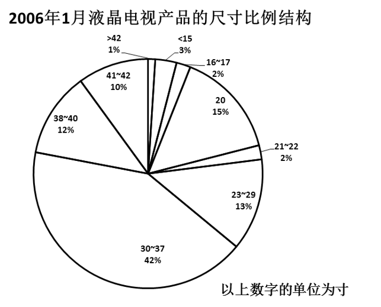

### 第 121 题

以上所列的液晶电视的尺寸的市场占有率中，尺寸为20寸的排名第几：

A. 第二

B. 第三

C. 第四

D. 第五

第 121 题 · 答案与解析

**参考答案（粉笔题库参考内容）**

A

**解析**

定位饼状图可得，尺寸为20寸的液晶电视市场占有率排名第二。

故正确答案为A。

**考点**：排序类、统计图

**来源**：2008年广西壮族自治区公务员录用考试《行测》题第121题

### 第 122 题

市场占有率前三的尺寸的液晶电视占整个市场的：

A. 60%

B. 70%

C. 69%

D. 67%

第 122 题 · 答案与解析

**参考答案（粉笔题库参考内容）**

B

**解析**

定位饼状图可得，市场占有率前三的尺寸的液晶电视依次为30～37寸、20寸、23～29寸，市场占有率分别为42%、15%、13%，占比之和为42%+15%+13%=70%。

故正确答案为B。

**考点**：简单加减计算、统计图

**来源**：2008年广西壮族自治区公务员录用考试《行测》题第122题

### 第 123 题

尺寸为20寸的液晶电视市场占有率约是尺寸为16~17寸的液晶电视市场占有率的多少倍：

A. 7.5

B. 7

C. 15

D. 5

第 123 题 · 答案与解析

**参考答案（粉笔题库参考内容）**

A

**解析**

根据题干“······约是······的多少倍”，可判定本题为现期倍数计算问题。定位饼状图可得，尺寸为20寸的液晶电视的市场占有率为15%，16～17寸的液晶电视的市场占有率为2%，所求倍数为15%/2% = 7.5倍。

故正确答案为A。

**考点**：现期倍数、统计图

**来源**：2008年广西壮族自治区公务员录用考试《行测》题第123题

### 第 124 题

在液晶电视机中占主导地位的产品的尺寸是多少寸：

A. 23~29

B. 20

C. 30~37

D. &lt;15

第 124 题 · 答案与解析

**参考答案（粉笔题库参考内容）**

C

**解析**

定位饼状图可知，市场占有率最高的为30～37寸的液晶电视，则在液晶电视机中主导地位的产品的尺寸是30～37寸。

故正确答案为C。

**考点**：直接找数、统计图

**来源**：2008年广西壮族自治区公务员录用考试《行测》题第124题

### 第 125 题

下列推论中最缺乏依据的是：

A. 液晶电视机的多数产品还是集中在30~37寸产品上

B. 大于37寸的产品，由于等离子电视机的竞争，很难取得优势

C. 低于30寸的产品，又在与显像管电视机的争夺中占据劣势

D. 30~37寸液晶电视机是目前电视机市场上的主力产品

第 125 题 · 答案与解析

**参考答案（粉笔题库参考内容）**

D

**解析**

A项：定位饼状图可得，30～37寸液晶电视占比最高，市场占有率接近一半，正确；

B项：定位饼状图可得，大于37寸的产品市场占有率为12%+10%+1%=23%，占比较低，正确；

C项：定位饼状图可得，低于30寸的产品市场占有率为3%+2%+15%+2%+13%=35%，则30寸及以上产品市场占有率为1-35%=65%，30寸以下产品占比低于30寸以上产品，正确；

D项：根据饼状图仅能得出30～37寸液晶电视机是液晶电视机市场的主力产品，而不是整个电视机市场的主力产品，错误。

本题为选非题，故正确答案为D。

**考点**：统计图、综合分析

**来源**：2008年广西壮族自治区公务员录用考试《行测》题第125题

## 材料 2

我国城乡就业人员从2002年的73740万人增加到2006年76400万人。其中：城镇就业人员从24780万人增加到28310万人；乡村就业人员从48960万人减少到48090万人，年均减少218万人。

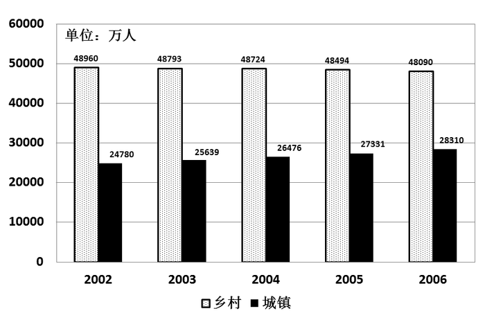

### 第 126 题

从2002年到2006年，城镇就业人员年均增长：

A. 883万人

B. 760万人

C. 979万人

D. 820万人

第 126 题 · 答案与解析

**参考答案（粉笔题库参考内容）**

A

**解析**

根据题目中的数据可知道，2006年城镇就业人员为28310万人，2002年城镇就业人员为24780万人，总共历经4年，故可根据估算法列出(28310−24780)/4 ≈ 3500/4 = 875万人。只有A选项最接近。

故正确答案为A。

**考点**：年均增长量、综合资料

**来源**：2008年广西壮族自治区公务员录用考试《行测》题第126题

### 第 127 题

根据图表，无法计算的一项是：

A. 城、乡就业人员年均增长率

B. 城、乡就业人员年环比增长量

C. 城、乡就业人员年累计增长量

D. 城镇失业人数

第 127 题 · 答案与解析

**参考答案（粉笔题库参考内容）**

D

**解析**

本题中没有城镇失业人数的数据，所以无法计算。

故正确答案为D。

**考点**：综合分析、综合资料

**来源**：2008年广西壮族自治区公务员录用考试《行测》题第127题

### 第 128 题

城镇与乡村就业人员比例最高的是哪一年：

A. 2002

B. 2003

C. 2005

D. 2006

第 128 题 · 答案与解析

**参考答案（粉笔题库参考内容）**

D

**解析**

根据题目可知，2006年乡村就业人员比2002~2005年的人数少，而城镇就业人员比2002~2005年的人数多，所以比例最高。

故正确答案为D。

**考点**：比值比较、综合资料

**来源**：2008年广西壮族自治区公务员录用考试《行测》题第128题

### 第 129 题

2006年农村就业人员占全部就业人员的比例为：

A. 58.9%

B. 37.1%

C. 62.9%

D. 41.1%

第 129 题 · 答案与解析

**参考答案（粉笔题库参考内容）**

C

**解析**

根据题目所给数据，所求比例为48090/(48090 + 28310) ≈ 48000/76000，直除可知首位为6。

故正确答案为C。

**考点**：现期比重、综合资料

**来源**：2008年广西壮族自治区公务员录用考试《行测》题第129题

### 第 130 题

从2002年到2006年，就业总人口每年变化为：

A. 增长

B. 减少

C. 持平

D. 不能确定

第 130 题 · 答案与解析

**参考答案（粉笔题库参考内容）**

A

**解析**

根据图表能够看出，从2002年到2006年城镇及乡村的就业人数都在逐年增长。

故正确答案为A。

**考点**：简单加减计算、统计图

**来源**：2008年广西壮族自治区公务员录用考试《行测》题第130题

## 材料 3

某省住宿餐饮业零售额增长迅速（如图所示），2003年住宿餐饮业零售额仅为259.45亿元，2006年突破400亿元，至2007年高达479.76亿元。2006年该省限额以上餐饮企业商品零售额为342952万元，比上年增加63012万元，增长22.5%，占当年该省全社会商品零售总额的比重为1.21%。按登记注册类型分组来可看，2006年内资企业商品零售额为280308万元，增长34.3%，港澳台商投资企业商品零售额13589万元，增长162.3%，外商投资企业商品零售额149056万元，下降25.7%。按国民经济行业分组来看，2006年正餐零售额280737万元，增长38.4%；快餐零售额54929万元，比上年下降21.8%；其他餐饮零售额6534万元，比上年下降0.95%。

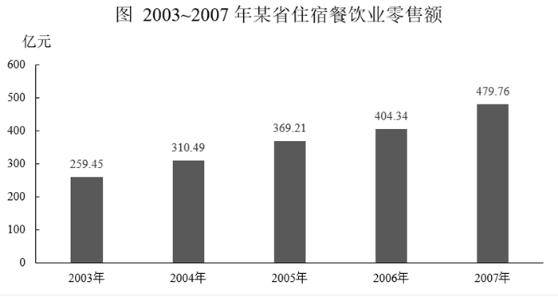

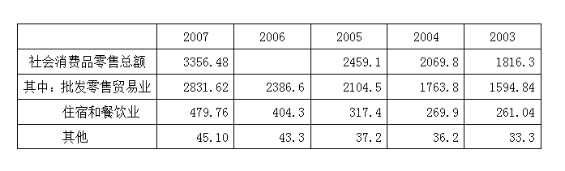

### 第 131 题

从2003年到2007年，该省住宿餐饮业零售额年均增长为：

A. 46.78亿元

B. 55.08亿元

C. 54.65亿元

D. 36.85亿元

第 131 题 · 答案与解析

**参考答案（粉笔题库参考内容）**

B

**解析**

根据题干“从2003年至2007年，······年均增长为”，结合选项带单位，可判定本题为年均增长量计算问题。定位统计图可得：2003年住宿餐饮业零售额为259.45亿元；2007年为479.76亿元。根据公式：年均增长量= (现期量−基期量)/年份差，故所求为(479.76 - 259.45)/(2007 - 2003) = 220.31/4 = 55^+亿元，B项符合。

故正确答案为B。

**考点**：年均增长量、综合资料

**来源**：2008年广西壮族自治区公务员录用考试《行测》题第131题

### 第 132 题

2006年该省全社会商品零售总额为：

A. 5668.6亿元

B. 3675.3亿元

C. 2834.2亿元

D. 5873.1亿元

第 132 题 · 答案与解析

**参考答案（粉笔题库参考内容）**

C

**解析**

根据题干“2006年该省全社会商品零售总额为”，结合材料时间为2006年及材料给出与题干相关主体的比重，可判定本题为现期比重问题。定位文字材料可得：2006年该省限额以上餐饮企业商品零售额为342952万元，占当年该省全社会商品零售总额的比重为1.21%。根据公式：整体=部分/比重，故所求为342952万元/1.21%，直除可知首位为2，C项符合。

故正确答案为C。

**考点**：现期比重、综合资料

**来源**：2008年广西壮族自治区公务员录用考试《行测》题第132题

### 第 133 题

住宿餐饮业零售额2007年比上年同期增长：

A. 29.94%

B. 34.81%

C. 15.72%

D. 18.65%

第 133 题 · 答案与解析

**参考答案（粉笔题库参考内容）**

D

**解析**

根据题干“2007年比上年同期增长”，结合选项为百分数，可判定本题为增长率问题。定位统计图可得：2006年住宿餐饮业零售额为404.34亿元，2007年住宿餐饮业零售额为479.76亿元。根据公式：增长率= (现期量−基期量)/基期量，故所求为(479.76−404.34)/404.34 ≈ 75.42/404 = 18%^+，D项符合。

故正确答案为D。

**考点**：一般增长率、综合资料

**来源**：2008年广西壮族自治区公务员录用考试《行测》题第133题

### 第 134 题

与2005年相比，2006年社会消费品零售额绝对增长量最大的行业是：

A. 批发零售贸易业

B. 住宿和餐饮业

C. 其他行业

D. 无法得知

第 134 题 · 答案与解析

**参考答案（粉笔题库参考内容）**

A

**解析**

根据统计表可知，2006年和2005年相比，批发零售贸易业增长量为2386.6−2104.5≈200，住宿和餐饮业为404.3 − 317.4 ≈ 100，其他不足10。故与2005年相比，2006年社会消费品零售额绝对增长量最大的行业是批发零售贸易业。

故正确答案为A。

**考点**：增长量比较、综合资料

**来源**：2008年广西壮族自治区公务员录用考试《行测》题第134题

### 第 135 题

根据表中内容，下列选项中可能正确的是：

①消费市场的繁荣，反映了居民收入的增加

②内需消费正在成为该省经济增长的强劲动力

③消费增长的拉动作用在不断加强

A. ①

B. ①与②

C. ②与③

D. ①②与③

第 135 题 · 答案与解析

**参考答案（粉笔题库参考内容）**

D

**解析**

通过全文内容，各项零售额涨幅都很大。①②③全可以表现出来。

故正确答案为D。

**考点**：综合分析、综合资料

**来源**：2008年广西壮族自治区公务员录用考试《行测》题第135题

