# 2009年广西壮族自治区公务员录用考试《行测》题

<!-- gwy:overview:start -->
> **广西 · 2009 · 行测 · 统考** ｜ 135 题 · 图片 105 处 · 答案随题折叠

| 题型模块 | 题量 | 题号 |
| --- | ---: | ---: |
| 数量关系 | 15 | 1–15 |
| 常识判断 | 30 | 16–45 |
| 言语理解与表达 | 25 | 46–70 |
| 判断推理 | 50 | 71–120 |
| 资料分析 | 15 | 121–135 |
| **合计** | **135** | |

导航：[题型与作答说明](#题型与作答说明) · [题目](#题目) · [材料 1](#材料-1)
<!-- gwy:overview:end -->

> 候选采集稿。参考答案及解析来自粉笔页面，不代表官方答案或真实高分答卷；来源使用许可与原卷对应关系仍需人工核实。

## 题型与作答说明

数量关系

（15题）

本部分包括数字推理与数学运算两种类型的试题。

常识判断

（30题）

本部分各题的选项中，只有一项是符合题意的，请将其选出填在答题卡上。

言语理解与表达

（25题）

根据题目要求，在四个选项中选出一个正确答案。

判断推理

（50题）

本部分包括图形推理、定义判断、逻辑判断、事件排序与类比推理五种类型的试题。

资料分析

（15题）

本部分题目供几组资料，或者是文字资料或者是图表。针对每一段文字或每一个图表， 后面有几个问题需要你回答。你应根据资料提供的信息进行分析、比较、计算和判断处理， 然后选出你认为最合适的答案。

## 题目

### 第 1 题

3，4，10，33，（  ）

A. 67

B. 76

C. 96

D. 136

第 1 题 · 答案与解析

**参考答案（粉笔题库参考内容）**

D

**解析**

观察数列，数字无明显特征，作差作和均无规律，考虑递推数列。根据递增趋势，相邻两项之间有：3×1+1=4，4×2+2=10，10×3+3=33，可得规律为：。因此所求项为。

故正确答案为D。

### 第 2 题

134，68，36，21，（  ）

A. 18

B. 14.5

C. 12

D. 9

第 2 题 · 答案与解析

**参考答案（粉笔题库参考内容）**

B

**解析**

观察数列，数字无明显特征，作差作和无规律，考虑递推数列。根据递减趋势相邻两项之间有：134÷2+1=68，68÷2+2=36，36÷2+3=21，可得规律为：，因此所求项为。

故正确答案为B。

### 第 3 题

5，7，24，62，（  ），468

A. 94

B. 145

C. 172

D. 236

第 3 题 · 答案与解析

**参考答案（粉笔题库参考内容）**

C

**解析**

观察数列无明显特征，作差后无规律，考虑递推数列，圈三数，找规律。观察发现，(7+24)×2=62，推测该数列规律为：(第一项+第二项)×2=第三项。做验证：(5+7)×2=24，符合规律，则所求项=(24+62)×2=172，向后验证(62+172)×2=468，符合规律。

故正确答案为C。

### 第 4 题

1，7，7，9，3，（  ）

A. 7

B. 11

C. 6

D. 1

第 4 题 · 答案与解析

**参考答案（粉笔题库参考内容）**

A

**解析**

观察数列无明显特征，变化混乱无序，考虑特殊规律。观察发现：1×7=7，7×7=49，7×9=63，规律为：前两项相乘的尾数等于第三项。则所求项为9×3=27的尾数，尾数为7。

故正确答案为A。

### 第 5 题

15 ，13 ，37 ，12 ，（  ）

A. 59

B. 16

C. 6

D. 35

第 5 题 · 答案与解析

**参考答案（粉笔题库参考内容）**

A

**解析**

观察数列变化混乱无序，考虑特殊规律。将个位数与十位数字拆分为1∣5、1∣3、3∣7、1∣2、（？∣？），分别观察个位数与十位数均无规律，反约分为2∣10、4∣12、6∣14、8∣16、（？∣？），观察可得，分隔符前：2、4、6、8、(10)，是公差为2的等差数列；分隔符后：10、12、14、16、(18)，是公差为2的等差数列。则反约分后的空缺项为10∣18，再约分为5∣9，故所求项应为59。

故正确答案为A。

### 第 6 题

4，13，36，（    ），268

A. 97

B. 81

C. 126

D. 179

第 6 题 · 答案与解析

**参考答案（粉笔题库参考内容）**

A

**解析**

数列变化幅度较大，且数据都是幂次数或者周围有幂次数，优先考虑幂次数列。观察发现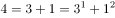，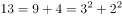，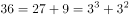，（    ），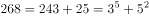。观察可得，幂次项规律为：底数为3，指数是公差为1的等差数列；修正项规律：底数是公差为1的等差数列，指数为2。故所求项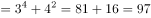。

故正确答案为A。

### 第 7 题

11，13，16，21，28，（  ）

A. 7

B. 39

C. 41

D. 47

第 7 题 · 答案与解析

**参考答案（粉笔题库参考内容）**

B

**解析**

观察数列，无明显特征，优先考虑多级数列。后项减前项得到新数列：2，3，5，7，为质数数列，后一项为11，故所求项为28+11=39。

故正确答案为B。

### 第 8 题

7，8，11，7，15，（  ），19，5

A. 8

B. 6

C. 11

D. 19

第 8 题 · 答案与解析

**参考答案（粉笔题库参考内容）**

B

**解析**

观察数列，发现数列项数较多，考虑多重数列。优先交叉看，奇数项数列：7，11，15，19，是公差为4的等差数列；偶数项数列：8，7，（    ），5，是公差为-1的等差数列，故所求项为6。

故正确答案为B。

### 第 9 题

16支球队分两组，每组打单循环赛，共需打（  ）场比赛。

A. 16

B. 56

C. 64

D. 120

第 9 题 · 答案与解析

**参考答案（粉笔题库参考内容）**

B

**解析**

由题意，根据比赛计数模型公式，每组进行的单循环比赛场次为场，于是两组球队共需打场比赛。

故正确答案为B。

### 第 10 题

一直角三角形最长边是10厘米，最短边是6厘米，则这个三角形的面积是多少平方厘米：

A. 24

B. 30

C. 48

D. 60

第 10 题 · 答案与解析

**参考答案（粉笔题库参考内容）**

A

**解析**

方法一：直角三角形的最长边即斜边，设另一直角边长为x厘米，根据勾股定理可得：，解得x=8。代入三角形面积公式，可得三角形面积平方厘米。

方法二：由题意可知，直角三角形的最长边即斜边，斜边：短直角边=5:3，根据直角三角形5：4：3的勾股比例，则另外一条直角边为厘米，代入三角形面积公式，可得三角形面积平方厘米。

故正确答案为A。

### 第 11 题

一电信公司在每晚九点到次日早七点以及周六、周日全天实行长话半价收费。请问该电信公司在一周内共有多少个小时实行长话半价收费：

A. 114

B. 84

C. 98

D. 91

第 11 题 · 答案与解析

**参考答案（粉笔题库参考内容）**

C

**解析**

由题意可知，周一至周五每天0点至7点、21点至24点长话半价，每天10小时，共5×10=50小时；周六、周日全天是长话半价，共2×24＝48小时。故一周共50+48=98小时实现半价收费。

故正确答案为C。

### 第 12 题

在一周长为50m的圆形花坛周围种树，如果每隔5m种一棵，共要种多少棵树：

A. 9

B. 10

C. 11

D. 12

第 12 题 · 答案与解析

**参考答案（粉笔题库参考内容）**

B

**解析**

根据环形植树公式：环形植树棵数，可得共需种树棵。

故正确答案为B。

### 第 13 题

从一副完整的扑克牌中至少抽出多少张牌，才能保证至少有5张牌的花色相同：

A. 17

B. 18

C. 19

D. 20

第 13 题 · 答案与解析

**参考答案（粉笔题库参考内容）**

C

**解析**

一副完整的扑克牌包括四种花色的A到K，共有4×13=52张以及2张大小王，要保证拿出的牌有5张花色相同，考虑最不利情况，即红桃、方块、黑桃、梅花各抽出4张，且抽中了2张大小王。此时，从剩下的扑克牌中任意拿出一张，均满足条件“保证拿出的牌一定有5张花色相同”，故至少需要拿出4×4+2+1=19张牌。

故正确答案为C。

### 第 14 题

某小学班有65名同学，其中男同学有30人，少先队员有45人；有12名男同学是少先队员，有多少名女同学不是少先队员：

A. 2

B. 8

C. 10

D. 15

第 14 题 · 答案与解析

**参考答案（粉笔题库参考内容）**

A

**解析**

根据两集合容斥原理公式：A+B-A∩B=总数-都不，即男同学+少先队员-男同学是少先队员=总人数-女同学且不是少先队员。代入数据30+45-12=65-女同学且不是少先队员，解得女同学且不是少先队员为2人。

故正确答案为A。

### 第 15 题

将1～9个数字分别填入下面的九宫阵，使阵中每一行，每一列、对角线上的三个数字之和均为15，其中的数字1可以填入阵中的（  ）位置。

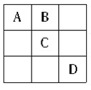

A. A

B. B

C. C

D. D

第 15 题 · 答案与解析

**参考答案（粉笔题库参考内容）**

B

**解析**

根据九宫格的性质，正中间的位置必填5，排除C；

A与D为对称位置，本质上是一样，均可排除。

这9个数字，将其分为3组，每组3个数字和为15，有两种分法：

第一种：6、1、8；7、5、3；2、9、4。

第二种：6、7、2；1、5、9；8、3、4。

故正确答案为B。

### 第 16 题

国家减灾委、民政部2009年3月2日发布消息，经国务院批准，自2009年起，每年哪天为全国“防灾减灾日”：

A. 3 月5 日

B. 5 月12 日

C. 6 月10 日

D. 7 月6 日

第 16 题 · 答案与解析

**参考答案（粉笔题库参考内容）**

B

**解析**

2009年3月2日，国家减灾委、民政部发布消息，经国务院批准，自2009年起，每年5月12日为全国“防灾减灾日”。国家减灾委办公室有关负责人表示，“防灾减灾日”的设立，有利于唤起社会各界对防灾减灾工作的高度关注，有利于全社会防灾减灾意识的普遍增强，有利于推动全民防灾减灾知识和避灾自救技能的普及推广，有利于各级综合减灾能力的普遍提高，最大限度地减轻自然灾害的损失。而这也是为了纪念2008年5月12日汶川发生的8.0级特大地震。

故正确答案为B。

### 第 17 题

商品最本质的因素是：

A. 使用价值

B. 交换价值

C. 价值

D. 价格

第 17 题 · 答案与解析

**参考答案（粉笔题库参考内容）**

C

**解析**

商品是用来交换的劳动产品，具有使用价值和价值两个属性。使用价值是商品具有的效用，即能满足人类某种需要的属性，使用价值是商品的自然属性。凝结在商品中的一般人类劳动就是商品的价值。价值是商品所特有的本质属性和社会属性，体现着商品生产者之间相互比较劳动耗费量和交换劳动的社会经济关系。

故正确答案为C。

### 第 18 题

跨国公司是由：

A. 联合国有关机构出资建立起来的

B. 原料出口国共同投资建立起来的

C. 一国的或以一国的垄断组织为主建立起来的

D. 多个国家的垄断组织共同建立起来的

第 18 题 · 答案与解析

**参考答案（粉笔题库参考内容）**

C

**解析**

跨国公司是垄断资本主义高度发展的产物。它的出现与资本输出密切相关。19世纪末20世纪初，资本主义进入垄断阶段，资本输出大大发展起来，这时才开始出现少数跨国公司。当时，发达资本主义国家的某些大型企业通过对外直接投资，在海外设立分支机构和子公司，开始跨国性经营。因此，跨国公司是一国的或以一国的垄断组织为主建立起来的。

故正确答案为C。

### 第 19 题

法的规范作用包括：

A. 指引、评价、惩罚、强制、教育作用

B. 指引、评价、教育、预测、惩罚作用

C. 指引、教育、强制、鼓励、预测作用

D. 指引、评价、预测、教育、强制作用

第 19 题 · 答案与解析

**参考答案（粉笔题库参考内容）**

D

**解析**

法的规范作用可以分为指引、评价、教育、预测和强制五种。指引作用是指法对本人的行为具有引导作用；评价作用是指法律作为一种行为标准，具有判断、衡量他人行为合法与否的评判作用；教育作用是指通过法的实施使法律对一般人的行为产生影响；预测作用是指凭借法律的存在，可以预先估计到人们相互之间会如何行为；强制作用是指法可以通过制裁违法犯罪行为来强制人们遵守法律。法的这五种规范作用是法律必备的，任何社会的法律都具有。但是，在不同的社会制度下，在不同的法律制度中，由于法律的性质和价值的不同，法的规范作用的实现程度是会有所不同的。

故正确答案为D。

### 第 20 题

法律从何时开始生效，一般根据该项法律的性质和实际需要来决定，通常有三种方式：第一种是法律条文中明确规定自公布之日起施行；第二种是法律公布后先予试行或暂行，而后由立法部门加以补充完善，再通过为正式法律，但在试行期间，该法律也具有约束力；第三种是：

A. 法律公布后并不立即生效施行，经过一定时期后才开始施行

B. 法律公布后并不立即生效施行，经过一年后才开始施行

C. 法律公布后并不立即生效施行，经过至少一年后才开始施行

D. 法律公布后并不立即生效施行，经过一定时期后才开始施行，法律中明确规定生效施行的日期

第 20 题 · 答案与解析

**参考答案（粉笔题库参考内容）**

D

**解析**

法律实施和公布是不同的概念。法律的公布是指由特定机关将通过的法律向全社会予以公告，法律的施行则是指法律开始生效。法律从何时开始生效，一般根据该项法律的性质和实际需要来决定，通常有三种方式：第一种是法律条文中明确规定自公布之日起施行。这种方式在我国立法中曾较多地运用，但近年来逐渐减少，主要适用于对法律、法规的修订或者法律、法规较少涉及公民权利义务的情形。第二种是法律公布后先予试行或暂行，而后由立法部门加以补充完善，再通过为正式法律，但在试行期间，该法律也具有约束力。第三种是法律公布后并不立即生效施行，经过一定时期后才开始施行，法律中明确规定生效施行的日期。这是近年来我国在制定新法时使用的主要方式。

故正确答案为D。

### 第 21 题

科学揭示燃烧现象的是：

A. 哥白尼

B. 牛顿

C. 拉瓦锡

D. 爱迪生

第 21 题 · 答案与解析

**参考答案（粉笔题库参考内容）**

C

**解析**

C项正确，法国著名化学家安托万-洛朗·拉瓦锡于1777年向巴黎科学院提出了一篇报告《燃烧概论》，阐明了燃烧作用的氧化学说，科学揭示了燃烧现象，也彻底地推翻了燃素说；

A、B、D错误，哥白尼解释的是日心说，牛顿揭示了万有引力定律，爱迪生则是发明家，发明了电灯，开创了现代对电的利用。

故正确答案为C。

### 第 22 题

作为调节社会经济运行的一种重要经济杠杆，提高税率通常是：

A. 提高政府的财政收入

B. 抑制投资，有利于防止经济过热

C. 刺激消费

D. 提高税收管理的效率

第 22 题 · 答案与解析

**参考答案（粉笔题库参考内容）**

B

**解析**

根据拉弗曲线：一般情况下，税率越高，政府的税收就越多；但税率的提高超过一定的限度时，企业的经营成本提高，投资减少，收入减少，即税基减少，反而导致政府的税收减少，所以A项错误。提高税率，通常会减少人们的可支配收入，从而能抑制消费和投资，所以C项错误。合理的提高或者降低税率都能提高税收管理的效率，所以D项错误。适度的提高税率可以抑制投资，并可以防止经济过热。

故正确答案为B。

### 第 23 题

李清照《声声慢》：“乍暖还寒时候，最难将息。”中的“将息”是指：

A. 喘息

B. 停止

C. 睡眠

D. 保养身体

第 23 题 · 答案与解析

**参考答案（粉笔题库参考内容）**

D

**解析**

“乍暖还寒时候，最难将息”译为特别是秋季骤热骤冷的时候最难以保养身体了。此处的“将息”是说休养、调理身体。

故正确答案为D。

### 第 24 题

生态系统是由生物群落及其生存环境共同组成的：

A. 静态平衡系统

B. 动态平衡系统

C. 平衡态平衡系统

D. 固态平衡系统

第 24 题 · 答案与解析

**参考答案（粉笔题库参考内容）**

B

**解析**

生态系统是指在一定的空间内生物成分和非生物成分通过物质循环和能量流动相互作用、相互依存而构成的一个生态学功能单位，即由生物群落和它的无机环境相互作用而形成的动态平衡系统。

故正确答案为B。

### 第 25 题

国务院决定从2009年1月1日起，在全国（  ）教育学校实施绩效工资，确保其教师平均工资水平不低于当地公务员平均工资水平。

A. 义务

B. 职业

C. 中等

D. 高等

第 25 题 · 答案与解析

**参考答案（粉笔题库参考内容）**

A

**解析**

国务院审议并通过的《关于义务教育学校实施绩效工资的指导意见》，决定从2009年1月1日起，在全国义务教育学校实施绩效工资，确保义务教育教师平均工资水平不低于当地公务员平均工资水平，同时对义务教育学校离退休人员发放生活补贴。

故正确答案为A。

### 第 26 题

甲、乙双方签订了货物买卖合同，由甲方向乙方提供货物。后经甲方同意，乙方将合同中的权利、义务转给丙。这样，法律关系的（    ）就发生了变更。

A. 主体、客体

B. 内容

C. 客体

D. 主体

第 26 题 · 答案与解析

**参考答案（粉笔题库参考内容）**

D

**解析**

本题考查法律关系的构成要素。法律关系由主体、客体和内容三个要素构成。主体是法律关系的参加者，即在法律关系中一定权利的享有者和一定义务的承担者。法律关系客体是指法律关系主体之间的权利和义务所指向的对象。

A项，本题中，法律关系的主体是签订合同的甲和乙，客体是货物。乙方在获得甲方同意的情况下将自己的权利、义务转移给丙方，法律关系的主体由原来的甲方乙方变更为甲方丙方，客体没有变更。该项应排除。

B项，法律关系的内容是指法律关系主体所享有的权利和承担的义务。本题中，乙所有的权利和义务都转移给了丙，法律关系的内容并没有变更。该项应排除。

C项，乙方将合同中的权利和义务转给丙之后，法律关系的客体仍是货物，没有发生变更。该项应排除。

D项，乙方将合同中的权利和义务转给丙，法律关系的主体就由甲和乙变成了甲和丙，即发生了法律关系主体的变更。该项应选。

故正确答案为D。

### 第 27 题

中国共产党之所以能够明确地提出彻底反帝反封建的民主革命纲领，最主要原因是：

A. 无产阶级政党

B. 正确分析和认识中国国情

C. 得到共产国际的指导

D. 具有广泛的群众基础

第 27 题 · 答案与解析

**参考答案（粉笔题库参考内容）**

B

**解析**

国情，泛指一国自然和社会的历史与现状的基本情况。“认清中国的国情，乃是认清一切革命问题的基本的依据”。在我国民主革命时期，因为对国情认识不清、不足甚至错误，致使革命受到挫折、损失，教训是非常深刻的。毛泽东一代的中国共产党人是运用马克思主义的世界观、方法论，在实践、认识、再实践、再认识的多次反复中，才认清了中国的国情，主要是认清了中国半殖民地半封建社会性质及至革命的对象、任务、动力和革命性质等基本问题，引导了中国革命走向胜利。

故正确答案为B。

### 第 28 题

经过半个世纪的开垦，北大荒成了全国闻名的“北大仓”。然而由于过度开垦已经造成了许多生态问题。现在，黑龙江垦区全面停止开荒，退耕还“荒”。这说明：

A. 人与自然的和谐最终以恢复生态为归宿

B. 人们改造自然的一切行为都会遭到“自然界的报复”

C. 人们在自然界面前总是处于被支配的地位

D. 人应合理地调节人与自然之间的物质变换

第 28 题 · 答案与解析

**参考答案（粉笔题库参考内容）**

D

**解析**

人类是自然的一部分，应该与自然和谐相处。人类在认识世界、改造世界的过程中必然受到大自然的反作用。题目中由“北大荒”到“北大仓”，再由过度开垦到停止开荒的转变过程，体现了人类与自然之间物质交换的合理调节。

故正确答案为D。

### 第 29 题

科学发展是在坚持以（  ）为中心的前提下，更好地落实党执政兴国的第一要务。

A. 思想建设

B. 文化建设

C. 经济建设

D. 制度建设

第 29 题 · 答案与解析

**参考答案（粉笔题库参考内容）**

C

**解析**

以经济建设为中心，是我们党的基本路线的核心内容，是我国经济社会发展的一条主线。科学发展观的要义是发展，只有坚持以经济建设为中心，抓好发展这个党执政兴国的第一要务，才能为以人为本、全面协调可持续发展打下坚实的物质基础，才能更好地解决前进道路上的矛盾和问题，实现全面建设小康社会和社会主义现代化的宏伟目标。

故正确答案为C。

### 第 30 题

中国现代话剧的奠基人是：

A. 鲁迅

B. 曹禺

C. 夏衍

D. 郭沫若

第 30 题 · 答案与解析

**参考答案（粉笔题库参考内容）**

B

**解析**

曹禺，卓越的中国现代戏剧家。代表作有《雷雨》、《日出》、《原野》、《北京人》、《胆剑篇》、《王昭君》等。被誉为中国现代话剧的奠基人。

故正确答案为B。

### 第 31 题

社会保障是指国家对社会成员在年老、残疾、伤残、失业、遭受灾害、生活困难等情况时，给予物质帮助的制度。社会保障的核心内容是：

A. 社会保险

B. 社会救济

C. 社会福利

D. 优抚安置

第 31 题 · 答案与解析

**参考答案（粉笔题库参考内容）**

A

**解析**

社会保障是指国家和社会在通过立法对国民收入进行分配和再分配，对社会成员特别是生活有特殊困难的人们的基本生活权利给予保障的社会安全制度。社会保障的本质是维护社会公平进而促进社会稳定发展。一般来说，社会保障由社会保险、社会救济、社会福利、优抚安置等组成。其中，社会保险是社会保障的核心内容。

故正确答案为A。

### 第 32 题

下列希腊神话人物中，太阳神是：

A. 哈得斯

B. 雅典娜

C. 阿波罗

D. 狄安娜

第 32 题 · 答案与解析

**参考答案（粉笔题库参考内容）**

C

**解析**

哈得斯是宙斯的哥哥，在战胜父亲克洛诺斯后，负责掌管下界冥土，成为冥王；雅典娜是掌管智慧与正义战争的女神；阿波罗全名为福玻斯·阿波罗，意思是“光明”或“光辉灿烂”，是希腊神话中的太阳神；狄安娜是奥林匹斯山上的月亮与狩猎女神。

故正确答案为C。

### 第 33 题

我国长期以来形成了依赖投资扩张的增长方式。解决投资扩张问题，可以采取的措施是：

A. 增加财政支出

B. 增加货币供应量

C. 提高贷款利率

D. 增加国债规模

第 33 题 · 答案与解析

**参考答案（粉笔题库参考内容）**

C

**解析**

A、B项错误，增加财政支出和增加货币供应量即增加投资，使投资扩张；

C项正确，提高贷款利率降低投资增长速度，可以解决投资扩张问题；

D项错误，扩大国债规模为基础设施建设以及惠及民生、亟须财政投入支持的地区和行业提供了资金支持，又为实现国家产业政策和实体经济发展提供了资金来源，是一种扩张投资的方式。

故正确答案为C。

### 第 34 题

在我国古代，和谐是一种理想的境界。（  ）所言的“和为贵”，就蕴含着对和谐境界的追求。

A. 老子

B. 墨子

C. 孔子

D. 孟子

第 34 题 · 答案与解析

**参考答案（粉笔题库参考内容）**

C

**解析**

“和为贵”出自《论语》，原文是：“礼之用，和为贵。先王之道，斯为美。小大由之，有所不行。知和而和，不以礼节之，亦不可行也。”孔子既强调礼的运用以和为贵，又指出不能为和而和，要以礼节制之，可见孔子提倡的和并不是无原则的调和，这是有其合理性的。

故正确答案为C。

### 第 35 题

北回归线在我国大陆穿过几个省：

A. 1

B. 2

C. 3

D. 4

第 35 题 · 答案与解析

**参考答案（粉笔题库参考内容）**

C

**解析**

北回归线是地球上北温带与热带的分界线，也就是北纬的纬线圈。中国大陆在北回归线经过的地方：广东的汕头、从化、封开，广西的桂平和云南的墨江，并都建起了标志塔。台湾地区的标志塔不属于大陆地区。

故正确答案为C。

### 第 36 题

2009年2月1日，《中共中央 国务院关于2009年促进农业稳定发展农民持续增收的若干意见》正式公布。这是中国改革开放以来第11个以（    ）为主题的中央一号文件。

A. 农村工作

B. 农业发展

C. “三农”

D. 农民工

第 36 题 · 答案与解析

**参考答案（粉笔题库参考内容）**

C

**解析**

今年2月1日正式公布的2009年中央一号文件再度锁定“三农”。这份名为《中共中央 国务院关于2009年促进农业稳定发展农民持续增收的若干意见》的文件，是改革开放以来第11个以“三农”为主题的中央一号文件，也是首次连续6年发布关于“三农”工作的一号文件。

故正确答案为C。

### 第 37 题

爱因斯坦指出“哲学可以被认为是全部科学之母”，这说明：

A. 哲学是全部科学的汇集

B. 哲学是各门科学知识的基础

C. 哲学对各门具体科学的研究具有指导作用

D. 哲学与各门具体科学是整体与局部的关系

第 37 题 · 答案与解析

**参考答案（粉笔题库参考内容）**

C

**解析**

哲学和具体科学的关系是既联系又有区别。哲学和各门具体学科就是共性和个性、一般和个别、指导和被指导的关系。

A项错误，哲学并不是全部科学的汇集；

B项错误，哲学不是具体科学的基础，而恰恰具体科学是哲学的基础；

D项错误，哲学是具体学科的概括和总结。

故正确答案为C。

### 第 38 题

随着世界经济发展的需要，一些国际经济组织应运而生，今天最广泛最具有权威性的是：

A. 国际货币基金组织

B. 世界银行

C. 世界贸易组织

D. 欧洲经济共同体

第 38 题 · 答案与解析

**参考答案（粉笔题库参考内容）**

C

**解析**

A、B、C三项都属于国际经济组织，D项欧洲共同体其实是一个联合的经济集团，它包括欧洲煤钢联营、欧洲经济共同体（西欧共同市场）和欧洲原子能联营，其中以欧洲经济共同体最为重要，欧洲共同体并非国际经济组织，可排除。只有C项的世界贸易组织工作几乎涉及各国所有的经济部门，管辖的范围已从货物贸易扩展至服务贸易、与贸易有关的投资及知识产权领域，而且还将涉及劳工、环境保护等领域，因此可以说是最具权威性的。

故正确答案为C。

### 第 39 题

国民教育的根本任务是：

A. 追求升学率

B. 培养精英人才

C. 普及科技知识

D. 全面提高国民素质

第 39 题 · 答案与解析

**参考答案（粉笔题库参考内容）**

D

**解析**

教育是一个民族最根本的事业，我国国民教育的基本任务是全面提高国民素质。A项所述追求升学率明显错误，可排除；B、C两项的说法只是国民教育中的一部分。

故正确答案为D。

### 第 40 题

我国首颗人造绕月探测卫星（  ）在累计飞行494天后，于北京时间2009年3月1日16时13分10秒成功落在月球的丰富海区域。

A. “嫦娥一号”

B. “长征二号”

C. “长征三号”

D. “神舟七号”

第 40 题 · 答案与解析

**参考答案（粉笔题库参考内容）**

A

**解析**

2007年10月24日，“嫦娥一号”绕月探测卫星发射成功，圆满实现工程目标和科学目标后，于2009年3月1日16时13分10秒，准确落入月表指定区域，成功完成硬着陆。长征二号、长征三号都是火箭；神舟七号是载人航天飞船。

故正确答案为A。

### 第 41 题

信用卡的使用体现着银行的一项业务活动，这项业务活动是：

A. 发行货币

B. 发行债券

C. 转账结算

D. 调节利率

第 41 题 · 答案与解析

**参考答案（粉笔题库参考内容）**

C

**解析**

信用卡是一种非现金交易付款的方式，是简单的信贷服务。我国法律规定的信用卡是指由商业银行或者其他金融机构发行的具有消费支付、信用贷款、转账结算、存取现金等全部功能或者部分功能的电子支付卡。A、B、C、D四个选项中只有C是正确的。

故正确答案为C。

### 第 42 题

地表有（  ）被海洋覆盖，被称为水圈。

A. 50％

B. 65％

C. 70％

D. 75％

第 42 题 · 答案与解析

**参考答案（粉笔题库参考内容）**

C

**解析**

全球海洋的面积约36200万平方公里（1400万平方里），大约占地球表面积的71%。

故正确答案为C。

### 第 43 题

国家统计局2009年1月22日发布的初步数据核算显示，2008年中国国内生产总值（GDP）突破30万亿元，比上年增长：

A. 8.0％

B. 9.0％

C. 10.5％

D. 13.2％

第 43 题 · 答案与解析

**参考答案（粉笔题库参考内容）**

B

**解析**

2009年1月22日国家统计局局长马建堂在国务院新闻办公室举行的新闻发布会上发布的初步核算数据显示，2008年中国国内生产总值为300670亿元，比上年增长9.0%。

故正确答案为B。

### 第 44 题

有选举权和被选举权的年满（  ）周岁的中华人民共和国公民可以被选为中华人民共和国主席、副主席。

A. 四十

B. 四十五

C. 五十

D. 五十五

第 44 题 · 答案与解析

**参考答案（粉笔题库参考内容）**

B

**解析**

《宪法》第七十九条第二款规定：“有选举权和被选举权的年满四十五周岁的中华人民共和国公民可以被选为中华人民共和国主席、副主席。”

故正确答案为B。

### 第 45 题

我国民族的分布特点是：

A. 东北、西北、西南多少数民族

B. 东南、中南、华东多汉族

C. 各民族大聚居，小杂居，交错杂居

D. 以汉族为主体的大杂居，小聚居，交错杂居

第 45 题 · 答案与解析

**参考答案（粉笔题库参考内容）**

D

**解析**

我国民族在长期的历史发展中，逐渐形成了以汉族为主体，大杂居、小聚居、交错杂居的分布特点。主要表现在：在汉族集中地区杂居着许多少数民族；在少数民族聚居地方，也多与汉族和其他民族交错杂居。现在全国几乎没有一个市、县的居民是由单一民族组成的。这种特点，对我国的民族关系和民族政策的制定有深远的影响。

故正确答案为D。

### 第 46 题

三月桃花盛开时节，许多南宁市民纷纷到青秀山＿＿＿＿＿＿春景。

A. 观看

B. 赏玩

C. 赏鉴

D. 观光

第 46 题 · 答案与解析

**参考答案（粉笔题库参考内容）**

B

**解析**

此题考查实词的填空。

A项的“观看”是特意地看，有参观、观察之意；C项的“赏鉴”多指欣赏鉴别艺术品，如赏鉴名画，故排除；D项的“观光”是参观外国或外地的景物、建设，也排除；B项的“赏玩”就是指欣赏玩味艺术品、风景、景物。在此题中用“赏玩”比“观看”更合适。

故正确答案为B。

### 第 47 题

为了加快工程进度，＿＿＿＿＿下大雨，刮大风，施工有困难，我们＿＿＿＿＿要干，＿＿＿＿＿要提前完成任务。

A. 如果 那么 并且

B. 虽然 但是 而且

C. 即使 也 而且

D. 即使 那么 并且

第 47 题 · 答案与解析

**参考答案（粉笔题库参考内容）**

C

**解析**

此题考查的是关联词的用法。

结合本题的语境，第一个空应填表假设的词，可排除B项；第二个空填“那么”句子不通顺，应排除A、D项；只有C项合适。

故正确答案为C。

### 第 48 题

将下列词语依次填入各句横线处，最恰当的一组是：

①国家为了公共利益的需要，县级以上人民政府依照法律规定的权限和程序，可以征收自然人、法人的不动产或者动产，但应当给予＿＿＿＿＿。

②过分强调竞争制度，以及依据直接用途而过早专业化，这就会包括专业知识在内的一切文化生活所依存的那种精神被＿＿＿＿＿＿。

A. 赔偿 扼杀

B. 赔偿 抹杀

C. 补偿 抹杀

D. 补偿 扼杀

第 48 题 · 答案与解析

**参考答案（粉笔题库参考内容）**

D

**解析**

此题考查近义实词的填空。

第一空中，“赔偿”是指因自己的行动使他人或集体受到损失而给予补偿，①表达的不是这个意思，因此可排除A、B两项；

第二空中，“抹杀”是一概不计，完全勾销之意，“扼杀”有比喻压制、摧残使不能存在或发展之意，符合②的语境。

故正确答案为D。

### 第 49 题

两国经过协商，已达成协议，双方军队各自撤回到自己的＿＿＿＿＿＿＿＿。

A. 边疆

B. 边界

C. 边境

D. 边区

第 49 题 · 答案与解析

**参考答案（粉笔题库参考内容）**

B

**解析**

此题考查近义实词的填空。

“边疆”是指靠近国界的领土；“边界”是指地区和地区之间的界线；“边境”是指靠近边界的地方；“边区”多指抗战时期革命政权在几个省连接的边缘地带建立的根据地。两国军队各自撤回到自己的边界。

故正确答案为B。

### 第 50 题

最近有媒体称，尽管美国表面上称要通过外交途径迫使伊朗 ＿＿＿＿＿＿，但以副总统切尼为代表的鹰派已经迫不及待，认为“通过外交手段不能＿＿＿＿＿＿＿伊朗的核野心”，因此美国媒体更频繁鼓吹对伊朗采取强硬措施。

A. 就范 控制

B. 就范 遏制

C. 屈服 遏制

D. 屈服 控制

第 50 题 · 答案与解析

**参考答案（粉笔题库参考内容）**

B

**解析**

此题考查近义实词的填空。

“就范”是指听从支配和控制，一般与“迫使”形成习惯搭配。“遏制”有制止之意， 即强迫使停止、不允许继续（行动），与“采取强硬措施”呼应，比“控制”一词更恰当。

故正确答案为B。

### 第 51 题

将下列选项中的词语依次填入横线处，最恰当的一组是：

①许多人都有一颗挂在嘴边拿得出手的中国心，我有一双 ＿＿＿＿不安的中国脚，说走就走，心在野外，心在路上。

②古塔是上天坠落的一枚钉子，锈迹斑斑，跃动着岁月的＿＿＿＿；今年的候鸟依然能从中找到去年的缺口，重筑它残破的巢。

A. 焦躁 纹理

B. 躁动 纹理

C. 躁动 波澜

D. 焦躁 波澜

第 51 题 · 答案与解析

**参考答案（粉笔题库参考内容）**

C

**解析**

此题考查近义实词的填空。

第一空“焦躁”指的是因着急而烦躁，①中“心在野外，心在路上”表现的是一种喜欢旅游、闲不住的心态，并没有“烦”的意思，所以“焦躁”不符合语境，“躁动”有“不停活动”之意，所以合适；

第二空“波澜”比“纹理”更凸显历史的动感，照应“跃动”一词。

故正确答案为C。

### 第 52 题

将下列选项中的词语依次填入各句横线，最恰当的一组是：

①有些企业在《劳动合同法》实施以前，开始着手解除那些工龄即将满十年的员工的劳动合同，以＿＿＿＿＿未来的经济补偿风险。

②广西某饮食服务公司由于狠抓管理，杜绝铺张浪费，三个月下来，仅办公经费一项，就＿＿＿＿＿了五十万元。

③北京市知名食品企业与北京市食品研究所，历时近两年，研发了200多个样品，并从中＿＿＿＿出第一批“新北京特产”。

A. 规避 结余 遴选

B. 回避 节余 遴选

C. 规避 节余 筛选

D. 回避 结余 筛选

第 52 题 · 答案与解析

**参考答案（粉笔题库参考内容）**

C

**解析**

此题考查实词的填空。

第一空“规避”是指设法躲开，逃避之意，“回避”则是让开、躲开之意，①中的“有些企业解除那些工龄即将满十年的员工的劳动合同”是有意为之，“规避”符合语境，故可排除B、D两项；

第二空“结余”是指结算后余下的，与②叙述的“狠抓管理，杜绝铺张浪费”没有什么联系，而“节余”则有因节约而剩下之意，据此可排除A项；

第三空“筛选”泛指通过淘汰的方法挑选，“遴选”则常用来指选拔人才，C项当选。

故正确答案为C。

### 第 53 题

报告是用于向上级机关汇报工作，＿＿＿＿＿＿情况，上级机关＿＿＿＿＿＿询问的陈述性上行公文。

A. 反应 答应

B. 反映 答应

C. 反映 答复

D. 反应 答复

第 53 题 · 答案与解析

**参考答案（粉笔题库参考内容）**

C

**解析**

此题考查实词的填空。

第一空“反映”的意思是：把意见、情况等告诉上级或有关部门；“反应”是名词，一般指事情所引起的意见、态度或行动，故第一空很容易排除A、D两项。

第二空“答应”有应声回答和应允、同意之意，在题干中不符合下级对上级的态度，“答复”则是对问题或要求给以回答。

故正确答案为C。

### 第 54 题

现代汉民族共同语言是以＿＿＿＿＿＿为标准音，以＿＿＿＿＿＿＿为基础方言，以典范的现代白话文著作为语法规范的普通话。

A. 北方语音 北京方言

B. 北京语音 北方方言

C. 北京语音 北京方言

D. 北方语音 北方方言

第 54 题 · 答案与解析

**参考答案（粉笔题库参考内容）**

B

**解析**

此题考查实词的填空。

根据“以＿＿＿＿＿＿为标准音，以＿＿＿＿＿＿＿为基础方言”，“标准”一般是比较固定、唯一的，范围应比“基础”小，故第一空填“北京语音”，第二空填“北方方言”。另外，根据普通话的定义：普通话是以北京语言为标准音，以北方话为基础方言，以典范的现代白话文著作为语法规范的现代汉民族共同语言。

故正确答案为B。

小贴士：言语题中会出现以常识形式考查知识点的情况。

### 第 55 题

人类许多古老文化在与时间的拔河中没能挺到最后。中国的文化资源在历史长河中究竟＿＿＿＿了多少，恐怕没有人能估量得出。在被＿＿＿＿＿＿扫荡过无数次的非洲大陆，人们只能在废墟中凭吊和猜测辉煌的古代文明了。

A. 流失 饥饿

B. 流逝 饥馑

C. 流逝 饥饿

D. 流失 饥馑

第 55 题 · 答案与解析

**参考答案（粉笔题库参考内容）**

D

**解析**

此题考查近义实词的填空。

第一空“流逝”指像流水一样消逝，而“流失”泛指有用的东西流散失去，题干中的中国文化资源明显用“流失”更合适；

第二空“饥馑”是饥荒的书面用法，说明存在着食物严重缺乏的状况，符合上下文的语言色彩。

故正确答案为D。

### 第 56 题

古阳关位于敦煌城西75公里的古董滩上，三面沙丘，沙梁环抱。它与玉门关遥相呼应，像两颗明珠镶嵌在一段汉长城的两端，因在玉门关以南，故名阳关。阳关这样的边塞之地之所以闻名遐迩，并不起始于王维的那首《渭城曲》，而是因为它自汉魏以来就是通往西域诸国最西边防上的重要关隘，是古丝绸之路南道的必经之口。

下列不属于古阳关闻名遐迩原因的一项是：

A. 古阳关是通往西域边防的重要关隘

B. 王维《渭城曲》诗中对古阳关的咏叹

C. 古阳关与玉门关遥相呼应，像两颗明珠镶嵌在一段汉长城的两端，因在玉门关以南，故名阳关

D. 古阳关是古丝绸之路的必经关口

第 56 题 · 答案与解析

**参考答案（粉笔题库参考内容）**

C

**解析**

据提问可知此题是细节判断题。

C项是在表述阳关名称来历的缘由。

其他三项都是古阳关之所以闻名遐迩的原因。

本题为选非题，故正确答案为C。

### 第 57 题

人生有限，知识无穷。当你用汗水敬献她的时候，她和你携手前进；当你用游荡讨好她的时候，她和你分道扬镳。

关于这段话，以下说法不正确的是：

A. “人生有限，知识无穷”是对偶

B. “当你用汗水敬献她的时候，她和你携手前进；当你用游荡讨好她的时候，她和你分道扬镳”是拟人和对比兼用

C. “当你用汗水敬献她的时候，她和你携手前进；当你用游荡讨好她的时候，她和你分道扬镳”是拟人中包含着借代

D. “当你用汗水敬献她的时候，她和你携手前进；当你用游荡讨好她的时候，她和你分道扬镳”是拟人中包含着夸张

第 57 题 · 答案与解析

**参考答案（粉笔题库参考内容）**

D

**解析**

A项，对偶是用字数相等、结构相同、意义对称的一对短语或句子来表达两个相对应或相近或相同的意思的修辞手法，“人生有限，知识无穷”属于对偶的修辞手法，表述正确，排除；

B项，拟人是指把物（包括物体、动物、思想或抽象概念）拟作人，使其具有人的外表、个性或情感的修辞手法；对比是把具有明显差异、矛盾和对立的双方安排在一起，进行对照比较的表现手法。B项所给句子把知识拟人为“她”，属于拟人的修辞手法；“用汗水敬献她的时候，她和你携手前进；当你用游荡讨好她的时候，她和你分道扬镳”，突出态度不同、结果迥异，属于对比的修辞手法，表述正确，排除；

C项，拟人是指把物（包括物体、动物、思想或抽象概念）拟作人，使其具有人的外表、个性或情感的修辞手法；借代是指不直接说出所要表达的人或事物，而是借用与它密切相关的人或事物来代替。C项所给句子把知识拟人为“她”，属于拟人的修辞手法；句子中用“汗水”代指勤奋刻苦的付出、脚踏实地的努力，用“游荡”代指虚度光阴、懒散懈怠的行为，属于借代的修辞手法，表述正确，排除；

D项，夸张是运用丰富的想象力，在客观现实的基础上有目的地放大或缩小事物的形象特征，以增强表达效果的修辞手法，D项句子是对客观事实的形象化表达，不属于夸张的修辞手法，表述错误，当选。

本题为选非题，故正确答案为D。

### 第 58 题

当今时代，我们的劳动可分两部分：一是为得到今天生存所必需的生活资料而付出的劳动；二是为未来的发展而预先支付的劳动。当两者的比例前者大于后者时，说明我们的劳动尚处在较低级阶段；而后者远大于前者时，则说明我们的劳动层次得到了很大提高。因此，只有通过社会发展、进步，提高人们的效率和层次，才能真正实现人类自身的彻底解放。

对这段话理解正确的是：

A. 要想使我们的社会更快地发展，我们就多从事一些为未来的发展而预先支付的劳动

B. 人类社会发展的一个重要标志是劳动层次的提高

C. 在现代社会，任何人从事的劳动都可以分为两个层次

D. 当今时代，我们的劳动目的主要是为了获得生存所必需的生活资料

第 58 题 · 答案与解析

**参考答案（粉笔题库参考内容）**

B

**解析**

据提问可知此题是细节判断题。

材料中的一句“因此，只有通过社会发展、进步，提高人们的效率和层次，才能真正实现人类自身的彻底解放”讲述了劳动层次提高会给人类社会带来的变化，即“劳动层次的提高是人类社会发展的一个重要标志”，因此B项正确。

A项的说法过于绝对而且无法从题干中推出；C、D两项说法过于片面，可排除。

故正确答案为B。

### 第 59 题

中国的传统庙会是集宗教祭祀、文艺表演、商品交易为一体的民间集会。庙会的最初形式并没有商品交换的内容，而只是纯粹的宗教祭祀活动。随着集会人数的不断增多，自然也就导致商人的汇集，定期的集市也就自然形成。演变到后来，庙会商品交易的功能变得比宗教祭祀功能更为重要。

这段文字意在说明（  ）。

A. 庙会商品交易的功能比宗教祭祀功能更为重要

B. 宗教的传播带动了商品的流通

C. 庙会的最初形式并没有商品交换的内容

D. 商品的流通也带动了宗教的传播

第 59 题 · 答案与解析

**参考答案（粉笔题库参考内容）**

B

**解析**

本题属于中心理解题。文段介绍传统庙会以祭祀为主，而没有商品交换的内容；后介绍随着集会人数的增多，庙会商品交易功能开始出现并超过了宗教祭祀功能。可知整个文段描述了庙会由纯粹的宗教祭祀活动演变至商品交易功能比宗教祭祀功能更为重要的过程，意在强调宗教的传播带动了商品的流通，故B项正确。

A、C两项的表达是符合原文内容的，但不是文段的中心意思，故排除。

D项，原文没有涉及商品流通对宗教的影响，属于无中生有，故排除。

故正确答案为B。

【文段出处】《对于中国传统节日与庙会的一些思考》

### 第 60 题

建立社会保障制度的主要目的是为了更好地体现公平原则，但公平与效率之间存在矛盾，公平只能是相对的，特别是对我国这样一个发展中国家来说，经济发展水平还比较低，发展生产力，提高效率应放在第一位，只有生产力和生产效率提高了，才能更好地实现社会公平。

这段话主要支持的观点是：

A. 从我国当前经济发展水平较低的情况来看，片面追求公平是不合适的

B. 只要经济发展水平上不去，就不能实现社会公平

C. 生产力决定社会公平原则的实现程度

D. 公平在任何国家都只能是相对的

第 60 题 · 答案与解析

**参考答案（粉笔题库参考内容）**

A

**解析**

据提问可知此题是中心理解题。

本段文字的中心意思是说我国应该如何处理“公平与效率”的关系。文中说“公平只能是相对的······才能更好地实现社会公平。”可以看出从实际来看，不应片面追求公平。

因此，结合选项应该选择A。

B项偷换概念，文中说“只有生产力和生产效率提高了，才能更好地实现社会公平”不代表“经济发展水平上不去，就不能实现社会公平”；C项观点在文中未体现；D项过于绝对化，在文中也没有提到。

故正确答案为A。

### 第 61 题

台湾祥和基金会制作的元旦贺卡上载有仿陆游《钗头凤》的一段话：“当地烟，本地烟，成瘾苦海都无边。前人唱，后人和，饭后一支，神仙生活，错错错！烟如泪，人苦透，咳嗽气喘累受够！喜乐少，愁苦多，一朝上瘾，终身枷锁，莫莫莫！”

这段话主要支持了这样一种观点，即：

A. 吸烟的极大乐趣

B. 人们生活艰辛，幸福来之不易

C. 现代人争名夺利，沉迷于物质

D. 劝告人们不要吸烟

第 61 题 · 答案与解析

**参考答案（粉笔题库参考内容）**

D

**解析**

据提问可知此题是中心理解题。

所给材料虽然说到了吸烟的“喜乐”，但更强调“苦愁多”，“莫莫莫！”这一句很明显地表明是在劝告人们不要吸烟；故可排除A，选D。

B、C两项的内容从原文推不出来。

故正确答案为D。

### 第 62 题

目前，农村社会养老保险实行的是按参保人身份证号码编号全国统一的实名个人账户，实行缴费确定型、以个人账户为主、缴费标准较低、可随人转移、适合农民特点的弹性社会养老保险制度。这一弹性社会养老保险制度已经在北京市大兴区、山西等地进行试点，显示出很好的适应性和可推广性。

最能准确表达这段话主要意思的是：

A. 农村社会养老保险以参保人个人账户为主

B. 弹性社会养老保险制度在农村显示出很好的适应性和可推广性

C. 农村社会养老保险缴费标准较低

D. 农村社会养老保险可随人转移

第 62 题 · 答案与解析

**参考答案（粉笔题库参考内容）**

B

**解析**

据提问可知此题是中心理解题。

题干中第一句话讲述了什么是弹性社会养老保险制度，接着引出弹性养老保险制度的优点，即：显示出很好的适应性和可推广性。

结合选项应该选择B。

A、C、D都只是原文片面的复述，并不能准确表达文段的主要意思。

故正确答案为B。

### 第 63 题

这里是典型的西南大石山区，石多人少，土地贫瘠，气候恶劣，十年九旱。尽管国家的好政策使部分群众走上了致富的道路，但仍有不少农民挣扎在贫困线上。

这段话主要说明了：

A. 大石山区经济落后，文化匮乏，和外面丰富多彩的世界形成了鲜明的对比

B. 与其等待国家的政策救助，当地政府不如因地制宜，发展地区特色经济以摆脱贫困

C. 解决部分西南贫困地区人民群众的温饱问题是协调发展的当务之急

D. 当地人民走向富裕的一个主要障碍是恶劣的自然环境

第 63 题 · 答案与解析

**参考答案（粉笔题库参考内容）**

D

**解析**

据提问可知此题是中心理解题。

这段话的侧重点在恶劣的自然环境，即尽管国家有好政策，但仍有不少农民挣扎在贫困线上。说明了恶劣的自然环境是当地人民走向富裕的一个主要障碍。

结合选项应该选择D。

A、B、C三项的内容从原文推不出，故不选。

故正确答案为D。

### 第 64 题

有研究者认为，女性在知识背景和智力因素上与男性并无差异，而其在沟通能力和亲和力上有着天然优势。信息时代，女性管理者往往更易于被团队成员所认同，更适合营造企业的凝聚力和发挥员工的积极性。

这段文字，理解不准确的是：

A. 女性在智力上和男性无生理差异

B. 女性善于处理各种人事关系

C. 女性适合做管理工作

D. 信息时代更适合发挥女性的优势

第 64 题 · 答案与解析

**参考答案（粉笔题库参考内容）**

A

**解析**

A项“女性在智力上和男性无生理差异”无法推出，原文提到“女性在智力因素上与男性并无差异”，但是智力因素无差异，不等于智力上无生理差异。

B项可由原文“沟通能力和亲和力上有着天然优势”推出；C项可由“女性管理者往往更易于被团队成员所认同”推出；D项可由原文“信息时代······”推出。

本题为选非题，故正确答案为A。

### 第 65 题

厚重的历史文化遗产不是城市建设、城市发展的包袱，而是精神理念的载体，容易凝聚成为现代建设最大的财富。开发人的内在动力，产生文化效应，大幅度提高市民素质，各种文化形态随之融汇渗透、辐射四方。

这段话支持了这样一种观点：

A. 历史文化景观作为城市建设的新观点的观念尚难为人们接受

B. 物质层面的财富是城市建设可感可触的基础

C. 历史文化遗产有益于提升城市的精神品质和塑造城市的风貌形象

D. 文化建设是城市建设的主要组成部分

第 65 题 · 答案与解析

**参考答案（粉笔题库参考内容）**

C

**解析**

据提问可知此题是中心理解题。

题干要说明的是历史文化遗产和城市建设的关系。

因此，结合选项应该选择C，C项体现了这一点。

A、B项所叙述的分别是人们的观念和物质基础，与题目所要阐述的主题不吻合；D项扩大了文化建设的作用，应排除。

故正确答案为C。

### 第 66 题

历史上的书法家多雅人高士，故所能风度潇洒，韵味醇古，于笔墨以外，则有一种静穆之气，幽雅之思，为常人凡夫所不及。此即将人格移入于作品之中，使之人格化，故能感人最深而为书法之上上乘也。

根据这段话，作者想告诉我们：

A. 人品影响作品

B. 作品影响人品

C. 人品比作品重要

D. 作品比人品重要

第 66 题 · 答案与解析

**参考答案（粉笔题库参考内容）**

A

**解析**

据提问可知此题是中心理解题。

作品是书法家艺术的成果，只能是人品影响作品，“使之人格化”，作品反映人品，排除B；作者并没有将作品与人品进行比较，可排除C、D两项。

故正确答案为A。

### 第 67 题

下列句子中有歧义的一句是：

A. 历史人文精神的弘扬，正是今天城市发展的最深厚的动力

B. 德国公民旅游是一面镜子，使我们看到了“绿游”的真谛，就是文明游、生态游、科学游，加上法制游

C. 本次郊游活动，我们三个人一组

D. 自古以来，“仁义礼智信”就是中国人为人处世的基准，“人无信不立”“君子重诺”“一诺千金”等无不昭示了“诚信为立身之本”这样一个千古不变的道理

第 67 题 · 答案与解析

**参考答案（粉笔题库参考内容）**

C

**解析**

此题考查歧义辨析的能力。

只有C项中“我们三个人一组”有歧义，可理解为“这次郊游，每三个人一组”，也可理解为“我们这三个人组成一组”。

A、B、D三项没有歧义。

故正确答案为C。

### 第 68 题

下列各句中没有语病的一句是：

A. 张局长做了关于绿化城市的报告

B. 本校教职工或学生出入校门要凭工作证和学生证

C. 在社会主义建设中，要发挥知识分子的充分作用

D. 为了提高各级各类学校的教育质量，我们必须不断地充实和提高师资水平

第 68 题 · 答案与解析

**参考答案（粉笔题库参考内容）**

A

**解析**

此题考查病句辨析的能力。

B项存在歧义，正确的表述应为“教职工凭工作证，学生凭学生证”，而“或”字表示选择关系，改变了原句的意思，应将“或”与后面的“和”调换位置；C项句子成分杂糅，“充分”应作为状语修饰谓语“发挥”，而不是作为定语修饰宾语“作用”，故应将“充分”移至“发挥”之前；D项搭配不当，“充实”不能与“师资水平”搭配。

故正确答案为A。

### 第 69 题

将下列6个句子重新排列组合：

①培养了真正的大师。

②但在今天难以想象的艰苦办学环境中。

③要说艰难困苦。

④原因就在西南联大恪守兼容并蓄、学术自由、民主治校的大学精神。

⑤西南联大大概是空前绝后的。

⑥西南联大却为中国培养了大量优秀人才。

排列组合最连贯的是：

A. ⑥③④①②⑤

B. ③①⑥②④⑤

C. ⑤③⑥④①②

D. ③⑤②⑥①④

第 69 题 · 答案与解析

**参考答案（粉笔题库参考内容）**

D

**解析**

此题属于语句排序题。

结合选项应该选择D。D项是符合逻辑，最连贯的。

第⑥句中“却”一字表明不能是首句，排除A项；第③句和第①句明显意思不连贯，排除B项；第②句的意思表达不完整，“但”一字表明不可能是末句，可排除C项。

故正确答案为D。

### 第 70 题

红色旅游是新时期加强和改进爱国主义教育、革命传统教育、公民道德教育、未成年人思想道德建设和大学生思想政治教育的一种创新方式。红色旅游，红色是内涵、资源、特色、品牌。旅游是实质，即红色旅游在实质上是一项旅游活动，而不能将其直接等同于爱国主义教育、革命传统教育。

这段短文主要告诉我们：

A. 红色旅游能够把旅游事业与经济发展密切结合起来

B. 红色旅游具有很强的政治功能，但首要的还是其旅游的功能特征

C. 红色旅游已经成为一项重要的政治工程、文化工程

D. 红色旅游具有很强的政治功能、经济功能和文化功能

第 70 题 · 答案与解析

**参考答案（粉笔题库参考内容）**

B

**解析**

据提问可知此题是中心理解题。

题干里说：“旅游是实质。”即红色旅游在实质上是一项旅游活动，而不能将其直接等同于爱国主义教育、革命传统教育。据此可推知短文的侧重点是“而”字转折后的意思，即想强调：红色旅游具有强烈的政治功能，但首要的还是其旅游的功能特征。

因此，结合选项应该选择B。

A、C、D都不能体现文段想要说明的意思。

故正确答案为B。

### 第 71 题

从所给四个选项中，选择最合适的一个填入问号处，使之呈现一定的规律性：

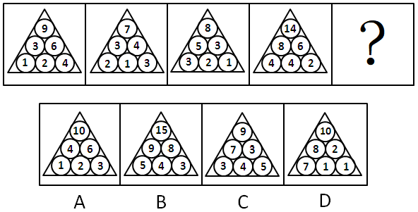

A. A

B. B

C. C

D. D

第 71 题 · 答案与解析

**参考答案（粉笔题库参考内容）**

D

**解析**

本题规律为，同一层相邻的两个小球的数字之和等于上一层位于这二者正上方的小球的数字，依此规律，四个选项中只有D项符合规律。

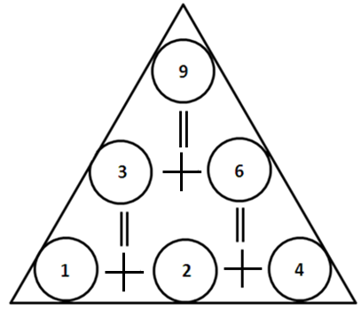

故正确答案为D。

### 第 72 题

从所给四个选项中，选择最合适的一个填入问号处，使之呈现一定的规律性：

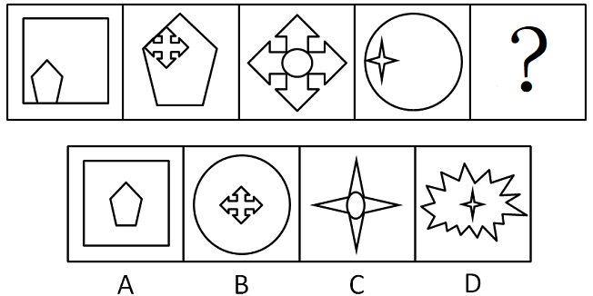

A. A

B. B

C. C

D. D

第 72 题 · 答案与解析

**参考答案（粉笔题库参考内容）**

C

**解析**

元素位置关系的考查。

本题规律为，所给的每个图形都分为两部分，一幅大图，一幅小图，前一个图形中的小图即为后一个图形中的大图。

故正确答案为C。

### 第 73 题

从所给四个选项中，选择最合适的一个填入问号处，使之呈现一定的规律性：

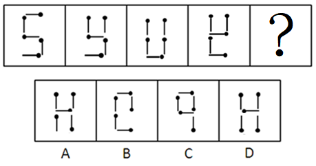

A. A

B. B

C. C

D. D

第 73 题 · 答案与解析

**参考答案（粉笔题库参考内容）**

A

**解析**

每个图形都由五根火柴棍组成，由前一个图形旋转一根火柴棍而得到下一个图形。旋转的方法为，以火柴头为中心，按照顺时针或逆时针方向旋转火柴，旋转的角度为90度，只有A项符合。

具体的旋转方式见下图：

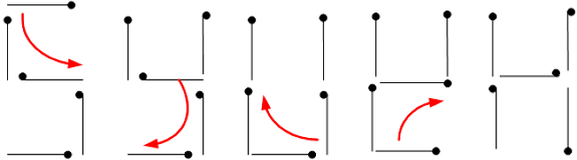

只有选项A能通过旋转一根火柴得到，B需要旋转两根火柴，C基本就是重新组合火柴，D需要旋转三根火柴。

故正确答案为A。

### 第 74 题

从所给四个选项中，选择最合适的一个填入问号处，使之呈现一定的规律性：

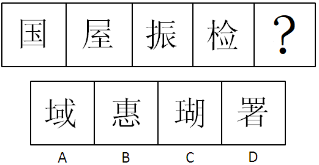

A. A

B. B

C. C

D. D

第 74 题 · 答案与解析

**参考答案（粉笔题库参考内容）**

B

**解析**

数汉字笔画。

每个图形中汉字的笔画数依次为8、9、10、11、（12），选项中笔画数量依次是11、12、13、13 。

故正确答案为B。

### 第 75 题

从所给四个选项中，选择最合适的一个填入问号处，使之呈现一定的规律性：

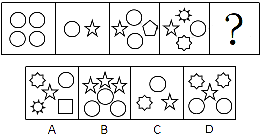

A. A

B. B

C. C

D. D

第 75 题 · 答案与解析

**参考答案（粉笔题库参考内容）**

A

**解析**

元素集合形式，考查元素种类数量。

每幅图中包含的图形的类别分别为1、2、3、4，所以下一幅图形中包括的图形的类别应该是5种，选项中元素种类分别是5、2、3、3。

故正确答案为A。

### 第 76 题

从所给四个选项中，选择最合适的一个填入问号处，使之呈现一定的规律性：

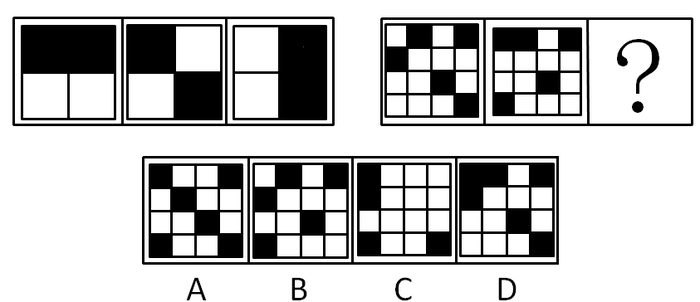

A. A

B. B

C. C

D. D

第 76 题 · 答案与解析

**参考答案（粉笔题库参考内容）**

C

**解析**

元素组成相似，元素叠加。

前两图黑白叠加形成第三个图形，本题规则为：黑＋白＝黑，白＋黑＝黑，黑＋黑＝白，白＋白＝白。

故正确答案为C。

### 第 77 题

从所给四个选项中，选择最合适的一个填入问号处，使之呈现一定的规律性：

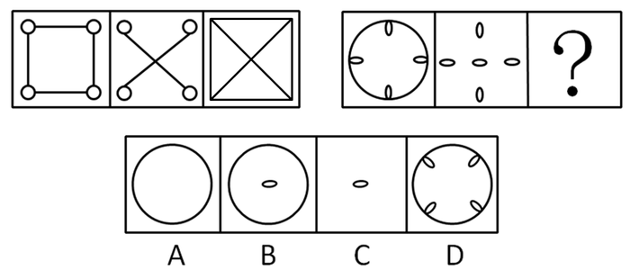

A. A

B. B

C. C

D. D

第 77 题 · 答案与解析

**参考答案（粉笔题库参考内容）**

B

**解析**

前两图叠加后去同存异形成第三个图形。

故正确答案为B。

### 第 78 题

从所给四个选项中，选择最合适的一个填入问号处，使之呈现一定的规律性：

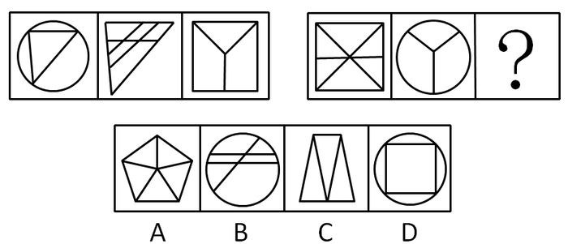

A. A

B. B

C. C

D. D

第 78 题 · 答案与解析

**参考答案（粉笔题库参考内容）**

B

**解析**

元素组成凌乱，考查数数。

每个图形的内部都有三条直线，选项内部的线条分别是5、3、2、4。

故正确答案为B。

### 第 79 题

从所给四个选项中，选择最合适的一个填入问号处，使之呈现一定的规律性：

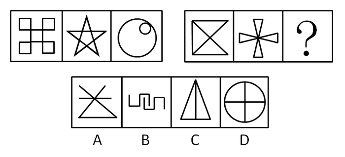

A. A

B. B

C. C

D. D

第 79 题 · 答案与解析

**参考答案（粉笔题库参考内容）**

C

**解析**

元素组成凌乱，考查数数。

数笔画，本题每幅图形都是一笔画图形，A、B、D都是两笔画图形。

故正确答案为C。

### 第 80 题

从所给四个选项中，选择最合适的一个填入问号处，使之呈现一定的规律性：

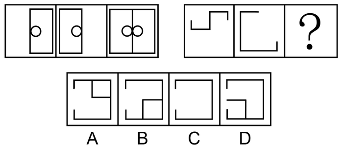

A. A

B. B

C. C

D. D

第 80 题 · 答案与解析

**参考答案（粉笔题库参考内容）**

A

**解析**

元素组成相似，优先考虑样式规律。第一组图，图1向左翻转，图2向右翻转，翻转之后两个图形相加得到图3；第二组图应用此规律，图1向左翻转，图2向右翻转，翻转之后的两个图形相加得到？处图形，只有A项符合。

故正确答案为A。

### 第 81 题

市政府的震后恢复重建的招标政策是标的最低投标人可以中标。有人认为，如果执行这项政策，一些中标者会偷工减料，造成工程质量低下。这不仅会导致追加建设投资的后果，而且会危及民众生命安全。如果我们要杜绝“豆腐渣工程”，就必须改变这种错误的政策。

以下哪项陈述为真，能最有力地削弱上述论证：

A. 重建损毁的建筑的需求可以为该市居民提供许多就业机会

B. 该市的建筑合同很少具体规定建筑材料质量和雇工要求

C. 该政策还包括：那些标书达到严格质量标准，并且具有一定资质的建筑公司才能投标

D. 如果建筑设计有缺陷，即使用最好的建筑材料和一流的工程质量建成的建筑也有危险

第 81 题 · 答案与解析

**参考答案（粉笔题库参考内容）**

C

**解析**

第一步：找到论点和论据。

本题论点是最低投标人可以中标这种政策是错误的，论据是执行这项政策，一些中标者会偷工减料，造成工程质量低下，导致追加建设投资的后果，而且会危及民众生命安全。

第二步：判断削弱方式。

题干论点和论据间存在因果关系，所以本题削弱论点。

第三步：逐一判断选项的作用。

C直接削弱论点，该政策还包括：只有那些其标书满足严格质量标准，并且达到一定资质的建筑公司才能投标。这样，就不会产生“豆腐渣工程”。因此，标的最低的投标人可以中标的招标政策并非是错误的；

A、B、D均与招标政策无关，属无关选项。

故正确答案为C。

### 第 82 题

爱因斯坦提出的广义相对论认为：由于有物质的存在，空间和时间会发生弯曲，而引力场实际上是一个弯曲的时空，爱因斯坦认为太阳是一个大引力场，遥远的星空如果掠过太阳表面，将会发生17秒的偏转。

这一项预言最终得到了天文观测的证实，由此不能推出：

A. 星光距离太阳越近所受影响越大

B. 星光的偏转度与太阳引力的大小有关

C. 广义相对论是根据天文观测提出的

D. 科学给许多不可思议的现象以合理解释

第 82 题 · 答案与解析

**参考答案（粉笔题库参考内容）**

C

**解析**

第一步：抓住每句话中的对象及其关系。

首先题干描述的是相对论的一些观点，涉及的对象有引力场、太阳、遥远的星空。

第二步：逐一判断选项的作用。

A由于太阳是一个大引力场，所以星光距离太阳越近所受影响越大；

B从题干中的“遥远的星空如果掠过太阳表面，将会发生17秒的偏转”可知星光的偏转度与太阳引力的大小有关；

C开头直接就是“爱因斯坦提出的广义相对论”，并没有提到怎么提出的相对论，所以不能推出C；

D是对相对论的一个归纳，可以从文中推出。

本题为选非题，故正确答案为C。

### 第 83 题

选出推理有错误的一项：

A. 企鹅虽是鸟类但不会飞，居住在新西兰的企鹅自然也是不会飞了

B. 植物利用阳光中的能量在体内制造自己所需的养分，而动物则最终必须依赖植物的营养生存，所以说“万物生长靠太阳”

C. 居住在热带地区的人的皮肤一般都比较黝黑，马来人大部分居住在热带地区，所以较多的马来人的皮肤都较黑

D. 病毒都需要侵入到细胞中进行复制和繁殖。这种病原体侵入到了细胞中，所以它是一种病毒

第 83 题 · 答案与解析

**参考答案（粉笔题库参考内容）**

D

**解析**

逐一翻译选项判断正确答案。

A项，第一句的推导关系是：企鹅不会飞，第二句“居住在新西兰的企鹅”，属于肯前件，推出第三句中“居住在新西兰的企鹅不会飞”，A正确；

B项，第一句的推导关系是：植物生长需要阳光，第二句的推导关系是：动物生长需要植物，第一句和第二句的推导关系联立可得，动物生长需要阳光，推出第三句中“万物生长靠太阳”，B正确；

C项，第一句的推导关系是：居住在热带地区的人的皮肤比较黝黑，第二句“马来人大部分居住在热带地区”，属于肯前件，推出第三句中“马来人的皮肤都较黑”，C正确；

D项，第一句的推导关系是：病毒侵入到细胞，第二句“这种病原体侵入到了细胞中”，属于肯后件，无法推出绝对表达的结论，第三句中“所以它是一种病毒”不能推出，D错误。

本题为选非题，故正确答案为D。

### 第 84 题

面试在求职过程中非常重要。经过面试，如果应聘者的个性不适合待聘工作的需要，则不可能被录用。

以上论断是建立在下列哪一项假设的基础上：

A. 必须经过面试才能取得工作

B. 若一个人的个性适合工作的要求，他就一定被录用

C. 面试主持者能够准确地分辨出哪些个性是工作所需要的

D. 面试的唯一目的就是测试应聘者的个性

第 84 题 · 答案与解析

**参考答案（粉笔题库参考内容）**

C

**解析**

第一步：找出论点和论据。

论点：经过面试，如果应聘者的个性不适合待聘工作的需要，则不可能被录用。

论据：无。

只有论点没有论据，问题为前提假设，加强考虑必要条件。

第二步：逐一分析选项。

A项：必须经过面试才能取得工作，而论点为经过面试，应聘者若个性不适合工作需要，则不可能被录用，论点探讨的是合适个性对工作的必要性，而非面试的必要性，无关项，不能加强，排除；

B项：一个人若个性适合工作要求，就一定被录用，而论点探讨的是合适个性对工作的必要性，并非个性合适就一定会被录用，无关项，不能加强，排除；

C项：如果面试主持者不能准确分辨出哪些个性是工作所需要的，那么即使知道应聘者个性，也不能判断这些个性是否适合工作，进而无法判断能否被录用，必要条件加强，当选；

D项：面试的唯一目的就是测试应聘者的个性，但论点探讨的是合适个性对工作的必要性，与个性是否为面试唯一目的无关，无关项，不能加强，排除。

故正确答案为C。

### 第 85 题

某公司为了扩大其网上商店的销售收入，采取了各种各样的广告宣传和促销手段，但是效果并不明显。该公司重金聘请了专业人士进行市场分析，专业人士认为开通了网上银行的人群才是真正潜在的网上商店的顾客群。于是该公司决定与商业银行合作，在新开通网上银行业务的人群中开展宣传和促销活动。但是一个月后，效果并不理想。

以下哪项为真，最能解释上述结果：

A. 一般来说，刚刚开通网上银行的人需要经过一段时间后才有可能进行网上消费

B. 网上金融服务在知识分子中已经比较普及，他们更希望网上商店能够提供一些特色服务

C. 目前网上商店数量增长很快，广告宣传和推广促销要想有效果，必须有鲜明的特色，才能够打动消费者的心

D. 最近网上银行用户被盗的案件频发，开通网上银行的人因此有所减少

第 85 题 · 答案与解析

**参考答案（粉笔题库参考内容）**

A

**解析**

第一步：找出题干矛盾。

公司根据专业人士意见在新开通网上银行业务的人群中开展宣传和促销活动，以提升销售收入，但一个月后，效果并不理想。

第二步：逐一分析选项。

A项说明刚刚开通网上银行的人需要经过一段时间后才有可能进行网上消费，从而解释说明没有在该公司的网店消费也是符合情理的；

B、C两项从第一二句可以知道，某公司之前的广告效果不明显是因为广告宣传的受众定位不准确，B、C两项说广告效果不明显的原因在于没有提供特色服务，不符合题干，可以排除；

D说的是开通网上银行的人数减少，而公司宣传的对象是新开通网上银行业务的人群，宣传效果与人数没有关系，所以D项无法解释效果不理想。

故正确答案为A。

### 第 86 题

黄某说张某胖，张某说范某胖，范某和覃某都说自己不胖。

如果四人陈述只有一个错，那么谁一定胖：

A. 仅黄某

B. 仅张某

C. 仅范某

D. 仅张某和范某

第 86 题 · 答案与解析

**参考答案（粉笔题库参考内容）**

B

**解析**

第一步：找突破口。

本题突破口为张某和范某之间的矛盾关系，两人的话必有一真和一假。

第二步：看其他人的话。

本题只有一句为假，故黄某和覃某的话均为真话，则张某一定胖，覃某一定不胖。

第三步：判断突破口中两句话的真假。

本题只有一句假话，则张某和范某之间谁说的是假话，不能从题干中得知，所以不能判断范某的胖瘦，一定胖的只有张某。

故正确答案为B。

### 第 87 题

在某餐馆中，菜谱中的菜属于川菜系，王先生点的菜中有川菜，因此，王先生点的菜中没有湘菜。

再加上下列哪项，才能使上述论证成立：

A. 餐馆规定，如果点了川菜，可以不点湘菜，但点了湘菜，一定要点川菜

B. 餐馆规定，点湘菜就不能点川菜，反之亦然

C. 王先生是四川人，只喜欢川菜

D. 王先生是湖南人，他喜欢湘菜

第 87 题 · 答案与解析

**参考答案（粉笔题库参考内容）**

B

**解析**

第一步：找到论点和论据。

本题论点是王先生点的菜中没有湘菜，论据是王先生点的菜中有川菜。

第二步：判断加强方式。

论点强调没有湘菜，论据强调有川菜，所以论点与论据间不存在明显因果关系，需加强论证，在论点和论据间搭桥。

第三步：逐一判断选项的作用。

A项，餐馆规定如果点了川菜，可以不点湘菜，但点了湘菜，一定要点川菜，并不能说明没有点湘菜，即与点的菜中没有湘菜无直接关系，属无关选项，排除；

B项，餐馆规定点湘菜就不能点川菜，反之亦然，说明了湘菜和川菜不能同时点，即在没有湘菜和有川菜间搭桥，加强论证，当选；

C项，王先生是四川人，只喜欢川菜，与点的菜中没有湘菜无直接关系，属无关选项，排除；

D项，王先生是湖南人，他喜欢湘菜，与点的菜中没有湘菜无直接关系，属无关选项，排除。

故正确答案为B。

### 第 88 题

有人说：“只有认识错误，才能改正错误。”

如果以上判断是真的，可能出现的情况是：

①某人认识了错误，没有能改正错误。

②某人没有认识错误，改正了错误。

③某人没有认识错误，没能改正错误。

④某人认识了错误，改正了错误。

A. ①

B. ①②③

C. ③④

D. ①③④

第 88 题 · 答案与解析

**参考答案（粉笔题库参考内容）**

D

**解析**

第一步：翻译题干。利用充分必要条件。

改正错误认识错误。

第二步：逐一翻译各个情况并判断其中正确的情况。利用逆否规则。

①认识错误没改正错误，“认识错误”属肯后件，无法推出绝对表达的结论，但题干中说的是可能出现的情况，①正确；②没认识错误改正错误，根据题干推导关系的逆否规则，②错；③没认识错误没改正错误，是题干推导关系的逆否规则，③正确；④认识错误改正错误，“认识错误”属肯后件，无法推出绝对表达的结论，但题干中说的是可能出现的情况，④正确。

故正确答案为D。

### 第 89 题

有四个外表看起来没有分别的小球，它们的重量可能各有不同。取一个天平将甲乙放一组，丙丁为另一组分别放在天平的两边，天平是基本平衡的。将乙和丁对调一下，甲、丁一边明显的要比乙、丙一边重很多。可奇怪的是我们将天平的一边放上甲、丙，而另一边刚放上乙，还没有来得及放上丁时，天平就压向了乙一边。

则四个球由重到轻的顺序是：

A. 乙、丁、甲、丙

B. 丁、乙、丙、甲

C. 乙、甲、丁、丙

D. 丁、乙、甲、丙

第 89 题 · 答案与解析

**参考答案（粉笔题库参考内容）**

D

**解析**

第一步：分析题干条件。

① 甲＋乙＝丙＋丁；

② 甲＋丁＞乙＋丙；

③ 甲＋丙＜乙。

第二步：根据题干条件进行推理。

将①、②相加可得：甲＋甲＋乙＋丁＞乙＋丙＋丙＋丁，两边分别消去相同小球可得：甲＋甲＞丙＋丙，即甲＞丙。结合①可知，当甲球比丙球重量大时，为保持平衡，则乙球需比丁球重量小，即丁＞乙。结合③可知，乙球的重量比甲、丙球都大，综上，四个球由重到轻的顺序为丁＞乙＞甲＞丙。

故正确答案为D。

### 第 90 题

某宿舍住着若干个研究生，其中一个是黑龙江人，两个是北方人，一个是云南人，两个人这学期只选修了逻辑哲学，三个人这学期选修古典音乐欣赏。

假设以上的介绍涉及了这宿舍中所有的人，那最少可能是几个人？最多可能是几个人：

A. 最少可能是3 人，最多可能是8 人

B. 最少可能是5 人，最多可能是8 人

C. 最少可能是5 人，最多可能是9 人

D. 最少可能是3 人，最多可能是9 人

第 90 题 · 答案与解析

**参考答案（粉笔题库参考内容）**

B

**解析**

第一步：找突破口。

题干中的“北方人”和“黑龙江人”，因为前者包含后者。

第二步：分析并得出相应结论。

2个北方人包含1个黑龙江人，与1个云南人是并列关系，所以地域上涉及3个人。又知2个人这学期只选修了逻辑哲学，3个人这学期选修古典音乐欣赏，即选课的共5人。

分析最少的人数：因为介绍涉及了这宿舍中所有的人，所以选课的5人包含地域上的3人，因此最少的人数是选课的。

分析最多的人数：当只有2个北方人中包含1个黑龙江人，其他的均不相互包含时，因此最多人数为：2个北方人＋1个云南人＋选课的5人＝8人。

故正确答案为B。

### 第 91 题

胜任力：员工在工作情境中，为完成工作所具备并体现出来的知识、技能、能力、态度、动机等关键特征。

以下表现为胜任力的行为是：

A. 小张运用自己的专业知识，顺利完成了领导交给他的任务，得到同事们的称赞

B. 还在试用期的小王，用了整整一周的时间，才整理出合格供应商的名单和真实报价

C. 元旦刚过，小黄请叔叔和客户打招呼，为公司签订了一个大订单，打响“开门红”

D. 上个月，小周所在班组在全厂考核中被评为优秀班组

第 91 题 · 答案与解析

**参考答案（粉笔题库参考内容）**

A

**解析**

第一步：抓住定义中的关键词。

关键词强调“体现自己的专业能力”。

第二步：逐一判断选项。

A项的小张，运用自己的专业知识，完成了工作，表现出自己的专业能力，拥有胜任力，A符合定义；

B项的小王用了整整一周时间整理出合格供应商的名单和真实报价，句中没有体现自己的能力，且用了“才”一字其实是说明小王的能力不够，B不符合定义；

C项的小黄为公司签订的一个大订单是他请叔叔和客户打过招呼的，不能说明是他自身的能力，C不符合定义；

D项的小周所在班组被评为优秀班组只能说明全组的能力，也不能得知小周个人的能力，D不符合定义。

故正确答案为A。

### 第 92 题

同理心是指在人际交往过程中，能够体会他人的情绪和想法，理解他人立场和感受，并站在别人的角度来思考和处理问题的高度。

根据以上定义，下列不属于同理心的是：

A. 己所不欲，勿施于人

B. 设身处地，感同身受

C. 推己及人，将心比心

D. 物我两忘，心无旁骛

第 92 题 · 答案与解析

**参考答案（粉笔题库参考内容）**

D

**解析**

第一步：抓住定义中的关键词。

关键词强调“体会他人的情绪和想法”“理解他人立场和感受”“站在别人的角度来思考和处理问题”。

第二步：逐一判断选项。

A、B、C表示的情况都是把自己当成是别人，从别人的角度出发，去理解和处理问题，均符合同理心的定义；

D项中的物我两忘是与诗学有关的古代美学概念，指创作时艺术家的主体与创作对象的客体浑然为一而兼忘的境界，不属于同理心。

本题为选非题，故正确答案为D。

### 第 93 题

从众型思维枷锁是指在认识判断、解决问题时，附和多数，人云亦云，缺乏自己独立思考，无主见、无创新意识的一种不良思维定势。

以下表现不属于“从众型思维枷锁”的一项是：

A. 前面许多行人闯了红灯，自己也紧跟着冲了过去

B. 大人们把自己的孩子“左撇子”习惯硬性扭转过来

C. 专家的意见值得信赖，大家都以专家的意见为办事依据

D. 中学生每天都要求穿校服，中学生小军每天都穿着校服

第 93 题 · 答案与解析

**参考答案（粉笔题库参考内容）**

D

**解析**

第一步：抓住定义中的关键词。

关键词强调“附和多数”且“缺乏自己独立思考”的一种不良思维定势。

第二步：逐一判断选项。

A中的跟着大多数人闯红灯属于从众型思维枷锁；

B中因为大多数人都不是左撇子，所以大人们把自己的孩子硬性扭转过来，这也属于从众型思维枷锁；

C中听从专家的意见办事明显是从众型思维枷锁；

D中的中学生被要求穿校服，是遵守学校规定，不是缺乏独立见解，不属于从众型思维枷锁。

本题为选非题，故正确答案为D。

### 第 94 题

实在判断：判断的简单形式，这里是肯定或否定地表明某一单个的事物的某种一般的性质（肯定判断：菊花是黄色的；否定判断：菊花不是黑色的）。

以下哪项不是实在判断：

A. 月球绕着地球做圆周运动

B. 月球不是恒星

C. 月球是圆的

D. 月球不是圆的

第 94 题 · 答案与解析

**参考答案（粉笔题库参考内容）**

A

**解析**

第一步：找出定义关键词。

“肯定或否定”、“某一单个的事物”、“某种一般的性质”。

第二步：逐一分析选项。

A项：月球绕着地球做圆周运动，不是月球的某种一般的性质，是描述一种现象或规律，不符合“某种一般的性质”，不符合定义，当选；

B项：月球不是恒星，否定地表明了月球的性质，符合“肯定或否定”、“某一单个的事物”、“某种一般的性质”，符合定义，排除；

C项：月球是圆的，肯定地表明了月球的性质，符合“肯定或否定”、“某一单个的事物”、“某种一般的性质”，符合定义，排除；

D项：月球不是圆的，否定地表明了月球的性质，符合“肯定或否定”、“某一单个的事物”、“某种一般的性质”，符合定义，排除。

本题为选非题，故正确答案为A。

### 第 95 题

创伤后应激障碍是一种极度的灾难的持续效果，即经历了创伤以后，出现持续的、不必要的、无法控制的障碍。

根据以上定义，下列不属于创伤后应激障碍的是：

A. 小明小时候到野外郊游的时候被蛇咬了一口，从此再也不想去野外郊游了

B. 小张在玩秋千时重重的摔了下来，从此常常在梦中梦到从高处摔下来，以后再也不敢荡秋千了

C. 从战场回来的士兵，大多患上了失眠、焦虑甚至严重的精神疾病

D. 目睹了儿子阿毛被野兽叼走的那一幕，失魂落魄的祥林嫂见了人就说：“我真傻，真的。我只知道下雪的时候，野兽在山坳里没有食吃，会到村里来，我不知道春天也会有……”

第 95 题 · 答案与解析

**参考答案（粉笔题库参考内容）**

A

**解析**

第一步：抓住定义中的关键词。

关键词强调“经历了创伤以后”“出现持续的、不必要的、无法控制”的障碍。

第二步：逐一判断选项。

A中“小明从此再也不想去野外郊游了”，不是持续的、不必要的、无法控制的障碍，而是可以自己进行控制的，A不是创伤后应激障碍；

B中从秋千摔下，之后一直梦到从高处摔下，C中从战场回来的士兵，由于精神饱受折磨，患上了精神疾病，D中的祥林嫂经历了儿子被野兽叼走的一幕，不断的重复着自己的后悔，B、C、D的情况都属于创伤后应激障碍。

本题为选非题，故正确答案为A。

### 第 96 题

自然失业是由于经济中一些难以克服的原因所引起的失业，它是任何经济都难以避免的失业，也是正常的失业。

根据以上定义，下列不属于自然失业的是：

A. 王某在某公司工作的一年中，嫌工资太低，于是辞职

B. 某地发生地震，厂房和设备毁坏了，厂长不舍地遣散了工作多年的人

C. 某企业进行改制，一些文化水平低，年满40 岁的女职工下了岗

D. 张某违反公司规定暗箱操作，被发现后公司将其开除

第 96 题 · 答案与解析

**参考答案（粉笔题库参考内容）**

D

**解析**

第一步：抓住定义中的关键词。

关键词强调“经济中一些难以克服的原因”“难以避免”的失业。

第二步：逐一判断选项。

A项是王某自己辞去工作，是正常的工作转移，属于自然失业；

B项的失业是由于难以克服的原因导致经济困难所引起的失业，属于自然失业；

C项是由于女职工与企业的需求结构不一致导致的失业，是难以避免的失业，属于自然失业；

D项是张某的违规操作造成被解雇，属个人原因所造成的，不属于自然失业。

本题为选非题，故正确答案为D。

### 第 97 题

原点思维是指给人或事调定到一个原点，时常回到原点进行思考，进行状态对照，纠正偏差，不断向目标前进。

下列属于原点思维的是：

A. 怎样看出人的优秀素质——重点考核小时候表现

B. 谁是中国历史上的罪人——宋代的秦桧

C. 谁能解下老虎脖子上的金铃——解铃还须系铃人

D. 怎样处理好人与人间的关系——经常交流沟通

第 97 题 · 答案与解析

**参考答案（粉笔题库参考内容）**

C

**解析**

第一步：抓住定义中的关键词。

关键词强调“回到原点进行思考”“纠正偏差”“不断向目标前进”。

第二步：逐一判断选项。

A中的“小时候”是一个模糊概念，并不是一个确定的时间点，因此不能看作原点；B既没有原点，也没有前进；D是对方法的阐述。A、B、D均不符合定义；

C中“解铃还须系铃人”指回到“解铃”的原点“系铃”，符合定义。

故正确答案为C。

### 第 98 题

例外原则是指企业高级管理人员，把一般日常事务授权给下属管理人员负责管理，保留例外事项，一般也是重要事项的决策和控制权。

根据以上定义，下列属于例外原则的是：

A. 某公司的董事长主要负责公司的一切事务，而总经理则负责维护跟合作单位的关系

B. 某公司的报账制度中，500 元以下的都由部门经理审批

C. 某管理中心的兼职人员和专职人员的确定，总经理才有决定权

D. 在每周的例会上，各中层管理人员都要将本周工作总结和下周工作计划向总经理汇报

第 98 题 · 答案与解析

**参考答案（粉笔题库参考内容）**

C

**解析**

第一步：抓住定义中的关键词。

关键词强调“一般日常事务授权给下属管理人员”“保留例外事项，一般也是重要事项的决策和控制权”。

第二步：逐一判断选项。

A中董事长主要负责公司的一切事务，不符合例外原则定义；

B中某公司的报账制度中，500元以下的都由部门经理审批，经理管理了日常事务，不符合例外原则定义；

C中只有总经理才能决定兼职人员和专职人员的确定，符合例外原则定义；

D中总经理管理了所有的事务，决策所有下属的工作，没有区分一般事务和例外事务，不符合例外原则定义。

故正确答案为C。

### 第 99 题

广告是指为了商业目的，由商品经营者或服务提供者承担费用，通过一定媒介或一定形式，如报刊、电视、路牌、橱窗等，直接或间接地对自己推销的商品或者所提供的服务所进行的公开宣传活动。

下列属于广告活动的是：

A. 钢材场老板为了更好的销售钢材，向邻县的包工头送礼一百万

B. 奥巴马为了当总统，不惜重金在电视和报刊上发表演说

C. 公司规定办公电脑要用统一品牌

D. 李宁牌服装赞助法国体育代表团出征奥运会，获得良好的社会效应和经济效益

第 99 题 · 答案与解析

**参考答案（粉笔题库参考内容）**

D

**解析**

第一步：抓住定义中的关键词。

关键词强调“商业目的”“直接或间接地对自己推销的商品或者所提供的服务所进行的公开宣传活动”。

第二步：逐一判断选项。

A中的钢材场老板并没有进行宣传活动，而是贿赂包工头，属于不当竞争；B中奥巴马的行为并不是基于商业目的；C中公司并没有进行宣传活动，只是制定了公司规定。A、B、C均不符合定义；

D中赞助法国体育代表团出征奥运会的行为属于间接对自己的商品进行公开的宣传活动，符合定义。

故正确答案为D。

### 第 100 题

社会保险是国家通过立法，采取强制手段对国民收入进行分配与再分配，形成专门消费基金，对劳动者在丧失劳动力或失去工作机会时进行社会帮助以保障其基本生活的一种制度。下列属于社会保险的是：

A. 在厂房工作中，小王因机器发生故障造成意外受伤，而获得赔偿

B. 军人黄某退伍，国家发安置费

C. 国家向地震灾区人民发放生活救济

D. 旅客人身伤害保险

第 100 题 · 答案与解析

**参考答案（粉笔题库参考内容）**

A

**解析**

第一步：抓住定义中的关键词。

关键词强调“国家形成专门消费基金”“丧失劳动力或失去工作机会”。

第二步：逐一判断选项。

A项中小王因为意外失去了工作机会，之后获得赔偿，属于工伤保险，符合定义；

B项中的黄某并没有丧失劳动力或失去工作机会，退伍后可以再就业；C项中地震是突发事件，国家没有对其设立专门消费基金，此处属于社会救助；D项中旅客人身伤害保险属于商业保险，不是由国家承担的。所以B、C、D均不符合定义。

故正确答案为A。

### 第 101 题

（1）打开帐篷

（2）驾车到郊外

（3）露营

（4）买水和食品

（5）回到家中写游记

A. 2—4—1—3—5

B. 4—2—1—3—5

C. 4—2—3—1—5

D. 2—3—4—1—5

第 101 题 · 答案与解析

**参考答案（粉笔题库参考内容）**

B

**解析**

题干描述的是自驾郊游的经过，④一定是首句，之后是②驾车到郊外，紧接着再①打开帐篷③露营，最后⑤回到家中写游记。

故正确答案为B。

### 第 102 题

（1）签署有关协议

（2）乘机赴台湾

（3）两岸会谈

（4）受到当地群众热烈欢迎

（5）两岸直航

A. 5—3—2—1—4

B. 2—4—3—1—5

C. 3—1—5—4—2

D. 2—3—1—5—4

第 102 题 · 答案与解析

**参考答案（粉笔题库参考内容）**

C

**解析**

本题描述的是两岸通航的经过，③两岸会谈之后才能①签署有关协议，之后才能达到⑤两岸直航的目的，签署协议过后结果就是该项会谈④受到当地群众热烈欢迎，最后大陆同胞可以②乘机赴台湾。

故正确答案为C。

### 第 103 题

（1）填写报名表

（2）考试

（3）查阅招考简章

（4）任职前公示

（5）体检

A. 1—3—2—5—4

B. 3—1—2—5—4

C. 1—5—2—3—4

D. 3—1—5—2—4

第 103 题 · 答案与解析

**参考答案（粉笔题库参考内容）**

B

**解析**

由题可知，③查阅招考简章一定在①填写报名表前面，①填写报名表必然在②④⑤的前面，则③一定是首句，排除AC，而⑤体检一定在②考试之后。

故正确答案为B。

### 第 104 题

（1）乱捅马蜂窝

（2）依法赔偿

（3）家属告上法院

（4）调查取证

（5）马蜂蜇死人

A. 1—5—3—4—2

B. 5—1—3—4—2

C. 1—3—5—4—2

D. 5—3—1—4—2

第 104 题 · 答案与解析

**参考答案（粉笔题库参考内容）**

A

**解析**

由题可知，①必然是首句，只有发生了①事件，才能造成后面连串事件，排除BD，而⑤马蜂蜇死人一定在③家属告上法院之前。

故正确答案为A。

### 第 105 题

（1）上班迟到

（2）晚上加班到深夜

（3）心中难受

（4）领导批评

（5）工作任务繁重

A. 1—4—3—5—2

B. 2—5—1—4—3

C. 2—5—1—3—4

D. 5—2—1—4—3

第 105 题 · 答案与解析

**参考答案（粉笔题库参考内容）**

D

**解析**

根据事情发展的因果顺序，排列上班迟到的前因后果，首先由于⑤工作任务繁重，所以②晚上加班到深夜，因此导致第二天①上班迟到，④受到领导批评，③心中感到难受。

故正确答案为D。

### 第 106 题

（1）中场才到来

（2）一人独往

（3）久等不来

（4）约好看电影

（5）电影已开演

A. 4—3—2—1—5

B. 5—4—2—3—1

C. 4—3—2—5—1

D. 5—2—3—4—1

第 106 题 · 答案与解析

**参考答案（粉笔题库参考内容）**

C

**解析**

由题可知，④约好看电影必然在⑤电影已开演的前面，排除BD，而⑤电影已开演一定在①中场才到来之前。

故正确答案为C。

### 第 107 题

（1）调焦对焦

（2）找出好景

（3）摆好姿势

（4）按下快门

（5）外出拍照

A. 5—2—3—1—4

B. 5—3—2—1—4

C. 2—5—1—4—3

D. 3—2—1—4—5

第 107 题 · 答案与解析

**参考答案（粉笔题库参考内容）**

A

**解析**

题干描述的是拍照的过程，⑤一定是首句，排除CD，根据照相的先后顺序，②找出好景之后③便摆好姿势，然后①调焦对焦，最后④按下快门。

故正确答案为A。

### 第 108 题

（1）吸取教训

（2）酒后驾车

（3）住院治疗

（4）酿成车祸

（5）朋友聚会

A. 2—3—1—4—5

B. 3—1—5—2—4

C. 5—2—4—3—1

D. 4—3—1—2—5

第 108 题 · 答案与解析

**参考答案（粉笔题库参考内容）**

C

**解析**

本题干描述的是酒后驾车伤人的经过，首先事情的起因是⑤朋友聚会，聚会之后②酒后驾车，不料④酿成车祸，之后③住院治疗，最后终于①吸取了教训。

故正确答案为C。

### 第 109 题

（1）准备材料

（2）施工

（3）搬进新房

（4）装修设计图纸

（5）检验装修质量

A. 4—1—2—5—3

B. 5—1—2—3—4

C. 5—2—1—4—3

D. 1—2—4—3—5

第 109 题 · 答案与解析

**参考答案（粉笔题库参考内容）**

A

**解析**

本题干描述的是装修和乔迁的经过，首先④装修设计图纸，然后根据图纸开始①准备材料，之后进行②施工，施工之后才能⑤检验装修质量，最后③搬进新房。

故正确答案为A。

### 第 110 题

（1）躺床上

（2）昏睡过去

（3）进卧室

（4）喝醉酒回家

（5）推开门

A. 4—3—5—1—2

B. 4—5—3—1—2

C. 4—3—5—2—1

D. 4—1—5—3—2

第 110 题 · 答案与解析

**参考答案（粉笔题库参考内容）**

B

**解析**

本题干描述的是一个喝醉回家的过程，首先④喝醉酒回家，然后⑤推开门、③进卧室，之后①躺床上，最后②昏睡过去。

故正确答案为B。

### 第 111 题

跆拳道∶韩国

A. 日本∶相扑

B. 武术∶中国

C. 足球∶美国

D. 英国∶网球

第 111 题 · 答案与解析

**参考答案（粉笔题库参考内容）**

B

**解析**

第一步：判断题干词语间逻辑关系。

题干两词是对应关系，且是体育项目和其发源国之间的一一对应关系。

第二步：判断选项词语间逻辑关系。

与题干相同逻辑关系的即为B；A相扑发源于日本，但是对应关系相反；C足球发源于英国；D网球发源于英国，但是对应关系相反。

故正确答案为B。

### 第 112 题

氏族∶部落

A. 市场经济∶商品经济

B. 短篇小说∶小说

C. 氯化氢∶盐酸

D. 导弹∶直升机

第 112 题 · 答案与解析

**参考答案（粉笔题库参考内容）**

C

**解析**

第一步：判断题干词语间逻辑关系。

题干两个词属于包容关系中的组成关系，部落是由若干血缘相近的氏族组成的群体，氏族是部落的组成部分。

第二步：判断选项词语间逻辑关系。

A项，商品经济是相对于自然经济而言的，市场经济是相对于计划经济而言的，因此商品经济和市场经济是并列关系，与题干不符。

B项，短篇小说是小说的一个分类，而不是小说的构成要素。小说与短篇小说的关系属于包容关系中的种属关系，与题干不符。

C项，盐酸是氯化氢的水溶液，氯化氢是盐酸的组成部分，两者为包容关系中的组成关系，符合题意。

D项，导弹和直升机不属于包容关系，与题干不符。

故正确答案为C。

### 第 113 题

立方体∶几何学

A. 比重∶物理学

B. 血液∶植物学

C. 地质学∶化合物

D. 基因∶历史学

第 113 题 · 答案与解析

**参考答案（粉笔题库参考内容）**

A

**解析**

第一步：判断题干词语间逻辑关系。

题干两词是对应关系，且是学科与学科内的专有概念间的一一对应关系。

第二步：判断选项词语间逻辑关系。

与题干相同逻辑关系的即为A；B、C、D均不满足题干的对应关系。

故正确答案为A。

### 第 114 题

侯方域∶《桃花扇》

A. 蒲松龄∶《聊斋志异》

B. 石头记：《红楼梦》

C. 崔莺莺∶《西厢记》

D. 秦始皇∶《后汉书》

第 114 题 · 答案与解析

**参考答案（粉笔题库参考内容）**

C

**解析**

第一步：判断题干词语间逻辑关系。

侯方域是《桃花扇》的主角，二者为文学作品与其主人公的对应关系。

第二步：判断选项词语间逻辑关系。

A项：蒲松龄是《聊斋志异》的作者，与题干逻辑关系不一致，排除；

B项：石头记是《红楼梦》的别称，与题干逻辑关系不一致，排除；

C项：崔莺莺是《西厢记》的主角，二者为文学作品与其主人公的对应关系，与题干逻辑关系一致，当选；

D项：秦始皇和《汉书》没有明显的逻辑关系，与题干逻辑关系不一致，排除。

故正确答案为C。

### 第 115 题

寒山寺：夜半钟声到客船

A. 中华门∶巍峨耸立

B. 植物园∶百卉千葩

C. 栖霞门∶层林尽染

D. 秦淮河∶桨声灯影

第 115 题 · 答案与解析

**参考答案（粉笔题库参考内容）**

D

**解析**

第一步：判断题干词语间逻辑关系。

题干两词是对应关系，且是古诗或成语与其描述的古迹间的一一对应关系。

第二步：判断选项词语间逻辑关系。

与题干相同逻辑关系的即为D；A、B中没有古迹；C中层林尽染描述的是长沙橘子洲。

故正确答案为D。

### 第 116 题

书∶阅读

A. 琵琶∶弹奏

B. 观察∶望远镜

C. 歌手∶音乐

D. 杯子∶解渴

第 116 题 · 答案与解析

**参考答案（粉笔题库参考内容）**

A

**解析**

第一步：判断题干词语间逻辑关系。

阅读书是动宾短语。

第二步：判断选项词语间逻辑关系。

A项，弹奏琵琶是动宾短语，与题干逻辑关系一致，当选；

B项，望远镜的功能是观察，与题干逻辑关系不一致，排除；

C项，歌手和音乐构不成动宾短语，与题干逻辑关系不一致，排除；

D项，杯子和解渴构不成动宾短语，与题干逻辑关系不一致，排除。

故正确答案为A。

### 第 117 题

象鼻山∶广西

A. 龙门石窟∶山西

B. 武当山古建筑群∶湖北

C. 湖南∶凤凰古镇

D. 浙江∶西湖

第 117 题 · 答案与解析

**参考答案（粉笔题库参考内容）**

B

**解析**

第一步：判断题干词语间逻辑关系。

题干两词是对应关系，且是名胜古迹或自然景观与其所在地间的一一对应关系。

第二步：判断选项词语间逻辑关系。

与题干相同逻辑关系的即为B；A龙门石窟位于河南省洛阳市；C凤凰古镇位于湖南省境内，D西湖位于浙江省杭州市，但是C、D的对应关系是相反的。

故正确答案为B。

### 第 118 题

足球∶运动

A. 大学生∶学生

B. 西瓜∶水果

C. 狐狸∶动物

D. 麻将∶娱乐

第 118 题 · 答案与解析

**参考答案（粉笔题库参考内容）**

D

**解析**

第一步：判断题干词语间逻辑关系。

题干两词是对应关系，踢足球是运动项目中的一种，但足球本身并不是运动项目，只是运动的器具。

第二步：判断选项词语间逻辑关系。

与题干相同逻辑关系的即为D，打麻将是娱乐项目中的一种，但麻将本身并不是娱乐项目，只是娱乐的工具；

A、B、C均是包容关系，且是包容中的种属关系，前者本身就属于后者中的一种。

故正确答案为D。

### 第 119 题

锤子：钉子

A. 鼠标∶电脑

B. 碗∶吃饭

C. 压路机∶地面

D. 发动机∶汽油

第 119 题 · 答案与解析

**参考答案（粉笔题库参考内容）**

C

**解析**

第一步：判断题干词语间逻辑关系。

题干两词是对应关系，且是用具与其作用对象间的一一对应关系。

第二步：判断选项词语间逻辑关系。

与题干相同逻辑关系的即为C；A是配套关系；B中碗是用来吃饭的，逻辑关系不同；D发动机的动力是汽油，逻辑关系不同。

故正确答案为C。

### 第 120 题

奶牛∶牛奶

A. 蚌∶珍珠

B. 鸟∶鸟巢

C. 螃蟹∶蜜蜂

D. 猪∶猪肉

第 120 题 · 答案与解析

**参考答案（粉笔题库参考内容）**

A

**解析**

第一步：判断题干词语间逻辑关系。

题干两词是对应关系，且是生物与其身体分泌物间的一一对应关系。

第二步：判断选项词语间逻辑关系。

与题干相同逻辑关系的即为A；B没有分泌物；C是并列关系；D是必然组成关系。

故正确答案为A。

## 材料 1

对外开放30年，我国服务贸易取得长足发展，服务贸易总额由1982年的43亿美元增加到2007年的2509亿美元。2007年，服务贸易总额占我国全部对外贸易总额的比重从1982年的9.4%上升到10.3%，占世界服务贸易的比重从0.6%升至4%，世界排名仅次于美国、英国、德国和日本，居第五位，成为世界贸易的重要国家。

### 第 121 题

2007年我国服务贸易总额是多少美元：

A. 43

B. 2509

C. 43亿

D. 2509亿

第 121 题 · 答案与解析

**参考答案（粉笔题库参考内容）**

D

**解析**

定位文字材料“服务贸易总额由1982年的43亿美元增加到2007年的2509亿美元”，可知2007年我国服务贸易总额是2509亿美元。

故正确答案为D。

### 第 122 题

我国服务贸易总额从1982年到2007年，大约增长了多少倍：

A. 56

B. 57

C. 58

D. 59

第 122 题 · 答案与解析

**参考答案（粉笔题库参考内容）**

B

**解析**

根据题干“我国服务贸易总额从1982年到2007年，大约增长了多少倍”，可判定本题为一般增长率问题。定位文字材料“服务贸易总额由1982年的43亿美元增加到2007年的2509亿美元”，根据公式：增长率，可得我国服务贸易总额增长率倍，最接近B项。

故正确答案为B。

### 第 123 题

2007年我国对外贸易总额约是多少亿美元：

A. 0.24 万

B. 0.25 万

C. 2.4 万

D. 2.5 万

第 123 题 · 答案与解析

**参考答案（粉笔题库参考内容）**

C

**解析**

根据题干“2007年我国对外贸易总额约是多少亿美元”，结合材料给出2007年我国服务贸易总额及占我国对外贸易总额的比重，可判定本题为现期比重问题。定位文字材料“2007年······服务贸易总额2509亿美元······占我国全部对外贸易总额的比重从1982年的9.4%上升到10.3%”。根据公式：总体，则2007年我国对外贸易总额亿美元=2.43万亿美元，最接近C项。

故正确答案为C。

### 第 124 题

从1982年到2007年，世界服务贸易的总额大约增加了多少亿美元：

A. 0.56 万

B. 0.46 万

C. 5.6 万

D. 4.6 万

第 124 题 · 答案与解析

**参考答案（粉笔题库参考内容）**

C

**解析**

根据题干“从1982年到2007年······增加······亿美元”，可判定本题为增长量计算问题。定位文字材料“服务贸易总额由1982年的43亿美元······2007年的2509亿美元······占世界服务贸易的比重从0.6%升至4%”。根据公式：总体，增长量=现期量-基期量，世界服务贸易总额的增长量亿美元-7167亿美元亿美元=5.56万亿美元，最接近C项。

故正确答案为C。

### 第 125 题

2007年英国服务贸易总额可能为下面哪一项：

A. 0.23 万亿美元

B. 0.24 万亿美元

C. 0.25 万亿美元

D. 0.26 万亿美元

第 125 题 · 答案与解析

**参考答案（粉笔题库参考内容）**

D

**解析**

定位文字材料“服务贸易总额······增加到2007年的2509亿美元······世界排名仅次于美国、英国······”，可知2007年英国服务贸易总额高于我国，即高于2509亿美元，只有D项符合条件。

故正确答案为D。

## 材料 2

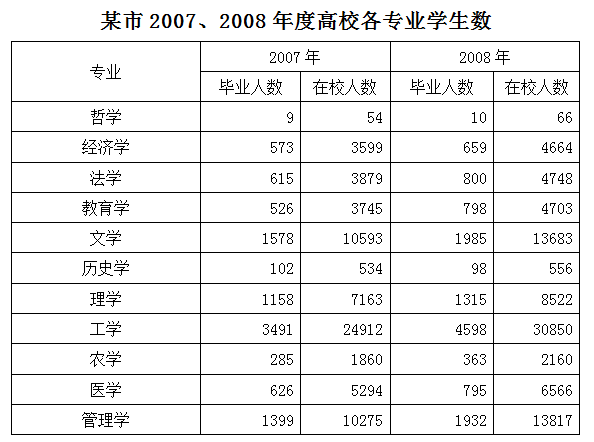

### 第 126 题

2008年该市高校学生在校人数最多的是哪个专业：

A. 经济学

B. 教育学

C. 文学

D. 工学

第 126 题 · 答案与解析

**参考答案（粉笔题库参考内容）**

D

**解析**

定位表格材料“2008年经济学、教育学、文学、工学的在校人数依次为4664、4703、13683、30850”，可知工学的在校人数最多。

故正确答案为D。

### 第 127 题

2007年的毕业生中，文学专业所占的比例大概是多少：

A. 10％

B. 12％

C. 15％

D. 18％

第 127 题 · 答案与解析

**参考答案（粉笔题库参考内容）**

C

**解析**

根据题干“2007年······文学专业所占的比例······”，结合表格给出2007年的数据，可判定本题为现期比重计算问题。定位表格材料，2007年所有毕业生人数=9+573+615+526+1578+102+1158+3491+285+626+1399=10362人，文学专业毕业生1578人。根据公式：总体，文学专业毕业生所占比例，最接近C项。

故正确答案为C。

### 第 128 题

下列说法正确的是哪一项：

A. 与2007年相比，2008年各专业毕业人数都有不同程度的上升

B. 2007年在校人数较多的三个专业占当年总在校人数大半

C. 与2007年相比，2008年理学专业毕业生的增长率比法学的高

D. 与2007年相比，2008年文学专业在校人数的增长率比管理学的高

第 128 题 · 答案与解析

**参考答案（粉笔题库参考内容）**

B

**解析**

A项：定位表格材料，历史学专业毕业人数2008年98人&lt;2007年102人，有所下降，错误；

B项：定位表格材料，2007年在校总人数=54+3599+3879+3745+10593+534+7163+24912+1860+5294+10275=71908人，在校人数最多的3个专业分别是文学（10593人），工学（24912人），管理学（10275人），共10593+24912+10275=45780人。根据公式：比重，可得在校人数较多的三个专业占当年总在校人数比重，正确；

C项：定位表格材料，理学专业毕业生2007年1158人，2008年1315人；法学专业毕业生2007年615人，2008年800人。根据公式：增长率可得，2008年理学专业毕业生增长率；2008年法学专业毕业生增长率，理学（13.5%）&lt;法学（30%），错误；

D项：定位表格材料，文学专业在校生2007年10593人，2008年13683人；管理学专业在校生2007年10275人，2008年13817人。根据公式：增长率可得，2008年文学专业在校生增长率；2008年管理学专业在校生增长率，文学（29%）&lt;管理学（34%），错误。

故正确答案为B。

### 第 129 题

2008年与2007年相比，在校生增长率超过25％的专业有多少个：

A. 3

B. 4

C. 5

D. 6

第 129 题 · 答案与解析

**参考答案（粉笔题库参考内容）**

B

**解析**

根据题干“······增长率超过25%······”，可判定本题为一般增长率问题。定位表格材料可得2007-2008年所有专业的在校生人数。根据公式：增长率，可得各专业在校生的同比增长率分别为：

哲学，经济学，

法学，教育学，

文学，历史学，

理学，工学，

农学，医学，

管理学。

所以满足条件的有经济学、教育学、文学、管理学共4个专业。

故正确答案为B。

### 第 130 题

与2007年相比，2008年毕业人数增长率最高的是哪个专业：

A. 经济学

B. 管理学

C. 教育学

D. 历史学

第 130 题 · 答案与解析

**参考答案（粉笔题库参考内容）**

C

**解析**

根据题干“······增长率最高的······”，可判定本题为一般增长率问题。定位表格材料可得2007-2008年经济学、管理学、教育学、历史学毕业生人数，根据公式： 增长率，则2007-2008年经济学、管理学、教育学、历史学毕业生人数的同比增速分别为：经济学；管理学；教育学；历史学，故教育学专业的增长率最高。

故正确答案为C。

## 材料 3

赵钱孙李周五位先生长途出行的方式都是乘坐汽车、火车或飞机，大致情况如下：

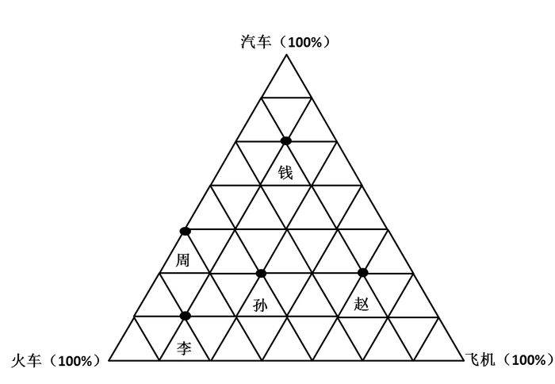

### 第 131 题

周先生最喜欢的出行方式是：

A. 汽车

B. 火车

C. 飞机

D. 无法确定

第 131 题 · 答案与解析

**参考答案（粉笔题库参考内容）**

B

**解析**

定位网状图，周先生乘坐火车、飞机、汽车的比例为4：0：3，选择火车的比例最高，可知周先生最喜欢的出行方式是乘坐火车。

故正确答案为B。

### 第 132 题

五人中最喜欢坐汽车出行的是：

A. 赵先生

B. 钱先生

C. 孙先生

D. 李先生

第 132 题 · 答案与解析

**参考答案（粉笔题库参考内容）**

B

**解析**

由网状图可知，钱先生所在的点离汽车出行比例最高点最近，故五人中钱先生乘坐汽车出行的比例最高。

故正确答案为B。

### 第 133 题

孙先生大概长途出行多少次才坐一次飞机：

A. 3

B. 3.5

C. 4

D. 4.5

第 133 题 · 答案与解析

**参考答案（粉笔题库参考内容）**

B

**解析**

定位网状图，孙先生乘坐火车、飞机、汽车的比例为3：2：2，坐飞机出行占总出行比例为，即孙先生出行7次，有2次选择坐飞机，根据比例关系7：2=3.5：1，可知孙先生出行3.5次，有1次选择坐飞机。

故正确答案为B。

### 第 134 题

赵先生长途出行坐火车次数与坐飞机次数的比例是：

A. 1∶2

B. 1∶3

C. 1∶4

D. 1∶5

第 134 题 · 答案与解析

**参考答案（粉笔题库参考内容）**

C

**解析**

直接由网状图可知，赵先生长途出行乘坐火车与飞机的比例为1:4。

故正确答案为C。

### 第 135 题

下列说法正确的是：

A. 周先生比赵先生喜欢出行

B. 李先生较喜欢坐飞机出行

C. 相对于孙先生而言，钱先生更喜欢坐火车出行

D. 钱先生和赵先生都不怎么喜欢坐火车出行

第 135 题 · 答案与解析

**参考答案（粉笔题库参考内容）**

D

**解析**

A项：定位网状图，只能判断这五位先生长途出行方式的比例，无法判断其出行的频率，错误；

B项：定位网状图，李先生乘坐火车、飞机、汽车的比例为5：1：1，因此李先生较喜欢坐火车出行，错误；

C项：定位网状图，孙先生乘坐火车、飞机、汽车的比例为3：2：2，钱先生乘坐火车、飞机、汽车的比例为1：1：5。相对于孙先生而言，钱先生更喜欢坐汽车出行，错误；

D项：定位网状图，赵先生乘坐火车、飞机、汽车的比例为1：4：2；钱先生乘坐火车、飞机、汽车的比例为1：1：5。赵先生比较喜欢乘坐飞机，钱先生比较喜欢乘坐汽车，他们都不怎么喜欢坐火车出行，正确。

故正确答案为D。

