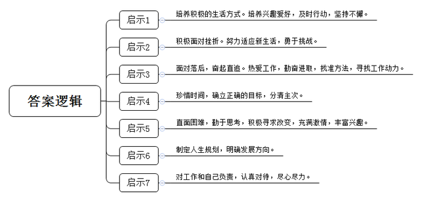
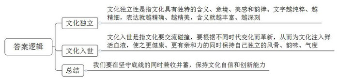
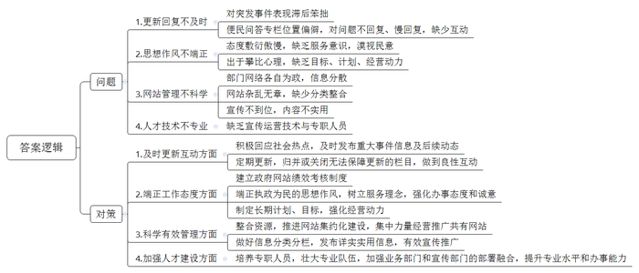
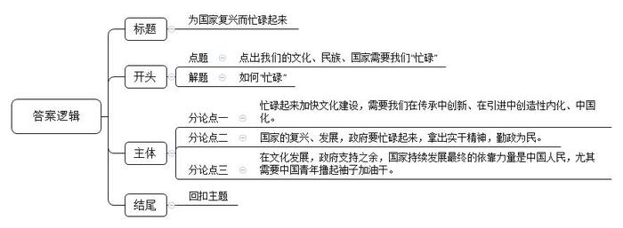

# 2017年公务员多省联考《申论》题（广西卷）

<!-- gwy:overview:start -->
> **广西 · 2017 · 申论 · 统考** ｜ 4 题 · 图片 4 处 · 答案随题折叠

导航：[题目](#题目)
<!-- gwy:overview:end -->

> 候选采集稿。参考答案及解析来自粉笔页面，不代表官方答案或真实高分答卷；来源使用许可与原卷对应关系仍需人工核实。

## 给定材料

### 材料 material-b0365f5623fd8ca9

当你年迈，步履蹒跚，你会选择怎样的生活方式？浙江的一对老夫妻选择了“一直在路上”，退休后开始自驾游。3年，1辆小汽车，走遍31个省市区。老人还把自驾游经历写成一本35万字的书。其实老人没接受过写作训练，没搞过文字，但从小他就很喜欢历史、地理。每次游玩，他都会把小本子带在身边。他每天都坚持到图书馆写4000多字，两个月就完成了25万字的初稿，接着对初稿修改、补充，大约花了半年时间完成全书。书稿都是手写的，他就让女儿打印装订，怕有别字病句，他就抱着打印稿找文联帮忙作最后的修改。最后，书终于出版了。在后记中，他说：“我跟他们说我驾车出游是因为我和老伴年纪不小了，趁现在还走得动，赶快走一走。我们是越走越想走啊。”现在他以自驾游西藏为主要内容的书稿，也已经完成了5万多字。

若你曾折翼，是否依然选择飞翔？15年前，安德鲁在登山中因被暴风雪所困而不幸截肢，但他并没有因此而消沉。装上义肢后，他每天都努力康复，不但适应了新的生活，还参加了铁人三项比赛，并在友人的帮助下，靠着绳索攀登了阿尔卑斯山脉中海拔高达4478米的马特宏峰。现在，以他为原型的纪录片《截肢登山家》已在英国播出。

如果你在一开始落后，是会奋起直追还是甘居下游？一个做同声传译的嘉宾在节目中大聊行业内幕：“忙、累、压力大！每隔20分钟就要休息一次，但收入确实丰厚。这行吃的不是青春饭，我有的同事都60岁了。”而对自己能胜任这份工作的秘诀，他也很直接地表示：“其实没什么秘诀，首先是热爱，其次是勤奋。坦白地说，我记忆力不好，语言天赋也不高，出身农村，直到初中才开始接触到外语。初中时每次期末考试，英语都是倒数几名。关键是一步一步自己找方法，其实学习和生活一样，就是为了不那么辛苦而辛苦。”同时，他坦白自己也有觉得坚持不下去的时候，那怎么办呢？想想自己干这行的甜头呗：比如每年只需要工作一个月就能赚够这一年的钱，剩下的时间就可以当个懒汉，优哉游哉地充电学习、旅行、品美食、思考人生……

### 材料 material-882debdb5e5ca28d

在五千年的文明史中，历代诗人留下了太多今天读来亦让人赞叹不已的诗句。其实，无论看多少“霸道总裁爱上灰姑娘”，我们心中依然有“蒹葭苍苍，白露为霜。所谓伊人，在水一方”的咏吟；无论经历多少好莱坞“星际争霸”“变形金刚”的洗礼，我们依然保留着“大江东去，浪淘尽，千古风流人物”的三国楚汉的豪情。然而在快餐时代，浮躁肤浅具有极强的传染性，即便明白腹有诗书气自华，许多人依然缺乏耐心，懒得去品味诗词歌赋的美妙意境。轻阅读、浅阅读、碎片化阅读成了一种趋势，不去思考，盲目轻信伪科学谣言和本属于垃圾食品的“心灵毒鸡汤”，获得一种零营养的娱乐快感。

对娱乐的偏好体现了文化的趋势，这一点值得我们警醒。

汉字作为世界上现存唯一仍在使用的象形文字，堪称包括我国文明在内的世界文明发展研究的活化石，也是我国五千年的文明得以延续发展的最重要载体。文字虽然是一种表达的工具，但它作为工具，首先必须是有效的，能够独立地表达出意思，甚至意境。文字用得越纯粹，也就越精细，表义也会越精确，文章就越精美，文化的感觉也会越精妙，文化的内涵就会越丰富、越深刻。豆腐为什么不能叫“中国布丁”？因为若被称为中国布丁，你就永远不知道它的制作原料、口感味觉，以及中国人对它所赋予的深意。然而，近年来，满眼“欧巴”“忙内”，外文字母缩写音译，既不能达义又不能表形，常常让人摸不着头脑。我们在对外文化交流史上，何曾没有过翻译？唐代僧人们翻译梵文的难度可想而知，可是他们宁愿绞尽脑汁去造字也不愿破坏方块字的建筑美感和铿锵韵律。法国巴黎大都会区内有个市镇，也是巴黎的卫星城之一，它的法文意义本已非常优美——美丽的泉水，但我们的翻译家却偏偏还要给它一个更钟灵毓秀的名字——枫丹白露；“佛罗伦萨”也不失为一个好名字，但是徐志摩的一首小诗使国人对它的另外一个名字更为倾情——翡冷翠，仔细想一想，玉的冷香和代表这座城市的凝紫，怎能不是绝配？美国加州有个公园，我们翻译成“优山美地”，不用去，听名字就已心向往之，据说风光也不负此名，可谓实至名归。而这些神级翻译，无一不是前人秉持“信达雅”的要求，以坚守和勤奋，让音译、意译完美结合。

我们有悠久的文明和丰富的文化可供挖掘汲取，但这些年对传统文化掠夺式的开采利用却是触目惊心：历史剧全是宫斗穿越、权术诡计；经典一再被各类小说荒唐地解构演绎；打油诗、顺口溜把唐诗宋词代替；文化流行存在媚俗、庸俗、低俗和恶俗倾向。这还涉及到更深远的问题。上善若水，文化亦是如此。它从千年之远、万里之遥走来，浸润着我们和这一片土地。倘若我们只是攫取，只是跟风随俗，那么文化之河将有可能“断流改道”。而它一旦“断流改道”，我们这一方水土又当如何？我们要坚守、要革新。革新？我们岂非没有过革新？新文化运动为古老的汉语注入鲜活的血液，让我们的文化拥有了更健康、更亲和的魅力。文化之美，在骨不在皮，美在风韵和气度，而不是华服丽饰，削骨隆鼻，美光磨皮。同样是写美人，我们有“巧笑倩兮，美目盼兮”“绝代有佳人，幽居在空谷”，有“最是那一低头的温柔，像一朵水莲花不胜凉风的娇羞”“她是有，丁香一样的颜色，丁香一样的芬芳”；同样是咏爱情，我们有“玲珑骰子安红豆，入骨相思知不知”“愿得一人心，白首不相离”，有“天上飘著些微云，地上吹著些微风。啊！微风吹动了我的头发，教我如何不想她？”“明月装饰了你的窗子，你装饰了别人的梦”。文化之美，是入世而独立。新陈代谢是文化最基本的生理机能。但对外来文化接纳和文化创新的底线在于自身的独立与清醒，没有坚守住这底线，恐怕始终都会陷入文化拿来主义的怪圈，日益丧失文化自信和创造的能力。不盲从，不封闭，能兼收并蓄，否则就是一种自卑又自负的虚弱。

## 题目

### 第 1 题

**请根据“给定材料**1**\-**2**”，简述这些事例对年轻人树立正确的人生观有哪些启示。（15分）**

关联材料：材料 material-b0365f5623fd8ca9

作答要求：

要求：

（1）全面，准确，简明，有条理。

（2）不超过200字。

第 1 题 · 答案与解析

**参考答案（粉笔题库参考内容）**

1.培养积极的生活方式。培养兴趣爱好，及时行动，坚持不懈。

2.积极面对挫折。努力适应新生活，勇于挑战。

3.面对落后，奋起直追。热爱工作，勤奋进取，找准方法，寻找工作动力。

4.珍惜时间，确立正确的目标，分清主次。

5.直面困难，勤于思考，积极寻求改变，充满激情，丰富兴趣。

6.制定人生规划，明确发展方向。

7.对工作和自己负责，认真对待，尽心尽力。

**解析**

**参考答案说明**：本参考答案从“生活方式”“面对挫折”“面对落后”“珍惜时间”“充满激情”“规划方向”“对工作和自己负责”七个方面进行了分条撰写。各条要点之间在内容上相互并列，没有交叉。

**考点**：考点经验启示类

**来源**：来源2017年公务员多省联考《申论》题（广西卷）

粉笔申论页面对本题只提供「解析视频」入口，该入口是会员推广位，页面无视频地址与文字解析。

### 第 2 题

**根据“给定材料**4**”，谈谈你对“文化之美，是入世而独立”这句话的理解。（15分）**

关联材料：材料 material-882debdb5e5ca28d

作答要求：

要求：

（1）全面，准确，简明，有条理。

（2）不超过200字。

第 2 题 · 答案与解析

**参考答案（粉笔题库参考内容）**

一、文化独立性是指文化具有独特的含义、意境、美感和韵律。文字越纯粹、越精细，表达就越精确、越精美，含义就越丰富、越深刻。二、文化入世是指文化要交流碰撞，要根据不同时代变化而革新，从而为文化注入鲜活血液，使之更健康、更有亲和力的同时保持自己独立的风骨、韵味、气度。三、我们要在坚守底线的同时兼收并蓄，保持文化自信和创新能力。

**解析**

**参考答案说明：**思路方面，本参考答案按照词句解释题“总体释义+展开解释+总结”的一般答题思路展开。内容方面，本参考答案先给出了“文化独立”的总体释义和展开解释部分；接着给出了“文化入世”的总体释义和展开解释部分；最后进行了总结。

**考点**：考点词句解释类

**来源**：来源2017年公务员多省联考《申论》题（广西卷）

粉笔申论页面对本题只提供「解析视频」入口，该入口是会员推广位，页面无视频地址与文字解析。

### 第 3 题

**“给定材料**3**”中谈到一些地方官方网站、官方微博没有起到应有的作用。请据此指出这些地方的官方网站和官方微博存在哪些问题，应当如何改进？（20分）**

关联材料：材料 material-b0365f5623fd8ca9

作答要求：

要求：

（1）针对性强、简明，建议合理，有条理；

（2）不超过400字。

第 3 题 · 答案与解析

**参考答案（粉笔题库参考内容）**

一、问题：

1.更新回复不及时：对突发事件表现滞后笨拙；便民问答专栏位置偏僻，对问题不回复、慢回复，缺少互动；

2.思想作风不端正：态度敷衍傲慢，缺乏服务意识，漠视民意；出于攀比心理，缺乏目标、计划、经营动力；

3.网站管理不科学：部门网络各自为政，信息分散；网站杂乱无章，缺少分类整合；宣传不到位，内容不实用；

4.人才技术不专业：缺乏宣传运营技术与专职人员。

二、措施：

1.积极回应社会热点，及时发布重大事件信息及后续动态；定期更新，归并或关闭无法保障更新的栏目，做到良性互动；

2.建立政府网站绩效考核制度，端正执政为民的思想作风，树立服务理念，强化办事态度和诚意，制定长期计划、目标，强化经营动力；

3.整合资源，推进网站集约化建设，集中力量经营推广共有网站；做好信息分类分栏，发布详实实用信息，有效宣传推广；

4.培养专职人员，壮大专业队伍，加强业务部门和宣传部门的部署融合，提升专业水平和办事能力。

**解析**

**参考答案说明：**本参考答案宏观上分成了“问题”和“对策”两个要素。在“问题”内部，又从“更新回复不及时”“思想作风不端正”“网站管理不科学”“人才技术不专业”等不同的层面进行了分条撰写。各条要点之间在内容上相互并列，没有交叉。在“对策”内部，又从“及时更新、互动”“端正工作态度”“科学有效管理”“加强人才建设”等不同的方面进行了分条撰写。各条要点之间在内容上相互并列，没有交叉。

**考点**：考点提出对策类

**来源**：来源2017年公务员多省联考《申论》题（广西卷）

粉笔申论页面对本题只提供「解析视频」入口，该入口是会员推广位，页面无视频地址与文字解析。

### 第 4 题

**根据你对“给定材料**5**”中划线部分“但现在的时刻，我们的文化、我们的民族、我们的国家，需要我们忙碌起来，而不是一直在缅怀过去、一直在不经过大脑地轻松娱乐”的理解，自选角度，自拟题目，写一篇文章。（50分）**

关联材料：材料 material-b0365f5623fd8ca9

作答要求：

要求：

（1）结合给定资料，但不拘泥于给定资料，联系实际；

（2）观点正确，内容充实；

（3）结构完整，思路清晰，语言流畅；

（4）字数不少于1000字。

第 4 题 · 答案与解析

**参考答案（粉笔题库参考内容）**

**为国家复兴而忙碌起来**

中华文化有优雅音韵与深刻内涵，却被快餐文化、娱乐文化蚕食，失去了风韵与气度；我国经济正在转型升级，国家亟需创新发展……在这本应忙碌起来加油干的时刻，我们很多年轻人却每天在“忙然又茫然”中虚度青春，直言人生“压力山大”，身心俱疲……

我们要忙碌起来！**思考上要勤奋、快速，要在坚守、继承、创新中梳理过去、辨明方向**；**但在行动上不能****“瞎忙”，要慢下来，把握节奏，分清主次、提高效率，着力解决必须解决的问题**。

**忙碌起来加快文化建设，需要我们在传承中创新、在引进中创造性内化、中国化**。我们伟大灿烂的古典文化不能在各种狭隘的宫斗剧，各种浮躁的搞笑段子、视频、娱乐中被曲解、被滥用，我们要耐心、细心挖掘传统文化之美、文明价值。而面对外来文化，我们要独立而自信。我们大量翻译和引进外国文献和文化产品的同时，要避免在盲从和模仿中丧失文化自信和创造力的风险。我们的民族正在复兴，文化的生命在于新陈代谢、有机更新，不断创造新文化。我们的文化要在传承古典精华、引进消化再创造中涅槃。

**国家的复兴、发展，政府要****忙碌起来，****拿出实干精神，****勤政****为民**。无所作为的官方微博、官方网站折射出的是庸政、懒政的思想，既怠慢了群众，也损害了政府“俯首甘为孺子牛”的亲民形象。空谈误国，实干兴邦。政府公职人员、领导干部应该时刻关注百姓民生，倾听民意、体察民情，想群众之所想，及时发布有效信息。不摆“花架子”，不搞“假名堂”，用严格的考评机制将“假忙碌”之人淘汰出公职队伍，真正实现“为人民服务”的第一宗旨。

**在文化发展，政府支持之余，国家持续发展最终的依靠力量是中国人民，尤其需要中国青年撸起袖子加油干**。

然而，让人忧心的是，作为创新中坚力量的青年人、大学生，部分群体在精神上萎靡不振、不思进取；智力上懒惰成性、思考不足、抄袭复制；理想上迷茫、慌乱。他们无所事事又忙忙碌碌，身心疲惫又游戏人生。这无疑需要政府、社会、学校重视起来，加强教育和引导。先辈的努力、父母的辛苦，给我们这一代青年人提供了较好的物质基础、技术积累、社会环境。工作上，我们不能沉溺在过去，不能躺在先辈、父母的积累上偷懒、嗟嘘，我们应该饮水思源、继承传统、加倍努力。生活中，我们也绝不能做好逸恶劳、不爱思考瞎乐呵，被逼无奈才去思考的“巨婴”。怯懦、狭隘、封闭是没有希望的，我们不能在无脑娱乐中过一种肤浅人生。

为了不在大时代中沉沦，我们要忙碌起来，要积极努力、勤于思考、善于创新创造。这种忙碌是为了不那么辛苦而辛苦，为了越努力越幸运而奋斗。这种忙碌也是为了致敬先辈，他们曾经为了我们今日的闲暇历尽艰辛、万分努力。我日夜期盼的朋友们，你们在哪？快来吧！时间到了！该为国家复兴而忙碌了！

**解析**

**文章分析**

**为国家复兴而忙碌起来**

【**标题的优点：**首先，范文的标题“为国家复兴而忙碌起来”突出了“忙碌”这一主题。其次，形式上，文字简洁明快。】

中华文化有优雅音韵与深刻内涵，却被快餐文化、娱乐文化蚕食，失去了风韵与气度；我国经济正在转型升级，国家亟需创新发展……。（2）在这本应忙碌起来加油干的时刻，我们很多年轻人却每天在“忙然又茫然”中虚度青春，直言人生“压力山大”，身心俱疲……

【**开头的优点：**★内容方面：范文的开头是紧扣题目给定的“但现在的时刻，我们的文化、我们的民族、我们的国家，需要我们忙碌起来，而不是一直在缅怀过去、一直在不经过大脑地轻松娱乐”这句话展开的。首先，开头点出主题，做到了主题明确。其次，对“忙碌”这一主题进行了分析阐述，指出了（1）“忙碌”的背景。（2）“忙碌”中存在的问题。★文字表达方面：使用了“却”等关联词，使语言表达有逻辑性。】

我们要忙碌起来！**思考上要勤奋、快速，要在坚守、继承、创新中梳理过去、辨明方向**；**但在行动上不能****“瞎忙”，要慢下来，把握节奏，分清主次、提高效率，着力解决必须解决的问题**。

【**过渡段的优点：**范文过渡段分析了如何“忙碌”的对策这一方面的内容，用来引起下文。】

**忙碌起来加快文化建设，需要我们在传承中创新、在引进中创造性内化、中国化**。（1）我们伟大灿烂的古典文化不能在各种狭隘的宫斗剧，各种浮躁的搞笑段子、视频、娱乐中被曲解、被滥用，我们要耐心、细心挖掘传统文化之美、文明价值。（2）而面对外来文化，我们要独立而自信。我们大量翻译和引进外国文献和文化产品的同时，要避免在盲从和模仿中丧失文化自信和创造力的风险。我们的民族正在复兴，文化的生命在于新陈代谢、有机更新，不断创造新文化。我们的文化要在传承古典精华、引进消化再创造中涅槃。

【**论述段****1****的优点：**★观点句：范文的观点句是紧扣“忙碌”这一文章主题提出的。形式上，它在段首处直接写出，位置突出，容易发现。内容上，关键词突出，内容要点明确，可以明显看出它是从“加快文化建设”入手，指出了“如何忙碌”。★论述内容：（1）介绍了“我们要挖掘传统文化之美”；（2）介绍了“我们要独立而自信的面对外来文化”；注意：以上几个方面的内容都是紧扣“忙碌起来加快文化建设，需要我们在传承中创新、在引进中创造性内化、中国化”这个观点句进行分析论述的，论述的针对性强，内容层次丰富。最后，在论述方法和论据的选取上做到了讲道理与举例子相结合，做到了丰富多样。】

**国家的复兴、发展，政府****也****要忙碌起来，拿出实干精神，****勤政****为民**。（1）无所作为的官方微博、官方网站折射出的是庸政、懒政的思想，（2）既怠慢了群众，也损害了政府“俯首甘为孺子牛”的亲民形象。空谈误国，实干兴邦。（3）政府公职人员、领导干部应该时刻关注百姓民生，倾听民意、体察民情，想群众之所想，及时发布有效信息。不摆“花架子”，不搞“假名堂”，用严格的考评机制将“假忙碌”之人淘汰出公职队伍，真正实现“为人民服务”的第一宗旨。

【**论述段****2****的优点：**★观点句：范文的观点句是紧扣“忙碌”这一文章主题提出的。形式上，它位置突出，容易发现。内容上，关键词突出，内容要点明确，可以明显看出它是从“中国政府”入手，指出了“如何忙碌起来促进国家发展”。★论述内容：（1）介绍了“无所作为政府的问题”；（2）介绍了“无所作为政府产生的危害”；（3）介绍了“政府应该如何为群众忙碌，有所作为”；注意：以上几个方面的内容都是紧扣“政府更要拿出实干精神，实干为民”这个观点句进行分析论述的，论述的针对性强，内容层次丰富。最后，在论述方法和论据的选取上做到了讲道理与举例子相结合，做到了丰富多样。】

**在文化发展，政府支持之余，国家持续发展最终的依靠力量是中国人民，尤其需要中国青年撸起袖子加油干**。

然而，让人忧心的是，作为（1）创新中坚力量的青年人、大学生，部分群体在精神上萎靡不振、不思进取；智力上懒惰成性、思考不足、抄袭复制；理想上迷茫、慌乱。他们无所事事又忙忙碌碌，身心疲惫又游戏人生。这无疑需要（2）政府、社会、学校重视起来，加强教育和引导。先辈的努力、父母的辛苦，给我们这一代青年人提供了较好的物质基础、技术积累、社会环境。（3）工作上，我们不能沉溺在过去，不能躺在先辈、父母的积累上偷懒、嗟嘘，我们应该饮水思源、继承传统、加倍努力。（4）生活中，我们也绝不能做好逸恶劳、不爱思考瞎乐呵，被逼无奈才去思考的“巨婴”。怯懦、狭隘、封闭是没有希望的，我们不能在无脑娱乐中过一种肤浅人生。

【**论述段****3****的优点：**★观点句：范文的观点句是紧扣“忙碌”这一文章主题提出的。形式上，它位置突出，容易发现。内容上，关键词突出，内容要点明确，可以明显看出它是从“中国人民”入手，指出了“如何忙碌起来促进国家发展”。★论述内容：（1）介绍了“部分青年群体存在的问题”；（2）介绍了“政府、社会、学校要对青年群体加强教育”；（3）介绍了“青年人在工作上如何忙碌”；（4）介绍了“青年人在生活上如何忙碌”注意：以上几个方面的内容都是紧扣“无论是文化发展还是经济创新，国家持续发展最终的依靠力量是中国人民，尤其需要中国青年撸起袖子加油干”这个观点句进行分析论述的，论述的针对性强，内容层次丰富。最后，在论述方法和论据的选取上做到了讲道理与举例子相结合，做到了丰富多样。】

【**论述段之间的关系**：★内容的内在逻辑：范文的论述段之间是依照“如何忙碌起来促进国家复兴发展”的逻辑展开的。论述段1先写了“忙碌起来加快文化发展”，论述段2再写了“政府要忙碌起来促进国家复兴发展”，论述段3接着写了“中国青年人如何忙碌起来促进国家复兴发展”。★段与段的外在衔接：论述段2的段首处的过渡句“国家的复兴、发展，政府也要忙碌起来”，起到了承接论述段1、引出了论述段2的作用。论述段3的段首处的过渡句“在文化发展，政府支持之余”，起到了承接论述段2、引出了论述段3的作用。】

为了不在大时代中沉沦，（1）我们要忙碌起来，要积极努力、勤于思考、善于创新创造。这种忙碌是为了不那么辛苦而辛苦，为了越努力越幸运而奋斗。这种忙碌也是为了致敬先辈，他们曾经为了我们今日的闲暇历尽艰辛、万分努力。（2）我日夜期盼的朋友们，你们在哪？快来吧！时间到了！该为国家复兴而忙碌了！

【**结尾的优点**：范文的结尾回扣了“忙碌”这一主题。（1）再次总结了“如何忙碌”；（2）发出了号召希望。】

**考点**：考点文章写作题

**来源**：来源2017年公务员多省联考《申论》题（广西卷）

粉笔申论页面对本题只提供「解析视频」入口，该入口是会员推广位，页面无视频地址与文字解析。

