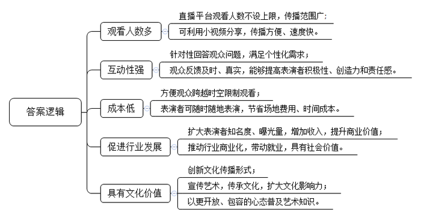
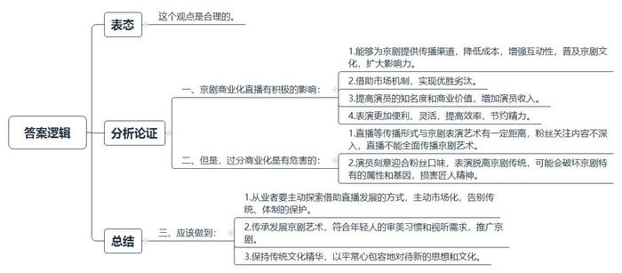
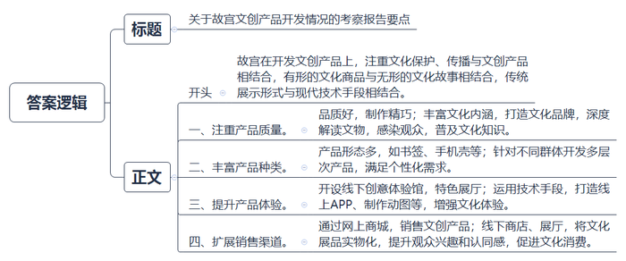
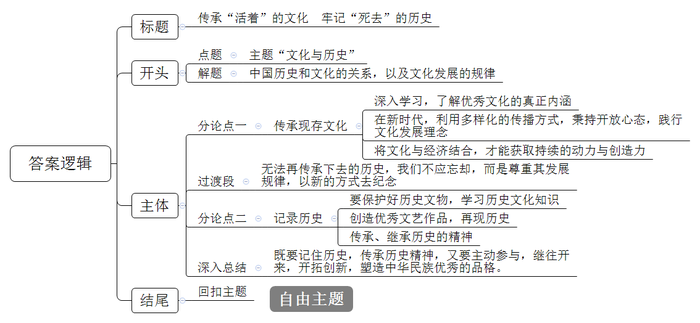

# 2018年广西公考《申论》题（A、普通选调卷）

<!-- gwy:overview:start -->
> **广西 · 2018 · 申论 · A类** ｜ 4 题 · 图片 4 处 · 答案随题折叠

导航：[题目](#题目) · [材料 1](#材料-1)
<!-- gwy:overview:end -->

> 候选采集稿。参考答案及解析来自粉笔页面，不代表官方答案或真实高分答卷；来源使用许可与原卷对应关系仍需人工核实。

## 给定材料

### 材料 1

每周五晚，某乐团二胡首席小杨准时进入她开设在某直播平台的“民乐坊”直播间，开始与粉丝互动。这一次，她请来了同事小琳，为“民乐坊”近3万粉丝进行一个半小时的箜篌演奏直播。许多粉丝对箜篌这个古老的乐器感到陌生，小琳在演奏的同时，还耐心地向观众介绍了箜篌的历史和特点。整个直播过程中，实时弹幕不时从屏幕上闪过，“我的天啊！太好听了！”有人送“蛋糕”“火箭”等虚拟礼物，还有人录下了直播视频分享到微信朋友圈。直播结束后小琳感叹道：“这么多人感兴趣啊！真没想到！直播让我对继续从事箜篌表演工作有信心啦，直播可以是我的另一个舞台，以后我还要多多尝试一些新方法，让更多的人知道并且喜欢箜篌。”

直播是什么？小杨以前并不了解，在被朋友邀请参加一次现场演奏直播时，她被21.5万的网上观看人数惊着了。她平时在国家大剧院的大剧场演出时，每场观众最多的时候也不过2000人左右。小杨说：“国家大剧院已经算非常大了，而直播平台的观看人数没有封顶的概念，我每次都会被惊到。”乐迷还自发地利用小视频录制功能把小杨的表演片段放到微博微信上，也获得了百万播放量。贵州某地的一位观众对小杨说，他很喜欢二胡，可是从来没有机会进入国家大剧院这样“高大上”的艺术殿堂，在线观看小杨直播时，他觉得自己已经置身国家大剧院了。

一个小时的直播，小杨至少要准备5个小时。虽然很辛苦，但她还是乐此不疲：“观众的反应很真实，喜欢不喜欢都会说，第一时间就有反馈，连我每次表演效果不一样都能听得出来，让我不敢有丝毫的懈怠。”她说观众还会点曲子，“更直接，很好玩，这就是直播的魅力。”

### 材料 2

晚上刚吃完饭，小夏手机里收到了某直播平台推送的一条消息：“国粹来袭，快来看直播！”进行直播表演的是两位京剧新生代演员小白和天帅。在近2小时的直播中，他们彩唱、清唱了多首经典京剧和昆曲曲目，期间穿插介绍京剧行当和一些梨园掌故。将近15万人围观了这场直播，还听他们回答了网友们的“凤冠为什么这么重”“妆容要化多久”等问题，看他们现场给大家普及表演了“唱念做打”等基本功。直播结束时，平台还设置了曲艺直播的推送信息，提醒意犹未尽的观众注意下一场直播的时间和内容。

作为京剧圈里的偶像派，以往小白演出或者跟粉丝见面都要花不少功夫，得找演出场地、办活动，花钱又费力。现在他随时随地能用手机举办“见面会”，还经常在排练厅、剧场后台展示一些排练、备场、化装或者精彩场次的表演片段，与观众顺畅聊天。“原来舞台表演之外的京剧有这么多门道，不得不说，年轻艺术家直播曲艺很酷，上直播听讲戏也很酷。”一名粉丝说。

社会学家W评论说，现在的事实就是，一些握着游戏杆和鼠标的手在拂拭已经传承千年的古琴，一些品着单麦芽、听着慢摇的Cafe Racer青年在审视着延袭百代的文化。不考虑他们的视听习惯和审美需要，还怎么谈传统文艺的传承和发展？推广才是当务之急。艺术生产者不能孤芳自赏和自娱自乐，要演给大家看，要通过商业接近大众，这才有持续性。

文化学者Z认为，什么时候中国人能真正不卑不亢地以平常心对待一切新的文化表现形式，既懂得保持传统文化精华，又能以开阔的胸怀和视野对待新的思想和文化，吞吐自如，那就是我们民族真正在精神上健康成熟的时候了。

### 材料 3

某直播平台副总贾先生认为，直播是商业化行为，但其实更早的时候，没有电视也没有广播，大家怎么表演呢？就是在剧场，甚至是在天桥，观众围成一圈看表演，觉得不错就打赏。我觉得这个形式没有变化。平台现在能为传统艺术做的，是提供流畅的传播渠道、减少剧场租用等高额成本支出这些困扰传统艺术发展的外在因素。至于传统艺术如何借助直播获得更好的发展，还得靠从业者自己来探索。

某大学文化产业研究院C教授表示，在规模效应的推动下，通过直播平台进行表演，扩大了演员的知名度和曝光量，同时也提升了演员们的商业价值。既然选择了直播，就要与网络经济做伙伴，这是传统艺术表演者在转型之路上应当形成的观念。商业化运作也有鉴别“真材实料”的能力。让传统艺术深得人心，就要主动告别传统和体制的保护，在市场中找回生命力。

直播的主流盈利模式是广告和虚拟道具。在直播平台上，粉丝们打赏送虚拟礼物需要花费“星币”，而“星币”则能通过平台转换为实际的金钱。在某直播平台打赏里，最便宜的礼物需要一颗虚拟钻石购买，在充值界面，最低充值是60元人民币购买60颗钻石。正在直播的一位主播收到了粉丝送的虚拟“豪华邮轮”，算下来需要花费人民币1300余元。

主播们以收看量和打赏数定“胜负”，想要得到更多的礼物和点赞，主播就要有意迎合粉丝们的口味：有的主播用二胡拉了一首热播剧的曲目，就很受观众欢迎；要是演奏古典乐曲《春江花月夜》，就反响平平。有的书法直播也不是只靠一张宣纸一支笔，主播会为观众设计签名，或者用毛笔为观众画像。而谁给的礼物更大，主播们就要优先满足谁的要求，哪怕这些要求有时有些过分。

较早尝试京剧直播的京剧表演艺术家王女士认为，直播对于演员来说，面对的不是台下真实的观众而是摄像机，习惯了剧场或舞台表演氛围的演员需要适应不同的表演场景。但包括京剧在内的传统艺术之所以能够走到今天，还“活”着，必然有其存在的当代价值，这个价值就是传统艺术应该坚持的东西，不管采用什么样的形式传播，利用什么样的创新手段，都不能破坏京剧特有的属性和基因。对京剧来说，“唱念做打”“一弦一柱”还是要有匠人的范儿。

郑女士不做直播已经半年多了。她也是位京剧演员，曾在同事的带动下做过一段时间的京剧直播。直播时，同事对粉丝提出的各种要求几乎不拒绝，比如，直播中应粉丝要求用京剧唱腔演唱流行歌曲、用现代乐器为京剧演唱伴奏，甚至连京剧演员的吃饭、健身都要直播……几次直播下来，同事的粉丝数量见长，收入也日渐增加。

但郑女士直播时从不向粉丝求点赞求礼物，也不为“吸粉”搞新花样，所以她的粉丝群体比较固定。她认为，“直播”这种传播形式与京剧这种表演艺术还是有距离的。“京剧这个行当真的不能过分商业化，直播中多数人只看到京剧的皮毛和八卦而忽略了京剧艺术本身。”

### 材料 4

在当前的博物馆行业，有一种和“直播”一样时髦的传统文化传播方式——文化创意产品。文化创意产品（以下简称“文创产品”）是通过发掘文化器物本身所蕴含的文化因素并将其转化成设计要素，使其与符合现代生活形态的新形式相结合，创制出的满足使用者物质和精神需求的设计产品。

我国博物馆文创产品的开发，故宫走在了前面，做了许多有益的探索和实践。故宫博物院院长单霁翔认为，馆藏文物是博物馆的心脏和灵魂，但传播文化未必只能通过展览馆藏文物来进行。一枚书签、一个手机壳，都可以作为故宫文化的载体。截至2016年底，故宫博物院的文创产品共有9170种，为故宫带来10亿元左右的收入。事实证明，这些文创产品对于故宫的文化影响力、文化传播力都起到了巨大的作用。

目前，市场上文创产品的设计类型通常分为：“复制型”，直接拷贝馆藏形成产品；“素材型”，将文物的形态、纹样用在产品上；“卡通型”，将文物元素卡通化转成产品；“创意型”，对经典藏品寓意进行研发的产品。但这些文创产品的内涵仅局限于产品本身，几乎等同于“小商品”。“这些工艺和内涵都缺乏保证的所谓‘文创产品’能承载博物馆文化吗？能承担普及教育的任务吗？能算得上是文物的‘周边’吗？我觉得答案是否定的。”北京的博物馆专家S认为，做好文物的深度解读，用深层次的文化感染观众，这是最重要的。“文创产品应该是‘有形加无形’的。有形的方面指功能需求，就是现在的文创产品；无形方面是精神的需求，是文物的核心故事。博物馆是个讲故事的地方，要通过故事做文化品牌，发展无形的文创才是博物馆正确的路。”

故宫博物院用了7年时间清理院藏文物，25大类180余万件（套）精美绝伦的文物藏品得以呈现并成为开发文创产品最宝贵的文化资源。故宫博物院经营管理处Y说：“故宫最吸引人的，是它厚重的文化底蕴。故宫出品的文化创意产品，核心竞争力之一就是把‘文化范儿’融入设计之中。文创产品应该是博物馆思想的延伸，通过它，让大家参与到博物馆的精神生活中去，让某种精神深入到观众的心，这才是成功的文创产品。在欧美国家，文创产品在博物馆商店出售，博物馆商店也因此被称作博物馆的‘最后一个展厅’，在这里，观众对展品的兴趣和认同可以通过文创产品实物化，进而转化为文化消费。”Y介绍说，故宫已经创办了故宫网上商城，用来销售文创产品，神武门外的文创商店也已开业。

### 材料 5

故宫在红墙外的东长房区域开设了故宫博物院文化创意体验馆。文化创意体验馆分为丝绸馆、服饰馆、生活馆、影像馆、木艺馆、陶瓷馆、展示馆和紫禁书苑等8间各具特色的展厅。

展示馆是故宫博物院集中展示新款文创产品的区域。馆内有针对普通观众制作的大量便于携带且物美价廉的故宫文化纪念品，比如朝珠耳机、手机壳、钥匙扣、行李牌、书签等创意独特的时尚生活用品，兼具趣味性和功能性；也有针对部分观众的特殊需求研发的品质优良、做工精细的文化产品，如采用故宫藏龙袍纹饰设计的“海水江崖”系列桌旗、餐垫、纸巾盒、电脑包、钱包、护照夹等。其中一款故宫顶戴花翎官帽伞打开后，撑伞的人远远看上去就像戴了一顶顶戴花翎官帽，别致有趣。

故宫特别针对孩子们推出了《皇帝的一天》APP：在这款应用中，一只乾清门前的小狮子带着由平民儿童扮演的皇帝，体验皇帝一天的生活，以此了解故宫文化与传统文化。“5点就要起床？皇帝不能偷懒多睡一会儿吗？”“一天两顿饭？堂堂的皇帝竟然得饿着！”“一天射了300多只兔子？文武双全啊！”……孩子们七嘴八舌地问着问题。

在书画馆，参观者可以看到一些书面类文创产品，喜欢哪件书画作品可以在一刻钟之内完成复制，将复制品带回家；在陶艺馆，参观者看到故宫的陶艺品如同家庭摆件一样陈列，十分温馨；在学艺馆，参观者则可以体验故宫文创产品的研发过程；在服饰馆，故宫博物院系列APP的新成果《清代皇帝服饰》ipad应用精选了院藏清代冠服、佩饰等多个门类的代表藏品，介绍了礼服、吉服、常服、戎服、行服、便服这六大类不同功用、特色鲜明的清代皇帝服饰，为观众系统而清晰地梳理宫廷服饰制度，提供一部观赏性极强、详细解读皇帝服饰的“动态图录”；在影像馆，石渠宝笈特展上的《五牛图》为观众准备了3D版。这幅画是唐代韩滉的名作，中国十大传世名画之一。如今，平面的画面立体了，铜质五牛图雕塑摆件栩栩如生。

单霁翔说：“希望故宫文化创意体验馆成为观众在出宫前，逛的最后一个展厅，市民不仅能在此感受清代宫廷文化，还可以将‘皇家御用’的物件‘带回家’”。他还强调，“文创产品不能像小商品一样，随便拿个东西就说是自己研发的就行了，这样只会伤害未来的文创市场。即便是一个书签，卖10元、20元，也要精美，也要品质好。”

### 材料 6

2017年11月，在第十九届中国上海国际艺术节上，广西戏剧院的新编历史壮剧《冯子材》以独特的艺术气质、特有的艺术唱腔、别致的舞美设计打动了众多观众。

中国传统戏剧的演出是此届艺术节的一大亮点，来自全国8个省（区、市）的8个传统剧种轮番亮相，而少数民族剧种剧目只有一个，就是壮剧《冯子材》。这部在业内屡获好评的精品佳作由广西戏剧院壮剧团2015年创排，以壮族、仫佬族等少数民族演员担纲演绎少数民族传统剧种的形式，将广西近代史上民族英雄形象搬上舞台。自2015年公演以来，不断修改打磨提高，于同年入选国家艺术基金年度资助项目；2016年9月入选第五届全国少数民族文艺会演，获得最佳音乐创作奖；2016年10月入选第十五届文华大奖终评，并参加第十一届中国艺术节演出；入选2017新年戏曲春晚。

壮剧是富有广西特色的古老剧种，在2006年被列入首批国家级非物质文化遗产名录。广西戏剧院一直致力于传承优秀壮族文化，挖掘古老的壮剧艺术，融入当代元素，将其精华发扬光大。有专家认为，壮剧《冯子材》的创排堪称非物质文化遗产传承的一个成功案例。

在这次中国上海国际艺术节上，上海戏迷能够通过壮剧《冯子材》品到浓浓的桂风壮韵。执导之一的L介绍：“壮剧《冯子材》在服装设计上运用了广西古老的壮锦、铜鼓等重要民族文化元素，在剧情里充分运用了也是古老的傩面具及巫师祭祀舞蹈等壮族民俗，继承出新，令戏迷赏心悦目。”整个剧目通过壮寨布局、壮族民间服饰、巫师举行祭祀仪式和号角、壮语、傩面、壮家兵器，以及独特战法等壮族文化的重要元素，散发出浓郁的壮族气息，极大地增强了观赏性。

精彩的演出给上海观众带来了听觉、视觉和心灵的震撼。演出结束后，不少戏迷久久不愿离去，好几位观众紧紧握住演员的手不住赞叹：“这部戏很好看，特别让我们感动，你们的表演很棒！”“广西的壮剧真不错，太精彩了！”“希望能够有更多的机会看到广西的戏剧。”

结束在第十九届中国上海艺术节的展演后，广西戏剧院携壮剧《冯子材》到武汉等地巡演，在将近一个月的时间内，剧组演职人员走过3000多公里，跨越5个省份，为7座城市的近万观众奉上10场精彩好戏，观众受到爱国精神鼓舞的同时，也给予壮剧极高的评价。

全国很多观众对壮剧并不熟悉，可并不妨碍观众对它的欣赏，其独特的唱腔和武戏，让戏迷眼前一亮。壮剧《冯子材》的语言以桂柳话为主，辅以少量壮语，演出时舞台两侧配有字幕。而肢体语言是《冯子材》的一大特色，壮剧源自壮族的民间歌舞，因而演员的手势、脚步、亮相都融合了戏曲程式和壮族舞蹈两种元素。

此次全国巡演引起各地观众强烈反响，观众在观看演出后，纷纷在观剧群里留言点赞：“第一次观看广西的壮剧，实在太精彩了！”“这样高质量的表演给我来一打！”

### 材料 7

30多幢深宅大院、21座古祠、6间书院、一条千米古街……建于明清时期的客家古建筑群在宣和乡培田村完整保存下来，这里至今仍生活着300多户人家。穿梭于白墙乌瓦、飞檐翘角的古民居，端详留存在深宅大院里的牌匾、对联，古代客家人“耕读为本、崇文重教”的流风遗韵跃然眼前；走在曲折的古街、巷道上，古建筑的“形”与客家文化的“神”浑然一体，让人叹为观止。

一张张细腻光滑、质白如玉、厚薄均匀的连史纸，代表了中国竹制纸技艺的高峰。邓家造纸始于清康熙年间，经11代人代代相传，没有间断。如今，“连城连史纸制作工艺”省级非物质文化遗产传承人邓金坤制纸采用的仍然是和几百年前一样的工艺，一张薄薄的连史纸，要经过竹丝做料、水碓打浆、捞纸、焙纸等72道程序，全部由匠人手工完成。

近年来，邓金坤也尝试通过电商销售连史纸，一刀（100张）连史纸卖到300多元，上等的连史纸可以卖到千元以上乃至更贵，国内一些图书馆、博物馆、档案馆等文博单位也开始用连史纸修复古籍。尽管市场认可度逐渐提升，但邓金坤并不打算引入工业化流水线批量生产，“那样就变味了，守护连史纸这块金字招牌就要守住传统工艺，不能把老祖宗的宝贝给丢了。”

在培田，深宅大院里居住的大多是年过半百的老人，年轻人都外出打拼了。邓金坤今年48岁，儿子在上大学，当问到孩子是否会子承父业时，他说：“没法勉强他。可我活在这儿，靠它吃饭，这是祖宗传下来的东西啊，是活着的历史啊，不能让它在我的手里弄丢了，我要不在了，它还能不能在，真不好说啊！”邓金坤显得无奈落寞，因为2006年以来，就没有年轻人加入这个行业了。一位从事文化工作的专家M说：“虽然我们尽力了，但我们还是遗憾地看到有些传统文化消失了，就像生活在北极的因纽特人的生活和文化消失了一样。因为传统的社会结构已然解体，传统的生活方式必然会随之消失。这是自然规律，死去的就让它死去吧，我们不能强求。”在她看来，文化本身有一个新陈代谢的过程，很多文化消失了，也有许多新的文化出现。<u>“活着”的历史是文化，“死去”的文化是历史。</u>

## 题目

### 第 1 题

**根据“给定资料1～3”，概括“直播”在传统艺术传播方面的优势。（10分）**

关联材料：材料 1、材料 2、材料 3

作答要求：全面、准确，字数不超过250字。

第 1 题 · 答案与解析

**参考答案（粉笔题库参考内容）**

1.观看人数多。直播平台观看人数不设上限，传播范围广；可利用小视频分享，传播方便、速度快。

2.互动性强。针对性回答观众问题，满足个性化需求；观众反馈及时、真实，能够提高表演者积极性、创造力和责任感。

3.成本低。方便观众跨越时空限制观看；表演者可随时随地表演，节省场地费用、时间成本。

4.促进行业发展。扩大表演者知名度、曝光量，增加收入，提升商业价值；推动行业商业化，带动就业，具有社会价值。

5.具有文化价值。创新文化传播形式；宣传艺术，传承文化，扩大文化影响力；以更开放、包容的心态普及艺术知识。

**解析**

**参考答案说明：**本参考答案思路上从“观看人数多”“互动性强”“成本低”“促进行业发展”“具有文化价值”这五个方面进行说明。此外，各条的要点之间是并列关系，内容之间不存在重复、交叉。

**考点**：特点类

**来源**：2018年广西公考《申论》题（A、普通选调卷）

### 第 2 题

**“给定资料3”中，郑女士认为：“京剧这个行当真的不能过分商业化，直播中多数人只看到京剧的皮毛和八卦而忽略了京剧艺术本身。”请就她的观点谈谈你的看法。（15分）**

关联材料：材料 1、材料 2、材料 3、材料 4、材料 5、材料 6、材料 7

作答要求：观点明确，分析透彻，条理清晰，字数不超过350字。

第 2 题 · 答案与解析

**参考答案（粉笔题库参考内容）**

这个观点是合理的。

一、京剧商业化直播有积极的影响：1.能够为京剧提供传播渠道，降低成本，增强互动性，普及京剧文化，扩大影响力。2.借助市场机制，实现优胜劣汰。3.提高演员的知名度和商业价值，增加演员收入。4.表演更加便利、灵活，提高效率，节约精力。

二、但是，过分商业化是有危害的：1.直播等传播形式与京剧表演艺术有一定距离，粉丝关注内容不深入，直播不能全面传播京剧艺术。2.演员刻意迎合粉丝口味，表演脱离京剧传统，可能会破坏京剧特有的属性和基因，损害匠人精神。

三、应该做到：1.从业者要主动探索借助直播发展的方式，主动市场化，告别传统、体制的保护。2.传承发展京剧艺术，符合年轻人的审美习惯和视听需求，推广京剧。3.保持传统文化精华，以平常心包容地对待新的思想和文化。

**解析**

**参考答案说明**：思路方面，本参考答案按照观点现象分析题“表态+分析论证+总结”的一般答题思路展开。内容方面，本参考答案先对题干中的观点进行了表态；“分析理由”部分先分析了“京剧的商业化有积极的影响”，接着分析了“过分商业化是有危害的”，最后进行了总结。词句表达方面，本答案使用了“但是”等连接词来承接上下文。

**考点**：观点现象分析类

**来源**：2018年广西公考《申论》题（A、普通选调卷）

### 第 3 题

**假如你是某省博物馆的工作人员，被派去考察故宫文创产品开发情况。请你根据“给定资料4～5”，撰写一份向本单位领导汇报的考察报告要点。（25分）**

关联材料：材料 4、材料 5

作答要求：内容全面，要点清晰，字数不超过350字。

第 3 题 · 答案与解析

**参考答案（粉笔题库参考内容）**

关于故宫文创产品开发情况的考察报告要点

我国博物馆文创产品的开发，故宫走在了前面，做了许多有益的探索和实践。

一、注重产品质量。品质好，制作精巧；丰富文化内涵，打造文化品牌，深度解读文物，感染观众，普及文化知识。二、丰富产品种类。产品形态多，如手机壳等；针对不同群体开发多层次产品，满足个性化需求。三、提升产品体验。开设线下创意体验馆，特色展厅；运用技术手段，打造APP、动图等，增强文化体验。四、扩展销售渠道。通过网上商城，销售文创产品；线下商店、展厅，将文化展品实物化，提升观众兴趣和认同感，促进文化消费。

总体来看，故宫在开发文创产品上，注重文化保护、传播与文创产品相结合，有形的文化商品与无形的文化故事相结合，传统展示形式与现代技术手段相结合。

**解析**

**参考答案说明：**（1）格式方面，本参考答案写到了“标题”“正文”。（2）正文部分，一方面从内容来看，围绕着“故宫文创产品开发”这一主题，本参考答案的开头简要介绍了为故宫文创产品开发做出努力。主体部分再分别从“注重产品质量”“丰富产品种类”“提升产品体验”“扩展销售渠道”等四个方面给出了具体的分析。结尾总结了故宫文创产品开发的做法。另一方面，形式上，本参考答案做到了分条分类撰写，整体上条理较为清晰。

**考点**：总结类

**来源**：2018年广西公考《申论》题（A、普通选调卷）

### 第 4 题

**“给定资料7”中提到，“‘活着’的历史是文化，‘死去’的文化是历史”。请从这句话引发思考，结合给定资料，联系实际，自选角度，自拟题目，写一篇文章。（50分）**

关联材料：材料 1、材料 2、材料 3、材料 4、材料 5、材料 6、材料 7

作答要求：

（1）观点明确，认识深刻；

（2）逻辑清晰，语言流畅；

（3）结合“给定资料”，但不拘泥于“给定资料”；

（4）字数不少于1000字。

第 4 题 · 答案与解析

**参考答案（粉笔题库参考内容）**

**传承“活着”的文化 牢记“死去”的历史**

每年的4月18日，是“国际古迹遗址日”。在中国，悠久的历史历经数千年，最终形成极具分量又独具特色的中国文化，孕育出灿烂的中华文明。然而，文化的发展也必将经历一个新陈代谢、推陈出新的过程。**这就需要我们对现存文化保护、传承、创新，同时牢记历史经典，不忘精神根脉。**

**传承文化，需要深入学习，了解优秀文化的真正内涵；在新时代，利用多样化的传播方式，秉持开放心态，践行文化发展理念；将文化与经济结合，才能获取持续的动力与创造力。**汉字中，“拓”字，指用“手”推开前面的拦路“石”；“途”字，指给别人留有“余”地，自己才有路“走”，中国文化博大精深，从简单的字词到复杂的成语；从节日的命名到称呼的考究，看似简单，其实都蕴藏着深刻、丰富的内涵，可以说，要讲好中国故事，先要学好中国文化。另外，随着直播、微博、微信等现代互联网模式的兴起，充分拉近了文化与受众的距离，文化再也不必被禁锢在某个特定的舞台，应秉持开放心态，利用现代技术打造平台，让传统文化更有新意、更受欢迎，传播更广。当然，文化并不是独立的，与经济的完美结合，才能够保障它的持续性和生命力。在“文化+”“互联网+”发展战略的引领下，各地文化创意产业发展迅速，比如北京世园会盛大开幕，为推动文化产业发展提供动力。

**如今，篆刻、羌笛演奏、锔瓷、青铜冶炼……渐渐退出人们的生活，成为回忆，这些无法再传承下去的历史，我们不应忘却，而是尊重其发展规律，以新的方式去纪念。**

**记录历史，不仅要保护好历史文物，学习历史文化知识；更应创造优秀文艺作品，再现历史；最重要的是传承、继承历史的精神。**文物，承载着民族历史，维系着文化认同，保护好代代先人留下的珍贵文物，就是对历史、对文化的纪念。近日，故宫养心殿因启动百余年来首次大修再次引起外界关注，巴黎圣母院大火为文化遗产保护敲响警钟，守护文化遗产，就是守护人类文明。此外，真正受欢迎的文艺作品也不应只歌颂当下，更应该回顾经典，让历史以新的方式重现在人们面前。电视栏目《经典咏流传》，将古诗唱出新潮，让经典在传唱人的声音中得到传播，《长征》《永远的战友》等影视作品展现了历史，燃起人们的爱国热情。历史留给我们的是一段故事，更是一种精神，只有把它融入到生活中，实践在行动里，才是真正的传承。

**我们每个人既生活在现实中，又活在历史里，正创造着“历史”，也会是历史的“剧中人”。既要记住历史，传承历史精神，又要主动参与，继往开来，开拓创新，塑造中华民族优秀的品格。**历史已经成为过去，我们无法、也不可让时间倒流，但历史精神不容遗忘，唯有继承、发扬、创新，才能让中华记忆历久弥新，塑造中华民族优秀的品格。

“文化兴国运兴，文化强民族强”。传承与牢记都是对历史的尊重，对文化的尊重。我们所有人都有责任，以文化复兴为契机，塑造并培养中国人独有的文化情怀，让继承与发展的文化理念成为广泛共识！

**文章分析：**

**传承“活着”的文化 牢记“死去”的历史**

【**标题的优点：**首先，范文的标题“传承‘活着’的文化 牢记‘死去’的历史”突出了“文化与历史”这一主题。其次，形式上采用了“拟人”修辞手法，使得标题更加形象生动，有吸引力。】

每年的4月18日，是“国际古迹遗址日”。在中国，（1）<u>悠久的历史历经数千年</u>，<u>最终形成极具分量又独具特色的中国文化</u>，<u>孕育出灿烂的中华文明</u>。然而，（2）<u>文化的发展也必将经历一个新陈代谢</u>、<u>推陈出新的过程</u>。**这就需要我们对现存文化保护、传承、创新，同时牢记历史经典，不忘精神根脉。**

【**开头的优点：**★内容方面。范文的开头是紧扣题目给定的“文化与历史”这一主题展开的。首先，开头第二句话点出主题，做到了主题明确。其次，对“文化与历史”这一主题进行了分析阐述，指出了（1）中国历史与文化的关系；（2）文化发展的规律。★文字表达方面。使用了关联词“然而”，使语言表达有逻辑性。】

**传承文化，需要深入学习，了解优秀文化的真正内涵；在新时代，利用多样化的传播方式，秉持开放心态，践行文化发展理念；将文化与经济结合，才能获取持续的动力与创造力。**汉字中，“拓”字，指用“手”推开前面的拦路“石”；“途”字，指给别人留有“余”地，自己才有路“走”，（1）<u>中国文化博大精深</u>，<u>从简单的字词到复杂的成语</u>；<u>从节日的命名到称呼的考究</u>，<u>看似简单</u>，<u>其实都蕴藏着深刻</u>、<u>丰富的内涵</u>，可以说，<u>要讲好中国故事</u>，<u>先要学好中国文化</u>。另外，（2）<u>随着</u>直播、微博、微信等<u>现代互联网模式的兴起</u>，<u>充分拉近了文化与受众的距离</u>，<u>文化再也不必被禁锢在某个特定的舞台</u>，<u>应秉持开放心态</u>，<u>利用现代技术打造平台</u>，<u>让传统文化更有新意</u>、<u>更受欢迎</u>，<u>传播更广</u>。当然，（3）<u>文化并不是独立的</u>，<u>与经济的完美结合</u>，<u>才能够保障它的持续性和生命力</u>。在“文化+”“互联网+”发展战略的引领下，各地文化创意产业发展迅速，比如北京世园会盛大开幕，<u>为推动文化产业发展提供动力</u>。

【**论述段1的优点：**★观点句：范文的观点句是紧扣“文化与历史”这一文章主题提出的。形式上，它在段首处直接写出，位置突出，容易发现。内容上，关键词突出，内容要点明确，可以明显看出它是从“如何传承文化”入手，指出了“深入学习、多样化传播、将文化与经济结合”。★论述内容：（1）介绍了应当通过学习了解中华文化；（2）介绍了现代互联网对文化传播的积极作用；（3）介绍了文化与经济结合的优势。注意：以上几个方面的内容都是紧扣“传承文化，需要深入学习，了解优秀文化的真正内涵；在新时代，利用多样化的传播方式，秉持开放心态，践行文化发展理念；将文化与经济结合，才能获取持续的动力与创造力”这个观点句进行分析论述的，论述的针对性强，内容层次丰富。最后，在论述方法和论据的选取上做到了讲道理、举例子相结合，做到了丰富多样。】

**如今，篆刻、羌笛演奏、锔瓷、青铜冶炼……渐渐退出人们的生活，成为回忆，这些无法再传承下去的历史，我们不应忘却，而是尊重其发展规律，以新的方式去纪念。**

【**过渡段的优点：**范文过渡段分析了“文化与历史”的现状等内容，此外，还要注意过渡段末尾的“这些无法再传承下去的历史，我们不应忘却，而是尊重其发展规律，以新的方式去纪念”是用来引起下文的过渡句。】

**记录历史，不仅要保护好历史文物，学习历史文化知识；更应创造优秀文艺作品，再现历史；最重要的是传承、继承历史的精神。**（1）<u>文物</u>，<u>承载着民族历史</u>，<u>维系着文化认同</u>，<u>保护好代代先人留下的珍贵文物</u>，<u>就是对历史</u>、<u>对文化的纪念</u>。近日，故宫养心殿因启动百余年来首次大修再次引起外界关注，巴黎圣母院大火为文化遗产保护敲响警钟，<u>守护文化遗产</u>，<u>就是守护人类文明</u>。此外，（2）<u>真正受欢迎的文艺作品也不应只歌颂当下</u>，<u>更应该回顾经典</u>，<u>让历史以新的方式重现在人们面前</u>。电视栏目《经典咏流传》，将古诗唱出新潮，<u>让经典在传唱人的声音中得到传播</u>，《长征》《永远的战友》等影视作品展现了历史，<u>燃起人们的爱国热情</u>。（3）<u>历史留给我们的是一段故事</u>，<u>更是一种精神</u>，<u>只有把它融入到生活中</u>，<u>实践在行动里</u>，<u>才是真正的传承</u>。

【**论述段2的优点：**★观点句：范文的观点句是紧扣“文化与历史”这一文章主题提出的。形式上，它在段首处直接写出，位置突出，容易发现。内容上，关键词突出，内容要点明确，可以明显看出它是从“如何记录历史”入手，指出了“保护文物、创造优秀文艺作品、传承历史精神”。★论述内容：（1）介绍了文物的重要性；（2）介绍了如何打造受欢迎的文艺作品；（3）介绍了历史的内涵以及如何传承历史。注意：以上几个方面的内容都是紧扣“记录历史，不仅要保护好历史文物，学习历史文化知识；更应创造优秀文艺作品，再现历史；最重要的是传承、继承历史的精神”这个观点句进行分析论述的，论述的针对性强，内容层次丰富。最后，在论述方法和论据的选取上做到了讲道理、举例子相结合，做到了丰富多样。】

**我们每个人既生活在现实中，又活在历史里，正创造着“历史”，也会是历史的“剧中人”。既要记住历史，传承历史精神，又要主动参与，继往开来，开拓创新，塑造中华民族优秀的品格。**历史已经成为过去，我们无法、也不可让时间倒流，但（1）<u>历史精神不容遗忘</u>，<u>唯有继承</u>、<u>发扬</u>、<u>创新</u>，<u>才能让中华记忆历久弥新</u>，<u>塑造中华民族优秀的品格</u>。

【**总结段的优点：**总结段是对前两个观点的深入总结，指出了“既要传承历史精神，又要塑造中华民族优秀品格”。同时，在论述内容上介绍了“如何对待历史精神”。】

“文化兴国运兴，文化强民族强”。（1）<u>传承与牢记都是对历史的尊重</u>，<u>对文化的尊重</u>。（2）<u>我们所有人都有责任</u>，<u>以文化复兴为契机</u>，<u>塑造并培养中国人独有的文化情怀</u>，<u>让继承与发展的文化理念成为广泛共识</u>！

【**结尾的优点**：范文的结尾回扣了“文化与历史”这一主题。（1）再次提到“文化与历史”这一主题；（2）发出了呼吁、号召。】

**考点**：文章写作题

**来源**：2018年广西公考《申论》题（A、普通选调卷）

