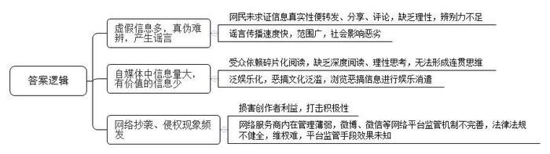
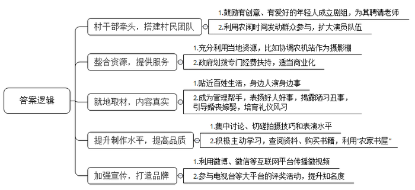
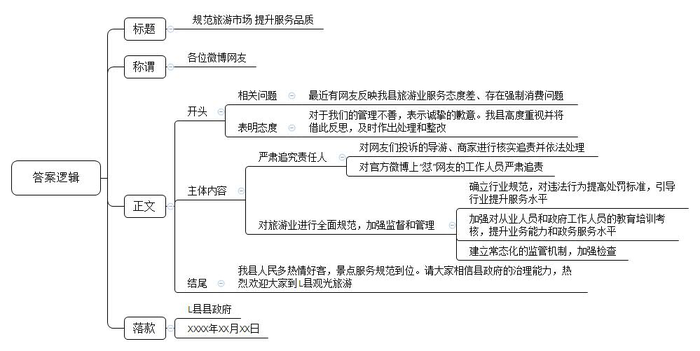
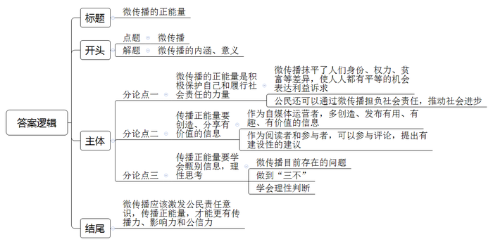

# 2018年广西公考《申论》题（B卷）

<!-- gwy:overview:start -->
> **广西 · 2018 · 申论 · B类** ｜ 4 题 · 图片 4 处 · 答案随题折叠

导航：[题目](#题目) · [材料 1](#材料-1)
<!-- gwy:overview:end -->

> 候选采集稿。参考答案及解析来自粉笔页面，不代表官方答案或真实高分答卷；来源使用许可与原卷对应关系仍需人工核实。

## 给定材料

### 材料 1

如今，微博、微信不再是传统舆论场的一个补充，它们的信息越来越具有首发性、独创性。以微博、微信和新闻客户端为主体的“两微一端”已成为微传播的主力军。新浪微博数据中心数据显示，截至2017年9月，微博月活跃人数共3.76亿，日活跃用户达到1.65亿；《2017微信数据报告》显示，截至2017年9月，微信日登陆用户9.02亿，日发送消息次数380亿，朋友圈日发表视频次数6800万，微信运动日活跃用户1.15亿，公众号月活跃账号数350万，月活跃粉丝数7.97亿；《中国互联网络发展状况统计报告》数据显示，截至2017年6月，中国网民规模达到7.51亿，互联网普及率为54.3%，手机网民规模达7.24亿。

计算机信息处理技术的日新月异将我们置身于一个新媒体的“微时代”。WiFi覆盖提升、移动4G网络技术的成熟为网民提供了更为优质的上网环境。随着智能手机的功能日益完善，价格持续走低，极大地方便了人们通过微博、微信等“短平快”的形式抒发情感、疏解压力，其中既有对生活趣事的调侃，也有对人生、社会的深思和对未来生活的展望。每一个智能手机用户都是一个潜在的信息发布者。

传统媒体的传播内容往往更强调权威和深入，篇幅长而深的独家内容被认为是核心竞争力所在，而微传播则穿上了“休闲装”去寻找“小而美”，诸如城市夜色、乡村美景、方言俚语、美食小吃、身边小事等都成了传播内容。越是微小而贴近生活的内容越容易被二次传播。

在微传播中，网民通过发表生活随笔、个人感想，以及有见地的观点和评论，或者转发、分享有吸引力的文字、图片、视频等，提高自己的“被关注度”。“发帖、回复、转发、点赞”这几个动作虽然简单，却极大满足了青年网民的参与需求和表达欲望，使他们切身感受到线上与线下、网络与现实的有效互动，感受到自身的价值，增强了内心的成就感。

“宅”现象日益流行的当下，“宅男宅女”们更喜欢把自己放逐到独立的空间中，独自享受着一个人的世界。他们与外界联系的方式大多通过网络来实现，如网购、网聊、网恋、网络社交、网上写作和阅读、网上理财等，不少年轻人的日常活动几乎都是在网络上完成。

微传播也可以做到以最快的速度将事态的状况和变化传递出去，比如去年某市遭逢特大暴雨，一张“积水地图”成为很多市民的出行参考，这张地图持续不断地更新，及时地发布最新情况，市民发现新的积水点，即时上传，即时更新地图，使其越来越全面和精准，受到市民的点赞。同样是微信，2017年一条消息刷爆朋友圈——“S县苹果丰产滞销，大家尽绵薄之力，爱吃苹果的帮帮忙，16元9个还包邮！”于是网友们纷纷点击认购、分享转发。5天内滞销的苹果累计销售量超过万斤。除本地网友订购外，来自上海、广东、北京、湖南等全国各地网友也纷纷下单援助S县果农，帮助S县果农走出了困境。

“微传播”手段的迅速发展和普及，带来了传播方式和舆论格局的深刻变革，在一定程度上颠覆了社会舆情形成、发展和传播的旧格局。信息生产、传播与接受的“微”已然成为时代的主体文化样态之一。

### 材料 2

在Q县M村，一群农民摄像爱好者组成了一个“谐乐剧组”，忙时种地，闲时拍微电影，用摄像机镜头记录农村里的人和事，再通过微博发给村民观看，在当地颇有名气。“谐乐剧组”的“导演”小陈介绍说：“我们的剧本来源都是平时身边发生的真实事情，主角都是自己演自己，其他演员也是由村民们客串，原汁原味，大家都很喜欢看，也喜欢参与表演。”

前些年，M村的老百姓解决温饱问题后，村里酗酒赌博之风盛行，邻里摩擦不断，迷信屡禁不止……村党支部书记老覃意识到，乡亲们钱袋子鼓了，但脑袋却空了。当他发现了小陈等村里几个年轻人喜欢摄影摄像后就积极鼓励支持他们。没有老师教，就帮着联系去外地请；没有合适的拍摄场所，就把村外偏远的农机站协调给他们作“摄影棚”使用。寒冬腊月，一群年轻人一头钻进“摄影棚”。一些探头探脑的好奇村民也不断加入这个队伍，甚至还吸引了一些中老年人。

每个演员都很珍惜演戏的经历，这让他们的人生有了更丰富的经历，实现了每个人心中的“演员梦”。为了提高拍摄技巧和表演水平，大家经常在一起讨论切磋，查阅资料，还买了很多书，原来冷清的农家书屋也被他们带火了。凭着这股子顽劲，他们拍摄的微电影影响越来越大，村民们每天不在微博微信里看到他们的视频就总觉得少了点儿什么，一些演员也成为了闻名四乡的“明星”。第二年，他们又迎来了发展的春风，县文化主管部门还给他们划拨了一笔扶持经费，成立了“谐乐剧组”。“谐乐剧组”组织拍摄的《壮妹的山村梦》上线不到一个月，就获得了320万的播放量，使他们信心大增。他们还上了电视台，拿过大奖。十里八乡的一些村民也慕名前来要求加入剧组，一些村子也想成立类似的剧组，请他们去指导。

“谐乐剧组”成了村上管理的好帮手，表扬好人好事，揭露陋习丑事，引导婚丧嫁娶，培育礼仪风习。村里每年评选的“十佳媳妇”，“谐乐剧组”都拍成微电影宣传。连续几年当选的小韦自己演自己，村民们看着自己熟悉的“明星”质朴的表演津津乐道。村里的媳妇妯娌们在这些微电影的影响下一个看着一个，互相“攀比”，看谁做得更好。婆媳关系的好坏，在村里也渐渐形成了比较具体的评价标准。

Q县县委宣传部部长介绍，微电影让身边人演身边事，不仅丰富了村民的文化生活，更能将人生至理通俗易懂地传递给普通民众。

### 材料 3

2016年10月，不少市民微信朋友圈流传着一段视频，里面出现夜里大批人群聚集的画面，并有配文表示这是某地W区近日发生的大游行活动。

对此，W区警方官方微博很快进行辟谣，事实并非如微信朋友圈中所说。《长江日报（数字报纸）》记者向办理此案的派出所了解到，在网侦等多部门的配合下，警方查出这段视频和配文的来源是51岁的某公司在职职工容某某。后据容某某讲述，他在网上看到这段视频后，并未认真求证视频的真实内容，便用手机将视频发到朋友圈，并配文表示他正在现场目击“游行”，随后视频和文字迅速从容某某的朋友圈发酵扩散，真实的视频和虚构的文字最终发酵出谣言。

其实这段视频是南方沿海某镇盐灶“拖老爷”民俗活动现场画面。当地每年正月的游神节日中，村中青壮年会抬神偶游行，游至指定空旷场地，齐声吆喝，各方硬汉争相登轿，想把神偶拖下来，抬神游行的壮汉极力护神，双方各不相让，你争我夺，甚至大打出手，最终结局就是把神偶拖下来。这一民俗常常被人称为中国最暴力的民俗。这段视频正是当时活动时现场拍下的真实画面。拖神习俗每年都吸引了成千上万的围观者，人山人海，热闹异常，人们骑上墙头，登上屋顶，喝彩助威，年年如是，这一民俗沿袭至今。

对于《长江日报（数字报纸）》及时全面的报道，网友们赞扬“这才是负责任的传媒！！！”“今天好多人在问这事，长报回应真及时。赞！”也有网友说“澄清事实，讲明真相，抓获造谣者，还事实本来面目，这是媒体的社会责任。感谢长报君！现在有很多事情，弄得跟真的似的，让人难以分辨，唯一的办法是，不传播，不转发，不分享，不议论，让造谣者见鬼去吧。”更有网友调侃道“脑子是个好东西，希望大家都有！”

### 材料 4

微传播的兴起带来了受众对于碎片化阅读的依赖和恶搞信息的偏爱。有人说，长此以往将会使受众成为得到娱乐最多但得到信息最少的人。没有依据、毫无关联、支离破碎或停留在表面的信息，会让受众产生错觉，自以为获得了大量信息，其实对自己有用的却寥寥无几。

在互联网技术高速发展的今天，以个人为中心的新媒体已从边缘走向主流，网民上网的第一目的也从获取信息转向寻求娱乐，网络媒体的娱乐化趋势已不可逆转。信息的爆炸对比受众时间的有限、心态的浮躁和压力的巨大，很少有人愿意花大量时间进行深度阅读、理性思考，浏览大量的新奇恶搞信息进行娱乐消遣成为趋势。在这样的背景下，人们开始用手中的电脑和手机在任何时间、任何地点获取资源，利用碎片化时间进行碎片化阅读。受众在社交媒体上所涉猎的大多是新奇事件、公知阔论、明星八卦、朋友晒图。这些信息量有限的只言片语，加上时空，逻辑，甚至人、事、物上的跳跃性使受众无法形成连贯理性的思维，并且在这些内容中恶搞文化大行其道。微传播当中的娱乐恶搞已经无孔不入，从人物到事件、从绘画到照片、从古典名著到红色影片等等，都难逃娱乐恶搞的命运。但这种娱乐性信息在网络中更容易被受众接受，点击率更高。人们在网络上疯狂地转发和评论具有娱乐因子的网络热点，网络的泛娱乐化使人们的关注行为越来越多地集中于寻找能满足其娱乐需求的信息。

于此我们不难看出，微信、微博等新媒体上的传播内容大多以娱乐为主，而不是思考，更多的受众选择将自己淹没在碎片化的信息中不去思考，只是浏览、跟随、附和与大笑。赫胥黎在《美丽新世界》中试图提醒我们，人们感到痛苦的不是他们用笑声代替了思考，而是他们不知道自己为什么笑以及为什么不再思考。不知我们在一次次短暂的、批发式的快感之后，是否能想起这句警示。

### 材料 5

随着一纸判决书的下发，某省首例微信侵权纠纷案终于落下帷幕。

案件的起因是微信公众号“Z市商房网”的运营商——商房网公司向微信用户发布了标题为《Z市谁最高？利和高度将被刷新——解密Z市高楼全档案》《初八后大幅度降温阴雨天气（转告朋友们注意添衣保暖哦）》《莫笑老饼为您推介Z市四大名饼（你都吃过了吗）》等三篇文章。上述三篇文章的最后均载明“任何公众号未经许可不得私自转载或抄袭”。

然而同年，另一个公众号“最潮Z市”发布了《谁是Z市第一高楼？Z市高楼全档案》《Z市下周大幅降温最低7度！你爸妈知道吗？》及《Z市四大名饼，你都吃过吗？》三篇文章，内容与商房网公司先前发布的三篇文章高度相似。据悉，“最潮Z市”由暴风公司运营，以发布推广信息、收取广告费谋利。

商房网公司认为暴风公司侵害了其著作权，诉至法院请求判令暴风公司在“最潮Z市”微信公众平台及《Z市日报》刊登道歉声明并赔偿经济损失1元。

一审法院认定暴风公司未经许可擅自转载商房网公司在微信上发表并载明不允许其他公众号转载的文章，侵犯了商房网公司享有的署名权、修改权、信息网络传播权及获得报酬等著作人身权及财产权，故判决其书面赔礼道歉并赔偿1元。二审法院维持原判。

微时代，面对原创，如何避免侵权？固然可以通过著作权法或者侵权责任法来打击侵权行为，但一个更为有效的方法是，通过立法强化网络服务商的内在管理。解铃还需系铃人，通过强化微博或微信平台的管理责任和义务，发挥其对侵权的监管义务，可以有立竿见影的效果。

微信平台已经开始了相关工作，在公众号平台发出了《微信公众平台关于抄袭行为处罚规则的公示》。这份公示指出，如果公众号运营者发现公众号有被抄袭等侵权情况，可以通过“侵权投诉”流程进行举报。此外，微信公众平台也推出了“原创声明”功能。根据这一规定，对抄袭别人微信公众号的处罚方式，按认定侵权次数而定：如初犯则要求删除并警告，第二次要求封号7天，第三次封号14天，第四次封号30天，第五次则要永久封号。然而，类似的规定能否真正起到制止侵权、鼓励原创的作用，还有待实践检验。

### 材料 6

近几年，有关L县旅游的负面新闻不断出现在微信、微博当中，备受公众关注。

2015年“五一”小长假的第一天，朋友圈中流传一段持续4分43秒的视频，视频中在L县旅游的游客因购物少被女导游大骂没良心、不要脸。她甚至威胁：“如果每个人不消费满3000～4000元，将取消接下来的旅游，旅行社将不再负责返回的机票费用。”

紧接着又发生了游客在L县马场，因为不愿骑马和交100元“人头费”，被马场10余名工作人员围殴3分钟，导致其手掌骨折、脑震荡。

2017年年初，一名女游客在微博上自曝其在L县就餐时，遭十几名男子辱骂暴打半小时，被用碎酒瓶划破脸毁容，并附上了让人感到不寒而栗、触目惊心的照片，女游客报警得不到处理后，求助微博，事件的恶劣性质及一些不公平待遇引起网友极大愤慨。

没出一个月又有游客曝出，他与家人到L县某饭店吃饭，因为嫌店家上餐慢，与店家发生争执，在民警的协调下，该游客母亲替其向饭店老板道歉。但事后仍遭到饭店老板尾随追打。

一个又一个舆情事件，使L县不断地被推到舆论的风口浪尖。网络上对L县的批评质疑之声如潮水涌来：

有的网友表示不理解：“十年前去当地旅游，导游一直在谢谢我们，她说游客是他们的衣食父母，对我们特别好，为什么现在L县变成这个样子了。”“想发财是人之常情，但不能合起伙非法劫财！怎么可以干了违法的事还如此理直气壮？谁助长了他们的歪风邪气？”

有些网友由此对去L县旅游产生了顾虑：“还能不能愉快地玩耍，吓死宝宝了。”“建议你别去那里，要不我还得去救你。”“攒钱想去趟L县，虽说不能不消费，但是消费太多个人经济也真是承受不住。”“好山好水，却令人不寒而栗。”

在这种批评和质疑声中，又一件引发争议的事情发生了。2017年3月25日L县某镇官方微博发布消息称，省旅游局对本县某4A级旅游景区作出严重警告，限期6个月整改。这是继3月23日省旅游局表示将联合有关部门开展旅游市场秩序综合整治行动，将L县等7个重点地区重点问题进行重点督查后的又一次警告，该官方微博表示诚恳接受处理决定，将持续深入整改。但是就在这条微博下，网友“记住她的好”发布的一则截图显示，其曾回复称“永远不会去的地方就是L县”，而该官方微博则对此回应“你最好永远别来！有你不多无你不少！”这则截图被大量转发后引发网友热议和质疑，网友表示这一回复是“官微怼网友”。这对L县的形象无疑是雪上加霜。

### 材料 7

微时代的产品打破了传统媒体对话语权的垄断，为人们提供了一个表达利益诉求的新平台，公民可以自己代表自己，通过微博、微信、微社区等平台直接对政府政策和议案发表自己的意见，传播自己的观点和理念，社会已进入了“全民话语权”时代。人们在身体力行地写微博、发微信之后，恍然发现，原来传播交流信息乃至进行情感沟通，仅仅通过百余字就完全可以实现，“随手拍解救乞讨儿童”“为一个尿毒症青年捐款”“关注空巢老人”等都曾经在微博上引起广泛关注，进而引起全社会的关注。

鲁迅在《南腔北调集》中针对中国人的“旁观者”心态一针见血地写道，“在中国，尤其是在都市里，倘使路上有暴病倒地，或翻车摔伤的人，路人围观或甚至于高兴的人尽有，肯伸手来扶助一下的人却是极少的。”虽然微时代“围观”的人比比皆是，但不得不承认微传播极大地激发了公民的责任意识，使公民表达社会责任的途径更有效。“微民”们可以对一些社会共同关注的话题进行转发扩散，使其广为传播，为更多的人所知，尽自己作为一个社会公民所应该尽的责任。

生活在微时代的每个人，以小人物的微形态和微行动低调地呈现自我，发出微小的声音，这样的呈现和声音的集结，可以形成一股不可小觑的力量，一股甚至可以改变社会秩序的力量。在这人人都是自媒体的时代，微博、微信、微视、微电影等对社会和人们的影响越来越大。毫不夸张地说，曾经流行的“打酱油”“俯卧撑”等一系列网络语言，就是人们凭借手机、iPad等将自己的所见、所感传播出去而形成巨大的集聚效应，甚至影响到了主流媒体。现在很多主流媒体已经调整思路和方法，主动适应“微时代”的大众需求，如人民日报微博最先爆料的湖南“上访妈妈”唐慧被劳教一事引起社会巨大反响，“新华社中国网事微博”三问殴打空姐案真相，最终推动了事件的解决，不少人为此击掌喝彩。

无论人们在现实社会中的身份、地位、贫富差距如何，都享有平等的发言权。“与其在别处仰望，不如在这里并肩”，不同于传统媒体环境中“传”者与“受”者的显著分野，微传播提供了多种平等的交流方式，无论是机构、组织还是名人，都与普通用户拥有完全平等的发言权——一个账号，一个文字框，一个提交发言的按钮，“人人都有麦克风”，在这里得到了最好的诠释。尤其是当主流媒体开通评论之后，不论你是专家或是普通民众，都可以就某一个新闻事件进行评论，甚至可以通过电台让全国的听众听到你的声音。

在这种时代背景下，每一位公民不仅仅是微传播的使用者、受益者，我们还要学会在海量的信息中甄别信息，而不是断章取义，极端地做一个“愤青”，要学会理性地思考，不带着个人感情和偏好去评论。英国心理学家理查德·怀斯曼（Richard Wiseman）说过，“<u>一切予人向上和希望、促使人不断追求、让生活变得圆满幸福的动力和感情就是正能量</u>”，这也正是当下人们普遍缺少却积极追求的。如今，我国经济社会高速发展，人们的压力倍增，如何在“微时代”发挥自己的小能量凝聚成大能量，是值得大家关注和去做的事情。

## 题目

### 第 1 题

**请根据“给定资料3~5”，概括微传播存在的问题。（15分）**

关联材料：材料 3、材料 4、材料 5

作答要求：

要求：全面，准确，有条理，不超过250字。

第 1 题 · 答案与解析

**参考答案（粉笔题库参考内容）**

1.虚假信息多，真伪难辨，产生谣言。网民未求证信息真实性便转发、分享、评论，缺乏理性，辨别力不足；谣言传播速度快，范围广，社会影响恶劣。

2.自媒体中信息量大，有价值的信息少。受众依赖碎片化阅读，缺乏深度阅读、理性思考，无法形成连贯思维；泛娱乐化，恶搞文化泛滥，浏览恶搞信息进行娱乐消遣。

3.网络抄袭、侵权现象频发。损害创作者利益，打击积极性；网络服务商内在管理薄弱，微博、微信等网络平台监管机制不完善，法律法规不健全，维权难，平台监管手段效果未知。

**解析**

**参考答案说明：**本参考答案从“虚假信息多”“自媒体中信息量大”“网络抄袭、侵权现象频发”这三个不同的方面对微传播存在的问题进行了分条撰写，各条要点之间内容上没有交叉。

**考点**：问题类

**来源**：2018年广西公考《申论》题（B卷）

### 第 2 题

**Q县决定在全县推广M村“谐乐剧组”的经验，假如你是该县文化主管部门的工作人员，请根据“给定资料2”提出推广的工作建议。（20分）**

关联材料：材料 2

作答要求：

要求：紧扣资料，条理清晰，具有针对性和可行性，不超过300字。

第 2 题 · 答案与解析

**参考答案（粉笔题库参考内容）**

一、村干部牵头，搭建村民团队。1.鼓励有创意、有爱好的年轻人成立剧组，为其聘请老师。2.利用农闲时间发动群众参与，扩大演员队伍。

二、整合资源，提供服务。1.充分利用当地资源，比如协调农机站作为摄影棚。2.政府划拨专门经费扶持，适当商业化。

三、就地取材，内容真实。1.贴近百姓生活，身边人演身边事。2.成为管理帮手，表扬好人好事，揭露陋习丑事，引导婚丧嫁娶，培育礼仪风习。

四、提升制作水平，提高品质。1.集中讨论、切磋拍摄技巧和表演水平；2.积极主动学习，查阅资料、购买书籍，利用“农家书屋”。

五、加强宣传，打造品牌。1.利用微博、微信等互联网平台传播微视频；2.参与电视台等大平台的评奖活动，提升知名度。

**解析**

**参考答案说明：**本参考答案从“村干部牵头”“整合资源”“就地取材”“提升制作水平”“加强宣传”这五个不同的方面进行了分条撰写，每条要点之间内容上没有交叉。

**考点**：提出对策类

**来源**：2018年广西公考《申论》题（B卷）

### 第 3 题

**根据“给定资料6”中反映的情况，如果你是L县县政府的工作人员，请草拟一份在官方微博上向公众做出回应的文稿。（25分）**

关联材料：材料 6

作答要求：

要求：内容全面，语言得体，符合实际，不超过400字。

第 3 题 · 答案与解析

**参考答案（粉笔题库参考内容）**

规范旅游市场 提升服务品质

各位微博网友：

大家好！最近有网友反映我县旅游业服务态度差、存在强制消费问题。对于我们的管理不善，表示诚挚的歉意。我县高度重视并将借此反思，及时作出处理和整改。

一、严肃追究责任人。对网友们投诉的导游、商家进行核实追责并依法处理；对官方微博上“怼”网友的工作人员严肃追责。二、对旅游业进行全面规范，加强监督和管理。一是确立行业规范，对违法行为提高处罚标准，引导行业提升服务水平。二是加强对从业人员和政府工作人员的教育培训考核，提升业务能力和政务服务水平。三是建立常态化的监管机制，加强检查。

我县人民多热情好客，景点服务规范到位。请大家相信县政府的治理能力，热烈欢迎大家到L县观光旅游。

L县县政府

XXXX年XX月XX日

**解析**

**参考答案说明**：（1）格式方面，本参考答案写到了“标题”“称谓”“正文”“落款”。（2）正文部分，一方面从内容看，围绕着“L县旅游业”这一主题，参考答案的开头先写到了“我县旅游业存在的问题”等，然后主体部分从“严肃追究责任人”“对旅游业进行全面规范，加强监督和管理”两个大方面给出了整改措施。另一方面，形式上，参考答案做到了分段、分条撰写，整体上条理较为清晰。

**考点**：宣传类

**来源**：2018年广西公考《申论》题（B卷）

### 第 4 题

**请围绕微传播这一视角，思考“给定资料7”中的划线句子：“****一切予人向上和希望、促使人不断追求、让生活变得圆满幸福的动力和感情就是正能量****”。结合给定资料，自拟题目，自选角度，写一篇文章。（40分）**

关联材料：材料 1、材料 2、材料 3、材料 4、材料 5、材料 6、材料 7

作答要求：

要求：

（1）立意明确，见解深刻；

（2）思路清晰，语言流畅；

（3）参考“给定资料”，但不拘泥于“给定资料”；

（4）总字数不少于800字。

第 4 题 · 答案与解析

**参考答案（粉笔题库参考内容）**

**微传播的正能量**

什么是“微传播”？就是微信、微博、新闻客户端逐渐成为主要的信息传播平台和网民自主参与发言、阅读、评论的网络舆论重心。微传播使得人人都可以为自己的利益发声，人人都有机会传播自己的观点和理念。微传播打破了传统媒体的话语权垄断，使人们的社会话语权更加平等。

权利意味着责任。**微传播给个人更大发言自主权的同时，要求我们传播更多积极向上的希望，传播让生活变得圆满幸福的社会正能量**。

**微传播的正能量是积极保护自己和履行社会责任的力量**。微传播抹平了人们身份、权力、贫富等差异，使人人都有平等的机会表达利益诉求。以前我们总感觉自己的力量是有限的，现在可以通过微传播汇聚大能量，有了可以“不平则鸣”的机会。与此同时，公民还可以通过微传播担负社会责任，推动社会进步。“教科书式的老赖”被转万余次，老赖黄某终于逃不脱法律的制裁；“随手拍流浪乞讨的儿童”让无数儿童重回父母的怀抱……。“天下兴亡，匹夫有责”，通过微传播我们可以践行对社会对同胞的关爱和责任。

那么，我们应该如何通过微传播传递正能量呢？

**传播正能量要创造、分享有价值的信息**。作为自媒体运营者，多创造、发布有用、有趣、有价值，能给予阅读者知识、美感和快乐的信息。比如微信公众号“粉笔公考”经常发布鼓励、激发年轻人努力学习，积极就业的文章，就传播了正能量。作为阅读者和参与者，可以参与评论，提出有建设性的建议，让网络生态环境变得更好。例如，网友可以在人民日报客户端中向政府建言献策；或者可以就滥捕滥杀野生动物者的处罚措施进行“点赞”支持。

**传播正能量要学会甄别信息，理性思考**。微传播作为新生事物，参与主体多元，难免存在参与门槛低，信息真伪难辨，立法和监管措施暂时滞后等问题。尤其是传播虚假信息，造谣传谣，无底线恶搞、娱乐和侵权等。每一个参与其中的人一方面要加强自律和提高甄别信息的能力。我们要做到“三不”，即：不造谣和传谣，不抄袭和侵权，不参与不文明行为。另一方面，要学会理性判断，对于偏激信息不传播，不转发，不分享，不议论，做文明的践行者，正义的捍卫者。

正如网友们所说“与其在别处仰望，不如在这里并肩”，微传播能产生集聚效应，影响主流媒体，推动社会进步。因此，微传播应该激发公民责任意识，传播正能量，发挥其成风化人、凝心聚力的作用。只有这样，微传播才能更有传播力、影响力和公信力。

**解析**

**文章分析**

**微传播的正能量**

【**标题的优点：**首先，范文的标题“微传播的正能量”突出了“微传播”这一主题。其次，形式上，文字简洁明快。】

（1）<u>什么是“微传播”</u>？<u>就是微信</u>、<u>微博</u>、<u>新闻客户端逐渐成为主要的信息传播平台和网民自主参与发言</u>、<u>阅读</u>、<u>评论的网络舆论重心</u>。（2）<u>微传播使得人人都可以为自己的利益发声</u>，<u>人人都有机会传播自己的观点和理念</u>。<u>微传播打破了传统媒体的话语权垄断</u>，<u>使人们的社会话语权更加平等</u>。

【**开头的优点：**★内容方面。范文的开头是紧扣主题“微传播”展开的。首先，开头第一句话点出主题，做到了主题明确。其次，对“微传播”这一主题进行了分析阐述，指出了（1）“微传播”的内涵。（2）“微传播”的意义。注意：以上两个方面的阐述在逻辑上有先后顺序：先写“内涵”，再写“意义”。★文字表达方面。采用了设问的修辞手法，使语言表达更加形象、有力。】

权利意味着责任。**微传播给个人更大发言自主权****的同时，****要求我们传播更多积极向上的希望****，****传播让生活变得圆满幸福的社会正能量**。

【**过渡段的优点：**范文过渡段分析了“微传播”的意义、对策，并且“要求我们传播更多积极向上的希望，传播让生活变得圆满幸福的社会正能量”是引起下文的过渡句。】

**微传播的正能量是积极保护自己和履行社会责任的力量**。（1）<u>微传播抹平了人们身份</u>、<u>权力</u>、<u>贫富等差异</u>，<u>使人人都有平等的机会表达利益诉求</u>。以前我们总感觉自己的力量是有限的，现在可以<u>通过微传播汇聚大能量</u>，有了可以“不平则鸣”的机会。（2）与此同时，<u>公民还可以通过微传播担负社会责任</u>，<u>推动社会进步</u>。“教科书式的老赖”被转万余次，老赖黄某终于逃不脱法律的制裁；“随手拍流浪乞讨的儿童”让无数儿童重回父母的怀抱……。“天下兴亡，匹夫有责”，<u>通过微传播我们可以践行对社会对同胞的关爱和责任</u>。

【**论述段1的优点**：★观点句：范文的观点句是紧扣“微传播”这一文章主题提出的。形式上，它在段首处直接写出，位置突出，容易发现。内容上，关键词突出，内容要点明确，可以明显看出它是从“意义”入手，指出了“微传播的正能量”。★论述内容：（1）介绍了“对于个人的意义”；（2）介绍了“对于社会的意义”。注意：以上两个方面的内容都是紧扣“微传播的正能量是积极保护自己和履行社会责任的力量”这个观点句进行分析论述的，论述的针对性强，内容层次丰富。在论述方法和论据的选取上做到了讲道理和举例子相结合，做到了丰富多样。】

那么，我们应该如何通过微传播传递正能量呢？

【**过渡段的优点：**“我们应该如何通过微传播传递正能量呢”是引起下文的过渡句。】

**传播正能量要创造、分享有价值的信息**。（1）<u>作为自媒体运营者</u>，<u>多创造</u>、<u>发布有用</u>、<u>有趣</u>、<u>有价值</u>，<u>能给予阅读者知识</u>、<u>美感和快乐的信息</u>。比如微信公众号“粉笔公考”经常发布鼓励、激发年轻人努力学习，积极就业的文章，就传播了正能量。（2）<u>作为阅读者和参与者</u>，<u>可以参与评论</u>，<u>提出有建设性的建议</u>，<u>让网络生态环境变得更好</u>。例如，网友可以在人民日报客户端中向政府建言献策；或者可以就滥捕滥杀野生动物者的处罚措施进行“点赞”支持。

【**论述段2的优点：**★观点句：范文的观点句是紧扣“微传播”这一文章主题提出的。形式上，它在段首处直接写出，位置突出，容易发现。内容上，关键词突出，内容要点明确，可以明显看出它是从“创造、分享有价值的信息”入手，指出了“如何传递正能量”。★论述内容：（1）介绍了“自媒体运营者要多创造、发布有用、有趣、有价值的信息”；（2）介绍了“阅读者和参与者，可以参与评论，提出建议”。注意：以上两个方面的内容都是紧扣“传播正能量要创造、分享有价值的信息”这个观点句进行分析论述的，论述的针对性强，内容层次丰富。在论述方法和论据的选取上做到了讲道理和举例子相结合，做到了丰富多样。】

**传播正能量要学会甄别信息，理性思考**。（1）<u>微传播作为新生事物</u>，<u>参与主体多元</u>，<u>难免存在参与门槛低</u>，<u>信息真伪难辨</u>，<u>立法和监管措施暂时滞后等问题</u>。<u>尤其是传播虚假信息，造谣传谣</u>，<u>无底线恶搞</u>、<u>娱乐和侵权等</u>。（2）<u>每一个参与其中的人一方面要加强自律和提高甄别信息的能力</u>。我们要做到“三不”，即：<u>不造谣和传谣，不抄袭和侵权，不参与不文明行为</u>。（3）<u>另一方面</u>，<u>要学会理性判断</u>，<u>对于偏激信息不传播</u>，<u>不转发</u>，<u>不分享</u>，<u>不议论</u>，<u>做文明的践行者</u>，<u>正义的捍卫者</u>。

【**论述段3的优点：**★观点句：范文的观点句是紧扣“微传播”这一文章主题提出的。形式上，它在段首处直接写出，位置突出，容易发现。内容上，关键词突出，内容要点明确，可以明显看出它是从“甄别信息，理性思考”入手，指出了“如何传递正能量”。★论述内容：（1）介绍了“目前微传播存在的问题”；（2）介绍了“三不”；（3）介绍了“学会理性判断”。注意：以上三个方面的内容都是紧扣“传播正能量要学会甄别信息，理性思考”这个观点句进行分析论述的，论述的针对性强，内容层次丰富。在论述方法和论据的选取上做到了讲道理和举例子相结合，做到了丰富多样。】

【**论述段之间的关系**：★内容的内在逻辑：范文的论述段之间是依照递进的逻辑展开的。论述段1先写了“微传播”的意义，论述段2、3接着写了“微传播”的对策 。★段与段的外在衔接：过渡段“那么，我们应该如何通过微传播传递正能量呢”，起到了承接论述段1、引出了论述段2、3的作用。】

正如网友们所说“与其在别处仰望，不如在这里并肩”，（1）<u>微传播能产生集聚效应</u>，<u>影响主流媒体</u>，<u>推动社会进步</u>。（2）因此，<u>微传播应该激发公民责任意识</u>，<u>传播正能量</u>，<u>发挥其成风化人</u>、<u>凝心聚力的作用</u>。只有这样，<u>微传播才能更有传播力</u>、<u>影响力和公信力</u>。

【**结尾的优点：**范文的结尾回扣了“微传播”这一主题。（1）再次提到“微传播”；（2）阐述了深远意义。】

**考点**：文章写作题

**来源**：2018年广西公考《申论》题（B卷）

