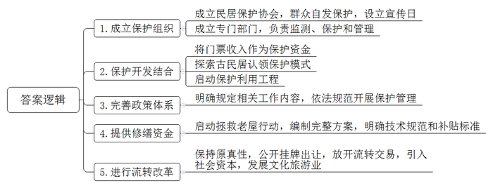
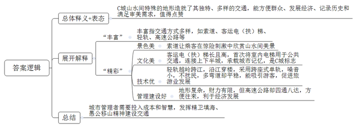
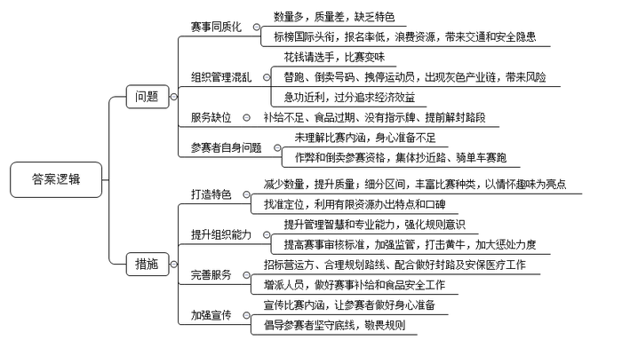
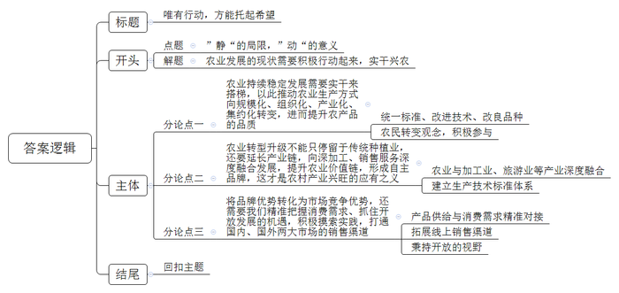

# 2019年公务员多省联考《申论》题（广西A、普通选调卷）

<!-- gwy:overview:start -->
> **广西 · 2019 · 申论 · A类** ｜ 4 题 · 图片 4 处 · 答案随题折叠

导航：[题目](#题目) · [材料 1](#材料-1)
<!-- gwy:overview:end -->

> 候选采集稿。参考答案及解析来自粉笔页面，不代表官方答案或真实高分答卷；来源使用许可与原卷对应关系仍需人工核实。

## 给定材料

### 材料 1

Y县位于A省南部。初夏时，这里群山披翠、江水碧蓝、小桥流水、长街曲巷、飞檐翘角、雕梁画栋……它们既是游客镜头里的美景，也是历史积淀的见证，更是当地薪火相传的文化根脉。

“今天恰好是我们县的‘民居宣传保护日’。每年今天，我们会家家户户地宣传民居保护知识。”当地世界文化遗产管理办公室负责人介绍说，“在县委、县政府的支持下，我们成立了民居保护协会，大家自发参与民居保护。每年，还会将古民居门票收入的一部分作为文物保护资金用于本地民居保护。这实现了保护与开发的良性循环。”

十余年前，Y县成立世界文化遗产管理办公室，负责全县世界文化遗产、历史古村落、有价值的古民居及其它文物资源的监测、保护和管理工作。在当时，这一专门的保护机构在全国尚属罕见。同一年，Y县又开始探索古民居认领保护活动的试点工作。在这种认领保护模式中，还包括认租和认购。在投资保护的前提下，认租、认购项目通过合理利用古建筑可以获得收益。这吸引了全国各地，尤其是艺术、收藏类的爱好者走进Y县，共同宣传和保护当地古民居。千山画院、归云山房、印象老屋、黄岳画院……一大批国内艺术大师的工作室都安居在此。这无疑更增加了当地的文化气息。

2009年，Y县在充分调查研究和广泛征求意见的基础上，启动了“百村千幢”古民居保护利用工程。Y县用了五年时间，成功地完成了对百余个古村落和上千幢古民居的保护开发和利用，探索出了“在保护中突出利用，在传承中注重创新”的新模式。

同时，当地还建立了以古民居认领保护利用、抢修保护利用、迁移保护利用、原地保护利用等为重点的古民居保护利用政策体系，对涉及的抢修、迁移、认领、土地转让、房屋登记、资金支持等相关程序作出了明确规定，为依法规范开展古民居保护管理工作，提供了依据。

据统计，Y县共有3000多幢古民居，其中列为各级文物保护单位的仅600余处，其他大部分非文保单位的古民居，多散落乡野，难以顾及。

“我们的老屋要垮了，我们没有能力维修，文物部门是不是该拨钱给我们维修？”这是工作人员经常遇到的问题。据了解，根据《文物法》第二十一条，非国有不可移动文物由所有人负责修缮、保养，文物部门负责报批程序和给予技术指导。2016年，某文物基金会在Y县启动了“拯救老屋行动”项目，计划在两年时间里资助4000万元，用于修复当地国家级传统村落中各级文物保护单位和一般不可移动文物，以及符合政策的民居。符合条件的老屋修缮至少能得到占修缮总费用50%的补贴款。

为此，Y县委托省古建筑设计研究院编制了一套完整的方案，其中不仅有规划纲要，更有具体到每一种建材的技术规范和补贴标准。以修复一栋民居为例，首先由户主根据房屋损毁情况提供图片证据及修复方案，交由专家委员会进行审核并作出修改，最终方案通过后再进行资金预算，政府补贴资金为预算资金的50%。双方确认并签订合同后便可施工。施工过程中，要随时接受专家巡查并按照整改意见来调整，施工进度完成三分之一时政府支付部分补贴资金，工程完工后通过专家验收再支付剩余补贴。

不仅如此，Y县探索开展的古民居流转改革试点工作，在依法保护的前提下，在保持原汁原味的基础上，不断丰富古建筑的内涵和利用方式；借鉴农村的土地流转模式，注重发挥市场主体作用。2014年，Y县开始探索古民居产权流转改革：以征地形式将古民居所在的集体土地转变为国有土地后公开挂牌出让，通过放开流转交易，打通社会力量参与古民居保护连接、利用的通道。

现在，借力社会资本，Y县的部分古民居“复活”变为风情浓郁的精品民宿、文化客栈，不仅奏出一首古韵悠长的新曲，更是当地旅游转型升级的新业态。

### 材料 2

以下是一位游客关于C城的日志：

C城环水依山，沟多坡陡，特殊的地形造就了它独特而多样的交通。缆车，横跨两江的客运索道，沟通上下半城的客运电（扶）梯，还有跨过长江、沿江蔓延、穿过楼道的轻轨……

“妹子，你们现在来我们这里可是方便得多啦。”一个火锅店老板跟我说，“你看看我们这里的地形条件，当年没客运电梯，没轻轨的时候，大家都是爬坡上坎，稍微走远一点去逛个街，买个东西都麻烦得很呢。”

索道是C城的特色交通，它建在立体的山水间，让乘客在惊喜刺激中欣赏了这里山环水拥的美景。乘坐跨江索道的最佳时间是晚上，坐在车里可以看到灯火辉煌的市中心半岛。

大扶梯当然不能错过，它承载着C城的记忆，是连接这座城市上下半城的交通工具：从火车站出来，横穿马路，直接走地下通道，就可以乘坐亚洲最长的坡地扶梯。像我这样初到C城的游客，确实好好感受了一下这地方特色浓郁的交通。K路电梯建于1986年，是国内首次将室内电梯用于城市公共交通。这个电梯高11层，曾经出现在C城造的火柴盒上，算得上是C城的标志之一。

最最不能略过的，当然是轻轨。C城的轻轨相当魔幻：它越过山岭，跨过长江，沿江蜿蜒，穿过楼道，真的是一站一种风景。

“好多人都以为地上跑的是轻轨，地下跑的就是地铁。才不是呢！”C城交通志愿者张大妈，一直以本地的轻轨为骄傲，“轻轨是载客量小，但移动速度快的轨道交通工具；它有自己的运行轨道，但不一定要与其他车辆隔离。重轨，即地铁，它载客量大，运行高速，独立于其他交通工具。”C城的轻轨采用跨座式单轨，噪音仅60分贝，所以即使穿楼而过，也不会影响周边居民的正常生活。依山而建的轨道，经常会有大的弯道，最大的弯道接近90度，乘坐轻轨犹如在坐过山车一样。庆幸的是它并没有过山车那么快，还是很平稳的。这引得不少摄影达人争先到访。1号线轻轨的X站被修建成了一个“森林城堡”。N站是2号线与3号线的换乘站点，位于城中心，有着长长的玻璃长廊，是眺望江景的好去处。这里特别适合晚上去，五彩斑斓的灯光、波光粼粼的江面，真的可以触景生情。

我还去了两江汇合之处的码头，沿着高速公路去看沿途风景。“这些年路修好了，货运、客运的生意都好多了。我们这里每个区、每个县都有高速公路，大家来往方便，也有利于经济的发展嘛。我们这里地形条件就这样，财政收入也有限，能把交通搞成这样，不容易啊。”

C城地形的复杂造就了建筑的复杂，而地形复杂、建筑复杂又决定了它交通建设的复杂和困难。这复杂程度，需要更多的成本和智慧。“天生如此，但再难也得搞好交通建设，我们唯有精卫填海、愚公移山。”C城交通主管部门的负责人曾这样形容当地交通建设工作的艰难。

有人说C城是一座5D城市，它的交通向人们展示了，并让人们融入了这座城市山水相依、灯火辉煌的风景，并且它本身就是风景。这些年C城成为“网红”城市，引得各地的游客纷纷前来“打卡”领略。这其中，它的特色交通功不可没。

如果说交通是一个城市写在山川河流上的史书，那么C城书写的内容，肯定是丰富而精彩的。为C城点赞！

### 材料 3

2018年马拉松持续火爆，据统计，截至11月2日，800人以上越野跑赛事共有1072场，参赛人次达530万，预计年底这个数字将达到600万。马拉松赛事多的背后，是马拉松爱好者群体的急速膨胀。当前，名称中带“国际”“半程”“全程”等字样的马拉松比赛已超过半数，这其实从侧面反映出同质化问题较为突出。

的确，马拉松比赛参与人数多、参与面广、参赛门槛低、赛事轻松活泼，又兼有一定的旅游观光的特点。很多地方都希望通过马拉松展示城市形象，吸引更多客流，带动旅游消费。然而一些新近举办的赛事虽然动辄标榜“国际”头衔，但实际报名率却很低。这不仅浪费办赛的人力物力等资源，还带来了交通问题和群众安全隐患。由于赛事等级评定对参赛人数、参赛标准甚至参赛成绩等都有严格要求，有些小赛事为了达到目标，不惜拉人头撑场面，甚至花钱请选手，让比赛变味。同时，一些具有品牌效应的马拉松赛事有一定的准入门槛和限制，往往“一号难求”。于是“号码黄牛”转让参赛号码布成为灰色产业链条，这扰乱了赛事组织秩序，给赛事带来了诸多潜在风险和管理难题。

马拉松比赛声势浩大，动辄几万人参加，有相当大的组织难度，非常考验城市管理者、主办方的管理智慧和专业能力。一位社评家甚至评价其为“城市综合治理能力的‘试金石’”。对于刚刚起步的中国马拉松运动来说，在“跑马乱象”面前树立规则大旗，强化规则意识，这需要参赛者、赛事组织者以专业管理运营来呵护它的成长。就现状来说，提高我们马拉松赛事的质量和水平，可能需要用百米冲刺的速度跑一场马拉松。

其实，马拉松赛事并不一定要追求声势和规模。它可以有很多细分区间，既有竞速比赛，也有越野赛、集体赛，还可以情怀、趣味等作为亮点。这需要举办地找准定位，利用有限的资源，办出特点，办出口碑。

任何新事物发展都会有“成长的烦恼”。近年来，马拉松赛事中替跑、转让号码布等问题屡禁不止，比赛补给不足、补给食品过期、参赛者半途迷路、关门时间未到路段解封等也时有报道，最近更是出现集体抄近路、骑单车“赛跑”、工作人员终点“搀扶”运动员等不良事件，引发大众吐槽。这些问题，既是参赛者的，也是主办方和运营方的。马拉松运动热催生了一批体育产业的运营商。它们在承办赛事时也往往显得急功近利，过分追求经济效益。“这说明我们在公共服务、公共管理方面还有不足。”某地体育主管部门负责人说道，“不得不承认，比起体育发达国家，我们在马拉松赛事的举办和管理上还有很多需要改进之处。一切迫在眉睫啊！”

一些跑者还没能真实领会到这项运动的内涵，单纯为了跑而跑、为了好玩而跑，他们并没有一个跑者的身体准备和心理准备。比赛中，一些参赛者伤病送医就是佐证。跑步，是一种锻炼享受。健康是出发点，更是落脚点。至于在比赛中的种种作弊和倒卖参赛资格的行为，更是失去了马拉松比赛的意义。前些时候，首都媒体发布了《首都媒体跑团2018年倡议书》，号召跑者们要自觉坚守底线，敬畏规则。体育运动的重要精神之一是“尊重规则”，所有参与者必须在统一的规则下“游戏”，竞争才有意义，结果才有价值。对于赛事的主办方地方政府来说，马拉松比赛绝不只是招标营运方、划出赛事路线、配合做好封路及安保医疗工作就完事了。一个赛事举办的好坏、赛事期间各项服务的优劣，以及当地风俗人情、文化景观等，都能在赛后成为网络热门话题。

### 材料 4

“Y省的咖啡豆是天赐的礼物。”这是一位外国友人对Y省咖啡豆的评价。据统计，Y省大部分咖啡豆种植区的海拔都在1000米以上，肥沃的土壤，充足的光照和降雨，明显的昼夜温差，让其所产咖啡豆颗粒饱满、口味醇厚，堪称天地厚养。

“Y省的咖啡豆，可以是高品质的，但这看运气。”咖啡爱好者小李说，“我喝到过有顶级口感的，也喝到过如炒糊的黄豆的。而它们都来自Y省同一产地。”的确，就拿Y省咖啡种植大户B市、P市来说，其仍然以散户种植为主。这些咖啡树的“邻居”可能是烟草、水果、玉米等等。施肥、除虫这些都可能没有。咖啡果本身是水果，风一吹，各种植物的花粉漫天，以这样简单粗暴的方式种植，咖啡豆的品质怎么可能稳定呢？

Y省某著名咖啡烘焙师对记者说：“我们的咖啡产业，主要还是在做咖啡豆供给，这属于产业链底端。种植的搞种植，烘焙的搞烘焙，各自为政，还要相互挤压利润空间。”

Y省的咖啡豆在国际上确实有些名气，但这种名气并不属于当地品牌，它只是在Y省生长出来的产品的属性。很多著名连锁咖啡店使用的咖啡豆就是产自Y省的。但大部分人并不认为自己在喝Y省的咖啡，而是在喝咖啡店的咖啡。

现阶段中国人均咖啡消费量远落后于世界的平均水平。不过，近几年“互联网+咖啡”模式进一步发展，一部分人有了喝现磨咖啡的习惯。同时，即饮咖啡市场也在兴起。较之速溶咖啡，现磨、即饮对口感要求高，更倾向于使用阿拉比卡豆（咖啡豆的一种），而Y省种植的主要就是阿拉比卡豆。

“我们不想种咖啡豆了。”Y省咖农老王对记者抱怨着，“我们的咖啡豆价格比巴西、印尼、越南低，但采摘成本却高很多。所以，我们不赚钱，有时还赔本。我在电视上看到，有的地方的农产品是一个村，甚至几个村一起统一种植、统一收割、统一标准加工，再‘组团进城’销售。我们要是也能那样就好了。”

当然也有好消息：2015年，两条中欧国际货运班列开通。这促进了Y省咖啡出口贸易井喷式增长。当年，Y省咖啡创汇逾4亿美元，比上年翻了将近一番。可不少咖农还是担心：“我们隔壁可是世界上速溶咖啡产量最大的国家啊，会不会它们顺着国际货运列车，来抢我们的生意？”

“我们咖啡单产高，这应是优势，而不是我们产能过剩的原因。但在很早之前，我们就已有低端产品产能过剩问题。”Y省政策研究室的工作人员说，“我们并没有从‘中国咖啡市场高速增长’中得到多少利润。举个例子，我们供给某外国品牌咖啡店的咖啡豆价格是25元一公斤，而它们在中国卖一杯咖啡就要价30元。其实，我们已建成了国内最大的焙炒咖啡生产线，还有几十个咖啡品牌以及大量的满怀热情的咖啡产业技术人才，这些都是我们咖啡业发展的条件。”

据统计，世界咖啡的消费增长速度大致维持在2.5%，而中国消费增长速度高达25～30%。考虑到人口基数，这个市场潜力大到无法想象。

“我们有难得的适宜种植利润丰厚的微批次精品咖啡豆的微环境、微气候。”某咖啡品牌主理人小雯感叹道，“可什么是精品，怎样才算微批次？我们用的是国外的概念和标准。而从种植到加工生产经营企业，有执行国际咖啡组织认证标准的，有执行欧盟认证标准的，有执行美国、日本认证标准的，可谓五花八门。为什么我们不制定符合我们国情，又兼容于国际的标准呢？不行动起来，我们还是会一直被牵着鼻子走。”

标准多等于无标准，品牌杂导致无名牌。目前，因咖啡产品生产技术认证标准不成体系，Y省咖啡产业从农业生产到工业加工，各个企业处于“八仙过海，各显神通”的境地。“一些浑水摸鱼、以次充好的经营者忽悠了消费者，也伤害了我们这些老老实实做咖啡的人。”小雯不无痛心地说。

其实，对于咖啡产业，Y省政府是高度重视和支持的，不仅出台了发展指导意见，更协助一些咖啡种植庄园从全球主产区引进瑰夏等优质咖啡品种，建起了世界咖啡博览园和Y省咖啡种子基因库，专注改善Y省咖啡品种单一的现状。经过近五年的种植培育，Y省某庄园已经产出了对当地环境、气候更加适应，风味更佳的二代品种。“这些成功的行动说明我们的地理环境和技术是很棒的，说明中国有好咖啡，就在我们这里。”一位当地的咖啡庄园主人说道。

小陈是Y省某咖啡品牌创始人，他所经营的咖啡网店的年营收已破千万元。是国内最著名、最成功的咖啡电商之一。“曾经有个记者朋友用‘三杯咖啡’形容我的咖啡电商创业历程。第一杯是苦后回甘，第二杯是保持原味本色，第三杯是着力花式调配。其实，在我心中就一个字——动。”自称“咖啡创业青年”的小陈轻松地笑着，“千百万次地想‘要让全国都喜欢我们Y省的咖啡’，不如勇敢地迈出第一步，再踏踏实实地走下去。我们有得天独厚的资源禀赋，也有诸多后发劣势……所以，一切的一切都需要行动起来。因为，<u>‘静’会给予很多‘如果’的假想，可唯有‘动’能带来‘但是’的希望。”</u>

## 题目

### 第 1 题

**根据给定资料1，概括Y县古民居保护的主要措施。(15分)**

关联材料：材料 1

作答要求：

要求：

（1）紧扣资料，全面，简明，语言流畅；

（2）字数不超过200字。

第 1 题 · 答案与解析

**参考答案（粉笔题库参考内容）**

1.成立保护组织。成立民居保护协会，群众自发保护，设立宣传日；成立专门部门，负责监测、保护和管理。

2.保护开发结合。将门票收入作为保护资金；探索古民居认领保护模式；启动保护利用工程。

3.完善政策体系。明确规定相关工作内容，依法规范开展保护管理。

4.提供修缮资金。启动拯救老屋行动，编制完整方案，明确技术规范和补贴标准。

5.进行流转改革。保持原真性，公开挂牌出让，放开流转交易，引入社会资本，发展文化旅游业。

**解析**

**参考答案说明**：本参考答案从“成立保护组织”“保护开发结合”“完善政策体系”“提供修缮资金”“进行流转改革”这五个方面入手，提出了保护古民居的相关措施。各条答案要点之间在内容上相互并列，没有交叉。

**考点**：概括措施类

**来源**：2019年公务员多省联考《申论》题（广西A、普通选调卷）

### 第 2 题

**根据给定资料2，谈谈你对划线部分“如果说交通是一个城市写在山川河流上的史书，那么C城书写的内容，肯定是丰富而精彩的”的理解。(20分)**

关联材料：材料 2

作答要求：

要求：

（1）紧扣资料，观点明确；

（2）逻辑清晰，语言准确；

（3）字数不超过300字。

第 2 题 · 答案与解析

**参考答案（粉笔题库参考内容）**

C城山水间特殊的地形造就了其独特、多样的交通，能方便群众、发展经济、记录历史和满足审美需求，值得点赞。

丰富指交通方式多样，如索道、客运电（扶）梯、轻轨、高速公路等。

精彩体现在：1.景色美。索道让乘客在惊险刺激中欣赏山水间美景。2.文化美。客运电（扶）梯长且高，首次将室内电梯用于公共交通，连接上下半城，承载城市记忆，是C城标志。3.技术优。轻轨越岭跨江，沿江穿楼，采用跨座式单轨，噪音小，不扰民，多弯道却平稳，能吸引游客，促进旅游业发展。4.管理建设好。地形复杂，财力有限，但高速公路却四通八达，方便往来，利于经济发展。

城市管理者需要投入成本和智慧，发挥精卫填海、愚公移山精神建设交通。

**解析**

**参考答案说明：**思路方面，本参考答案按照词句解释题“总体释义+展开解释+总结”的一般答题思路展开。内容方面，先解释了“如果说交通是一个城市写在山川河流上的史书，那么C城书写的内容，肯定是丰富而精彩的”的含义，并对其进行表态；再“展开解释”部分，一方面分析了“丰富”的具体表现，另一方面分析了“精彩”的具体表现；最后进行了总结。词句表达方面，本答案加上了“如”“体现在”等连接词来承接上下文。

**考点**：词句解释类

**来源**：2019年公务员多省联考《申论》题（广西A、普通选调卷）

### 第 3 题

**根据给定资料3，分析部分城市马拉松赛事存在的主要问题并提出相应的改进措施。(25分)**

关联材料：材料 3

作答要求：

要求：

（1）紧扣资料，符合实际；

（2）表达准确，条理清晰；

（3）字数不超过400字。

第 3 题 · 答案与解析

**参考答案（粉笔题库参考内容）**

主要问题有：1.赛事同质化。数量多，质量差，缺乏特色；标榜国际头衔，报名率低，浪费资源，带来交通和安全隐患。2.组织管理混乱。花钱请选手，比赛变味；替跑、倒卖号码、拽停运动员，出现灰色产业链，带来风险；急功近利，过分追求经济效益。3.服务缺位。补给不足、食品过期、没有指示牌、提前解封路段。4.参赛者自身问题。未理解比赛内涵，身心准备不足；作弊和倒卖参赛资格，集体抄近路、骑单车赛跑。

改进措施为：1.打造特色。减少数量，提升质量；细分区间，丰富比赛种类，以情怀趣味为亮点；找准定位，利用有限资源办出特点和口碑。2.提升组织能力。提升管理智慧和专业能力，强化规则意识；提高赛事审核标准，加强监管，打击黄牛，加大惩处力度。3.完善服务。招标营运方、合理规划路线、配合做好封路及安保医疗工作；增派人员，做好赛事补给和食品安全工作。4.加强宣传。宣传比赛内涵，让参赛者做好身心准备；倡导参赛者坚守底线，敬畏规则。

**解析**

**参考答案说明：**本参考答案写到了“主要问题”和“改进措施”两大部分。其中第一部分主要从“赛事同质化”“组织管理混乱”“服务缺位”“参赛者自身问题”这四个不同的方面对马拉松赛事存在的主要问题进行了分条撰写；第二部分主要从“打造特色”“提升组织能力”“完善服务”“加强宣传”这四个不同的方面对如何解决马拉松赛事存在的问题提出了相应的对策，同样进行了分条撰写，各条要点之间内容上没有交叉。

**考点**：提出对策类

**来源**：2019年公务员多省联考《申论》题（广西A、普通选调卷）

### 第 4 题

**根据给定资料4中划线部分“****‘静’会给予很多‘如果’的假想，可唯有‘动’能带来‘但是’的希望****”，自选角度，自拟题目，写一篇文章。(40分)**

关联材料：材料 1、材料 2、材料 3、材料 4

作答要求：

要求：

（1）立意明确，结构完整；

（2）联系实际，不拘泥于“给定资料”；

（3）思路清晰，语言流畅；

（4）字数不少于1000字。

第 4 题 · 答案与解析

**参考答案（粉笔题库参考内容）**

**唯有行动，方能托起希望**

沉思过往，总结经验教训，憧憬明天，规划未来的蓝图。这本是一件好事，但现实却是，不少人只是囿于在静思中寻求“如果”，流于假设，甚至不切实际地假想、空想。**千百度地思忖，不如勇敢迈出第一步，行动才是一切认知的落脚点。新时代的美好蓝图、幸福愿景，只有靠实干才能实现。**

今天，我们为什么一直强调实干精神？因为当今中国经济社会发展进入新常态，各类领域下行压力都很大，唯有“上进”地干才能化压力为动力。尤其是农业，它作为基础性产业，关系国民经济的根本。然而，**当前我国农业发展模式粗放、产品长期处于产业链底端、国际竞争压力与日俱增，已经到了不转变方式就难以持续稳定发展的重要关口。**

**农业持续稳定发展需要实干来搭梯，以此推动农业生产方式向规模化、组织化、产业化、集约化转变，进而提升农产品的品质。**当前，农产品产能过剩的实质是低品质农产品比重太大。究其原因，主要是我国农业以家庭为单位的小农生产模式过于粗放、低效，让产品质量没有保障。因此，要加快转变农业生产方式，从粗放式转为集约型，实现农产品生产由数量扩张向质量提升转变。这既需要农业管理者从政策层面统一标准、改进技术、改良品种，也需要农业生产者能够转变观念，摒弃简单粗暴的生产方式，种植符合市场需求的品种，积极加入到规模化生产和经营的大军中。

**农业转型升级不能只停留于传统种植业，还要延长产业链，向深加工、销售服务深度融合发展，提升农业价值链，形成自主品牌，这才是农村产业兴旺的应有之义。**传统种植业再怎么精耕细作，农民还只是温饱刚好、小康奢望。这主要是由于农业产业链短、附加值偏低。作为传统农业大国，在稳定粮食产能的基础上，各地都积极探索创新，为农民寻求了更多增收渠道，比如农业与加工业、旅游业等产业深度融合。农民获得多渠道收入的同时，也创造出了多元化的产品。而产品价格的增值主要依靠品牌建设，但是标准不成体系是品牌建设上亟待补齐的一块短板。有鉴于此，各利益方须摒弃成见、统一思想，立足国情，对标世界，建立各个门类产品生产技术标准体系。

高品质、多元化的产品支撑起中国农业品牌崛起。而**将品牌优势转化为市场竞争优势，还需要我们精准把握消费需求、抓住开放发展的机遇，积极摸索实践，打通国内、国外两大市场的销售渠道。**信息化时代，我们既要主动利用大数据，让产品供给精准对接个性、多变的消费需求，也要善于借助“互联网+”技术，搭建电商平台，拓展线上销售渠道。技术是社会进步赋予的发展机遇，而政策则是顺势而为的契机。比如，“一带一路”政策促进了云南省咖啡出口贸易井喷式增长。这也启示我们要秉持开放的视野，加强与沿线各国的贸易合作，在国际市场上抢占一席。

一叶知秋，见微知著。一颗咖啡豆“静”与“动”的演绎，引人思考，给人启迪。就此领悟，我们须实干、须创新，方能推动农业现代化精于产品品质，贵于产业融合，赢在市场竞争力。

**文章分析：**

**唯有行动，方能托起希望**

【**标题的优点：**首先，范文的标题“唯有行动，方能托起希望”突出了主题词。其次，形式上，文字简洁明快。】

沉思过往，总结经验教训，憧憬明天，规划未来的蓝图。这本是一件好事，（1）但现实却是，不少人<u>只是囿于在静思中寻求“如果”</u>，<u>流于假设</u>，<u>甚至不切实际地假想</u>、<u>空想</u>。（2）**千百度地思忖****，****不如勇敢迈出第一步****，****行动才是一切认知的落脚点****。新时代的美好蓝图、幸福愿景，只有靠实干才能实现。**

【**开头的优点：**★内容方面。范文的开头是紧扣题目给定的“实干兴农”这一主题展开的。首先，开头即点出主题，做到了主题明确。其次，对“实干兴农”这一主题进行了分析阐述，指出了（1）“‘静’的局限”。（2）“‘动’的意义”。★文字表达方面：使用了“只是”“才是”“只有……才能”等关联词，使语言表达更有逻辑性。】

今天，我们为什么一直强调实干精神？<u>因为当今中国经济社会发展进入新常态</u>，<u>各类领域下行压力都很大</u>，<u>唯有“上进”地干才能化压力为动力</u>。<u>尤其是农业</u>，<u>它作为基础性产业</u>，<u>关系国民经济的根本</u>。然而，**当前我国农业发展模式粗放****、****产品长期处于产业链底端****、****国际竞争压力与日俱增****，已经到了不转变方式就难以持续稳定发展的重要关口。**

**【过渡段的优点：**范文过渡段分析了“实干兴农”的背景和必要性等方面的内容，此外，还要注意过渡段末尾的“已经到了不转变方式就难以持续稳定发展的重要关口”是用来引起下文的过渡句。**】**

**农业持续稳定发展需要实干来搭梯，以此推动农业生产方式向规模化、组织化、产业化、集约化转变，进而提升农产品的品质。**（1）当前，<u>农产品产能过剩的实质是低品质农产品比重太大</u>。究其原因，<u>主要是我国农业以家庭为单位的小农生产模式过于粗放</u>、<u>低效</u>，<u>让产品质量没有保障</u>。因此，（2）<u>要加快转变农业生产方式</u>，<u>从粗放式转为集约型</u>，<u>实现农产品生产由数量扩张向质量提升转变</u>。（3）<u>这既需要农业管理者从政策层面统一标准</u>、<u>改进技术</u>、<u>改良品种</u>，<u>也需要农业生产者能够转变观念，摒弃简单粗暴的生产方式</u>，<u>种植符合市场需求的品种，积极加入到规模化生产和经营的大军中</u>。

【**论述段1的优点：**★观点句：范文的观点句是紧扣“实干兴农”这一文章主题提出的。形式上，它在段首处直接写出，位置突出，容易发现。内容上，内容要点明确，可以明显看出它是从“生产方式”入手，指出了“如何实干兴农”。★论述内容：（1）介绍了“我国农业发展现状”；（2）介绍了“加快转变农业生产方式”；（3）介绍了“统一标准、改进技术、改良品种、转变观念”。注意：以上三个方面的内容都是紧扣“推动农业生产方式向规模化、组织化、产业化、集约化转变，进而提升农产品的品质”这个观点句进行分析论述的，论述的针对性强，内容层次丰富。在论述方法的选取上以道理论证为主，论述透彻有力。】

**农业转型升级不能只停留于传统种植业，还要延长产业链，向深加工、销售服务深度融合发展，提升农业价值链，形成自主品牌，这才是农村产业兴旺的应有之义。**（1）<u>传统种植业</u>再怎么精耕细作，农民还只是温饱刚好、小康奢望。这主要是由于农<u>业产业链短</u>、<u>附加值偏低</u>。（2）作为传统农业大国，在稳定粮食产能的基础上，<u>各地都积极探索创新</u>，<u>为农民寻求了更多增收渠道</u>，比如<u>农业与加工业</u>、<u>旅游业等产业深度融合</u>。<u>农民获得多渠道收入</u>的同时，<u>也创造出了多元化的产品</u>。（3）而<u>产品价格的增值主要依靠品牌建设</u>，但是标准不成体系是品牌建设上亟待补齐的一块短板。有鉴于此，各利益方须摒弃成见、统一思想，立足国情，对标世界，<u>建立各个门类产品生产技术标准体系</u>。

【**论述段2的优点：**★观点句：范文的观点句是紧扣“实干兴农”这一文章主题提出的。形式上，它在段首处直接写出，位置突出，容易发现。内容上，内容要点明确，可以明显看出它是从“产业转型升级”入手，指出了“如何实干兴农”。★论述内容：（1）介绍了“传统农业的弊端”；（2）介绍了“产业融合”；（3）介绍了“建立产品生产技术标准体系”。注意：以上三个方面的内容都是紧扣“延长产业链，向深加工、销售服务深度融合发展，提升农业价值链，形成自主品牌”这个观点句进行分析论述的，论述的针对性强，内容层次丰富。在论述方法和论据的选取上做到了讲道理和举例子相结合，做到了丰富多样。】

高品质、多元化的产品支撑起中国农业品牌崛起。而**将品牌优势转化为市场竞争优势，还需要我们精准把握消费需求、抓住开放发展的机遇，积极摸索实践，打通国内、国外两大市场的销售渠道。**（1）<u>信息化时代</u>，<u>我们既要主动利用大数据</u>，<u>让产品供给精准对接个性</u>、<u>多变的消费需求</u>，（2）<u>也要善于借助“互联网+”技术</u>，<u>搭建电商平台</u>，<u>拓展线上销售渠道</u>。技术是社会进步赋予的发展机遇，而政策则是顺势而为的契机。比如，“一带一路”政策促进了云南省咖啡出口贸易井喷式增长。（3）这也启示我们<u>要秉持开放的视野</u>，<u>加强与沿线各国的贸易合作</u>，<u>在国际市场上抢占一席</u>。

【**论述段3的优点：**★观点句：范文的观点句是紧扣“实干兴农”这一文章主题提出的。形式上，它在段首处直接写出，位置突出，容易发现。内容上，内容要点明确，可以明显看出它是从“品牌建设”入手，指出了“如何实干兴农”。★论述内容：（1）介绍了“产品供给与消费者需求精准对接”；（2）介绍了“拓展线上销售渠道”；（3）介绍了“秉持开放视野”。注意：以上三个方面的内容都是紧扣“将品牌优势转化为市场竞争优势，还需要我们精准把握消费需求、抓住开放发展的机遇，积极摸索实践，打通国内、国外两大市场的销售渠道”这个观点句进行分析论述的，论述的针对性强，内容层次丰富。在论述方法和论据的选取上做到了讲道理和举例子相结合，做到了丰富多样。】

【**论述段之间的关系：**★内容的内在逻辑：范文的论述段之间是并列关系。论述段1先写了“转变生产方式”，论述段2再写了“产业融合发展”，论述段3最后写了“品牌建设”。★段与段的外在衔接：论述段2的段首处的过渡句“农业转型升级不能只停留于传统种植业……形成自主品牌”，起到了承接论述段1、引出了论述段2的作用。论述段3的段首处的过渡句“高品质、多元化的产品支撑起中国农业品牌崛起”，起到了承接论述段2、引出了论述段3的作用。】

一叶知秋，见微知著。一颗咖啡豆“静”与“动”的演绎，引人思考，给人启迪。就此领悟，我们须实干、须创新，方能推动农业现代化精于产品品质，贵于产业融合，赢在市场竞争力。

【**结尾的优点：**范文的结尾回扣了“实干兴农”这一主题。阐述了“实干兴农”的深远意义。】

**考点**：文章写作题

**来源**：2019年公务员多省联考《申论》题（广西A、普通选调卷）

