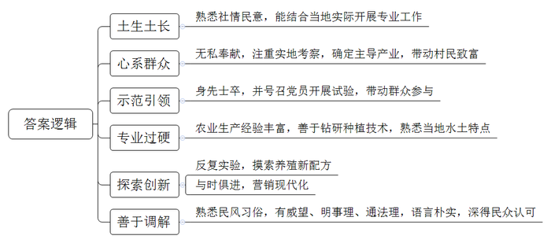
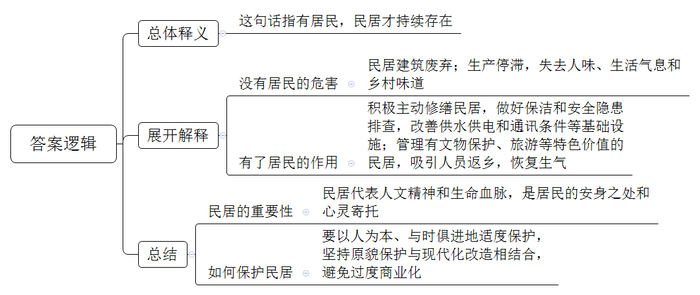
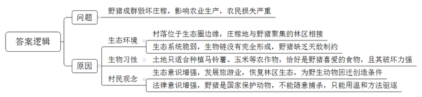
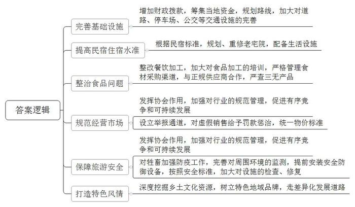
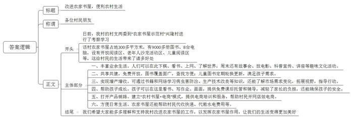

# 2019年公务员多省联考《申论》题（广西B卷）

<!-- gwy:overview:start -->
> **广西 · 2019 · 申论 · B类** ｜ 5 题 · 图片 5 处 · 答案随题折叠

导航：[题目](#题目) · [材料 1](#材料-1)
<!-- gwy:overview:end -->

> 候选采集稿。参考答案及解析来自粉笔页面，不代表官方答案或真实高分答卷；来源使用许可与原卷对应关系仍需人工核实。

## 给定材料

### 材料 1

走进新凤村，这里林木环绕、空气清新、道路整洁、民居井然有序，但在四年前，新凤村还是个破败萧条的贫困村，这个村为何能在这么短的时间里发生如此大的变化呢？笔者满怀好奇地向当地的同志问到：“新凤村的喜人局面从何而来？”对方笑答：“因为这里有一批‘土专家’”。他们都是土生土长的当地人，对社情民意清楚得很，这些“土专家”在脱贫攻坚中结合新凤村的实际，干了不少专业的事。

新凤村党支部书记老谭，今年31岁，是本村的种植大户。担任书记后，看到村里的面貌依旧落后，乡亲们的生活依旧贫困。他心急如焚，总想为乡亲们办点事。新凤村作为贫困村，产业发展滞后一直是该村脱贫致富的“绊脚石”。为此，2015年以来，老谭带领村干部自费考察十余次，选定了适合本村发展的西瓜、二荆条辣椒和脆红李等三个主导产业项目。项目有了，谁来做“第一个吃螃蟹的人”？对此，群众都持观望态度。作为书记，老谭把自家的7.2亩土地当成“试验田”，还以高出市场价的价格承包了村民土地300余亩，从外地引进种子、种苗，聘请技术人员指导，分片种上了西瓜、二荆条辣椒和脆红李。老谭为什么敢身先士卒做试验？照他的话说，“自己和泥土打了一辈子交道，虽然没有上过大学，但喜欢钻研果蔬种植技术，对这方水土的脾气还是很了解”。身先士卒之际，老谭又接连组织召开党员大会，苦口婆心号召党员带头干。一批“党员试验田”很快建成。“党员试验田”里，西瓜、二荆条辣椒种植当年就见到了效益；最初试种的脆红李三年后就进入丰产期，平均亩产达到3000公斤，见到“党员试验田”的效益后，乡亲们竞相种植。老谭不仅亲自当起技术员，还自费为村民提供种苗。如今，新凤村西瓜、二荆条辣椒和脆红李“三个一千亩”种植基地初成规模，带动了466户群众实现增收致富。

“我们这的土鸡，可好啦！”老秦是村里养鸡场的主人，一说到鸡，他就滔滔不绝，“在这儿，鸡全部都是传统养殖的。”他说，“过去由于交通闭塞，我们县的土鸡因为和外界交流少，品种特色保留得好，我们这里水好、土好、品种好。而且这几年，我通过反复试验，摸索出了纯粮饲料配方，饲养出的鸡品相好、口感好。”在老秦眼里，土鸡和其它农产品一样，要土生土养，但营销必须要现代化，要跟得上时代。“我们有很多年卡会员，客人们年初交费办一张年卡，我们每个月给他们配送土鸡。这样，顾客得到一定折扣，我们也有了更多的现金流。”现在，老秦的养鸡场光年卡会员客户就有上千人，仅此一项，营业额便达四百余万元。生意的兴旺更带动村里十几个村民就业。

在产业发展的同时，新凤村还积极启用“土法官”建设和谐邻里关系，着力提升美丽乡村的“气质”。该村组建了“土法官”民事纠纷调解小组。这些“土法官”由熟悉民风习俗，有一定威望、明事理、懂法律的人员担任。“大家都乡里乡亲的，之前两家关系也不错，为这点蝇头小利闹翻，值得吗？”“房屋复耕后土地属于集体，你们两家人都没有所有权，你们知道吗？”

“土法官”们就是用这种朴实的语言调解了不少鸡毛蒜皮的矛盾纠纷。自实行“土法官”制度以来，新凤村成功调解民事纠纷20余件，成功率达100%。村民现在对这种调解方式心服口服，这极大地促进了文明乡风建设。

### 材料 2

“以前啊，这里很多老房子被废弃，濒临倒塌。屋顶残破，梁柱上出现斑斑点点的虫眼……像奄奄一息的病人。”XN村支书老王对从省里来调研的小姚介绍道，“屋里不亮堂，杂草丛生，墙体垮塌，有的连横梁都断裂了。”

“那时候，这儿的老房子基本没人住。我也跟着儿子去了县城，时不时回来一趟，可村子都空了。”村民吴大妈回忆时也不无叹息，“修得再漂亮，没人住也就是个屋子，没有人味儿！”

作家阿敏是XN村的租客，她已在村里住了些年头了。“我曾经离开过一段时间。因为那时候这里人越来越少，没有种田、犁地、收谷、摘果等生产活动，没有欢歌，没有笑语。这里成了‘空心村’，没有真正的生活气息，没有我想要的乡村民居的味道。”

“再不行动起来，要不了几年，我们村就将不复存在了！”当时，这样的警告在老王脑袋里响起。“我们的房子大部分不属于文物级别，没有办法申请经费修葺，但我们自己也得想办法，赶紧行动起来啊。”

2010年春，在老王和热心村民老冯的牵头下，全村人合力捐款捐物，自筹4万多元，对村里最具特色和保护价值的Y堂大宅院正屋破损部位进行了集中修缮，制定了以“保护环境、不准私占、清理整洁、损坏赔偿”等为基本内容的大宅院保护公约。此后，村民们自发成立了村志愿队，不仅承担了公共区域保洁工作，更常常挨家挨户地排查危房安全隐患，宣传自用民屋的日常修葺维护常识。“房子嘛，最怕水和火。没有住就容易坏掉，人住着，房子有点啥问题也能及时察觉。本来随便弄弄就能解决的小问题，因为没人，几年下来，就成大问题了。”

XN村请相关部门对全村有文物保护、旅游等方面价值的民居进行了清理，并划定了保护区域网格，立起了保护标志。而村民们更是主动当起了网格员，协助建立各栋民居的档案。

这几年，返乡的人越来越多，村里又有了生气。人回来了，自然是要居住的，这时候再不行动就没有道理了。

“现在，村里用土地流转办联合社赚到的钱，给大家改善了供水供电和通讯条件。住起来确实比以前舒服多啦。”吴大妈说道，“能住得舒服，谁不爱自己的老家呢?”

在调研完XN村自发的民居保护工作后，小姚在笔记上写道:

有居民，方有民居。和巍峨雄伟的皇宫比，民居更能代表中国的人文精神和生命血脉。它是家，是安身之处和心灵寄托。但保护再重要，也要以人为本、与时俱进。在民居保护工作中，我们要避免两个极端：一是过于追求“原汁原味”，只强调对民居原貌的修葺和保持，忽视甚至限制必要的现代化改造。这样的民居难以满足人们的生活需求，最后只会导致“人去屋空”。而另一个则是过度的现代化甚至是商业化的改造。比如某些古街改造，把各个时期的旧民居改建成清一色的仿古建筑，沿路店面几乎全在经营衣服、箱包，成了“服饰箱包一条街”，它们是商业之地，却不是人们生活之所。

### 材料 3

“野猪成群结队，一晚上能毁几十亩玉米、马铃薯。”时下正值马铃薯、玉米成熟收获的季节，但星月村的村民怎么也高兴不起来。“野猪太多了，防不胜防，村里已有几百亩庄稼被毁了。”村民对记者小侯表示，野猪已成为他们最头疼的事。星月村位于东山生态圈边缘，与小沟林场相邻，村里的庄稼地与林区相接。“上了年纪的村民都知道，那个林场可是野猪的‘老窝啊’。”村民说道。

野猪经常光顾玉米地。“这些地里的玉米棒都被吃了，只剩下玉米杆。”村民老李指着玉米地说，“去年也有人告诉我们尽量不要种玉米、马铃薯这些野猪特别爱吃的作物，可是你看看我们这里的土地，就适合种玉米、马铃薯。野猪就是杂食动物，什么都吃。”同时，小侯还看到，在成片的玉米地中间，有几块绿油油的燕麦地，村民马大姐正忙着收割燕麦。“燕麦没有成熟，怎么就收了？”小侯提出疑问。“野猪毁了玉米，下山没有吃的，就毁坏燕麦、冬小麦。抓紧收割，有了麦穗起码还能当作饲料用。”

“十年前，野猪开始在村里出没，当时出现的次数和数量比较少，一个月能见到一两次。”老李介绍。最近几年，野猪成群结队出现，一般三五只，最多十几只。一只野猪一晚上就能毁坏十几亩庄稼，十几只野猪在庄稼地里肆意毁坏的程度就更严重了。

小侯走在小沟林场附近，时不时可以看到野鸡从庄稼地、林间草地惊飞而起。“野鸡、野兔、野猪在这里太常见了。”老护林员老张说，他们巡林时，经常看到成群的野猪。过去，林场主要依靠砍伐木材和种植经济林维持发展，生态破坏比较严重，很多野生动物迁徙到其他地方。如今，经过十几年退耕还林、封山禁牧，林区生态逐渐恢复，空气清新、景色宜人，吸引了不少人来游玩，但生态系统仍然很脆弱，没有达到“自愈”的能力。“野猪等野生动物逐渐迁回，生物链没有完全形成，他们现在没天敌，只能让他们这么‘嚣张’。”老张表示。

“经常有外地人来到村里，希望村民配合捕杀野猪，但均被村民拒绝。”老张说，虽然村民对野猪毁坏庄稼既无奈又“痛恨”。但这些年的普法宣传工作做得扎实，村民们都知道野猪不能随意捕杀，只是采取温和的方法驱逐。

### 材料 4

近二十年来，农家乐在全国各地兴起，成为发展乡村旅游，振兴乡村经济的重要支点。然而，令人吃惊的是，作为我国农家乐发源地之一的P县，近两年的农家乐发展却略显颓势。原因何在？出路何在？下面是P县当地论坛中一些网友的说法：

●交通是永远的痛啊。有的没有公交通达，有的没有停车场，路况差，到处坑坑洼洼的。这么差的交通条件把不少慕名而来的客人赶跑了。

●一些农家乐太老了，建的时候就是以农民自己的宅院为底本，腾出几间空闲屋子当客房，打扫出院子当活动场所，洗手池、厕所、浴室等都是一家农家乐就一个，这些很影响消费体验。

●说句实话，都是千篇一律的钓鱼、打牌、吃饭等活动，没有特色，去了其中一家，就等于去了所有农家乐，怎么会有回头客呢？

●一些店家在餐饮加工时，生食、熟食没有分区。我还观察了他们用的食材，有的没有商标、生产日期，一问才知道这些东西都是在附近的无证小作坊里买的。我不敢再去了。

●说起这个我就生气，上次去体验捉土鸡、拣土鸡蛋，结果那些鸡比菜市场的饲料鸡都肥，怎么可能是土鸡呢？一问老板，老板还笑嘻嘻地说：“现在哪去找土鸡？我这土生土长，吃饲料长大的鸡，就算是土鸡了。”他们很多蔬果也是直接在市场上买的，根本不是自己种的，却以“农家自种自养”为噱头，收费昂贵。

●P县有300多年历史，有那么丰富的民俗风情、农耕文化、民间技艺资源。可是，我在当地的农家乐里完全看不到它们的影子。这里和其他地方的农家乐真的没有什么不同。而且，放养的猫狗等牲畜、临河的地理位置、不符合安全标准的简陋的跷跷板等，都让我为来这里玩的孩子们担心。

●住农家屋，吃农家饭，干农家活，享农家乐。其实，农家乐的优势在“农”字，乡村风光、农家饭菜、农事活动是吸引游客的法宝。农家乐要在深度挖掘民俗风情、农耕文化、民间技艺等乡土文化资源上下功夫。

●P县农家乐要发展，其协会应该发挥作用。而不是像现在只是给当地农家乐挨家挨户地发一块“P县农家乐协会成员单位”的牌子，其他时候却完全隐形。协会本身有规范行业管理、促进有序竞争和可持续发展的义务。

### 材料 5

近日，王家村党支书老王带领村支两委一行来到“农家书屋示范村”兴隆村考察学习。以下是考察学习的相关情况：

“我们这个农家书屋占地300多平方米，不仅有9000多册图书，还有8台电脑呢！设有开放阅读区、老年人沙龙活动区、儿童阅读区、借阅工作区等。”兴隆村党支书老马介绍道。

“早上有老人下棋，下午有学生看书写作业，周末文化活动更多。”村民颜大妈笑着说，“以前大家业余生活就是聊天打牌。这里，给老人和孩子们张罗了一个好去处。这里一周七天都开着门，平时能看看书、上上网，多了解一下外面的世界。到了周末还有‘兴隆故事会’、放电影、科普宣传讲座，这些活动都挺有意思的。有了这个书屋，我们觉得生活有滋有味。”

“共建共享是我们的理念，这里对全村村民免费开放。”书屋管理员小蔡介绍道，“当初建这个书屋时不仅得到县、镇的支持，也受到村里群众的欢迎。这里有4000本图书、2台电脑是村民们自发捐的。这里的近万册图书覆盖了农业生产、农村生活、儿童科教等多个方面，并严格按照《中国图书馆分类法》编码分类，各种图书非常好找。针对儿童阅读速度快、阅读需求量大的特点，我们与邻村的书屋会定期轮换儿童图书，让它们在农村‘转’起来。”

现在，更多的村民成了农家书屋的常客，在病虫害防治、生产技术改良、市场需求变化等问题上，村民都学会了主动从书籍和网络上寻找答案。年过六旬的村民老韦说：“前些年市里有个扶贫项目，免费为我们引进了一种新柿子，价钱能比老品种高五六倍。就是需要砍了老树嫁接，大家大眼看小眼，谁都不行动。现在想想啊，这都是因为不晓得村外的世界。”

“孩子们一到放学就会到书屋里来做作业，看看课外书。每到周日，这里就更是孩子们的乐园，看书、画画、练字……”管理员小蔡说，“村民以前最担心的就是一到放学放假，孩子到处乱跑有危险。自从农家书屋开设这个免费的课后托管中心，孩子们放学就可以来这里写作业，管理员也能稍微辅导一下；放假了还有大学生志愿者来支教，这给家长们帮了大忙，毕竟，阅读、作业、课后辅导，都是孩子成长中的大事啊。”

“我们的农家书屋不仅仅有图书馆的作用，它也是一个微型的农村电商服务中心和培训基地。”老马书记骄傲的介绍道，“我们兴隆村不是家家户户都拉了网线，买了电脑，村民也不是人人都熟悉电脑操作，所以我们利用农家书屋的联网电脑提供农村电商培训和服务。这样，我们的柿子、土蜂蜜、杏干等土特产都不差销路了。”

这种“农家书屋+电商”的模式极大地增加了农家书屋的吸引力，使农家书屋人气大增。越来越多的村民在书屋工作人员的帮助下，开起网店，做起电商。

在书屋外墙上，有大字标语写着“让兴隆的优质农产品不再难卖”，各种包装精美的产品排列整齐。管理员小蔡说，书屋不但帮村民卖农产品，还为他们代收快递、代缴水电费用等，这极大地方便了大家的生活。

## 题目

### 第 1 题

**根据“给定资料1”，概括新凤村“土专家”的特点。（15分）**

关联材料：材料 1、材料 2、材料 3、材料 4、材料 5

作答要求：

要求：全面，准确，简明，有条理；字数不超过200字。

第 1 题 · 答案与解析

**参考答案（粉笔题库参考内容）**

1.土生土长。熟悉社情民意，能结合当地实际开展专业工作。

2.心系群众。无私奉献，注重实地考察，确定主导产业，带动村民致富。

3.示范引领。身先士卒，并号召党员开展试验，带动群众参与。

4.专业过硬。农业生产经验丰富，善于钻研种植技术，熟悉当地水土特点。

5.探索创新。反复实验，摸索养殖新配方；与时俱进，营销现代化。

6.善于调解。熟悉民风习俗，有威望、明事理、通法理，语言朴实，深得民众认可。

**解析**

**参考答案说明**：本参考答案从“土生土长”“心系群众”“示范引领”“专业过硬”“探索创新”“善于调解”六个方面展开，各条答案要点之间在内容上相互并列，没有交叉。

**考点**：特点类

**来源**：2019年公务员多省联考《申论》题（广西B卷）

粉笔申论页面对本题只提供「解析视频」入口，该入口是会员推广位，页面无视频地址与文字解析。

### 第 2 题

**根据“给定资料2”，谈谈对其划线部分“有居民，方有民居”的理解。（15分）**

关联材料：材料 1、材料 2、材料 3、材料 4、材料 5

作答要求：

要求：

（1）紧扣资料，观点明确；

（2）逻辑清晰，语言准确；

（3）字数不超过200字。

第 2 题 · 答案与解析

**参考答案（粉笔题库参考内容）**

这句话指有居民，民居才持续存在。一、没有居民会导致：民居建筑废弃；生产停滞，失去人味、生活气息和乡村味道。二、有了居民就会积极主动修缮民居，做好保洁和安全隐患排查，改善供水供电和通讯条件等基础设施；管理有文物保护、旅游等特色价值的民居，吸引人员返乡，恢复生气。三、民居代表人文精神和生命血脉，是居民的安身之处和心灵寄托。要以人为本、与时俱进地适度保护，坚持原貌保护与现代化改造相结合，避免过度商业化。

**解析**

**参考答案说明：**思路方面，本参考答案按照词句解释题“总体释义+展开解释+总结”的一般答题思路展开。内容方面，本参考答案先对“有居民，方有民居”的含义进行了解释，接着分析了“没有居民”对民居带来的危害以及“有了居民”对民居的积极作用，最后进行了总结，介绍了民居的重要性及保护民居的对策。

**考点**：词句解释类

**来源**：2019年公务员多省联考《申论》题（广西B卷）

粉笔申论页面对本题只提供「解析视频」入口，该入口是会员推广位，页面无视频地址与文字解析。

### 第 3 题

**根据“给定资料3”，请就该村近年来遇到的问题分析其原因。（15分）**

关联材料：材料 1、材料 2、材料 3、材料 4、材料 5

作答要求：

要求：

（1）全面，准确，简明，有条理；

（2）字数不超过200字。

第 3 题 · 答案与解析

**参考答案（粉笔题库参考内容）**

问题：野猪成群毁坏庄稼，影响农业生产，农民损失严重。

原因：

1.生态环境：村落位于生态圈边缘，庄稼地与野猪聚集的林区相接；生态系统脆弱，生物链没有完全形成，野猪缺乏天敌制约。

2.生物习性：土地只适合种植马铃薯、玉米等农作物，恰好是野猪喜爱的食物，且其破坏力强。

3.村民观念：生态意识增强，发展旅游业，恢复林区生态，为野生动物回迁创造条件；法律意识增强，野猪是国家保护动物，不能随意捕杀，只能用温和方法驱逐。

**解析**

**参考答案说明**：本参考答案宏观上从“问题”和“原因”两个方面展开。先指出了该村遇到的“问题”，再从“生态环境”“生物习性”“村民观念”这三个方面指出了该问题产生的“原因”，并进行了分条撰写。各条要点之间在内容上相互并列，没有交叉。

**考点**：多要素组合类

**来源**：2019年公务员多省联考《申论》题（广西B卷）

粉笔申论页面对本题只提供「解析视频」入口，该入口是会员推广位，页面无视频地址与文字解析。

### 第 4 题

**根据“给定资料4”，针对P县农家乐存在的问题提出改进建议。（20分）**

关联材料：材料 1、材料 2、材料 3、材料 4、材料 5

作答要求：

要求：

（1）紧扣资料，内容全面；

（2）条理清晰，语言通畅；

（3）字数不超过300字。

第 4 题 · 答案与解析

**参考答案（粉笔题库参考内容）**

1.完善基础设施。增加财政拨款，筹集当地资金，规划路线，加大对道路、停车场、公交等交通设施的完善。2.提高民宿住宿水准。根据民宿标准，规划、重修老宅院，配备生活设施。3.整治食品问题。整改餐饮加工，加大对食品加工的培训，严格管理食材采购渠道，与正规供应商合作，严查三无产品。4.规范经营市场。发挥协会作用，加强对行业的规范管理，促进有序竞争和可持续发展。设立举报通道，对虚假销售给予罚款惩治，统一物价标准。5.保障旅游安全。对牲畜加强防疫工作，完善对周围环境的监测，提前安装安全防御设备，按照安全标准，加大对设施的检查、修复。6.打造特色风情。深度挖掘乡土文化资源，树立特色地域品牌，走差异化发展道路。

**解析**

**参考答案说明**：本参考答案从“完善基础设施”“提高民宿住宿水准”“整治食品问题”“规范经营市场”“保障旅游安全”“打造特色风情”这六个方面进行了分条撰写。各条要点之间在内容上是并列关系，没有交叉。并且撰写每条要点时，都提炼出了概括性强的总结词并前置。

**考点**：提出对策类

**来源**：2019年公务员多省联考《申论》题（广西B卷）

粉笔申论页面对本题只提供「解析视频」入口，该入口是会员推广位，页面无视频地址与文字解析。

### 第 5 题

**王家村拟参照兴隆村的模式改进农家书屋，但有些村民认为“改不改，没多大关系”。请你根据“给定资料5”，代表王家村村支两委，就这些情况，为即将召开的村民大会写一篇发言稿。（35分）**

关联材料：材料 1、材料 2、材料 3、材料 4、材料 5

作答要求：

要求：

（1）紧扣资料，内容全面；

（2）逻辑清晰，语言流畅；

（3）字数不超过600字。

第 5 题 · 答案与解析

**参考答案（粉笔题库参考内容）**

改进农家书屋，便利农村生活

各位村民朋友：

日前，我村的村支两委到“农家书屋示范村”兴隆村进行了考察学习。该村农家书屋占地300多平方米，有9000多册图书、8台电脑，设有开放阅读区、老年人沙龙活动区、儿童阅读区等，这给村民的生活带来了诸多好处：

一、丰富业余生活。人们可以在此下棋、看书、上网、了解世界，周末还有故事会、放电影、科普宣传、讲座等趣味文化活动。

二、共享共建，免费开放。图书覆盖面广，查找方便；儿童图书定期轮换更新，满足孩子需求。

三、实现增产增收。可通过书籍和网络学习病虫害防治、生产技术改良等知识，还能了解市场需求变化，拓展视野，指导行动。

四、帮助孩子成长。孩子可以在这里看书、写作业、画画，提供免费课后托管和辅导，减轻了家长的负担，还能确保孩子的安全。

五、打开产品销路。建立“农村书屋+电商”模式，提供电商培训和服务，帮助村民开网店做电商。

六、方便日常生活。农家书屋还能帮助村民代收快递、代缴水电费用等。

我们希望大家能多多理解和支持我村改进农家书屋的工作，以发挥农家书屋作用，让我们的生活变得更加美好！

**解析**

**参考答案说明：**（1）本参考答案写到了“标题+称谓+正文”三个部分。（2）正文部分：从内容来看，围绕着“兴隆镇农村书屋”这一主题，开头部分介绍了村支两委到兴隆村考察学习及农村书屋的基本概况，主体部分分别从“丰富业余生活”“共享共建，免费开放”“实现增产增收”“帮助孩子成长”“打开产品销路”“方便日常生活”这六个方面对农家书屋所带来的好处进行了分条撰写，结尾部分进行了呼吁号召。从形式来看，本参考答案做到了分段撰写，为了体现公文题的逻辑性，还加上了连接词来承接上下文。

**考点**：宣传类

**来源**：2019年公务员多省联考《申论》题（广西B卷）

粉笔申论页面对本题只提供「解析视频」入口，该入口是会员推广位，页面无视频地址与文字解析。

