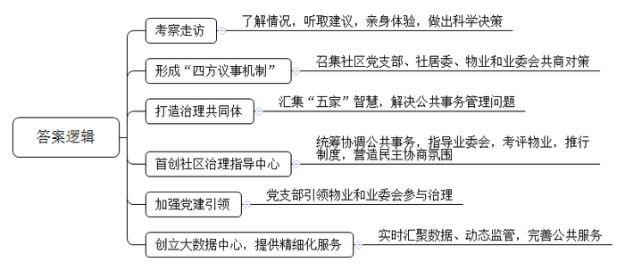
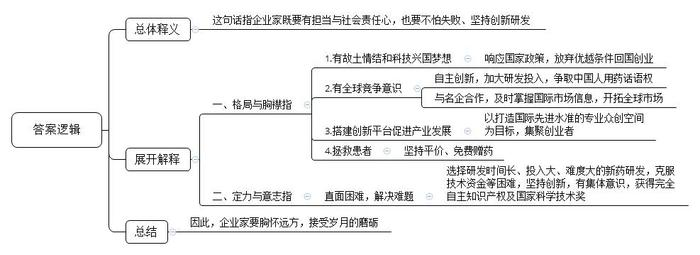
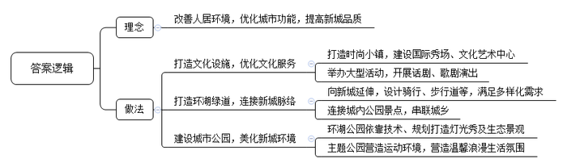
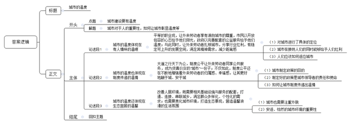

# 2020年0822公务员多省联考《申论》题（广西A卷）

> 候选采集稿。参考答案及解析来自粉笔页面，不代表官方答案或真实高分答卷；来源使用许可与原卷对应关系仍需人工核实。

## 给定材料

### 材料 material-41a04f653839dcfb

“我们真是社区治理的受益者，现在门口一点也不堵了，物业经理都亲自给我们站岗呢！”说到校门口的停车问题，A市第二小学的李校长如沐春风。第二小学位于Z小区旁，曾经因为管理混乱，小区乱停车拥堵了校门，连校车都进出困难，小区环境脏乱差，业主更是怨声载道。去年，Z小区业主委员会成立，目的是炒掉旧物业，换个新物业。街道和社区对此非常着急，“我们担心旧物业走了，按照现有的物业费标准，新物业又招不来，小区就乱套了。”H街道陈主任说。

为破解难题，陈主任带领工作人员到Z小区进行考察。他们了解了小区环境卫生状况，走访了物业公司、业委会和居民，又听取了几位居民的建议，在上下班高峰期等几个重要时间节点，亲身体验了小区道路拥堵、交通混乱的状况。经过调查，陈主任和街道工作人员一致认为，要解决Z小区管理中存在的问题，不能采取更换物业公司这种短效行为，必须创新工作思路，方能从根本上解决问题。

于是，H街道召集社区党支部、社居委、物业和业委会，四方齐聚一堂，心平气和地摆出问题，凝聚共识，共商对策，逐渐形成了“四方议事机制”。

经过商讨，H街道决定在Z小区创新社区治理模式，推动社区治理共同体的诞生。以社区“两委”为“本家”、社区全体业主为“主家”、物业服务企业为“管家”、辖区单位为“邻家”、专业规划团队为“专家”，汇集“五家”智慧参与社区治理，解决社区公共事务管理中的重点难点问题。

H街道在全市首创社区治理指导中心，负责对社区公共事务管理工作的统筹协调，指导业主大会召开及业委会成立，组织辖区物业服务企业的日常考评工作，全面推行社区议事委员制度，营造社区民主协商氛围。

新的社区治理模式让小区大“变脸”。过去Z小区大门破旧不堪，而且安全系数低，也影响车辆通行。新的社区治理模式启动后，社区党支部积极发挥“本家”的作用，引导“主家”“管家”“邻家”形成合力，共同推进小区大门整修工作。经小区半数以上“主家”投票选定大门设计方案，同时社区治理共同体成员针对整修资金筹措进行会商，最终业委会出资10万、物业出资3万，剩余部分由社区公益金、党组织服务群众经费补足。如今的小区大门焕然一新：青砖黄柱，一边是整洁的保安亭，一边是灰色大字的小区名，十分典雅。“回家顿时有了仪式感。”居民王先生感叹道。

小区的生态共治园占地600平方米，曾是物业公司的育种苗圃。业主们想给孩子打造一块种植园，让他们知道西红柿、草莓怎么开花结果。经社区居委会积极与物业公司沟通，物业同意将该处苗圃无偿打造成生态共治园。社区邀请种植专家和居民代表召开会议，制定生态共治园的建设方案。建成后，Z小区的生态共治园既有科普教学功能，又有美学价值，还能让居民体验农耕生活、感受种植乐趣。

如今，Z小区社区治理模式已基本成型。“今后，街道将总结社区党建引领物业和业委会参与社区治理的经验，向其他社区推广，扎实做好党建引领社区治理工作。”陈主任表示。

为了给社区居民提供更精细化的服务，H街道还创立了区域大数据中心。街道办事处社会服务管理指挥中心内，大屏幕上随时切换着辖区内商业街的人流情况以及辖区内0至3岁幼儿分布、停车位使用情况等信息。依托大数据平台，辖区内“人、地、事、物”等数据都呈现在一张通过实景拍摄后制成的数字地图上，有效实现了数据的实时汇聚和动态监管。大数据就像一只“无形的手”，针对服务薄弱环节和突出问题精准发力，解决了百姓的许多难事和急事。

去年H街道召开居民代表大会，会上代表们反映最多的就是幼儿入园难的问题。“我们根据大数据平台掌握的实有人口和户籍人口信息，通过热力图表预测未来两年0至3岁幼儿的入园需求，从而根据幼儿分布状态选址建设幼儿园。”陈主任说，目前街道已与区教委达成一致意见，共同新建两个公立幼儿园，满足辖区内幼儿的入园需求。此外，街道年满60周岁的老年人信息会自动被大数据平台筛选出来。哪位居民年满60周岁该办理老年证了，大数据平台提前3个月自动为老人发送提示短信。证件办理成功后，不用老人去街道社区取，社区工作人员亲自送上门。

对此，陈主任坦言，社区就是我们的大家庭，我们的梦想就是打造一个共建共治共享的和谐家园。“大数据的运用让信息多跑路，让群众少跑腿，打通了公共服务的‘最后一米’。”

### 材料 material-9ab481f050c7f209

BD药业是一家在全球肿瘤药物领域拥有多项核心自主知识产权的高科技公司。说起BD药业的故事和梦想，公司董事长兼首席执行官丁先生有很多的感慨。

2002年，借着国家鼓励大众创新创业的东风，留洋十年的丁先生背起行囊，与几位合伙人一道回国创业。就在第二年，BD药业成立，开始追逐“做创新药”的大梦想。有人说，丁先生身上有不少光环，比如国外著名大学的医学博士、执业医师等，回国创业就意味着放弃了优渥的生活条件、高额的薪水，白手起家，这个抉择很有勇气。而在丁先生看来，这个选择顺理成章。“像我们这些知识分子，大多数还是有故土情结的，梦想着科技兴国。”除了游子的思乡情结，还有一点对丁先生来说非常重要——“国家鼓励海归创新创业，在国内可以做到在国外做不到的事”。他说，在国外，科学家只能做药物研发的某一部分工作，而只有在中国才有几个科学家合作完成一个新药所有的研究，并将其产业化的机会。

与很多企业选择做仿制药不同，BD药业一开始就立志做新药，要在全球药业竞争中拥有完全知识产权。虽然面临各种技术难题、无休止试药及资金链断裂等“生死劫”，但有志者事竟成，BD药业克服了重重困难，最终成功了。他们研制的抗癌药获得国家颁发的新药证书，成为我国首个具有完全自主知识产权的同类抗癌新药。该药还被列入国际权威机构发布的新药研发年度报告，成为第一个获得国际机构认可的中国创制新药。

2016年1月8日对于丁先生来说很特别，也很难忘。这一天他作为BD药业相关项目的第一完成人，在2015年度国家科学技术奖励大会上接受了表彰。“这是奋斗者的荣誉，这个荣誉不仅属于我，也属于我们团队，其实还属于国家。”当时，在深冬北京的暖阳中，丁先生手捧大红证书，站在人民大会堂前拍了一张照片。这是国家对BD药业创新能力的巨大肯定。

“只有自主创新，才能拥有话语权”，丁先生常说，“要真正把中国的医药产业发展起来，得把中国人用药的话语权掌握在自己手里。”

近年来，BD药业跑得飞快，源源不绝的动力就来自“创新”二字。自主研发是BD药业的看家本领，丁先生表示，截至目前，今年创新研发投入已经超过10亿元。“我们正不断加强自主研发这一块。有自主研发做保障，我们就有底气开拓市场和开展合作。”BD药业把眼光投向全球，通过与国际知名医药企业合作，及时掌握国际市场信息，在全球的抗肿瘤药物市场中奋勇开拓。

如今，BD药业又种下了一颗新的梦想种子——以自家企业为基础，打造一座“医药梦工场”，搭建更大的创新平台，为全国医药产业的快速发展打造新引擎。丁先生说，这是一个为科学家、创业者造梦圆梦的项目，目标是打造一个具有国际先进水准的生物医药专业众创空间。未来，这里也将集聚一批医药领域的创业者。

研制新药去拯救病患，搭建创新平台去服务全行业。丁先生说这些都是出自一个企业家的担当。“很多人说我一夜暴富，其实我们自己没什么特别的感觉，财富是创业创新水到渠成的结果。我们脑子里想的更多的还是新药研发，以及企业的未来发展。”作为过来人，丁先生还想告诉创业者的是，企业家要有企业家的担当，企业家既要有仰望星空的格局与胸襟，也要有坐住板凳的定力和意志。“就拿我们医药行业来说，与一般的制造业不同的是，医药行业一方面与老百姓的身体健康密切相关，另一方面新产品的研发时间长、投入大、失败的风险高，要成功很难。”经历了风风雨雨，丁先生一直坚持“做老百姓吃得起的好药”，还对符合相关条件的患者进行免费赠药，赠药数量甚至超过了销售数量，这就是一位企业家的社会责任心。胸怀远方，迎接岁月的磨砺，才有了如今的BD药业。

### 材料 material-1b2481be68bffdec

T市新城，环湖公园已全景亮相，湖畔绿道成为健身爱好者的乐园，文化艺术中心正紧锣密鼓建设之中，国际秀场首秀在即……人居环境不断改善，城市功能不断优化，用高品质筑就生态宜居之城，这个新城规划时的梦想正在变成现实。

“今年六月份到年底，国家级和国际级的大型秀场活动都排满了。”国际秀场招商负责人的言语中透着自信与骄傲。国际秀场位于T市新城的时尚小镇内，是时尚小镇中的地标建筑，建设目标是成为中国时尚文化新窗口。目前，国际秀场已竣工，即将迎来“首秀”。

与国际秀场毗邻的是T市新城的文化艺术中心。这个拥有几何立面和斜面屋顶的建筑矗立在湖畔，自成姿态。T市人从此又多了一个看话剧、歌剧的好去处。“家门口就可以看戏、看话剧，梦寐以求的事情实现了。”小吴家住新城，以前看戏，他都要去主城区。“听说文化艺术中心的硬件设施是世界顶级的，”他充满了期待，“希望引进的剧种能多样化、多层次，既有经典又有流行。”

近两年，T市新城加速打造品质之城。人文是这座新城的“心”，沉淀着这个城市的故事，孕育出这个城市的灵气。

城心湖占地面积大，风景优美，历代文人墨客在此题咏。T市新城围绕城心湖而建，这座湖是新城的“肺”。如今，一条环湖的绿道已经建成。环湖绿道是T市新城打造的自然景观之一，全线滨水，视野开阔。从早上六点半到晚上八点半，环湖绿道上随处可见晨练、夜跑的人。中午时分，周边写字楼里的白领们也常常在绿道边漫步休闲，“听着鸟鸣，闻着花香，很舒服。”

未来，这条绿道将向整个新城延伸，设计有骑行道和步行道，还有VR体验馆，满足人们多样的需求。绿道不仅连接新城所有的公园和景点，还将城市与乡村紧密相连，走在绿道中，仿佛走在画中。绿道就像是新城的“脉”，通过绿道串起来的是一个大写的“融”字。绿道建设负责人说，“我们希望这条路连起所有新城人的梦想和记忆。”

城市如人，也要健康、好看。有心灵的跃动，脉搏的畅通，还要有肌肤的美丽。公园就是新城的肌肤。

藕花再现，湖泊复兴。新城将在环湖公园实现全域亮灯，呈现全线夜景灯光秀，一个“越夜越美丽”的环湖公园就要来到市民的生活中。环湖公园之美，靠的是技术和规划。环湖公园水生态养护的负责人说：“我们已经在湖中建成了一套成熟的水下生态系统。”水生态技术让这里的夏天再现“藕花满汀洲”的盛景。陆地上也有一套完整、科学的植被规划，以自然景观为基调形态，突出四季变化。春季赏花，夏季绿荫，秋季观叶，冬季葱郁，营造出充满活力的自然生态树林景观。

相较于环湖公园的自然与人文，体育公园的针对性更强。全民体育，乐跑体育，以运动促健康，是这里的主题。动与静、开放与私密、艺术与自然相结合的运动环境，满足了各年龄段人群健康、休闲、品质的运动需求。距离体育公园不远的花海公园则以“新城潮生活”为主题，怒放的花海让这里变得浪漫温馨。

公园让城市变得美丽光鲜，它为我们建造了一个“桃花源”，安放新城人生态宜居的梦想。

### 材料 material-183bc01e903ba971

“我们都在努力奔跑，我们都是追梦人。”是的，我们都是追梦人。追梦，我们收获满满；追梦，我们希望满满。

正如习近平总书记所说，中国人民具有伟大梦想精神。改革开放40多年的征程，就是一个追梦之旅。改革开放之初，我们党以非凡的胆略、坚定的自信设计了用70多年、分三步走，基本实现社会主义现代化的宏伟蓝图。改革开放40多年的追梦路上，我们咬定青山不放松，风雨无阻朝着这个伟大目标前进。

从站起来、富起来到强起来，这是奋斗的力量，也是梦想的力量。

党的十九大对我国发展提出了更高的奋斗目标，形成了从全面建成小康社会到基本实现现代化、再到全面建成社会主义现代化强国的战略安排，发出了实现中华民族伟大复兴中国梦的最强音。

但是，船到中流浪更急，人到半山路更陡，并且“愈进愈难、愈进愈险而又不进则退、非进不可”。在这样的关键时刻，我们要心怀梦想、奋勇拼搏，一步一个脚印，一棒接着一棒，在新时代创造中华民族新的更大奇迹！

梦想是拼出来的，奇迹是干出来的。改革开放的辉煌成就背后，是40多年的不懈努力。未来中国梦的实现，同样需要汗水的浇灌。没有人能随随便便成功。改革开放40多年的历程告诉我们：伟大事业都始于梦想，基于创新，成于实干。梦想是激发活力的源泉，只要有梦想，就会有力量。只要有梦想，则时光不弃，未来可期。

## 题目

### 第 1 题

**根据给定资料**2**，概括H街道加强社区治理的主要措施。（15分）**

关联材料：材料 material-41a04f653839dcfb

作答要求：

要求：全面，准确，有条理。不超过200字。

### 第 2 题

**根据给定资料**3**，谈谈你对画线句子“企业家既要有仰望星空的格局与胸襟，也要有坐住板凳的定力和意志”的理解。（20分）**

关联材料：材料 material-9ab481f050c7f209

作答要求：

要求：全面准确，分析透彻，条理清晰，不超过300字。

### 第 3 题

**根据给定资料**4**，总结T市新城生态宜居建设的主要理念和做法。（20分）**

关联材料：材料 material-1b2481be68bffdec

作答要求：

要求：准确，全面，有条理，不超过200字。

### 第 4 题

**根据给定资料，结合提到的****“温暖，温情****和温馨****”，围绕“城市的温度”，联系实际，自拟题目，写一篇文章。（45分）**

关联材料：材料 material-183bc01e903ba971

作答要求：

要求：

（1）自选角度，立意明确；

（2）思路清晰，语言流畅；

（3）参考给定资料，但不拘泥于“给定资料”；

（4）总字数1000—1200字。

## 答案与解析

第 1 题

**参考答案（粉笔题库参考内容）**

1.考察走访。了解情况，听取建议，亲身体验，做出科学决策。

2.形成“四方议事机制”。召集社区党支部、社居委、物业和业委会共商对策。

3.打造治理共同体。汇集“五家”智慧，解决公共事务管理问题。

4.首创社区治理指导中心。统筹协调公共事务，指导业委会，考评物业，推行制度，营造民主协商氛围。

5.加强党建引领。党支部引领物业和业委会参与治理。

6.创立大数据中心，提供精细化服务。实时汇聚数据、动态监管，完善公共服务。

**解析**

**参考答案说明：**本参考答案从“考察走访”“形成‘四方议事机制’”“打造治理共同体”“首创社区治理指导中心”“加强党建引领”“创立大数据中心，提供精细化服务”这六个方面展开，对H街道加强社区治理的主要措施进行了分条撰写。各条要点之间在内容上相互并列，没有交叉。

**考点**：考点概括措施类

**来源**：来源2020年0822公务员多省联考《申论》题（广西A卷）

粉笔申论页面对本题只提供「解析视频」入口，该入口是会员推广位，页面无视频地址与文字解析。

第 2 题

**参考答案（粉笔题库参考内容）**

这句话指企业家既要有担当与社会责任心，也要不怕失败、坚持创新研发。

一、格局与胸襟指：1.有故土情结和科技兴国梦想。响应国家政策，放弃优越条件回国创业。2.有全球竞争意识。自主创新，加大研发投入，争取中国人用药话语权；与名企合作，及时掌握国际市场信息，开拓全球市场。3.搭建创新平台促进产业发展。以打造国际先进水准的专业众创空间为目标，集聚创业者。4.拯救患者。坚持平价、免费赠药。二、定力与意志指：直面困难，解决难题。选择研发时间长、投入大、难度大的新药研发，克服技术资金等困难，坚持创新，有集体意识，获得完全自主知识产权及国家科学技术奖。

因此，企业家要胸怀远方，接受岁月的磨砺。

**解析**

**参考答案说明：**（1）思路方面，本参考答案按照词句解释题“总体释义+展开解释+总结”的一般答题思路展开。（2）内容方面，本参考答案先解释了画线句的总体含义；“展开解释”部分再分别从“格局与胸襟”“定力与意志”两方面展开，最后在“总结”部分提出了对策。（3）词句表达方面，本参考答案加上了“这句话指”“因此”等逻辑连接词来承接上下文。

**考点**：考点词句解释类

**来源**：来源2020年0822公务员多省联考《申论》题（广西A卷）

粉笔申论页面对本题只提供「解析视频」入口，该入口是会员推广位，页面无视频地址与文字解析。

第 3 题

**参考答案（粉笔题库参考内容）**

理念：改善人居环境，优化城市功能，提高新城品质。

做法：1.打造文化设施，优化文化服务。打造时尚小镇，建设国际秀场、文化艺术中心；举办大型活动，开展话剧、歌剧演出。2.打造环湖绿道，连接新城脉络。向新城延伸，设计骑行、步行道等，满足多样化需求；连接城内公园景点，串联城乡。3.建设城市公园，美化新城环境。环湖公园依靠技术、规划打造灯光秀及生态景观；主题公园营造运动环境，营造温馨浪漫生活氛围。

**解析**

**参考答案说明：**本参考答案先指出了T市新城生态宜居建设的主要理念，然后从“打造文化设施，优化文化服务”“打造环湖绿道，连接新城脉络”“建设城市公园，美化新城环境”三个方面对具体做法进行了分条撰写。各条要点之间在内容上是并列关系，无交叉。

**考点**：考点多要素组合类

**来源**：来源2020年0822公务员多省联考《申论》题（广西A卷）

粉笔申论页面对本题只提供「解析视频」入口，该入口是会员推广位，页面无视频地址与文字解析。

第 4 题

**参考答案（粉笔题库参考内容）**

**城市的温度**

从“陌生、疏离”到“扎根、亲近”，是外乡人对城市的切身感受——融入；从“星星点灯”到“流光溢彩”，是外乡人对城市贡献的展示——繁荣。城市是人赖以生存的聚居所，城市的建设要“以人为本”，要让人感受到温暖、温情和温馨，让人拥有回家的归属与幸福，拼搏向前的勇气和力量，悠然自得的胸怀与心境。

**城市的温度体现在有人情味的温暖。平等的职业观，让外来劳动者享有源自城市的尊重，市民以开放包容的心态给予他们阳光，政府以完善配套的公益服务给予他们温度；与此同时，让外来劳动者扎根城市，分享行业红利，有稳定可上升的发展空间，满足其精神需求，减少距离感。**城市是一个有着只要勤奋就能月入过万，只要能奔跑就能赢得笑容，只要努力拼搏就有向上发展、实现人生出彩机会的地方。“送人玫瑰，手留余香”，简单的一声“谢谢”，体现“城”对“人”的接纳；“风驰电掣”的行业发展，是“城”给“人”的红利。在这个“城”，没有退缩与逃避，没有鄙视与不屑，有的是义无反顾、冲锋陷阵、尊重敬畏。

**城市的温度也体现在制度传递的温情。大道之行天下为公，制度公平让外来劳动者同享公共服务，成为货真价实的****“城市”一份子；不仅如此，制度公平还在不断地增强着外来劳动者的归属感、幸福感，让其更好****地****融于城、安于城。**政策、制度的最终目的是维护公共利益，让人们的生活更加美好，某些关键领域的“好政策”已成为人民群众期盼的“甘霖”“雨露”，成为促进社会发展的“牵引机”、“助推器”、“加速器”。一个城市要有好的政策、制度，是他们应该承担的责任和使命。同一片蓝天，同一个领导者，需要让生活在此的群众享受同等的优惠，比如兼具医保卡和储蓄功能的公民卡，以及积分落户政策，让看似“硬邦邦”的制度展现出了它的“温情”。

**城市的温度还体现在生态宜居的温馨。改善人居环境，既需要相关基础设施与服务的配套，打通、连接、串联城乡，满足群众多样化、个性化的需求；也需要美化城市环境，打造生态景观，营造温馨浪漫的生活氛围。**城市如人，要注重外观、看重健康，有心灵的悦动，要脉搏的畅通，需美丽的肌肤。安适、恬然的城市环境是吸引外来务工者的基础，作为新城代表的T市，用美丽光鲜的环湖公园、自成姿态的文化艺术中心、风景优美的环湖绿道点缀着自己的“面孔”。正是有了这样“暖意”的环境，这样“画”中的感觉，这样适合居住的设施、服务，才让人们切实感受到温馨。

利民之事，丝发必兴。城市的有序发展关系到个人幸福感的满足、梦想的实现……个人的不断进步关系到城市的长足发展、繁荣复兴……城市的温度需要“城”与“人”的相互配合，每一方都使另一方丰满有据。

**解析**

**文章分析**

**城市的温度**

【**标题的优点**：首先，范文的标题突出了“城市的温度”这一主题。其次，形式上，文字简洁明快。】

（1）从“陌生、疏离”到“扎根、亲近”，是外乡人对城市的切身感受——融入；从“星星点灯”到“流光溢彩”，是外乡人对城市贡献的展示——繁荣。（2）城市是人赖以生存的聚居所，（3）城市的建设要“以人为本”，要让人感受到温暖、温情和温馨，让人拥有回家的归属与幸福，拼搏向前的勇气和力量，悠然自得的胸怀与心境。

【**开头的优点：**★内容方面：范文的开头是紧扣“城市的温度”这一主题展开的。首先，开头点出主题，做到了主题明确。其次，对“城市的温度”这一主题进行了分析阐述，指出了：（1）外乡人对城市的感受和贡献；（2）城市对于人的重要性；（3）如何让城市彰显温度。★文字表达方面：长短句配合使用，使语言表达有节奏感。】

**城市的温度体现在有人情味的温暖。平等的职业观，让外来劳动者享有源自城市的尊重，市民以开放包容的心态给予他们阳光，政府以完善配套的公益服务给予他们温度；与此同时，让外来劳动者扎根城市，分享行业红利，有稳定可上升的发展空间，满足其精神需求，减少距离感。**（1）城市是一个有着只要勤奋就能月入过万，只要能奔跑就能赢得笑容，只要努力拼搏就有向上发展、实现人生出彩机会的地方。“送人玫瑰，手留余香”，（2）简单的一声“谢谢”，体现“城”对“人”的接纳；“风驰电掣”的行业发展，是“城”给“人”的红利。（3）在这个“城”，没有退缩与逃避，没有鄙视与不屑，有的是义无反顾、冲锋陷阵、尊重敬畏。

【**论述段****1的优点：**★观点句：范文的观点句是紧扣“城市的温度”这一文章主题提出的。形式上，它在段首处直接写出，位置突出，容易被发现；内容上，关键词突出，内容要点明确，可以明显看出它是从“平等职业观、行业红利的分享”等内容入手，指出了“城市的温度体现在人情味的温暖”。★论述内容：（1）对城市进行了具体的定位；（2）指出了城市在接纳人们的同时能够给予人们红利；（3）指出了人们应该如何适应城市。注意：以上三个方面的内容都是紧扣观点句“城市的温度体现在有人情味的温暖”进行分析论述的，针对性强、内容层次丰富。最后，在论述方法上主要采用了讲道理的方式，论述内容比较有力。】

**城市的温度也体现在制度传递的温情。大道之行天下为公，制度公平让外来劳动者同享公共服务，成为货真价实的****“城市”一份子；不仅如此，制度公平还在不断地增强着外来劳动者的归属感、幸福感，让其更好****地****融于城、安于城。**（1）政策、制度的最终目的是维护公共利益，让人们的生活更加美好，某些关键领域的“好政策”已成为人民群众期盼的“甘霖”“雨露”，成为促进社会发展的“牵引机”、“助推器”、“加速器”。（2）一个城市要有好的政策、制度，是他们应该承担的责任和使命。同一片蓝天，同一个领导者，（3）需要让生活在此的群众享受同等的优惠，比如兼具医保卡和储蓄功能的公民卡，以及积分落户政策，让看似“硬邦邦”的制度展现出了它的“温情”。

【**论述段****2的优点：**★观点句：范文的观点句是紧扣“城市的温度”这一文章主题提出的。形式上，它在段首处直接写出，位置突出，容易被发现；内容上，关键词突出，内容要点明确，可以明显看出它是从“同享公共服务、公平的制度”等内容入手，指出了“城市的温度体现在制度的温情”。★论述内容：（1）介绍了城市制定政策的目的；（2）指出了制定好的政策是城市领导者的责任和使命；（3）介绍了如何让城市制度传递出温情。注意：以上三个方面的内容都是紧扣观点句“城市的温度也体现在制度传递的温情”进行分析论述的，针对性强、内容层次丰富。最后，在论述方法和论据的选取上做到了讲道理、举例子相结合，让论述内容丰富多样。】

**城市的温度还体现在生态宜居的温馨。改善人居环境，既需要相关基础设施与服务的配套，打通、连接、串联城乡，满足群众多样化、个性化的需求；也需要美化城市环境，打造生态景观，营造温馨浪漫的生活氛围。**（1）城市如人，要注重外观、看重健康，有心灵的悦动，要脉搏的畅通，需美丽的肌肤。（2）安适、恬然的城市环境是吸引外来务工者的基础，作为新城代表的T市，用美丽光鲜的环湖公园、自成姿态的文化艺术中心、风景优美的环湖绿道点缀着自己的“面孔”。正是有了这样“暖意”的环境，这样“画”中的感觉，这样适合居住的设施、服务，才让人们切实感受到温馨。

【**论述段****3的优点：**★观点句：范文的观点句是紧扣“城市的温度”这一文章主题提出的。形式上，它在段首处直接写出，位置突出，容易被发现；内容上，关键词突出，内容要点明确，可以明显看出它是从“配套基础设施和服务、美化城市环境”等内容入手，指出了“城市的温度体现在生态宜居的温馨”。★论述内容：（1）将城市比作人，说明城市也需要注重外貌；（2）以T市为例，指出了安适、怡然的城市环境的重要性。注意：以上两个方面的内容都是紧扣观点句“城市的温度还体现在生态宜居的温馨”进行分析论述的，针对性强、内容层次丰富。最后，在论述方法和论据的选取上做到了讲道理、举例子相结合，让论述内容丰富多样。】

【**论述段之间的关系：**★内容的内在逻辑：三个论述段分别从“温暖”“温情”“温馨”三个方面对“城市的温度”这一主题展开论述。三个论述段相互并列，逻辑清晰。】

利民之事，丝发必兴。城市的有序发展关系到个人幸福感的满足、梦想的实现……个人的不断进步关系到城市的长足发展、繁荣复兴……城市的温度需要“城”与“人”的相互配合，每一方都使另一方丰满有据。

【**结尾的优点：**范文的结尾回扣了“城市的温度”这一主题，语言精悍，不拖沓。】

**考点**：考点文章写作题

**来源**：来源2020年0822公务员多省联考《申论》题（广西A卷）

粉笔申论页面对本题只提供「解析视频」入口，该入口是会员推广位，页面无视频地址与文字解析。

