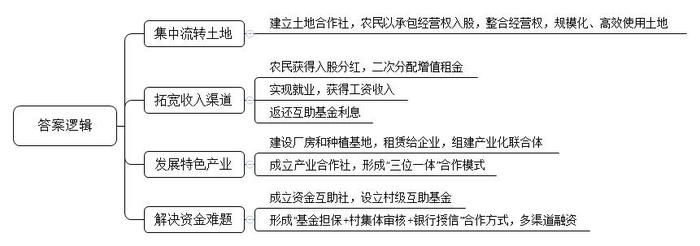
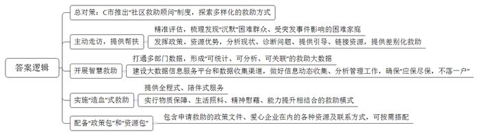
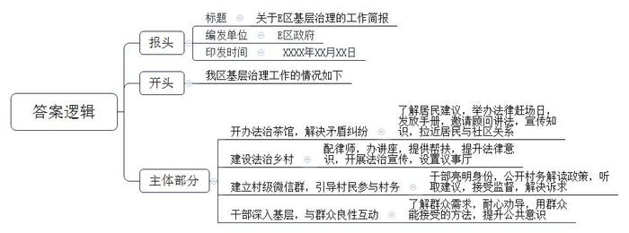
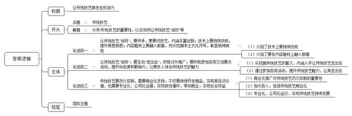

# 2021年公务员多省联考《申论》题（广西A、普通选调卷）

> 候选采集稿。参考答案及解析来自粉笔页面，不代表官方答案或真实高分答卷；来源使用许可与原卷对应关系仍需人工核实。

## 给定材料

### 材料 material-fd4f864728b987ac

近年来，长茂村围绕破解人、财、地三个难题，积极推进系列要素联动改革，逐步从一个发展落后的农业村蝶变为远近闻名的“明星村”。

以前的长茂村是一个传统的农业村，农作物一年两季，一季烤烟，一季稻谷，粗放式耕种方式抗风险能力弱，市场竞争力不强。“一旦遇上了台风，基本就是颗粒无收。”长茂村党支部书记刘振华说，“我们村地处世界长寿之乡，土壤富含‘长寿元素’硒，空气与水质好、温差大，但为何农业却成为‘跛脚’产业？”曾十余次到此走访的农业大学王教授直言，欠发达地区的资源禀赋优势本来就不明显，若是以分散的土地、少量的资金延续传统农业生产形态，收益自然一般。

32岁的黄波是长茂村的致富能手。去年上半年，他一口气向村里的股份合作经济联合社租下40亩地发展木耳种植，“这40亩地，涉及几十户人家，我现在不用一一去谈，只要找村里股份合作经济联合社就行，省去大量沟通成本。”去年以来，为解决承包地分散化、碎片化和低效使用等问题，长茂村建立村级土地合作社。“农民以承包经营权入股，以求将分散在每家每户的耕地经营权‘化零为整’，实现股权到人、股份合作、集体运营。”刘振华介绍，“村级土地合作社以合适的价格集约土地，并将集约后的土地以竞价方式承租出去。对于土地租金增值部分，土地合作社进行二次分配。50%返还给土地出租农户，50%归作集体，用于村里产业发展、关爱老人等公益事业。”

黑木耳产业园是长茂村近些年发展“一村一品”特色产业的缩影。该产业园由长茂村利用集体经济扶持资金与产业帮扶资金投资兴建，总投资约500万元，占地约10亩，实行生产、加工、销售一体化经营。记者在黑木耳产业园看到，几十个村民忙着栽培菌种、制作菌棒、养菌，柳琴就是其中一位。“在这上班，一个月有4000元左右的工资，也能照顾家里。”她笑言。据了解，在前期土地流转基础上，长茂村利用村集体经济建设厂房和种植基地，然后每年以20万元价格租赁给企业，探索“党支部+公司+基地+专业合作社+农户”形式，联手组建产业化联合体。同时，村党支部组织农户成立产业合作社，发展专业化生产，形成生产、供销、信用“三位一体”综合合作模式，有效解决农户传统种植模式风险大、竞争力较弱的问题，为村民提供内有技术、外有销路的产业链服务。

随着乡村振兴战略的推进，农村发展产业有资金需求，但金融机构有规避风险的责任，“钱从哪儿来，怎么才能用好”的问题愈发突出。为此，长茂村按照因地制宜、入社自愿的原则，探索成立长茂村资金互助社，并设立村级互助基金。“互助基金的资金来源为村民自筹、财政支持和社会捐赠三部分，我们实际筹款103万元。”刘振华说。之后，在互助基金中设置100万不动本基金，用于村集体、农业合作社及村民在银行担保贷款，担保贷款总额度为300万元。不动本基金的利息，一部分归村集体，一部分返还给资金互助社社员。“基金担保+村集体审核+银行授信”合作方式，为长茂村带来多渠道、多方式的融资服务，有助于满足农户短期种养、技术设备购买与更新、产业投资等方面的资金需求，也为长茂村股份合作经济联合社开展项目投资提供资金支持。

推进乡村振兴战略，如何释放沉淀资源、推动产业兴旺，是不少乡村遇到的现实难题。在王教授看来，只要思路和方法得当，就能找到适合本地的致富之路，就像把米、红豆、红枣等熬制成八宝粥，能得到更多附加值。长茂村走的正是这样一条路。

### 材料 material-b0f0709d13a1eab8

“把她的家粉刷一新，给独自生活的她更多支持。”

某公益平台上，为女孩小珊修缮房屋的公募计划得到不少爱心网友的积极参与。1元、10元、100元……不到一个月，爱心捐款就超过了修缮所需。

小珊家住C市N区。唯一的亲人去世了，自己又身患多种疾病，这让她一度有了轻生的念头，是N区“社区救助顾问”团队把她从疾病与孤独中拉了出来。“我们希望为她‘粉刷’的不仅仅是墙面，也是内心。”为小珊修缮房屋正是为其定制的救助“组合拳”中的一步；修葺后的房屋腾出一间出租，能有效缓解其家庭债务。同时，“社区救助顾问”团队为其提供专业心理咨询、继续教育、就业指导等服务，帮助她重拾生活信心。

小珊的故事是C市N区近年在全国率先推出“社区救助顾问”制度及社会救助综合改革的一个缩影。为贯彻党的十九届四中全会“建立解决相对贫困的长效机制”精神，N区探索多样化的救助方式，取得了较好效果。

尽管C市已建立较完备的现代社会救助体系，但救助工作涉及部门较多、政策内容较复杂，总有少数困难群众因不熟悉政策等原因未得到应有救助。如何彻底解决救助工作“最后一公里”，是C市N区亟待解决的难题。

2020年9月，C市宣布在全市全面实施“社区救助顾问”制度。N区作为全国社会救助综合改革试点区，在C市最先探索此项制度。2019年，该区组建一支300余人的“社区救助顾问”，由社区事务受理中心人员、居民区救助人员和专业社工组成。团队在发现不少“沉默”困难群众的同时，发挥熟悉各项救助政策、能够调配各项救助资源的优势，帮助困难群众分析现状、诊断问题、提供指引、链接资源，最终找到符合他们实际需要的差别化救助方式。“社区救助顾问”制度推出至今，N区已对7000多户居民进行了精准评估，梳理出困境家庭重点服务对象1300多户，其中不少为原本“沉默”的困难人群。

受新冠肺炎疫情影响，是否有些家庭会面临更大的风险？ N区红桥路街道救助顾问联合居委会主动走访。他们发现，经营小食店的苏先生因疫情无法开工，妻子无业在家，还有三胞胎女儿需要照顾，家庭基本生活难以维持。了解这一情况后，救助顾问以最快速度制定了救助方案，除发放临时帮扶金外、还链接外部资源，帮助苏先生妻子找到了线上工作岗位。

在N区华新路街道，近年来通过打通民政、人社、卫健、医保、残联等部门数据壁垒，形成了“可统计、可分析、可关联”的智慧救助大数据系统。街道办何主任举例说，救助顾问在比对居民医保与工会数据时，发现陈女士家庭医药费支出突然增大，上门走访后得知陈女士最近做了一场大手术，丈夫又生病在家，儿子也找不到工作。救助顾问随即为陈女士一家对接救助政策，不仅解决了大部分自费医药费，还帮助其儿子找到临时工作，使这个家庭走出了困境。

“我们还将进一步建设好大数据信息服务平台，畅通数据收集渠道，做好低保家庭、低收入家庭和特殊困难家庭的动态信息收集、数据管理分析工作，确保‘应保尽保，不落一户’。”N区民政局申局长说。

“贫困有时候不是光靠钱就能解决的，‘社区救助顾问’就是要分析每个个体或家庭的致贫原因，以‘一户一方案’原则设计救助计划，并提供全程式、陪伴式服务，把过去‘供血’式的物质救助转变为物质保障、生活照料、精神慰藉、能力提升等相结合的‘造血’式救助。”N区民政局社会救助科科长说。

N区每名救助顾问都有一个“政策包”和一个“资源包”，“政策包”里装着为困难群众申请救助的政策文件，“资源包”里则有包括爱心企业、群团组织、基金会等在内的各种资源和联系方式。救助顾问可根据救助对象实际所需及时匹配相应救助资源。

“社区救助顾问”制度在N区试点两年来，越来越多的困难人群被救助顾问发现，并得到相关救助。数据显示，N区救助目标对象占全区户籍人口的比例已从1%升至约3%。

### 材料 material-5c66434fd8cb0dcd

E区开展基层治理工作情况调研，以下是部分访谈记录。

某社区丁书记：在我们社区“法治茶馆”的墙上，写了“乡里茶谈”四个字，就是想把社区邻里的矛盾纠纷、居民对社区工作的建议意见等放到台面上，在大家聊天、喝茶、拉家常的过程中得到解决。在这里，每个月有两次法律主题的赶场日，为村民免费发放土地纠纷、老年人权益保护等法律手册，并有法律顾问现场讲解一些法律问题，提供法律咨询。前年，电力公司准备在社区修建一座高压铁塔，老陈等居民认为辐射大，影响身体健康，极力反对，社区干部多次上门做工作也没用。一次赶场日，社区工作人员专门邀请老陈到茶馆一起喝茶聊天，还邀请了电力公司的专业技术人员介绍高压铁塔的安全性。老陈听了后如释重负地说道：“看来是我对高压铁塔的安全性了解不够多，建铁塔看来是好事嘛。”事后，老陈遇到我，专门提起这件事，他说：“喝茶的时候我就不那么有抵触情绪，感觉和你们之间也没有隔阂了。”

村民老张：在我们村，以前村民有纠纷，会有一些打架等极端行为。现在，区司法局为每个村配备了律师，每个月都有普法讲座，村民依法维权意识大大增强。前些年，我把自家的3亩地租给了柑橘园刘老板，开始还能按时付租金，但从2017年起，刘老板不再如期支付租金，我多次要账无果。2019年区里推行律师驻村后，我靠免费法律帮扶要回了租金。如果没有驻村律师帮助，我不知道还要多花多少钱。我当时想把他的水利设备破坏掉出口气。现在看来，还是法律维权最好。如今，村委会不仅增设了“乡村大喇叭”，讲法律、“摆”道理，还设置了议事厅，有了小矛盾小纠纷，大家都可以到议事厅里，心平气和把事情“摆”出来，把道理讲清楚，共同解决问题。

某镇纪委胡书记：我们镇所有村都建立了村级微信群，让乡镇干部、民（辅）警、村组干部、每户村民代表等成为“微友”，并要求进群干部实行“实名+职务”亮明身份。按照要求，群内及时发布新政策动态、工程评议过程、议事决策以及村务信息等。群众对村里工作有建议，也可以直接在微信里提出来，还可对村里的老大难问题进行监督。不久前，龙溪村因上季度财务未定期公开，一些群众通过村级微信群表示质疑。镇党委按照加强基层管理的有关要求，立即着手调查，发现村财务并无问题，只是村务公开不及时，遂责成该村迅速公开财务，并向群众作出检讨。2020年来，我们镇通过“村级微信群”共解决涉及政策解答、诉求回应的便民服务类问题510件，收到“微友”反映的问题线索30余条。村级微信群让群众更便捷更直观地参与到了村级事务管理中，拉近了村民和村干部之间的距离。

某镇党委刘书记：我们在基层治理工作中，既需要群众给我们支持，理解我们的政策措施，推动工作落实落地，但更需要我们的干部深入基层干实事解难事，这样群众就会更加支持政府工作，形成干群关系良性互动，有理有法推动基层治理。我们镇上有对外乡夫妇，有一手烤羊肉串的好手艺，雇了5名员工，经营羊肉摊串。刚到镇上时，由于生意火爆，经常违规占道经营。派出所、城管执法队员和社区志愿者开始做劝导工作的时候，夫妻二人很不理解。执法人员耐心指导，动之以情，晓之以理，并耐心地帮他们经营出点子，所在社区还帮助解决了他们孩子入学的问题。现在，他们一家在镇上安顿下来，买了房子，租了门面，生意越来越红火。2019年，他们向所在社区捐出1万元和大米、菜油等爱心物资，帮助了25名困难群众。

区基层治理办小秦：我参加工作5年多了，做好基层治理工作，我最大的体会是，单靠法治是不够的，应在基层党委的领导下，还要学会和群众打交道的艺术，了解群众的需求，用群众易于接受的方法合情合理合法地推进。同样一个道理、一个政策，用不同的方法，就有不同的效果。有时候好的方法，不仅能让群众理解透政策，还能收获到他们的支持和好点子。关键也是要以心换心。

## 题目

### 第 1 题

**根据“给定资料**1**”，分析长茂村由发展落后的乡村蝶变为远近闻名的“明星村”的原因。（15分）**

关联材料：材料 material-fd4f864728b987ac

作答要求：

要求：

（1）全面，准确，有条理；

（2）字数不超过200字。

### 第 2 题

**根据“给定资料**2**”，谈谈C市是如何解决救****助****工作“最后一公里”难题的。（20分）**

关联材料：材料 material-b0f0709d13a1eab8

作答要求：

要求：

（1）全面，准确，有条理；

（2）字数不超过300字。

### 第 3 题

**假如你是E区政府办公室工作人员，请根据“给定资料**3**”，写一份E区基层治理工作的简报。（25分）**

关联材料：材料 material-5c66434fd8cb0dcd

作答要求：

要求：

（1）准确全面，条理清晰，语言流畅；

（2）字数不超过300字。

### 第 4 题

**“给定资料**4**”中提到“复活****容易****，活好****难****”。请根据你的理解，联系实际，自选角度，自拟题目，写一篇文章。（40分）**

关联材料：材料 material-fd4f864728b987ac

作答要求：

要求：

（1）立意明确，内容充实；

（2）思路清晰，语言流畅；

（3）参考“给定资料”，但不拘泥于“给定资料”；

（4）字数1000~1200字。

## 答案与解析

第 1 题

**参考答案（粉笔题库参考内容）**

1.集中流转土地。建立土地合作社，农民以承包经营权入股，整合经营权，规模化、高效使用土地。

2.拓宽收入渠道。农民获得入股分红，二次分配增值租金；实现就业，获得工资收入；返还互助基金利息。

3.发展特色产业。建设厂房和种植基地，租赁给企业，组建产业化联合体；成立产业合作社，形成“三位一体”合作模式。

4.解决资金难题。成立资金互助社，设立互助基金；形成“基金担保+村集体审核+银行授信”合作方式，多渠道融资。

**解析**

**参考答案说明：**本参考答案在内容上从“集中流转土地”“拓宽收入渠道”“发展特色产业”“解决资金难题”四个方面分类概括要点；形式上，对要点按照四个分类进行了整合，并且将每类中具有总括性的要点前置，符合题干中“有条理”这一要求。

**考点**：考点原因类

**来源**：来源2021年公务员多省联考《申论》题（广西A、普通选调卷）

粉笔申论页面对本题只提供「解析视频」入口，该入口是会员推广位，页面无视频地址与文字解析。

第 2 题

**参考答案（粉笔题库参考内容）**

C市推出“社区救助顾问”制度，探索多样化的救助方式：

1.主动走访，提供帮扶。精准评估，梳理发现“沉默”困难群众、受突发事件影响的困难家庭；发挥政策、资源优势，分析现状、诊断问题、提供引导、链接资源，提供差别化救助。

2.开展智慧救助。打通多部门数据，形成“可统计、可分析、可关联”的救助大数据；建设大数据信息服务平台和数据收集渠道，做好信息动态收集、分析管理工作，确保“应保尽保，不落一户”。

3.实施“造血”式救助。提供全程式、陪伴式服务；实行物质保障、生活照料、精神慰藉、能力提升相结合的救助模式。

4.配备“政策包”和“资源包”。包含申请救助的政策文件、爱心企业在内的各种资源及联系方式，可按需搭配。

**解析**

**参考答案说明：**本参考答案在整体上为“总-分”结构，先整体上指出C市推出“社区救助顾问”制度，再指出具体做法。具体做法部分分别从“主动走访，提供帮扶”“开展智慧救助”“实施‘造血’式救助”“配备‘政策包’和‘资源包’”这四个层面展开，并进行了分条撰写，且每条要点都将总结性的信息前置。

**考点**：考点概括措施类

**来源**：来源2021年公务员多省联考《申论》题（广西A、普通选调卷）

粉笔申论页面对本题只提供「解析视频」入口，该入口是会员推广位，页面无视频地址与文字解析。

第 3 题

**参考答案（粉笔题库参考内容）**

关于E区基层治理的工作简报

E区政府 XXXX年XX月XX日

我区基层治理工作的情况如下：

一、开办法治茶馆，解决矛盾纠纷。了解居民建议，举办法律赶场日，发放手册，邀请顾问讲法，宣传知识，拉近居民与社区关系。二、建设法治乡村。配律师，办讲座，提供帮扶，提升法律意识，开展法治宣传，设置议事厅。三、建立村级微信群，引导村民参与村务。干部亮明身份，公开村务解读政策，听取建议，接受监督，解决诉求。四、干部深入基层，与群众良性互动。了解群众需求，耐心劝导，用群众能接受的方法，提升公共意识。

以上是我区基层治理的相关情况。

**解析**

**参考答案说明：**（1）本题要求写“简报”，一般格式为：报头（包括标题、编发单位、印发日期等）+正文（一般包括开头、主体、结尾）。（2）本参考答案的内容方面，主体部分从“开办法治茶馆”“建设法治乡村”“建立村级微信群”“干部深入基层，与群众良性互动”这四个方面对E区基层治理工作进行了具体展开。形式方面，本参考答案做到了分段、分条撰写，整体上条理较为清晰。

**考点**：考点总结类

**来源**：来源2021年公务员多省联考《申论》题（广西A、普通选调卷）

粉笔申论页面对本题只提供「解析视频」入口，该入口是会员推广位，页面无视频地址与文字解析。

第 4 题

**参考答案（粉笔题库参考内容）**

**让传统技艺焕发生机活力**

习近平总书记指出，“要推动中华优秀传统文化创造性转化、创新性发展，以时代精神激活中华优秀传统文化的生命力。”传统技艺作为优秀文化的重要组成部分，也亟待振兴。但正所谓“复活容易，活好难”，我们不能沉湎于简单的传承，更要与时代接轨，让传统技艺焕发新的生命力。让传统技艺真正“活好”，我们要不断释放创造活力，创新技艺、丰富内涵，也要坚持对外推广，走出国门、走向世界，还要依靠商业化支持，走上市场化发展之路。

**让传统技艺“活好”，要传承，更要对技艺、内涵丰富创新。技术上要持续改良，提升美感质感；内容题材上要融入新意，充分挖掘本土文化符号，彰显地域特色**。既传承历史，又善于创新，才能不断巩固竞争力。要在技术上不断学习探索，结合新形势下行业的发展成果，借鉴新鲜技术、成熟经验，有机融合扬长避短，对现有技术有效改良，大力提升美感质感。要在内容题材上融入更多新意，既体现新格局时代要求、新潮流审美观念，也要体现当地自然风光、人文观念、规律习俗等独有特色，唤发强大的生命力、发展力。

**让传统技艺“活好”，要主动“走出去”，积极对外推广。要积极参加各类交流展示活动，提升知名度和影响力，让更多人体会传统技艺的魅力**。培育好生存土壤与空间，传统技艺才有存在的价值。要深度挖掘传统技艺的重要意义、丰富内涵，想方设法“走出去”，让其走得远、走得稳。要积极组织参加更大范围、更高层次的展示活动，通过电视、报刊、网络等方式开展宣传，利用各级商会、协会、研究会等提供的平台进行实物交流、技艺演示、推广宣传，吸引更多爱好者认可和关注，引起权威机构与专业人士重视，扩大知晓度、覆盖面、影响力，让更多的人体会传统技艺的魅力。

**传统技艺要历久弥新，需要商业化支持。不仅要持续开发商品，实现其经济价值，也需要专业化、公司化运营，实现良性循环，带动就业，实现社会效益**。商业化推广是让传统技艺历久弥新、永葆生机的重要途径。要加大投入，开发造纸、绘画纪念品等文化商品并扩大生产，加强专业化研究，把古老技艺变为现实需求，大力发展文化旅游，促进当地经济发展，释放经济价值。要实行专业化、公司化运营，通过市场化管理增强发展竞争力，持续营造浓厚文化氛围，提升传统文化价值，展现历史文化魅力，带动当地及周边劳动力就近就业，实现最大社会效益，实现良性循环，强化可持续发展。

时代呼唤创新，更呼唤像王陶然一样的创新型人才。坚持守正创新，保持开拓进取，必将不断激活优秀传统技艺的生命力，助推传统技艺绽放无比璀璨的光芒。

**解析**

**文章分析**

**让传统技艺焕发生机活力**

【**标题的优点：**标题中含有“传统技艺”这一主题，使文章主题更突出、清晰。】

习近平总书记指出，“要推动中华优秀传统文化创造性转化、创新性发展，以时代精神激活中华优秀传统文化的生命力。”（1）传统技艺作为优秀文化的重要组成部分，也亟待振兴。但正所谓“复活容易，活好难”，（2）我们不能沉湎于简单的传承，更要与时代接轨，让传统技艺焕发新的生命力。让传统技艺真正“活好”，我们要不断释放创造活力，创新技艺、丰富内涵，也要坚持对外推广，走出国门、走向世界，还要依靠商业化支持，走上市场化发展之路。

【**开头的优点：**★内容方面。范文的开头是紧扣题目中“传统技艺”这一主题展开的。首先，指出了传统技艺的重要性；其次通过分析当今时代的发展引出总观点。即指明让传统技艺“活好”要不断创新，要走出国门，要市场化发展等，为后文具体观点的论述做铺垫。★文字表达方面。使用了“然而”“更”等连接词，使语言表达有逻辑性。】

**让传统技艺“活好”，要传承，更要对技艺、内涵丰富创新。技术上要持续改良，提升美感质感；内容题材上要融入新意，充分挖掘本土文化符号，彰显地域特色**。既传承历史，又善于创新，才能不断巩固竞争力。（1）要在技术上不断学习探索，结合新形势下行业的发展成果，借鉴新鲜技术、成熟经验，有机融合扬长避短，对现有技术有效改良，大力提升美感质感。（2）要在内容题材上融入更多新意，既体现新格局时代要求、新潮流审美观念，也要体现当地自然风光、人文观念、规律习俗等独有特色，唤发强大的生命力、发展力。

【**论述段****1****的优点：**★观点句：范文的观点句是紧扣“传统技艺”这一文章主题提出的。形式上，它在段首处直接写出，位置突出，容易发现。内容上，关键词突出，内容要点明确，可以明显看出它从“丰富创新技艺、内涵”入手，让传统技艺“活好”。★论述内容：（1）介绍了技术上要持续改良；（2）介绍了要在内容题材上融入新意。注意：以上两个方面层次清晰，论述的针对性强。在论述方法上主要采用了讲道理的方式。】

**让传统技艺“活好”，要主动“走出去”，积极对外推广。要积极参加各类交流展示活动，提升知名度和影响力，让更多人体会传统技艺的魅力。**培育好生存土壤与空间，传统技艺才有存在的价值。（1）要深度挖掘传统技艺的重要意义、丰富内涵，想方设法“走出去”，让其走得远、走得稳。（2）要积极组织参加更大范围、更高层次的展示活动，通过电视、报刊、网络等方式开展宣传，利用各级商会、协会、研究会等提供的平台进行实物交流、技艺演示、推广宣传，吸引更多爱好者认可和关注，引起权威机构与专业人士重视，扩大知晓度、覆盖面、影响力，让更多的人体会传统技艺的魅力。

【**论述段****2****的优点：**★观点句：范文的观点句是紧扣“传统技艺”这一文章主题提出的。形式上，它在段首处直接写出，位置突出，容易发现。内容上，关键词突出，内容要点明确，可以明显看出它是从“主动‘走出去’”出发，让传统技艺“活好”。★论述内容：（1）从挖掘传统技艺的意义、内涵入手让传统技艺走出去；（2）通过参加各类活动，提升传统技艺魅力，让其走出去。注意：以上几个方面的内容都是紧扣观点句进行分析论述的，论述的针对性强，内容层次丰富。】

**传统技艺要历久弥新，需要商业化支持。不仅要持续开发商品，实现其经济价值，也需要专业化、公司化运营，实现良性循环，带动就业，实现社会效益。**（1）商业化推广是让传统技艺历久弥新、永葆生机的重要途径。（2）要加大投入，开发造纸、绘画纪念品等文化商品并扩大生产，加强专业化研究，把古老技艺变为现实需求，大力发展文化旅游，促进当地经济发展，释放经济价值。（3）要实行专业化、公司化运营，通过市场化管理增强发展竞争力，持续营造浓厚文化氛围，提升传统文化价值，展现历史文化魅力，带动当地及周边劳动力就近就业，实现最大社会效益，实现良性循环，强化可持续发展。

【**论述段****3****的优点：**★观点句：范文的观点句是紧扣“传统技艺”这一文章主题提出的。形式上，它在段首处直接写出，位置突出，容易发现。内容上，关键词突出，内容要点明确，可以明显看出它是从“商业化支持”入手，让传统技艺历久弥新。★论述内容：（1）商业化推广对传统技艺历久弥新的重要性。（2）加大投入，促进传统技艺商业化。（3）专业化、公司化运行，实现传统技艺持续发展。注意：以上几个方面的内容都是紧扣观点句进行分析论述的，论述的针对性强，内容层次丰富。在论述方法上采用了讲道理、举例子相结合，做到了丰富多样。】

【**论述段之间的关系：**★内容的内在逻辑：论述段1从技术、内容上创新的层面让传统技艺“活好”，论述段2从主动“走出去”层面让传统技艺“活好”，论述段3从商业化支持层面让传统技艺“活好”。三个论述段相互并列，逻辑清晰。】

时代呼唤创新，更呼唤像王陶然一样的创新型人才。坚持守正创新，保持开拓进取，必将不断激活优秀传统技艺的生命力，助推传统技艺绽放无比璀璨的光芒。

【**结尾的优点**：范文的结尾回扣了“传统技艺”这一主题，语言精悍，不拖沓。】

**考点**：考点文章写作题

**来源**：来源2021年公务员多省联考《申论》题（广西A、普通选调卷）

粉笔申论页面对本题只提供「解析视频」入口，该入口是会员推广位，页面无视频地址与文字解析。

