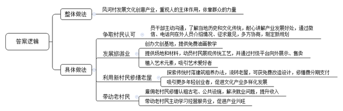
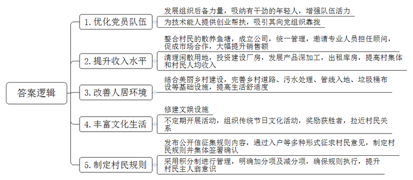
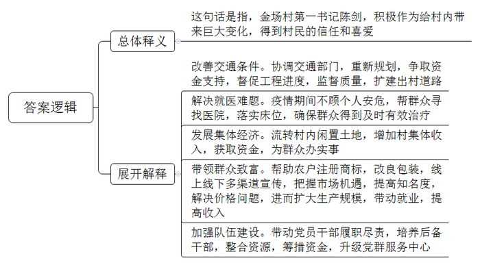
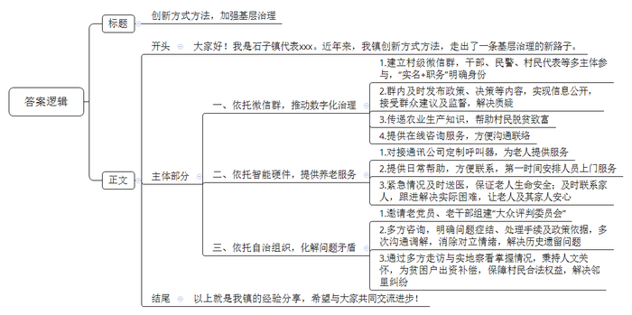

# 2021年公务员多省联考《申论》题（广西B卷）

<!-- gwy:overview:start -->
> **广西 · 2021 · 申论 · B类** ｜ 4 题 · 图片 4 处 · 答案随题折叠

导航：[题目](#题目) · [材料 1](#材料-1)
<!-- gwy:overview:end -->

> 候选采集稿。参考答案及解析来自粉笔页面，不代表官方答案或真实高分答卷；来源使用许可与原卷对应关系仍需人工核实。

## 给定材料

### 材料 1

北山县风河村沿溪而建，村史数百年，村尾的廊桥也已年过百岁。溪流两侧遗存的民居楼一字排开，多数为明清古建筑，都有百年以上的历史，但整体风貌保存完好。

近年来，风河的年轻人外出发展，迁居县城、省城，村里只剩下老人孩子。像风河这样的村子在北山有很多，“北山底子薄，发展只能立足于自身优势。”一位领导回忆起当年决策时说，北山的“优势”，就是传统村落及集群。

2015年，风河村在文创专家团队的指导下，打算以村里的古建筑和廊桥等为依托，发展村落文化创意产业。起初这一想法在村里并没有激起多大的波澜，有不少村民戏谑，“就咱这山脚旮旯，还能整出啥创意来？”“谁愿意到我们这穷乡僻壤来？”

为此，风河村的党员干部逐个上门跟村里的老人们沟通，向他们了解风河的历史和文化传统，跟他们耐心地讲解在风河开展文化创意产业的诸多好处。为让村里在外人员对古村落保护和文化创意有更多了解，村干部专门通过微信、电话等方式向他们介绍相关情况，征求意见建议。有人提出，“发展村落文创产业不是不行，但关键是谁来创这个业？”还有人担心，村里面的人群单一，“没有人进来，创业之后如何能够持续下去？”大家意识到，发展村落文化创意产业的关键是要把人引进来，尤其要引入“新村民”。在多方讨论协商之后，风河村最终以“文创新古村、引凤入风河”为主题，制定了新的发展规划。

以规划为指引，在文创团队的协助下，风河村创办了文创基地“广泰艺术城”，先后在两个村落试点“人人都是艺术家”项目，为村民、游客提供免费油画教学。村里还提供场地和材料，动员村民将剪纸、雕刻等传统手工艺展现出来，并通过村级平台向外界展示、售卖。这不但激发了村民的热情，还吸引了许多游客前来打卡。随着艺术元素的植入，古村旅游风生水起，“广泰艺术城”吸引了众多艺术爱好者纷至沓来，目前已陆续接待国内外驻学人员2万多人次。

村里空置老屋不少，但难就难在老屋早已不适合居住，要拆，业主们不肯；修缮，太费钱，工程还复杂繁琐。两难之下，风河村摸索出了“传统村落建筑租养”的办法。一是村委统一与产权人签订租赁合同，流转老屋的使用权和经营权。二是“新村民”作为老屋承租人同村委签订租赁合同。三是老屋的现代化改造设计由专业团队免费提供，修缮费用由村里垫付，“新村民”分期支付。

2017年8月，冯皓成从南方老家辗转来到风河，成为风河村第一批“新村民”。他选定了两栋溪边老屋，一栋运营书屋，一栋运营咖啡屋。三年多来书屋兼营民宿、文创器物等，已获利超20万元；咖啡屋经营3年多已基本回本。

古村落、古民居的传统环境，以及第一批“新村民”取得的成果，吸引了不少年轻人到此从事互联网文创产业。如今的风河拥有书屋2家、咖啡吧5家、美术馆2个，艺术共享空间和工作室22家，国术馆1家。“新村民”在风河村所从事的文创产业已覆盖影视、传媒、音乐、美术等多个领域。文创产业的愈发兴旺带来的是乡村旅游的人气倍增。在这一过程中，风河变得更加有活力，对老村民的回馈也越来越多。

“从头到尾，老村民都是受益者。”村干部说，“在建设初期，村里的公共设施、‘新村民’认租的古宅都是由村委会雇佣老村民来修建、修缮的，这是他们不用外出打工，在家门口赚到的第一桶金。”游客越来越多，老村民又跟“新村民”学习，经营起餐馆、民宿、小卖部之类，干得风生水起。

“别人‘筑巢引凤’，而我们是‘引凤筑巢’。”有人这样评价。

### 材料 2

2020年12月，团进村681户村民，陆续在一份“五和团进”村民规则确认书上，郑重地签下自己的名字。速度之快、人心之齐，让人很难想象这曾经是一个矛盾不断的后进村。

松山南部地区的团进村，2005年由团湖、望江、进守、津水4个村合并而成。与许多合并村一样，团进村曾经也存在“合村不合心”的问题。在村民周建华的记忆里，以前户与户之间都是各扫门前雪、不问村务事。“记得有一次，我们和4个村民一起，发起一场道路清扫义务活动，没想到不少村民当着面就说我们是作秀。”

这不是团进一个村遇到的窘境。在经济社会的快速发展变迁中，曾经是传统乡村联结根基的长辈权威等已逐渐弱化。如何建立一种新的联结，激发村民参与村庄治理的积极性？团进村一直在摸索。

新一届村党支部针对团湖、望江、进守、津水党员数量分布不均衡、结构不合理、先锋模范作用发挥不好等问题，积极发展后备力量，鼓励技术能人向党组织靠拢。“以前我们支部的平均年龄在60岁左右，经过几年的发展，我们吸纳了一批有干劲的年轻人，极大地增强了队伍的活力。”村党支部莫书记介绍。

韦长发是原津水村村民，多年来一直在外地从事水产养殖工作，考虑到望江水产基础好，适合发展名特优水产品，打算回乡发展。“刚回来的时候，村里在选场地、筹集资金、招募工人、办手续等方面给了我很大的帮助。”韦长发说。一年后，他的养殖基地开始盈利。2019年，韦长发被吸纳为党员。

在津水和望江有一些村民此前承包水塘养鱼，但由于技术有限，市场信息不对称，行情一直不太好。去年，村里规划将两地原有的散养鱼塘整合，成立了团进鱼跃公司，统一管理，并邀请韦长发担任顾问。韦长发凭借自己在外多年的门路，成功促成了团进鱼跃公司与外地饲料公司和一些大型生鲜市场的合作，鱼跃公司市场销售额比以前翻了几番。

去年底，村里把闲散的15.3亩建设用地清理出来，村集体投资建设了厂房，用于水产品深加工，并且将部分库房出租给经销商。“仅这一项，就让我们村集体收入比去年多出了60多万元。”村委会主任曾永平高兴地算着账，“去年村民人均纯收入增加了1.2万元，大家都很高兴。”

村里结合美丽乡村建设，加强乡村道路、污水处理、管线入地、垃圾桶布设等基础设施建设，“前几年，村里的部分路段经常泥泞不堪，出行不便，道路两旁杂草丛生，垃圾随处可见。现在，村里的道路拓宽了，环境得到改善了，我们的生活变得更加舒适了。”村民黄海老人笑着说。

村里还修建了民心广场，供村民休闲娱乐。不定期开展健身运动会、说书比赛等活动，还在传统节日的时候组织村民包粽子、猜灯谜、对对子，并且由村民评选出获胜者，给予一定奖励，“得到奖品是小事，关键是大家愿意聚拢了，比以往更亲近了！”村民李大红说。

去年12月，为了进一步规范村民行为，增强村庄凝聚力，团进村向全体村民发出了一封公开信，围绕“和善村民、和美家庭、和睦邻里、和煦村庄、和谐社会”，征集村民规则的具体内容，同时通过入户走访、座谈等多种形式征求意见，在此基础上形成了“五和团进”村民规则。为了使规则落到实处，村里采用积分制进行管理——不乱停车加1分，违法搭建扣5分，违反出租屋规定扣1分……整个村民规则包括30条加分项和30条减分项，大家称之为“团进60条”。

这份大家讨论出来的“家法”织牢了约束村民言行举止的规矩之网。据曾永平介绍，规则实行以来，村里乱丢垃圾、乱停车、乱搭建等行为大为减少。“在农村，村民们最看重的就是‘面子’，有了这样的激励，大家对积分格外上心，村民的主人翁意识也大大提高了！”

### 材料 3

“我们金场村是传统的纯农业村，小陈刚来时，我为他捏了一把汗。那个时候，村民们把他当外人看，都不相信这个年轻人能带领大家改变金场村。没想到两年下来，他为金场村带来了巨大的变化，也得到了大家的信任和喜爱。”金场村70岁的老支书余桂龙感慨地说。

位于三镇交界处的金场村，俗称“金三角”，其实是经济薄弱村。2018年3月，陈剑来到金场村担任第一书记。他第一次到金场村，因为道路狭窄不平，他坐的车在会车时车轮卡住了，进退不得。围观的村民无一援手，最后不得已，只好花钱找吊机吊上来。“要致富，先修路，没有路就没有出路。”陈剑积极协调县交通部门对出村公路进行了重新规划，争取财政和社会力量的资金支持，修建出村公路。陈剑经常泡在工地上，督促工程进度，监督公路质量。不到一年，直通国道的出村道路便扩建完成。

金场村90后小伙周祥几乎不与村干部打交道，却与陈剑成了患难之交。“我母亲去年患尿毒症，每周一、三、五定期到市区医院透析。”周祥介绍。突如其来的疫情打断了他母亲的治疗计划，不得已，他向村干部求助。为了让周祥的母亲得到及时有效的治疗，陈剑在做好严密防控的前提下，亲自前往县城寻找救治医院，落实透析床位。“在疫情防控最严峻的时候，陈书记帮了我们大忙，这份情我们一家人都记在心上。”周祥说。这件事在全村传开后，大家都夸陈书记能真正帮老百姓解难题。

“想为村民办事，要有钱啊！村集体经济不好，想办事也办不成。”刚到村时，陈剑就开始为村集体经济发愁。两年来，他通过多种方式，流转了全村80%的土地，盘活了村里的闲置土地，为村集体增加收入175万元。金场村建档立卡的低收入农户51人提前脱贫，6名贫困学子获资助走进大学校园，留守儿童暑期教育问题也得以解决……

让村里人富起来，是陈剑一直以来的心愿。村民孙保国看到其他地方“鱼稻共生”生态种植很赚钱，就在金场村租下110亩农田开展有机水稻种植，没想到第一年就遭遇“滑铁卢”，卖不起价。“他们投入血本，忙了一年，最后竟无人识货，孙保国着急上火，他老婆天天哭。”陈剑说，“我详细了解了水稻种植全过程，得知稻种优、水质佳、天然肥、手工种的‘鱼稻共生’生态种植模式具有广阔发展前景，不能因为价格问题挫伤种植户的积极性。”陈剑帮其注册了“金场村”牌商标，用布袋小包装，请来好友制作宣传单，在自己的短视频账号“金场故事”出镜说故事、讲情怀，还赶在春节前到各企事业单位推销，“金场村”牌大米成了“网红大米”。前后一个多月的时间，两万多斤“金场村”牌“网红大米”以每斤20元的价格销售一空。难题解决了，孙保国看到了希望，增加了种植面积。金场村20多名村民也被请来当季节工，每人每天有100多元收入，村民共同致富的目标又近了一步。

担任第一书记以来，陈剑引领全村党员、干部在岗位上履职尽责，还培养了两名年轻的后备干部。通过多方整合资源、筹措资金，对村党群服务中心进行了升级改造。

陈剑说：“从刚开始的不熟悉，到如今随便走进哪一家，村民都热情地端茶倒水，坐在小板凳上与我聊家常，把我当自家人，我感到了金场村2000多村民对我的认可。我觉得非常开心，因为用心付出换来了我最看重的东西。”

### 材料 4

“今年全村16万元土地流转金，已通过转账方式发放到你们的银行卡中，请大家注意查收……”2020年11月24日，石子镇悦来村主任利用村级微信群向大家发布通知。

村级微信群让乡镇干部、民（辅）警、村干部、村民小组长、每户村民代表等成为“微友”，进群干部实行“实名＋职务”亮明身份。按照要求，群里及时发布新政策动态、工程评议过程、议事决策以及村务信息等。群众对村里工作有建议，也可直接在微信里提出来，还可对村里的重大事项进行监督。

不久前，石子镇龙溪村因上季度财务未定期公开，一些群众通过村级微信群表示质疑。镇党委按照加强基层治理的有关要求，立即着手调查，发现村财务并无问题，只是村务公开不及时，便责令该村迅速公开财务，并向群众作出说明。

“冬季油菜管理、黑山羊常见病防治等知识，我都是通过村级微信群学到的，我们脱贫致富又多了一个‘好帮手’。”石子镇沙河村村民王林掏出手机，熟练地打开微信，翻看群里历史聊天记录，笑着说，“以前咨询村干部事情还要专门打电话或者到村委会去，现在群里几句话就弄明白了！”

2020年5月11日，石子镇黄集社区张大娘在家中不慎摔倒，动弹不得，她立即通过随身携带的“呼叫器”，向社区寻求帮助。社区干部得知消息后，第一时间将张大娘送往医院就医，并及时与张大娘在外地打工的儿子取得联系。住院期间，社区干部、党员、志愿者等多次与她联系，帮助她解决实际困难。

针对社区留守老人、独居老人较多这一具体情况，为了更好地给他们提供服务，黄集社区主动与某通讯服务公司联系，定制了一款集手机与对讲机优势于一体的呼叫器，发放给老年人使用。“老人们需要帮助，通过呼叫器，随时能与社区取得联系，我们会在第一时间安排相关人员上门服务。”党支部书记胡汉生介绍。

“摔倒了、起不了床，我都可以按一下按键，通知社区里的人来帮忙，这就方便了不少。”张大娘说，有了呼叫器，就不用再担惊受怕了，这点很贴心，儿子在外面工作也很放心。

石子镇南河村资源丰富，本应抓住机遇、向前发展，但多年来，由于种种原因，村上历史遗留问题较多，加上一些新出现的矛盾，不仅阻碍了村内工作的正常开展，而且影响了村干部干事创业的积极性。南河村充分发挥集体智慧，按照群众的事交给群众来解决、大家的事大家来评判的工作思路，决定邀请村中有威望、办事公正、有奉献精神的老党员、老干部组建“大众评判委员会”。这个提议得到了大家的积极响应，很快，“大众评判委员会”就建立起来。

村民李大奇自称20多年前为村里建桥，但一直没有结算工程款，多次找村干部要求结清账目，但都未解决。“大众评判委员会”按照承包工程的正常程序，要求其出示合同手续、工程结算、验收结果等凭证，均被其以时间久远、手续丢失为由拒绝。后来经过咨询工程权威单位、询问时任村干部，基本弄清了问题的症结所在、解决该问题需要的手续以及相关的政策依据。在此基础上，“大众评判委员会”又召集双方多次沟通调解，逐渐消除双方的对立情绪，解决了纠纷。

村民田洪亮，2009年在村里批得块新宅基地，他在上面盖了新房。房子建成后，因相邻一户没有及时修建，地基长年积水，致使其新房出现裂缝，他找邻居协商无果后，频频上访。经过多方走访和实地察看，“大众评判委员会”发现田洪亮的房屋裂缝确系相邻户宅基地雨天积水所致。但是相邻户户主是残疾人，收入较低，且家里有两个小孩上学，家庭负担非常重，出于人文关怀，“大众评判委员会”经过与村委会商量，决定由村里出资17000元作为房屋维修费补偿给田洪亮。一件多年上访积案得以解决。

“大众评判委员会”成立以来，解决了村民反映突出的历史遗留问题13件，处理邻里纠纷20余起，极大地改善了村民之间的关系，助推了村里事务的有序开展。

## 题目

### 第 1 题

**根据****“给定材料**1**”，谈谈北山县风河****村****是怎样****“引凤筑巢”的。（15分）**

关联材料：材料 1、材料 2、材料 3、材料 4

作答要求：

要求：

（1）准确，全面，有条理；

（2）字数不超过300字。

第 1 题 · 答案与解析

**参考答案（粉笔题库参考内容）**

风河村发展文化创意产业，重视人的主体作用，依靠群众的力量。

1.争取村民认可。党员干部主动沟通，了解当地历史和文化传统，耐心讲解产业发展好处，通过微信、电话向在外人员介绍情况、征求意见，多方协商，制定新规划。

2.发展旅游业。创办文创基地，提供免费油画教学；提供场地和材料，动员村民展现传统工艺，并通过村级平台向外展示、售卖；植入艺术元素，吸引艺术爱好者。

3.利用新村民修缮老屋。探索传统村落建筑租养办法，流转老屋，可获免费改造设计，修缮费分期支付；吸引更多年轻创业者，促进文化产业多样化发展。

4.带动老村民。雇佣老村民修缮认租古宅、公共设施，解决就业问题，提升收入；带动老村民主动学习经营服务业，促进产业兴旺。

**解析**

**参考答案说明：**本参考答案首先将整体做法前置，并利用文章内容对整体做法进行补充，并从“争取村民认可”“发展旅游业”“利用新村民修缮老屋”“带动老村民”四个方面分类概括要点，对具体每条要点的撰写时将总结性的信息前置，做到了题干要求的“有条理”。

**考点**：考点概括措施类

**来源**：来源2021年公务员多省联考《申论》题（广西B卷）

粉笔申论页面对本题只提供「解析视频」入口，该入口是会员推广位，页面无视频地址与文字解析。

### 第 2 题

**根据****“给定资料**2**”，分析团进村是如何解决“合村不合心”问题的。（25分）**

关联材料：材料 1、材料 2、材料 3、材料 4

作答要求：

要求：

（1）准确，全面，有条理；

（2）字数不超过400字。

第 2 题 · 答案与解析

**参考答案（粉笔题库参考内容）**

1.优化党员队伍。发展组织后备力量，吸纳有干劲的年轻人，增强队伍活力；为技术能人提供创业帮扶，吸引其向党组织靠拢。

2.提升收入水平。整合村民的散养鱼塘，成立公司，统一管理，邀请专业人员担任顾问，促成市场合作，大幅提升销售额；清理闲散用地，投资建设厂房，发展产品深加工，出租库房，提高村集体和村民人均收入。

3.改善人居环境。结合美丽乡村建设，完善乡村道路、污水处理、管线入地、垃圾桶布设等基础设施，提高生活舒适度。

4.丰富文化生活。修建文娱设施；不定期开展活动，组织传统节日文化活动，奖励获胜者，拉近村民关系。

5.制定村民规则。发布公开信征集规则内容，通过入户等多种形式征求村民意见，制定村民规则并集体签署确认；采用积分制进行管理，明确加分项及减分项，确保规则执行，提升村民主人翁意识。

**解析**

**参考答案说明：**本参考答案从“优化党员队伍”“提升收入水平”“改善人居环境”“丰富文化生活”“制定村民规则”这五个方面进行了分条撰写。各条要点之间在内容上相互并列，没有交叉。

**考点**：考点概括措施类

**来源**：来源2021年公务员多省联考《申论》题（广西B卷）

粉笔申论页面对本题只提供「解析视频」入口，该入口是会员推广位，页面无视频地址与文字解析。

### 第 3 题

**根据****“给定资料**3**”，谈谈对划线句子“因为用心付出换来了我最看重的东西”的理解。（20分）**

关联材料：材料 1、材料 2、材料 3、材料 4

作答要求：

要求：

（1）准确，全面，条理清晰；

（2）字数不超过300字。

第 3 题 · 答案与解析

**参考答案（粉笔题库参考内容）**

这句话是指，金场村第一书记陈剑，积极作为给村内带来巨大变化，得到村民的信任和喜爱。具体表现为：

一、改善交通条件。协调交通部门，重新规划，争取资金支持，督促工程进度，监督质量，扩建出村道路。

二、解决就医难题。疫情期间不顾个人安危，帮群众寻找医院，落实床位，确保群众得到及时有效治疗。

三、发展集体经济。流转村内闲置土地，增加村集体收入，获取资金，为群众办实事。

四、带领群众致富。帮助农户注册商标，改良包装，线上线下多渠道宣传，把握市场机遇，提高知名度，解决价格问题，进而扩大生产规模，带动就业，提高收入。

五、加强队伍建设。带动党员干部履职尽责，培养后备干部，整合资源，筹措资金，升级党群服务中心。

**解析**

**参考答案说明：**思路方面，本参考答案按照“总体释义+展开解释”的答题思路展开。内容方面，本参考答案先对题干句子的含义进行了解释；然后分别从“改善交通条件”“解决就医难题”“发展集体经济”“带领群众致富”“加强队伍建设”五个方面分析了“用心付出”的具体表现；最后由于材料中没有总结对策性信息，因此总结部分可略去。词句表达方面，本参考答案加上了“具体表现为”等连接词来承接上下文。

**考点**：考点词句解释类

**来源**：来源2021年公务员多省联考《申论》题（广西B卷）

粉笔申论页面对本题只提供「解析视频」入口，该入口是会员推广位，页面无视频地址与文字解析。

### 第 4 题

**县里近期将召开基层治理工作经验交流大会，石子镇将在会上发言。请你根据****“给定资料**4**”，写一份石子镇创新方式方法加强基层治理的经验交流材料提纲。（40分）**

关联材料：材料 1、材料 2、材料 3、材料 4

作答要求：

要求：内容全面具体，有逻辑性，语言流畅。不得署真实姓名，不超过500字。

第 4 题 · 答案与解析

**参考答案（粉笔题库参考内容）**

创新方式方法，加强基层治理

背景介绍：大家好！我是石子镇代表xxx。近年来，我镇创新方式方法，走出了一条基层治理的新路子。

具体经验：一、依托微信群，推动数字化治理。1.建立村级微信群，干部、民警、村民代表等多主体参与，“实名+职务”明确身份。2.群内及时发布政策、决策等内容，实现信息公开，接受群众建议及监督，解决质疑。3.传递农业生产知识，帮助村民脱贫致富。4.提供在线咨询服务，方便沟通联络。二、依托智能硬件，提供养老服务。1.对接通讯公司定制呼叫器，为老人提供服务。2.提供日常帮助，方便联系，第一时间安排人员上门服务。3.紧急情况及时送医，保证老人生命安全；及时联系家人，跟进解决实际困难，让老人及其家人安心。三、依托自治组织，化解问题矛盾。1.邀请老党员、老干部组建“大众评判委员会”。2.多方咨询，明确问题症结、处理手续及政策依据，多次沟通调解，消除对立情绪，解决历史遗留问题。3.通过多方走访与实地察看掌握情况，秉持人文关怀，为贫困户出资补偿，保障村民合法权益，解决邻里纠纷。

总结：以上就是我镇的经验分享，希望与大家共同交流进步！

**解析**

**参考答案说明：**（1）本题为“提纲”，不必考虑格式，但是为了保险起见，建议加上标题。（2）正文部分，一方面从内容来看，围绕着“石子镇创新方法加强基层治理”这一主题，开头部分先背景介绍；接着主体部分从“依托微信群，推动数字化治理”“依托智能硬件，提供养老服务”“依托自治组织，化解问题矛盾”这三个方面介绍了石子镇加强基层治理的经验，且每个方面又进一步展开说明；最后结尾部分简单总结呼吁。另一方面，形式上，本参考答案做到了分段、分条撰写，整体上条理较为清晰。

**考点**：考点总结类

**来源**：来源2021年公务员多省联考《申论》题（广西B卷）

粉笔申论页面对本题只提供「解析视频」入口，该入口是会员推广位，页面无视频地址与文字解析。

