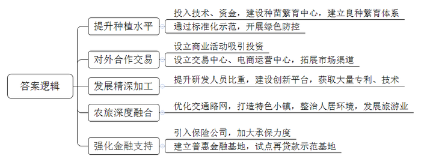
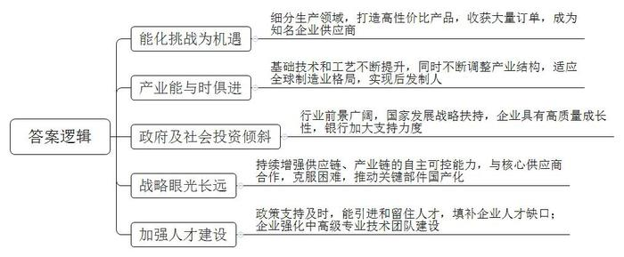
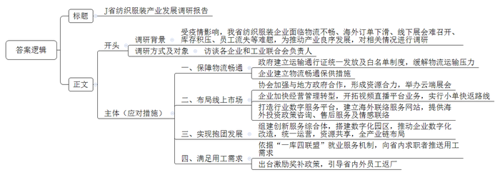
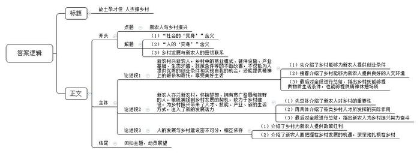

# 2022年公务员多省联考《申论》题（广西A、普通选调卷）

<!-- gwy:overview:start -->
> **广西 · 2022 · 申论 · A类** ｜ 4 题 · 图片 4 处 · 答案随题折叠

导航：[题目](#题目) · [材料 1](#材料-1)
<!-- gwy:overview:end -->

> 候选采集稿。参考答案及解析来自粉笔页面，不代表官方答案或真实高分答卷；来源使用许可与原卷对应关系仍需人工核实。

## 给定材料

### 材料 1

T市地处北纬30度，气候温和，雨量充沛，日照充足，平均气温17℃，且有偏酸性的土壤和便利的灌溉条件，孕育了柠檬生长的最佳环境。作为世界三大适于柠檬生长的圣地之一，T市近些年瞄准“国际柠檬之都”的目标，大力推动柠檬特色产业发展。

近些年，T市农投集团依托着农科院技术力量，投入资金建设柠檬种苗繁育中心，逐步建立起柠檬良种脱毒三级繁育体系，实现柠檬良种无毒化。“采用脱毒育苗两年可出成品苗，比传统方式可以提前一年左右，还具有长势快、抗逆性强等优点。”种苗繁育中心技术员介绍，自2018年建成投产以来，该中心一年就可以培育出100万株以上柠檬新品种，为T县打造柠檬种植产业奠定了坚实的基础。

T市还主动将省里的农业种植专家请进来，在专家指导下，T市那平镇万亩柠檬基地通过有机肥代替化肥、喷施叶面肥、果园生草栽培技术等措施，以标准园为示范，在全市所有柠檬园开展了绿色防控，实现农药化肥双减30%以上。农残抽检均低于国家标准，柠檬产量和绿色品质大幅提升。看着即将成熟的大片柠檬树，农民老杨激动地说，“在柠檬基地当看护员，离家近不说，一个月轻轻松松就有两三千收入，比在外面打工好多了！”到目前为止，T市柠檬种植面积已达32万亩，年产鲜果28万吨，综合产值50亿元，助力5万多农民增收致富。

2021年10月21日，首届国际柠檬节在T市开幕，来自不同城市、地区的150多家企业和单位现场签约51个投资项目。签约金额28亿元。国内首个柠檬交易中心也同步上线，当天交易各类柠檬产品2万吨。今年初，T市柠檬电商运营中心正式启动运营。“我们之前从事多年的线上服装销售工作，积累了一定的直播经验，现在通过电商平台，我们可以将柠檬卖到全球多地，销量越来越好。”运营中心工作人员小刘说。

“柠檬全身是宝，在T市，每一片柠檬都会被‘榨干吃净’。”柠宝科技集团徐总说。如今在T市，已有柠宝等十多家企业投资建厂。围绕着柠檬精深加工，已开发出饮料、绿色食品、美容护肤品、生物医药及保健品等5大体系350多种产品，如柠檬蜜茶、柠檬面膜、柠檬香皂、柠檬精油、柠檬冻干片等。“我们企业主导产品就是果胶，作为重要食品添加剂，广泛应用于众多消费食品中。”徐总介绍，“公司不断突破关键核心技术，一条生产线一年就可消化掉3.5万吨果皮，生产出2000吨高质量果胶，产值高达2亿元。”在柠宝科技集团，研发人员超过了职工总数的十分之一，并建有柠檬深加工工程技术中心、企业技术中心等创新平台，围绕柠檬产品精深开发的国家专利30多项，自主研发精深加工技术300多项。

为了方便柠檬采摘运输，T市2018年启动了“四好农村路”建设工程，优化农村综合交通路网，累计完成了200公里道路建设，惠及全市40多个村镇。“近年来，镇里还以柠檬产业为抓手，以打造柠檬小镇为目标，推动农村人居环境整治，大力发展林下采摘、特色民宿、亲子体验等项目，平均吸引城市游客近10万人次。“檬圩镇党委书记说。2021年，檬圩镇集体经济总收入达600万元，同比增长12%，檬圩镇目前成功纳入省《2022年特色小镇清单》。

“今年T市相继引入了三家保险公司，现针对柠檬种植、加工、生产等方面的新险种多达27个，承保力度也比较大，柠檬产业的发展有了很好的保障。”省银保监局的工作人员说，“T市还在215个行政村建立了普惠金融基地，其中白沙镇、檬圩镇等典型示范乡镇还设有‘央行再贷款示范基地’，相关金融机构在T市柠檬产业领域的投资收益连续多年保持5%以上增长。”

### 材料 2

2022年5月5日，G省《一季度全省经济运行情况报告》显示，一季度全省规模以上制造业增加同比增长6.2%，其中“新动能”制造业发展迅猛，为G省加快走出疫情影响提供了新动力。新动能制造业主要涉及新能源、人工智能、新材料、电子设备、高精密仪器设备、医药和医疗器械等领域，新动能企业合计占G省规模以上工业企业总数的33.3%，总量位居全国第一。

张总的企业今年刚入选工信部“专精特新”企业名单，今年一季度，企业面临原材料涨价，物流不畅等问题，但他们的产品订单量、销售额同比大幅增长。“我们将挑战化作机遇，在面对西方垄断的情况下，进行生产领域的细分，着力打造性价比较高的产品，即使全球供应链紧张也没有阻止我们收获大量订单。”张总自信满满地说，企业成立至今三年多时间，每年都保持翻倍式增长。我们的产品主要应用于蓝牙耳机、智能手环等移动便携设备，去年还成为全球多家知名企业的供应商。

省社科院陆教授说：“我省‘新动能’产业的发展并非一日之功，从改革开放至今，我省制造业的基础技术和基础工艺都在不断提升，全球制造业的格局也在不断变化。”受省发改委委托，陆教授的团队近几年一直在跟踪研究全省经济结构。“前几年我省‘新动能’制造业刚起步，确实拖累了全省GDP增速，但随着产业结构的不断调整布局，‘新动能’制造业后发制人，迅猛提速的效果立即显现。”

数据显示，2021年G省电气电子、新材料制造、通用和专用设备等领域新增规模以上工业企业超过1万家，新能源汽车制造业产值同比增长34.2%，电子设备制造业产值同比增长23.5%，高端医疗器械和医药制造业产值同比增长26.8%，实体经济培育效果显著。省统计局张局长介绍，“一串串靓丽数字的背后是政府及社会投资风向的转变。2021年全省高技术制造业投资猛增64.3%，先进制造业投资增长43.1%，‘新动能’制造业发展势头旺盛。”

“近三年的行业前景分析报告支持我们加大对‘新动能’制造业的支持力度。”某银行G省分行熊副行长说。《一季度全省经济运行情况报告》显示，2022年3月末全省金融机构对“新动能”制造业的贷款增长了45.8%。熊副行长说：“我们的银行业务重心正在转向高技术产业、‘专精特新’类企业客户，很多银行都在这么做。我们认为，这些客户具有独立创新的企业家精神和抢抓市场的独特视野，具有高质量的成长性。为他们提供贷款支持既是为了国家发展大战略，也是我们银行发展的‘新动能’。”

高达智能公司是G省人工智能领域的龙头企业，企业负责人说：“我们在疫情与国际局势的双重影响下，持续增强供应链、产业链的自主可控能力，与核心供应商合作，打破芯片、轴承、精密塑胶原材料受制于国外企业的不利局面，针对各种‘卡脖子’技术，推动上下游关键部件国产化。因此，公司得以在‘危机’中看‘新机’，‘变局’中开‘新局’。我们应对疫情变化迅速研发出三款防疫机器人，不仅在国内取得成功应用，也出口到25个国家和地区。欧美多国现在就有超过300多所中小学、500多座写字楼在使用我们的产品，公司的长远预期没有变化，人工智能本身着眼于未来，不会因为当前的一些困难就改变初衷。”

“我们公司之前非常缺既懂芯片，又懂市场，还懂管理的复合型人才，想引进一个人才比较困难，即使引进来了也不长久，省里的政策出台得很及时，效果也很好，帮助我们实实在在解决了燃眉之急。另外我们公司的中高级专业技术团队也在不断强化。”某芯片研发制造企业负责人感慨地说。“企业的人才需求就是我们的行动方向，我们的‘新动能’企业在国内外市场披荆斩棘，我们出台了《关于强化制造业高质量发展人才支撑的意见》，就是要在大后方搞好政策保障。”省人社厅黎厅长意味深长地说。

### 材料 3

每年的三四月是纺织服装企业的销售旺季，但2022年春天的散发疫情使得J省部分企业再次陷入困境。“三四月份的经营情况并不是很乐观。”J省P公司李经理说，“面辅料进不来、产品送不出去。在给客户寄付样衣时，我每次都会同时找四五家快递‘多路突进’。”

“起初预判今年的海外订单会有所上涨，本想大干一场。疫情的反弹，却带来一场‘倒春寒’，一些海外客户就因为交付期延长而选择退订。”L公司胡总说，“由于正常的生产周期被打乱，接下来一段时间很可能会经历订单大幅下滑的空窗期。目前海外客户下单之前都会提前咨询交货周期或库存情况，今后公司会更侧重向客户推荐库存纱线或者交货周期短的产品。”

“春季本来是我们省纺织服装行业下订单的旺季，今年临近夏季了，都很难看到人声鼎沸的线下展会，秋季展会能不能召开也存在很大的变数。”营销部赵经理所在的D科技有限公司前不久参加了“2022首届中国轻纺城云展·轻薄面料专场”，由业务员在直播间向采购商推介产品，收获了不少客户。同时，公司还调整了经营管理模式，走与电商更匹配的“小单快返”路线，产品目前全部实现7至10天内快返。“其实前两年，我们就开始进行线上布局，组建团队在多个视频直播平台开拓业务。今年更是加快了转型步伐。身边很多企业也在准备参加云端展会，尝试满足防疫要求的同时，还打破区域市场局限。”

下游中小企业的产需波动，不可避免地传导至上游的大型企业。从事化纤生产的H公司负责人赵经理说：“旺季不旺，从现有的产品库存积压情况来看，下游需求量至少下降了3成左右。”

“我们将进一步加强与纺织服装产业集群集中的地方政府合作，在资金技术和资源上形成合力，策划举办更多大规模的‘云展会’。”J省纺织工业联合会段副会长说，联合会还计划在7月份启动FDA纺织行业应用指南数字服务平台建设，建立完善J省纺织国际产能合作海外服务网络，建立海外联络服务站，为企业海外投资提供政策咨询服务，开展海外客户售后服务和情感联络工作，避免疫情后海外客户大量流失。

J省服装协会日前的调研显示，“保障物流畅通”成为企业希望政府采取的首要帮扶措施，占比高达91%。“为了保证物流畅通，近期省政府建立了‘省内及跨省运输通行证统一发放制度’和‘白名单制度’。”J省Q公司李经理说，“目前物流运输压力已经有了明显的缓解，我们公司5月初被列入了当地物流保障‘白名单’，企业做好防疫措施后就可以接货，不过跨省远程运输的效率仍有待提升。”

“集团为应对疫情影响而建立的产销协调周例会机制、物资调度平台、原辅料临时转运基地等一系列物流畅通保供措施已经发挥效果，有效保证了生产稳定，也缓解了相关生产企业的原料供应紧张的局面。现在整个产业链正逐渐恢复，各子公司也在稳步生产中，为接下来疫情稳定后的需求回暖做好准备。”K集团负责人说。

服装产业一直是H市传统优势产业。近年来，为应对新冠肺炎疫情影响，H市在J省相关部门支持下，通过组建J省服装产业创新服务综合体，搭建“时尚E家”应用场景，完成中小微传统服装加工企业的数字化改造，并由服装产业服务综合体统一运营，推动产品设计、面料制版、生产、造型、仓储等资源共享，将中小微企业的设计、加工、销售等环节串珠成链，实现从低小散作坊的“各自为战”走向数字化园区的“抱团发展”。目前已有近一万家企业入驻这个平台，无数小微企业紧密联系，形成具有特色且充满活力的“集体”。H市S科技公司负责人说，“正是得益于这种‘抱团发展’的方式，本次疫情中不少因故停产的中小微企业能够及时把订单转接给周边产能充足的企业，按时交付订单的同时，也留住了客户的心。”

M纺织品公司余总表示，“前段时间企业订单少，用工需求低，厂里就给员工放长假了，一些外地员工在这个阶段走掉，以后可能就难回来了。如果订单回暖之后再经历一波‘用工荒’，那就太难受了。”据了解，近期J省工信厅正依据全省人力资源“一库四联盟”就业服务机制，向省内求职人员广泛推送企业用工需求。与此同时，J省财政厅和人社厅还联合出台了相关政策，采取报销交通费等措施引导外省市员工返厂，并通过奖补政策，鼓励吸引省内外劳务资源，加大用工需求宣传，带动城乡劳动力返回工作岗位。

### 材料 4

从一线城市回到农村老家，“95后”姑娘小覃选择了和大多数同龄人不一样的生活。两年前，就职于某市一家大型培训机构的小覃偶然听朋友说起，可以在家乡开一家“优选驿站”，村民线上下单，店铺负责线下进货，最终将商品送到村民家里。大到冰箱、彩电，小到一条鱼、一捆菜，都能次日送达。“这太方便了。”小覃觉得“优选驿站”这个平台很有潜力。在短暂的纠结之后，小覃毅然离开城市，回到了熟悉而又陌生的农村老家。但“理想很丰满，现实很骨感”，小覃的“优选驿站”一开始并不顺利。村里的老人一般很少走出村子，社会接触面狭小，再加上不会使用智能手机，与外界的联系基本停留在打电话、看电视上，城里早就习以为常的网购，对于这些老人们来说还难以接受。

面对这种情况，小覃没有急于求成，而是静下心来，想着如何推广这种新的商务方式，她发现，网购再怎么高效便捷，如果村民的媒介素养达不到，就难以推广。因此，小覃没事就到村里溜达，见人就打招呼、拉家常，并耐心地教老人们使用智能手机。老人们开始是学习微信聊天、视频通话，逐渐学会加群、购物。“他们慢慢地就学会使用智能手机，也慢慢开始支持我的‘优选驿站’。”小覃说。“优选驿站”做的时间长了，在外打拼的年轻人也知道了这个平台，纷纷要求加入小覃的“优选驿站”群，时不时就会在里面下单，通过小覃把一些生活用品送到老人和孩子手里。甚至有一些年轻人也回到自己的村里做起了“优选驿站”。

“我就是本村人，小时候对家乡的印象主要是‘苦’。我们这儿以前交通不便，到镇上读书要走2个小时，也没什么产业。之前我一直做企业管理工作，也想过回来，可是回来能干什么呢？后来听说家乡发生了很大转变，我就决定回来村里开一家民宿。”农家乐民宿吕老板说。

“当初走进村就被优美的环境吸引了，在这里可以放开手脚从事喜欢的手工工作。”“木作艺术空间”的创办人刘先生说，“村庄不大，民居都是沿田、沿河而建，相对分散的格局营造出良好的生态空间，有一种久违的亲切和熟悉，完全符合我们这些在城市打拼的人群对于乡村的眷顾。我很喜欢这种‘轻度假’式的定居生活，既可兼顾事业和兴趣爱好，又可以享受乡村生活。”

过去名不见经传的“空心村”，到如今被网络平台盛赞的“文艺村落”“乡野乌托邦”，年轻的党支部书记小林感慨道，“以前年轻人都想去大城市找工作、享受生活，但是现在不一样了，来这里的年轻人有设计师、有企业高管、有手工作坊的经营者，还有喜欢乡村生活的城里人。目前村里有170人左右，大部分是来自城里怀揣梦想的人，他们为村里带来了人才、技能、产业、个性IP。”

<u>社会在“变身”，人也在“变身”，人与社会相互成就。</u>

## 题目

### 第 1 题

**根据“给定资料1”，概括T市柠檬产业发展的主要措施。（15分）**

关联材料：材料 1

作答要求：

（1）全面、准确、有条理；

（2）字数不超过200字。

第 1 题 · 答案与解析

**参考答案（粉笔题库参考内容）**

1.提升种植水平。投入技术、资金，建设种苗繁育中心，建立良种繁育体系；通过标准化示范，开展绿色防控。

2.对外合作交易。设立商业活动吸引投资；设立交易中心、电商运营中心，拓展市场渠道。

3.发展精深加工。提升研发人员比重，建设创新平台，获取大量专利、技术。

4.农旅深度融合。优化交通路网，打造特色小镇，整治人居环境，发展旅游业。

5.强化金融支持。引入保险公司，加大承保力度；建立普惠金融基地，试点再贷款示范基地。

**解析**

**参考答案说明**：本参考答案从“提升种植水平”“对外合作交易”“发展精深加工”“农旅深度融合”“强化金融支持”五个方面展开，各条答案要点之间在内容上相互并列，没有交叉。

**考点**：概括措施类

**来源**：2022年公务员多省联考《申论》题（广西A、普通选调卷）

### 第 2 题

**根据“给定资料2”，分析G省“新动能”制造业迅猛发展的主要原因。（20分）**

关联材料：材料 2

作答要求：

（1）全面、准确、有条理；

（2）字数不超过250字。

第 2 题 · 答案与解析

**参考答案（粉笔题库参考内容）**

1.能化挑战为机遇。细分生产领域，打造高性价比产品，收获大量订单，成为知名企业供应商。

2.产业能与时俱进。基础技术和工艺不断提升，同时不断调整产业结构，适应全球制造业格局，实现后发制人。

3.政府及社会投资倾斜。行业前景广阔，国家发展战略扶持，企业具有高质量成长性，银行加大支持力度。

4.战略眼光长远。持续增强供应链、产业链的自主可控能力，与核心供应商合作，克服困难，推动关键部件国产化。

5.加强人才建设。政策支持及时，能引进和留住人才，填补企业人才缺口；企业强化中高级专业技术团队建设。

**解析**

**参考答案说明**：本参考答案从“能化挑战为机遇”“产业能与时俱进”“政府及社会投资倾斜”“战略眼光长远”“加强人才建设”等五个方面展开，各条答案要点之间在内容上相互并列，没有交叉。

**考点**：原因类

**来源**：2022年公务员多省联考《申论》题（广西A、普通选调卷）

### 第 3 题

**假如你是J省发改委的工作人员，根据“给定资料3”，写一份题为“J省纺织服装产业发展调研报告”的提纲。（25分）**

关联材料：材料 3

作答要求：

（1）紧扣材料、准确全面；

（2）条理清晰、逻辑性强；

（3）字数不超过400字。

第 3 题 · 答案与解析

**参考答案（粉笔题库参考内容）**

J省纺织服装产业发展调研报告

调研背景：受疫情影响，我省纺织服装企业面临物流不畅、海外订单下滑、线下展会难召开、库存积压、员工流失等难题，为推动产业良序发展，对相关情况进行调研。

调研方式及对象：访谈各企业和工业联合会负责人。

应对措施：一、保障物流畅通。政府建立运输通行证统一发放及白名单制度，缓解物流运输压力；企业建立物流畅通保供措施。二、布局线上市场。协会与地方政府合作，形成资源合力，举办云端展会；企业加快经营管理转型，开拓视频直播平台业务，实行小单快返路线；打造行业数字服务平台，建立海外联络服务网站，提供海外投资政策咨询、售后服务及情感联络。三、实现抱团发展。组建创新服务综合体，搭建数字化园区，推动企业数字化改造，统一运营，资源共享，全产业链布局。四、满足用工需求。依据“一库四联盟”就业服务机制，向省内求职者推送用工需求；出台激励奖补政策，引导省内外员工返厂。

**解析**

**参考答案说明**：（1）格式方面，本参考答案写到了“标题”“正文”两个部分，符合题目写提纲，并且已经给定了标题的要求。（2）正文部分，一方面从内容上来看，围绕“服装产业发展”这一主题，本参考答案的开头部分先介绍了“调研背景”以及“调研方式及对象”；主体部分从“保障物流畅通”“布局线上市场”“实现抱团发展”“满足用工需求”这四个方面给出了具体的应对纺织服装产业发展面临困境的措施。另一方面，形式上，本参考答案做到了分段、分条撰写，整体上条理较为清晰。

**考点**：总结类

**来源**：2022年公务员多省联考《申论》题（广西A、普通选调卷）

### 第 4 题

**“给定资料4”中提到，“社会在‘变身’，人也在‘变身’，人与社会相互成就。”根据你的理解，联系实际，自选角度，自拟题目，写一篇文章。（40分）**

关联材料：材料 1、材料 2、材料 3、材料 4

作答要求：

（1）立意明确，内容充实；

（2）思路清晰，语言流畅；

（3）参考给定资料，但不局限于给定资料；

（4）字数1000-1200字。

第 4 题 · 答案与解析

**参考答案（粉笔题库参考内容）**

**故土孕才俊 人杰振乡村**

百年前，一艘小小的红船承载着信仰和希望在风雨飘摇中劈波斩浪；百年后，复兴的“巨轮”在风云诡谲的大变局中乘风破浪。观时下之中国，社会巨变聚焦于乡村，从脱贫攻坚到乡村振兴，乡村机遇满满、潜力无限。与此同时，有更多的有识之士从城市走进乡村，变成新农人，为乡村建设发展贡献自己的绵薄之力。乡村发展离不开人的创造力，人的发展也离不开乡村所提供的外在环境支撑，因此，乡村发展和人的变化相互依存、互相成就。

**新农村兴新农人，乡村中的商业模式、硬件设施、产业基础、生态环境、政策条件等的不断改善，不仅能为人提供优质的创业条件和实现自我的机会，还能提供精神上的皈依和寄托，享受美好生活。**北山县风河村，创办文创基地，植入艺术元素，提供艺术共享空间，为艺术爱好者和文创产业创业者，提供了优质创业条件。不仅如此，乡村丰富的人文资源、独特的乡村风情、悠久的历史文化，让处于焦虑状态下的人们悟生命意义，享生命欢乐，给人以内心的新生。由此可见，当下的农村不仅能够安置肉身，更能安置灵魂。

**新农人亦兴新农村，怀揣梦想、拥有宽广格局和视野的人，敏锐捕捉到乡村发展的契机，致力于乡村建设，为乡村振兴带来了人才、技能、产业、新的生活方式，注入了新的发展活力。**人才是乡村振兴的第一资源，是乡村振兴的重要保障和支撑，是乡村振兴动力的源头活水。扎根农村的青年干部们，带着改变乡村的使命，为乡村带来了电商产业，助力乡村脱贫攻坚；在农村书写奋斗史诗的科研人才，将论文写在农村大地，推动了科研成果向田间地头的转化，让农业有了“黑科技”；心系农村发展的创业者，带着先进的管理理念，参与到村集体经济建设、乡贤理事会的运作，让乡村自治且善治；努力读书走出大山的孩子们，抱着改变家乡的梦想，回到家乡，用学到的知识改变家乡面貌……无数返乡、下乡的新时代青年人，前赴后继，在乡村的大地上撰写奋斗故事，让新农村朝气蓬勃。

**人的发展与乡村建设密不可分，相互依存。**要想让人与乡村的关系更紧密，一方面需要继续落实乡村振兴政策，为人才提供有为之地，还要为人才提供更多的政策红利，如设置创业贷款、优化评优渠道等，另一方面更需要人才，扎根乡村，发现乡村的美，抓住发展的机遇与挑战。

谋大事必先观大势，开新局必先知变局。乡村社会在“变身”中为人才提供了大展拳脚的舞台，而人才也应勇于抓住乡村社会“变身”机遇，承担历史使命，反哺乡村建设。只有乡村与新农人携手并进，才能走向更为灿烂的明天！

**文章分析：**

**故土孕才俊 人杰振乡村**

【**标题的优点：**一方面，标题中含有主题词，使文章主题突出、清晰。另一方面，对称式结构，为标题增添了些许特色。】

（1）百年前，<u>一艘小小的红船承载着信仰和希望在风雨飘摇中劈波斩浪</u>；百年后，<u>复兴的“巨轮”在风云诡谲的大变局中乘风破浪</u>。观时下之中国，<u>社会巨变聚焦于乡村</u>，<u>从脱贫攻坚到乡村振兴</u>，<u>乡村机遇满满、潜力无限</u>。（2）与此同时，<u>有更多的有识之士从城市走进乡村</u>，<u>变成新农人</u>，<u>为乡村建设发展贡献自己的绵薄之力</u>。（3）<u>乡村发展离不开人的创造力</u>，<u>人的发展也离不开乡村所提供的外在环境支撑</u>，因此，<u>乡村发展和人的变化相互依存、互相成就</u>。

【**开头的优点：**★内容方面。范文的开头是紧扣题目给定“新农人与乡村振兴”这一主题展开的。（1）首先指出了“社会的‘变身’”，即中国社会的百年变迁与当今中国农村的蜕变。（2）接着指出了“人的‘变身’”，即许多人才从城市走进乡村、奉献乡村。（3）最后阐述了乡村发展与新农人的密切联系。★文字表达方面。使用了“与此同时”“因此”等连接词，使论述逻辑更加严谨。】

**新农村兴新农人，乡村中的商业模式、硬件设施、产业基础、生态环境、政策条件等的不断改善，不仅能为人提供优质的创业条件和实现自我的机会，还能提供精神上的皈依和寄托，享受美好生活。**（1）北山县风河村，<u>创办文创基地</u>，<u>植入艺术元素</u>，<u>提供艺术共享空间</u>，<u>为艺术爱好者和文创产业创业者</u>，<u>提供了优质创业条件</u>。（2）不仅如此，<u>乡村丰富的人文资源、独特的乡村风情、悠久的历史文化</u>，<u>让处于焦虑状态下的人们悟生命意义</u>，<u>享生命欢乐</u>，<u>给人以内心的新生</u>。（3）由此可见，<u>当下的农村不仅能够安置肉身</u>，<u>更能安置灵魂</u>。

【**论述段1的优点：**★观点句：范文的观点句是紧扣“新农人与乡村振兴”这一主题提出的。形式上，它在段首处直接写出，位置突出，容易发现。内容上，关键词突出，内容要点明确，可以明显看出主要论述“乡村对人才的作用”。★论述内容：（1）先介绍了乡村能够为新农人提供创业条件；（2）接着介绍了乡村能够为新农人提供良好的人文环境；（3）最后对全段进行总结，指出乡村既能够提供物质生活条件，也能够提供精神休憩场所。注意：以上几个方面的内容都是紧扣“新农村兴新农人，乡村中的商业模式、硬件设施、产业基础、生态环境、政策条件等的不断改善，不仅能为人提供优质的创业条件和实现自我的机会，还能提供精神上的皈依和寄托，享受美好生活”这个观点句进行分析论述的，论述的针对性强，内容层次丰富。在论述方法上主要采用了讲道理、举例子相结合的方式。】

**新农人亦兴新农村，怀揣梦想、拥有宽广格局和视野的人，敏锐捕捉到乡村发展的契机，致力于乡村建设，为乡村振兴带来了人才、技能、产业、新的生活方式，注入了新的发展活力。**（1）<u>人才是乡村振兴的第一资源</u>，<u>是乡村振兴的重要保障和支撑</u>，<u>是乡村振兴动力的源头活水</u>。（2）扎根<u>农村的青年干部们</u>，<u>带着改变乡村的使命</u>，<u>为乡村带来了电商产业</u>，<u>助力乡村脱贫攻坚</u>；在农村书写奋斗史诗的<u>科研人才</u>，<u>将论文写在农村大地</u>，<u>推动了科研成果向田间地头的转化</u>，<u>让农业有了“黑科技”</u>；心系农村发展的<u>创业者</u>，<u>带着先进的管理理念</u>，<u>参与到村集体经济建设、乡贤理事会的运作</u>，<u>让乡村自治且善治</u>；努力读书走出大山的<u>孩子们</u>，<u>抱着改变家乡的梦想</u>，<u>回到家乡</u>，<u>用学到的知识改变家乡面貌</u>……（3）<u>无数返乡、下乡的新时代青年人</u>，<u>前赴后继</u>，<u>在乡村的大地上撰写奋斗故事</u>，<u>让新农村朝气蓬勃</u>。

【**论述段2的优点：**★观点句：范文的观点句是紧扣“新农人与乡村振兴”这一主题提出的。形式上，它在段首处直接写出，位置突出，容易发现。内容上，关键词突出，内容要点明确，可以明显看出主要论述“人才对乡村的作用”。★论述内容：（1）先总体介绍了新农人对乡村的重要性；（2）再具体介绍了各类乡村人才所发挥的实际作用；（3）最后对全段进行总结，指出新农人为乡村振兴努力奋斗。注意：以上几个方面的内容都是紧扣“新农人亦兴新农村，怀揣梦想、拥有宽广格局和视野的人，敏锐捕捉到乡村发展的契机，致力于乡村建设，为乡村振兴带来了人才、技能、产业、新的生活方式，注入了新的发展活力”这个观点句进行分析论述的，论述的针对性强，内容层次丰富。在论述方法上主要采用了讲道理、举例子相结合的方式。】

**人的发展与乡村建设密不可分，相互依存。**要想让人与乡村的关系更紧密，（1）一方面需要<u>继续落实乡村振兴政策</u>，<u>为人才提供有为之地</u>，还要<u>为人才提供更多的政策红利</u>，如设<u>置创业贷款、优化评优渠道</u>等，（2）另一方面更<u>需要人才</u>，<u>扎根乡村</u>，<u>发现乡村的美</u>，<u>抓住发展的机遇与挑战</u>。

【**论述段3的优点：**★观点句：范文的观点句是紧扣“新农人与乡村振兴”这一主题提出的。形式上，它在段首处直接写出，位置突出，容易发现。内容上，关键词突出，内容要点明确，可以明显看出主要论述“如何让乡村人才与乡村联系更密切”。★论述内容：（1）一方面，介绍了乡村为新农人提供政策红利；（2）另一方面，介绍新农人要把握在乡村发展的机遇，深深地扎根在乡村。注意：以上两个方面的内容都是紧扣“人的发展与乡村建设密不可分，相互依存”这个观点句进行分析论述的，论述的针对性强，内容层次丰富。在论述方法上主要采用了讲道理、举例子相结合的方式。】

【**论述段之间的关系**：★内在逻辑上：文章先论述“乡村对人才的积极作用”，再论述“人才对乡村的积极影响”，最后论述两者关系，在逻辑上层层递进，清晰严谨。】

谋大事必先观大势，开新局必先知变局。乡村社会在“变身”中为人才提供了大展拳脚的舞台，而人才也应勇于抓住乡村社会“变身”机遇，承担历史使命，反哺乡村建设。只有乡村与新农人携手并进，才能走向更为灿烂的明天！

【**结尾的优点：**范文的结尾回扣了“新农人与乡村振兴”这个主题，并且进行了展望，发出了号召。】

**考点**：文章写作题

**来源**：2022年公务员多省联考《申论》题（广西A、普通选调卷）

