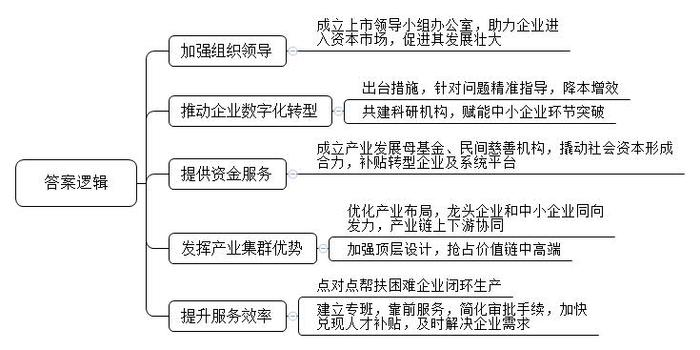
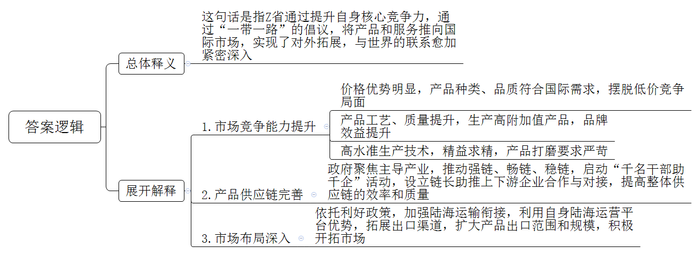
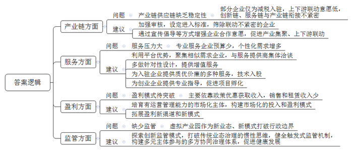
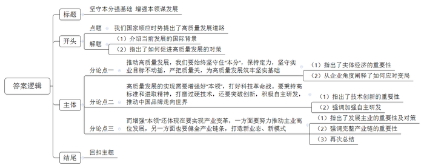

# 2023年公务员多省联考《申论》题（广西A、普通选调卷）

<!-- gwy:overview:start -->
> **广西 · 2023 · 申论 · A类** ｜ 4 题 · 图片 4 处 · 答案随题折叠

导航：[题目](#题目) · [材料 1](#材料-1)
<!-- gwy:overview:end -->

> 候选采集稿。参考答案及解析来自粉笔页面，不代表官方答案或真实高分答卷；来源使用许可与原卷对应关系仍需人工核实。

## 给定材料

### 材料 1

2021年初，J市启动数字经济发展三年行动。出台了《支持产业数字化转型升级十二条措施》，从打造数字化转型标杆样板等方面，扶持传统型企业数字化转型。J市经信委相关负责同志介绍，数字化转型运行两年来，样板企业平均运营成本降低20%，产品研发周期增加50%，生产效率提升40%。

在龙头企业示范先行的同时，J市还推动中小企业进行数字化改革。“我们针对不同企业在研发、生产、管理、销售等各环节面临的具体问题，为他们提供智能运维、调度、物流、管网及算法软件优化等精准指导，帮助企业降本增效。”中科院某装备制造研究中心负责人告诉记者。作为中科院与J市人民政府共同建设的科研单位，该中心以赋能中小企业“环节突破”为核心要务，已为全市200多家中小企业提供了数字化转型服务。

2022年7月，由市政府主导、国有企业出资，总规模达50亿元的产业发展母基金正式成立。J市财政局相关负责人介绍：“我们将以此撬动至少200亿元社会资本形成合力，用以投向科技创新和数字经济领域。”对鞋服、建材、医疗器械等传统产业的数字化转型标杆样板企业，市政府按照不超过其投入金额20%的标准给予补助；对于工业互联网平台、系统服务商，最高可获30万元奖励。“拿出‘真金白银’补贴转型企业及协助企业转型的系统平台，效果十分明显。”市发改委相关负责人表示，“我市有7000多亿元的工业底盘，超26万的市场主体，拥有海量数据资源，推进数字化转型，有基础有优势，以数字化转型推进实体经济做强做优做大正当其时。”

J市行业龙头企业的周边活跃着数以千计的中小企业为之提供配套服务，他们中绝大多数的服务辐射半径在50公里以内。这种产业布局意味着，龙头企业能够快捷便利地找到配套商，大大降低成本，而中小企业专注于产业链条某一环节的研发生产，也不愁没有市场。某公司负责人说：“2022年以来，从鞋服材料、纸箱到标识、模具，产业链上下游500多家做配套的中小企业，全部和我们一道保持满负荷生产。”龙头企业和中小企业同向发力，产业链上下游协同，是近年来J市发挥产业集群优势、稳住实体经济大盘的秘诀。

泰信集团是一家纺织面料、纺织机械生产企业，为配合海外客户需求，公司于2016年在东南亚设立工厂。“东南亚国家企业生产一双运动鞋所需的高端面料、纱线、鞋底材料等，很大程度上依赖国内出口。在东南亚国家建设智能车间、数字化生产线，也离不开来自国内的技术人员和工程师。”泰信集团总裁说，“我们走出了国门，迎来了新的业务和订单。”“这对J市企业的转型升级也是机遇，要抓住这个机遇，关键在于能否通过顶层设计，统筹布局、高位推动，以产业集群优势，在精细化工、中高端面料、智能装备、高端设备、示范工厂等方面发力，抢占价值链中高端。”J市经信委相关负责同志指出。

早在2001年，J市政府就成立了企业上市领导小组办公室，助力多家集团进入资本市场，为其发展壮大提供“资本燃料”。多年来，J市不断根据企业需求塑造政府职能，当好企业的“引路人、推车手、服务员”。2022年3月，疫情使众多企业生产经营受到影响。多家企业负责人回忆，当时正是生产旺季，很多企业已经提前交付了海运集装箱定金，如果不能按时交货，将承担巨额违约责任。危急时刻，J市政府帮助困难企业闭环生产，点对点运送货物至港口出海，保障生产、按时交货，挽救了一批企业。2022年8月，胜科纳米科技公司的芯片分析测试实验室正式运行。这家高科技企业，从决定在J市设立公司开始到正式运营，仅用了半年时间。J市的服务效率给公司刘总留下了深刻印象，“市里建立专班，靠前服务，各项审批手续一个窗口完成，人才补贴及时兑现，员工租房、联系食堂等也迅速协调解决。只要企业有需求，随时给政府部门打电话，都能在第一时间得到回应和解决。”

企业不仅是市场主体，也要承担好社会责任，将做强实体经济的理念传承下去。在相关部门促动下，J市成立了首个民间慈善机构——J市慈善总会。“企业捐出来的钱，用于帮助困难职工子女上学，资助乡里修桥铺路等。”慈善总会黄会长说，做慈善培育了企业家的家国情怀，也给后代树立了榜样，告诉他们要传承父辈艰苦创业、坚守实业的传统。

### 材料 2

“刚刚结束的卡塔尔世界杯备受瞩目，‘中国制造’在本届世界杯上也是随处可见。”球迷王先生兴奋地说。此刻，王先生正在卡塔尔首都多哈的一家世界杯官方特许商品零售店选购纪念品，帽子、围巾、水杯、徽章、吉祥物等商品琳琅满目，其中绝大多数都产自于中国Z省。“连赞助商都有中国的。”

与球迷王先生一样兴奋的还有Z省凯奥体育用品有限公司的吴经理，他的公司是五届世界杯的“元老级供货商”。这几年受疫情影响，来实地看货的海外客商有所减少，但公司抓住海外需求依然强劲的机遇，销量保持了持续增长，尤其在卡塔尔世界杯期间实现了40%的环比增长。“10年前，我们靠低价抢占市场，现在我们的商品不仅价格优势明显，种类、品质也越来越符合国际市场的口味。”利斯体育用品公司丁经理介绍，“我们以做大做强品牌为目标，不断提升和改进产品工艺和质量。特别是今年，我们原创的带刺绣图案的牛津布旗帜，大量出口到欧美国家，在世界杯之后，还可用作室内装饰。虽然价格比普通旗帜贵10倍，订单却源源不断。”

“源源不断”的还有海外客户对“中国制造”的赞叹。Z省精工钢构集团是世界杯主体育场主体钢结构的承接单位，项目负责人刘经理说：“按设计要求，直径1600mm的圆管，对接错边不得超过3mm，而我们通过看家的硬核科技，将对接错边成功控制在了1mm。”连外方项目验收人员都感叹：“从未见过对自己都这么苛刻的工程公司。”球迷王先生表示，即便没有比赛，这座体育场的宏伟与各个细节的处理都令人感到山呼海啸的气势与精细绵柔的享受。

当一辆辆载满球迷的大巴驶向一座座留有“中国制造”印记的世界杯体育场时，可能很多人还不知道，这些大巴大多都是Z省生产的新能源客车，“性能非常可靠、售后服务非常完备，我们非常满意！”多哈公共交通部门负责人说。

火热的世界杯已经落幕，但火热的中外经贸合作仍沿着“一带一路”向前奔跑。B国是“一带一路”沿线国家之一，其首都是区域性金融与贸易中心，Z省目前有约5万华侨在此长期经商。2022年12月，Z省商务厅组织包机，搭载45家企业前往B国参加贸易博览会，参展首日即签订了价值4500余万元人民币的意向订单。而此前一个月，Z省商务厅就召开专题会议，研究“促招引、拓市场、抢订单”工作方案。

日前，Z省津津食品公司刚刚拿到了第100家欧洲客商的订单，这在食品安全标准异常严格的欧洲是非常难得的。公司黄经理说：“我们这次能够这么快拿下这个订单离不开政府在食品行业强链畅链稳链方面所做的大量工作，我们不能辜负政府的努力。”2022年11月，Z省启动了“千名干部助千企”精准服务活动，该活动至今已选派了4987名干部服务各级各类企业7546家。Z省还聚焦十大主导产业，为100条产业链设立了链长，帮助链上中小企业进行产业链整零对接、芯机对接、产销对接。“我们储备了20余个对外投资项目，总投资15亿元。”省发改委相关负责人表示。

近日，一趟满载出口商品的班列在Z省铁路某货场鸣笛启程前往欧洲。在紧邻班列出发地的国际联运港会议室里，常驻货场的多个公司负责人围坐一起畅谈公司发展。“党的二十大和中央经济工作会议让我们‘走出去’有了更大的信心和底气。我们计划开拓南线通道，增开线路，确保货物及时送出去。”Z省国际物流公司罗经理说。“‘一带一路’需要陆路与海路的衔接，上个月我们就与贤云港签了合作协议，陆海运营平台优势尽显。”Z省联运港有限公司胡经理接过话茬。

Z省经济研究院杨副院长在日前召开的民营经济发展论坛上指出，<u>Z省正以其硬核实力实</u><u>现从</u><u>“走出去”到“走进去”的新飞跃</u>，与世界的联系愈加紧密深入。

### 材料 3

“虽然我们的办公地点还在深圳，但我们可以享受到千里之外的D市‘云端’服务和税收等优惠政策。”启程科技公司周经理高兴地对记者说。启程科技公司所享受的服务和优惠，源于D市积极布局打造跨越物理边界的虚拟产业园。近日，《D市日报》记者专门对虚拟产业园发展现状进行了一次调研走访。

据记者了解，加入D市虚拟产业园，已成为不少企业的新选择。相较于传统产业园区，企业只需把公司注册到虚拟产业园，不用入驻指定地理区域生产经营，可自由选择办公城市和地点，也就是说，虚拟产业园内的企业可以分布在全国各地。

前不久，布拉电商科技有限公司成为D市虚拟产业园的新成员。“我们在深圳通过网络提交了相关材料，D市虚拟产业园的工作人员随即帮我们完成了工商注册，非常方便。”公司陈总经理说。

“截至目前，虚拟产业园招商入驻企业近100家，主要为互联网企业、电商企业、高科技企业等，初步促成了企业在线规模化集聚。”D市虚拟产业园负责人石主任向记者介绍。目前，D市虚拟产业园为入驻企业提供了合作需求发布、企业资源交换、信息共享、互动交流等多方面服务。“我们掌握着比较丰富的数据，利用这些信息流，可以有效促进上下游、产供销协同联动。最近，我们正在帮助园区内的一些电商企业与相关企业对接、合作，拓展渠道。”石主任说，“但是我们发现，部分企业入驻产业园的主要目的是减税，与平台产业链上下游进行联动的意愿不强，创新链、服务链与产业链之间的有机衔接没有达到预期，产业链供应链还缺乏稳定性。”

在D市工业经济研究所何研究员看来，目前选择入驻虚拟产业园的大多数为初创型企业，这些企业往往资金规模较小，除了基础的政务服务需求外，也希望能够以较低的成本获取法律、人力、财务、营销、金融、品牌等专业服务。部分企业因为行业特性还会衍生出不少个性化的需求，例如电商企业对客服、营销服务的需求，文创企业对设计、美工服务的需求。“虚拟产业园原本就有平台优势，可以把具有相似需求的企业聚集在一起，共同与服务提供商进行洽谈，从而节省成本，现在的关键问题是如何把这个优势发挥好。”

“虚拟产业园要发展，需在盈利模式上有所突破。与传统产业园区相比，虚拟产业园在房地产方面的销售和租赁收入很少，目前主要依靠税收返还、政府补贴等渠道获取收入，但这并非长久之计！”D市经信委宋副主任说，以D市虚拟产业园为例，市里不仅为入驻企业和个人提供地方留存税收的80%作为奖励，还外加最高600万元的人才补贴、企业上云补贴等奖励。“我觉得有必要加快培育一批具有运营管理能力的市场化主体，构建市场化的投入和盈利模式，比如向企业收取一定的园区管理费或场地租用费来增加园区收入。”

“作为新业态新模式的虚拟产业园打破行政边界后，如何实现有效监管，对虚拟产业园的发展至关重要。”D大学贺教授表示，要打破传统业态按区域、按行业治理的惯性思维，探索创新监管模式。“从企业的角度来看，我认为虚拟产业园还应该在推动产业集聚、上下游联动方面多做工作，同时要多一些有针对性的设计，在增值服务方面也还有进一步提升的空间。”君和咨询公司游经理向记者表示，D市虚拟产业园应该探索拓展盈利新渠道和新模式，如通过入股园区内企业、为企业嫁接资源等方式参与企业经营，既为入驻企业发展提供支撑，也能实现产业园自身的发展。

“虚拟产业园的监管是一个全新的课题。”何研究员说，“市经信委正委托我们开展专题研究，主要聚焦在健全触发式监管机制，构建依靠企业、社会组织等多元主体参与的多方协同治理体系，促进其健康发展。”

市经信委宋副主任不久前才去了沿海某城市，考察了当地的网商虚拟产业园建设。“他们为入驻企业提供了安全、稳定、快速和优惠的云服务，以及专属服务器运维服务。此外，产业园还以技术入股或低于市场价格的方式为入驻企业提供技术开发服务，如平台系统搭建、APP开发、网站开发、公众号开发等。”宋副主任感慨地说，“他们在产业园建设了产学研一体化、培训实训孵化一条龙的‘众创空间’，并邀请知名企业家、教授为创业团队提供专业意见和建议，产业园已成功孵化项目超过30个，我很受启发。”

### 材料 4

二十多年前，A集团刚刚起步，还是个小企业，时任福建省省长的习近平对A集团关怀鼓励的一幕幕场景令集团丁总记忆犹新。2001年4月20日，时任福建省省长习近平出席第三届中国国际鞋业博览会。开馆仪式后，他便径直来到A集团展馆，对企业提出了三点要求：“把好质量关，创出自己的品牌，要有自己的创新产品。”

“就是那时候开始，我们步入了发展的快车道。”丁总深有感触地说，“做实业确实蛮不容易，一定要有定力。”近年来，国际市场不稳定性、不确定性上升，一些制造业企业特别是出口企业遇到困难。A集团没有转行赚快钱，而是坚持做实业，不断加大主业投入、提高研发投入，逐步成长为全球第三大体育用品集团。

2022年2月5日晚，在2000米混合团体接力A组决赛中，中国队以0.016秒的优势，夺得北京冬奥会短道速滑项目首枚金牌。这0.016秒的背后，离不开A集团运用空气湍流控制、边界滑移技术、高弹减阻面料和表面导流结构等多种减阻技术打造的短道速滑比赛服。不仅如此，在北京冬奥会上，A集团还为中国国家队打造了多类型高科技专业比赛装备。

2022年8月8日，A集团在年度创新科技大会上，发布了最新的自主研发科技创新成果——氮科技中底平台与碳管悬架系统。在这一最新技术加持下的全新奥运冠军跑鞋，拥有优越的缓震性能与超强的稳定支撑，中底能量回归率高达82.6%，耐受性提升33%，整体缓震性能提升26%，稳定性能提升23%。

A集团始终对科技创新有着不懈追求，从2007年公司上市以来，A集团已累计投入超56亿用于自主创新研发，研发开支占比在我国可选消费品上市公司中持续位居前列。目前，A集团在中、美、日、韩、意建立了全球五大设计研发中心，主导搭建了覆盖20多个国家和地区、由60多所科研机构共同参与的全球创新研发网络。

“我们将牢记习近平总书记嘱托，坚守实业不动摇，以改革创新为核心动力实现全面发展，为中国品牌成为世界舞台上的佼佼者而不懈奋斗。”丁总信心满满。

### 材料 5

近日，Q市社科院召开学习贯彻党的二十大精神座谈会。出席座谈会的市委党校熊教授发言时说：“党的二十大报告指出，没有坚实的物质技术基础，就不可能全面建成社会主义现代化强国。当前，世界百年未有之大变局加速演进，新一轮科技革命风起云涌，产业变革深入发展。我们必须心无旁骛，<u>在大变局的喧嚣中始终坚守住‘本分’，切实增强好‘本领’，不断突破创新，推动高质量发展的步伐就能坚实稳健，我们就能走向广阔的未来。</u>”

## 题目

### 第 1 题

**近日，省委要求****J市就近年来落实习近平总书记关于着力发展实体经济的系列重要指示的情况进行书面汇报。请根据“给定资料**1**”，拟写书面汇报材料中的“具体举措”部分。(15分)**

关联材料：材料 1

作答要求：

要求：

（1）全面，准确，有条理；

（2）字数不超过250字。

第 1 题 · 答案与解析

**参考答案（粉笔题库参考内容）**

1.加强组织领导。成立上市领导小组办公室，助力企业进入资本市场，促进其发展壮大。

2.推动企业数字化转型。出台措施，针对问题精准指导，降本增效；共建科研机构，赋能中小企业环节突破。

3.提供资金服务。成立产业发展母基金、民间慈善机构，撬动社会资本形成合力，补贴转型企业及系统平台。

4.发挥产业集群优势。优化产业布局，龙头企业和中小企业同向发力，产业链上下游协同；加强顶层设计，抢占价值链中高端。

5.提升服务效率。点对点帮扶困难企业闭环生产；建立专班，靠前服务，简化审批手续，加快兑现人才补贴，及时解决企业需求。

**参考答案说明：**本参考答案从“加强组织领导”“推动企业数字化转型”“提供资金服务”“发挥产业集群优势”“提升服务效率”等五个方面展开，各条答案要点之间在内容上相互并列，没有交叉。

**解析状态：unknown（来源未提供）**

### 第 2 题

**请根据****“给定资料**2**”，谈谈对划线句子“Z省正以其硬核实力实****现从****‘走出去’到‘走进去’的新飞跃”的理解。(20分)**

关联材料：材料 2

作答要求：

要求：

（1）分析全面，条理清晰；

（2）字数不超过300字。

第 2 题 · 答案与解析

**参考答案（粉笔题库参考内容）**

这句话是指Z省通过提升自身核心竞争力，通过“一带一路”的倡议，将产品和服务推向国际市场，实现了对外拓展，与世界的联系愈加紧密深入。

1.市场竞争能力提升。价格优势明显，产品种类、品质符合国际需求，摆脱低价竞争局面；产品工艺、质量提升，生产高附加值产品，品牌效益提升；高水准生产技术，精益求精，产品打磨要求严苛。

2.产品供应链完善。政府聚焦主导产业，推动强链、畅链、稳链，启动“千名干部助千企”活动，设立链长助推上下游企业合作与对接，提高整体供应链的效率和质量。

3.市场布局深入。依托利好政策，加强陆海运输衔接，利用自身陆海运营平台优势，拓展出口渠道，扩大产品出口范围和规模，积极开拓市场。

**参考答案说明：**（1）思路方面，本参考答案按照词句解释题“总体释义+展开解释+总结”的一般答题思路展开。（2）内容方面，本参考答案先对句子的含义进行了解释；接着从“市场竞争能力提升”“产品供应链完善”“市场布局深入”三个方面介绍了实现新飞跃的具体表现。

**解析状态：unknown（来源未提供）**

### 第 3 题

**请根据****“给定资料**3**”，梳理D市虚拟产业园发展中存在的问题，并提出解决问题的建议。(25分)**

关联材料：材料 3

作答要求：

要求：

（1）问题梳理全面，准确；

（2）所提建议与问题对应，具体明确、切实可行；

（3）字数不超过400字。

第 3 题 · 答案与解析

**参考答案（粉笔题库参考内容）**

一、问题：产业链供应链缺乏稳定性。部分企业仅为减税入驻，上下游联动意愿低，创新链、服务链与产业链衔接不紧密。建议：加强审核，设定进入标准，筛除联动不紧密的企业；通过宣传倡导等方式增强企业合作意愿，促进产业集聚、上下游联动。

二、问题：服务压力大。专业服务企业预算少，个性化需求增多。建议：利用平台优势，聚集相似需求企业，与服务提供商集体洽谈；多做针对性设计，提供增值服务；为入驻企业提供质优价廉的多种服务，技术入股；为创业企业提供专业指导，促进项目孵化。

三、问题：盈利模式待突破。主要依靠政策优惠获取收入，销售和租赁收入少。建议：培育有运营管理能力的市场化主体，构建市场化的投入和盈利模式；拓展盈利新渠道和新模式。

四、问题：缺少监管。虚拟产业园作为新业态、新模式打破行政边界。建议：探索创新监管模式，打破传统业态治理的惯性思维，健全触发式监管机制，构建多元主体参与的多方协同治理体系，促进健康发展。

**参考答案说明：**本参考答案从“产业链”“服务”“盈利”“监管”四个方面展开，每个方面内部先阐释问题，再给出相应的解决建议，做到了所提建议与问题相对应。各条答案要点之间在内容上相互并列，没有交叉。

**解析状态：unknown（来源未提供）**

### 第 4 题

**“给定资料**5**”提到，“在大变局的喧嚣中始终坚守住‘本分’，切实增强好‘本领’，不断突破创新，推动高质量发展的步伐就能坚实稳健，我们就能走向广阔的未来。”请结合对这句话的理解，参考给定资料，联系实际，自选角度，自拟题目，写一篇文章。(40分)**

关联材料：材料 1、材料 2、材料 3、材料 4、材料 5

作答要求：

要求：

（1）立意明确，内容充实；

（2）思路清晰，语言流畅；

（3）参考“给定资料”，但不拘泥于“给定资料”；

（4）字数1000-1200字。

第 4 题 · 答案与解析

**参考答案（粉笔题库参考内容）**

**坚守本分强基础 增强本领谋发展**

当今世界正处于百年未有之大变局，新一轮科技革命风起云涌，产业变革深入发展。如何于变局中开新局，中国智慧彰显出力量，我们国家顺应时势提出了高质量发展道路。前进的方向已经明确，前行的道路已经开拓，我们必须以坚守本分为原则，以增强本领为手段，以突破创新为核心动力，大力推动经济高质量发展，为全面建设社会主义现代化强国开好局起好步。

**推动高质量发展，我们要始终坚守住“本分”，保持定力，坚守实业目标不动摇，严把质量关，为高质量发展筑牢坚实基础。**实体经济是国民经济的基础和命脉，是国家强盛和民族复兴的重要支柱。而在实体经济的主战场上，质量是企业的立身之本。变局之下，大环境的不确定性、不稳定性增加，做实业考验着企业的定力。如何应对变局？格力给出了自己的答案。“好空调格力造”，这句脍炙人口的广告是格力三十年如一日坚持做实业、“锱铢必较”严把质量关的生动写照。因此，迎战变局，企业一方面需要拿出“咬定青山不放松”的定力，迎难而上、攻坚克难，聚焦目标、聚焦实业。另一方面要严把材料关、生产关、检验关，确保产品质量过硬，用高品质立身。

**高质量发展的实现需要增强好“本领”，打好科技革命战。要秉持高标准和进取精神，打磨过硬技术，还要突破创新，积极自主研发，推动中国品牌走向世界。**技术创新是推动企业发展的核心驱动力。通过不断提升技术水平，企业能够生产出更具竞争力的产品和提供更优质的服务，从而满足消费者需求。无论是对企业自身的提升，还是对整体经济的发展，打磨过硬技术都是不可或缺的。另一方面，在全球化竞争日益激烈的背景下，依靠模仿和跟随的发展模式已经无法适应市场需求。只有通过自主研发和创新，才能在国际竞争中脱颖而出。通过不断推陈出新，中国品牌能够树立起自身的技术和品牌优势，并逐步赢得全球市场的认可。

**而增强“本领”还体现在要实现产业变革，一方面要努力推动主业高位发展，另一方面也要健全产业链条，打造新业态、新模式。**主业是企业发展的核心竞争力，只有不断提升主业水平，才能在市场竞争中立于不败之地。通过加大科研投入、培养专业人才、提高技术创新能力，企业可以不断突破自身的局限，实现产业变革的目标。与此同时，一个完整的产业链条能够形成合理的分工和协同发展，提高资源利用效率和降低生产成本。通过与上下游企业的合作，可以实现资源共享、互利共赢，进而推动整个产业的升级变革。只有具备这些“本领”，企业才能在激烈的市场竞争中脱颖而出，向上发展。

君子务本，本立而道生。坚守物质技术基础，增强创新能力，我们就一定能于变局之中开新局，在危机之中育先机。不断推进高质量发展，把我国建设成为社会主义现代化强国。

**文章分析**

**坚守本分强基础 增强本领谋发展**

【**标题的优点：**范文的标题突出了主题，文章主题、角度都很清晰。】

（1）<u>当今世界正处于百年未有之大变局</u>，新一轮科技革命风起云涌，产业变革深入发展。如何于变局中开新局，中国智慧彰显出力量，我们国家顺应时势提出了高质量发展道路。前进的方向已经明确，前行的道路已经开拓，（2）<u>我们必须以坚守本分为原则</u>，<u>以增强本领为手段</u>，<u>以突破创新为核心动力</u>，大力推动经济高质量发展，为全面建设社会主义现代化强国开好局起好步。

【**开头的优点：**★内容方面。范文的开头是紧扣“高质量发展”这一主题展开的。首先，开头点出主题，做到了主题明确。其次，对“高质量发展”这一主题进行了分析阐述，指出了（1）推动高质量发展的时代背景。（2）引出文章核心观点。★文字表达方面。使用了设问的修辞手法，使文字表达更加有力。】

**推动高质量发展，我们要始终坚守住****“本分”，保持定力，坚守实业目标不动摇，严把质量关，为高质量发展筑牢坚实基础。**（1）<u>实体经济是国民经济的基础和命脉</u>，<u>是国家强盛和民族复兴的重要支柱</u>。而在实体经济的主战场上，质量是企业的立身之本。变局之下，大环境的不确定性、不稳定性增加，做实业考验着企业的定力。（2）<u>如何应对变局</u>？格力给出了自己的答案。“好空调格力造”，这句脍炙人口的广告是格力三十年如一日坚持做实业、“锱铢必较”严把质量关的生动写照。因此，<u>迎战变局</u>，<u>企业一方面需要拿出</u>“<u>咬定青山不放松</u>”<u>的定力</u>，<u>迎难而上</u>、攻坚克难，聚焦目标、聚焦实业。<u>另一方面要严把材料关</u>、<u>生产关</u>、检验关，确保产品质量过硬，用高品质立身。

【**论述段****1的优点：**★观点句：范文的观点句是紧扣“高质量发展”这一文章主题提出的。形式上，它在段首处直接写出，位置突出，容易发现。内容上，关键词突出，内容要点明确，可以明显看出主要论述从“坚守住‘本分’”方面入手。★论述内容：（1）先指出了实体经济的重要性；（2）再从企业角度阐释了如何应对变局。注意：以上几个方面的内容都是紧扣“推动高质量发展，我们要始终坚守住‘本分’，保持定力，坚守实业目标不动摇，严把质量关，为高质量发展筑牢坚实基础”这个观点句进行分析论述的，论述的针对性强，内容层次丰富。在论述方法上主要采用了讲道理与举例子结合，论述清晰透彻。】

**高质量发展的实现需要增强好****“本领”，打好科技革命战。要秉持高标准和进取精神，打磨过硬技术，还要突破创新，积极自主研发，推动中国品牌走向世界。**（1）<u>技术创新是推动企业发展的核心驱动力</u>。通过不断提升技术水平，企业能够生产出更具竞争力的产品和提供更优质的服务，从而满足消费者需求。无论是对企业自身的提升，还是对整体经济的发展，打磨过硬技术都是不可或缺的。（2）另一方面，<u>在全球化竞争日益激烈的背景下</u>，<u>依靠模仿和跟随的发展模式已经无法适应市场需求。只有通过自主研发和创新</u>，才能在国际竞争中脱颖而出。通过不断推陈出新，中国品牌能够树立起自身的技术和品牌优势，并逐步赢得全球市场的认可。

【**论述段****2的优点：**★观点句：范文的观点句是紧扣“高质量发展”这一文章主题提出的。形式上，它在段首处直接写出，位置突出，容易发现。内容上，关键词突出，内容要点明确，可以明显看出主要论述从“增强本领，科技创新”方面入手。★论述内容：（1）先指出了技术创新的重要性；（2）强调加强自主研发。注意：以上几个方面的内容都是紧扣“高质量发展的实现需要增强好‘本领’，打好科技革命战。要秉持高标准和进取精神，打磨过硬技术，还要突破创新，积极自主研发，推动中国品牌走向世界”这个观点句进行分析论述的，论述的针对性强，内容层次丰富。在论述方法上主要采用了讲道理的方式，论述清晰透彻。】

**而增强****“本领”还体现在要实现产业变革，一方面要努力推动主业高位发展，另一方面也要健全产业链条，打造新业态、新模式。**（1）<u>主业是企业发展的核心竞争力</u>，<u>只有不断提升主业水平</u>，<u>才能在市场竞争中立于不败之地</u>。通过加大科研投入、培养专业人才、提高技术创新能力，企业可以不断突破自身的局限，实现产业变革的目标。与此同时，（2）<u>一个完整的产业链条能够形成合理的分工和协同发展</u>，<u>提高资源利用效率和降低生产成本</u>。通过与上下游企业的合作，可以实现资源共享、互利共赢，进而推动整个产业的升级变革。<u>只有具备这些</u>“<u>本领</u>”，<u>企业才能在激烈的市场竞争中脱颖而出</u>，<u>向上发展</u>。

【**论述段****3的优点：**★观点句：范文的观点句是紧扣“高质量发展”这一文章主题提出的。形式上，它在段首处直接写出，位置突出，容易发现。内容上，关键词突出，内容要点明确，可以明显看出主要论述从“增强本领，产业变革”方面入手。★论述内容：（1）先指出了发展主业的重要性及对策；（2）强调完整产业链的重要性；（3）再次总结。注意：以上几个方面的内容都是紧扣“而增强‘本领’，还体现在要实现产业变革，一方面要努力推动主业高位发展，另一方面也要健全产业链条，打造新业态、新模式”这个观点句进行分析论述的，论述的针对性强，内容层次丰富。在论述方法上主要采用了讲道理的方式，论述清晰透彻。】

君子务本，本立而道生。坚守物质技术基础，增强创新能力，我们就一定能于变局之中开新局，在危机之中育先机。不断推进高质量发展，把我国建设成为社会主义现代化强国。

【**结尾的优点：**范文的结尾回扣了“高质量发展”这个主题，语言精练不拖沓。】

**解析状态：unknown（来源未提供）**

