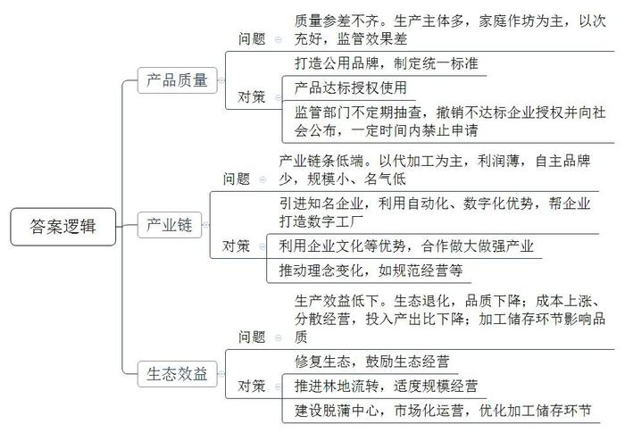
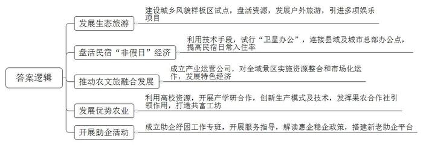
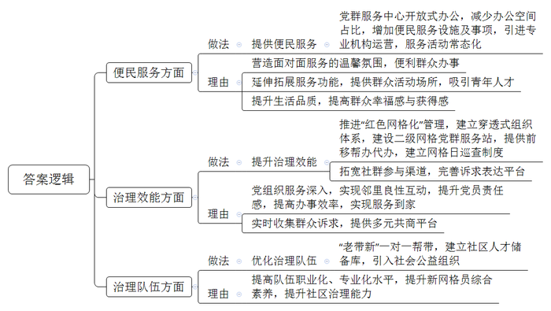
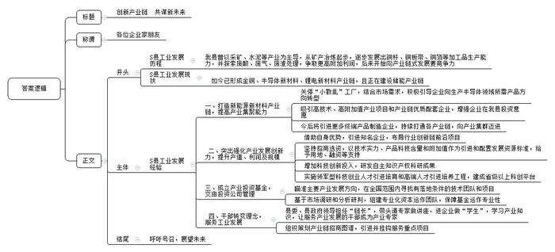

# 2023年公务员多省联考《申论》题（广西B卷）

<!-- gwy:overview:start -->
> **广西 · 2023 · 申论 · B类** ｜ 4 题 · 图片 4 处 · 答案随题折叠

导航：[题目](#题目) · [材料 1](#材料-1)
<!-- gwy:overview:end -->

> 候选采集稿。参考答案及解析来自粉笔页面，不代表官方答案或真实高分答卷；来源使用许可与原卷对应关系仍需人工核实。

## 给定材料

### 材料 1

2022年本应是L县山核桃丰产的大年，但由于高温干旱，产量只是略有增加。虽然产量受影响，但效益却创下了新高。

多年来，L县山核桃产业生产主体众多，很多是家庭作坊，质量参差不齐，以次充好并不鲜见。相关部门不断加强对山核桃销售市场的监管，但收效甚微。“为此，我们决定制定统一的标准，鼓励、引导、带动企业执行这个标准。”县农业农村局周局长介绍。

2021年，L县发布“天目”农产品区域公用品牌，覆盖包括山核桃在内的众多农产品。县政府委托省山核桃产业协会牵头制定并发布“天目”山核桃系列标准，标准起草人之一、省山核桃产业协会蔡秘书长说：“在山核桃领域20个标准中，我们这次制定的标准是最高的。”

“要获得‘天目’品牌使用授权，企业需要申请，产品要符合我们的标准。”周局长说。目前已有8家山核桃企业获得授权，L县太康炒货食品厂就是其中之一。“现在，我们有两款产品用了‘天目’品牌。”梁厂长说，“这两款山核桃的品质是我们产品中最好的。”获得“天目”品牌使用授权后，梁厂长感受最深的是品牌推广的力度大大提升。“‘天目’需要好的产品来支撑，我们也需要‘天目’这个公共品牌提升消费者的认可度。”

“市场监管部门会不定期抽查，如果授权企业的‘天目’产品不符合相关标准，将撤销授权并向社会公布，同时在一定时间内禁止该企业再次申请。”周局长表示。

L县山核桃加工企业有280多家，年加工能力3万吨，光是龙水镇就聚集了170余家炒货食品加工产业链企业。但这些企业大多是给品牌企业代加工，尽管做自己品牌的也有，然而规模、名气都不大，没有一个家喻户晓的品牌。蔡秘书长说：“为品牌企业做代加工利润薄，只有更多品牌企业成长起来，L县山核桃的品牌价值才会更大，才能分享到山核桃产业带来的更多效益。”

2022年，天生记总部落户龙水镇，L县终于有了第一个具有全国知名度的坚果类品牌。天生记苏副总经理说，将总部从省城迁到L县，不仅有公司发展的考量，也有助力L县山核桃产业发展的情怀。

透过玻璃，天生记山核桃加工生产的每一个环节都能看到，自动化、数字化程度很高。“没有什么不能看的，每一个环节都经得起检验。”苏副总经理说，数字工厂9月初投用，如果L县其他山核桃加工企业有打造数字工厂的需求，他们愿意提供帮助。

“看着都是山核桃，但其实有很多不同的地方，在企业文化、品牌宣传等方面，天生记更有优势。”在梁厂长看来，大家可以合作，一起将山核桃产业做强做大，“如果整个市场能做得更大，效益进一步提升，大家都可以从中受益。”而在周局长眼里，天生记的到来，更为重要的是“带来理念的变化”，包括规范经营、现代化生产、市场营销、科技研发等。

几年前，因山核桃种植规模无序扩张，加之过度使用农药、化肥，导致山坡植被大面积破坏、水土流失严重，山核桃品质逐年下降。L县痛定思痛，于2019年9月起开展了一场生态修复行动，“退果还林”2万亩，退出后的山核桃林禁止施肥、除虫、采打等经营活动，由村集体看管。“正常经营的山核桃林，则鼓励生态经营，推广自然落果，不滥用农药、化肥，减少人为干预。”县农林技术推广中心李主任说，“生态经营逐步推广，山核桃林的产出更稳定，品质也更好。”

“近年来，由于种植成本上涨、分散经营等原因，山核桃林的投入产出比持续下降。”李主任说，“为了提升山核桃林的生产效益，县里推进山核桃林流转，推广适度规模经营。规模经营更有利于农业机械和数字技术利用，能更好地实施科学种植与培育，降低生产成本、优化投入产出比。”

山核桃脱蒲的汁液碱性很强，乱排放对环境有影响。晒干、存储环节没做好，山核桃品质就会受影响。“脱蒲中心可以实现山核桃脱蒲、晒干、存储、销售‘一条龙’服务。”周局长介绍，“这个中心由政府建设，实行市场化运营。农户将采收的山核桃送到中心脱蒲后，可以直接将山核桃存储在这里的仓库。仓库是数字化管理，精准地对温度、湿度等进行控制，山核桃存储在这里比存放在家里更妥当。”

### 材料 2

在H市西北角，依山傍水的W县，是全市唯一没有工业园区的县。

“没选择，有时是最好的选择，对W县发展来说正是如此。”县委蓝书记对W县的情况有清醒认识，“土地资源的受限、空间发展的制约，决定了W县不能走‘工业兴县’的道路，只能另辟蹊径，一门心思探索‘依山傍水’绿色发展的路径。”

近几年，W县根据省市发展规划，结合美丽城镇建设要求，扎实推进城乡风貌样板区试点建设。优美的生态环境吸引了大量游客，旅游产值年均超亿元，接待人次年均超100万，旅游过夜人次年均突破11.8万。W县获得“全国旅游百强县”等多项国字号荣誉。

在W县房车露营公园，深耕户外领域20多年的老徐见证了一次行业热潮。以2021年“五一”小长假为例，5天营业额近50万元，比2020年同期增长近5倍。“热潮”不是一夜之间出现的，而是来自长久的铺垫和布局。

W县拥有丰富的旅游资源，户外旅游是W县精心打造的金名片。2014年W县引进了占地约800亩的“野天堂”项目。此后，山地摩托、滑翔伞等项目纷纷落地，最具代表性的是民宿的发展。W县是H市民宿起步最早、数量最多的县，民宿（农家乐）近千家，占H市近40%，2021年接待游客730余万人次，带动旅游消费30多亿元。

“盘活民宿的‘非假日’经济，是W县的重要探索。”蓝书记介绍，去年开始，时光信息科技有限公司等企业在W县试行“卫星办公”。这些企业依靠信息网络等技术手段，将设立在县里的办公点与位于城市的总部连接起来。县里首推136家精品特色民宿开展“卫星办公”试点。“卫星办公提高了我们平时的入住率，成了很多科技企业‘闭关’的选择。”“竹·窗”民宿刘老板说。

2021年，W县成立县域产业运营公司，对16个全域景区村镇实施资源整合和市场化运作，打造组织领航、镇企合作、群众参与的农文旅融合发展新模式，推动乡村旅游、生态农业、民宿农家乐等特色经济快速发展。截至2022年底该公司已实现营收1900万元，带动农户营收超7500万元。

“蜜梨是我们县域发展的法宝。”山水果业陈总说。不久前，H市第十九届蜜梨生活节在W县举办，W县利用地方高校资源，与Z大学开展产学研合作的全省首个蜜梨科技小院发布成果：通过“梨—羊—草”种养结合模式、水肥一体化技术，不仅实现绿色生产，而且增产12%至23%。

W县近年来积极发挥果农合作社引领作用，打造共富工坊，在龙头企业带领下，2021年全县蜜梨栽培面积10多万亩，产量15万吨，产值28亿元，带动了3万多农户增收致富，蜜梨获评国家农产品地理标志。

“企业奋力腾飞，我们保驾护航。当好企业‘娘家人’，是W县做好产业服务的宗旨。”蓝书记介绍。“县里组织了留抵退税政策专场解读会，一对一回答问题，解了企业燃眉之急。”山水果业陈总每次参加“亲清”助企活动，都有新的收获。

今年以来，助企纾困工作专班开展服务指导70余次，帮助企业解决问题50余个；深入解读惠企稳企政策；搭建商会“老底子”助企平台、双创园“新主角”助企平台，护航新老企业齐飞。

在最近刚举行的“亲清”助企活动上，蓝书记说：“我们依山傍水，因地制宜，写好了绿色发展这篇大文章。”

### 材料 3

白沙社区是典型的“村改社区”。为做好“村改居”后半篇文章，近年来，白沙社区以“近邻”为基、“聚邻”为要、“惠邻”为本，通过做优做实“党建+”邻里中心建设，提升社区综合治理水平。

走进白沙社区“党建+”邻里中心的党群服务中心，这里窗明几净、视野开阔。升级改造后，一改此前窗口办公的风格，开放式的办公区更加亲民，营造出面对面服务的温馨氛围。

“在‘党建+’邻里中心建设过程中，我们社区按照‘去形式化、去机关化、去办公化’的原则，打造‘一心多点’便民服务圈。改造后，办公空间占比减少80%。”党支部韦书记说，“虽然办公空间减少了，但便民服务却增加了，我们引进了政务服务自助一体机，编排印制社区便民服务联络卡，开设便民事项预约热线，为群众办事提供更多便利。”

居家养老服务照料中心是白沙社区“党建+”邻里中心建设的重要一环。今年74岁的谢阿姨一有空就会到照料中心同邻居们一起休闲娱乐、话家常。“社区关心我们老年人，提供了这样一个好场所，让我们来活动，大家都很欢喜。”除了新建照料中心，还配备了社区食堂、儿童之家、亲子阅读室及早教托育中心等8个功能区域，并引进第三方专业机构运营。

白沙社区进一步延伸拓展服务功能，立足本土文化，设计提炼社区独具特色的文化标识，建成社区乡村记忆馆，推动社区大学生“反哺”基地、白沙茶产学研基地落地，增设人才驿站等阵地，推动青年人才走进白沙。

“没想到只是在网格群里这么一提，社区当天就进行了维修，网格的办事效率太给力了！”日前，居民农女士说起不久前的一宗路灯快速维修事件，连连点赞。这是白沙社区持续深化“党建+”邻里中心工作的一个缩影。

“目前，我们正全面推进‘红色网格化’管理，推动党小组建立在网格上、党员沉到网格中、处置融入网格里，成立社区邻里先锋队，选聘32户党员中心户，8名楼栋长，按照每人挂钩联系群众10-20户，组织党员认领责任片区，建立‘社区党组织——网格党小组——党员楼栋长——党员中心户’一贯到底的穿透式组织体系，将党组织的服务延伸至院落楼栋、居民家庭，实现邻里良性互动。”韦书记说。党员中心每户家门口都挂有用于亮身份的责任牌，“看到这个红色的牌子，立刻就感受到自己作为一名党员的责任。”白沙社区党员赵女士说。

与此同时，白沙社区建成3个二级网格党群服务站，实现二级网格驻点办公，提供前移帮办代办便民服务，并建立网格日巡查制度，通过就近设、入户帮、上门办，将儿童之家、医疗护理等服务项目送到家。

为优化治理队伍，白沙社区坚持以职业化为基础、以专业化为方向，选聘一批网格长，通过“老带新”一对一帮带，加速提升网格员综合素养，同时建立社区人才储备库，引入致和社工、亿家社工等社会公益组织，着力提升社区治理能力。

在推深做实党建引领网格化管理的基础上，白沙“党建+”邻里中心拓宽社群参与渠道，完善诉求表达平台。在线下，设置居民意见箱，设立部门轮值室，主动对接“两代表一委员”、纪工委等部门，定期开放接访群众；还设置邻里会事厅，为民众议事解难题提供多元共商平台。在线上，依托社区公众号开通邻里会事留言板，利用“微监督”小程序及时公开居务情况，实时收集群众诉求和意见。

“不用到医院，在家门口的卫生健康服务站就能完成心电图、血常规、血压血脂、尿酸、视力等一系列体检检查。”白沙社区“党建+”邻里中心卫生健康服务站陆站长说，“服务站由街道和社区共建，通过完善‘病有所医’配套，推动优质卫生健康资源和服务人员‘双下沉’，让社区居民在家门口就能享受到就诊、体检、取药、医保结算一体化的医疗卫生服务。”

为进一步提升社区生活品质，提升群众幸福感与获得感，白沙社区“党建+”邻里服务中心坚持服务活动常态化，今年来累计开展了“粽叶飘香”“交友趣”“邻里齐聚闹中秋”“爱在重阳”等主题活动20余场，其他日常活动60余场，参与人数超4000人次，社区以文化认同为切入点，绘制景观墙，既展示了“爱乡邻·爱白沙”的“聚邻”文化，又扮靓了村居颜值。

### 材料 4

地处山区的S县，曾经以采矿、水泥等产业为主导，从2012年建设20万吨铜冶炼项目开始，S县开启了向产业链式发展要竞争力的探索，不断将长板优势转化为产业竞争力。如今，S县已形成金铜、半导体新材料、锂电新材料产业链，正在建设储能产业链。

“我们从最初的矿产冶炼起步，逐步发展出铜杆、铜板带、铜箔等加工品生产能力。”县金铜产业发展中心石主任说，“能力的提升一环扣着一环，我们在把废酸、废气、废渣‘吃干榨尽’的探索中争取更高附加利润，逐渐形成明确的链式发展思路。”

脱胎于水泥厂的尔德科技是一家半导体新材料企业，该公司已破解电子级三氟化氯、电子级一氟甲烷等13个半导体材料技术难题。尔德科技王董事长说，S县近年关停大量“小散乱”水泥厂，结合铜冶炼副产品消化和化工产品市场需求，积极引导我们向生产半导体领域所需的含氟化工产品方向转型。

“国家鼓励发展锂电、半导体新材料等产业，我县正好具备产业基础。”县工信委陈主任说，县委县政府据此提出打造新能源新材料产业链，提高产业集聚能力。

近年来，S县吸引了一批高技术、高附加值产业项目和产业链优质配套企业。“上下游企业在S县投资的意愿不断增强。”黄县长介绍，2021年S县实际使用工业用地6000余亩，推进了10个投资超十亿元的新能源新材料产业项目。“下一步，我们将引进更多新能源汽车、储能电池、半导体等领域的终端产品制造企业，持续打通各产业链，向产业集群迈进。”

2022年上半年，S县多数锂电和半导体新材料企业产品供不应求，产值、利润翻番或接近翻番。这样的成绩，与S县突出强化产业发展创新力密切相关。

借助矿业资源、工业基础等优势，S县近几年不仅引进了一些知名企业，布局行业创新链的前沿项目，还引进了年产值只有1亿多元、但具备技术优势的旭晶半导体公司。县招商局莫局长说：“我们坚持招商选资，摒弃‘捡到篮子里都是菜’的观念，不管项目大小，都以技术实力、产品科技含量和附加值作为引进和配置发展资源的标准，并给予用地、融资等支持。”

2019年，S县成立首期规模为5亿元的鼎发新材料产业投资基金，交由县投资公司管理，瞄准主要产业发展方向，在全国范围内寻找有落地条件的技术团队和项目。“鼎发基金的投资方向主要基于公司的市场调研和分析研判。”县投资公司凌总说，“我们组建了专业化资本运作团队，保障基金运作的专业性。”尔德科技生产六氟磷酸锂产品时，启动资金不足，缺少行业资源。县投资公司经过研判，通过引入工发集团，共同以股权投资方式，利用前期资金撬动风投资金超10亿元，建成年产6000吨六氟磷酸锂项目。

近年来，S县的科技创新投入连年增长，2021年全社会研发投入连续5年保持全省县域前列，具有自主知识产权科研成果230个。持续实施领军型科技创业人才引进培育和高端人才引进培养工程，聚集了国家重大计划人才8人、省高层次人才127人，建成28个省级以上科创平台。

通过培育产业创新能力，S县仅用不到5年时间，就实现了新能源新材料产业从0到200亿元的产业规模跨越。近三年，S县新能源新材料产业年均增速50%以上。

第一次与黄县长见面，甫天电子材料有限公司杨总就被黄县长发展产业的诚意深深打动了。“谈起半导体化学品领域的技术路线，黄县长比我了解得更深入。”杨总于是决定将技术团队带到S县。

服务工业发展，干部必须转变理念。县委、县政府领导担任“链长”，带头请专家做讲座，进企业做“学生”，学习产业知识，让服务产业发展的干部成为产业专家，组织策划产业链招商图谱，引进并挂钩服务重点项目。今年上半年S县各新材料产业链“链长”共策划项目288个，已落地101个。

## 题目

### 第 1 题

**请根据“给定资料1”，概括L县山核桃产业发展过程中存在的问题及解决措施。（20分）**

关联材料：材料 1、材料 2、材料 3、材料 4

作答要求：

要求：

（1）全面，准确，有条理；

（2）字数不超过300字。

第 1 题 · 答案与解析

**参考答案（粉笔题库参考内容）**

1.问题：质量参差不齐。生产主体多，家庭作坊为主，以次充好，监管效果差。对策：打造公用品牌，制定统一标准；产品达标授权使用；监管部门不定期抽查，撤销不达标企业授权并向社会公布，一定时间内禁止申请。

2.问题：品牌价值低。代加工为主，利润薄，自主品牌少，规模小、名气低。对策：引进知名企业，利用自动化、数字化优势，打造数字工厂；利用企业文化等优势，合作做大做强产业；推动理念变化。

3.问题：生产效益低。无序扩张，过度使用农药化肥，生态退化，品质下降；成本上涨、分散经营，投入产出比下降；加工储存环节影响品质。对策：修复生态，鼓励生态经营；推进林地流转，适度规模经营；建设脱蒲中心，市场化运营，优化加工储存环节。

**解析**

**参考答案说明：**答案从“质量参差不齐”“品牌价值低”“生产效益低”3个方面指出了L县山核桃产业发展过程中存在的问题，并针对每一方面的问题给出了相应的对策。此外，形式方面，本答案做到了分类分条撰写，各条要点之间在内容上是并列关系，没有交叉。

**考点**：多要素组合类

**来源**：2023年公务员多省联考《申论》题（广西B卷）

粉笔申论页面对本题只提供「解析视频」入口，该入口是会员推广位，页面无视频地址与文字解析。

### 第 2 题

**请根据“给定资料2”，分析W县能够做好绿色发展的原因。（20分）**

关联材料：材料 1、材料 2、材料 3、材料 4

作答要求：

要求：

（1）全面，准确，有条理；

（2）字数不超过250字。

第 2 题 · 答案与解析

**参考答案（粉笔题库参考内容）**

1.发展生态旅游。建设城乡风貌样板区试点，盘活资源，发展户外旅游，引进多项娱乐项目。

2.盘活民宿“非假日”经济。利用技术手段，试行“卫星办公”，连接县域及城市总部办公点，提高民宿日常入住率。

3.推动农文旅融合发展。成立产业运营公司，对全域景区实施资源整合和市场化运作，发展特色经济。

4.发展优势农业。利用高校资源，开展产学研合作，创新生产模式及技术，发挥果农合作社引领作用，打造共富工坊。

5.开展助企活动。成立助企纾困工作专班，开展服务指导，解读惠企稳企政策，搭建新老助企平台。

**解析**

**参考答案说明**：本参考答案从“发展生态旅游”“盘活民宿‘非假日’经济”“推动农文旅融合发展”“发展优势农业”和“开展助企活动”这五个方面展开。各条答案要点在内容上相互并列，没有交叉。

**考点**：原因类

**来源**：2023年公务员多省联考《申论》题（广西B卷）

粉笔申论页面对本题只提供「解析视频」入口，该入口是会员推广位，页面无视频地址与文字解析。

### 第 3 题

**近期，市里将评选基层治理先进社区，假如你是白沙社区所在街道工作人员，请根据“给定资料3”，拟写白沙社区在基层治理工作中可推广的做法和推荐理由。（20分）**

关联材料：材料 1、材料 2、材料 3、材料 4

作答要求：

要求：

（1）全面，准确，有条理；

（2）字数不超过350字。

第 3 题 · 答案与解析

**参考答案（粉笔题库参考内容）**

1.做法：提供便民服务。党群服务中心开放式办公，减少办公空间占比，增加便民服务设施及事项，引进专业机构运营，服务活动常态化。理由：营造面对面服务的温馨氛围，便利群众办事；延伸拓展服务功能，提供群众活动场所，吸引青年人才；提升生活品质，提高群众幸福感与获得感。

2.做法：提升治理效能。推进“红色网格化”管理，建立穿透式组织体系，建设二级网格党群服务站，提供前移帮办代办，建立网格日巡查制度；拓宽社群参与渠道，完善诉求表达平台。理由：党组织服务深入，实现邻里良性互动，提升党员责任感，提高办事效率，实现服务到家；实时收集群众诉求，提供多元共商平台。

3.做法：优化治理队伍。“老带新”一对一帮带，建立社区人才储备库，引入社会公益组织。理由：提高队伍职业化、专业化水平，提升新网格员综合素养，提升社区治理能力。

**解析**

**参考答案说明：**本参考答案从“便民服务”“治理效能”“治理队伍”这三个方面展开，各条答案要点之间在内容上相互并列，没有交叉。

**考点**：多要素组合类

**来源**：2023年公务员多省联考《申论》题（广西B卷）

粉笔申论页面对本题只提供「解析视频」入口，该入口是会员推广位，页面无视频地址与文字解析。

### 第 4 题

**S县近期准备举办全县工业企业家联谊会，请根据“给定资料4”，为黄县长拟写讲话稿。（40分）**

关联材料：材料 1、材料 2、材料 3、材料 4

作答要求：

要求：

（1）角色定位准确，内容切合主题，语言流畅，有感染力；

（2）800-1000字。

第 4 题 · 答案与解析

**参考答案（粉笔题库参考内容）**

创新产业链 共谋新未来

各位企业家朋友：

大家好！我县曾以采矿、水泥等产业为主导，从矿产冶炼起步，逐步发展出铜杆、铜板带、铜箔等加工品生产能力，并探索废酸、废气、废渣处理，争取更高附加利润，后来开始向产业链式发展要竞争力，如今已形成金铜、半导体新材料、锂电新材料产业链，且正在建设储能产业链。在此过程中，我县做出了诸多努力：

一、打造新能源新材料产业链，提高产业集聚能力。关停“小散乱”工厂，结合市场需求，积极引导企业向生产半导体领域所需产品方向转型；吸引高技术、高附加值产业项目和产业链优质配套企业，增强企业在我县投资意愿；今后将引进更多终端产品制造企业，持续打通各产业链，向产业集群迈进。

二、突出强化产业发展创新力，提升产值、利润及规模。借助自身优势，引进知名企业，布局行业创新链前沿项目；坚持招商选资，以技术实力、产品科技含量和附加值作为引进和配置发展资源标准，给予用地、融资等支持；增加科技创新投入，研发自主知识产权科研成果；实施领军型科技创业人才引进培育和高端人才引进培养工程，建成省级以上科创平台。

三、成立产业投资基金，交由投资公司管理。瞄准主要产业发展方向，在全国范围内寻找有落地条件的技术团队和项目；基于市场调研和分析研判，组建专业化资本运作团队，保障基金运作专业性。

四、干部转变理念，服务工业发展。县委、县政府领导担任“链长”，带头请专家做讲座，进企业做“学生”，学习产业知识，让服务产业发展的干部成为产业专家；组织策划产业链招商图谱，引进并挂钩服务重点项目。

我县工业发展的成就，离不开各位企业家朋友高瞻远瞩的眼光、坚持不懈的努力。我们也将继续拿出最大的诚意，做好各项企业服务，并与大家一起为了共同的发展目标持续前进！

**解析**

**参考答案说明**：（1）格式方面，本参考答案写到了“标题”“称谓”“正文”三个部分。（2）正文部分，一方面从内容上来看，围绕“创新产业链，推动工业企业创新发展”这一主题，本参考答案的开头先写到了“S县工业发展的历程及现状”；主体部分从“打造新能源新材料产业链”“突出强化产业发展创新力”“成立产业投资基金”“干部转变理念”等方面总结了S县工业发展的经验；结尾号召全县工业企业共同努力，继续推动发展。另一方面，形式上，本参考答案做到了分段、分条撰写，整体上条理较为清晰。

**考点**：总结类

**来源**：2023年公务员多省联考《申论》题（广西B卷）

粉笔申论页面对本题只提供「解析视频」入口，该入口是会员推广位，页面无视频地址与文字解析。

