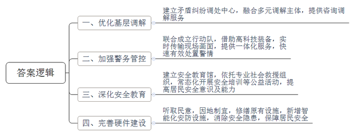
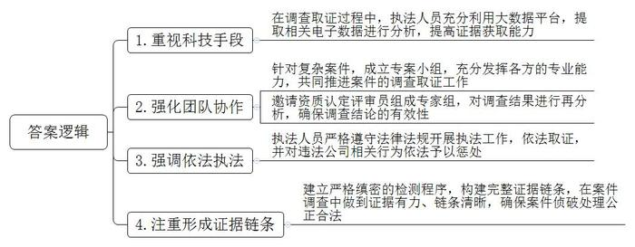

# 2023年公务员多省联考《申论》题（广西C卷）

> 候选采集稿。参考答案及解析来自粉笔页面，不代表官方答案或真实高分答卷；来源使用许可与原卷对应关系仍需人工核实。

## 给定材料

### 材料 material-d7d12732af1be5bc

2022年5月，A市认定729个“五星级平安小区”，光明区海港街道有12个小区获评“五星级平安小区”，居光明区各街道首位。人们纷纷打探海港街道的“平安密码”到底是什么。

近日，海港街道居民吴先生出差回家后发现，自己楼下的“爱车”竟然被“毁容”。邻居家装修时工人使用电焊未加装防护措施，导致火星坠落破坏了车漆面。吴先生找到施工队负责人沟通后，赔偿金额不能达成一致。街道多元化矛盾纠纷调处中心知悉后主动介入，经过调解，双方达成一致，纠纷成功化解。

多元化矛盾纠纷调处中心以公证机关专业调解为牵引，融合公证调解、人民调解、治安调解、司法调解等多元调解为主体，力争将矛盾解决在基层。2020年7月运行以来，中心成功化解183起纠纷，成功率达98.4%，接受当事人咨询631人次。

2021年3月26日晚，“超级花血月”现身A市。作为最佳观测点之一，位于海港辖区内的中兴大桥观景平台，迎来了众多专业的天文学爱好者及市民。在现场，一群身着高科技装备、驾驶平衡车维持秩序的民警们格外吸睛。海港街道联合派出所成立了“闪警别动队”，集治安巡逻、反诈宣传、隐患排查、应急处突、便民服务为一体，日常巡逻搭载北斗定位系统和360度高清摄像头，与派出所后台监控管理系统相连接，实时传输巡逻现场画面，实现一键报警、智能派警、快速处警。

5月20日，海港街道安全教育馆迎来一群活泼可爱的小朋友，A市光明区蓝天救援队队员为小朋友们讲授水上安全与自救、急救包扎的知识。在现场，同学们与授课队员积极互动，场面十分活跃。

自2020年海港街道安全教育馆运作以来，依托蓝天救援队的专业力量，常态化开展应急救护、安全演练、安全宣传、安全培训、心理危机干预等公益活动，为居民提供心理支持与服务，不断提高辖区居民的安全意识和安全防范能力。开馆以来，已为学生和居民举办40多场安全培训，累计接待居民、学生、各类团体4000余人次。

“刷脸”进出楼栋，这不是在高端小区。光明南路294号，三栋建于上世纪80年代的居民楼内，也实现了这一设想。8月中旬，随着崭新的人脸识别系统在单元楼上线，无物业老旧小区的居民们靠“刷脸”就能进出楼栋，在方便出行的同时，也更有安全保障。为保障居民安全，派出所还牵头修缮了一批老旧防盗门。

走进海成廊桥小区，映入眼帘的是三组电动车智能充电桩，满足居民电动车充电需求。海港街道坚持防范在前、疏堵结合，下大力气解决小区居民电动车停放、充电问题，消除“电动车进电梯”而引发的安全隐患。去年10月份开始，在了解到居民的“急难愁盼”问题之后，廊桥小区物业和业委会及时进行商量，充分听取居民的诉求，实地勘察小区环境，充分利用小区资源，在辖区内开展电动自行车充电设施建设。

海港街道切实解决群众身边的“糟心事、烦心事、揪心事”，海成廊桥小区居民李先生表示：“现在小区更安全，邻里更和谐，群众更满意，对这个小区的归属感也越来越强。”

### 材料 material-dd0d0a797c3dac60

2022年12月17日下午15时，C市机动车排气污染管理中心工作人员在后台开展冒黑烟车辆倒查溯源过程中突然发现，冒黑烟车辆的检测合格报告均出自市内某机动车检测有限公司，由此推测该公司在机动车检测活动中存在异常行为。市生态环境局获知此情况后，立即派出执法人员对该公司进行了现场调查。

下午16时，执法队员到达该公司，在对1号线操作间进行全面的现场排查后，并未发现机动车检测活动存在异常。但执法队员小李在车间内的一个角落里发现了一个与正常检测活动无关的OBD转接器，随后在现场进行了上线试验，提取数据后发现该OBD转接器做过特殊处理，可用于作假。看到试验数据，小李推断，这个公司在检测过程中可能使用过这个OBD转接器人为干扰检测结果，但现在缺乏直接有力的证据。

“这个OBD转接器是你们公司的吗？你们公司在机动车检测时使用过这个OBD转接器吗？……”执法队员分别对该公司法定代表人吕某、总经理助理谭某、环保检测线负责人韦某、环保检测线工作人员黄某，进行了细致的询问。对于是否在机动车检测时使用OBD转接器干扰OBD诊断仪的问题，吕某、谭某和韦某均予否认。仅有环保检测线上的黄某承认：“之前在检测机动车时，我们好像使用过这个转接器，具体记不清楚了。”

如何证明该公司在检测过程中存在人为干扰检测结果的行为，是摆在执法队员面前的一道难题。当天，小李原本想用那个在角落里发现的转接器在现场做一个对比实验，但该转接器为三无产品，无商品编码等证明，又不在公司登记册内，缺乏唯一性。由于登记保存时未做好现场物品的标记工作，在开展现场比对试验时未与该公司确认，相关负责人坚决不承认该转接器是其公司1号线操作间内的，同时拒绝现场检查签字，现场调查取证再次陷入僵局。

“我们办案常用的调查取证方法是‘抓现行+固定证据+笔录确认’，但这次并没有抓到现行的违法证据，又遇到了当事人的‘软’对抗。”小李在案情讨论时说，“看来他们是有准备的，这次的情况比较棘手，我们需要考虑其它的调查取证方法。”

据此，C市生态环境局立即召开案情分析会，当即决定从机动车排气污染管理中心检测过程和视频着手，深入调查处理。经请示上级，C市生态环境局牵头成立了由执法团队、技术团队和律师团队组成的专案小组，开展调查取证工作。因为生态环境部没有出台相关电子数据作为环境执法证据的规范要求，所以参考《公安机关办理刑事案件电子数据取证规则》的相关规定，从市机动车排气污染防治信息监管平台提取整理了该公司的相关电子数据。为了更高效、科学、准确地分析数据信息，执法人员和技术部门相互协作，充分利用大数据平台，让电子数据“开口说话”。

12月18日下午，执法人员在公安机关的协助下，调取了相关数据和视频分析后发现，该公司9月至12月期间共有40辆汽油车的OBD诊断仪采集的数据失实。为了进一步提升分析结果的证明力，局里邀请了三名省内检验检测机构资质认定评审员组成专家组，对相关结果进行再分析。数据分析结果表明，这40辆汽油车排放检验OBD读取数据及相应尾气检测过程中的车速、转速过程数据，不符合检测标准数据要求，所以原来的检测数据是无效的，不能作为机动车排放检测结果是否合规的判断依据。

执法人员还在现场仔细抽查了该公司的监控视频，发现有关检测人员在尾气检测时，违反了自动检测要求，人为对正在采集数据的不透光烟度计进行操作，所以又调取了188辆柴油车检测过程视频。从中发现，该公司9月至12月期间，操作员在检测柴油车尾气过程中多次使用纸巾塞进不透光烟度计，进行人为干扰，导致车辆尾气检测数据失实，并对相关车辆出具了合格检测报告。

“该公司操作员的弄虚作假行为违反了检验检测管理秩序，构成了未按照国家规定的检验方法、技术规范进行检验的违法行为。”周律师说。

在技术部门及专家组的多次试验、调查取证和论证后，形成了完整的违法行为证据链，证据之间能够相互印证、形成闭环，证据确凿，该公司无从抵赖狡辩。小李等人就分析报告、专家意见内容对该公司相关负责人进行了最后的询问调查，最终认定该公司在检测过程中存在出具虚假排放检验报告和未按照国家规定的检验方法、技术规范进行检验的违法行为，该公司在限期内未提出异议。

根据《中华人民共和国大气污染防治法》《市机动车和非道路移动机械排气污染防治条例》等相关法律规定，参照《省环境行政处罚自由裁量规则》有关规定，没收该公司违法所得4100元，罚款274138元；对该公司未按照国家规定的检验方法、技术规范进行检验的违法行为罚款35000元。依据《中华人民共和国治安管理处罚法》规定，将该公司人为干扰检测结果和计算机系统正常运行的工作人员移送至公安机关。

### 材料 material-7cbe6d42e354fcda

“碰碰手表，加个好友！”这句话成了当下不少儿童社交时打招呼的见面语。儿童智能手表市场蓬勃发展的背后，也暴露出不少问题。为守护儿童“腕上安全”，N市市场监管局近日召开了一次专题座谈会，听取各方意见建议。以下是部分参会人员的发言摘录：

学生家长龚某：前几天，小孩突然要我在她手表上绑定我的手机钱包。她说班上很多小朋友都这么做了，到时想买什么就买什么。有些智能手表一旦关联了家长的手机，就开通了免密支付，在家长不知情的情况下，孩子就可能会任性消费，比如打赏、购买游戏皮肤等，这不但容易导致小孩养成不健康的消费习惯，还可能危及家庭的资金安全。

某学校教师曾某：客观而言，智能手表有助于学生、家长和学校之间的沟通联系，但学生之间语音聊天、打电话越来越频繁，有的还在手表里下载了游戏和短视频App，课上偷着玩，课下抢着玩，不但影响了正常教学秩序，也不利于学生学习。

学生家长李某：给孩子买智能手表，主要是为了方便跟孩子联系，确保孩子安全。前阵子，孩子突然吵着要拿我的手机扫码听音乐，我才知道他的手表电话中居然自带了语音提示：“小朋友，请用爸爸妈妈的手机扫码，开通手表音乐VIP。”其实，我觉得儿童手表只要有基本功能就行，没必要设置那么多诱导性的语音提示和支付绑定功能。

市教委周副主任：现在儿童智能手表都具有上网、拍照以及智能语音功能，有的学生自律意识差，一遇到不会做的题，自己不动脑筋思考，而是用手表拍照在网上搜索答案，关键有时候答案还是错的。更严重的是，不少手表都与人工智能平台相连，学生喜欢向手表提出各种稀奇古怪的问题，而得到的回答时常会给学生造成误导，甚至引起认知偏差，非常不利于他们的身心健康。我们正在研究相关办法，加强对学生带手表入校以及具体使用行为的规范和引导，当然这也需要家长们的理解和配合。

市消保委监督部黄主任：我们今年对儿童智能手表消费情况进行了调查，结果显示，近一半的消费者对儿童智能手表质量表示不满，主要是信号不稳定、定位不准确、屏幕显示质量差、材质不安全等问题，有的厂商涉嫌虚假宣传，产品售后维修困难。

市公安局周警官：我们遇到过不少因儿童手表免密支付引发的经济损失案件。我们发现，有恶意程序伪装成游戏App，当小孩在手表上下载安装后，恶意程序就能轻松进驻到手表中，手表就被远程控制，容易被不法分子采集位置信息、监听通话记录，甚至偷拍偷录视频，有时可能危及儿童人身安全。希望家长引导孩子正确使用手表，一旦人身和财产受到侵害，应及时寻求警方帮助。

市关工委刘副主任：由于缺乏筛选和监管，用户容易下载到血腥暴力的游戏App和内容不健康的漫画App，极易诱使未成年人模仿。一些App在安装时，不用授权就可以直接获得定位、通讯录、麦克风、摄像头等多种敏感权限，轻易就能获取孩子的位置、人脸图像、录音等个人隐私信息，存在极大的信息安全漏洞。

某儿童手表公司曹经理：我们会千方百计确保产品质量，针对用户反馈的第三方软件问题，我们已在第一时间下架处理了问题应用程序。但守护儿童“腕上安全”仅靠我们一家公司是不够的，我们已向行业协会提出建议，出台相应的行业自律公约，共同为孩子们提供干净安全的手表。

某大学姚教授：儿童智能手表集多种功能于一体，但功能的多样性也带来了一系列“负产品”。治理儿童智能手表乱象，根本在于要从更高层面出台相应的法律法规或政策标准，同时社会各界也要共同担当作为，合力确保孩子“腕上安全”。

市场监管局王副局长：大家所反映的问题都不同程度存在，且问题所涉及面较广，给执法带来一定难度。我们将不断探索新的监管方式，丰富监管手段，提高监管专业能力。

## 题目

### 第 1 题

**请根据****“给定资料**1**”，概括海港街道开展平安小区建设的做法。（15分）**

关联材料：材料 material-d7d12732af1be5bc

作答要求：

要求：

（1）全面，准确，有条理；

（2）字数不超过200字。

### 第 2 题

**根据****“给定资料**2**”，谈谈C市此次生态环境执法行动对你有哪些启发？（20分）**

关联材料：材料 material-dd0d0a797c3dac60

作答要求：

要求：

（1）分析全面，准确合理，条理清晰；

（2）字数不超过250字。

### 第 3 题

**假如你是****N市市场监管局工作人员，请根据“给定资料**3**”，对座谈会上反映的问题提出解决的初步建议，供领导参考。（25分）**

关联材料：材料 material-7cbe6d42e354fcda

作答要求：

要求：

（1）全面，准确，有条理；

（2）有针对性，合理可行；

（3）不超过300字。

### 第 4 题

**根据给定资料，以****“里子”和“面子”为话题，联系实际，自选角度，自拟题目，写一篇文章。（40分）**

关联材料：材料 material-d7d12732af1be5bc

作答要求：

要求：

（1）立意明确，内容充实；

（2）思路清晰，语言流畅；

（3）参考给定资料，但不拘泥于给定资料；

（4）字数800—1000字。

## 答案与解析

第 1 题

**参考答案（粉笔题库参考内容）**

一、优化基层调解。建立矛盾纠纷调处中心，融合多元调解主体，提供咨询调解服务。

二、加强警务管控。联合成立行动队，借助高科技装备，实时传输现场画面，提供一体化服务，快速有效处置警情。

三、深化安全教育。建立安全教育馆，依托专业社会救援组织，常态化开展安全培训等公益活动，提高居民安全意识及能力。

四、完善硬件建设。听取民意，因地制宜，修缮原有设施，新增智能化安防设施，消除安全隐患，保障居民安全。

**解析**

**参考答案说明：**本参考答案从“优化基层调解”“加强警务管控”“深化安全教育”“完善硬件建设”这四个方面展开，各条答案要点之间在内容上相互并列，没有交叉。

**考点**：考点概括措施类

**来源**：来源2023年公务员多省联考《申论》题（广西C卷）

粉笔申论页面对本题只提供「解析视频」入口，该入口是会员推广位，页面无视频地址与文字解析。

第 2 题

**参考答案（粉笔题库参考内容）**

1.重视科技手段。在调查取证过程中，执法人员充分利用大数据平台，提取相关电子数据进行分析，提高证据获取能力。

2.强化团队协作。针对复杂案件，成立专案小组，充分发挥各方的专业能力，共同推进案件的调查取证工作；邀请资质认定评审员组成专家组，对调查结果进行再分析，确保调查结论的有效性。

3.强调依法执法。执法人员严格遵守法律法规开展执法工作，依法取证，并对违法公司相关行为依法予以惩处。

4.注重形成证据链条。建立严格缜密的检测程序，构建完整证据链条，在案件调查中做到证据有力、链条清晰，确保案件侦破处理公正合法。

**解析**

**参考答案说明**：本参考答案从“重视科技手段”“强化团队协作”“强调依法执法”“注重形成证据链条”四个方面展开，各条答案要点之间在内容上相互并列，没有交叉。

**考点**：考点经验启示类

**来源**：来源2023年公务员多省联考《申论》题（广西C卷）

粉笔申论页面对本题只提供「解析视频」入口，该入口是会员推广位，页面无视频地址与文字解析。

第 3 题

**参考答案（粉笔题库参考内容）**

1.完善顶层制度。针对乱象，从更高层面出台法律法规或政策标准；研究相关办法，加强对学生戴手表入校以及具体使用行为的规范和引导。

2.引导家长配合。引导孩子正确使用手表，一旦人身和财产受到侵害，及时寻求警方帮助；理解并配合学校的规定和安排。

3.加强市场监管。市场监管局与网信等部门，开展联合执法，加强针对性监管；探索新的监管方式，丰富监管手段，提升监管能力。

4.规范行业行为。保留基本功能，删除诱导性的语音提示和支付绑定功能；确保产品质量；针对用户反馈，及时做出处理；推动行业协会出台自律公约。

**解析**

**参考答案说明：**本参考答案从“完善顶层制度”“引导家长配合”“加强市场监管”“规范行业行为”4个方面对儿童手表市场存在的“问题”提出了解决建议，并进行了分类分条撰写，各条要点之间在内容上是并列关系，没有交叉。

**考点**：考点提出对策类

**来源**：来源2023年公务员多省联考《申论》题（广西C卷）

粉笔申论页面对本题只提供「解析视频」入口，该入口是会员推广位，页面无视频地址与文字解析。

第 4 题

**参考答案（粉笔题库参考内容）**

**兼顾里子与面子 留住灵气与暖意**

一座城市的发展，承载着市民对美好生活的向往，向往的既有城市外在的美丽与繁华，也有内在的温暖与归属。只有二者兼顾，以人为本，才能留住城市的人间烟火气，让民众感受到城市的灵气与暖意。

**“****面子****”****是城市的风貌，****“****里子****”****则是城市的良心。**“面子”是一座城市的名片，是外在环境，是市容市貌，关乎城市形象；“里子”是城市的气度、灵气、烟火气，是看不见，却涉及城市安全和群众利益的服务、民生诉求等，关乎生活品质。随着生活水平的提升，民众对于城市环境的要求越来越高，优美的景色、完善的硬件、特色的建筑等，也是城市魅力与品味的象征，是市民自信心与归属感的来源。但如果过分追求“面子”，忽视“里子”则会降低市民的幸福感和获得感。因为居于其中，我们更希望一座城市有优质的服务、厚重的人文、便利的生活……

**“面子”与“里子”看似对立实则统一，是城市建设的一体两面，缺一不可。**“面子”“里子”共同构筑幸福、宜居、安全的城市。当前，一些城市重金打造城市地标、对夜市摊点“一禁了之”、忽视地下管网建设导致“城市看海”等等，不仅造成国家财力和社会资源的浪费，还损害民众的切身利益，面子有了，却丢了里子。但若在重视“里子”的同时，未做好管理工作，也会让民众心生不满，如夜市开放后，满地散乱的垃圾、难以清理的油垢同样会有损城市的“面子”。所以城市建设不可厚此薄彼，只有内外兼修，城市才是一座健康的生命有机体！

**兼顾****“面子”与“里子”需要政府疏堵结合，法规设立人性化，管理体系精细化，部门之间加强联动，明确权责。**游人如织的夜市中，人与人之间有了亲密的交流，城市不再是钢筋水泥的森林，而是成了寄托乡愁，释放压力的归处。但狂欢之时的噪音扰民，狂欢之后的卫生难题，也饱受诟病。如何平衡就要考量政府治理的智慧。一方面政府要以人为本，出台制度，立法疏导。如对于设摊经营、占道经营等行为由以往的全面禁止变为“重点区域禁止”，不再“一禁了之”。当然也不能“一放了之”，所以另一方面，管理者也要不断提升管理水平，统筹规划，建立更加精细化的管理体系，协调各部门通力合作、密切配合。这样才不会让城市的“烟火气”变成“火气”。

既把“面子”做靓，又要把“里子”做实。只有“面子”“里子”一起抓，才能真正提升城市质感，彰显城市温度，让民众在“光鲜亮丽”中感受城市的活力与美好。

**解析**

**文章分析**

**兼顾里子与面子** **留住灵气与暖意**

【**标题的优点：**首先，范文的标题突出了“‘里子’与‘面子’”这一主题。其次，形式上，文字简洁明快。】

一座城市的发展，承载着市民对美好生活的向往，向往的既有城市外在的美丽与繁华，也有内在的温暖与归属。只有二者兼顾，以人为本，才能留住城市的人间烟火气，让民众感受到城市的灵气与暖意。

【**开头的优点：**★内容方面：范文的开头是紧扣“‘里子’与‘面子’”这一主题展开的。首先指出了城市发展对市民诉求的关系；然后指出了兼顾“面子”和“里子”让城市充满灵气。★文字表达方面：长短句配合使用，使语言表达有节奏感。】

**“面子”是城市的风貌，“里子”则是城市的良心。“面子”是一座城市的名片，是外在环境，是市容市貌，关乎城市形象；“里子”是城市的气度、灵气、烟火气，是看不见，却涉及城市安全和群众利益的服务、民生诉求等，关乎生活品质。**随着生活水平的提升，（1）民众对于城市环境的要求越来越高，优美的景色、完善的硬件、特色的建筑等，也是城市魅力与品味的象征，是市民自信心与归属感的来源。（2）但如果过分追求“面子”，忽视“里子”则会降低市民的幸福感和获得感。因为居于其中，我们更希望一座城市有优质的服务、厚重的人文、便利的生活……

【**论述段****1的优点：**★观点句：范文的观点句是紧扣“‘里子’与‘面子’”这一文章主题提出的。形式上，它在段首处直接写出，位置突出，容易发现。内容上，关键词突出，内容要点明确，可以明显看出他是围绕“‘里子’与‘面子’”的含义展开。★论述内容：（1）首先介绍了城市环境（面子）的重要性；（2）介绍了过分追求“面子”带来的危害；（3）介绍了生活在城市的人，对城市的期望——既有面子，又有里子。注意：以上三个方面的内容都是紧扣“‘面子’是城市的风貌，‘里子’则是城市的良心。‘面子’是一座城市的名片，是外在环境，是市容市貌，关乎城市形象；‘里子’是城市的气度、灵气、烟火气，是看不见，却涉及城市安全和群众利益的服务、民生诉求等，关乎生活品质”这个观点句论述的，论述的针对性强，内容层次丰富。在论述方法上采用了讲道理、举例子相结合，做到了丰富多样。】

**“面子”与“里子”看似对立实则统一，是城市建设的一体两面，缺一不可。“面子”“里子”共同构筑幸福、宜居、安全的城市。**当前，（1）一些城市重金打造城市地标、对夜市摊点“一禁了之”、忽视地下管网建设导致“城市看海”等等，不仅造成国家财力和社会资源的浪费，还损害民众的切身利益，面子有了，却丢了里子。（2）但若在重视“里子”的同时，未做好管理工作，也会让民众心生不满，如夜市开放后，满地散乱的垃圾、难以清理的油垢同样会有损城市的“面子”。（3）所以城市建设不可厚此薄彼，只有内外兼修，城市才是一座健康的生命有机体！

【**论述段****2****的优点：**★观点句：范文的观点句是紧扣“‘里子’与‘面子’”这一文章主题提出的。形式上，它在段首处直接写出，位置突出，容易发现。内容上，关键词突出，内容要点明确，可以明显看出他是围绕“‘里子’与‘面子’”的关系展开。★论述内容：（1）首先介绍了城市建设只注重“面子”带来的危害；（2）其次介绍了城市建设不重视“面子”带来的危害；（3）最后指出城市建设要内外兼修，平衡“里子”与“面子”。注意：以上三个方面的内容都是紧扣“‘面子’与‘里子’看似对立实则统一，是城市建设的一体两面，缺一不可。“面子”“里子”共同构筑幸福、宜居、安全的城市”这个观点句论述的，论述的针对性强，内容层次丰富。在论述方法上采用了讲道理、举例子相结合，做到了丰富多样。】

**兼顾****“面子”与“里子”需要政府疏堵结合，法规设立人性化，管理体系精细化，部门之间加强联动，明确权责。**（1）游人如织的夜市中，人与人之间有了亲密的交流，城市不再是钢筋水泥的森林，而是成了寄托乡愁，释放压力的归处。但狂欢之时的噪音扰民，狂欢之后的卫生难题，也饱受诟病。如何平衡就要考量政府治理的智慧。（2）一方面政府要以人为本，出台制度，立法疏导。如对于设摊经营、占道经营等行为由以往的全面禁止变为“重点区域禁止”，不再“一禁了之”。（3）当然也不能“一放了之”，所以另一方面，管理者也要不断提升管理水平，统筹规划，建立更加精细化的管理体系，协调各部门通力合作、密切配合。这样才不会让城市的“烟火气”变成“火气”。

【**论述段****3****的优点：**★观点句：范文的观点句是紧扣“‘里子’与‘面子’”这一文章主题提出的。形式上，它在段首处直接写出，位置突出，容易发现。内容上，关键词突出，内容要点明确，可以明显看出他是围绕“如何兼顾‘里子’与‘面子’”展开。★论述内容：（1）城市作用；（2）如何建设城市——以人为本，出台制度；（3）如何建设城市——统筹规划，精细化管理。注意：以上三个方面的内容都是紧扣“兼顾‘面子’与‘里子’需要政府疏堵结合，法规设立人性化，管理体系精细化，部门之间加强联动，明确权责”这个观点句论述的，论述的针对性强，内容层次丰富。在论述方法上采用了讲道理、举例子相结合，做到了丰富多样。】

既把“面子”做靓，又要把“里子”做实。只有“面子”“里子”一起抓，才能真正提升城市质感，彰显城市温度，让民众在“光鲜亮丽”中感受城市的活力与美好。

【**结尾的优点：**范文的结尾回扣了“‘面子’与‘里子’”这个主题，并且进行了总结提升。】

**考点**：考点文章写作题

**来源**：来源2023年公务员多省联考《申论》题（广西C卷）

粉笔申论页面对本题只提供「解析视频」入口，该入口是会员推广位，页面无视频地址与文字解析。

