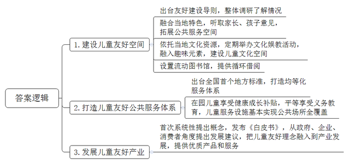
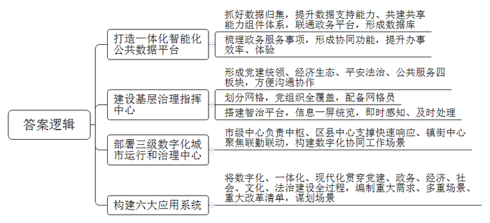
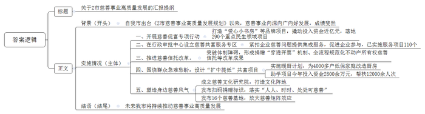
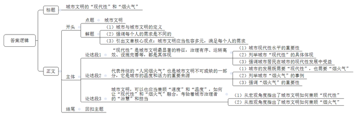

# 2024年公务员多省联考《申论》题（广西A、普通选调卷）

> 候选采集稿。参考答案及解析来自粉笔页面，不代表官方答案或真实高分答卷；来源使用许可与原卷对应关系仍需人工核实。

## 给定材料

### 材料 material-9a86d26b551362cf

“这顶凉帽是我在2023年暑假跟师傅学着做的，他教我们编织凉帽的时候，还给我们讲凉帽的由来和客家历史。”恬恬自豪地说。来自华成区凉帽新村的恬恬亲手编织的客家凉帽在N市首届儿童友好博览会上引起了围观，大人小孩纷纷试戴合影。

凉帽新村是一个典型的城中村，村里有500余名留守儿童，占总人口的16%。在实施儿童友好空间改造工作之前，华城区城管局活力城中村项目负责人小青，带领设计团队做了整体调研，发现诸多如凉帽新村这样的群众村，普遍存在空间狭小、安全隐患多、环境差、儿童游乐设施少等问题。

为此，设计团队重新整理了凉帽新村西侧人行道路，利用架空技术将人行道从1米多宽的步道拓展出3800㎡的公共服务空间。“其中有一处粉红色的儿童无动力设施就最受孩子欢迎，每天一放学，这里就会‘长满’了孩子。”小青说，设施的顶是形似竹编的钢结构，契合了凉帽新村的竹编特色。“建设过程中，我们听了家长和孩子们的意见，尽量避免过度设计可能带来的千篇一律，剥夺了孩子想象空间的问题。对孩子而言，随处有一滩水、一处沙、一个捉迷藏空间，比装个固定的滑梯更友好。”

“以前接小孩放学后，就要寸步不离地盯着他，村里的车乱开乱停，小孩子们跑来跑去很危险。现在孩子们都喜欢去空中乐园玩，我们都很放心。”一位孩子妈妈开心地说。除了有形的友好空间，凉帽新村也为儿童打造了友好的文化空间。

村里以市级非遗凉帽编织技艺为主题，定期举办科普、彩绘等亲子文化娱教活动，并融入趣味元素，引导孩子们感受和了解地方传统文化。不仅仅在凉帽新村，打造儿童友好空间已经成为N市2135个城中村改造升级的重要内容之一。N市妇联钟主席表示，市里去年出台了《城中村儿童友好空间建设导则》，目标是根据城中村的基础设施以及居住的儿童数量，为居住在城中村的孩子们创造更多安全游乐的空间。“妈妈，流动图书馆大巴怎么开到这来了？”看到儿童友好博览会外停着的一辆彩绘大巴，安化区小学的一涵同学激动地说，“我已经从流动图书馆里借阅了快100本书了，上幼儿园开始看绘本，现在看小学的书。我会讲好多故事，每次大巴开到家门口，我都约了好朋友一起上车选书，我太喜欢流动图书馆了！”

“安化区城中村比较多，有的村没有条件建设图书馆，有不少小朋友向我们反映了上门借阅图书不方便，于是我们就用大巴将书送到孩子身边。”安化区图书馆馆长谈到大巴车会按社区路线走，每个小朋友一次可以借阅20本书，两个月内大巴车会循环回来，届时小朋友还可以还书再借书。安化流动图书馆自2020年在N市启动以来，已在8个社区和16所学校设置服务点，累计投入儿童书籍11万余册，借阅量超过7万册次。

2022年，N市出台全国首个儿童友好地方标准《儿童友好公共服务体系建设指南》，明确了从法律保护等八个方面构建儿童友好公共服务体系。来了就是N市人，来了就是N市的娃，让社会发展成果更公平普惠所有儿童。3至6岁在园儿童均可享受健康成长补贴，每年有58万名孩子受益，51%的义务教育学位提供给了非本地户籍学生，使这些孩子作为与户籍学生平等的主体，更好地融入这座城市。截至2023年底，N市已建成市级儿童友好基地452个，友好公园1260多座，儿童议事组织580个，社区儿童之家761个，建成母婴室1270多间，基本实现公共场所全覆盖，创新推广移动母婴室，让儿童出行更加便捷。

日前，N市前瞻产业研究院，参考国家统计局的划分方式，首次系统性提出了“中国儿童产业”的概念。“我们注意到国内一些企业已经在研发、生产、经营满足儿童心理发展需求的产品。我们也发现儿童产业存在一些突出问题，比如我国3岁以上儿童食品目前尚无国家标准，添加剂标准以60公斤成年人为参照标准，动画片分级制度尚为空白。”研究院副院长谈道。在首届儿童友好博览会开幕式上，研究院公布了《中国儿童产业友好实践洞察白皮书》，从政府、企业、消费者三个层面提出儿童产业友好发展的建议。“我们希望企业把儿童友好理念融入到产业发展中，为儿童、家长和家庭提供更多优质产品和服务，支撑儿童友好城市建设的‘硬设施’和‘软服务’。”

“去年，我们在湖华小学调研时，曾询问孩子们什么是‘儿童友好’。一位6年级学生想了想，说是‘尊重’。我觉得最容易被忽略的就是对孩子的尊重，这也是‘儿童友好’的本源。只有学会以‘一米’高度看城市，才能让儿童真正感受到城市的关怀与温暖。”N市妇联钟主席感叹地说，“八年来，N市正在把‘儿童友好’从一个概念变成一项项真正落下来的设施、服务。”

### 材料 material-e58a24de9cad2a70

“我们早上九点提交申请，不到半个小时就收到资料检查通过的短信，十点签了个字，下午三点企业就注册成功了。”12月1日，创业者小苏在网上提交“企业开办一件事”申请，轻松完成了企业开办手续。

今天像这样的在网上申请开办企业的有50多例，几乎当日就能办结，如果申请人勾选了社保、公积金等其他事项，还能一并办结。D县政务服务中心周主任表示，随着Q市一体化智能化公共数据平台的持续打造，企业、群众“足不出户”就能够办成的事情越来越多，办事体验越来越好。

2023年以来，Q市围绕提升一体化、智能化公共数据平台的服务支撑能力，重点抓好了数据收集，提升数据支持能力、共建共享能力组件体系，联通升级两大政务平台形成了数据“一组库”。共编写52346类数据，为76个市级部门、41个区县提供数据仓环境，建成全市物联感知系统。接入数据头、传感器117类，157万个设备，实现了303项上架能力组件，能力组件的使用量达到107万。“快办”平台精细化梳理了2866个政务服务事项，支撑53项“一件事、一次办”上线运行。“快办”平台形成了16项协同功能，日均活跃用户40万。

走进N区双桂镇基层治理指导中心，一块智慧大屏映入眼帘。“可以实现查看辖区内场镇路口、森林河道、公路、铁路等各个监控点位的高清画面，我们将原有的办公场地设立为基层治理指挥中心，形成党建统领、经济生态、平安法治和公共服务四个板块，沟通更便捷，协作更高效。”覃镇长表示。全镇共划分为176个网格，全覆盖建立网格党支部或党小组，采取整合、招聘、下沉的方式，配备专职网格员176人。“在应用场景建设方面，我们通过搭建智治平台，以网格为单位核准‘人、房、地、事、物’等信息，实现全镇网格一屏统览。一旦发生紧急事件，网格地图将立即变色并闪烁预警，实现即时感知、及时处理。”智治平台投用半月来，累计处理矛盾纠纷、突发险情等各类案件378起。不少居民表示，现在天天看得见网格员，他们上报的事情很快就有回音。

Q市现有3000多万常住人口，兼具“大城市”与“大农村”的特点，体系错综、结构复杂、运行治理难度大。2023年初Q市启动部署市、区县、镇街数字化城市运行和治理中心。市级中心作为治理“大脑”，负责感知发现、决策指挥等数字化治理中枢工作；区县中心聚焦“实战”，承载市级应用，谋划本级特色应用，支撑公共安全等事件的快速响应；镇街中心聚焦“联勤联动”，负责服务群众、推动发展等。莫局长说，全市90%的镇街目前已建成“一中心四板块”和智治平台，形成网格7万余个，并通过三级数字化城市运行和治理中心，构建起全局“一屏掌控”、政令“一键智达”、执行“一贯到底”、监督“一览无余”的数字化协同工作场景。“如果说传统的城市治理是织农家土布的话，那么数字时代的城市治理就是江南刺绣。”

“驾车行驶在经开大道上，你可能会疑惑，曾经拥堵的路段为何变得如此通畅？”Q公安局经开分局夏局长说，这是全市首个交通信号配时中心高效运行的结果。作为本级特色应用，交通信号配时中心发现道路拥堵后，会立即切换到相应道路的视频监控摄像头，借助智能算法进行深度分析，针对拥堵问题给出“最优解”，打造一条条“绿波带”，提升道路通行效率。

数字，让道路更畅通。这些道路有些是有形的，有些是无形的。

Q市842家医疗机构已实现影像检查结果互认，医生可以跨院调阅患者的影像检查结果，避免患者重复检查，让医生的诊断更加高效；B区智慧养老服务中心对居家养老群体的居住环境进行适老化改造，装上一键呼叫、燃气监测等设备，一旦出现异常，工作人员会第一时间联系处理；在革命纪念馆，游客借助数字技术手段，便能“穿越”时空，沉浸式感受红色文化……

2023年初，Q市召开数字城市建设大会，对标“数字中国”战略部署，提出加快建设“1361”数字城市建设整体构架，打造引领新时代的数字文明市域范例。一年多来，Q市把数字化、一体化、现代化贯穿到党建、政务、经济、社会、文化、法治建设全过程，各方面着力构建六大应用系统，编制应用重大需求清单、多重场景清单、重大改革清单，并以“一件事思维”谋划场景930个。

数字时代的城市治理，不只需要冷冰冰的数据、硬邦邦的机器，而且要通过海量的数据资源、完善的基础设施、先进的科学技术，人性化的运行机制，让整个城市更加密切、更有效率。莫局长说：“数字场景应用正在渐渐改变人们生活的方方面面，赋予城市发展生生不息的力量，Q市加速前行，数字化运行和治理的思想和场景还在不断地增强……”

### 材料 material-c94c3277bbd6a119

二十大报告强调，分配制度是促进共同富裕的基础性制度。坚持按劳分配为主体多种分配方式并存，构建初次分配、再分配、第三次分配协调配套的制度体系。公益慈善事业作为第三次分配的重要载体，被赋予了时代使命。“谢谢你们，孩子再也不用在塑料凳上写作业了。”日前，在T县山坝村小雨家里，小雨的爷爷高兴地对送书桌上门的“爱心小书房”志愿者说。在陈旧简陋的家具摆设中，崭新的书桌格外醒目。点滴之爱，为困难家庭的孩子带来了更多的阳光和希望。

“爱心小书房”是Z市慈善促富专项行动中涌现出的品牌慈善项目。该项目采取民生服务共富结对的机制开展。“过去一年，Z市9个区民政部门与T县等3个县民政部门结对共建组成3个共建团队，聚焦当地老人、小孩和困难群众的民生服务需求，统筹资源支持3个县民政民生协同发展。”Z市民政局慈善事业促进处韦处长表示，慈善促富专项行动已累计撬动投入慈善资金近亿元，落地290个重点民生领域项目。

“我们出台《Z市慈善事业高质量发展规划》，在全省各行政审批服务中心中，率先设立慈善共富服务专区，紧扣企业反映的捐赠发票、税收抵扣、捐赠形式、慈善信托等问题提供集成服务，让企业更好地走进慈善、了解慈善、支持慈善。”韦处长说，一年多来，已实施慈善募捐、救助等服务项目110个。Z市还突破慈善信托起步初期的体制障碍，形成了慈善信托捐赠“穿透开票”机制、全国首单全流程规范化不动产所有权慈善信托等系列改革成果。围绕群众的“急难愁盼”，Z市各级慈善总会精心设计一批“扩中提低”共富项目，将每一份关爱精准送到最需要的地方。

“油烟机终于装上了，灶具也换新的了。厨房不仅干净了许多，也更加安全了。感谢你们！”市民李大妈开心地对绿能集团工作人员说。这个叫“暖厨计划”的项目，由Z市慈善总会和绿能集团联合发起，计划投入3000万元，持续三年时间为低保家庭改造厨房，帮助更换油烟机、灶具等厨房设备。绿能集团公益慈善基金会负责人表示，“暖厨计划”已累计改造厨房4000多家。如果说，“暖厨计划”慈善项目让善意的微光照进烟火日常，助学行动则是面向未来的希望之光。

近日，又一批家境困难的学生得到社会的援助。在“学子自强计划”帮助下T县等3个县的60名大学生收到了社会各界捐赠的每人16000元助学金。“有善始者实繁，能克终者盖寡。”Z市慈善总会负责人表示，“‘学子自强计划’已连续开展18年，是助学行动的有效组成部分。”帮扶困难学生，可以推动从“帮扶一个人”到“幸福一个家庭”，今年慈善系统助学项目已投入慈善资金2800余万元，帮扶12000余人次。

2023年1月至8月，Z市慈善系统支出2亿元，救助困难群众38万人次。9月，Z市慈善文化研究院揭牌成立。“我们将从历史和现实着眼，汲取中国传统慈善文化精髓，加快慈善文化阵地建设，强化慈善典型事迹宣传，服务慈善事业大格局。”研究院娄院长说。同月，Z市发布“慈善一日捐”扫码捐赠统一标识，市民通过政务APP、支付宝、微信即可捐赠，将“人人可慈善、时时可慈善、处处可慈善”落到实处。

日前，Z市对外发布首批16个慈善基地。东城区孝爱慈善基地打造线上线下智慧慈善超市、西城区幸福乡里共同体慈善基地守护“朝夕美好”，T县太安村幸福直播慈善基地帮助低收入农户家门口就业……随着Z市的慈善基地“触角”延伸，“身边慈善”蔚然成风，慈善矩阵效应得以不断放大。在红帆路，一个情意暖暖的幸福里慈善街区规模初现，慈善摊位、爱心助岗……“我们以帮扶困难群众就业为重点，打造公益慈善与商圈资源相融合的街区慈善文化。”江北区慈善总会负责人介绍，目前该街区正全力打造幸福里慈善驿站，已经投资30余万元成立慈善信托，提供就业岗位300余个。

## 题目

### 第 1 题

**“给定资料**1**”中提到****“****只有学会以****‘****一米****’高度看城市，才能让儿童真正感受到城市的关怀与温暖****”****，请谈谈****N市围绕这个方面做了哪些工作****？（****15分）**

关联材料：material-9a86d26b551362cf

作答要求：

要求：全面、准确、有条理，字数不超过250字。

### 第 2 题

**请根据****“给定资料**2**”，分析Q市数字化服务能力提升的原因。****（****20分****）**

关联材料：material-e58a24de9cad2a70

作答要求：

要求：

（1）分析全面，条理清晰；

（2）不超过300字。

### 第 3 题

**市相关领导计划近期召开专题会议，听取****《****Z****市****慈善事业高质量发展规划》落实情况，假如你是慈善总会工作人员，请根据****“给定资料**3**”，拟写一份汇报提纲****。（****25分****）**

关联材料：material-c94c3277bbd6a119

作答要求：

要求：

（1）紧扣资料，内容全面；

（2）准确简明，条理清晰；

（3）字数不超过400字。

### 第 4 题

**“给定资料**4**”****提到****“****文明之所以文明，就是因为它既容纳了现代的行为方式，也包容了传统的生活习惯。****”****请深入思考这句话，联系实际，自选角度，自拟题目，写****一****篇文章。****（****40分）**

关联材料：material-9a86d26b551362cf

作答要求：

要求：

（1）立意明确，内容充实；

（2）思路清晰，语言流畅；

（3）参考给定资料，但不拘泥于给定资料；

（4）字数1000~1200字。

## 答案与解析

第 1 题

**参考答案（粉笔题库参考内容）**

1.建设儿童友好空间。出台友好建设导则，整体调研了解情况；融合当地特色，听取家长、孩子意见，拓展公共服务空间；依托当地文化资源，定期举办文化娱教活动，融入趣味元素，建设儿童文化空间；设置流动图书馆，提供循环借阅。

2.打造儿童友好公共服务体系。出台全国首个地方标准，打造均等化服务体系；在园儿童享受健康成长补贴，平等享受义务教育，儿童服务设施基本实现公共场所全覆盖。

3.发展儿童友好产业。首次系统性提出概念，发布《白皮书》，从政府、企业、消费者角度提出发展建议，把儿童友好理念融入到产业发展，提供优质产品和服务。

**解析**

**参考答案说明：**本参考答案从“建设儿童友好空间”“打造儿童友好公共服务体系”“发展儿童友好产”三个方面介绍了N市让儿童感受到城市的关怀与温暖的对策。每条答案要点之间在内容上是并列关系，没有交叉。

**考点**：考点概括措施类

**来源**：来源2024年公务员多省联考《申论》题（广西A、普通选调卷）

粉笔申论页面对本题只提供「解析视频」入口，该入口是会员推广位，页面无视频地址与文字解析。

第 2 题

**参考答案（粉笔题库参考内容）**

1.打造一体化智能化公共数据平台。抓好数据归集，提升数据支持能力、共建共享能力组件体系，联通政务平台，形成数据库；梳理政务服务事项，形成协同功能，提升办事效率、体验。

2.建设基层治理指挥中心。形成党建统领、经济生态、平安法治、公共服务四板块，方便沟通协作；划分网格，党组织全覆盖，配备网格员；搭建智治平台，信息一屏统览，即时感知、及时处理。

3.部署三级数字化城市运行和治理中心。市级中心负责中枢、区县中心支撑快速响应、镇街中心聚焦联勤联动，构建数字化协同工作场景。

4.构建六大应用系统。将数字化、一体化、现代化贯穿党建、政务、经济、社会、文化、法治建设全过程，编制重大需求、多重场景、重大改革清单，谋划场景。

**解析**

**参考答案说明：**本参考答案分别从“打造一体化智能化公共数据平台”“建设基层治理指挥中心”“部署三级数字化城市运行和治理中心”“构建六大应用系统”四个方面介绍了Q市数字化服务能力提升的原因，各条要点之间在内容上相互并列，没有交叉。

**考点**：考点原因类

**来源**：来源2024年公务员多省联考《申论》题（广西A、普通选调卷）

粉笔申论页面对本题只提供「解析视频」入口，该入口是会员推广位，页面无视频地址与文字解析。

第 3 题

**参考答案（粉笔题库参考内容）**

关于Z市慈善事业高质量发展的汇报提纲

背景：自我市出台《Z市慈善事业高质量发展规划》以来，慈善事业向深向广向好发展，成绩斐然。

落实情况：一、开展慈善促富专项行动。打造“爱心小书房”等品牌项目，撬动投入资金近亿元，落地290个重点民生领域项目。二、在行政审批中心设立慈善共富服务专区。紧扣企业慈善问题提供集成服务，促进企业参与，已实施服务项目110个。三、推进慈善信托改革。突破体制障碍，形成捐赠“穿透开票”机制、全流程规范化不动产所有权慈善信托等改革成果。四、围绕群众急难愁盼，设计“扩中提低”共富项目。实施暖厨计划，为4000多户低保家庭改造厨房；助学项目今年投入资金2800余万元，帮扶12000余人次。五、塑造身边慈善风气。成立慈善文化研究院，打造文化阵地；发布扫码捐赠标识，落实“人人、时时、处处可慈善”；发布16个慈善基地，放大慈善矩阵效应。

结语：未来我市将持续推动慈善事业高质量发展。

**解析**

**参考答案说明：**（1）格式方面，本参考答案写到了“标题”“正文”两个部分。（2）正文部分，一方面从内容上来看，围绕“《Z市慈善事业高质量发展规划》落实情况”这一主题，本参考答案的开头先写到了Z市推动慈善事业发展的成就；主体部分从“开展慈善促富专项行动”“在行政审批中心设立慈善共富服务专区”“推进慈善信托改革”“围绕群众急难愁盼，设计‘扩中提低’共富项目”“塑造身边慈善风气”这五个方面给出了具体的落实情况；结尾部分写到了对Z市慈善事业的展望。另一方面，形式上，本参考答案做到了分段、分条撰写，整体上条理较为清晰。

**考点**：考点总结类

**来源**：来源2024年公务员多省联考《申论》题（广西A、普通选调卷）

粉笔申论页面对本题只提供「解析视频」入口，该入口是会员推广位，页面无视频地址与文字解析。

第 4 题

**参考答案（粉笔题库参考内容）**

**城市文明的“现代性”和“烟火气”**

城市是人类文明的重要成果和标志。作为人类文明发展的高级阶段，**城市文明应该是以人的幸福为中心的文明**。从整体而言，人类都在追求更优渥的物质条件、更便利的生活；但从个体角度来看，每个人的需求和感受、生活方式和价值观念等又都是不同的。因此，**城市的文明应当是包容的、多元的，让每个人都能够在其中获得满足和尊重**。

在城市文明中，代表着未来发展方向的“现代性”与代表传统的“人间烟火气”，一个追求速度和秩序，一个关注温度和个体，二者看似格格不入，但实际上都是城市文明的重要组成。

**毋庸置疑，****“现代性”是城市文明最显著的特征，治理有序、运转高效、设施完善等，都是其体现。**城市居民的生活质量，在很大程度上取决于城市的现代性水平。“数字城市”等先进的社会治理方式，让城市决策更高效、治理更精细；城市机能的高效运转，能够让人以最短的时间、最低的成本，完成各种各样的社会活动；城市中完善的设施，能够给人们提供更加舒适的生活体验，提高生活的幸福指数……可以说，在当下的中国，每一座城市的居民，都能切实感受到城市发展的红利，都在城市的发展中受益。

但是在有些人的眼中，城市发展的速度和秩序，就是城市文明的唯一标准，乃至有些地方，不允许菜农上地铁、不允许摆摊，因为这不够“现代”，影响“秩序”。

**恰恰相反，代表传统的****“人间烟火气”也是城市文明不可或缺的一部分，它是城市的温度和活力的重要来源。**城市的发展，不能只有高楼大厦、车水马龙，清早装满蔬菜的背篓、夜市里嘈杂的叫卖，也同样是城市的风景。山城重庆开通的“背篓专列”，一头连接乡村生计，一头连接城市需求，这是政府换位思考、人性化管理的智慧，也是城市烟火气的再现。“人间烟火气，最抚凡人心”，“烟火气”能够激活城市的神经末梢，是观察城市文明的一扇窗口，是城市张力和灵性的所在，一个失去“烟火气”的城市，往往会变得空洞、冷漠，缺乏生机和活力。真正文明的城市，既要装得下“公文包”，也容得下“菜背篓”。

**城市文明，****可以****也应当兼顾****“速度”和“温度”，如何让“现代性”和“烟火气”融合，考验着城市治理者的“****治****慧****”****和担当。**在宏观的战略布局上，通过先进的技术、科学的规划，保障城市的经济发展、秩序稳定，为市民提供便捷舒适的生活环境；在微观的民生福祉上，倾听市民的声音，满足他们的真实需求与期望，让他们找到归属感与幸福感，为城市的繁荣贡献力量。同时，也需要加强公众教育，让关爱、尊重、包容成为每一个市民的共识，让每一个人都成为城市文明的传播者与践行者，让身边的人都能感受到融融暖意。

电影《流浪地球2》有句打动人心的话：“没有人的文明，毫无意义。”同理，脱离人性的城市文明亦属空谈。唯有速度与温情并存，秩序与人性相依，数字与情感交融，方可称得上真正的城市文明。

**解析**

**文章分析**

**城市文明的“现代性”和“烟火气”**

【**标题的优点：**首先，范文的标题突出了“城市文明”这一主题。其次，形式上，文字简洁明快，不拖沓。】

（1）城市是人类文明的重要成果和标志。作为人类文明发展的高级阶段，城市文明应该是以人的幸福为中心的文明。（2）从整体而言，人类都在追求更优渥的物质条件、更便利的生活；但从个体角度来看，每个人的需求和感受、生活方式和价值观念等又都是不同的。（3）因此，**城市的文明应当是包容的****、****多元的****，****让每个人都能够在其中获得满足和尊重****。**

【**开头的优点：**★内容方面：范文的开头是紧扣“城市文明”这一主题展开的。首先，开头点出主题，做到了主题明确。其次，对“城市文明”这一主题进行了分析阐述：（1）首先指出了城市与城市文明的定义；（2）其次强调每个人的需求是不同的；（3）最后引出文章核心观点：城市文明应当包容多元，满足每个人的需求。★文字表达方面：长短句配合使用，使语言表达有节奏感。】

在城市文明中，代表着未来发展方向的“现代性”与代表传统的“人间烟火气”，一个追求速度和秩序，一个关注温度和个体，二者看似格格不入，但实际上都是城市文明的重要组成。

【**过渡段的优点：**范文过渡段分析了城市文明的组成，一是“现代性”，二是“烟火气”，这两部分组成起到了引起下文的作用。】

**毋庸置疑，****“现代性”是城市文明最显著的特征，****治理有序、运转高效、设施完善等****，都是其体现。**（1）城市居民的生活质量，在很大程度上取决于城市的现代性水平。（2）“数字城市”等先进的社会治理方式，让城市决策更高效、治理更精细；城市机能的高效运转，能够让人以最短的时间、最低的成本，完成各种各样的社会活动；城市中完善的设施，能够给人们提供更加舒适的生活体验，提高生活的幸福指数……（3）可以说，在当下的中国，每一座城市的居民，都能切实感受到城市发展的红利，都在城市的发展中受益。

【**论述段****1的优点：**★观点句：范文的观点句是紧扣“城市文明”这一文章主题提出的。形式上，它在段首处直接写出，位置突出，容易发现。内容上，关键词突出，内容要点明确，可以明显看出它是从“现代性”这个角度入手，指出了城市文明“现代性”的表现。★论述内容：（1）首先指出了城市现代性水平的重要性；（2）其次列举了城市“现代性”的具体体现；（3）最后强调了城市居民在城市的现代性发展中受益。注意：以上三个方面的内容都是紧扣“毋庸置疑，‘现代性’是城市文明最显著的特征，治理有序、运转高效、产业发达、设施完善等，都是其体现”这个观点句进行分析论述的，论述的针对性强，内容层次丰富。最后，在论述方法上主要采用了讲道理的方式，论述深刻有力。】

但是在有些人的眼中，城市发展的速度和秩序，就是城市文明的唯一标准，乃至有些地方，不允许菜农上地铁、不允许摆摊，因为这不够“现代”，影响“秩序”。

【**过渡段的优点：**范文过渡段指出了部分人对城市文明“现代性”的绝对肯定和对城市文明“烟火气”的否定，起到了引起下文的作用。】

**恰恰相反，代表传统的****“人间烟火气”也是城市文明不可或缺的一部分，它是城市的温度和活力的重要来源。**（1）城市的发展，不能只有高楼大厦、车水马龙，清早装满蔬菜的背篓、夜市里嘈杂的叫卖，也同样是城市的风景。（2）山城重庆开通的“背篓专列”，一头连接乡村生计，一头连接城市需求，这是政府换位思考、人性化管理的智慧，也是城市烟火气的再现。（3）“人间烟火气，最抚凡人心”，“烟火气”能够激活城市的神经末梢，是观察城市文明的一扇窗口，是城市张力和灵性的所在，一个失去“烟火气”的城市，往往会变得空洞、冷漠，缺乏生机和活力。真正文明的城市，既要装得下“公文包”，也容得下“菜背篓”。

【**论述段****2****的优点：**★观点句：范文的观点句是紧扣“城市文明”这一文章主题提出的。形式上，它在段首处直接写出，位置突出，容易发现。内容上，关键词突出，内容要点明确，可以明显看出它是从“烟火气”这个角度入手，指出了城市文明“烟火气”的重要性。★论述内容：（1）首先指出了城市的发展既需要“现代性”，也需要“烟火气”；（2）其次列举了城市“烟火气”的事例；（3）最后强调了“烟火气”的重要性。注意：以上三个方面的内容都是紧扣“恰恰相反，代表传统的‘人间烟火气’也是城市文明不可或缺的一部分，它是城市的温度和活力的重要来源”这个观点句进行分析论述的，论述的针对性强，内容层次丰富。最后，在论述方法上主要采用了讲道理与举例子结合，做到了丰富多样。】

**城市文明，可以也应当兼顾****“速度”和“温度”，如何让“现代性”和“烟火气”融合，考验着城市治理者的****“****治慧****”****和担当。**（1）在宏观的战略布局上，通过先进的技术、科学的规划，保障城市的经济发展、秩序稳定，为市民提供便捷舒适的生活环境；（2）在微观的民生福祉上，倾听市民的声音，满足他们的真实需求与期望，让他们找到归属感与幸福感，为城市的繁荣贡献力量。同时，也需要加强公众教育，让关爱、尊重、包容成为每一个市民的共识，让每一个人都成为城市文明的传播者与践行者，让身边的人都能感受到融融暖意。

【**论述段****3****的优点：**★观点句：范文的观点句是紧扣“城市文明”这一文章主题提出的。形式上，它在段首处直接写出，位置突出，容易发现。内容上，关键词突出，内容要点明确，可以明显看出它是从“现代性”与“烟火气”这个角度入手，指出了城市文明应当兼顾两者。★论述内容：（1）首先从宏观角度指出了城市文明如何兼顾“现代性”；（2）其次从微观角度指出了城市文明如何兼顾“烟火气”。注意：以上两个方面的内容都是紧扣“城市文明，可以也应当兼顾‘速度’和‘温度’，如何让‘现代性’和‘烟火气’融合，考验着城市治理者的‘治慧’和担当”这个观点句进行分析论述的，论述的针对性强，内容层次丰富。最后，在论述方法上主要采用了讲道理的方式，论述深刻有力。】

【**论述段之间的关系：**★内容的内在逻辑：范文的论述段之间是依照“并列”的逻辑展开的。论述段1先写了城市文明的“现代性”，论述段2接着写了城市文明的“烟火气”，论述段3最后写了城市文明要兼顾“现代性”与“烟火气”。三个论述段相互并列，逻辑清晰。】

电影《流浪地球2》有句打动人心的话：“没有人的文明，毫无意义。”同理，脱离人性的城市文明亦属空谈。唯有速度与温情并存，秩序与人性相依，数字与情感交融，方可称得上真正的城市文明。

【**结尾的优点：**范文的结尾回扣了“城市文明”这个主题，并且进行了总结提升。】

**考点**：考点文章写作题

**来源**：来源2024年公务员多省联考《申论》题（广西A、普通选调卷）

粉笔申论页面对本题只提供「解析视频」入口，该入口是会员推广位，页面无视频地址与文字解析。

