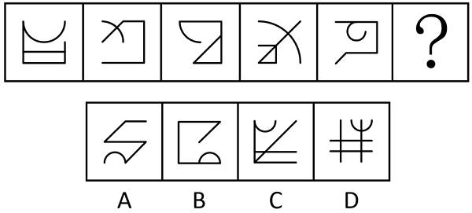
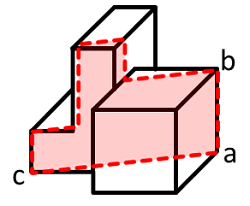
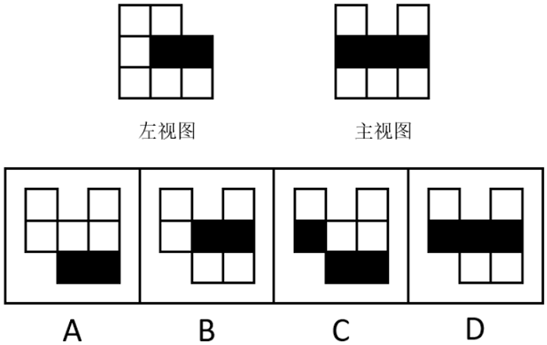
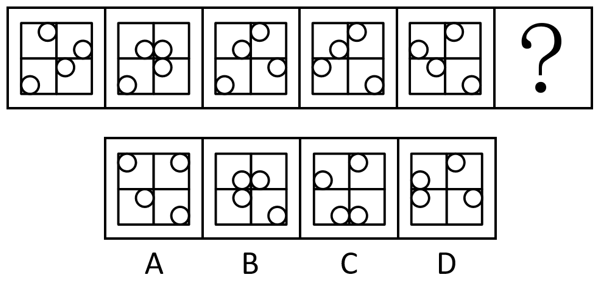
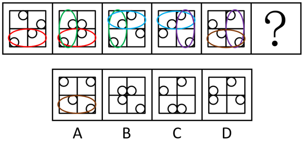
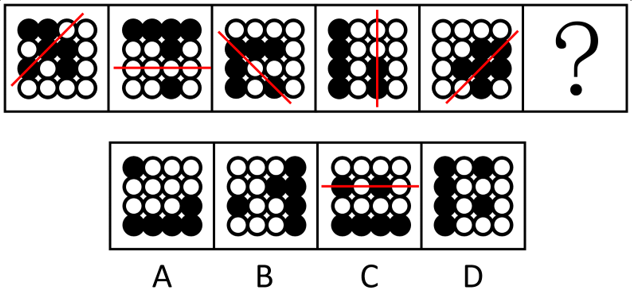
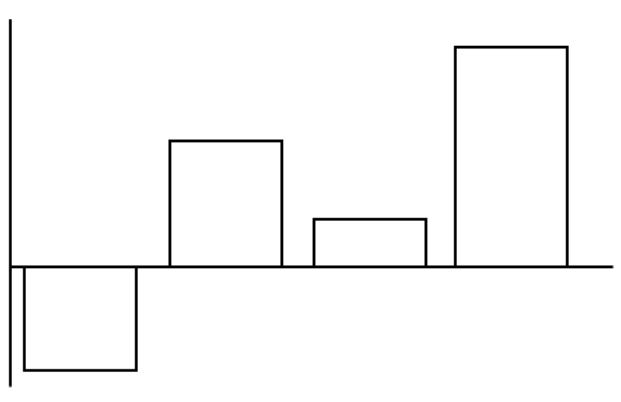

# 2025年广西区考公务员录用考试《行测》题（网友回忆版）

<!-- gwy:overview:start -->
> **广西 · 2025 · 行测 · 统考** ｜ 110 题 · 图片 32 处 · 答案随题折叠

| 题型模块 | 题量 | 题号 |
| --- | ---: | ---: |
| 政治理论 | 10 | 1–10 |
| 常识判断 | 10 | 11–20 |
| 言语理解与表达 | 30 | 21–50 |
| 数量关系 | 10 | 51–60 |
| 判断推理 | 35 | 61–95 |
| 资料分析 | 15 | 96–110 |
| **合计** | **110** | |

导航：[题型与作答说明](#题型与作答说明) · [题目](#题目) · [材料 1](#材料-1)
<!-- gwy:overview:end -->

> 候选采集稿。参考答案及解析来自粉笔页面，不代表官方答案或真实高分答卷；来源使用许可与原卷对应关系仍需人工核实。

## 题型与作答说明

政治理论

（10题）

根据题目要求，在四个选项中选出一个最恰当的答案。

常识判断

（10题）

根据题目要求，在四个选项中选出一个最恰当的答案。

言语理解与表达

（30题）

本部分包括表达与理解两方面的内容。请根据题目要求，在四个选项中选出一个最恰当的答案。

数量关系

（10题）

在这部分试题中，每道题呈现一段表述数字关系的文字，要求你迅速、准确地计算出答案。

判断推理

（35题）

本部分包括图形推理、定义判断、类比推理与逻辑判断四种类型的试题，在四个选项中选出一个最恰当的答案。

资料分析

（15题）

所给出的图、表、文字或综合性资料均有若干个问题要你回答。你应根据资料提供的信息进行分析、比较、计算和判断处理。

## 题目

### 第 1 题

习近平总书记指出，“两个结合”是我们取得成功的最大法宝。关于“两个结合”，下列表述正确的有几项？

①“两个结合”筑牢了道路根基，中国特色的关键就在于“两个结合”

②“两个结合”本身就是创新，同时又开启了广阔的理论和实践创新空间

③“两个结合”产生了深刻的“化学反应”，造就了一个有机统一的新的文化生命体

④“两个结合”是坚持把马克思主义基本原理同中国具体实际相结合、同中华优秀传统文化相结合

A. 1

B. 2

C. 3

D. 4

第 1 题 · 答案与解析

**参考答案（粉笔题库参考内容）**

D

**解析**

本题考查理论与政策。

2023年6月2日，中共中央总书记、国家主席、中央军委主席习近平在北京出席文化传承发展座谈会并发表重要讲话。

①正确，讲话在“二、深刻理解‘两个结合’的重大意义”部分指出，第三，“结合”筑牢了道路根基。中国特色的关键就在于“两个结合”。“第二个结合”让中国特色社会主义道路有了更加宏阔深远的历史纵深，拓展了中国特色社会主义道路的文化根基。

②正确，讲话在“二、深刻理解‘两个结合’的重大意义”部分指出，第四，“结合”打开了创新空间。“结合”本身就是创新，同时又开启了广阔的理论和实践创新空间。“第二个结合”让我们掌握了思想和文化主动，并有力地作用于道路、理论和制度。

③正确，讲话在“二、深刻理解‘两个结合’的重大意义”部分指出，第二，“结合”的结果是互相成就。“结合”不是“拼盘”，不是简单的“物理反应”，而是深刻的“化学反应”，造就了一个有机统一的新的文化生命体。

④正确，讲话在“二、深刻理解‘两个结合’的重大意义”部分指出，在五千多年中华文明深厚基础上开辟和发展中国特色社会主义，把马克思主义基本原理同中国具体实际、同中华优秀传统文化相结合是必由之路。这是我们在探索中国特色社会主义道路中得出的规律性认识。

故正确的有①②③④，共4项。

故正确答案为D。

**考点**：文化建设

**来源**：2025年云南省公务员录用考试《行测》题（网友回忆版）第1题

### 第 2 题

习近平总书记强调，中国将坚持推进高水平对外开放，以高质量发展全面推进中国式现代化，为各国开放合作提供新机遇。关于推进高水平对外开放，下列举措恰当的有几项？

①维护多元稳定的国际经济格局和经贸关系

②加强知识产权保护，营造良好的营商环境

③稳步扩大规则、规制、管理、标准等制度型开放

④减少对外资企业的准入限制，全面放开所有行业领域

⑤加快建设贸易强国，推动共建“一带一路”高质量发展

A. 2

B. 3

C. 4

D. 5

第 2 题 · 答案与解析

**参考答案（粉笔题库参考内容）**

C

**解析**

本题考查理论与政策。

①③⑤正确，④错误，党的二十大报告“四、加快构建新发展格局，着力推动高质量发展”部分指出：“（五）推进高水平对外开放。依托我国超大规模市场优势，以国内大循环吸引全球资源要素，增强国内国际两个市场两种资源联动效应，提升贸易投资合作质量和水平。稳步扩大规则、规制、管理、标准等制度型开放。推动货物贸易优化升级，创新服务贸易发展机制，发展数字贸易，加快建设贸易强国。合理缩减外资准入负面清单，依法保护外商投资权益，营造市场化、法治化、国际化一流营商环境。推动共建‘一带一路’高质量发展。优化区域开放布局，巩固东部沿海地区开放先导地位，提高中西部和东北地区开放水平。加快建设西部陆海新通道。加快建设海南自由贸易港，实施自由贸易试验区提升战略，扩大面向全球的高标准自由贸易区网络。有序推进人民币国际化。深度参与全球产业分工和合作，维护多元稳定的国际经济格局和经贸关系。”减少外资准入限制是推进对外开放的重要举措，但“全面放开所有行业领域”表述过于绝对，某些关键领域仍需保留一定的限制，以确保国家利益和安全。

②正确，习近平总书记在重要文章《全面加强知识产权保护工作 激发创新活力推动构建新发展格局》中指出：“创新是引领发展的第一动力，保护知识产权就是保护创新······知识产权保护工作关系国家对外开放大局，只有严格保护知识产权，才能优化营商环境、建设更高水平开放型经济新体制。知识产权保护工作关系国家安全，只有严格保护知识产权，才能有效保护我国自主研发的关键核心技术、防范化解重大风险。”

故①②③⑤表述正确，有4项。

故正确答案为C。

**考点**：经济建设

**来源**：2025年福建省公务员录用考试《行测》题（网友回忆版）第4题

### 第 3 题

党的二十大报告指出，构建全国统一大市场，深化要素市场化改革，建设高标准市场体系。关于构建全国统一大市场，下列与之相关说法错误的是：

A. 推动市场基础制度规则统一

B. 加强公平竞争审查柔性约束

C. 规范地方招商引资法规制度

D. 深化地方标准管理制度改革

第 3 题 · 答案与解析

**参考答案（粉笔题库参考内容）**

B

**解析**

本题考查理论与政策。

B项错误，A、C、D三项正确，《中共中央关于进一步全面深化改革 推进中国式现代化的决定》在“二、构建高水平社会主义市场经济体制”部分“（6）构建全国统一大市场”中指出：“推动市场基础制度规则统一、市场监管公平统一、市场设施高标准联通。加强公平竞争审查刚性约束，强化反垄断和反不正当竞争，清理和废除妨碍全国统一市场和公平竞争的各种规定和做法。规范地方招商引资法规制度，严禁违法违规给予政策优惠行为。建立健全统一规范、信息共享的招标投标和政府、事业单位、国有企业采购等公共资源交易平台体系，实现项目全流程公开管理。提升市场综合监管能力和水平。健全国家标准体系，深化地方标准管理制度改革。”故B项中“柔性约束”说法错误。

本题为选非题，故正确答案为B。

**考点**：经济建设、重要文件

**来源**：2025年云南省公务员录用考试《行测》题（网友回忆版）第4题

### 第 4 题

党的二十届三中全会指出，法治是中国式现代化的重要保障。下列不属于完善中国特色社会主义法治体系举措的是：

A. 健全基层民主制度

B. 深入推进依法行政

C. 深化立法领域改革

D. 加强涉外法治建设

第 4 题 · 答案与解析

**参考答案（粉笔题库参考内容）**

A

**解析**

本题考查理论与政策。

A项错误，中国共产党第二十届中央委员会第三次全体会议提出，发展全过程人民民主是中国式现代化的本质要求。必须坚定不移走中国特色社会主义政治发展道路，坚持和完善我国根本政治制度、基本政治制度、重要政治制度，丰富各层级民主形式，把人民当家作主具体、现实体现到国家政治生活和社会生活各方面。要加强人民当家作主制度建设，健全协商民主机制，健全基层民主制度，完善大统战工作格局。

B、C、D三项正确，中国共产党第二十届中央委员会第三次全体会议提出，法治是中国式现代化的重要保障。必须全面贯彻实施宪法，维护宪法权威，协同推进立法、执法、司法、守法各环节改革，健全法律面前人人平等保障机制，弘扬社会主义法治精神，维护社会公平正义，全面推进国家各方面工作法治化。要深化立法领域改革，深入推进依法行政，健全公正执法司法体制机制，完善推进法治社会建设机制，加强涉外法治建设。

本题为选非题，故正确答案为A。

**考点**：重要会议讲话、其他建设

**来源**：2025年云南省公务员录用考试《行测》题（网友回忆版）第6题

### 第 5 题

习近平总书记强调，现代化产业体系是现代化国家的物质技术基础，必须把发展经济的着力点放在实体经济上，为实现第二个百年奋斗目标提供坚强物质支撑。下列与之相关说法正确的有几项？

①推进实施绿色发展战略，充分发挥绿色化赋能实体经济发展效应

②促进数字技术和实体经济深度融合，催生新产业新业态新模式替代传统产业

③重视现代服务业的发展，推动现代服务业与先进制造业、现代农业深度融合

④推动重点产业在国内外有序转移、促进国内外产业深度融合与实体经济发展相结合

A. 1

B. 2

C. 3

D. 4

第 5 题 · 答案与解析

**参考答案（粉笔题库参考内容）**

C

**解析**

本题考查理论与政策。

①正确，《新型工业化是发展新质生产力的主阵地》中指出，习近平总书记强调：“要充分认识形成绿色发展方式和生活方式的重要性、紧迫性、艰巨性。”······因此，要推动绿色发展与实体经济发展相融合，充分发挥绿色化赋能实体经济发展效应。

②错误，《中华人民共和国国民经济和社会发展第十四个五年规划和2035年远景目标纲要》中指出，促进数字技术与实体经济深度融合，赋能传统产业转型升级，催生新产业新业态新模式，壮大经济发展新引擎。

③正确，《中华人民共和国国民经济和社会发展第十四个五年规划和2035年远景目标纲要》中指出，重视现代服务业的发展，推动现代服务业与先进制造业、现代农业深度融合，深化业务关联、链条延伸、技术渗透，支持智能制造系统解决方案、流程再造等新型专业化服务机构发展。培育具有国际竞争力的服务企业。

④正确，习近平总书记在二十届中央政治局第二次集体学习时强调，优化生产力布局，推动重点产业在国内外有序转移，支持企业深度参与全球产业分工和合作，促进内外产业深度融合，打造自主可控、安全可靠、竞争力强的现代化产业体系。这要求我们发挥好超大规模市场优势和超大纵深空间优势，加快建设以实体经济为支撑的现代化产业体系，引导产业合理有序梯度转移。

故①③④表述正确，共3项。

故正确答案为C。

**考点**：经济建设、重要文件

**来源**：2025年河北省公务员录用考试《行测》题（网友回忆版）第5题

### 第 6 题

习近平总书记强调，纪检监察机关是推进党的自我革命的重要力量，党和人民对这支队伍充分信任、充满期待，下列与之相关说法正确的有几项？

①巩固拓展主题教育和教育整顿成果，坚持把思想教育放在首位

②强化严格管理监督，打造忠诚干净担当、敢于善于斗争的纪检监察铁军

③深化纪检监察体制改革，坚持授权和控权相结合，把权力关进制度的笼子

④着力加强纪检监察工作规范化法治化正规化建设，不断提高正风肃纪反腐能力

A. 1

B. 2

C. 3

D. 4

第 6 题 · 答案与解析

**参考答案（粉笔题库参考内容）**

C

**解析**

本题考查理论与政策。

①错误，②③④正确，2025年1月6日，习近平总书记在中国共产党第二十届中央纪律检查委员会第四次全体会议上发表重要讲话。习近平总书记在讲话中强调：“纪检监察机关是推进党的自我革命的重要力量，党和人民对这支队伍充分信任、充满期待。要深化纪检监察体制改革，坚持授权和控权相结合，把权力关进制度的笼子。要着力加强纪检监察工作规范化法治化正规化建设，不断提高正风肃纪反腐能力。要巩固拓展主题教育和教育整顿成果，坚持打铁必须自身硬，强化严格管理监督，打造忠诚干净担当、敢于善于斗争的纪检监察铁军。”

综上，②③④说法正确，共3项。

故正确答案为C。

**考点**：重要会议讲话、其他建设

**来源**：2025年甘肃公务员录用考试《行测》题（网友回忆版）第5题

### 第 7 题

2024年12月，中央农村工作会议在北京召开，会议对如何做好“三农”工作进行了具体部署，下列与之相关说法错误的是：

A. 加强新时代农村精神文明建设，积极开展移风易俗

B. 提高农村基本公共服务水平，持续改善农村人居环境

C. 推进农业科技力量协同攻关，因地制宜发展农业新质生产力

D. 完善农产品贸易与生产协调机制，推动粮食等农产品价格稳步提升

第 7 题 · 答案与解析

**参考答案（粉笔题库参考内容）**

D

**解析**

本题考查理论与政策。

D项错误，A、B、C三项正确，2024年中央农村工作会议强调，要聚焦学习运用“千万工程”经验、推进乡村全面振兴······推进农业科技力量协同攻关，加快科技成果大面积推广应用，因地制宜发展农业新质生产力······完善农产品贸易与生产协调机制，推动粮食等重要农产品价格保持在合理水平······推动基础设施向农村延伸，提高农村基本公共服务水平，持续改善农村人居环境，加强农村生态环境治理······实施文明乡风建设工程，加强新时代农村精神文明建设，积极开展移风易俗。

本题为选非题，故正确答案为D。

**考点**：经济建设、重要会议讲话

**来源**：2025年云南省公务员录用考试《行测》题（网友回忆版）第8题

### 第 8 题

实现中华民族伟大复兴的中国梦不可能一马平川，我们要居安思危、未雨绸缪，坚决战胜一切不确定难预料的风险挑战。任何困难都无法阻挡中国人民前进的步伐，我们要居安思危、未雨绸缪，是因为：

A. 人类社会历史发展是前进性与曲折性的辩证统一

B. 社会规律是在各种因素的相互作用过程中自发实现的

C. 通过充分发挥主观能动性，就能消除事物发展中的偶然方面

D. 本质与现象是相互依存的，所有现象都在一定程度上表现本质

第 8 题 · 答案与解析

**参考答案（粉笔题库参考内容）**

A

**解析**

本题考查马克思主义。

“居安思危”是指处于安全的环境下，也要预判可能出现的危险。“未雨绸缪”比喻事先做好准备工作，防止意外的发生。

A项正确，题干中强调“实现中华民族伟大复兴的中国梦不可能一马平川”，其中，实现中华民族伟大复兴的中国梦是历史发展的必然趋势，具有前进性，但中国梦的实现不是一帆风顺，有一定的曲折性。要居安思危、未雨绸缪，就是要正视前进性的曲折，做好准备工作，符合题意。

B项错误，社会规律是通过人们的自觉活动实现的，需要人的有意识、有目的的活动参与，不是在各种因素的相互作用过程中自发实现的。

C项错误，事物的发展是由必然性和偶然性共同决定的。必然性是指事物发展过程中不可避免、确定的因素，偶然性则是指事物发展过程中不确定、可能改变的因素。但是，偶然性往往是难以完全预见和控制的。因此，通过充分发挥主观能动性，并不能消除事物发展中的偶然方面。

D项错误，本质是事物的根本性质，是构成事物的诸要素之间的内在联系，是相对稳定的。现象是事物的外部联系和表面特征，是多变易逝的。本质总是通过一定的现象表现自己的存在。表述正确，但是和材料无关。

故正确答案为A。

**考点**：唯物辩证法

**来源**：2025年甘肃公务员录用考试《行测》题（网友回忆版）第9题

### 第 9 题

党的二十届三中全会提出，要推动建设生育友好型社会。关于推动建设生育友好型社会，下列举措不恰当的是：

A. 指导各地推动养育、教育产业市场化发展

B. 鼓励各地出台多孩子女同校就读具体实施办法

C. 指导各地将辅助生殖技术项目纳入医保报销范围

D. 指导有条件的地方将参加职工基本医疗保险的灵活就业人员纳入生育保险

第 9 题 · 答案与解析

**参考答案（粉笔题库参考内容）**

A

**解析**

本题考查理论与政策。

2024年10月19日，国务院办公厅印发《关于加快完善生育支持政策体系推动建设生育友好型社会的若干措施》（以下简称《措施》）。

A项错误，《措施》在“一、总体要求”部分指出：“以习近平新时代中国特色社会主义思想为指导······完善生育支持政策体系和激励机制，健全覆盖全人群、全生命周期的人口服务体系，有效降低生育、养育、教育成本，营造全社会尊重生育、支持生育的良好氛围，为推动实现适度生育水平、促进人口高质量发展提供有力支撑。”由此可见，推动养育、教育产业市场化发展说法错误。

B项正确，《措施》在“四、强化教育、住房、就业等支持措施”部分“（九）扩大优质教育资源供给”中指出：“优化区域教育资源配置······鼓励各地出台多孩子女同校就读具体实施办法，帮助解决家长接送不便问题。”

C项正确，《措施》在“二、强化生育服务支持”部分“（四）加强生殖健康服务”中指出：“深入实施母婴安全行动提升计划和出生缺陷防治能力提升计划······加强生育医疗费用保障，指导各地将适宜的分娩镇痛以及辅助生殖技术项目纳入医保报销范围。”

D项正确，《措施》在“二、强化生育服务支持”部分“（一）增强生育保险保障功能”中指出：“强化生育保险对参保女职工生育医疗费用、生育津贴待遇等保障作用。指导有条件的地方将参加职工基本医疗保险的灵活就业人员、农民工、新就业形态人员纳入生育保险。”

本题为选非题，故正确答案为A。

**考点**：重要文件、社会建设

**来源**：2025年河南省公务员录用考试《行测》题（网友回忆版）第85题

### 第 10 题

深化养老服务改革发展是实施积极应对人口老龄化国家战略的迫切要求，是保障和改善民生的重要任务，事关亿万百姓福祉，事关社会和谐稳定，为加快建设适合我国国情的养老服务体系，更好保障老有所养，下列举措恰当的是：

①推动国有资本参与发展养老服务，完善分类考核评价

②加快补齐农村养老服务短板，扩大农村养老服务供给

③发挥社区养老的决定作用，为居家养老提供有力支持

④以失能老年人的照护为重点，强化我国基本养老服务

A. ①②③

B. ①②④

C. ①③④

D. ②③④

第 10 题 · 答案与解析

**参考答案（粉笔题库参考内容）**

B

**解析**

本题考查理论与政策。

2024年12月30日，中共中央 国务院发布了《关于深化养老服务改革发展的意见》（以下简称《意见》）。

①正确，《意见》在“四、构建养老服务事业产业发展三方协同机制”部分指出：“发挥养老服务产业发展市场配置资源作用······推动国有资本参与发展养老服务，完善分类考核评价。”

②正确，《意见》在“三、贯通协调居家社区机构三类养老服务形态”部分指出：“加快补齐农村养老服务短板。因地制宜扩大农村养老服务供给。”

③错误，《意见》在“三、贯通协调居家社区机构三类养老服务形态”部分指出：“强化社区养老依托作用。扩大社区养老服务有效供给，依托社区为居家养老提供有力支持。”故“社区养老的决定作用”说法有误。

④正确，《意见》在“一、总体要求”部分指出：“加快健全养老服务网络，优化居家为基础、社区为依托、机构为专业支撑、医养相结合的养老服务供给格局，强化以失能老年人照护为重点的基本养老服务，健全分级分类、普惠可及、覆盖城乡、持续发展的养老服务体系······”

故正确的有①②④。

故正确答案为B。

**考点**：重要文件、社会建设

**来源**：2025年河南省公务员录用考试《行测》题（网友回忆版）第90题

### 第 11 题

下列关于汉字的表述错误的是：

A. 甲骨文的内容多为“卜辞”

B. “书同文”中的“文”指的是大篆

C. “钟鸣鼎食”中的两种器具均是金文的载体

D. 隶书是篆书的化繁为简，化圆为方，化弧为直

第 11 题 · 答案与解析

**参考答案（粉笔题库参考内容）**

B

**解析**

本题考查人文常识。

A项正确，甲骨文，主要流行于商周时期，又称“契文”、“甲骨卜辞”，是迄今为止中国发现的年代最早的成熟文字系统。因商朝的人大都迷信鬼神，大事小事都要卜问，故甲骨文的内容大部分是殷商王室占卜的记录，即“卜辞”。

B项错误，“书同文”是秦始皇统一六国后推行的政策，以秦国的小篆为标准，统一全国文字，这里的“文”指的是小篆，而不是大篆。

C项正确，“钟鸣鼎食”出自《史记·货殖列传》，钟：古代乐器；鼎：古代炊器，二者都是青铜器，而金文指的是铸造在殷商与周朝青铜器上的铭文，所以这两种器具均是金文的载体。

D项正确，隶书是由篆书演变而来的，它简化了篆书的结构，将篆书的圆转笔画改为方折，化繁为简，化圆为方，化弧为直。

本题为选非题，故正确答案为B。

**考点**：文化常识

**来源**：2025年云南省公务员录用考试《行测》题（网友回忆版）第13题

### 第 12 题

下列诗句与其所描述的乐器对应正确的是：

A. 昆山玉碎凤凰叫，芙蓉泣露香兰笑——二胡

B. 锦瑟无端五十弦，一弦一柱思华年——古筝

C. 曲终收拨当心画，四弦一声如裂帛——箜篌

D. 几年调弄七条丝，元化分功十指知——古琴

第 12 题 · 答案与解析

**参考答案（粉笔题库参考内容）**

D

**解析**

本题考查人文常识。

A项错误，“昆山玉碎凤凰叫，芙蓉泣露香兰笑”出自唐代李贺的《李凭箜篌引》，意思是乐声清脆得就像昆仑山的美玉被击碎，凤凰在鸣叫；时而又像芙蓉在露水中饮泣，像兰花迎风开放笑语轻柔。通过“玉碎”“凤凰叫”等意象描述箜篌的清脆音色和奇幻音效，诗句所描述的乐器是箜篌，而非二胡。

B项错误，“锦瑟无端五十弦，一弦一柱思华年”出自唐代李商隐的《锦瑟》，意思是精美的瑟为什么有五十根弦，一弦一柱都叫我追忆青春年华。“瑟”是中国传统弹拨乐器，早期有五十弦，后演变为二十五弦，而古筝通常为二十一弦，两者形制不同。诗句明确指向瑟，而非古筝。

C项错误，“曲终收拨当心画，四弦一声如裂帛”出自唐代白居易的《琵琶行》，意思是一曲终了拨子从弦索中间划过四弦，一声轰鸣好像撕裂了布帛。“四弦”直接点明诗句所描述的乐器为琵琶，而非箜篌。

D项正确，“几年调弄七条丝，元化分功十指知”出自唐代方干的《听段处士弹琴》，意思是弹琴者花费了数年时间来调弄琴弦，深知通过十指的巧妙运用，能够将自然的变化和美妙融入到音乐之中。“七条丝”明确指出了所弹乐器为古琴，古琴以七弦为基本形制，且诗句强调“十指”拨弄的技法，符合古琴演奏特点。

故正确答案为D。

**考点**：文学常识

**来源**：2025年甘肃公务员录用考试《行测》题（网友回忆版）第18题

### 第 13 题

下列与水资源有关说法错误的是：

A. 我国主要淡水资源是冰川和地下水

B. 通过蒸发海水可以提取到氯化钠晶体

C. 利用蒸馏法淡化海水的过程主要是物理变化

D. 我国西北绝大部分地区属于地下水补给贫乏区

第 13 题 · 答案与解析

**参考答案（粉笔题库参考内容）**

A

**解析**

本题考查地理国情。

A项错误，中国淡水资源总量为2.8万亿立方米，占全球水资源的6%，居世界第六位，但人均只有2200立方米，仅为世界平均水平的1/4、美国的1/5，是全球人均水资源贫乏的国家之一，属于缺水严重的国家。河流和湖泊是中国主要的淡水资源，河湖的分布、水量的大小，直接影响着各地人民的生活和生产。

B项正确，通过蒸发海水可以提取到氯化钠晶体，这种方法在工业上被广泛应用，称为海水晒盐。海水晒盐是利用了蒸发结晶的原理。氯化钠的溶解度随温度变化不大，通过阳光照射和风力等自然条件，使海水蒸发，溶剂减少，溶液达到饱和状态，继续蒸发，氯化钠就会以晶体的形式析出。

C项正确，蒸馏法淡化海水的原理是根据海水中各成分的沸点不同，通过加热海水使其汽化，然后将水蒸气冷却凝结成淡水。在这个过程中，只是水的状态发生了变化，从液态变为气态再变为液态，没有新物质生成，所以主要是物理变化。

D项正确，西北地区深居内陆，气候干旱少雨，降水量少，蒸发量大。地表径流缺乏，由于降水少，西北地区的河流数量少，且多为内流河，河流水量较小。一些河流在流经干旱地区时，还会因为蒸发、下渗等原因，水量逐渐减少甚至干涸。因此，河流对地下水的补给作用有限。

本题为选非题，故正确答案为A。

**考点**：中国地理

**来源**：2025年云南省公务员录用考试《行测》题（网友回忆版）第17题

### 第 14 题

关于急救知识，下列说法正确的是：

A. 伤者出现呕吐时，应对其采取仰卧姿势放置，以防止窒息

B. 踝关节扭伤后，应及时采取热疗加上按摩的方式来促进血液循环

C. 冻伤后应使用温水复温，直至冻伤区域的皮肤恢复正常颜色和感觉

D. 心肺复苏需按照“胸外按压10次、人工呼吸2次”的流程循环操作

第 14 题 · 答案与解析

**参考答案（粉笔题库参考内容）**

C

**解析**

本题考查科技常识。

A项错误，伤者出现呕吐时，应将其头部偏向一侧，可以使呕吐物自然流出，保持呼吸道通畅。而不是采取仰卧姿势，仰卧姿势可能会导致呕吐物堵塞气道，引起窒息。

B项错误，踝关节扭伤后，应在初期采取冷敷，而不是热疗和按摩。冷敷可以使局部血管收缩，减轻肿胀和疼痛。在扭伤初期进行热疗和按摩会加重局部出血和肿胀，不利于恢复。一般在扭伤48小时后，根据恢复情况可适当进行热疗等促进血液循环的措施。

C项正确，冻伤后使用温水复温是正确的处理方法，一般用38°C至42°C的温水浸泡冻伤部位，直至冻伤区域的皮肤恢复至正常颜色和感觉。复温过程中应避免使用过热的水或火烤等方式，以免造成二次损伤。

D项错误，心肺复苏的正确流程是胸外按压30次、人工呼吸2次，按照这样的流程循环操作，而不是胸外按压10次、人工呼吸2次。

故正确答案为C。

**考点**：生活常识

**来源**：2025年云南省公务员录用考试《行测》题（网友回忆版）第16题

### 第 15 题

关于常见植物，下列说法正确的是：

A. 香樟树抗旱耐盐碱，在北方地区更容易生长

B. 玉兰的花期在夏季，花朵有一定的药用价值

C. 银杏树现今已广泛种植，退出濒危植物名录

D. 侧柏四季常青，树形美观，常用作园林绿化

第 15 题 · 答案与解析

**参考答案（粉笔题库参考内容）**

D

**解析**

本题考查科技常识。

A项错误，香樟树为亚热带常绿乔木，喜温暖湿润气候，耐寒性弱且不耐盐碱。北方冬季寒冷、土壤偏盐碱，不适宜其生长，故更适合南方种植。

B项错误，玉兰为木兰科落叶乔木，不同种类兰花的花期不同，也因不同地区的温度不同而有区别，通常在春季，而非夏季。其花可入药，有祛风散寒、宣肺通鼻之效；主要分布于安徽、江西、浙江等地，现亦广泛栽培于城市园林。

C项错误，银杏树虽已大规模人工种植，但野生种群仍属濒危。根据世界自然保护联盟（IUCN）《红色名录》，银杏评级为濒危（EN），尚未退出名录。

D项正确，侧柏为柏科常绿乔木，四季常青、树形优美，兼具耐修剪、抗污染特性，是北方园林绿化中常见的行道树、绿篱及庭院景观树种。

故正确答案为D。

**考点**：生物常识

**来源**：2025年云南省公务员录用考试《行测》题（网友回忆版）第18题

### 第 16 题

关于环境污染，下列说法正确的是：

A. 逆温天气时，大气层变动剧烈，加快了大气污染物的扩散

B. 淡水水体大量缺氧造成藻类死亡，容易引发“赤潮”现象

C. 大气中的二氧化硫和水蒸气可被氧化合成硫酸，进而形成硫酸雾

D. 石灰粉会与油脂发生化学反应使其溶于水，可用来处理海上石油泄漏

第 16 题 · 答案与解析

**参考答案（粉笔题库参考内容）**

C

**解析**

本题考查地理国情。

A项错误，逆温天气时，大气层出现温度随高度上升而增高的异常现象，导致空气垂直对流受阻，污染物无法扩散至高空，反而积聚在近地面，加剧污染（如雾霾）。因此，逆温天气会减缓污染物扩散，而非加快。

B项错误，水体富营养化指的是水体中N、P等营养盐含量过多而引起的水质污染现象。水体出现富营养化现象时，浮游藻类大量繁殖，在淡水中形成水华，这种现象在海洋中叫做赤潮或红潮。

C项正确，二氧化硫排放到大气中后，可被氧化为三氧化硫，再与水蒸气结合生成硫酸。硫酸与颗粒物结合形成硫酸雾（气溶胶），属于二次污染物，可导致酸雨。

D项错误，石灰粉是以碳酸钙为主要成分的白色粉末状物质。石灰粉与油脂一般不会发生化学反应使其溶于水。在处理海上石油泄漏时，通常以物理吸附或沉淀为主，如使用吸油材料、围油栏围控等，辅以生物降解或化学分散剂等。

故正确答案为C。

**考点**：其他

**来源**：2025年云南省公务员录用考试《行测》题（网友回忆版）第15题

### 第 17 题

关于生活生产实践中的化学现象，下列说法错误的是（ ）。

A. 中药熬煮过程中，多糖类和蛋白质类成分会发生水解

B. 火药点燃时迅速释放出大量气体和热量的物质是硫化氢

C. 木炭通常由木材不完全燃烧或者在隔绝空气的条件下热解得到

D. 琉璃的多彩颜色源于铜、铁、锰等金属的氧化物在高温下的化学反应

第 17 题 · 答案与解析

**参考答案（粉笔题库参考内容）**

B

**解析**

本题考查科技常识。

A项正确，在中药熬煮过程中，多糖类和蛋白质类成分会发生水解：多糖是由多个单糖分子通过糖苷键连接而成的高分子化合物，熬煮时，高温和水的作用会使糖苷键部分断裂，多糖逐步发生有限水解，生成更易溶出的低聚糖和少量单糖；蛋白质是由多种氨基酸通过肽键连接而成的生物大分子，熬煮时高温先使蛋白质变性，且中药本身含有的天然有机酸、矿物质等成分会形成弱催化环境，促进肽键部分断裂，使蛋白质逐步水解为多肽（部分可进一步生成氨基酸）。熬煮通过上述过程助力中药有效成分溶出，更好地发挥药效。

B项错误，火药是一种燃烧剂，主要由硝酸钾、炭和硫磺组成。当火药被点燃时，其中的硝酸钾迅速分解产生氧气，同时炭和硫磺燃烧释放出热量。这些反应会产生大量的气体，同时释放出巨大的能量。火药点燃后发生的反应主要是：2KNO_3+3C+S=K_2S+N_2↑+3CO_2↑。从反应方程式可以看出，产物是硫化钾、氮气和二氧化碳，没有硫化氢气体产生。

C项正确，在木材不完全燃烧时，由于氧气供应不充足，木材中的有机物不能完全氧化成二氧化碳和水，会有部分碳元素保留下来形成木炭。在隔绝空气条件下对木材进行热解，这是一个干馏过程。在高温作用下，木材中的水分和其他挥发性物质（如一些有机小分子）会被去除，同时木材中的纤维素、半纤维素和木质素等成分会发生分解和缩聚等化学反应，最终形成以碳为主要成分的木炭，同时还会得到木焦油、木煤气等副产物。

D项正确，琉璃是以各种颜色的人造水晶为原料，在高温下烧制而成的。在制作琉璃的过程中，加入含有铜、铁、锰等金属的氧化物作为着色剂，这些金属氧化物在高温下会发生化学反应，从而使琉璃呈现出丰富多彩的颜色。例如，氧化铜可使琉璃呈现出绿色或蓝色，氧化铁能让琉璃呈现出红色、黄色或棕色，氧化锰则可使琉璃呈现出紫色或黑色等。不同的金属氧化物以及它们的不同含量和组合，能够使琉璃产生各种各样绚丽的色彩效果。

本题为选非题，故正确答案为B。

**考点**：化学常识

**来源**：2025年甘肃公务员录用考试《行测》题（网友回忆版）第11题

### 第 18 题

关于洗澡过程中的物理现象，下列说法错误的是：

A. 当浴室内水蒸气凝结成小水珠时，光线在小水珠上会发生散射现象

B. 水珠在皮肤上呈球形，是因为液体表面张力作用使其表面积最小化

C. 淋浴刚喷出水时更有力，是因为水流速度的增加会导致压强的增加

D. 人在浴缸中泡澡时会受到向上的浮力，其大小等于人排开水的重量

第 18 题 · 答案与解析

**参考答案（粉笔题库参考内容）**

C

**解析**

本题考查科技常识。

A项正确，散射是指由传播介质的不均匀性引起的光线向四周射去的现象。当浴室内水蒸气凝结成小水珠时，小水珠在浴室内的分布是不均匀的，因此光线照射在小水珠上会发生散射现象。

B项正确，液体表面张力使液体表面有收缩的趋势，会让水珠尽量收缩成表面积最小的球形，这样可以使其整体的能量最低，处于最稳定状态，因此水珠在皮肤上会呈现球形。

C项错误，根据伯努利原理，在流体中，流速越大的地方压强越小。淋浴喷头通过特殊设计，使水在喷出时流速增大，从而导致喷头出口处的压强减小，而不是压强增加。

D项正确，根据阿基米德原理，浸在液体中的物体受到向上的浮力，其大小等于物体所排开液体的重力。人在浴缸中泡澡时，身体浸入水中，会排开一部分水，受到的浮力大小就等于排开的水的重量。

本题为选非题，故正确答案为C。

**考点**：物理常识

**来源**：2025年河南省公务员录用考试《行测》题（网友回忆版）第102题

### 第 19 题

粉笔暂未收录本题（来源缺题，题位保留）

第 19 题 · 答案与解析

**答案状态：unknown（来源未提供）**

**解析状态：unknown（来源未提供）**

### 第 20 题

粉笔暂未收录本题（来源缺题，题位保留）

第 20 题 · 答案与解析

**答案状态：unknown（来源未提供）**

**解析状态：unknown（来源未提供）**

### 第 21 题

对分类学者来说，与其说是找到新物种，不如说是碰到新物种。新物种的发现往往并非            ，而是意外之喜。在阅读文献、野外调查、查阅图片或者研究标本时，分类学者偶尔会发现某份标本或者个体跟之前的记录不一样，进而通过形态学比较或者分子测序手段确认该物种是否属于新的物种。

填入画横线部分最恰当的一项是：

A. 守株待兔

B. 刻舟求剑

C. 照本宣科

D. 按图索骥

第 21 题 · 答案与解析

**参考答案（粉笔题库参考内容）**

D

**解析**

根据“并非······而是”可知，横线处所填成语与“意外之喜”构成反义并列，且根据前文“不如说是碰到新物种”以及后文“偶尔会发现某份标本或者个体跟之前的记录不一样”可知，新物种并不是通过以往的记录或文献发现的，而是偶然间发现的，故横线处所填成语需体现通过以往的资料或线索发现之意。D项“按图索骥”比喻依照线索去寻找事物，符合文意，当选。

A项“守株待兔”比喻死守狭隘的经验不知变通，也讽刺妄想不劳而获的侥幸心理，B项“刻舟求剑”比喻办事刻板拘泥，不知根据实际情况处理问题，均与文意不符，排除；

C项“照本宣科”形容讲课、发言等死板地按照课文、讲稿，没有发挥，不生动，与“新物种的发现”搭配不当，排除。

故正确答案为D。

【文段出处】《哪里更容易碰到新物种？》

**考点**：词的辨析-搭配对象、对应关系-前后呼应、成语填空、关联关系-并列关系

**来源**：2025年云南省公务员录用考试《行测》题（网友回忆版）第21题

### 第 22 题

很多短视频不会提供更多的、有助于消除不确定性的信息，标题几乎就是其内容的全部。在标题的暗示下，网友被误导从而更容易相信某个被放大的碎片就是完整真相，所以短视频时代的“标题党”可能带来的破坏力就更加          。

填入画横线部分最恰当的一项是：

A. 昭然若揭

B. 难以名状

C. 显而易见

D. 不容小觑

第 22 题 · 答案与解析

**参考答案（粉笔题库参考内容）**

D

**解析**

根据“网友被误导从而更容易相信某个被放大的碎片就是完整真相”可知，横线处所填成语需表达出短视频时代“标题党”可能带来的破坏力会很大、不能忽视之意。D项“不容小觑”指不能小看，不能轻视，符合文意，当选。

A项“昭然若揭”指含义非常明显或真相完全暴露，侧重坏事被揭露，与文意不符，排除；B项“难以名状”指难以形容、描述，侧重无法形容，文意明确指出破坏力不能忽视之意，与文意不符，排除；C项“显而易见”指事情或道理很明显，极容易看清，侧重事情本身较明显，文段侧重“标题党”所带来的消极影响很大，与文意不符，排除。

故正确答案为D。

【文段出处】《浙江宣传|别让“标题党”在短视频上蔓延》

**考点**：成语填空、关联关系-因果关系

**来源**：2025年甘肃公务员录用考试《行测》题（网友回忆版）第21题

### 第 23 题

食品数字标签，相当于电子“身份证”，通过二维码等形式展示食品的标签信息，消费者可以扫描食品标签上的二维码，通过页面放大、语音识读、视频讲解等多种功能，        地获取食品的相关信息。比如，食品的名称、配料表、生产日期和保质期、营养成分表等信息，消费者            。

依次填入画横线部分最恰当的一项是：

A. 持续 一览无遗

B. 实时 一清二楚

C. 详尽 一举两得

D. 便捷 一目了然

第 23 题 · 答案与解析

**参考答案（粉笔题库参考内容）**

D

**解析**

第一空，根据“消费者可以扫描食品标签上的二维码”“比如，食品的名称、配料表、生产日期和保质期、营养成分表等信息”可知，文段强调通过食品数字标签，消费者获取食品相关信息非常便利，且获取的信息全面，故横线处所填词语要体现便利、全面之意，C项“详尽”指详细全面，没有遗漏，D项“便捷”指方便快捷，均符合文意，保留。A项“持续”指连续不断，与“扫码”这一动作不匹配，排除；B项“实时”指在某事发生、发展的实际时间同步做某事，与文段“比如”之后列举的内容不符，排除。

第二空，根据“消费者可以扫描食品标签上的二维码······获取食品的相关信息”“比如，食品的名称、配料表、生产日期和保质期、营养成分表等信息”可知，文段强调消费者对于食品相关信息清楚了解，故横线处所填成语要体现清楚之意，D项“一目了然”形容事物、事情原委很清晰，一看就知道是怎么回事，符合文意，当选。C项“一举两得”指做一件事，同时收获两方面的好处，文段未提及两方面好处，排除。

故正确答案为D。

【文段出处】红网《食品数字标签保护“舌尖上的安全”》

**考点**：对应关系-前后呼应、混搭填空、对应关系-解释说明

**来源**：2025年云南省公务员录用考试《行测》题（网友回忆版）第22题

### 第 24 题

通过迁地保护、建立常态化监测体系、保护和修复野生动植物赖以生存的生态家园等一系列举措，云南许多珍稀动植物的命运正在被        。滇金丝猴数量增长到3300余只，西黑冠长臂猿、绿孔雀等20多种野生动物种群数量也大幅上升；漾濞槭、华盖木等30种极小种群野生植物        灭绝威胁。

依次填入画横线部分最恰当的一项是：

A. 改编 挣脱

B. 改写 脱离

C. 改变 面临

D. 修改 受到

第 24 题 · 答案与解析

**参考答案（粉笔题库参考内容）**

B

**解析**

第一空，搭配“命运”，根据前文可知，横线处表达一系列举措对云南许多动植物命运产生积极影响，B项“改写”指变换另一种写法，C项“改变”指使发生变化，均与“命运”搭配恰当，且符合文意，保留。A项“改编”指根据原著重新编写，D项“修改”指改正文章、计划等里面的错误、缺点，均与“命运”搭配不当，排除。

第二空，根据前文可知，一系列举措对云南许多珍稀动植物起到积极作用，横线处应表达不再面临灭绝威胁之意。B项“脱离”指离开（某种环境或情况），符合文意，当选。C项“面临”指面前遇到（问题、形势等），与文意相悖，排除。

故正确答案为B。

【文段出处】光明日报《解码生物多样性保护的云南经验》

**考点**：词的辨析-词义侧重、词的辨析-搭配对象、实词填空、对应关系-前后呼应

**来源**：2025年云南省公务员录用考试《行测》题（网友回忆版）第23题

### 第 25 题

山西的珍贵古建筑为现代艺术创作提供了无尽的        。《黑神话：悟空》游戏开发者们深入挖掘山西古建筑中的艺术瑰宝，巧妙地将27处极具代表性的古建筑融入游戏设计中。游戏场景中，“亢金龙”“虚日鼠”等藏于晋城玉皇庙里的二十八星宿塑像被复刻得            ，使越来越多的人体验到中国的古建之美和文化之韵。

依次填入画横线部分最恰当的一项是：

A. 巧思 跃然纸上

B. 灵感 栩栩如生

C. 参考 惟妙惟肖

D. 想象 绘声绘色

第 25 题 · 答案与解析

**参考答案（粉笔题库参考内容）**

B

**解析**

第一空，搭配“无尽”，根据“《黑神话：悟空》游戏开发者们深入挖掘山西古建筑中的艺术瑰宝，巧妙地将27处极具代表性的古建筑融入游戏设计中”可知，现代艺术创作者从古建筑中获取到了设计游戏的思路。A项“巧思”指灵巧的心思或巧妙的构思，B项“灵感”指在文学、艺术、科学、技术等活动中，突然产生的富有创造性的思路，均符合文意，保留。C项“参考”指在处理事物时借鉴、利用有关材料，与“无尽”搭配不当，排除；D项“想象”指人类在头脑中对已有的表象进行加工改造，创造出新形象的心理过程，而文段强调的是从真实存在的山西古建筑中获取创作元素，与文意相悖，排除。

第二空，搭配“二十八星宿塑像”，且根据“使越来越多的人体验到中国的古建之美和文化之韵”可知，横线处成语与后文构成因果关系，应体现复刻效果极具真实感之意。B项“栩栩如生”指艺术形象非常逼真，如同活的一样，符合文意且搭配恰当，当选。A项“跃然纸上”形容描写或刻画得十分生动逼真，多用于文学或绘画领域，“纸上”这一表述显然与“二十八星宿塑像”搭配不当，排除。

故正确答案为B。

【文段出处】光明日报《山西：数智助力 古建出圈》

**考点**：词的辨析-搭配对象、对应关系-前后呼应、混搭填空、关联关系-因果关系

**来源**：2025年甘肃公务员录用考试《行测》题（网友回忆版）第24题

### 第 26 题

品牌建设是一项长期性、战略性任务，也是一项系统工程。要抓住机遇，直面挑战，用好物质基础雄厚、人力资源丰富、市场空间广阔等        ，坚决解决部分产品质量和性能欠佳的“硬伤”，做细做精做强，不断提升品牌的内在价值，让有竞争力的品牌            。

依次填入画横线部分最恰当的一项是：

A. 要素 崭露头角

B. 资本 声名鹊起

C. 优势 脱颖而出

D. 条件 百尺竿头

第 26 题 · 答案与解析

**参考答案（粉笔题库参考内容）**

C

**解析**

第一空，与“物质基础雄厚、人力资源丰富、市场空间广阔等”搭配，且根据文意可知，横线处所填词语应表达品牌建设需要利用好这些资源之意。A项“要素”指构成事物的必要因素，C项“优势”指能超过对方的有利形势，D项“条件”指影响事物发生、存在或发展的因素，均符合文意，保留。B项“资本”比喻牟取利益的凭借，与“市场空间广阔”搭配不当，排除。

第二空，根据横线前“品牌建设······要抓住机遇，直面挑战”以及“做细做精做强，不断提升品牌的内在价值”可知，横线处所填成语应体现让有竞争力的品牌得到充分发展的意思。C项“脱颖而出”比喻人的才能全部显示出来，多用于竞争的语境当中，与“有竞争力的品牌”搭配恰当，当选。A项“崭露头角”比喻突出地显露出才能和本领，多用于形容事物发展初期或起步阶段，与文意不符，排除；D项“百尺竿头”比喻学问、成绩等达到了很高的程度以后仍继续努力，与文意不符，排除。

故正确答案为C。

【文段出处】《以品牌建设助推高质量发展》

**考点**：词的辨析-搭配对象、对应关系-前后呼应、混搭填空

**来源**：2025年甘肃公务员录用考试《行测》题（网友回忆版）第25题

### 第 27 题

近年来，“打卡无人区”成为一些人的时髦选择，诸如青海可可西里、新疆罗布泊等人迹罕至的自然保护区，成了不少人            的人间秘境。但是，“无人区”及自然生态保护区，远没有外界想象得那么浪漫和神秘。每个游客及旅行团都要深刻认识到这类地区的极端危险性，切莫仅凭一腔热血与        ，就盲目进发。

依次填入画横线部分最恰当的一项是：

A. 念兹在兹 臆想

B. 念念不忘 激情

C. 心驰神往 好奇

D. 心醉神迷 勇气

第 27 题 · 答案与解析

**参考答案（粉笔题库参考内容）**

C

**解析**

第一空，横线处搭配“人间秘境”，且根据“时髦选择”可知，文段表达人迹罕至的自然保护区成为很多人向往的地方，C项“心驰神往”形容思想集中在追求和向往的事情或地方上，一心向往，搭配恰当，符合文意，保留。A项“念兹在兹”指念念不忘某一件事情，与“人间秘境”搭配不当，排除；B项“念念不忘”指牢记于心，时刻不忘，搭配地点时多搭配去过的地方，文段中并没有去过，与文意不符，排除；D项“心醉神迷”形容佩服爱慕到极点，程度过重，排除。

第二空，代入验证，根据“每个游客及旅行团都要深刻认识到这类地区的极端危险”可知，文段表达这类地区很危险，不能盲目出发，C项“好奇”指对自己不了解的事物觉得新奇而感兴趣，能体现促使人们盲目进发的情绪，与文意相符，当选。

故正确答案为C。

【文段出处】《不得擅自进入“无人区”，青海这个提醒为何必要？|新京报快评》

**考点**：词的辨析-搭配对象、词的辨析-程度轻重、对应关系-前后呼应、混搭填空

**来源**：2025年云南省公务员录用考试《行测》题（网友回忆版）第28题

### 第 28 题

大自然的雄性和小部分雌性动物在性竞争中会采取            的手段，比如“控制资源”“使用武器”，以及进化出更有          的形态或功能（表型）等。而推动雄性表型性进化的动力，是雌性作为选择者凭借其感官系统和大脑机制的结合在选择配偶的过程中表现出来的性审美。

依次填入画横线部分最恰当的一项是：

A. 匪夷所思 亲和力

B. 行之有效 攻击性

C. 独出心裁 独特性

D. 多种多样 吸引力

第 28 题 · 答案与解析

**参考答案（粉笔题库参考内容）**

D

**解析**

本题可从第二空入手，根据“是雌性作为选择者凭借其感官系统和大脑机制的结合在选择配偶的过程中表现出来的性审美”可知，雄性所进化出的形态或功能（表型）符合雌性审美，且能吸引雌性，故横线处所填词语需体现吸引之意，A项“亲和力”比喻使人感到融洽、亲切并愿意接近的力量，D项“吸引力”指能吸引别的事物、人或人的兴趣的性质或能力，均符合文意，保留。B项“攻击性”指具有对他人有意挑衅、侵犯或对事物有意损毁、破坏等心理倾向和行为的人格特征，C项“独特性”指某物或某人所具有的区别于其他同类事物的特性，均与文意不符，排除。

第一空，横线后通过“比如”对前文进行举例分析，根据“‘控制资源’‘使用武器’，以及进化出更有······的形态或功能（表型）等”可知，横线处所填成语应体现出大自然的雄性和小部分雌性动物在性竞争中会采取多种手段之意，D项“多种多样”指多方面的、五花八门，符合文意，当选。A项“匪夷所思”指事物怪异或人的言行离奇，不是一般人按照常理所能想象的，文段并无怪异、离奇之意，排除。

故正确答案为D。

【文段出处】中国科学报《它们的审美是异性进化的动力》

**考点**：对应关系-前后呼应、混搭填空、对应关系-解释说明

**来源**：2025年云南省公务员录用考试《行测》题（网友回忆版）第30题

### 第 29 题

未来，金融机构应该如何进一步做好科技金融服务？ 要根据高技术产业研发投入大、周期长、风险高等特点，            创新信贷服务模式，最大限度提高信贷服务的          ，通过规范发展“贷款+外部直投”、科技保险、科技领军企业供应链金融等专属金融服务，全方位畅通高新技术企业的贷款通道。

依次填入画横线部分最恰当的一项是：

A. 因势利导 适配性

B. 量身定制 特殊性

C. 兼收并蓄 积极性

D. 固本强基 重要性

第 29 题 · 答案与解析

**参考答案（粉笔题库参考内容）**

A

**解析**

第一空，根据“要根据高技术产业研发投入大、周期长、风险高等特点” 可知，横线处所填成语应体现根据高技术产业的特点去创新信贷服务模式之意。A项“因势利导”指顺着事情的发展趋势加以引导，B项“量身定制”指根据功能需要定制产品，均符合文意，保留。C项“兼收并蓄”指把不同内容、不同性质的东西收下来，侧重“包容性”，D项“固本强基”指加固本体、强化基础，均与文意无关，排除。

第二空，搭配“信贷服务”，结合后文“通过规范发展‘贷款+外部直投’、科技保险、科技领军企业供应链金融等专属金融服务，全方位畅通高新技术企业的贷款通道”可知，横线处所填词语应体现信贷服务要与高技术产业贷款需求相匹配。A项“适配性”指互相匹配，相互适应，符合文意，当选。B项“特殊性”强调不同于一般，“最大限度提升特殊性”表述程度过重，与文意不符，排除。

故正确答案为A。

【文段出处】经济日报 《精准做好科技金融服务》

**考点**：词的辨析-词义侧重、对应关系-前后呼应、混搭填空

**来源**：2025年云南省公务员录用考试《行测》题（网友回忆版）第29题

### 第 30 题

发展新质生产力需要传统产业的支撑与贡献。发展好传统产业，可以稳住经济的基本盘，避免            ，为产业转型提供回旋空间，为新产业培育积累产业基础。因此，发展新质生产力不能不立先破、盲目放弃或忽视传统产业，也不能            ，盲目上马所谓的高新技术产业。

依次填入画横线部分最恰当的一项是:

A. 随波逐流 人云亦云

B. 大开大合 瞎子摸象

C. 无的放矢 朝秦暮楚

D. 大起大落 一哄而上

第 30 题 · 答案与解析

**参考答案（粉笔题库参考内容）**

D

**解析**

第一空，根据“发展好传统产业，可以稳住经济的基本盘，避免······”可知，横线处所填成语应与“稳住”意思相反，体现不稳定、波动大之意，D项“大起大落”指大幅度的起与落，形容变化大，可体现“不稳定”之意，符合文意，保留。A项“随波逐流”比喻自己没有立场和主见，只是随着潮流走，B项“大开大合”形容文思跌荡，放得开，收得拢，C项“无的放矢”比喻说话做事没有明确目的，或不切合实际，均与文意不符，排除。

第二空，代入验证。根据“盲目上马所谓的高新技术产业”可知，横线处所填成语应形容“盲目上马”这一行为，D项“一哄而上”比喻做事没有计划、没有组织，大家乱糟糟地开始上马，符合文意，当选。

故正确答案为D。

【文段出处】光明网-文摘报《全国统一大市场建设有助于处理好三对关系》

**考点**：对应关系-前后呼应、成语填空

**来源**：2025年云南省公务员录用考试《行测》题（网友回忆版）第25题

### 第 31 题

武器因人类生存需要而产生，最初的武器来自自然的        。参照蚌壳边缘、石块边棱等尖锐、锋利的存在，人类学会了制作第一批原始武器。基于对弹性、惯性、杠杆原理等概念的        认识，人类学会了制作弓弩、抛石机等弹射武器，极大地扩展了武器的攻击        。

依次填入画横线部分最恰当的一项是：

A. 馈赠 粗浅 手段

B. 启发 模糊 距离

C. 效法 初步 范围

D. 模仿 清醒 强度

第 31 题 · 答案与解析

**参考答案（粉笔题库参考内容）**

B

**解析**

第一空，根据“参照蚌壳边缘、石块边棱等尖锐、锋利的存在”可知，横线处所填词语应体现因为自然而学会制作武器之意，B项“启发”指用事例引起对方联想并有所了解、领悟，符合文意，保留。A项“馈赠”指赠送，文段强调人类从自然现象中主动学习制作武器，而非被动给予，与文意不符，排除；C项“效法”指仿照别人的做法去做，学习别人的长处，D项“模仿”指照某种现成的样子学着做，置于此处应表述为“对自然的效法/模仿”，用法均错误，排除。

第二空，代入验证，根据“人类学会了制作弓弩、抛石机等弹射武器”可知，人类处于制作弹射武器的阶段，横线处要表达人类对科学原理的认知不深入之意，B项“模糊”指不清楚、不分明，与文意相符，保留。

第三空，代入验证，搭配“扩展”，且根据“弓弩、抛石机等弹射武器”可知，横线处要表达出弹射武器可以攻击更远的目标，B项“距离”指事物在空间或时间上相隔，符合文意，且搭配恰当，当选。

故正确答案为B。

【文段出处】物理《古代武器中的物理学》

**考点**：词的辨析-搭配对象、实词填空、对应关系-前后呼应

**来源**：2025年云南省公务员录用考试《行测》题（网友回忆版）第32题

### 第 32 题

面对疑难杂症，临床医学上很多时候只能摸着石头过河。在这方面，AI可以发挥很大作用。它能        影像、病理、基因等多模态数据，提供多尺度综合分析，帮助我们构建更        的肿瘤画像。肿瘤是一个由复杂癌细胞组成的生态系统，对其画像勾勒得越        ，就越能发现以往忽视的肿瘤行为和潜在治疗靶点，为前端治疗提供新思路。

依次填入画横线部分最恰当的一项是：

A. 整合 完整 准确

B. 收集 稳定 详尽

C. 模拟 具象 立体

D. 回溯 精细 透彻

第 32 题 · 答案与解析

**参考答案（粉笔题库参考内容）**

A

**解析**

第一空，根据“提供多尺度综合分析”可知，此处体现AI能获取多种数据，对多种数据进行处理，从而提供多尺度综合分析之意，A项“整合”指把零散的东西彼此衔接，从而实现信息系统的资源共享和协同工作，形成有价值有效率的一个整体，B项“收集”指使聚集在一起，均可体现获取或处理多种数据之意，保留。C项“模拟”指对真实事物或者过程的虚拟，侧重于模仿虚拟，D项“回溯”指上溯，向上推导，向内推导，侧重于推导，回忆，均不符获取或处理多种数据之意，排除。

第二空，搭配“肿瘤画像”，结合“提供多尺度综合分析”可知，此处体现构建更为全面的肿瘤画像之意，A项“完整”指具有或保持着应有的部分，没有损坏或残缺，可与“肿瘤画像“搭配，且可体现较为全面的肿瘤画像之意，保留。B项“稳定”指稳恒固定；没有变动；使稳定，与“肿瘤画像”搭配不当，且意思为稳定不变，不符合文意，排除。

第三空，代入A项验证，“准确”指行动的结果完全符合实际或预期，可对应后文“就越能发现以往忽视的肿瘤行为和潜在治疗靶点”，可体现对画像勾勒的正确性，当选。

故正确答案为A。

【文段出处】《AI如何助力重塑肿瘤诊疗模式》

**考点**：词的辨析-词义侧重、词的辨析-搭配对象、实词填空

**来源**：2025年云南省公务员录用考试《行测》题（网友回忆版）第33题

### 第 33 题

在发展流变中，汉语的表达效率不断提升。比如，“枯藤老树昏鸦，小桥流水人家，古道西风瘦马”，三个短句，省去了一切连接、修饰，全由名词并列而成。高度        的表达下，九种景物看似独立存在，实则互相        、有机相融，构建出一幅萧瑟秋景，游子离家、悲秋之情            。

依次填入画横线部分最恰当的一项是：

A. 简练 叠加 呼之欲出

B. 简约 呼应 显而易见

C. 概括 关联 不言而喻

D. 凝练 照应 溢于言表

第 33 题 · 答案与解析

**参考答案（粉笔题库参考内容）**

D

**解析**

第一空，根据“省去了一切连接、修饰”可知，横线处所填词语应体现表达方式非常精炼，没有多余内容之意。A项“简练”指简明精练，B项“简约”指简略，D项“凝练”指紧凑简练，均符合文意，保留。C项“概括”指把事物的共同特点归结在一起加以简明地叙述，侧重对复杂内容进行归纳总结，与文意不符，排除。

第二空，根据“有机相融，构建出一幅萧瑟秋景”可知，横线处所填词语应表明景物之间彼此联系，形成一个有机的整体，B项“呼应”指互相照应，D项“照应”指对照呼应，均可体现互相存在联系，符合文意，保留。A项“叠加”指的是使预先成并存储的图形、属性特征等被调用并叠合在一个基本图形上的过程或方法，强调物理性的机械堆砌，无法体现出景物之间的内在联系，与文意不符，排除。

第三空，搭配“游子离家、悲秋之情”，且根据“构建出一幅萧瑟秋景，游子离家、悲秋之情”可知，横线处所填成语应体现出文字所想表达的情感非常深切之意，D项“溢于言表”意为超出言语以外，指某种思想感情虽未说明却能使人体会出来，符合文意，当选。B项“显而易见”意为事情或道理很明显，极容易看清，一般用来形容事情、道理等比较直观，容易被察觉，与“游子离家、悲秋之情”搭配不当，且“游子离家、悲秋之情”是通过对景物的描写委婉地表达出来的，并非是那种一眼就能看清楚的，置于此处不如D项更符合文意，排除。

故正确答案为D。

【文段出处】人民日报《汉语的魅力从何而来》

**考点**：词的辨析-搭配对象、对应关系-前后呼应、混搭填空

**来源**：2025年云南省公务员录用考试《行测》题（网友回忆版）第31题

### 第 34 题

粉笔暂未收录本题（来源缺题，题位保留）

第 34 题 · 答案与解析

**答案状态：unknown（来源未提供）**

**解析状态：unknown（来源未提供）**

### 第 35 题

粉笔暂未收录本题（来源缺题，题位保留）

第 35 题 · 答案与解析

**答案状态：unknown（来源未提供）**

**解析状态：unknown（来源未提供）**

### 第 36 题

雅文化是一种自觉的、表现为典籍形态的思想体系，流行于知识层次较高的阶层，对社会的影响深刻而狭窄。俗文化以世俗生活为中心，是民众自发的、无意识的文化心理，对社会的影响肤浅而广泛。二者之间只有形式上的自觉思想体系与民众直观体认，典籍形态与世俗传承的区别，实际上雅中有俗、俗中有雅，由俗到雅、由雅到俗。《论语》《孟子》中的语录不仅记载于典籍，也被世俗传诵。《诗经》原本是当时的民谣俚曲，后世竟成为儒家的经典。

这段文字意在强调雅文化与俗文化：

A. 彼此完全对立

B. 表现形式有别

C. 社会影响不同

D. 存在互动关系

第 36 题 · 答案与解析

**参考答案（粉笔题库参考内容）**

D

**解析**

文段首先引入了“雅文化”和“俗文化”的话题，并介绍了二者各自的特点，接着指出二者之间只有形式上的区别，后文通过“实际上”进行转折，强调雅中有俗、俗中有雅，由俗到雅、由雅到俗，最后通过《论语》《孟子》《诗经》进行举例论证，故文段重点在转折之后，强调雅中有俗、俗中有雅，由俗到雅、由雅到俗，D项“存在互动关系”是对文段中心的同义替换，当选。

A项，“彼此完全对立”文段并未涉及，无中生有，排除；

B项，“表现形式有别”对应文段转折之前的内容，非重点，排除；

C项，“社会影响不同”为文段开篇引入话题的部分，非重点，排除。

故正确答案为D。

【文段出处】光明网《社会风俗中的道德力量》

**考点**：分述句特征-举例子、分述句特征-引入铺垫、关联词-转折

**来源**：2025年河南省公务员录用考试《行测》题（网友回忆版）第16题

### 第 37 题

从传播史上来讲，人类的传播形式经历过人际交往的口头传播。在这个阶段，由于传播主体的时空局限，文化传播特别缓慢，其中的文化是歌乐舞一体的，人可以说是“混沌的人”。文字发明之后的书写传播，扩大了空间范围、延伸了时间长度，随之诞生了一种具有反思精神和思想反刍意味的“深度的人”。古登堡革命之后是大规模印刷时代的到来，新闻报刊与20世纪以来的广播、电影视等共同将人类带入了大众传播时代。这种传播模式下，它的受众是一种“无个性的人”。这是一个由小众到大众的发展历程，也是一种人的演变过程。

这段文字主要介绍了：

A. 人类传播形式的演变历史

B. 技术进步对人类传播形式的影响

C. 人从“混沌”变为“深度”的过程

D. 人类感知世界和认识社会方式的进化

第 37 题 · 答案与解析

**参考答案（粉笔题库参考内容）**

D

**解析**

文段开篇从传播史视角切入，详细阐述了人类传播形式演变对人类自身感知的影响，即口头传播时期，受时空局限，人类处于“混沌的人”；书写传播时期，因时空扩展，使人们反思和思想反刍成为可能，认知方式得以深化，成为“深度的人”；大众传播时代，人们成为“无个性的人”。尾句通过指代词“这”对前文内容进行了总结，即人类在传播形式发展过程中，自身的认知也在演变。故文段重点强调人类自身感知的演变，对应D项。

A项，仅提及传播形式的改变，而未提及人自身的演变，偏离文段结论的重点，排除；

B项，文段并非强调“技术进步的影响”，而是“人类自身感知的演变”，偏离文段重点，排除；

C项，从“混沌”变为“深度”，仅涉及“从口头传播到书写传播”过程中的部分内容，未包括大众传播时代这些“无个性的人”，概括的不够全面，排除。

故正确答案为D。

【文段出处】光明日报《网络生态下对文学走向的展望》

**考点**：分述句特征-多角度论述

**来源**：2025年云南省公务员录用考试《行测》题（网友回忆版）第37题

### 第 38 题

枯木是自然界中凋枯衰朽之木的总称，宋诗中展现出各种枯木之姿，不仅丰富了诗歌的审美内蕴，还折射出宋人独特的精神追求。                    。宋代社会掀起一股尚“枯”趣味的审美潮流。在日常生活领域，“三苏”开创了清供枯木假山的潮流，枯态花卉、寒山枯林受到士人们的欣赏；在艺术创作领域，士人们在书画创作中运用枯笔技法、追崇枯瘦书体，开创了枯木题材的绘画；在诗歌批评领域，宋代出现了“枯淡”“枯劲”等一系列含“枯”的诗论概念。从日常生活到文学艺术，“枯”成为宋人的重要美学命题。

填入画横线部分最恰当的一项是：

A. 枯木意象寄托了宋人丰富的情思意蕴

B. 对枯木的思考映现出艺术家的创作情感

C. 枯木意象与宋代社会的审美文化息息相关

D. 诗歌中的枯木意象具有深邃的思想文化内涵

第 38 题 · 答案与解析

**参考答案（粉笔题库参考内容）**

C

**解析**

横线出现在文段中间，需结合前后文进行分析。横线前通过下定义的方式引出“枯木”的话题，并指出宋诗中的枯木之姿丰富了诗歌的审美内蕴，折射出宋人的精神追求。横线后从日常生活、艺术创作和诗歌批评三个角度阐述宋代社会掀起尚“枯”趣味的审美潮流，强调“枯”成为宋人重要的美学命题，故横线处应承上启下，体现“枯木”意象与宋代社会审美潮流之间的关系，对应C项。

A项，“情思意蕴”指情感内涵，与横线后体现的宋代尚“枯”审美潮流话题不一致，无法构成衔接，排除；

B项，“艺术家的创作情感”仅能对应后文的艺术创作领域，表述片面，排除；

D项，“具有深邃的思想文化内涵”无法体现“枯”的意象与宋代社会审美文化的关联，与后文衔接不当，排除。

故正确答案为C。

【文段出处】掌桥科研《宋诗枯木意象研究》

**考点**：横线在中间

**来源**：2025年甘肃公务员录用考试《行测》题（网友回忆版）第43题

### 第 39 题

水墨作为民族文化的重要象征，是历代国人观察和表现世界的一种独特方式。有别于传统绘画，当代水墨更为贴近这个时代，有着对艺术更为深入的思考。当代水墨艺术家更注重反映当下人的生存状态和精神指向，他们既了悟中国传统文化的艺术灵蕴，又深谙西方先锋艺术语言，同时兼具人文关怀和独立品格，其作品往往能够从传统中汲取精华，又能在西方美学中吸收养分，进而创造出一种新的当代语言，形成自己特有的笔墨方式来表达艺术理想，具有鲜活的时代特征和生命力量。

这段文字主要介绍了：

A. 传统水墨与当代水墨之间的差异

B. 水墨作为民族文化象征的重要地位

C. 当代水墨艺术家及其作品的独特造诣

D. 水墨艺术折射出的人文关怀和文化精华

第 39 题 · 答案与解析

**参考答案（粉笔题库参考内容）**

C

**解析**

文段开篇引出“水墨”的话题，接着指出“当代水墨”更贴近时代且有更深入的艺术思考。随后阐述“当代水墨艺术家”更注重反映当下人的生存状态与精神指向，他们有其自身的优势，进而强调他们的作品能从传统和西方美学中汲取养分，创造新语言、形成独特笔墨方式来表达艺术理想，具有鲜活时代特征和生命力量。故文段主题词为“当代水墨艺术家”，重点讨论当代水墨艺术家及其作品的特点，对应C项。

A项，“传统水墨”为引出主题词“当代水墨艺术家”的铺垫，非重点，排除；

B项，“水墨的重要地位”为开篇引入部分，非重点，排除；

D项，“水墨艺术折射出的人文关怀和文化精华”为当代水墨艺术家及其作品的具体特点，未重点突出“当代水墨艺术家”，偏离文段重点，排除。

故正确答案为C。

【文段出处】雅昌新闻《贾廷峰：当代水墨是未来艺术投资的潜力股》

**考点**：主题词

**来源**：2025年云南省公务员录用考试《行测》题（网友回忆版）第38题

### 第 40 题

①地球科学在寻找、开发和利用自然资源中起着巨大作用

②还可以帮助人类与自然环境和谐共处

③从应用性上来看，它为人类如何利用、保护自然提供了科学的方法论

④并通过掌握自然灾害的规律与其作斗争

⑤从理论性上来说，它承担着揭示自然界奥秘与规律的使命

⑥地球科学是一门理论性、应用性都很强的自然科学

将以上6个句子重新排列，语序正确的一项是：

A. ⑥⑤③①②④

B. ⑥③⑤①④②

C. ①②④⑥③⑤

D. ①④②⑥③⑤

第 40 题 · 答案与解析

**参考答案（粉笔题库参考内容）**

A

**解析**

对比选项，确定首句。⑥句通过下定义的方式引出“地球科学”的话题，①句介绍地球科学的巨大作用，根据行文逻辑，应先下定义引出话题再描述具体作用，因此⑥句更适合作首句，排除C、D两项。

对比A、B两项，⑥句后所接句子分别为⑤句和③句。③句从“应用性”的角度对地球科学进行解释，⑤句从“理论性”的角度对地球科学进行解释，根据⑥句中“地球科学是一门理论性、应用性都很强的自然科学”可知，应先说“理论性”，再介绍“应用性”，故⑤句应在③句之前，排除B项，锁定A项。

故正确答案为A。

**考点**：确定首句-首句特征、确定顺序

**来源**：2025年云南省公务员录用考试《行测》题（网友回忆版）第49题

### 第 41 题

①研究方法是指在研究中发现新现象、新事物，或提出新理论、新观点，揭示事物内在规律的工具和手段，是论文中不可或缺的部分

②学习了一种方法就相当于掌握了解决某一特定问题的一件工具，掌握的工具越多，解决问题的方法越多，研究能力也就越强

③“工欲善其事，必先利其器”，如果“事”属于学术研究，“器”便是研究方法

④在论文写作过程中，研究方法是十分重要的部分，撰写论文不仅要规范格式，写好综述，尤其还要掌握常用的研究方法

⑤能否做好学术研究，取决于是否使用了正确的、合适的研究方法

⑥它解释了研究如何进行以及数据来源、数据收集技术的使用等问题

将以上6个句子重新排列，语序正确的一项是：

A. ①③⑤②④⑥

B. ②③①⑤⑥④

C. ③①④⑥②⑤

D. ④⑤①⑥③②

第 41 题 · 答案与解析

**参考答案（粉笔题库参考内容）**

D

**解析**

观察选项，判断首句。①句介绍研究方法是什么，并指出其对论文的重要性，②句介绍学习、掌握研究方法后带来的意义，③句指出“器”是研究方法，④句通过“尤其”强调研究方法对论文的重要性，①句、③句和④句均可以引出“研究方法”这一话题，按照逻辑顺序，应先引出“研究方法”的话题，再介绍掌握研究方法之后的意义，故②句应该放在①③④三句之后，排除A、B两项。

继续观察发现，⑥句出现指代词“它”，可以考虑通过指代词捆绑解题。对比④⑥句、①⑥句，①句具体介绍研究方法的定义，指出研究方法是发现新现象，揭示事物内在规律的工具，⑥句中“研究如何进行以及数据来源、数据收集技术的使用”是对研究方法是论文写作工具的进一步说明，话题一致且内容衔接得当，④句指出在论文写作过程中要掌握常用的研究方法，与⑥句内容无法衔接，排除C项。

故正确答案为D。

【文段出处】微信公众号北体新传《2023年体育新闻传播研究方法与论文写作工作坊》

**考点**：确定捆绑、确定顺序

**来源**：2025年云南省公务员录用考试《行测》题（网友回忆版）第50题

### 第 42 题

传统文博展示方式受场地空间、展览时间、文物特性等因素影响，限制了传播力与影响力的进一步提升，很难满足海量游人参观体验的需求。为此，可善用人工智能、虚拟现实等先进技术，推动文博展陈与文创产品数字化、沉浸式转化。比如，近期成立的全国博物馆文创联盟、博物馆策展联盟等平台，正以创新方式探索文博行业发展的新路径，带动中小型博物馆深度挖掘文物背后的故事，并运用新技术打破时空壁垒，以数字化方式让万千文博展品走进大众生活。

这段文字意在说明，文博展陈应：

A. 拓展多空间，善用新技术

B. 活化老文物，挖掘新共鸣

C. 传承古智慧，融合新媒体

D. 展现历史美，利用新视角

第 42 题 · 答案与解析

**参考答案（粉笔题库参考内容）**

A

**解析**

文段首先指出传统文博展示方式难以满足游人参观体验需求的问题，接着通过“为此”提出善用先进技术推动文博展陈与文创产品数字化、沉浸式转化这一对策，最后通过“比如”进行举例论证，故文段重点强调“为此”之后的对策，即善用先进技术推动文博展陈的发展，A项能够体现文段重点“善用先进技术”，当选。

B项“新共鸣”、C项“新媒体”、D项“新视角”均偏离主题词“先进技术”，排除。

故正确答案为A。

【文段出处】中国经济网《展创结合让文物活起来》

**考点**：分述句特征-举例子、关联词-对策、主题词、分述句特征-引入铺垫

**来源**：2025年云南省公务员录用考试《行测》题（网友回忆版）第45题

### 第 43 题

在机场过安检时，有时会遇到这样的情景：安检人员用一张白色的小纸片在你的手提行李、电子设备，甚至你的衣服上擦拭一遍，再将试纸放入一旁的仪器中。这张白色的小纸片其实是一种专门设计的爆炸物痕量检测纸，用于探测行李或物品表面是否残留有爆炸物的痕迹。它的使用起源于对航空安全的严格要求，尤其是在现代航空业面对的恐怖主义威胁日益增多的背景下，痕量检测技术已成为机场安检系统中的重要组成部分。

这段文字接下来最不可能谈及的是：

A. 爆炸物痕量检测纸的工作原理

B. 安检中使用痕量检测纸的利弊

C. 机场采用痕量检测技术的背景

D. 候机楼发现爆炸物的处置程序

第 43 题 · 答案与解析

**参考答案（粉笔题库参考内容）**

D

**解析**

本题为接语选择题，需通读全文，重点把握文段最后讨论的核心话题。文段开篇描述机场安检人员使用爆炸物痕量检测纸的情景，接着介绍其用途、使用起源，最后强调痕量检测技术在机场安检系统的重要性。故文段接下来应重点围绕痕量检测技术在安检中的相关内容展开。

A项，文段描述了痕量检测纸的用途，但并未深入解释其工作原理，此项与文段话题紧密相关，排除；

B项，文段探讨了痕量检测技术的重要性，但并未提及其弊端，探讨其利弊是合理延伸，排除；

C项，“机场采用痕量检测技术的背景”与尾句“背景”相关，接下来有可能展开探讨，排除；

D项，与文段最后谈论的核心话题不符，接下来最不可能谈及，当选。

本题为选非题，故正确答案为D。

【文段出处】科普中国《坐飞机过安检时擦的小纸片是什么？》

**考点**：接语选择题

**来源**：2025年云南省公务员录用考试《行测》题（网友回忆版）第36题

### 第 44 题

郑和大航海发生在中国军事科技实力遥遥领先的背景下，郑和率领两百余艘船、两万多名将士的大舰队，实力远超大航海时代两三艘船、百余人的小船队，军事实力更是远超途经的国家和地区，但郑和船队坚持“共享太平之福”“敦睦邦交”“强不凌弱”的原则，奉行“厚往薄来”的政策，从来没有以大欺小，倚强凌弱，没有掠夺一两黄金白银，没有发动一场军事侵略，也没有占领一寸海外殖民地。“郑和大航海”                    。

填入画横线部分最恰当的一项是：

A. 在中外交流交往中发挥了积极的作用

B. 为中国的发展创造了稳定的国际环境

C. 是中华民族一脉相承的和平基因的最好例证

D. 为推动构建海洋命运共同体提供了中国方案

第 44 题 · 答案与解析

**参考答案（粉笔题库参考内容）**

C

**解析**

横线位于文段结尾，需结合前文内容进行分析。文段开篇点明郑和大航海所处背景是中国军事科技实力遥遥领先的时候，郑和船队实力远超同时代其他船队。随后通过转折词“但”指出郑和船队始终秉持“共享太平之福”“敦睦邦交”“强不凌弱”的原则，奉行“厚往薄来”的政策，在航海过程中未进行掠夺、侵略和占领。这些行为充分彰显了和平友好的特质。故文段最后应进行总结，表明“郑和大航海”所展现的和平理念，对应C项。

A项，“在中外交流交往中发挥了积极的作用”偏离文段核心话题，文段重点强调的是郑和大航海过程中展现的和平理念，而非其在中外交流交往中的积极作用，排除；

B项，“为中国的发展创造了稳定的国际环境”无中生有，文段并没有表明中国因郑和大航海而获得了怎样稳定的国际环境，排除；

D项，“海洋命运共同体”是现代概念，文段围绕的是郑和大航海时期的和平行为，与文段时代背景不符，排除。

故正确答案为C。

【文段出处】光明网《向世界讲好“郑和大航海”故事》

**考点**：横线在结尾

**来源**：2025年云南省公务员录用考试《行测》题（网友回忆版）第40题

### 第 45 题

免疫系统包含三大防线，皮肤、黏膜作为免疫系统的第一道防线，会阻止所有病毒或细菌的进入。当病毒或细菌已经侵入到人的身体时，巨噬细胞率先开始发挥作用。巨噬细胞能把外来异物如病毒或细菌吞入，靠内部的酶和各种活性物质杀死它们或者使其降解。当侵入人体的病毒或细菌数量过大时，巨噬细胞会释放化学信号，这时免疫系统的“保安”——白细胞能通过变形而穿过毛细血管壁，聚集到病菌入侵部位，将其包围、吞噬。

这段文字意在说明：

A. 巨噬细胞的工作机制

B. 免疫系统如何抵御病菌

C. 白细胞具有包围、吞噬病菌的作用

D. 皮肤、黏膜是免疫系统的第一道防线

第 45 题 · 答案与解析

**参考答案（粉笔题库参考内容）**

B

**解析**

文段开篇介绍免疫系统有三大防线，接着论述第一道防线会阻止所有病毒或细菌的进入，之后指出当病毒或细菌侵入人体后，巨噬细胞先开始发挥作用，最后论述当侵入人体的病毒或细菌数量过大时，白细胞会将病菌包围和吞噬，故文段为三方面的并列结构，详细介绍了免疫系统抵御病菌的三道防线，对应B项。

A项“巨噬细胞”、C项“白细胞”和D项“皮肤、黏膜”均为文段并列的一部分内容，表述片面，排除。

故正确答案为B。

【文段出处】光明日报《免疫系统是如何抵御病毒的》

**考点**：关联词-并列

**来源**：2025年云南省公务员录用考试《行测》题（网友回忆版）第43题

### 第 46 题

粉笔暂未收录本题（来源缺题，题位保留）

第 46 题 · 答案与解析

**答案状态：unknown（来源未提供）**

**解析状态：unknown（来源未提供）**

### 第 47 题

粉笔暂未收录本题（来源缺题，题位保留）

第 47 题 · 答案与解析

**答案状态：unknown（来源未提供）**

**解析状态：unknown（来源未提供）**

### 第 48 题

农耕时代生产与生活、人与自然的关系十分密切。人们或为了感恩大自然的恩赐，或为了庆祝辛苦劳作换来的收获，或为了激发生命的活力，或为了加强人际的亲情，经过长期相互认同，最终约定俗成，渐渐把一年中某一天确定为节日，并创造了十分完整又严格的节俗，如仪式、庆典、规制、禁忌，乃至特定的游艺、装饰与食品，来把节日这天演化成一个内涵独特、氛围迷人的日子。

这段文字意在说明：

A. 节日的内涵

B. 节日的形成

C. 节俗的意义

D. 节俗的创造

第 48 题 · 答案与解析

**参考答案（粉笔题库参考内容）**

B

**解析**

文段开篇介绍农耕时代生产与生活、人和自然关系密切，随后指出人们因感恩自然、庆祝收获等原因，经过长期相互认同，最终约定俗成将一年中的某一天定为节日，后文举例说明节日中的一些习俗，并指出节俗让节日更有内涵和氛围，故文段重在说明节日是如何形成的，对应B项。

A项，“节日的内涵”文段并未提及，无中生有，排除；

C项，文段重点强调节日的形成，“节俗的意义”非重点，排除；

D项，“节俗的创造”仅为节日形成过程中的一部分，表述片面，排除。

故正确答案为B。

【文段出处】天津市老教授协会《冯骥才：我们为什么要过节》

**考点**：分述句特征-举例子、分述句特征-引入铺垫

**来源**：2025年河南省公务员录用考试《行测》题（网友回忆版）第17题

### 第 49 题

近年来，相关地区依托长城保护修复实践基地，将长城保护工作重心由一般性保护工程向研究性修缮项目转变。与以往修缮过程中各专业技术人员作业相对分离不同，研究性修缮从工程启动便形成协同模式：以考古挖掘为开端，多学科研究为手段，数字化跟踪记录为保障，考古、设计、勘察、施工等人员在前期研究与勘察、设计方案制定、施工执行、成果整理等各环节协同配合，形成全专业全周期的合作。

最适合做这段文字标题的是：

A. 研究性修缮：考古保护新范式

B. 研究性修缮如何进行多学科协同

C. 长城保护：研究性修缮的协同新模式

D. 研究性修缮揭开长城科学保护的细节

第 49 题 · 答案与解析

**参考答案（粉笔题库参考内容）**

C

**解析**

文段开篇介绍长城保护工作重心由一般性保护工程向研究性修缮项目转变，接着指出与以往的修缮过程不同，研究性修缮项目注重形成协同模式，后文具体描述协同的各个环节，故文段重在强调研究性修缮项目注重以协同模式开展长城保护工作，对应C项。

A项，“考古保护”范围扩大，文段强调的是“长城保护”，排除；

B项，未包含主题词“长城保护”，排除；

D项，偏离文段核心话题“协同模式”，且“长城科学保护的细节”无中生有，排除。

故正确答案为C。

【文段出处】人民日报《研究性修缮助力长城保护（新知）》

**考点**：标题填入题

**来源**：2025年甘肃公务员录用考试《行测》题（网友回忆版）第39题

### 第 50 题

西北太平洋台风主要形成于菲律宾以东的西北太平洋海域。这片海域全年温暖湿润，尤其是在夏季和秋季，海水温度升高，空气湿度加大，为台风的生成提供了充足能量。因此，西北太平洋成为全球台风生成最为活跃的区域之一。通常情况下，西北太平洋台风生成后沿西北方向移动，逐步影响中国、菲律宾、日本等国家。相比之下，南海被众多岛屿和大陆环抱，为台风活动提供了一个独特的舞台。由于位于热带和副热带气候带之间，南海夏季海温同样较高，这为台风的生成提供了充足的能量。而季风活动对南海台风的生成和发展有重要影响，使其具有明显的季节性和区域性特点。

这段文字未提及的是：

A. 西北太平洋台风的影响范围

B. 南海台风与季风活动的关系

C. 南海台风的路径变化特点

D. 地形在台风形成中的作用

第 50 题 · 答案与解析

**参考答案（粉笔题库参考内容）**

C

**解析**

A项，根据“通常情况下，西北太平洋台风生成后沿西北方向移动，逐步影响中国、菲律宾、日本等国家”可知，“影响范围”有所提及，排除；

B项，根据“而季风活动对南海台风的生成和发展有重要影响，使其具有明显的季节性和区域性特点”可知，“南海台风与季风活动的关系”有所提及，排除；

C项，文段中并未提及南海台风的路径变化特点，无中生有，当选；

D项，根据“南海被众多岛屿和大陆环抱，为台风活动提供了一个独特的舞台”可知，“地形在台风形成中的作用”有所提及，排除。

本题为选非题，故正确答案为C。

【文段出处】中国气象报社《生于海上，几多风雨？——谈谈台风的认知误区》

**考点**：细节判断题

**来源**：2025年云南省公务员录用考试《行测》题（网友回忆版）第48题

### 第 51 题

某产品甲、乙两个经销商第一季度销售总额为200万元。第二季度，甲、乙的销售额比第一季度分别高20%、25%，且甲的销售额比乙高44万元。问上半年甲的销售额比乙高多少万元？

A. 72

B. 76

C. 80

D. 84

第 51 题 · 答案与解析

**参考答案（粉笔题库参考内容）**

D

**解析**

设甲第一季度销售额为a万元，则乙第一季度销售额为（200-a）万元，甲第二季度销售额为1.2a万元，乙第二季度销售额为1.25×（200-a）万元。根据题意可列式：1.2a-1.25×（200-a）=44，解得a=120，则甲第一季度销售额为120万元，乙第一季度销售额为200-120=80万元。故甲第一季度销售额比乙高120-80=40万元，根据题干甲第二季度销售额比乙高44万元，因此上半年甲的销售额比乙高40+44=84万元。

故正确答案为D。

**考点**：和差倍比问题

**来源**：2025年云南省公务员录用考试《行测》题（网友回忆版）第51题

### 第 52 题

某购物平台推出每消费600元立减50元的活动，钟先生在该平台准备购买单价为500元的某款商品不超过10件，问他购买几件时平均每件的购买成本最低？

A. 5

B. 6

C. 8

D. 9

第 52 题 · 答案与解析

**参考答案（粉笔题库参考内容）**

B

**解析**

方法一：根据题意，由于“每消费600元立减50元”，故要想平均每件的购买成本最低，则应让购买总价刚好为600的倍数。因为购买商品单价为500元，因此购买总价也应为500的倍数。故购买总价既是600的倍数又是500的倍数，则其应为600和500最小公倍数（3000）的倍数。因为购买件数不超过10件，所以购买总价不超过500×10=5000元，则当购买总价为3000元时，即购买3000/500 = 6件商品时，此时平均每件成本最低。

方法二：根据每消费600元立减50元，代入选项进行分析：

代入A项：若购买5件，则总价为500×5=2500元，2500/600=4······100，故可享受优惠50×4=200元，平均每件商品享受优惠200/5 = 40元；

代入B项：若购买6件，则总价为500×6=3000元，3000/600=5，故可享受优惠50×5=250元，平均每件商品享受优惠250/6 ＞ 40元；

代入C项：若购买8件，则总价为500×8=4000元，4000/600 = 6······400，故可享受优惠50×6=300元，平均每件商品享受优惠300/8＜40元；

代入D项：若购买9件，则总价为500×9=4500元，4500/600=7······300，故可享受优惠50×7=350元，平均每件商品享受优惠= 350/9 ＜ 40元。

综上，当购买6件时，平均每件商品享受优惠最大，此时平均每件的购买成本最低。

故正确答案为B。

**考点**：经济利润问题、公倍数与公约数问题

**来源**：2025年甘肃公务员录用考试《行测》题（网友回忆版）第58题

### 第 53 题

某公司搬家需打包运走电脑主机和显示器各n台。有两种打包方式：一种是一箱装入6台主机和4台显示器，另一种是一箱装入3台主机和8台显示器。已知公司所有的电脑主机和显示器正好装满若干箱，问n可能的最小值为：

A. 18

B. 24

C. 30

D. 36

第 53 题 · 答案与解析

**参考答案（粉笔题库参考内容）**

D

**解析**

设第一种打包方式装满a箱，第二种打包方式装满b箱。根据电脑主机和显示器各有n台，可得：n=6a+3b=4a+8b，解得a=2.5b，代入可得n=18b。因为a、b均为箱子的数量，必须为正整数，故b取最小值2时，n取最小值为36。

故正确答案为D。

**考点**：和差倍比问题

**来源**：2025年云南省公务员录用考试《行测》题（网友回忆版）第52题

### 第 54 题

某公司甲部门男性员工比女性多2人，乙部门女性员工比男性多3人。已知甲、乙两部门女性员工共6人，问从甲、乙两部门中随机选出4人，恰好选到2名男员工和2名女员工的概率是：

A. 4/11

B. 5/11

C. 2/33

D. 5/66

第 54 题 · 答案与解析

**参考答案（粉笔题库参考内容）**

B

**解析**

设甲部门女性员工为x人，则甲部门男性员工有（x+2）人；乙部门女性员工有（6-x）人；乙部门男性员工有（6-x）-3=（3-x）人；甲、乙两个部门共有男性员工（x+2）+（3-x）=5人。

根据公式：概率=满足要求的情况数/总情况数，分析如下：

甲、乙两个部门共有5+6=11名员工，从中随机选出4人，总情况数= C_11^4 = 330种。

要求选出的4名员工恰好为2名男员工和2名女员工：从5名男员工中随机选出2名，有C_5^2种情况；从6名女员工中随机选出2名，有C_6^2种情况。则满足要求的情况数为C_5^2 × C_6^2 = 10 × 15 = 150种。

综上，所求概率= 150/330 = 5/11。

故正确答案为B。

**考点**：给情况求概率

**来源**：2025年云南省公务员录用考试《行测》题（网友回忆版）第54题

### 第 55 题

小张和小赵分别从甲、乙两地同时出发前往对方的出发地。小张出发时的速度是小赵的一半，两人匀速行进1小时后迎面相遇。此后小张开始均匀加速，最终比小赵晚到达1小时。问小张到达时的速度是小赵到达时速度的多少倍？

A. 5/3

B. 7/3

C. 5/6

D. 7/6

第 55 题 · 答案与解析

**参考答案（粉笔题库参考内容）**

C

**解析**

根据题意，赋值小赵出发时每小时的速度为2，则小张出发时每小时的速度为1。两人同时从甲、乙两地出发，1小时后相遇，根据相遇公式：S和=V和×t相遇，可得S_甲乙 = (2+1)×1 = 3。小赵从乙地到甲地全程用时为3/2 = 1.5小时，则小张从甲地到乙地全程用时为1.5+1=2.5小时。小张从相遇后到达乙地用时为2.5-1=1.5小时，小张从相遇后到达乙地距离等于小赵1小时行进距离=2×1=2，则小张从相遇后到达乙地的平均速度为2/1.5 = 4/3。根据公式：均匀加速运动的平均速度=(V初+V末)/2，可列式4/3 = (1 + V_末)/2，解得小张达到乙地时的速度为V末=5/3，则小张到达时的速度是小赵到达时速度的5/3 ÷ 2 = 5/6倍。

故正确答案为C。

**考点**：相遇追及

**来源**：2025年云南省公务员录用考试《行测》题（网友回忆版）第56题

### 第 56 题

甲乙两部门组织户外团建，共设A、B、C三项活动。甲部门每人三项活动均参加1次，乙部门每人任选2项不同活动各参加1次。已知A、B、C三项活动分别有18人、16人、15人参加，问甲部门成员至多有多少人?

A. 11

B. 12

C. 13

D. 14

第 56 题 · 答案与解析

**参考答案（粉笔题库参考内容）**

C

**解析**

解法一：A、B、C三项活动参加的总人次为18+16+15=49，设甲部门为x人，乙部门为y人。根据题意，可得方程3x+2y=49，根据奇偶特性，可得x为奇数，排除B、D两项；根据问题“至多有多少人”，优先代入C项，解得y=5，符合题意，当选。

解法二：根据问题“至多”，可通过选项从大到小依次代入验证：

代入D项：甲部门14人，根据甲部门每人三项活动均参加1次，即A、B、C三项活动分别剩下4、2、1人次，4+2+1=7人次，奇数不能让乙部门每人任选2项不同活动各参加1次，排除；

代入C项：甲部门13人，根据甲部门每人三项活动均参加1次，即A、B、C三项活动分别剩下5、3、2人次，5+3+2=10人次，偶数能让乙部门每人任选2项不同活动各参加1次，符合题意，当选。

故正确答案为C。

**考点**：普通不定方程

**来源**：2025年云南省公务员录用考试《行测》题（网友回忆版）第53题

### 第 57 题

某梯形区域ABCD的俯视图如下图所示，AB、BC、AD长度相等，且为CD长度的一半，E、F、G分别为所在边的中点。现打算在阴影区域建艺术广场，如果梯形ABCD的总面积为120亩，问艺术广场的面积为多少亩？

A. 80

B. 50√3

C. 40√3+30

D. 100

第 57 题 · 答案与解析

**参考答案（粉笔题库参考内容）**

D

**解析**

如图所示，连接EG，过F向DC作垂线，垂足为H，与EG交于点M，根据题意可知AB = BC= AD = 1/2 DC，E、F、G分别为所在边的中点，则梯形ABCD为等腰梯形，EG为等腰梯形ABCD的中位线，FH为等腰梯形ABCD的高，FM为△AEF的高，FM = 1/2 FH，△AEF ≌ △BGF，由图可知S阴影 = S梯形ABCD − S△AEF − S△BGF= S_梯形ABCD − 2S_△AEF，设AF长度为a，FH长度为2h，则AB=2a、CD=4a、FM=h，根据梯形面积公式：S = (1/2)(上底 + 下底) × 高，可得S梯形ABCD=1/2(AB+CD)×FH=1/2(2a+4a)×2h=6ah；根据三角形面积公式：S = 1/2 × 底 × 高，可得S_△AEF=1/2×AF×FM= 1/2 × a × h = 1/2ah，则(S△AFE+S△BGF)/S梯形ABCD=2S△AFE/S梯形ABCD=(2×1/2ah)/(6ah)=1/6，即S△AFE + S△BGF= 120 × 1/6 = 20亩，因此S阴影 = 120 - 20 = 100亩。

故正确答案为D。

**考点**：几何公式类-平面图形

**来源**：2025年云南省公务员录用考试《行测》题（网友回忆版）第58题

### 第 58 题

甲和乙两条生产线的效率比为1：x，现共同生产一批设备12天后正好完成一半。此时甲的效率提升为原来的2x倍，乙的效率提升为原来的y倍后，又用了6天正好完成生产任务。问x和y的关系为：

A. xy=1

B. xy=2

C. x=2y

D. x=3y

第 58 题 · 答案与解析

**参考答案（粉笔题库参考内容）**

B

**解析**

设甲和乙两条生产线的效率分别为1和x，根据“共同生产一批设备12天后正好完成一半”，可得：(1+x) × 12 = 工作总量 × 1/2 ……①。根据“甲的效率提升为原来的2x倍，乙的效率提升为原来的y倍”，则甲生产线的效率变为2x，乙生产线的效率变为xy，根据“又用了6天正好完成生产任务”，可得：(2x+xy)×6=工作总量×1/2……②。联立①②，可得：（1+x）×12=（2x+xy）×6，化简得：xy=2。

故正确答案为B。

**考点**：给效率比例型

**来源**：2025年甘肃公务员录用考试《行测》题（网友回忆版）第66题

### 第 59 题

粉笔暂未收录本题（来源缺题，题位保留）

第 59 题 · 答案与解析

**答案状态：unknown（来源未提供）**

**解析状态：unknown（来源未提供）**

### 第 60 题

五边形公园ABCDE的面积为4万平方米，其中ABCD为长方形，AB=0.75BC，且ADE为等腰直角三角形（∠AED为直角）。小张从D点出发在公园中慢跑，沿箭头所示方向先后经过B点、AE中点和DE中点后到达C点。问小张全程跑了多少米?

A. 420+120√17

B. 250+100(√2+√17)

C. 350 + 100√17

D. 300+120(√2+√17)

第 60 题 · 答案与解析

**参考答案（粉笔题库参考内容）**

C

**解析**

连接AD，设长方形长BC、AD为4x米，则宽AB、DC为3x米，则根据勾股定理可得长方形对角线BD= √((3x)^2 + (4x)^2) = 5x米；根据△AED为等腰直角三角形，三边比例关系为1 : 1 : √2，可得AE = DE = 4x/√2 = 2√2x米；则S_五边形 = S_△AED + S_□ABCD=1/2×2√2x×2√2x+3x×4x=40000；解得x=50米，那么AB=CD=150米，AD=BC=200米，BD=250米。

由题意可得F、G分别为AE、DE中点，故FG=1/2AD=100米；过E点做AD垂线相交于H点，过G点做AD、BC垂线分别相交于I、J点，则EH=HD=100米，GI为△DEH的中位线，故GI=DI=1/2EH=50米；那么在直角△CJG中，CJ=DI=50米，JG=IJ+GI=150+50=200米，根据勾股定理可得：GC=√(50^2+200^2)=√(50^2(1+4×4))=50√17米，同理可得：BF=50√17米；则所求距离= DB + BF + FG + GC=250+50√17+100+50√17= 350+100√17米。

故正确答案为C。

**考点**：几何结论类-三角形相关、几何公式类-平面图形

**来源**：2025年甘肃公务员录用考试《行测》题（网友回忆版）第68题

### 第 61 题

从所给的四个选项中，选择最合适的一个填入问号处，使之呈现一定规律性。

A. A

B. B

C. C

D. D

第 61 题 · 答案与解析

**参考答案（粉笔题库参考内容）**

A

**解析**

元素组成不同，优先考虑属性规律。观察发现，题干已知图形的黑块均为轴对称图形，且都只有一条对称轴，而D项的黑块有两条对称轴，排除；继续观察发现，题干已知图形中都只有一个轴对称的空白面，该空白面也只有一条对称轴，且该空白面的对称轴与所在图形中黑块的对称轴从左到右依次呈垂直、平行位置关系交替，故？处图形黑块的对称轴与轴对称空白面的对称轴应为平行关系，只有A项符合。

故正确答案为A。

**考点**：黑白块类、属性规律-对称性

**来源**：2025年云南省公务员录用考试《行测》题（网友回忆版）第61题

### 第 62 题

从所给的四个选项中，选择最合适的一个填入问号处，使之呈现一定规律性：

A. A

B. B

C. C

D. D

第 62 题 · 答案与解析

**参考答案（粉笔题库参考内容）**

D

**解析**

元素组成不同，且无明显属性规律，考虑数量规律。观察发现，题干图形均由黑白球组成，第一组图形黑球每次增加1个，白球每次增加2个；第二组图形黑球每次增加2个，白球每次增加1个，故？处图形应该包含6个黑球、3个白球，排除A、B两项；再次观察发现，题干图形都是由不同颜色的球组成，且明显分为内外两圈，考虑分开看。第一组图中，内圈的黑球依次顺时针增加1个，外圈的白球依次逆时针增加2个；第二组图中，前两幅图内圈的白球依次顺时针增加1个，外圈的两部分黑球各依次逆时针增加1个，？处图形应用此规律，只有D项符合。

故正确答案为D。

**考点**：位置规律-平移、数量规律-素

**来源**：2025年云南省公务员录用考试《行测》题（网友回忆版）第64题

### 第 63 题

从所给的四个选项中，选择最合适的一个填入问号处，使之呈现一定规律性：

A. A

B. B

C. C

D. D

第 63 题 · 答案与解析

**参考答案（粉笔题库参考内容）**

D

**解析**

解析一：元素组成不同，且无明显属性规律，考虑数量规律。观察发现，图形线条交叉明显，且每幅图均出现明显的弧线，考虑数曲直交点。曲直交点数均为1，排除B项；继续观察发现，题干图形曲直交点的特征依次为：曲线的端点与直线交叉、曲线的中段与直线“十字交叉”、曲线的端点与直线交叉、曲线的中段与直线“十字交叉”、曲线的端点与直线交叉，故？处图形的曲直交点应为曲线的中段与直线“十字交叉”，只有D项符合。

故正确答案为D。

解析二：

元素组成不同，且无明显属性规律，考虑数量规律。观察发现，图形线条交叉明显，且每幅图均出现明显的弧线，考虑曲直交点。曲直交点数均为1，排除B项；继续观察发现，题干图形曲直交点的特征为：曲线与直线（横线或竖线）相交、曲线与斜线相交、曲线与直线（横线或竖线）相交、曲线与斜线相交、曲线与直线（横线或竖线）相交，故？处图形的曲直交点应为曲线与斜线相交，只有A项符合。

故正确答案为A。

注：本题粉笔倾向于解析一。因为题干图形均只有一条曲线，曲线的端点或中段与直线相交的特征更明确；另外，解析二中图1为曲线与竖线相交，图3和图5为曲线与横线相交，其直线方向不完全一样。

**考点**：数量规律-点

**来源**：2025年云南省公务员录用考试《行测》题（网友回忆版）第62题

### 第 64 题

下图为给定的多面体，将其沿a、b、c三个顶点所在的平面切开，其截面是（ ）。

A. A

B. B

C. C

D. D

第 64 题 · 答案与解析

**参考答案（粉笔题库参考内容）**

B

**解析**

本题考查截面图。根据平面公理“过不在一条直线上的三点，有且只有一个平面”可以得出，经过a、b、c三点可以确定唯一的平面，即所得截面为B项，如下图所示：

故正确答案为B。

**考点**：空间类-截面图

**来源**：2025年甘肃公务员录用考试《行测》题（网友回忆版）第74题

### 第 65 题

把下面的六个图形分为两类，使每一类图形都有各自的共同特征或规律，分类正确的一项是：

A. ①③④，②⑤⑥

B. ①②④，③⑤⑥

C. ①②⑤，③④⑥

D. ①④⑥，②③⑤

第 65 题 · 答案与解析

**参考答案（粉笔题库参考内容）**

B

**解析**

本题为分组分类题目。元素组成不同，且无明显属性规律，考虑数量规律。观察发现，题干图形被分割，考虑面数量，但面数量无规律，且框内有明显一笔构成的线条，考虑笔画数。图①②④均为两笔画图形，图③⑤⑥均为一笔画图形，即图①②④为一组，图③⑤⑥为一组。

故正确答案为B。

**考点**：数量规律-线

**来源**：2025年云南省公务员录用考试《行测》题（网友回忆版）第65题

### 第 66 题

把下面的六个图形分为两类，使每一类图形都有各自的共同特征或规律，分类正确的一项是：

A. ①③④，②⑤⑥

B. ①②④，③⑤⑥

C. ①⑤⑥，②③④

D. ①②⑥，③④⑤

第 66 题 · 答案与解析

**参考答案（粉笔题库参考内容）**

C

**解析**

本题为分组分类题目。元素组成相同，但无位置规律和属性规律，考虑数量规律。观察发现，题干图形黑球和白球分堆明显，考虑部分数。图①⑤⑥中黑球部分数均为1，白球部分数均为4，图②③④中黑球部分数均为2，白球部分数均为3，故图①⑤⑥为一组，图②③④为一组。

故正确答案为C。

**考点**：数量规律-素

**来源**：2025年甘肃公务员录用考试《行测》题（网友回忆版）第73题

### 第 67 题

下面为15个白色块和3个黑色块立体图的左视图和主视图，那么俯视图应该是（ ）。

A. A

B. B

C. C

D. D

第 67 题 · 答案与解析

**参考答案（粉笔题库参考内容）**

A

**解析**

本题考查三视图。左视图最右列上方有1个黑色正方形，且该黑色正方形正上方为空白，则对应俯视图最下方一行中必有小黑色正方形，排除B、D两项。左视图、主视图结合选项俯视图可以确定立体图形，逐一分析A、C选项。

A项：结合题干两个视图和A项，确定立体图形如下图所示（注意底层是7个白色块），立体图形有15个白色块和3个黑色块，符合题干要求；

C项：结合题干两个视图和C项，确定立体图形如下图所示（注意底层是7个白色块），立体图形有14个白色块和3个黑色块，不符合题干要求。

故正确答案为A。

**考点**：空间类-三视图

**来源**：2025年甘肃公务员录用考试《行测》题（网友回忆版）第75题

### 第 68 题

从所给的四个选项中，选择最合适的一个填入问号处，使之呈现一定规律性。

A. A

B. B

C. C

D. D

第 68 题 · 答案与解析

**参考答案（粉笔题库参考内容）**

A

**解析**

元素组成相同，优先考虑位置规律。观察发现，图1与图2下侧两个白球位置没有发生变化，图2与图3左侧两个白球位置没有发生变化，图3与图4上侧两个白球位置没有发生变化，图4与图5右侧两个白球位置没有发生变化，按照此规律，图5与？处图形下侧两个白球位置应该没有发生变化，排除C、D两项；继续观察发现，每个图形中位置发生变化的两个白球在各自的框内顺时针平移1步，排除B项，只有A项符合。

故正确答案为A。

**考点**：位置规律-平移

**来源**：2025年云南省公务员录用考试《行测》题（网友回忆版）第63题

### 第 69 题

从所给的四个选项中，选择最合适的一个填入问号处，使之呈现一定规律性。

A. A

B. B

C. C

D. D

第 69 题 · 答案与解析

**参考答案（粉笔题库参考内容）**

C

**解析**

元素组成相同，但无明显位置规律，考虑属性规律。观察发现，题干所有图形均由黑球和白球构成，考虑黑白球分开看，且题干图形的黑球或白球部分较为规整，考虑对称性。图1、图3、图5的黑球部分均为轴对称图形，图2、图4的白球部分均为轴对称图形，故？处图形的白球部分应为轴对称图形，排除A、B两项；继续观察发现，题干已知图形中轴对称部分的对称轴方向依次顺时针旋转45°，故？处图形中轴对称部分的对称轴方向应为水平，只有C项符合。

故正确答案为C。

**考点**：黑白块类、属性规律-对称性

**来源**：2025年河南省公务员录用考试《行测》题（网友回忆版）第47题

### 第 70 题

左下图为两个正方体组合而成的长方体，这两个正方体的外表面展开图分别可能是：

A. ①和②

B. ③和④

C. ①和④

D. ②和③

第 70 题 · 答案与解析

**参考答案（粉笔题库参考内容）**

A

**解析**

将题干两个正方体的面标上字母序号，并在立体图形和外表面展开图的黑色半圆形面（面e和面g）中以黑色半圆形的直径所在的边为起始边，顺时针描边标号，如下图所示。

图①中，标出黑色半圆形面中对应的边1和边4后发现，二者与题干右侧正方体中面g的边1和边4对应一致，可能是题干右侧正方体的外表面展开图。

图②中，标出黑色半圆形面与小直角三角形面的公共边（即边3）后发现，边3与题干左侧正方体中面e和面f的公共边对应一致，可能是题干左侧正方体的外表面展开图。

图③中，标出黑色半圆形面中对应的边1和边3后发现，边1与题干右侧正方体中面g的边1不对应一致，不可能是题干右侧正方体的外表面展开图；边3与题干左侧正方体中面e的边3不对应一致，不可能是题干左侧正方体的外表面展开图。故图③不可能是组成长方体的任一正方体的外表面展开图。

图④中，黑色半圆形面中对应的边1与题干右侧正方体中面g的边1不对应一致，不可能是题干右侧正方体的外表面展开图；黑色半圆形面中对应的边3与题干左侧正方体中面e的边3不对应一致，不可能是题干左侧正方体的外表面展开图。故图④不可能是组成长方体的任一正方体的外表面展开图。

综上，两个正方体的外表面展开图可能是①和②，对应A项。

故正确答案为A。

**考点**：空间类-空间重构-六面体

**来源**：2025年云南省公务员录用考试《行测》题（网友回忆版）第67题

### 第 71 题

情绪爆发策略是指在谈判过程中，当双方在某一个问题上相持不下，或者对方的态度、行为欠妥，要求不太合理时，通过情绪爆发、大发脾气等手段有意制造僵局逼迫对方，从而使对方被迫让步的谈判策略。

根据上述定义，下列符合情绪爆发策略的是：

A. 小强脾气很是暴躁，做事没有耐心，经常一遇到不顺心的事就生气发火，家里人都不敢和他亲近

B. 老王作为公司负责人经常出去谈判，有时遇到对方提出无理要求，他总会大发脾气直接离席，不再与对方谈判

C. 谈判时，双方在某原则性问题上讨论了两天毫无进展，老周率领代表团临时离席表达自己的不满，最终对方作出了让步

D. 多多与父母沟通，要求买新手机，但被父母拒绝了，多多以离家出走要挟父母必须给他买，父母坚决不同意并对他进行了批评教育

第 71 题 · 答案与解析

**参考答案（粉笔题库参考内容）**

C

**解析**

第一步：找出定义关键词。

“在谈判过程中”、“双方在某一个问题上相持不下，或者对方的态度、行为欠妥，要求不太合理”、“通过情绪爆发、大发脾气等手段有意制造僵局逼迫对方”、“使对方被迫让步”。

第二步：逐一分析选项。

A项：小强脾气很是暴躁，做事没有耐心，遇到不顺心的事就生气发火，是日常做事的态度和行为，不符合“在谈判过程中”，家里人都不敢和他亲近，不符合“使对方被迫让步”，不符合定义，排除；

B项：老王在谈判过程中，遇到对方提出无理要求，不再与对方谈判，直接终止谈判而不是在继续的谈判中迫使对方让步，不符合“使对方被迫让步”，不符合定义，排除；

C项：谈判时，双方在某原则性问题上讨论了两天毫无进展，符合“在谈判过程中”、“双方在某一个问题上相持不下”，老周率领代表团临时离席表达自己的不满，最终对方作出了让步，符合“通过情绪爆发、大发脾气等手段有意制造僵局逼迫对方”、“使对方被迫让步”，符合定义，当选；

D项：多多以离家出走要挟父母必须给他买手机，但父母坚决不同意并对他进行了批评教育，证明父母没有让步，不符合“使对方被迫让步”，不符合定义，排除。

故正确答案为C。

**考点**：大前提

**来源**：2025年云南省公务员录用考试《行测》题（网友回忆版）第68题

### 第 72 题

主动收入就是用时间来换取金钱，它最大的特点就是必须花费时间和精力去获得，它是一种临时性收入，做一次工作得到一次回报。被动收入是不需要花费多少时间和精力，也不需要照看，就可以自动获得的收入。

根据上述定义，下列各项收入中不属于被动收入的是：

A. 银行存款的收益

B. 授权专利的许可费

C. 每月固定的兼职工资

D. 退休后每月领到的退休金

第 72 题 · 答案与解析

**参考答案（粉笔题库参考内容）**

C

**解析**

第一步：找出定义关键词。

主动收入：“用时间来换取金钱”、“最大的特点就是必须花费时间和精力去获得”、“一种临时性收入，做一次工作得到一次回报”；

被动收入：“不需要花费多少时间和精力，也不需要照看，就可以自动获得的收入”。

第二步：逐一分析选项。

A项：银行存款的收益无需花费额外的时间和精力，就可自动获得利息，符合“不需要花费多少时间和精力，也不需要照看，就可以自动获得的收入”，符合“被动收入”定义，排除；

B项：授权专利的许可费无需花费额外的时间和精力，只要有人使用专利，就可获得许可费用，符合“不需要花费多少时间和精力，也不需要照看，就可以自动获得的收入”，符合“被动收入”定义，排除；

C项：每月固定的兼职工资是需要花费时间和精力的，也是做一次工作得到一次回报，符合“用时间来换取金钱”、“最大的特点就是必须花费时间和精力去获得”、“一种临时性收入，做一次工作得到一次回报”，符合“主动收入”定义，不符合“被动收入”定义，当选；

D项：退休后每月领到的退休金无需花费额外的时间和精力，是按照当前的相关制度，每月自动发放的，符合“不需要花费多少时间和精力，也不需要照看，就可以自动获得的收入”，符合“被动收入”定义，排除。

本题为选非题，故正确答案为C。

**考点**：常规问法

**来源**：2025年云南省公务员录用考试《行测》题（网友回忆版）第70题

### 第 73 题

文化再生产是指文化模式、信仰、价值观、习俗、语言和其他社会行为在时间上的持续性和在不同社会成员之间的传递，通常通过教育系统、家庭、媒体、宗教机构和其他社会机构来实现。这些机构通过传授知识、规范和行为模式，帮助新一代成员学习并内化其文化。

根据上述定义，下列一定属于文化再生产的是：

A. 小王在单亲家庭长大，从小养成了独立的性格

B. 在公司聚会上，小李向同事介绍自己的女朋友

C. 某小学开设了具有当地特色的民俗课，深受学生喜爱

D. 电视上不断滚动播放着某品牌家用饮水设备的广告语

第 73 题 · 答案与解析

**参考答案（粉笔题库参考内容）**

C

**解析**

第一步：找出定义关键词。

“文化模式、信仰、价值观、习俗、语言和其他社会行为”、“时间上的持续性”、“不同社会成员之间的传递”。

第二步：逐一分析选项。

A项：单亲家庭中长大的小王，养成了独立的性格，性格是一个人对现实的相对稳定的态度，不符合“文化模式、信仰、价值观、习俗、语言和其他社会行为”，养成独立的性格也不符合“不同社会成员之间的传递”，不符合定义，排除；

B项：小李在公司聚会上向同事们介绍自己的女朋友，传递给同事的信息是关于女朋友的基本情况，不符合“文化模式、信仰、价值观、习俗、语言和其他社会行为”，不符合定义，排除；

C项：某小学开设了具有当地特色的民俗课，民俗课可以将当地特色的民间文化通过课程的形式传递给同学们，符合“文化模式、信仰、价值观、习俗、语言和其他社会行为”、“不同社会成员之间的传递”，课程深受学生喜爱，同学们通过学习逐渐了解并认同这些民俗，有利于把当地特色民俗传承下去，符合“时间上的持续性”，符合定义，当选；

D项：某品牌家用饮水设备的广告语不断在电视上滚动播放，电视广告传递的是饮水设备的产品信息，不符合“文化模式、信仰、价值观、习俗、语言和其他社会行为”，不符合定义，排除。

故正确答案为C。

**考点**：拆词

**来源**：2025年云南省公务员录用考试《行测》题（网友回忆版）第69题

### 第 74 题

在经济学当中，运动防御是指企业不仅要坚守原有市场阵地，还要将业务范围扩展到新的有潜力的领域，以作为将来防御和进攻的中心。

根据上述定义，下列不属于运动防御的是：

A. 某石油公司转型为能源公司，市场范围扩展到煤炭、核能、水利和化学等多方面

B. 某饮料公司发现许多人都在控制糖类摄入，于是推出了不少低糖饮料，以此来稳固市场

C. 某手机公司除了钻研提升手机性能以外，近几年还推出了智能穿戴、新能源汽车等多类产品

D. 某白酒公司认识到年轻人对白酒的消费意愿不强，于是拓展进入了冷冻食品等其他行业，实行多元化经营

第 74 题 · 答案与解析

**参考答案（粉笔题库参考内容）**

B

**解析**

第一步：找出定义关键词。

“企业不仅要坚守原有市场阵地，还要将业务范围扩展到新的有潜力的领域”。

第二步：逐一分析选项。

A项：石油公司将业务扩展至煤炭、核能、水利和化学等新的领域，符合“企业不仅要坚守原有市场阵地，还要将业务范围扩展到新的有潜力的领域”，符合定义，排除；

B项：低糖饮料属于饮料行业的细分产品，饮料公司并未向新的领域扩展业务，不符合“企业不仅要坚守原有市场阵地，还要将业务范围扩展到新的有潜力的领域”，不符合定义，当选；

C项：手机公司将业务扩展至智能穿戴、新能源汽车等新的领域，符合“企业不仅要坚守原有市场阵地，还要将业务范围扩展到新的有潜力的领域”，符合定义，排除；

D项：白酒公司将业务扩展至冷冻食品等新的领域，符合“企业不仅要坚守原有市场阵地，还要将业务范围扩展到新的有潜力的领域”，符合定义，排除。

本题为选非题，故正确答案为B。

**考点**：方式目的

**来源**：2025年云南省公务员录用考试《行测》题（网友回忆版）第75题

### 第 75 题

生理性购买动机是指消费者为满足由保持和延续生命而引起的各种需要所产生的购买动机，社会性购买动机是指由社会性因素引起的消费者购买商品的动机。消费者的社会性购买动机是在后天社会因素的影响下形成的，一般可分为基本的社会性动机和高级的社会性动机。由社会交往、归属、自主等意念引起的购买动机，属于基本的社会性购买动机；由成就、威望等意念引起的购买动机，属于高级的社会性购买动机。

根据上述定义，下列属于社会性购买动机的是：

A. 小乔每周都会和朋友出去约饭喝茶

B. 小华每周都会购买必要的生活物资

C. 小吴每周都会去社区参加义工活动

D. 小曼每个季度会购买刚需换季衣物

第 75 题 · 答案与解析

**参考答案（粉笔题库参考内容）**

A

**解析**

第一步：找出定义关键词。

生理性购买动机：“消费者为满足由保持和延续生命而引起的各种需要所产生的购买动机”；

社会性购买动机：“由社会性因素引起的消费者购买商品的动机”、“分为基本的社会性动机和高级的社会性动机”；

基本的社会性购买动机：“由社会交往、归属、自主等意念引起的购买动机”；

高级的社会性购买动机：“由成就、威望等意念引起的购买动机”。

第二步：逐一分析选项。

A项：小乔每周都会和朋友出去约饭喝茶，符合“由社会交往、归属、自主等意念引起的购买动机”，符合“基本的社会性购买动机”定义，也符合“社会性购买动机”定义，当选；

B项：小华每周都会购买必要的生活物资，符合“消费者为满足由保持和延续生命而引起的各种需要所产生的购买动机”，符合“生理性购买动机”定义，不符合“社会性购买动机”定义，排除；

C项：小吴每周都会去社区参加义工活动，参加义工活动不涉及购买商品，不符合“由社会性因素引起的消费者购买商品的动机”，不符合“社会性购买动机”定义，排除；

D项：小曼每个季度会购买刚需换季衣物，符合“消费者为满足由保持和延续生命而引起的各种需要所产生的购买动机”，符合“生理性购买动机”定义，不符合“社会性购买动机”定义，排除。

故正确答案为A。

**考点**：常规问法

**来源**：2025年云南省公务员录用考试《行测》题（网友回忆版）第71题

### 第 76 题

通常把公开出版发行的文献称为白色文献，把涉及机密无法公开出版发行的文献称为黑色文献。灰色文献是指采用访问、会议、报告、通信等非正式科学交流方式传播的、尚未正式出版的文献。灰色文献介于白色和黑色文献之间，已经发行但不易通过一般销售渠道购得。

根据上述定义，下列不属于灰色文献的是：

A. 某行业协会印刷的提供给协会会员使用的技术规范

B. 某高校文学院为召开某次学术会议印刷的会议论文集

C. 某考古学杂志社每期印刷的受众极小的专业类学术期刊

D. 某企业印刷的在其内部流通的塑造企业文化的内部刊物

第 76 题 · 答案与解析

**参考答案（粉笔题库参考内容）**

C

**解析**

第一步：找出定义关键词。

白色文献：“公开出版发行的文献”；

黑色文献：“涉及机密无法公开出版发行的文献”；

灰色文献：“采用访问、会议、报告、通信等非正式科学交流方式传播的、尚未正式出版的文献”、“已经发行但不易通过一般销售渠道购得”。

第二步：逐一分析选项。

A项：行业协会印刷的提供给协会会员使用的技术规范，是在协会的内部传播，不易通过一般销售渠道购得，符合“采用访问、会议、报告、通信等非正式科学交流方式传播的、尚未正式出版的文献”、“已经发行但不易通过一般销售渠道购得”，符合灰色文献的定义，排除；

B项：高校文学院为学术会议印刷的会议论文集，只适用在学术会议这一特定场合，尚未正式出版，也不能通过一般销售渠道购得，符合“采用访问、会议、报告、通信等非正式科学交流方式传播的、尚未正式出版的文献”、“已经发行但不易通过一般销售渠道购得”，符合灰色文献的定义，排除；

C项：考古学杂志社每期印刷的受众极小的学术期刊，虽然受众小，但也属于正式出版发行的文献，符合“公开出版发行的文献”，不符合“采用访问、会议、报告、通信等非正式科学交流方式传播的、尚未正式出版的文献”，符合白色文献的定义，不符合灰色文献的定义，当选；

D项：企业印刷的内部刊物只在其内部流通，并未正式出版，也不能通过一般销售渠道购得，符合“采用访问、会议、报告、通信等非正式科学交流方式传播的、尚未正式出版的文献”、“已经发行但不易通过一般销售渠道购得”，符合灰色文献的定义，排除。

本题为选非题，故正确答案为C。

**考点**：常规问法

**来源**：2025年云南省公务员录用考试《行测》题（网友回忆版）第72题

### 第 77 题

校友经济是指在校友的社会活动中以母校为核心，通过母校与校友、校友与校友、母校与社会之间所产生的物质、文化、人才等方面的交流，从而给母校、校友以及社会带来客观收益的经济活动。校友经济以母校和校友为载体，目的是通过校友与母校之间天然的纽带，长期不断循环推动相关经济活动的发展。

根据上述定义，下列属于校友经济的是：

A. 某大学校友会举办了校园招聘活动，23家校友企业出席并提供了超100个就业岗位

B. 某自媒体博主将自己赚的第一桶金捐给了贫困山区的学校，为他们购买了学习物资，助力乡村教育发展

C. 某高校给予对学校建设和发展作出突出贡献的校友精神奖励，包括但不限于授予荣誉称号，聘请担任名誉职务等

D. 某高校定期举办成功校友与在校学生座谈活动，让校友现身说法，通过典型宣传，进一步做实大学生思想政治工作

第 77 题 · 答案与解析

**参考答案（粉笔题库参考内容）**

A

**解析**

第一步：找出定义关键词。

“校友的社会活动中以母校为核心”、“以母校和校友为载体”、“给母校、校友以及社会带来客观收益的经济活动”。

第二步：逐一分析选项。

A项：校友会举办了校园招聘活动，校友企业提供了就业岗位，符合“校友的社会活动中以母校为核心”、“以母校和校友为载体”、“给母校、校友以及社会带来客观收益的经济活动”，符合定义，当选；

B项：某自媒体博主将自己赚的第一桶金捐给了贫困山区的学校，并没有体现母校与校友的核心主体，不符合“校友的社会活动中以母校为核心”、“以母校和校友为载体”、“给母校、校友以及社会带来客观收益的经济活动”，不符合定义，排除；

C项：某高校给予对学校建设和发展作出突出贡献的校友精神奖励，并未体现校友给母校带来的客观收益的经济活动，不符合“给母校、校友以及社会带来客观收益的经济活动”，不符合定义，排除；

D项：某高校定期举办成功校友与在校学生座谈活动，进一步做实大学生思想政治工作，属于教育引导，并没有涉及经济活动，不符合“给母校、校友以及社会带来客观收益的经济活动”，不符合定义，排除。

故正确答案为A。

**考点**：方式目的

**来源**：2025年河南省公务员录用考试《行测》题（网友回忆版）第75题

### 第 78 题

在管理心理学中，人们把在不记姓名或相互不了解的情况下个体独立性、自主性得到充分体现的现象，称之为匿名效应。

根据上述定义，下列属于匿名效应的是：

A. 小刘到了一个新成立的公司，大家互相不了解，因此他尽量收敛自己的锋芒

B. 小方只想在现在的岗位上工作，没有长远规划，常常以不会为理由推脱各项工作

C. 学校要求匿名对教师进行评价，小林虽然不喜欢张老师，但还是给她的评价写了“优”

D. 小丁随便报了个旅行团到陌生城市旅行，在旅行中大胆尝试不同的穿衣风格，释放真实的自己

第 78 题 · 答案与解析

**参考答案（粉笔题库参考内容）**

D

**解析**

第一步：找出定义关键词。

“不记姓名或相互不了解的情况”、“个体独立性、自主性得到充分体现”。

第二步：逐一分析选项。

A项：小刘到了新成立的公司，符合“不记姓名或相互不了解的情况”，但小刘收敛自己的锋芒，没有真正地展现自己，不符合“个体独立性、自主性得到充分体现”，不符合定义，排除；

B项：小方在现在的岗位上工作，不清楚是否是“相互不了解的情况”，常常以不会为理由推脱各项工作，不清楚是否真的不会，不符合“个体独立性、自主性得到充分体现”，不符合定义，排除；

C项：小林不喜欢张老师，但还是评价了“优”，并没有展现自主性，不符合“个体独立性、自主性得到充分体现”，不符合定义，排除；

D项：小丁到陌生城市旅行，符合“不记姓名或相互不了解的情况”，在旅行中释放真实的自己，符合“个体独立性、自主性得到充分体现”，符合定义，当选。

故正确答案为D。

**考点**：单定义-其他句式

**来源**：2025年甘肃公务员录用考试《行测》题（网友回忆版）第87题

### 第 79 题

非组织公众就是在公共关系对象中，处于无组织状态的个体的总和，非组织公众一般包括流散型公众、聚散型公众、周期型公众和固定型公众。①流散型公众：极为分散的最不稳定的公众；②聚散型公众：因某一临时事件、活动或某一共同问题临时聚集在一起的公众；③周期型公众：按一定的规律聚集在一起的公众；④固定型公众：由于兴趣、爱好、习惯的影响，比较集中地与某些组织、社团、商店、杂志社或某种商品生产厂家保持稳定联系的公众。

根据上述定义，下列对应正确的是：

A. 乘坐北京开往上海高铁的旅客——④

B. 定期来某学校上课的函授班学员——③

C. 经常来社区棋牌室打牌的退休人员——②

D. 奥运会期间来田径体育场观看比赛的观众——①

第 79 题 · 答案与解析

**参考答案（粉笔题库参考内容）**

B

**解析**

第一步：找出定义关键词。

①流散型公众：“极为分散”、“不稳定”；

②聚散型公众：“因某一临时事件、活动或某一共同问题”、“临时聚集”；

③周期型公众：“按一定的规律聚集在一起”；

④固定型公众：“由于兴趣、爱好、习惯的影响”、“与某些组织、社团、商店、杂志社或某种商品生产厂家保持稳定联系”。

第二步：逐一分析选项。

A项：乘坐北京开往上海高铁的旅客，“乘坐高铁”不符合“由于兴趣、爱好、习惯的影响”、“与某些组织、社团、商店、杂志社或某种商品生产厂家保持稳定联系”，不符合“固定型公众”定义，对应错误，排除；

B项：定期来某学校上课的函授班学员，“定期”符合“按一定的规律聚集在一起”，符合“周期型公众”定义，对应正确，当选；

C项：经常来社区棋牌室打牌的退休人员，“打牌”符合“由于兴趣、爱好、习惯的影响”，“经常来社区棋牌室”符合“与某些组织、社团、商店、杂志社或某种商品生产厂家保持稳定联系”，符合“固定型公众”定义，不符合“聚散型公众”定义，对应错误，排除；

D项：奥运会期间来田径体育场观看比赛的观众，“奥运会期间”“看比赛”符合“因某一临时事件、活动或某一共同问题”、“临时聚集”，符合“聚散型公众”定义，不符合“流散型公众”定义，对应错误，排除。

故正确答案为B。

**考点**：特殊问法

**来源**：2025年云南省公务员录用考试《行测》题（网友回忆版）第73题

### 第 80 题

组合是指把多项看似不相关的事物通过想象加以联接，从而使之变成新的整体。按照组合方式不同，组合可分为三种：同类组合是指若干相同事物的组合；异类组合是指两种或两种以上不同事物的组合；重组组合是指分解事物的原来组合，再按照新的目标重新组合。

根据上述定义，下列属于重组组合的是：

A. 在手机壳背后安一个钢圈，制成带支架的手机壳

B. 用100根雪糕棍制作成房子、坦克等手工艺制品

C. 在台灯底座安装紫外线灭蚊装置，设计出灭蚊灯

D. 将原来拼装成大风车的积木拆开，再拼装成飞机

第 80 题 · 答案与解析

**参考答案（粉笔题库参考内容）**

D

**解析**

第一步：找出定义关键词。

组合：“把多项看似不相关的事物”、“通过想象加以联接”；

同类组合：“若干相同事物的组合”；

异类组合：“两种或两种以上不同事物的组合”；

重组组合：“分解事物的原来组合，再按照新的目标重新组合”。

第二步：逐一分析选项。

A项：在手机壳背后安装一个钢圈，是在原有的基础上加上一个东西，并未分解事物的原来组合，不符合“分解事物的原来组合，再按照新的目标重新组合”，不符合“重组组合”定义，排除；

B项：用100根雪糕棍制作成房子等手工艺制品，是同一种事物的组合，符合“若干相同事物的组合”，符合“同类组合”定义，不符合“重组组合”定义，排除；

C项：在台灯底座安装紫外线灭蚊装置，是在台灯底座原有的基础上安装，并未分解事物的原来组合，不符合“分解事物的原来组合，再按照新的目标重新组合”，不符合“重组组合”定义，排除；

D项：将原来拼装成大风车的积木拆开，符合“分解事物的原来组合”，再拼装成飞机，符合“再按照新的目标重新组合”，符合“重组组合”定义，当选。

故正确答案为D。

**考点**：常规问法

**来源**：2025年云南省公务员录用考试《行测》题（网友回忆版）第74题

### 第 81 题

欲穷千里目：更上一层楼

A. 为唤春来争艳朵：甘将香化育花泥

B. 不经一番寒彻骨：怎得梅花扑鼻香

C. 欲上高楼去避愁：愁还随我上高楼

D. 抛开俗事陪山坐：才得闲心听水歌

第 81 题 · 答案与解析

**参考答案（粉笔题库参考内容）**

A

**解析**

第一步：判断题干词语间逻辑关系。

“欲穷千里目，更上一层楼”的意思是想要看到千里之外的风光，那就要再登上更高的一层城楼，其中“欲穷千里目”是目的，“更上一层楼”是方式，二者为方式目的的对应关系。

第二步：判断选项词语间逻辑关系。

A项：“为唤春来争艳朵，甘将香化育花泥”的意思是为了春天的花朵绽放，甘愿化作花泥，其中“为唤春来争艳朵”是目的，“甘将香化育花泥”是方式，二者为方式目的的对应关系，与题干逻辑关系一致，当选；

B项：“不经一番寒彻骨，怎得梅花扑鼻香”的意思是只有经历艰苦（寒彻骨），才能获得美好的结果（梅花香），二者不是方式目的的对应关系，与题干逻辑关系不一致，排除；

C项：“欲上高楼去避愁，愁还随我上高楼”的意思是心想到高楼上观看美景躲避忧愁，忧愁还是跟着我上了高楼，二者不是方式目的的对应关系，与题干逻辑关系不一致，排除；

D项：“抛开俗事陪山坐，才得闲心听水歌”的意思是放下世俗的琐事、烦恼和欲望，与山为伴，亲近自然，才能获得内心的闲适与安宁，聆听流水的声音，感受自然的美好，二者为条件结果的对应关系，不是方式目的的对应关系，与题干逻辑关系不一致，排除。

故正确答案为A。

**考点**：逻辑关系-对应关系

**来源**：2025年甘肃公务员录用考试《行测》题（网友回忆版）第90题

### 第 82 题

覆：盖：覆盖

A. 寒：酸：寒酸

B. 厚：重：厚重

C. 喉：舌：喉舌

D. 抚：摸：抚摸

第 82 题 · 答案与解析

**参考答案（粉笔题库参考内容）**

D

**解析**

第一步：判断题干词语间逻辑关系。

“覆”、“盖”、“覆盖”均指遮盖，三者是近义关系。

第二步：判断选项词语间逻辑关系。

A项：“寒”指冷、穷困，“酸”指像醋的气味或味道，二者不是近义关系，与题干逻辑关系不一致，排除；

B项：“厚”指扁平物体上下两个面的距离大，“重”指分量较大、程度深，二者不是近义关系，与题干逻辑关系不一致，排除；

C项：“喉”指介于咽和气管之间的部分，“舌”指舌头，二者不是近义关系，与题干逻辑关系不一致，排除；

D项：“抚”、“摸”、“抚摸”均指用手指轻轻触摸，三者是近义关系，与题干逻辑关系一致，当选。

故正确答案为D。

**考点**：语义关系-近义关系、拆分思维

**来源**：2025年云南省公务员录用考试《行测》题（网友回忆版）第78题

### 第 83 题

发炎：发烧

A. 饥饿：烧烤

B. 学习：考试

C. 祭祀：缅怀

D. 缺铁：贫血

第 83 题 · 答案与解析

**参考答案（粉笔题库参考内容）**

D

**解析**

第一步：判断题干词语间逻辑关系。

发炎表现为红、肿、热、痛和功能障碍，所以发炎可以导致发烧，二者为因果对应关系。

第二步：判断选项词语间逻辑关系。

A项：饥饿会导致胃肠疾病或者低血糖等，不会导致烧烤，二者不是因果对应关系，与题干逻辑关系不一致，排除；

B项：学习是为了准备考试，二者为方式目的的对应关系，与题干逻辑关系不一致，排除；

C项：祭祀是一种缅怀的方式，二者为方式目的的对应关系，与题干逻辑关系不一致，排除；

D项：缺铁可以导致贫血，二者为因果对应关系，与题干逻辑关系一致，当选。

故正确答案为D。

**考点**：逻辑关系-对应关系

**来源**：2025年云南省公务员录用考试《行测》题（网友回忆版）第77题

### 第 84 题

（ ） 对于 斜拉桥 相当于 燃油车 对于（ ）

A. 拱式桥；摩托车

B. 钢架桥；人力车

C. 人行桥；网约车

D. 独木桥；违章车

第 84 题 · 答案与解析

**参考答案（粉笔题库参考内容）**

C

**解析**

逐一代入选项。

A项：拱式桥和斜拉桥是两种不同结构类型的桥，二者是并列关系；有的摩托车是燃油车，有的燃油车是摩托车，有的摩托车不是燃油车，有的燃油车不是摩托车，二者是交叉关系，前后逻辑关系不一致，排除；

B项：有的钢架桥是斜拉桥，有的斜拉桥是钢架桥，有的钢架桥不是斜拉桥，有的斜拉桥不是钢架桥，二者是交叉关系；燃油车和人力车是两种不同动力来源的车，二者是并列关系，前后逻辑关系不一致，排除；

C项：有的人行桥是斜拉桥，有的斜拉桥是人行桥，有的人行桥不是斜拉桥，有的斜拉桥不是人行桥，二者是交叉关系；有的网约车是燃油车，有的燃油车是网约车，有的网约车不是燃油车，有的燃油车不是网约车，二者是交叉关系，前后逻辑关系一致，当选；

D项：独木桥和斜拉桥是两种不同结构类型的桥，二者是并列关系；有的违章车是燃油车，有的燃油车是违章车，有的违章车不是燃油车，有的燃油车不是违章车，二者是交叉关系，前后逻辑关系不一致，排除。

故正确答案为C。

注：有同学可能会认为B项的钢架桥和斜拉桥是按照结构划分的两种不同的桥梁，但是按照结构划分的应为“刚”架桥，选项中的“钢”架桥为按照材料划分的，二者并不相同。

**考点**：逻辑关系-交叉关系

**来源**：2025年云南省公务员录用考试《行测》题（网友回忆版）第85题

### 第 85 题

讲解：精讲

A. 山村：荒村

B. 火器：武器

C. 语词：热词

D. 乐事：趣事

第 85 题 · 答案与解析

**参考答案（粉笔题库参考内容）**

C

**解析**

第一步：判断题干词语间逻辑关系。

“精讲”一般指对某一知识点或某一内容进行深入、细致、有条理、全面的讲解，“精讲”是一种“讲解”，二者为种属关系。

第二步：判断选项词语间逻辑关系。

A项：“山村”指山区的村庄，“荒村”指荒僻的村落，有的山村是荒村，有的山村不是荒村，有的荒村是山村，有的荒村不是山村，二者为交叉关系，与题干逻辑关系不一致，排除；

B项：“火器”指的是利用炸药等的爆炸或燃烧性能起杀伤破坏作用的武器，“火器”是一种“武器”，二者为种属关系，但词语顺序与题干相反，与题干逻辑关系不一致，排除；

C项：“语词”指词、词组，“热词”指一个时期内使用频率极高的词语，“热词”是一种“语词”，二者为种属关系，与题干逻辑关系一致，当选；

D项：“乐事”指令人高兴的事，“趣事”指有趣的事，有的乐事是趣事，有的乐事不是趣事，有的趣事是乐事，有的趣事不是乐事，二者为交叉关系，与题干逻辑关系不一致，排除。

故正确答案为C。

**考点**：逻辑关系-包容关系

**来源**：2025年云南省公务员录用考试《行测》题（网友回忆版）第76题

### 第 86 题

汉朝建立后，在秦咸阳故都的基础上建立了长安城。经过西汉末年、东汉末年和魏晋南北朝期间的长期战乱，长安城日益凋敝。城门、宫殿、武库及城南的礼制建筑等都在战火中被毁，唐朝建立后，虽然汉都长安已破败不堪，但是唐长安城仍与其关联密切。有学者认为，汉长安城实际上成为了唐长安城的一部分。

以下哪项如果为真，最能支持上述学者的观点？

A. 汉长安城的渭南内城被划入了唐长安城西北角的禁苑，成为专供皇室游猎的场所

B. 唐朝政府设有专门的机构管理汉长安城的主要遗迹，还曾对汉未央宫进行过修葺扩建

C. 至唐朝时，汉长安城的城墙城门、部分宫殿、武库、官署和角楼等建筑及道路都还保留完好

D. 隋朝建立都城时，曾从汉长安城的宫室建筑拆取了一些大型建材，这些都为后世的唐朝所继承

第 86 题 · 答案与解析

**参考答案（粉笔题库参考内容）**

A

**解析**

第一步：找出论点和论据。

论点：汉长安城实际上成为了唐长安城的一部分。

论据：无。

本题只有论点，没有论据，加强优先考虑补充论据。

第二步：逐一分析选项。

A项：汉长安城的渭南内城被划入了唐长安城西北角的禁苑，说明汉长安城确实成为了唐长安城的一部分，补充论据，可以加强，当选；

B项：唐朝政府会管理汉长安城的主要遗迹并修葺扩建过汉未央宫，但汉长安城的主要遗迹和汉未央宫是否被纳入了唐长安城并不清楚，为不明确项，无法加强，排除；

C项：汉长安城的部分建筑及道路至唐朝时仍保留完好，但其是否被纳入了唐长安城并不清楚，为不明确项，无法加强，排除；

D项：唐朝部分建筑的“建材”来自汉长安城的宫室建筑，而论点讨论的是汉长安“城”实际上成为了唐长安城的一部分，建材无法代表城池，话题不一致，无法加强，排除。

故正确答案为A。

**考点**：补充论据

**来源**：2025年云南省公务员录用考试《行测》题（网友回忆版）第86题

### 第 87 题

自己烧水喝与直接喝包装水，哪一种更健康？一种观点认为，包装水中含有大量的微塑料，直接喝包装水会使微塑料进入体内，危害健康，因此自己烧水喝比直接喝包装水健康，另一种观点则认为，当前微塑料污染无处不在，海洋、污水、淡水、饮用水中均含有微塑料，因此自己烧水喝与直接喝包装水对健康的影响是一样的。

以下哪项如果为真，最能削弱第二种观点？

A. 在日常饮食中应尽量减少微塑料进入体内

B. 把水烧开后，可以除去高达84%的微塑料

C. 自然水域中的微塑料已危害到野生动物健康

D. 微塑料可以进入血液，甚至抵达心脏和大脑

第 87 题 · 答案与解析

**参考答案（粉笔题库参考内容）**

B

**解析**

第一步：找出论点和论据。

论点：自己烧水喝与直接喝包装水对健康的影响是一样的。

论据：当前微塑料污染无处不在，海洋、污水、淡水、饮用水中均含有微塑料。

本题论点讨论是自己烧水喝与直接喝包装水对健康的影响相同，论据讨论的是所有水中都含有微塑料，二者话题一致，削弱优先考虑削弱论点。

第二步：逐一分析选项。

A项：指出日常饮食中应该减少微塑料的摄入，与论点讨论的自己烧水喝与直接喝包装水对健康的影响相同无关，话题不一致，无法削弱，排除；

B项：指出水烧开后可以除去84%的微塑料，说明自己烧水喝比直接喝包装水摄入的微塑料少，因此自己烧水喝与直接喝包装水对健康的影响不一样，削弱论点，可以削弱，当选；

C项：指出自然水域中的微塑料危害到“野生动物”的健康，与论点讨论的“人体健康”无关，话题不一致，无法削弱，排除；

D项：指出微塑料的危害，但不清楚自己烧的水与直接饮用包装水中的微塑料含量是否相同，为不明确项，无法削弱，排除。

故正确答案为B。

**考点**：削弱论点

**来源**：2025年云南省公务员录用考试《行测》题（网友回忆版）第87题

### 第 88 题

研究人员比较了过去几年自动驾驶车辆和人类驾驶车辆的相关数据发现，一般情况下，与人类驾驶相比，自动驾驶车辆在执行常规驾驶任务，如保持车道位置和根据车流调整位置时更安全，研究人员认为，以自动驾驶车辆代替人类驾驶车辆上路可以大大减少交通事故。

上述结论需要补充以下哪项作为前提？

A. 当前交通事故主要发生在常规驾驶任务中

B. 过去几年自动驾驶车辆技术水平发展迅速

C. 自动驾驶车辆可以为道路交通提供精准导航

D. 自动驾驶车辆和人类驾驶车辆存在风险差异

第 88 题 · 答案与解析

**参考答案（粉笔题库参考内容）**

A

**解析**

第一步：找出论点和论据。

论点：以自动驾驶车辆代替人类驾驶车辆上路可以大大减少交通事故。

论据：一般情况下，与人类驾驶相比，自动驾驶车辆在执行常规驾驶任务，如保持车道位置和根据车流调整位置时更安全。

论据和论点都在说自动驾驶车辆比人类驾驶更安全，二者话题一致，且提问方式为“前提”，加强优先考虑补充必要条件。

第二步：逐一分析选项。

A项：选项表明当前交通事故主要发生在常规驾驶任务中，如果该项不成立，即交通事故大多都不是发生在常规驾驶任务中，那么就无法根据论据“在执行常规驾驶任务时，自动驾驶车辆比人类驾驶更安全”得出论点，因此该项是论点成立的必要条件，可以加强，当选；

B项：选项表明过去几年自动驾驶车辆技术水平发展迅速，但不明确以自动驾驶车辆代替人类驾驶车辆上路是否可以减少交通事故，无法加强，排除；

C项：选项表明自动驾驶车辆可以为道路交通提供精准导航，说的是自动驾驶车辆的导航能力，而论点说的是自动驾驶车辆的安全性，话题不一致，无法加强，排除；

D项：选项表明自动驾驶车辆和人类驾驶车辆存在风险差异，但不明确以自动驾驶车辆代替人类驾驶车辆上路是否可以减少交通事故，无法加强，排除。

故正确答案为A。

**考点**：必要条件

**来源**：2025年云南省公务员录用考试《行测》题（网友回忆版）第88题

### 第 89 题

某商场发生了一起电梯坠落事故，对于事故发生的原因，甲、乙二人展开了讨论。甲说：此次电梯坠落事故的责任在于电梯维保单位，事故电梯维保单位没有严格按照安全技术规范要求对电梯进行实质性维保。乙说：此次电梯坠落事故的发生与事故电梯维保单位没有关系，事故电梯向下运行过程中，对重反绳轮滚动轴承因疲劳剥落失效，出现了卡死现象，这才是导致事故发生的原因。

以下哪项如果为真，最能削弱乙的意见？

A. 事故电梯维保单位负责保养的其他电梯并没有出现类似事故，目前都在正常运行

B. 由于安全监管等相关部门的重视，对所有电梯元件的生产、安装、维保都有严格的规定，由此导致的事故数量呈现逐年下降趋势

C. 当前出现的电梯事故的主要原因是人的不安全行为，如超载、反复开关梯门、在电梯运行过程中蹦跳等，而非电梯本身的不安全状态

D. 事故电梯维保单位没有严格按照安全技术规范要求对电梯进行实质性维保，导致对重反绳轮滚动轴承老化，出现卡死现象

第 89 题 · 答案与解析

**参考答案（粉笔题库参考内容）**

D

**解析**

第一步：找出论点和论据。

论点：此次电梯坠落事故的发生与事故电梯维保单位没有关系，事故电梯向下运行过程中，对重反绳轮滚动轴承因疲劳剥落失效，出现了卡死现象，这才是导致事故发生的原因。

论据：无。

本题只有论点没有论据，削弱优先考虑削弱论点。

第二步：逐一分析选项。

A项：该项说的是事故电梯维保单位负责保养的“其他电梯”正常运行，但不能说明题干商场发生事故的电梯问题与维保单位无关，无法削弱，排除；

B项：该项说的是安全监管等相关部门对电梯元件的规定及事故数量下降趋势，与论点讨论的此次电梯坠落事故发生的原因无关，为无关项，无法削弱，排除；

C项：该项说的是电梯事故的主要原因是人的不安全行为，而非电梯本身的不安全状态，但不明确人的不安全行为与论点讨论的原因之间的关系，为不明确项，无法削弱，排除；

D项：该项说的是事故电梯维保单位没有严格按照要求对电梯进行实质性维保，导致对重反绳轮滚动轴承老化，出现卡死现象，说明从根本上来说，是电梯维保单位没有严格按照要求对电梯进行实质性维保导致了事故的发生，直接削弱了乙的观点，可以削弱，当选。

故正确答案为D。

**考点**：削弱论点

**来源**：2025年甘肃公务员录用考试《行测》题（网友回忆版）第97题

### 第 90 题

一项有关办公模式的研究中，研究机构选择了全球最大在线旅行社之一的M公司员工进行了实验，该公司员工约有1600人，研究发现，与每天到办公室工作相比，每周居家办公两天的混合办公模式不仅没有影响员工的工作表现，还能有效降低人力成本。因此，研究机构认为：混合办公模式是公司运营的有效模式。

以下哪项如果为真，最能支持上述结论？

A. M公司推行混合办公模式后，员工辞职率下降了33%

B. M公司中，采用混合办公模式人员和非混合办公模式人员在晋升方面机会均等

C. 近几年来全球约1亿员工采用混合工作制，M公司所在国有很多企业都赞成该模式

D. 如果员工每周5天不在办公室工作，员工培训指导以及公司文化都会受到较大影响

第 90 题 · 答案与解析

**参考答案（粉笔题库参考内容）**

A

**解析**

第一步：找出论点和论据。

论点：混合办公模式是公司运营的有效模式。

论据：一项对M公司员工约1600人进行的实验发现，与每天到办公室工作相比，每周居家办公两天的混合办公模式不仅没有影响员工的工作表现，还能有效降低人力成本。

本题论据说的是混合办公模式的一些优势，论点说的是混合办公模式是公司运营的有效模式，二者话题一致，加强优先考虑补充论据。

第二步：逐一分析选项。

A项：该项说的是混合办公模式降低了M公司的辞职率，提升了员工的稳定性，有利于公司运营，补充论据，可以加强，当选；

B项：该项说的是混合办公模式对“人员晋升”的影响，不涉及公司运营，话题不一致，无法加强，排除；

C项：该项说的是混合办公模式的使用情况和其他企业的态度，不涉及公司运营，话题不一致，无法加强，排除；

D项：该项说的是混合办公模式产生的负面影响，不利于公司运营，具有削弱作用，排除。

故正确答案为A。

**考点**：补充论据

**来源**：2025年云南省公务员录用考试《行测》题（网友回忆版）第94题

### 第 91 题

研究人员调查了负面情绪（包括愤怒、焦虑和悲伤）是否会对人体产生不利影响。研究中，280名成年人被随机分配4项情绪任务之一，包括回忆让他们愤怒的个人经历；回忆令自己感到焦虑的事件；阅读一系列引发悲伤的令人沮丧的句子；或者反复从1数到100以诱发中性情绪状态。研究发现，从任务完成后的0分钟到40分钟，回忆愤怒经历会导致血管舒张能力受损。40分钟后，这种状况才消失，而相较于愤怒，焦虑和悲伤情绪并没有引发血管内壁功能的显著变化。研究人员据此认为，愤怒会增加患动脉粥样硬化的风险。

上述论证的成立需要补充以下哪项作为前提？

A. 血管舒张能力受损引发血管内壁功能的显著变化

B. 回忆愤怒的经历与心血管疾病之间存在显著关联

C. 血管舒张能力受损会增加患动脉粥样硬化的风险

D. 研究开始前，受试者都未检出血管舒张能力受损

第 91 题 · 答案与解析

**参考答案（粉笔题库参考内容）**

C

**解析**

第一步：找出论点和论据。

论点：愤怒会增加患动脉粥样硬化的风险。

论据：回忆愤怒经历会导致血管舒张能力受损，而焦虑和悲伤情绪并没有引发血管内壁功能的显著变化。

本题论点说的是“愤怒”与“患动脉粥样硬化的风险”之间的关系，论据说的是“愤怒”与“血管舒张能力受损”之间的关系，二者话题不一致，且提问方式为“前提”，加强优先考虑搭桥，即在“血管舒张能力受损”与“患动脉粥样硬化的风险”之间建立联系。

第二步：逐一分析选项。

A项：指出血管舒张能力受损引发血管内壁功能的显著变化，但不明确是否会增加患动脉粥样硬化的风险，不明确选项，无法加强，排除；

B项：指出回忆愤怒经历与心血管疾病之间存在关联，但不明确是否会增加患动脉粥样硬化的风险，不明确选项，无法加强，排除；

C项：指出血管舒张能力受损会增加患动脉粥样硬化的风险，在“血管舒张能力受损”与“患动脉粥样硬化的风险”之间建立了联系，搭桥选项，是论证成立的前提，当选；

D项：指出实验前受试者都未检出血管舒张能力受损，说明实验具有科学性，但论点讨论的是患动脉粥样硬化的风险，所以不是论证成立的前提，排除。

故正确答案为C。

**考点**：搭桥

**来源**：2025年云南省公务员录用考试《行测》题（网友回忆版）第91题

### 第 92 题

深度睡眠阶段，人体会从大脑中移除不想要的或可能有害的物质，包括阿尔茨海默病中聚集的主要蛋白质，如Tau蛋白。阿尔茨海默病患者的一种病理变化是脑内Tau蛋白过度磷酸化，在细胞内堆积形成神经原纤维缠结。因此有研究者认为，深度睡眠不足会增加罹患阿尔茨海默病的风险。

以下哪项如果为真，最能削弱上述结论?

A. 神经原纤维缠结与神经细胞死亡和认知功能障碍密切相关

B. 携带阿尔茨海默病高风险基因的人更可能出现深度睡眠不足

C. 精神刺激、创伤、神经系统疾病等因素都可诱发阿尔茨海默病

D. 年轻人的深度睡眠占睡眠时间的20%~25%，老年人只占5%~7%

第 92 题 · 答案与解析

**参考答案（粉笔题库参考内容）**

B

**解析**

第一步：找出论点和论据。

论点：深度睡眠不足会增加罹患阿尔茨海默病的风险。

论据：深度睡眠阶段，人体会从大脑中移除不想要的或可能有害的物质，包括阿尔茨海默病中聚集的主要蛋白质，如Tau蛋白。阿尔茨海默病患者的一种病理变化是脑内Tau蛋白过度磷酸化，在细胞内堆积形成神经原纤维缠结。

本题论点和论据讨论的都是深度睡眠和患阿尔茨海默病的风险之间的关系，二者话题一致，优先考虑削弱论点，且论点包含因果关系，还可以考虑因果倒置或他因削弱。

第二步：逐一分析选项。

A项：该项指出神经原纤维缠结与神经细胞死亡和认知功能障碍密切相关，但是，由于认知功能障碍包含的疾病类型诸多，不一定只有阿尔茨海默病，因此选项不明确，无法削弱，排除；

B项：该项指出携带阿尔茨海默病高风险基因的人更可能出现深度睡眠不足，说明深度睡眠不足可能是由阿尔茨海默病的遗传风险（高风险基因）引起的，而不是深度睡眠不足导致了阿尔茨海默病，因此选项为因果倒置，可以削弱，当选；

C项：该项说明精神刺激、创伤、神经系统疾病等因素都可诱发阿尔茨海默病，提出了其他可能的阿尔茨海默病的风险因素，但并未说明这些因素与深度睡眠的关系，因此无法削弱深度睡眠不足和阿尔茨海默病之间的关系，话题不一致，无法削弱，排除；

D项：该项指出年轻人和老年人深度睡眠在睡眠时间中的占比，说明深度睡眠的比例随着年龄的增长而减少，但它并没有说明年轻人和老年人中患阿尔茨海默病的占比，因此无法直接削弱深度睡眠不足和阿尔茨海默病之间的关系，话题不一致，无法削弱，排除。

故正确答案为B。

**考点**：因果倒置

**来源**：2025年云南省公务员录用考试《行测》题（网友回忆版）第93题

### 第 93 题

为研究雄性小鼠肠道微生物组对后代健康的影响，研究人员给雄性小鼠注射了6周抗生素，导致它们肠道微生物多样性和丰富度下降，结果发现这些小鼠的后代出生时体重较轻、生长严重受限以及过早死亡的概率更高，研究人员认为，这一效应与雄性生殖系统对微生物组失衡的反应有关，这种反应可能会增加胎盘功能不全的风险，因此，雄性小鼠肠道微生物组紊乱可能会影响后代健康。

以下哪项如果为真，最能支持上述结论？

A. 在雌性小鼠受孕前，若紊乱的雄性小鼠肠道微生物组得到恢复，则能降低后代不健康的风险

B. 研究中雄性小鼠生殖系统对微生物组失衡的反应包括激素信号受损和睾丸代谢物特征改变

C. 导致雄性小鼠肠道微生物组紊乱的环境因素会引发宿主的生理和疾病反应

D. 对哺乳动物而言，雄性的健康状况很有可能会遗传给后代

第 93 题 · 答案与解析

**参考答案（粉笔题库参考内容）**

A

**解析**

第一步：找出论点和论据。

论点：雄性小鼠肠道微生物组紊乱可能会影响后代健康。

论据：研究人员给雄性小鼠注射了6周抗生素，导致它们肠道微生物多样性和丰富度下降，结果发现这些小鼠的后代出生时体重较轻、生长严重受限以及过早死亡的概率更高，研究人员认为，这一效应与雄性生殖系统对微生物组失衡的反应有关，这种反应可能会增加胎盘功能不全的风险。

本题论点和论据均在讨论雄性小鼠肠道微生物对后代健康的影响，论点论据话题一致，加强优先考虑补充论据。

第二步：逐一分析选项。

A项：选项说在雌性小鼠受孕前，紊乱的雄性小鼠肠道微生物组如果恢复，则能降低后代不健康的风险，补充反面论据说明雄性小鼠肠道微生物组紊乱确实会影响后代健康，补充论据，可以加强，当选；

B项：选项说研究中雄性小鼠生殖系统对微生物组失衡的反应包括哪些特征改变，但论点讨论的是雄性小鼠肠道微生物组紊乱是否会影响后代健康，话题不一致，无法加强，排除；

C项：选项说导致雄性小鼠肠道微生物组紊乱的环境因素会引发宿主的生理和疾病反应，但论点讨论的是雄性小鼠肠道微生物组紊乱是否会影响后代健康，话题不一致，无法加强，排除；

D项：选项说哺乳动物雄性的健康状况很有可能会遗传给后代，但是不确定雄性小鼠肠道微生物组紊乱是否会影响后代健康，为不明确选项，无法加强，排除。

故正确答案为A。

**考点**：补充论据、加强-实验类

**来源**：2025年云南省公务员录用考试《行测》题（网友回忆版）第90题

### 第 94 题

某研究团队发布了一项关于睡眠习惯、时间与癌症风险的研究。研究分析了近1.5万人，发现睡眠时间短导致癌症风险升高，和睡眠时间为6-8小时的参与者相比，夜间睡眠时间少于6小时的人，患癌风险升高41%，和午睡时间多于60分钟的参与者相比，从不午睡的参与者患癌风险升高60%。

以下哪项如果为真，最能加强上述观点：

A. 睡眠时间短会损害免疫功能、降低人体对肿瘤细胞的识别和消灭能力

B. 人类环境、卫生资源和睡眠习惯的变化，导致癌症发病原因发生了变化

C. 夜间睡眠时间短或不午睡的参与者，大多年龄较大且缺少锻炼，健康状况不佳

D. 和总睡眠时间为7-8小时的参与者相比，总睡眠时间少于7小时的男性，患癌风险升高69%

第 94 题 · 答案与解析

**参考答案（粉笔题库参考内容）**

A

**解析**

第一步：找出论点和论据。

论点：睡眠时间短导致癌症风险升高。

论据：和睡眠时间为6-8小时的参与者相比，夜间睡眠时间少于6小时的人，患癌风险升高41%，和午睡时间多于60分钟的参与者相比，从不午睡的参与者患癌风险升高60%。

论据在说夜间睡眠时间短和从不午睡的参与者患癌风险高，论点在说睡眠时间短导致癌症风险升高，二者话题一致，加强考虑补充论据。

第二步：逐一分析选项。

A项：该项指出“睡眠时间短会损害免疫功能、降低人体对肿瘤细胞的识别和消灭能力”，解释了睡眠时间短与患癌风险高之间的关系，补充论据，可以加强，保留；

B项：该项指出人类环境、卫生资源和睡眠习惯的变化使得癌症发病原因发生了变化，并未说明睡眠时间短和癌症风险高有关系，无法加强，排除；

C项：该项指出夜间睡眠时间短或不午睡的参与者，年龄较大且缺少锻炼，但并未说明年龄较大、缺少锻炼是否癌症风险就会高，为不明确项，无法加强，排除；

D项：该项指出睡眠时间短于7小时的男性患癌风险升高了69%，举例说明睡眠时间短与患癌风险高之间存在关系，补充论据，可以加强，保留。

比较A、D两项，A项是解释原因，D项举例，解释原因的加强力度大于举例，A项的加强力度更强。

故正确答案为A。

**考点**：补充论据

**来源**：2025年新疆公务员录用考试《行测》试题（网友回忆版）第86题

### 第 95 题

某公司举办年会，所有表演街舞的员工都表演了民族舞，所有表演民族舞的员工都表演了唱歌，有些表演吉他演奏的员工表演了诗朗诵，所有表演吉他演奏的员工都没有表演唱歌。

根据上述陈述，不能推出以下哪项？

A. 所有表演街舞的员工都表演了唱歌

B. 有些表演街舞的员工表演了吉他演奏

C. 有的表演诗朗诵的员工没有表演唱歌

D. 所有表演吉他演奏的员工都没有表演民族舞

第 95 题 · 答案与解析

**参考答案（粉笔题库参考内容）**

B

**解析**

第一步：翻译题干。

①表演街舞→表演民族舞；

②表演民族舞→表演唱歌；

③有的表演吉他演奏→表演诗朗诵；

④表演吉他演奏→表演唱歌；

条件③可换位为：⑤有的表演诗朗诵→表演吉他演奏；

可将条件①②逆否后和条件④⑤串联推出：⑥有的表演诗朗诵→表演吉他演奏→表演唱歌→表演民族舞→表演街舞。

第二步：逐一分析选项。

A项：翻译为表演街舞→表演唱歌，“表演街舞”是对条件⑥的否后，否后必否前，可以推出，排除；

B项：翻译为有的表演街舞→表演吉他演奏，根据条件⑥可知，表演吉他演奏→表演街舞，将其逆否后为，表演街舞→表演吉他演奏，“所有A不是B”与“有的A是B”互为矛盾关系，无法推出，当选；

C项：翻译为有的表演诗朗诵→表演唱歌，根据条件⑥可以推出，排除；

D项：翻译为表演吉他演奏→表演民族舞，“表演吉他演奏”是对条件⑥的肯前，肯前必肯后，可以推出，排除。

本题为选非题，故正确答案为B。

**考点**：集合推理

**来源**：2025年云南省公务员录用考试《行测》题（网友回忆版）第95题

## 材料 1

截至2023年底，全国现有海水淡化工程156个，同比增加了6个。其中，万吨级及以上海水淡化工程55个，工程规模2300723吨/日，千吨及以上万吨级以下海水淡化工程51个，工程规模208266吨/日，千吨级以下海水淡化工程50个，全国海水淡化工程分布点10个省级行政区。

### 第 96 题

2020-2023年间，全国年底海水淡化工程规模同比增速最快的年份是：

A. 2020年

B. 2021年

C. 2022年

D. 2023年

第 96 题 · 答案与解析

**参考答案（粉笔题库参考内容）**

C

**解析**

根据题干“······同比增速最快的年份是”，可判定本题为一般增长率问题。定位统计图可知2019-2023年每年全国年底海水淡化工程规模。根据公式：增长率= (现期量 − 基期量)/基期量，可得2020-2023年间，全国年底海水淡化工程规模同比增速依次为：

2020年= (1651083-1573760)/1573760 ≈ (165-157)/157 = 8/157 ＜ 10%；

2021年=(1856433-1651083)/1651083≈(186-165)/165=21/165=10%^+；

2022年=(2357048−1856433)/1856433≈(236−186)/186=50/186=20%^+；

2023年= (2522956 − 2357048)/2357048 ≈ (252 − 236)/236 = 16/236 ＜ 10%。

比较可得，2022年同比增速最快。

故正确答案为C。

**考点**：一般增长率、综合资料

**来源**：2025年云南省公务员录用考试《行测》题（网友回忆版）第101题

### 第 97 题

2022年底，我国平均每个海水淡化工程规模约在以下哪个范围内？

A. 不到1.5万吨/日

B. 1.5-1.6万吨/日之间

C. 1.6-1.7万吨/日之间

D. 超过1.7万吨/日

第 97 题 · 答案与解析

**参考答案（粉笔题库参考内容）**

B

**解析**

根据题干“2022年底······平均每个·····”，结合材料时间为2023年，可判定本题为基期平均数问题。定位文字材料可得，2023年底全国现有海水淡化工程156个，同比增加了6个；定位统计图可得，2022年底全国海水淡化工程规模为2357048吨/日。则所求平均数=2022年底海水淡化工程规模/2022年底海水淡化工程项目数=2357048/(156−6)=2357048/150≈15700吨/日=1.57万吨/日，在B项范围内。

故正确答案为B。

**考点**：基期平均数、综合资料

**来源**：2025年云南省公务员录用考试《行测》题（网友回忆版）第102题

### 第 98 题

2023年底，我国平均每个千吨级以下海水淡化工程规模约为多少吨/日？

A. 279

B. 285

C. 296

D. 324

第 98 题 · 答案与解析

**参考答案（粉笔题库参考内容）**

A

**解析**

根据题干“2023年底······平均每个······”，结合材料时间为2023年底，可判定本题为现期平均数问题。定位文字材料可得：截至2023年底，全国万吨级及以上海水淡化工程规模为2300723吨每日，千吨及以上万吨级以下海水淡化工程规模为208266吨/日，千吨级以下海水淡化工程50个；定位统计图可得：2023年底全国海水淡化工程规模为2522956吨/日。2023年底，千吨级以下海水淡化工程规模=全国海水淡化工程规模-万吨级及以上海水淡化工程规模-千吨及以上万吨级以下海水淡化工程规模=2522956-2300723-208266=13967吨/日，则所求平均数= 13967/50 ≈ 279吨/日。

故正确答案为A。

**考点**：现期平均数、综合资料

**来源**：2025年云南省公务员录用考试《行测》题（网友回忆版）第103题

### 第 99 题

2023年底，全国海水淡化工程规模最大的5个省级行政区，同期海水淡化工程规模占全国的比重在以下哪个范围内？

A. 不到90%

B. 90~92.5之间

C. 92.5%~95%之间

D. 95%以上

第 99 题 · 答案与解析

**参考答案（粉笔题库参考内容）**

C

**解析**

根据题干“2023年底···占···的比重在以下哪个范围内”，结合材料时间为2023年底，可判定本题为现期比重问题。定位图形材料可得：2023年底，全国海水淡化工程规模为2522956吨/日。定位表格材料可得：2023年底，全国海水淡化工程规模最大的5个省级行政区依次为浙江（801473吨/日）、山东（713209吨/日）、河北（390700吨/日）、天津（306000吨/日）、辽宁（161384吨/日）。根据公式：比重 = 部分量/整体量，则所求为(801473+713209+390700+306000+161384)/2522956≈ (801000+713000+391000+306000+161000)/2520000= 2372000/2520000 ≈ 94%，在C项范围内。

故正确答案为C。

**考点**：现期比重、综合资料

**来源**：2025年贵州省公务员录用考试《行测》题（网友回忆版）第94题

### 第 100 题

以下饼图中，最能准确反应2023年底浙江（黑色），山东（灰色）和其他省级行政区（白色）海水淡化工程规模占全国比重的是：

A. 

B. 

C. 

D. 

第 100 题 · 答案与解析

**参考答案（粉笔题库参考内容）**

D

**解析**

根据题干“以下饼图中，最能准确反应2023年底······占全国比重的是”，结合材料时间为2023年底，可判定本题为现期比重问题。定位统计图可得：2023年底全国海水淡化工程规模2522956吨/日；定位统计表可得：2023年底浙江、山东海水淡化工程规模分别为801473吨/日、713209吨/日，则801473/713209 ≈ 800000/710000 ≈ 1.1，即黑色区域约是灰色区域的1.1倍，排除A、B两项。根据公式：比重=部分/整体，则2023年浙江、山东海水淡化工程规模之和占全国比重= (801473 + 713209)/2522956≈1500000/2500000=60%，即黑色区域和灰色区域占比之和超过1/2，排除C项。

故正确答案为D。

**考点**：现期比重、综合资料

**来源**：2025年云南省公务员录用考试《行测》题（网友回忆版）第104题

## 材料 2

### 第 101 题

2023年全球发明专利授权量约为多少万件？

A. 200

B. 184

C. 39

D. 20

第 101 题 · 答案与解析

**参考答案（粉笔题库参考内容）**

A

**解析**

根据题干“2023年全球发明专利······多少万件”，结合材料给出2023年数字经济核心产业全球发明专利授权量及占全球发明专利授权总量比重，可判定本题为现期比重问题。定位统计图可得：2023年数字经济核心产业全球发明专利授权量为88.79万件，占全球发明专利授权总量比重为44.4%。 根据公式：整体=部分/比重，可得所求= 88.79/44.4% ≈ 200万件。

故正确答案为A。

**考点**：现期比重、综合资料

**来源**：2025年云南省公务员录用考试《行测》题（网友回忆版）第96题

### 第 102 题

2023年数字产品制造业全球发明专利授权量占该年全球发明专利授权量的比重约为：

A. 51.2%

B. 44.4%

C. 31.6%

D. 22.7%

第 102 题 · 答案与解析

**参考答案（粉笔题库参考内容）**

D

**解析**

根据题干“2023年······占该年······的比重约为”，结合材料时间为2023年，可判定本题为现期比重问题。定位统计图可知：2023年数字经济核心产业全球发明专利授权量为88.79万件，占全球发明专利授权总量比重为44.4%；定位统计表可知：2023年数字产品制造业全球发明专利授权量为454221件。根据公式：比重=部分/整体，可得题干所求比重为454221/((88.79万)/(44.4%))≈ 45/89 × 44.4%≈ 45/90 × 4/9=2/9≈22.2%，与D项最接近。

故正确答案为D。

**考点**：现期比重、综合资料

**来源**：2025年云南省公务员录用考试《行测》题（网友回忆版）第98题

### 第 103 题

2022年，数字要素驱动业全球发明专利授权量约比数字技术应用业全球发明专利授权量多多少万件？

A. 21.7

B. 19.5

C. 8.4

D. 6.1

第 103 题 · 答案与解析

**参考答案（粉笔题库参考内容）**

D

**解析**

根据题干“2022年······比······多多少万件”，结合材料时间为2023年，可判定本题为基期和差问题。定位表格材料可得：2023年数字要素驱动业全球发明专利授权量为258489件，同比增长21.5%；数字技术应用业全球发明专利授权量为174852件，同比增长15.1%。根据公式：基期量=现期量/(1+增长率)，则所求为258489/(1+21.5%)−174852/(1+15.1%)≈258489/1.22−174852/1.15≈ 212000 - 152000 = 6万件，与D项最接近。

故正确答案为D。

**考点**：基期和差、综合资料

**来源**：2025年云南省公务员录用考试《行测》题（网友回忆版）第99题

### 第 104 题

如保持2023年同比增速不变，则2024年数字产品制造业全球发明专利授权量约是数字要素驱动业全球发明专利授权量的多少倍?

A. 1.2

B. 1.5

C. 1.9

D. 2.4

第 104 题 · 答案与解析

**参考答案（粉笔题库参考内容）**

B

**解析**

根据题干“如保持2023年同比增速不变，则2024年······是······的多少倍”，结合材料时间为2023年，可判定本题为现期倍数问题。定位统计表可得：2023年数字产品制造业全球发明专利授权量为454221件，同比增速为5.6%；数字要素驱动业全球发明专利授权量为258489件，同比增速为21.5%。根据公式：现期量=基期量×（1+增长率），则题干所求=(454221×(1+5.6%))/(258489×(1+21.5%))≈(450000×1.1)/(260000×1.2)=(15×1.1)/(26×0.4)=16.5/10.4≈1.6倍，与B项最接近。

故正确答案为B。

**考点**：现期倍数、综合资料

**来源**：2025年河南省公务员录用考试《行测》题（网友回忆版）第108题

### 第 105 题

以下折线图反映了哪一时间段内，数字经济核心产业全球发明专利授权量同比增速的变化趋势？

A. 2016-2018年

B. 2017-2019年

C. 2018-2020年

D. 2020-2022年

第 105 题 · 答案与解析

**参考答案（粉笔题库参考内容）**

B

**解析**

根据题干“······同比增速的变化趋势”，可判定本题为一般增长率问题。定位统计图可知2016-2022年数字经济核心产业全球发明专利授权量。由于材料未给出2015年相关数据，故2016年数字经济核心产业全球发明专利授权量同比增速无法计算，排除A项。根据公式：r=(现期量−基期量)/基期量，则2017-2022年数字经济核心产业全球发明专利授权量同比增速分别为：

2017年：(57.04 − 54.16)/54.16 ≈ 2.88/54.2 = 5%^+；

2018年：(58.22 - 57.04)/57.04 ≈ 1.18/57 = 2%^+；

2019年：(64.56 − 58.22)/58.22 ≈ 6.34/58.2 = 10%^+；

2020年：(68.15−64.56)/64.56≈3.59/64.6=5%^+；

2021年：(74.96 − 68.15)/68.15 ≈ 6.81/68.2 ≈ 10%；

2022年：(79.49-74.96)/74.96≈4.53/75=6%^+。

观察发现，折线图先下降再上升，且第3个点高于第1个点，只有2017-2019年满足该变化趋势。

故正确答案为B。

**考点**：一般增长率、综合资料

**来源**：2025年云南省公务员录用考试《行测》题（网友回忆版）第100题

## 材料 3

### 第 106 题

2015-2023年，全球新增光伏装机规模同比增速超过20%的年份有几个？

A. 4

B. 5

C. 6

D. 7

第 106 题 · 答案与解析

**参考答案（粉笔题库参考内容）**

C

**解析**

根据题干“2015-2023年······同比增速······”，可判定本题为一般增长率问题。定位统计表可知2014-2023年全球新增光伏装机规模。根据公式：一般增长率= (现期量 − 基期量)/基期量，则2015-2023年全球新增光伏装机规模的同比增速分别为：

2015年，(56.0−45.0)/45.0 = 11/45 ＞ 20%；

2016年，(75.0-56.0)/56.0 = 19/56 ＞ 20%；

2017年，(99.0-75.0)/75.0 = 24/75 ＞ 20%；

2018年，(102.1-99.0)/99.0=3.1/99＜20%；

2019年，(115.0−102.1)/102.1=12.9/102.1＜20%；

2020年，(137.0 - 115.0)/115.0 = 22/115 ＜ 20%；

2021年，(170.0-137.0)/137.0 = 33/137 ＞ 20%；

2022年，(240.0-170.0)/170.0=70/170＞20%；

2023年，=(408.7-240.0)/240.0=168.7/240＞20%。

综上，同比增速超过20%的年份有2015年、2016年、2017年、2021年、2022年、2023年，共6个。

故正确答案为C。

**考点**：一般增长率、统计表

**来源**：2025年河南省公务员录用考试《行测》题（网友回忆版）第116题

### 第 107 题

2023年，中国新增光伏装机规模占全球的比重比2019年增加了：

A. 不到15个百分点

B. 15-20个百分点之间

C. 20-25个百分点之间

D. 25个百分点以上

第 107 题 · 答案与解析

**参考答案（粉笔题库参考内容）**

D

**解析**

根据题干“2023年······占······的比重比2019年增加了”，可判定本题为两期比重问题。定位统计表可得：2019年、2023年中国新增光伏装机规模分别为30.1GW、216.9GW，全球新增光伏装机规模分别为115.0GW、408.7GW。根据公式：比重=部分/整体，则所求为216.9/408.7 - 30.1/115.0 ≈ 217/409 - 30/115≈ 53% − 26% = 27%，即增加了25个百分点以上，在D项范围内。

故正确答案为D。

**考点**：两期比重、统计表

**来源**：2025年甘肃公务员录用考试《行测》题（网友回忆版）第116题

### 第 108 题

2014-2023年间东南亚新增光伏装机规模最高的一年，当年其新增光伏装机规模占全球的比重比欧洲低：

A. 不到7个百分点

B. 7-11个百分点之间

C. 11-15个百分点之间

D. 15个百分点以上

第 108 题 · 答案与解析

**参考答案（粉笔题库参考内容）**

A

**解析**

根据题干“2014-2023年间······占······的比重比······低”，结合材料时间为2014-2023年，可判定本题为现期比重问题。定位统计表可知2014-2023年间东南亚新增光伏装机规模，进而可得2014-2023年间，2020年东南亚新增光伏装机规模最高（15.0GW）。定位统计表可知：2020年，全球新增光伏装机规模为137.0GW，欧洲为22.5GW。根据公式：比重=部分/整体，则所求为15.0/137.0 - 22.5/137.0=−7.5/137≈−5%，即约低5个百分点，则2020年东南亚新增光伏装机规模占全球的比重比欧洲低不到7个百分点。

故正确答案为A。

**考点**：现期比重、统计表

**来源**：2025年甘肃公务员录用考试《行测》题（网友回忆版）第118题

### 第 109 题

以下国家和地区中，2014-2023年新增光伏装机规模平均增速（以2014年为基准）最快的是：

A. 欧洲

B. 美国

C. 拉美

D. 中东及北非

第 109 题 · 答案与解析

**参考答案（粉笔题库参考内容）**

D

**解析**

根据题干“······2014-2023年······平均增速（以2014年为基准）最快的是”，可判定本题为年均增长率问题。定位统计表可得：2014年欧洲、美国、拉美、中东及北非新增光伏装机规模分别为7.2GW、6.7GW、0.5GW、0.3GW；2023年欧洲、美国、拉美、中东及北非新增光伏装机规模分别为61.2GW、31.1GW、25.4GW、18.2GW。根据年均增长率公式：(1+r)^n=现期量/基期量，年份差n相同，比较年均增速只需比较现期量/基期量的大小。欧洲：61.2/7.2 = 8^+；美国：31.1/6.7 = 4^+；拉美：25.4/0.5 = 50^+；中东及北非：18.2/0.3=60^+，比较可得2014-2023年新增光伏装机规模平均增速最快的是中东及北非。

故正确答案为D。

**考点**：年均增长率、统计表

**来源**：2025年甘肃公务员录用考试《行测》题（网友回忆版）第117题

### 第 110 题

以下柱状图反映了哪一时间段内，中国新增光伏装机规模同比增量的变化趋势（横轴位置代表增量为0）？

A. 2015-2018年

B. 2017-2020年

C. 2018-2021年

D. 2019-2022年

第 110 题 · 答案与解析

**参考答案（粉笔题库参考内容）**

D

**解析**

根据题干“······同比增量的变化趋势······”，可判定本题为增长量比较问题。定位统计表可得2014-2022年中国新增光伏装机规模。根据公式：增长量=现期量-基期量，可得选项中各指标同比增量如下：

A项，2015年，15.1-10.6=4.5GW，同比增量＞0，而柱状图（横轴位置代表增量为0）中第一年的同比增量＜0，不符合柱状图变化趋势，排除；

B项，2017年，53.1-34.5=18.6GW，同比增量＞0，而柱状图（横轴位置代表增量为0）中第一年的同比增量＜0，不符合柱状图变化趋势，排除；

C项，2018年，44.3-53.1=-8.8 GW；2019年，30.1-44.3=-14.2GW，同比增量＜0，而柱状图（横轴位置代表增量为0）中第二年的同比增量＞0，不符合柱状图变化趋势，排除；

D项,2019年，30.1-44.3=-14.2GW；2020年，48.2-30.1=18.1GW；2021年，54.9-48.2=6.7GW；2022年，87.4-54.9=32.5GW。符合柱状图变化趋势，当选。

故正确答案为D。

**考点**：增长量比较、统计表

**来源**：2025年甘肃公务员录用考试《行测》题（网友回忆版）第120题

## 未自动迁移的旧版答案

旧版完整内容保留在本地候选目录中的 legacy-original.md。因题目身份未唯一确认，这些答案没有按旧题号附加到新题目。
