# 2014年新疆维吾尔自治区公务员录用考试《行测》题（网友回忆版）

<!-- gwy:overview:start -->
> **新疆 · 2014 · 行测 · 统考** ｜ 120 题 · 图片 137 处 · 答案随题折叠

| 题型模块 | 题量 | 题号 |
| --- | ---: | ---: |
| 常识判断 | 20 | 1–20 |
| 言语理解与表达 | 30 | 21–50 |
| 数量关系 | 15 | 51–65 |
| 判断推理 | 35 | 66–100 |
| 资料分析 | 20 | 101–120 |
| **合计** | **120** | |

导航：[题型与作答说明](#题型与作答说明) · [题目](#题目) · [材料 1](#材料-1)
<!-- gwy:overview:end -->

> 候选采集稿。参考答案及解析来自粉笔页面，不代表官方答案或真实高分答卷；来源使用许可与原卷对应关系仍需人工核实。

## 题型与作答说明

常识判断

（20题）

根据题目要求，在每个选项中选出一个正确答案。

言语理解与表达

（30题）

根据题目要求，在每个选项中选出一个正确答案。

数量关系

（15题）

在这部分试题中，每道题中呈现一段表述数字关系的文字，要求你迅速、准确地计算出答案。

判断推理

（35题）

本部分包括图形推理、定义判断、类比推理与逻辑判断四种类型的试题。

资料分析

（20题）

所给出的图、表、文字或综合性资料均有若干个问题要你回答。你应根据资料提供的信息进行分析、比较、计算和判断处理。

## 题目

### 第 1 题

习近平同志在2014年5月第二次中央新疆工作座谈会上指出：要高举各民族大团结的旗帜，在各民族中牢固树立国家意识、公民意识和（    ）。

A. 集体主义意识

B. 中华民族共同体意识

C. 爱国主义意识

D. 民族团结意识

第 1 题 · 答案与解析

**参考答案（粉笔题库参考内容）**

B

**解析**

本题考查政治常识。

习近平同志在2014年5月第二次中央新疆工作座谈会上指出：要高举各民族大团结的旗帜，在各民族中牢固树立国家意识、公民意识、中华民族共同体意识。

故正确答案为B。

**考点**：政治建设、重要会议讲话

**来源**：2014年新疆维吾尔自治区公务员录用考试《行测》题（网友回忆版）第1题

### 第 2 题

2014年9月1日，第（    ）届中国—亚欧博览会在乌鲁木齐隆重开幕。本届亚欧博览会在肩负“首脑外交平台、新疆与周边国家多领域合作重要渠道、树立新疆良好形象重要窗口”三大光荣使命的同时，又多了一项新的使命——建设丝绸之路经济带的重要平台。

A. 五

B. 四

C. 三

D. 二

第 2 题 · 答案与解析

**参考答案（粉笔题库参考内容）**

B

**解析**

本题考查政治常识。

2014年9月1日，第四届中国—亚欧博览会暨中国—亚欧经济发展合作论坛在新疆乌鲁木齐举行。中国国务院副总理汪洋出席开幕式并作了题为《共建丝路经济带 打造利益共同体》的主旨演讲。本届亚欧博览会在肩负“首脑外交平台、新疆与周边国家多领域合作重要渠道、树立新疆良好形象重要窗口”三大光荣使命的同时，又多了一项新的使命——建设丝绸之路经济带的重要平台。

故正确答案为B。

**考点**：其他建设、重要会议讲话

**来源**：2014年新疆维吾尔自治区公务员录用考试《行测》题（网友回忆版）第2题

### 第 3 题

以下关于中国与国际组织关系的说法，正确的是（    ）。

A. 中国是联合国儿童基金会成员国

B. 中国在加入世贸组织之后也自动成为世界知识产权组织的成员国

C. 中国尚未获得世界卫生组织的成员资格

D. 中国自恢复在联合国粮农组织席位以来，一直是该组织的理事国

第 3 题 · 答案与解析

**参考答案（粉笔题库参考内容）**

D

**解析**

本题考查政治常识。

A项错误，联合国儿童基金会（United Nations International Children's Emergency Fund，简称UNICEF），原名“联合国国际儿童紧急救助基金会”，于1946年12月11日创建，联合国儿童基金会在190个国家和地区设有办事处，是世界上主要的儿童权利倡导机构。每个国家办事处都通过与所在国的政府订定个别的合作计划来执行联合国儿童基金会的使命，而不是通过成为成员国的方式。1979年，联合国儿童基金会与中国恢复合作。

B项错误，1995年7月11日，世贸组织总理事会会议决定接纳中国为该组织的观察员。2001年12月11日，中国正式加入世界贸易组织，成为其第143个成员。1980年6月3日，中国加入世界知识产权组织（WIPO），正式成为该组织第90个成员国。所以中国正式成为世界知识产权组织的成员国是在正式加入世贸组织之前。

C项错误，世界卫生组织（World Health Organization，简称WHO）是联合国下属的一个专门机构，总部设置在瑞士日内瓦，只有主权国家才能参加，是国际上最大的政府间卫生组织，截至2015年共有194个成员国。1946年国际卫生大会通过了《世界卫生组织组织法》，1948年4月7日世界卫生组织宣布成立，于是每年的4月7日也就成为全球性的“世界卫生日”。中国是世界卫生组织的创始国之一。1972年5月10日，第25届世界卫生大会通过决议，恢复了中国在世界卫生组织的合法席位。此后，中国出席世界卫生组织历届大会和地区委员会会议，被选为执委会委员，并与世界卫生组织签订了关于卫生技术合作的备忘录和基本协议。

D项正确，联合国粮食及农业组织（Food and Agriculture Organization of the United Nations，FAO）简称“粮农组织”，于1945年10月16日正式成立，总部在意大利罗马，是联合国系统内最早的常设专门机构，是各成员国间讨论粮食和农业问题的国际组织。其宗旨是提高人民的营养水平和生活标准，改进农产品的生产和分配，改善农村和农民的经济状况，促进世界经济的发展并保证人类免于饥饿。中国是粮农组织创始成员国之一，自1973年恢复在该组织席位以来，一直是理事会成员国，与粮农组织始终保持着良好的合作关系。

故正确答案为D。

**考点**：国际经济及组织

**来源**：2014年新疆维吾尔自治区公务员录用考试《行测》题（网友回忆版）第3题

### 第 4 题

关于我国的选举制度，下列说法不正确的是：

A. 我国现行选举法规定全国人大代表的名额不超过3000人

B. 我国的各级人大代表均采用间接选举的方式产生

C. 我国全国人大常委会是主持全国人大代表选举的机构

D. 我国省级人大常委会是主持本级人代会选举的机构

第 4 题 · 答案与解析

**参考答案（粉笔题库参考内容）**

B

**解析**

本题考查法律常识。

A项正确，根据《中华人民共和国全国人民代表大会和地方各级人民代表大会选举法》第十六条第二款规定：“全国人民代表大会代表的名额不超过三千人。”

B项错误，根据《中华人民共和国全国人民代表大会和地方各级人民代表大会选举法》第三条规定：“全国人民代表大会的代表，省、自治区、直辖市、设区的市、自治州的人民代表大会的代表，由下一级人民代表大会选举。不设区的市、市辖区、县、自治县、乡、民族乡、镇的人民代表大会的代表，由选民直接选举。”

C、D两项正确，根据《中华人民共和国全国人民代表大会和地方各级人民代表大会选举法》第九条第一款规定：“全国人民代表大会常务委员会主持全国人民代表大会代表的选举。省、自治区、直辖市、设区的市、自治州的人民代表大会常务委员会主持本级人民代表大会代表的选举。”

本题为选非题，故正确答案为B。

**考点**：宪法

**来源**：2014年新疆维吾尔自治区公务员录用考试《行测》题（网友回忆版）第4题

### 第 5 题

在当事人登记结婚后，以下撤销婚姻的理由，成立的是：

A. 甲限制乙父人身自由，并以乙父生命相要挟逼婚，乙被迫与甲结婚

B. 甲为给母亲治病，迫于无奈嫁给富裕的乙，以换取丰厚聘礼买药

C. 甲对乙声称自己有车有房，婚后乙发现原来甲只有宿舍和自行车

D. 甲履行早年其父亲为其订的“娃娃亲”，嫁给身有残疾的乙

第 5 题 · 答案与解析

**参考答案（粉笔题库参考内容）**

A

**解析**

本题考查法律常识。

A项正确，B、C、D三项错误，根据《中华人民共和国民法典》第一千零五十二条第一款规定：“因胁迫结婚的，受胁迫的一方可以向人民法院请求撤销婚姻。”第一千零五十三条第一款规定：“一方患有重大疾病的，应当在结婚登记前如实告知另一方；不如实告知的，另一方可以向人民法院请求撤销婚姻。”A项，甲胁迫乙与自己结婚，乙可以申请人民法院撤销该婚姻。B、C、D三项均不属于申请撤销婚姻的理由。

故正确答案为A。

**考点**：民法典

**来源**：2014年新疆维吾尔自治区公务员录用考试《行测》题（网友回忆版）第5题

### 第 6 题

根据行政处罚法的规定，下列说法正确的是：

A. 违法行为轻微，及时纠正没有造成危害后果的，应当依法减轻对当事人的处罚

B. 行政机关在调查或者检查时，执法人员不得少于2人

C. 当事人不在场的情况下，行政处罚决定书应当场送达

D. 对当事人的同一个违法行为可以给予两次以上罚款

第 6 题 · 答案与解析

**参考答案（粉笔题库参考内容）**

B

**解析**

本题考查法律常识。

A项错误，根据《中华人民共和国行政处罚法》第三十三条第一款规定：“违法行为轻微并及时改正，没有造成危害后果的，不予行政处罚。初次违法且危害后果轻微并及时改正的，可以不予行政处罚。”

B项正确，根据《中华人民共和国行政处罚法》第四十二条规定：“行政处罚应当由具有行政执法资格的执法人员实施。执法人员不得少于两人，法律另有规定的除外。执法人员应当文明执法，尊重和保护当事人合法权益。”

C项错误，根据《中华人民共和国行政处罚法》第六十一条规定：“行政处罚决定书应当在宣告后当场交付当事人；当事人不在场的，行政机关应当在七日内依照《中华人民共和国民事诉讼法》的有关规定，将行政处罚决定书送达当事人。当事人同意并签订确认书的，行政机关可以采用传真、电子邮件等方式，将行政处罚决定书等送达当事人。”

D项错误，根据《中华人民共和国行政处罚法》第二十九条规定：“对当事人的同一个违法行为，不得给予两次以上罚款的行政处罚。同一个违法行为违反多个法律规范应当给予罚款处罚的，按照罚款数额高的规定处罚。”

故正确答案为B。

**考点**：行政法

**来源**：2014年新疆维吾尔自治区公务员录用考试《行测》题（网友回忆版）第6题

### 第 7 题

在证券投资中，证券发行人无法按期支付利息或本金的风险称为：

A. 利率风险

B. 违约风险

C. 购买风险

D. 流动性风险

第 7 题 · 答案与解析

**参考答案（粉笔题库参考内容）**

B

**解析**

本题考查经济常识。

A项错误，利率风险是指因利率变动，导致附息资产而承担价值波动的风险。

B项正确，违约风险又称信用风险，是指证券发行人在证券到期时无法还本付息而使投资者遭受损失的风险，它通常针对债券而言。

C项错误，购买风险包括：预期风险、形象风险或心理风险、金融风险和人身安全风险，是在购买的过程中存在的风险。

D项错误，流动性风险是由于资产转化为现金的需求无法满足而造成损失或收益减少的可能性。

故正确答案为B。

**考点**：微观经济

**来源**：2014年新疆维吾尔自治区公务员录用考试《行测》题（网友回忆版）第7题

### 第 8 题

关于股票，下列说法不正确的是：

A. A股是以人民币认购和交易的股票

B. H股是注册地在内地、上市地在香港的股票

C. N股指的是在美国纽约上市的股票

D. B股股票一般用外币标明面值

第 8 题 · 答案与解析

**参考答案（粉笔题库参考内容）**

D

**解析**

本题考查经济常识。

A项正确，A股，即人民币普通股票，是由中国境内注册公司发行，在境内上市，以人民币标明面值，供境内机构、组织或个人以人民币认购和交易的普通股股票。

B项正确，H股也称国企股，指注册地在内地、上市地在香港的中资企业股票。H股为实物股票，实行“T+0”交割制度，无涨跌幅限制。中国大陆地区机构投资者和个人投资者均可以投资H股，但大陆地区个人投资者证券账户和资金账户之和需超过50万元。在天津，个人投资者可以在各大证券公司网点开办“港股直通车”业务而直接投资于H股。

C项正确，N股是指那些在美国纽约（New York）的证券交易所上市的外资股票，取纽约字首的第一个字母N作为名称。在我国股市中，当股票名称前出现了N字，表示这只股是当日新上市的股票，字母N是英语New（新）的缩写。

D项错误，B股的正式名称是人民币特种股票，是以人民币标明面值，以外币认购和买卖，在中国境内（上海、深圳）证券交易所上市交易的外资股。B股公司的注册地和上市地都在中国境内。

本题为选非题，故正确答案为D。

**考点**：微观经济

**来源**：2014年新疆维吾尔自治区公务员录用考试《行测》题（网友回忆版）第8题

### 第 9 题

90多年来，中国共产党团结带领人民完成和推进了“三件大事”。下列不属于“三件大事”的是：

A. 完成了辛亥革命，结束了统治中国几千年的君主专制制度

B. 完成了新民主主义革命，实现了民族独立、人民解放

C. 完成了社会主义革命，确立了社会主义基本制度

D. 进行了改革开放新的伟大革命，开创、坚持、发展了中国特色社会主义

第 9 题 · 答案与解析

**参考答案（粉笔题库参考内容）**

A

**解析**

本题考查毛中特。

B、C、D三项正确，A项错误。2011年7月1日，胡锦涛在庆祝中国共产党成立90周年大会上发表重要讲话。他指出，90年来，我们党团结带领人民在中国这片古老的土地上，书写了人类发展史上惊天地、泣鬼神的壮丽史诗，集中体现为完成和推进了三件大事。我们党紧紧依靠人民完成了新民主主义革命，实现了民族独立、人民解放。我们党紧紧依靠人民完成了社会主义革命，确立了社会主义基本制度。我们党紧紧依靠人民进行了改革开放新的伟大革命，开创、坚持、发展了中国特色社会主义。这三件大事，从根本上改变了中国人民和中华民族的前途命运。

本题为选非题，故正确答案为A。

**考点**：党的历史

**来源**：2014年新疆维吾尔自治区公务员录用考试《行测》题（网友回忆版）第9题

### 第 10 题

下列事件按时间排列，正确的是：

①中日签署《联合声明》

②中国重返联合国

③中国加入世界贸易组织

④中国参加亚太经合组织

A. ①②③④

B. ②①④③

C. ③①②④

D. ③②④①

第 10 题 · 答案与解析

**参考答案（粉笔题库参考内容）**

B

**解析**

本题考查人文常识。

①中华人民共和国政府和日本国政府联合声明，简称中日联合声明，又称中日建交公报，是1972年9月29日中日邦交正常化时，两国政府签署的一份联合声明。

②随着中国国际地位不断提高和亚非拉国家在联合国作用的不断加强，1971年10月25日，第26届联大对恢复中国合法权利的提案举行表决，以76票赞成、35票反对、17票弃权的压倒多数，通过了恢复中华人民共和国的合法席位。

③2001年12月11日，中国正式加入世界贸易组织，成为其第143个成员。中国加入世界贸易组织，是中国深度参与经济全球化的里程碑，标志着中国改革开放进入历史新阶段。

④1991年11月，在“一个中国”和“区别主权国家和地区经济”的原则基础上，中国、中国台北和香港（1997年7月1日起改为“中国香港”）正式加入亚太经合组织。

故正确排序为②①④③。

故正确答案为B。

**考点**：中国历史

**来源**：2014年新疆维吾尔自治区公务员录用考试《行测》题（网友回忆版）第10题

### 第 11 题

下列人体生理特征中，不可能成为身份鉴定的是：

A. 指纹

B. 眼纹

C. 基因

D. 声音

第 11 题 · 答案与解析

**参考答案（粉笔题库参考内容）**

D

**解析**

本题考查科技常识。

A项正确，指纹识别是将识别对象的指纹进行分类比对从而进行判别。指纹是人类手指末端指腹上由凹凸的皮肤所形成的纹路，在人类出生之前指纹就已经形成并且随着个体的成长指纹的形状不会发生改变，只是明显程度的变化，而且每个人的指纹都是不同的，在指纹中有许多特征点，特征点提供了指纹唯一性的确认信息，这是进行指纹识别的基础。

B项正确，眼纹就是眼白区域的血管排布纹理，每个人的眼纹都是独一无二的，所以可以被用做识别个人身份的生物特征。眼纹识别则是识别眼睛的巩膜部分，即“眼白”的血管排布情况。

C项正确，基因鉴定技术是一项生物学检测技术，人体细胞有总数约为30亿个碱基对的DNA，每个人的DNA都不完全相同，人与人之间不同的碱基对数目达几百万之多，因此通过分子生物学方法显示的DNA图谱也因人而异，由此可以识别不同的人。所谓“DNA指纹”，就是把DNA作为像指纹那样的独特特征来识别不同的人。由于DNA是遗传物质，因此通过对DNA鉴定还可以判断两个人之间的亲缘关系。

D项错误，声纹识别是生物识别技术的一种，也称为说话人识别，包括说话人辨认和说话人确认。人类语言的产生是人体语言中枢与发音器官之间一个复杂的生理物理过程，人在讲话时使用的发声器官——舌、牙齿、喉头、肺、鼻腔在尺寸和形态方面每个人的差异很大，所以一般情况下两个人的声纹图谱都有差异。但是每个人的语音声学特征既有相对稳定性，又有变异性，这种变异可来自生理、病理、心理、模拟、伪装，也与环境干扰有关。因此这种方法不能准确地作为身份鉴定的方法。

本题为选非题，故正确答案为D。

**考点**：科技理论与成就

**来源**：2014年新疆维吾尔自治区公务员录用考试《行测》题（网友回忆版）第11题

### 第 12 题

下列河流与流经的国家对应错误的是：

A. 湄公河——柬埔寨

B. 多瑙河——法国

C. 尼罗河——埃及

D. 密西西比河——美国

第 12 题 · 答案与解析

**参考答案（粉笔题库参考内容）**

B

**解析**

本题考查地理国情。

A项正确，湄公河发源于中国唐古拉山的东北坡，在中国境内叫澜沧江，流入中南半岛后的河段称为湄公河。湄公河干流全长4909千米，是亚洲最重要的跨国水系，是世界第九长河，亚洲第五长河，东南亚第一长河，流经中国、老挝、缅甸、泰国、柬埔寨和越南，于越南胡志明市流入南海流域。

B项错误，多瑙河是欧洲第二长河，在欧洲河流中长度仅次于伏尔加河。它发源于德国西南部，自西向东流，流经奥地利、斯洛伐克、匈牙利、克罗地亚、塞尔维亚、保加利亚、罗马尼亚、摩尔多瓦、乌克兰，最后注入黑海。

C项正确，尼罗河是一条流经非洲东部与北部的河流，自南向北注入地中海，长6670公里，是世界上最长的河流。从尼罗河的源头开始算，尼罗河干流从上游自下游分别流经布隆迪、卢旺达、坦桑尼亚、南苏丹、苏丹和埃及等国家，尼罗河整个流域流经的国家还包括埃塞俄比亚、肯尼亚、刚果（金）以及厄立特里亚等国。

D项正确，密西西比河是美国最大的河流，同时也是北美洲最长的河流，是世界第四长河。密西西比河流域范围很广，众多的支流，联系着大半个美国的经济区域。

本题为选非题，故正确答案为B。

**考点**：世界地理

**来源**：2014年新疆维吾尔自治区公务员录用考试《行测》题（网友回忆版）第12题

### 第 13 题

按照光的波长，从长到短排序正确的一项是：

A. 红外光、紫外光、可见光

B. 紫外光、可见光、红外光

C. 可见光、红外光、紫外光

D. 红外光、可见光、紫外光

第 13 题 · 答案与解析

**参考答案（粉笔题库参考内容）**

D

**解析**

本题考查科技常识。

将各个频率的电磁波按波长从长到短排序为：无线电波、微波、红外线、可见光、紫外线、X射线、伽马射线。

故正确答案为D。

**考点**：物理常识

**来源**：2014年新疆维吾尔自治区公务员录用考试《行测》题（网友回忆版）第13题

### 第 14 题

关于农作物，下列说法不正确的是：

A. 世界上通常将大豆归为谷物

B. 美国目前是世界上产玉米最多的国家

C. 我国的三大农作物是水稻、玉米和小麦

D. 油菜是我国播种面积最大的油料作物

第 14 题 · 答案与解析

**参考答案（粉笔题库参考内容）**

A

**解析**

本题考查科技常识。

A项错误，农作物是农业上栽培的各种植物。包括粮食作物、经济作物（油料作物、蔬菜作物、花、草、树木）两大类。谷物主要成分为淀粉，而大豆富含蛋白质，国际上一般归为油料作物。（注：“谷物”涵盖的范围较广，包括大米、小麦、小米、大豆等及其它杂粮。在我国可大体分为两类：①禾谷类：包括稻类（籼稻、粳稻、糯稻）、麦类（小麦、大麦、燕麦、黑麦）、玉米、高粱、粟、黍、黄米、荞麦等；②豆菽（shū）类：包括大豆、蚕豆、豌豆、绿豆、红小豆、芸豆等。）

B项正确，玉米的种植范围从北纬（加拿大和俄罗斯）至南纬（南美）。世界上整年每个月都有玉米成熟。美国是产玉米最多的国家，产量约占世界产量的一半，其中约供外销。中国年产玉米占世界第二位，其次是巴西、墨西哥、阿根廷。

C项正确，水稻、玉米和小麦是我国三大主要的粮食作物，也是三大农作物。

D项正确，油料作物是种子中含有大量脂肪，是用来提取油脂供食用或作工业、医药原料等的一类作物，主要有大豆、花生、油菜、芝麻、蓖麻、向日葵、苏子等。油菜是我国播种面积最大、地区分布最广的油料作物。我国是世界上生产油菜籽最多的国家。

本题为选非题，故正确答案为A。

**考点**：生活常识

**来源**：2014年新疆维吾尔自治区公务员录用考试《行测》题（网友回忆版）第14题

### 第 15 题

关于图中示意的降水方式，下列说法不正确的是：

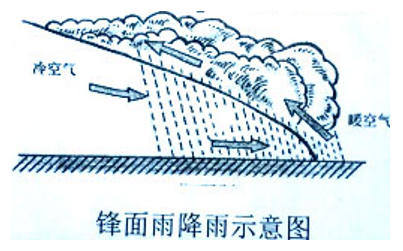

A. 主要原因是地形抬升导致暖湿气流冷凝

B. 常常形成呈带状分布的大范围降水区域

C. 降水带的平均位置有随季节移动的特点

D. 我国江淮流域的梅雨就是该类型的降水

第 15 题 · 答案与解析

**参考答案（粉笔题库参考内容）**

A

**解析**

本题考查地理国情。

锋面活动时，暖湿气流在上升过程中，由于气温不断降低，水汽就会冷却凝结，成云致雨，这种雨称锋面雨。

A项错误，地形雨是四大降水方式之一（其余三个是：锋面雨、对流雨、台风雨）。地形雨是湿润气流遇到山脉等高地阻挡时被迫抬升而气温降低形成的降水，对改变局部小气候有重要影响作用。因此A项是地形雨成因而非锋面雨。

B、C两项正确，锋面降水的第一个特点是水平范围大，常常形成大范围的呈带状分布的降水区域，称为降水带。随着锋面平均位置的季节移动，降水带的平均位置也随季节移动（从冬季到夏季，降水带的位置逐渐向北移动；从夏季到冬季，则向南移动）；锋面降水的另一个特点是持续时间长，因为层状云上升速度小，含水量和降水强度都比较小，有些纯粹的水云很少发生降水，即使发生也是毛毛雨。

D项正确，长江中下游地区处在欧亚大陆东部的中纬度，一方面受到从寒带南下的冷空气影响，另一方面又受到从热带海洋北上的暖湿空气影响。每年6、7月份，冷暖空气相遇，交界处形成锋面，锋面附近产生降水，因此时正值梅子黄熟的时节，所以这种锋面雨人们又称之为梅雨。

本题为选非题，故正确答案为A。

**考点**：自然地理

**来源**：2014年新疆维吾尔自治区公务员录用考试《行测》题（网友回忆版）第15题

### 第 16 题

李某与王某有仇怨。一日，李某拦住王某，百般辱骂，王某挥动拳头欲打李某，李某逃跑，王某紧追不舍。李某从屠户徐某处抢到一把屠刀，王某不敢再追，李某用言辞激王某，王某又追。待王某迫近时，李某用刀捅了王某一刀，导致王某心脏破裂而死。李某的行为属于：

A. 正当防卫

B. 紧急避险

C. 防卫过当

D. 故意杀人

第 16 题 · 答案与解析

**参考答案（粉笔题库参考内容）**

D

**解析**

本题考查法律常识。

D项正确，A、C两项错误，根据《中华人民共和国刑法》第二十条规定：“为了使国家、公共利益、本人或者他人的人身、财产和其他权利免受正在进行的不法侵害，而采取的制止不法侵害的行为，对不法侵害人造成损害的，属于正当防卫，不负刑事责任。正当防卫明显超过必要限度造成重大损害的，应当负刑事责任，但是应当减轻或者免除处罚。对正在进行行凶、杀人、抢劫、强奸、绑架以及其他严重危及人身安全的暴力犯罪，采取防卫行为，造成不法侵害人伤亡的，不属于防卫过当，不负刑事责任。”李某与王某有仇怨，其主动拦住王某后，先是百般辱骂，后持刀示威，待王某不敢再追时，又言语相激，趁其逼近捅了一刀，致王某死亡，属于典型的防卫挑拨，即故意引诱对方进行不法侵害而借机加害于不法侵害人的行为，不构成正当防卫和防卫过当，成立故意杀人罪。

B项错误，根据《中华人民共和国刑法》第二十一条第一、二款规定：“为了使国家、公共利益、本人或者他人的人身、财产和其他权利免受正在发生的危险，不得已采取的紧急避险行为，造成损害的，不负刑事责任。紧急避险超过必要限度造成不应有的损害的，应当负刑事责任，但是应当减轻或者免除处罚。”李某手中持刀，而王某仅仅是追赶，后者并未造成李某遭受危险，不构成紧急避险的前提条件。

故正确答案为D。

**考点**：刑法

**来源**：2014年新疆维吾尔自治区公务员录用考试《行测》题（网友回忆版）第16题

### 第 17 题

下列水源①井水②江河水③泉水④山溪水⑤池塘水，作为饮用水，选择顺序正确的是：

A. ③②①⑤④

B. ③①④⑤②

C. ①③④②⑤

D. ①③⑤④②

第 17 题 · 答案与解析

**参考答案（粉笔题库参考内容）**

C

**解析**

本题考查科技常识。

《地震灾区集中式饮用水水源保护技术指南（暂行）》“第二章 饮用水水源及重点保护区的划分”中第四条第三款规定，“通常选择水源的顺序是：水井、山泉、江河、水库、湖泊、池塘，但要结合实际情况和水源特征的分析结果来决定。”

另外可根据排除法做题。通常池塘都是没有地面的入水口的，它们都是依靠天然的地下水源和雨水或以人工的方法引水进池，所以池塘这个封闭的生态系统跟湖泊有所不同。池水很多时候都是绿色的，因为里面有很多藻类，最不适合饮用，因此排在最后。

故正确答案为C。

**考点**：生活常识

**来源**：2014年新疆维吾尔自治区公务员录用考试《行测》题（网友回忆版）第17题

### 第 18 题

下列关于节能与可再生能源表述不正确的是：

A. “低碳”意指更低的二氧化碳气体的排放

B. 太阳能、水能、风能都属于可再生能源

C. 为节约用电，夏季空调温度宜设置在以上

D. 利用燃气轮机进行天然气发电不属于可再生能源利用

第 18 题 · 答案与解析

**参考答案（粉笔题库参考内容）**

C

**解析**

本题考查科技常识。

A项正确，低碳，意指较低（更低）的温室气体（二氧化碳为主）排放。

B项正确，再生能源包括太阳能、水能、风能、生物质能、波浪能、潮汐能、海洋温差能、地热能等。

C项错误，为节约用电，夏季空调温度宜设置在以上。

D项正确，天然气是不可再生能源，利用燃气轮机进行天然气发电属于不可再生能源利用。

本题为选非题，故正确答案为C。

**考点**：生活常识

**来源**：2014年新疆维吾尔自治区公务员录用考试《行测》题（网友回忆版）第18题

### 第 19 题

面对灾害，下列做法正确的是：

A. 强烈破坏性地震发生时，在低楼层的人应跳楼逃生

B. 火灾发生时浓烟弥漫，应尽量采取低姿势爬行逃生

C. 雷电交加时，在空旷的野外尽量站在高处

D. 刮大风时，应尽量将机动车辆停靠在高楼和大树下方

第 19 题 · 答案与解析

**参考答案（粉笔题库参考内容）**

B

**解析**

本题考查科技常识。

A项错误，强烈破坏性地震发生时，如果家住楼房，千万不要跳楼，应立即切断电闸，关掉煤气，暂避到洗手间等跨度小的地方，或是桌子、床铺等下面，震后迅速撤离，以防强余震。

B项正确，火灾发生时浓烟弥漫，由于热空气的上升作用，大量有毒气体将漂浮在上层，贴近地面的空气相对更易呼吸，故应采取低姿势沿安全通道向下逃离为妥。

C项错误，雷电交加时，如果在空旷的野外无处躲避，应该尽量寻找低凹地（如土坑）藏身，或者立即下蹲、双脚并拢、双臂抱膝、头部下俯，尽量降低身体的高度。

D项错误，刮大风时，应当将机动车辆停靠在空旷的地方，以防止坠物或树枝被折断而造成的损失。

故正确答案为B。

**考点**：生活常识

**来源**：2014年新疆维吾尔自治区公务员录用考试《行测》题（网友回忆版）第19题

### 第 20 题

关于可燃冰，下列说法错误的是：

A. 分布于深海沉积物或陆域的永久冻土层中

B. 是天然气与水在高压低温条件下形成的类冰状结晶物质

C. 开采过程中必须有效实现对温度和压力条件的控制

D. 其规模化利用将有效缓解温室效应

第 20 题 · 答案与解析

**参考答案（粉笔题库参考内容）**

D

**解析**

本题考查科技常识。

A、B、C三项正确，D项错误，可燃冰即天然气水合物，是天然气与水在高压低温条件下形成的类冰状结晶物质，因其外观像冰，遇火即燃，因此被称为“可燃冰”“固体瓦斯”和“气冰”。可燃冰分布于深海或陆域永久冻土中，燃烧后会生成二氧化碳和水，故其规模利用并不能有效缓解温室效应。由于可燃冰在常温下极不稳定，所以在开采过程中必须有效地实现对温度和压力条件的控制。

本题为选非题，故正确答案为D。

**考点**：生活常识

**来源**：2014年新疆维吾尔自治区公务员录用考试《行测》题（网友回忆版）第20题

### 第 21 题

蓝田玉是近期人们比较追捧的玉种，但资源非常有限。我们理应百倍地珍惜节约使用，不能贪图眼前的蝇头小利而滥采滥挖，粗率加工。和田玉经过数千年的采用已近绝迹，而中国人世世代代重玉爱玉的文化情结，还要一代接一代地传承下去，蓝田玉身负的使命，不言而喻。

这段文字意在说明：

A. 我们应合理开发利用蓝田玉资源

B. 和田玉的地位将被蓝田玉所取代

C. 现在蓝田玉存在过度开发的问题

D. 蓝田玉承载着传承中国玉文化的重任

第 21 题 · 答案与解析

**参考答案（粉笔题库参考内容）**

A

**解析**

文段开篇引出蓝田玉的话题，然后通过“但”转折指出蓝田玉资源有限的问题，接着通过“应”提出对策，即节约使用，不要滥采滥挖、粗率加工，最后通过论述蓝田玉的重要性来进行论证，故文段的重点在对策，即对蓝田玉应合理开采挖掘，对应A项。

B、D两项，均对应后文解释说明的部分，非重点，排除；

C项，为文段问题表述，非重点，排除。

故正确答案为A。

【文段出处】《漫谈蓝田玉》

**考点**：关联词-对策

**来源**：2014年新疆维吾尔自治区公务员录用考试《行测》题（网友回忆版）第21题

### 第 22 题

夏日高温炎热，水成为消暑的必备品。但对开车一族而言，久置在高温、闷热车厢里的饮料是健康的潜在威胁。用塑料制成的饮料瓶，用一次是安全的，如果重复使用就有致癌危险。这些饮料瓶在室温下，可保存较长时间，但若经阳光暴晒，就会发生材质老化、释放出有毒物质，人饮用瓶内的饮料后会出现恶心、呕吐等慢性中毒反应。

这段文字主要说明的是：

A. 夏季如何避免车内饮料变质

B. 一次性饮料瓶含有致癌物质

C. 司机在夏季开车要及时补充体内水分

D. 夏季久置车厢内的饮料是健康的潜在威胁

第 22 题 · 答案与解析

**参考答案（粉笔题库参考内容）**

D

**解析**

文段开篇指出水是夏季消暑的必备品，接着通过转折词“但”指出，久置在高温、闷热车厢里的饮料是健康的潜在威胁，后文从塑料制成的饮料瓶重复使用有致癌危险、饮用暴晒过的饮料会中毒两个方面进行解释说明，故文段重点强调转折后的内容，即久置在高温车厢内的饮料是健康的潜在威胁，对应D项。

A项，“如何避免”为做法，文段未提及对策，无中生有，排除；

B项，“饮料瓶含有致癌物质”对应后文解释说明的内容，非重点，排除；

C项，“及时补充体内水分”文段未提及，无中生有，排除。

故正确答案为D。

【文段出处】《医生提醒：久置车厢的饮料是健康的潜在威胁》

**考点**：关联词-转折

**来源**：2014年新疆维吾尔自治区公务员录用考试《行测》题（网友回忆版）第22题

### 第 23 题

研究人员的大脑镜像实验显示，厌食症患者大脑中负责协调情绪和负责制定计划并感知后果的两部分神经回路不平衡，导致面对食物时，这两部分神经回路会轮流控制患者的感官，使患者一方面饱受饥饿感的煎熬，一方面又因为觉得可能发胖而不敢进餐。

这段文字主要探讨了：

A. 厌食症的生理成因

B. 厌食症患者所受的痛苦

C. 厌食症与恐惧心理的联系

D. 厌食症患者表现出的症状

第 23 题 · 答案与解析

**参考答案（粉笔题库参考内容）**

A

**解析**

文段开篇介绍大脑镜像的实验结果，指出厌食症患者大脑中负责协调情绪、制定计划和感知后果的神经回路不平衡时，会出现厌食现象。故文段重在介绍厌食症的生理成因，对应A项。

B项，“所受的痛苦”对应“一方面饱受饥饿感的煎熬”，为尾句中两个方面内容中的“一方面”内容，表述片面，排除；

C项，“厌食症与恐惧心理的联系”对应“一方面又因为觉得可能发胖而不敢进餐”，为尾句中两个方面内容中的“一方面”内容，表述片面，排除；

D项，文段并未介绍“厌食症患者表现出的症状”，无中生有，排除。

故正确答案为A。

【文段出处】《美国发现导致厌食症的生理原因》

**考点**：关联词-因果

**来源**：2014年新疆维吾尔自治区公务员录用考试《行测》题（网友回忆版）第23题

### 第 24 题

一亩地产辣椒5000公斤，一根豇豆1米长，一个茄子重3斤······中国空间技术研究院有关负责人介绍，1987年以来，我国共进行了22次航天育种搭载试验，有近60多个品系在农业生产中推广应用。传统育种一般需要6~10年，而航天育种通过太空多种特殊条件的诱变，能缩短至4~5年。另外，比如航椒1号辣椒，维生素C含量提高了183%。

这段文字主要介绍的是：

A. 近年来我国农业育种技术发展迅速

B. 传统育种技术会被航天育种技术所取代

C. 农业科研人员在育种方面多年的努力颇有成效

D. 航天育种能创造出大批优质的种质资源

第 24 题 · 答案与解析

**参考答案（粉笔题库参考内容）**

D

**解析**

文段开篇介绍中国进行了航天育种搭载试验后，一些品系可以在农业生产中推广应用，接着与传统育种进行对比，体现出航天育种的时间较短，并通过航椒举例说明航天育种的品质也得到了提高。故文段为并列结构，共同论述航天育种的优势，对应D项。

A、C两项，均没有提到文段核心话题“航天育种”，排除；

B项，“传统育种技术会被航天育种技术所取代”文段中没有提到，无中生有，排除。

故正确答案为D。

【文段出处】《航天种子为何难“落地”》

**考点**：主题词、关联词-并列

**来源**：2014年新疆维吾尔自治区公务员录用考试《行测》题（网友回忆版）第24题

### 第 25 题

暗影是新精神分析家荣格提出的一个概念，指的是人类精神中最隐蔽最深奥的部分，其中包括了人性中最糟的方面也包含了人性中最有生命力的方面。暗影包含着积极面和消极面，积极面是指巨大的创造力，消极面则表现为现实生活中大到战争、侵略、动乱以及贪污腐败，小到人与人之间的欺骗、谎言、仇恨、嫉妒、伤害、怀疑、抱怨等。

这段文字主要是：

A. 解释暗影的概念和内涵

B. 分析暗影存在的根源

C. 介绍暗影这一理论是如何提出的

D. 说明暗影对人性有哪些影响

第 25 题 · 答案与解析

**参考答案（粉笔题库参考内容）**

A

**解析**

文段首句引出话题，“暗影”是荣格提出的一个概念，并阐述此概念包括的两个方面，随后详细介绍“暗影”的两面——积极面和消极面，以及它们在现实生活中的表现。故文段为总分结构，解释了暗影的概念和内涵，对应A项。

B项“暗影存在的根源”和C项“暗影这一理论是如何提出的”文段均未提及，无中生有，排除；

D项，文段阐述了暗影包含人性中“最糟的方面”和“最有生命力的方面”，是对人性的客观反映，并未提及暗影对人性的影响，无中生有，排除。

故正确答案为A。

【文段出处】中国青年报《你要提防暗影中的自己》

**考点**：分述句特征-其他

**来源**：2014年新疆维吾尔自治区公务员录用考试《行测》题（网友回忆版）第25题

### 第 26 题

眼下涉及教育的话题，时常会出现“两军对垒”：一边是教育专家，苦口婆心地说，成功的教育必须激发学生的兴趣；另一边是家长和老师，一致认为“考试唯大，分数至上”。专家指出，这样的“功利心”使得孩子们的天性与兴趣都被无情地扼杀了。但在优质教育资源不足的条件下，家长不想方设法让孩子考名校，还能有什么更明智的选择吗？

这段文字意在说明：

A. 国内的优质教育资源供不应求

B. 教育专家的观点脱离生活现实

C. 现在教育扼杀了孩子们的天性

D. 家长的“功利”选择出于无奈

第 26 题 · 答案与解析

**参考答案（粉笔题库参考内容）**

D

**解析**

文段首先指出教育有两军对垒的情况，一方面教育专家强调兴趣的重要性，另一方面家长老师认为分数至上。接着通过专家的观点提出家长老师们的“功利心”会带来的问题。尾句通过转折关联词“但”和反问句式，强调考名校是家长不得不采取的“功利”选择，故文段的重点是强调家长采取“功利”选择是被迫的，对应D项。

A项，“优质教育资源供不应求”属于尾句结论的前提条件，非重点，排除；

B项，“专家的观点脱离生活现实”无中生有，排除；

C项，“扼杀了孩子们的天性”对应转折前的内容，非重点，排除。

故正确答案为D。

**考点**：关联词-转折

**来源**：2014年新疆维吾尔自治区公务员录用考试《行测》题（网友回忆版）第26题

### 第 27 题

①垃圾食品不仅没营养，还可能让人脾气变坏

②目前，研究已显示，吃垃圾食品的人更愿意用暴力行为解决问题，脾气也更坏，但具体数据还没有公布

③牛津大学科学家以1000名16~21岁的男女为研究对象，他们将分为两组，一组长期服用维生素和营养补充剂，另一组长期食用垃圾食品，然后对他们进行为期1年的跟踪观察

④英国牛津大学的科学家发现，长期吃垃圾食品可能会增加暴力行为

⑤科学家解释说，当大脑极度缺乏重要营养成分，尤其缺乏大脑神经元的重要组成成分欧米伽-3脂肪酸时，大脑会失去灵活，注意力不集中，自制力受损，暴力倾向增加

⑥而垃圾食品营养成分单一，长期食用会造成营养缺失

将以上6个句子重新排列，语序正确的是：

A. ①④③②⑤⑥

B. ④③②①⑤⑥

C. ①③④⑤②⑥

D. ④①⑤⑥②③

第 27 题 · 答案与解析

**参考答案（粉笔题库参考内容）**

A

**解析**

对比选项，确定首句。①句指出垃圾食品既没有营养，还可能让人脾气变坏，④句指出科学家的研究发现，长期吃垃圾食品可能会增加暴力行为，均可作为首句。

继续观察发现，②句介绍了实验研究的结果，即吃垃圾食品的人会有暴力倾向，③句介绍了科学家的实验过程，⑤句详细解释了为何暴力倾向会增加，按照逻辑顺序可知，应先介绍实验过程，再讲述实验的结果，最后解释为何会出现这一结果，故③②两句应在⑤句之前，排除C、D两项。

对比A、B两项，区别在于①句的位置。①④两句均在说垃圾食品有问题，而③②⑤这三句是围绕垃圾食品有问题进行的实验研究，应先提出问题，再围绕问题进行分析，故①句应在③②⑤三句之前，排除B项，锁定A项。

故正确答案为A。

【文段出处】《常吃垃圾食品会让人变暴力》

**考点**：确定顺序

**来源**：2014年新疆维吾尔自治区公务员录用考试《行测》题（网友回忆版）第27题

### 第 28 题

英国国家船舶博物馆里停泊着这样一艘船，它1894年下水，在大西洋上曾138次遭遇冰山，116次触礁，13次起火，207次被风暴拗断桅杆。使这艘船名扬天下的是一名来此观光的律师。当时，他刚打输了一场官司，委托人也于不久前自杀了。每当遇到这样的事情，他总有一种负罪感，不知该怎样安慰这些不幸的人。当他看到这艘船时，忽然有一种想法，为什么不让他们来参观参观这艘船呢？于是，他就把这艘船的历史抄下来，连同这艘船的照片一起挂在他的律师事务所里，每当有委托人请他辩护，无论输赢，他都建议他们去看看这艘船。

这段文字的主旨是：

A. 放下心中的包袱才能前行

B. 要勇敢地告别过去

C. 生活中遭遇挫折是不可避免的

D. 失败是成功之母

第 28 题 · 答案与解析

**参考答案（粉笔题库参考内容）**

C

**解析**

文段为寓言故事，首先通过数据介绍了一艘多次遭遇事故的船。接着介绍了一名律师不知道如何安慰那些不幸的人。最后表示律师把这艘船的历史抄下来，连同这艘船的照片一起挂在事务所，每当有委托人请他辩护，无论输赢，他都建议他们去看看这艘多次遭遇事故的船。故本文主要强调人生就像船一样会多次遭受挫折，对应C项。

A项，“放下心中的包袱”强调放下心理上的负担，而文段强调生活中客观存在的挫折困难，并非心理，与文意不符，排除；

B项“告别过去”强调告别过去，D项“失败是成功之母”强调失败对成功的重要意义，均未体现生活中遇到困难是很常见之意，均偏离文段重点，排除。

故正确答案为C。

【文段出处】《人生像一条船》

**来源**：2014年新疆维吾尔自治区公务员录用考试《行测》题（网友回忆版）第28题

### 第 29 题

据报道，尽管目前关于地球变暖、海水融化以及海平面上升的消息频繁出现在媒体的头条，但有气候分析员指出在南半球的冬季，南极海域出现的大块浮冰总质量实际上是不断增加的。事实上，在九月下旬，卫星数据显示南极洲周围的海冰区域达到了有史以来最大的范围，南极海冰区域面积为751万平方英里，约为1944万平方公里，并且还呈现出缓慢增长的趋势，以年均约1%的速度增加。

这段文字意在说明：

A. 全球气候并非都在变暖

B. 南极洲海冰的增长速度缓慢

C. 南极洲海冰的区域日益增大

D. 关于地球变暖的有关报道严重失实

第 29 题 · 答案与解析

**参考答案（粉笔题库参考内容）**

A

**解析**

文段先指出地球变暖、海水融化的消息，通过“但”转折词指出南极海域浮冰总质量其实是在不断增加的，后文通过列举事实及数据资料指出南极海冰区域确实在增加。故文段转折之后是用来反驳开篇提出的地球变暖这一观点的，也就是全球并非都在变暖，对应A项。

B、C两项，均侧重谈论“南极洲海冰”，属于例证内容，非重点，排除；

D项，文段通过南极海域浮冰不断增加这一例证，重在强调全球并非都在变暖，并不是论述报道本身属实与否，偏离文段中心，排除。

故正确答案为A。

【文段出处】《全球变暖并非仅是气温升高 短期数据意义不大》

**考点**：关联词-转折

**来源**：2014年新疆维吾尔自治区公务员录用考试《行测》题（网友回忆版）第29题

### 第 30 题

人们在茶叶生产和消费过程中的约定俗成的行为模式，通常是以茶礼、茶俗以及茶艺等形式表现出来的。如宋代诗人杜耒“寒夜客来茶当酒”的名句，说明来客敬茶是我国的传统礼节；千里寄茶表示对亲人的怀念；民间旧时行聘以茶为礼，称“茶礼”，送“茶礼”称“下茶”，古时谚语曰“一女不吃两家茶”，即女家受了“茶礼”便不再接受别家聘礼；还有以茶敬佛，以茶祭祀等等。至于各地、各民族的饮茶习惯更是异彩纷呈，各种饮茶方法和茶艺程式也如百花齐放，美不胜收。

这段文字主要介绍了：

A. 古代诗词中的茶文化

B. 与茶有关的民间习俗

C. 饮茶的方法和茶艺花样繁多

D. 不同地区的饮茶习俗各有千秋

第 30 题 · 答案与解析

**参考答案（粉笔题库参考内容）**

B

**解析**

文段开篇指出茶叶在生产和消费中的行为模式通常是以茶礼、茶俗等形式表现的。后文通过“如”进行举例论证，尾句再次说明各地、各民族的饮茶习惯不同，并且各种饮茶方法和茶艺程式也不同，对前文进行解释说明。故文段为总分结构，重点在首句，强调的是茶叶的行为模式与茶礼、茶俗、茶艺等形式有关，B项“民间习俗”即“约定俗成的行为模式”的同义替换，当选。

A项，“诗词中的茶文化”为例子中的内容，非重点，排除；

C项“饮茶的方法和茶艺花样”、D项“不同地区的饮茶习俗”均为解释说明的内容，非重点，排除。

故正确答案为B。

【文段出处】《关于茶文化精神》

**考点**：分述句特征-举例子

**来源**：2014年新疆维吾尔自治区公务员录用考试《行测》题（网友回忆版）第30题

### 第 31 题

大家都知道生物多样性对于保护地球生态环境是非常重要的，但我们的眼光都被那些肉眼可见的动植物所吸引了，完全忘记了地球上最大的生物多样性宝库其实是属于微生物的，而且它们的作用要比动植物大得多。举例来说，海洋吸收了大气中至少一半的二氧化碳，这一吸收过程非常复杂，有大量微生物的参与，但人类对它们的情况了解得极少，因此也就很难预测它们会对气候变化做出怎样的反应。幸运的是，随着DNA测序技术的改进，科学家们终于开始进入这个神秘的微观世界了。

这段文字接下来最可能讲述的是：

A. DNA测序技术在微生物观测中的应用

B. 微生物在海洋吸收二氧化碳过程中的作用

C. 对生物多样性的重新认识具有现实意义

D. 微生物的活动与气候变化之间的关系

第 31 题 · 答案与解析

**参考答案（粉笔题库参考内容）**

A

**解析**

本题为接语选择题，重点关注文段尾句谈论的核心话题。文段开篇指出微生物对于生态环境保护很重要，却被人们遗忘，随后以二氧化碳吸收过程进行举例论证，尾句指出DNA测序技术的改进让科学家开始进入微观世界。根据话题一致原则，后文应就“DNA测序技术”“微生物”进行展开说明，对应A项。

B、C、D三项均与尾句核心话题“DNA测序技术”不一致，排除。

故正确答案为A。

【文段出处】《神秘的微观世界》

**考点**：接语选择题

**来源**：2014年新疆维吾尔自治区公务员录用考试《行测》题（网友回忆版）第31题

### 第 32 题

①随着核磁共振等技术的不断进步，科学家们基本达成了共识，那就是记忆储存在大脑的海马区

②科学家们发现，记忆储存于神经细胞的连接方式之中

③这个改变是由一系列基因负责实现的

④要想研究记忆，首先必须弄清记忆究竟储存在什么地方

⑤接下来的问题是，记忆是如何被储存的？这个问题也已经有了答案

⑥大脑通过改变神经细胞的连接方式和连接强度，将某个外来刺激永久地固定于大脑之中

将以上6个句子重新排列，语序正确的是：

A. ①⑥②④⑤③

B. ①④②⑤③⑥

C. ④①⑤②⑥③

D. ④③①⑤⑥②

第 32 题 · 答案与解析

**参考答案（粉笔题库参考内容）**

C

**解析**

对比选项，判断首句。①句提到了科学家们的共识，记忆储存在大脑的海马区，④句提到了要弄清记忆储存在哪里，按照逻辑顺序，应该先说弄清楚记忆储存在哪里，再具体介绍记忆储存的地方，故④句在①句之前，排除A、B两项。

继续观察发现，③句出现指代词“这个改变”，故③句前应描述“改变”，对比③句前接④句还是⑥句，④句论述的内容与改变无关，而⑥句提到了大脑改变神经细胞的连接方式和连接强度，故⑥句与③句可以构成指代词捆绑，排除D项。

故正确答案为C。

【文段出处】《打开记忆的开关》

**考点**：确定捆绑、确定顺序

**来源**：2014年新疆维吾尔自治区公务员录用考试《行测》题（网友回忆版）第32题

### 第 33 题

①随着西夏王朝的灭亡，西夏文字逐渐淡出了人们的视线

②西夏文字作为打开西夏文化的钥匙，完整破译西夏文字，对于有关西夏的研究至关重要

③在相当长的一段历史岁月中，西夏文字沉寂而去，几乎无人知晓

④然而由于毁灭性打击，后世失传，西夏文字被称为“天书”

⑤直到清朝乾隆嘉庆期间，学者追寻和著述西夏历史时，西夏文字才被重新提及

⑥1997年，国内第一部也是唯一的一部西夏文字典《夏汉字典》出版，这为破译西夏文字，打开西夏文献宝库提供了一把“金钥匙”

将以上6个句子重新排序，语序正确的是：

A. ①③⑤④②⑥

B. ①⑤③⑥④②

C. ②①③⑤⑥④

D. ②⑥⑤④①③

第 33 题 · 答案与解析

**参考答案（粉笔题库参考内容）**

A

**解析**

对比选项，确定首句，①句交代背景，指出西夏文字随着王朝灭亡淡出人们的视线，②句指出破译西夏文字很重要，均可作为首句。

继续寻找解题线索，①句介绍西夏文字淡出人们视线，③句介绍西夏文字无人知晓，⑤句介绍西夏文字被重新提及，按照逻辑顺序，应为①③⑤，排除B、D两项。

对比A、C两项，尾句分别为⑥④两句，④句指出西夏文字失传，被称为“天书”，⑥句指出《夏汉字典》可以破译西夏文字，是打开西夏文化宝库的“金钥匙”，按照逻辑顺序，应先提出问题，再阐述对策，故④句应排在⑥句之前，排除C项。

故正确答案为A。

【文段出处】《西夏学专家：全部西夏文字共计5917字》

**考点**：确定顺序

**来源**：2014年新疆维吾尔自治区公务员录用考试《行测》题（网友回忆版）第33题

### 第 34 题

反传统是中国革命的主线。五四运动之后，学习西方变成了向西方追求真理。学习西方并没有错，但把西方视为真理则大错特错了。中国并不拒绝其他文明和价值，但西方文化主导下的西方话语解释不了中国的一切，所以中国文化必须成为主体。因此我们，尤其是知识分子必须花大力气从长达一个多世纪的思维和思想被“殖民”的状态中解放出来。西方继续要学，但中国的主体地位也必须得到确立。

这段文字主要谈的是：

A. 如何推广中国文化

B. 学习西方文化的方法和策略

C. 中国文化的核心价值

D. 确立中国文化主体地位的必要性

第 34 题 · 答案与解析

**参考答案（粉笔题库参考内容）**

D

**解析**

文段开篇指出反传统是中国革命的主线，并指出五四运动之后，学习西方变成向西方追求真理，随后又指出把西方视为真理是错误的，西方话语解释不了中国的一切。紧接着通过结论词“因此”总结前文，强调在继续学习西方时必须确立中国的主体地位。故文段重点强调应确立中国文化的主体地位，对应D项。

A项，文段强调应确立中国文化的主体地位，而非“推广中国文化”，无中生有，排除；

B项，“学习西方文化的方法和策略”，文段未提及“方法和策略”，无中生有，排除；

C项，文段并未提及“中国文化的核心价值”是什么，无中生有，排除。

故正确答案为D。

【文段出处】《“解放”与中国的文化崛起》

**考点**：关联词-因果

**来源**：2014年新疆维吾尔自治区公务员录用考试《行测》题（网友回忆版）第34题

### 第 35 题

在畜牧业中经常使用抗生素，会使得携带耐抗生素基因的微生物繁盛起来。某些情况下，耐抗生素基因可以变得具有很高的移动性，也就是说它们能够迁移到那些对人体致病的细菌中去。这样一来，当人类患病再去服用抗生素的时候，由于细菌已经具有耐药性，原本神奇的药物就失去效用了。

这段文字意在说明：

A. 人体会对抗生素产生耐药性

B. 耐抗生素基因有移动性

C. 畜牧业应控制使用抗生素

D. 过度使用抗生素可使人体致病

第 35 题 · 答案与解析

**参考答案（粉笔题库参考内容）**

C

**解析**

文段开篇指出畜牧业经常使用抗生素会带来耐抗生素基因的微生物变多的问题，而后论述某些情况下耐抗生素基因的高移动性让它们可以进入人体致病的细菌中，尾句进一步指出耐药性对于人类患病服用抗生素的不利影响，故文段为“提出问题-分析问题”的结构，应优选解决问题的对策，对应C项。

A项，对应尾句分析问题的部分，非重点，排除；

B项，对应分析问题的部分，非重点，排除；

D项，文段并未提及抗生素与人体致病的关系，无中生有，排除。

故正确答案为C。

【文段出处】《南京环保专家称喝水十万年才等于吃片药，央视驳称不科学》

**考点**：关联词-对策

**来源**：2014年新疆维吾尔自治区公务员录用考试《行测》题（网友回忆版）第35题

### 第 36 题

20世纪30年代，一个英国学者曾根据自己的研究结果预测，世界范围内将发生严重的铜资源短缺。现在的情况是，美国地质调查局在地质勘探后推算，地球地表的铜资源储量至少可达30亿吨，可供人类使用18.5万年。随着人类勘探技术的提高，这个数字在未来还有可能继续攀升。

这段文字最适合的标题是：

A. 不断改正错误科技才能进步

B. 地球铜资源远未枯竭

C. 铜资源短缺问题已经得到解决

D. 权威学者也会犯大错误

第 36 题 · 答案与解析

**参考答案（粉笔题库参考内容）**

B

**解析**

文段首先指出20世纪30年代有英国学者预测世界的铜资源将发生严重短缺，接着通过现在的勘探情况反驳了英国学者的观点，指出铜资源储量还有很多，并通过尾句进一步说明了铜资源的勘探储量可能继续攀升。故文段围绕“铜资源”展开论述，重点说明铜资源储量丰富，远未枯竭，对应B项。

A项，“不断改正错误科技才能进步”未提及核心话题“铜资源”，且文段并未提及“改正错误”与“科技进步”之间的关系，无中生有，排除；

C项，“铜资源短缺问题”文段并未提及，无中生有，排除；

D项，“权威学者也会犯大错误”未提及文段核心话题“铜资源”，且“大错误”程度过重，排除。

故正确答案为B。

【文段出处】《错误的石油峰值理论》

**考点**：标题填入题

**来源**：2014年新疆维吾尔自治区公务员录用考试《行测》题（网友回忆版）第36题

### 第 37 题

现代欧洲城市与中世纪城市以及当代工业城市模式截然不同。中世纪城市是作为对封建领主权力的制衡力量而崛起并站稳脚跟的，在当时是受保护的自治区域，是庇护所，让商人和工匠的活动不受封建主掠夺。与之相反，现代城市则是放弃了农村传统居所的显贵（如资产阶级地主）所青睐的居住地，是将周边乡村都置于其影响下的新兴权力中心。现代城市的另一个特点是第三产业在城市功能中占压倒性优势，这是以损害生产性活动为代价的，而后者曾是中世纪城市的核心，并在后来的工业化时代重新占据这一地位。

文中“后者”指的是：

A. 生产性活动

B. 第三产业

C. 现代城市

D. 资产阶级地主

第 37 题 · 答案与解析

**参考答案（粉笔题库参考内容）**

A

**解析**

“后者”出现在文段尾句，需结合前文内容进行理解，文段开篇引出话题，论述现代欧洲城市与中世纪城市以及当代工业城市模式截然不同，接着具体论述其不同之处，尾句则论述现代城市的另一个特点是第三产业以损害生产性活动为代价，得以在城市功能中占压倒性优势，即第三产业与生产性活动间的关系，故“后者”指代尾句中出现的两个关键词中的第二个关键词，即“生产性活动”，对应A项。

B项，“第三产业”为尾句中的“前者”，排除；

C项，“现代城市”非尾句强调的重点话题，无法与指代词构成指代关系，排除；

D项，“资产阶级地主”为前文例子内容，非尾句强调的重点话题，排除。

故正确答案为A。

【文段出处】《&lt;时空契阔>：欧洲城市演化史给我们什么启示》

**考点**：代词

**来源**：2014年新疆维吾尔自治区公务员录用考试《行测》题（网友回忆版）第37题

### 第 38 题

一个优秀的战略制定者，不仅要有很强的逻辑分析能力，还要具备很强的直觉感受。他们必须同时是优秀的经济学家和心理学家。近期关于人类认知的研究发现，战略制定者若能得到利用联想思维去发现、利用并说服各方接受潜在的机遇，通常会取得更好的结果。战略创新不仅依靠理性分析，同样也需要直觉灵感。

根据这段文字，可以知道：

A. 心理分析将成为制定战略的秘密武器

B. 战略制定者常常利用联想思维去说服他人

C. 创新战略常常是理性和感性结合的结果

D. 制定战略时直觉感受比逻辑分析能力更重要

第 38 题 · 答案与解析

**参考答案（粉笔题库参考内容）**

C

**解析**

A项，“成为制定战略的秘密武器”文段未提及，无中生有，排除；

B项，文段指出的是“若能得到利用联想思维去发现”，故“常常利用联想思维”为假设变现实的表述，与文段表述不符，排除；

C项，根据“战略创新不仅依靠理性分析，同样也需要直觉灵感”可知，表述正确，当选；

D项，根据“要有很强的逻辑分析能力，还要具备很强的直觉感受”可知，“直觉感受比逻辑分析能力更重要”为无关对比，排除。

故正确答案为C。

**考点**：细节判断题

**来源**：2014年新疆维吾尔自治区公务员录用考试《行测》题（网友回忆版）第38题

### 第 39 题

50年前，世界人口大约只有如今的一半，人类曾希望用所谓的“绿色革命”阻止迫在眉睫的粮食危机。杂交种子和化肥使用量的猛增取得了一些效果，但人类也付出了沉重的生态代价。统计显示，与我们父辈生活的时代相比，当下全球的粮食产量翻了将近一番，但代价也是巨大的：农业生产对地表水和地下水的消耗增长了两倍。

这段文字意在说明：

A. 人类对粮食危机的本质认识不足

B. 杂交种子和化肥并非“绿色革命”的本质

C. 解决问题不能以牺牲生态环境为代价

D. “绿色革命”并非解决粮食危机的良药

第 39 题 · 答案与解析

**参考答案（粉笔题库参考内容）**

C

**解析**

文段开篇介绍人类曾希望用所谓的“绿色革命”阻止粮食危机，接着通过转折关联词“但”强调这些所谓的“绿色革命”使人类付出了沉重的生态代价。后文通过统计数据对破坏生态环境的巨大代价进行具体解释说明。故文段重点在于转折之后，强调解决粮食危机破坏了生态环境的问题，选项应给出对策，对应C项。

A项“粮食危机的本质”、B项“‘绿色革命’的本质”文段中均未提及，无中生有，排除；

D项，“并非······良药”表述不明确，排除。

故正确答案为C。

【文段出处】《2050年世界人口新增25亿 人类吃什么？》

**考点**：关联词-对策、关联词-转折

**来源**：2014年新疆维吾尔自治区公务员录用考试《行测》题（网友回忆版）第39题

### 第 40 题

由于学识、秉性、经历及外部环境的影响，每个人对读书内容的喜好千差万别。从学习角度而言，在感兴趣的方面发扬钉子精神深钻细研，无疑可以对该领域了解得更全面、系统和深透。但不感兴趣的东西，有的也可能恰恰是我们所欠缺的。这不仅仅因为兴趣本身具有一定的局限性，而且在特定领域浸淫日久，往往会固化这种兴趣，而形成越不感兴趣越排斥的恶性循环，导致短板更短。而合理地阅读，才能培养取得社会认可、适应时代需要的能力素质。

这段文字意在强调：

A. 读书应符合自身的特点

B. 兴趣对阅读习惯的培养至关重要

C. 阅读时应适当突破兴趣的局限

D. 阅读能力是新时代人才亟需的素质

第 40 题 · 答案与解析

**参考答案（粉笔题库参考内容）**

C

**解析**

文段首先引出每个人对于读书内容的喜好不同这一话题，并从学习的角度论述了兴趣对于阅读的影响，之后通过转折提出不感兴趣的的东西往往也是我们所欠缺的这一问题，并对此进行了原因解释。最后文段通过“而”提出对策，告诉我们要合理地阅读，即要克服全凭兴趣喜好来决定阅读的问题，对应C项。

A项，文段强调解决“兴趣影响阅读”的问题，“符合自身特点”与文意无关，排除；

B项，文段强调摆脱兴趣对阅读的影响，该项突出兴趣的作用，与文意相悖，排除；

D项，强调“阅读能力”的重要性，偏离文段中心，排除。

故正确答案为C。

**考点**：关联词-对策、关联词-转折

**来源**：2014年新疆维吾尔自治区公务员录用考试《行测》题（网友回忆版）第40题

### 第 41 题

有统计显示，新中国成立以来，我国共研制并投入民用的1100多种高科技材料中，有80%是因航天技术的发展需求而研制的。众所周知，航天科技对各种设备、元器件的要求极高，由此，中国航天的每一个进步，都“逼迫”电子产业、装备制造业不断换代升级，而这些的终极受益者，还是普通百姓。

这段文字意在强调：

A. 航天科技最终能使普通百姓受益

B. 航天能够带动基础产业的巨大发展

C. 航天科技的发展能形成巨大的社会效益

D. 制造业的升级换代带来航天技术的不断进步

第 41 题 · 答案与解析

**参考答案（粉笔题库参考内容）**

A

**解析**

文段开篇提出我国研制并投入民用的1100多种高科技材料中有80%是因航天技术的发展需求研制的。接着提到航天科技对各种设备要求极高，尾句通过“由此”引出结论，即中国航天的进步促使了电子产业和装备制造业不断升级，并通过程度词“终极”强调，普通百姓成为了最后的受益者。故文段结构为分总，重点在尾句，强调航天科技带来的进步最终使得百姓成为了受益者，对应A项。

B、C两项，“基础产业”和“巨大的社会效益”文段均未提及，无中生有，排除；

D项，“制造业的升级换代带来航天技术的不断进步”表述与文段不符，逻辑颠倒，排除。

故正确答案为A。

【文段出处】《航天科技能为普通百姓带来什么》

**来源**：2014年新疆维吾尔自治区公务员录用考试《行测》题（网友回忆版）第41题

### 第 42 题

受制于持续增长的花费以及不断缩水的预算，美国航空航天局已经不得不推迟甚至取消许多研究项目。一些人担心美国国会今后不会再批准一些耗资巨大的项目，比如将火星岩石带回地球进行分析——这是科学家认为能够确定火星是否曾有生命的唯一办法。

这段文字意思概括最为准确的是：

A. 目前航空航天研究项目的预算经费越来越高

B. 国会的决议影响了美国的航空航天局新项目的开展

C. 对于火星上是否有生命的研究未来将可能难以为继

D. 预算压力将成为美国大型航天项目被叫停的主要原因

第 42 题 · 答案与解析

**参考答案（粉笔题库参考内容）**

D

**解析**

文段开篇介绍由于“持续增长的花费以及不断缩水的预算”，美国航空航天局的许多研究项目被推迟甚至被取消，随后指出一些人对耗资巨大的项目是否能得到批准表示担心，并举例说明。故文段为总分结构，重在强调预算压力导致美国一些大型航天项目被叫停，对应D项。

A项，“预算经费越来越高”文段未提及，无中生有，排除；

B项，文段论述的只是“一些人担心美国国会······”，“国会的决议影响了”表述与文意不符，排除；

C项，对应举例论证，非重点，且文段仅论述“美国”的相关情况，无法得出其他国家“对于火星上是否有生命的研究未来将可能难以为继”的结论，排除。

故正确答案为D。

【文段出处】《太空探索：无法控制的成本飙升》

**考点**：分述句特征-举例子

**来源**：2014年新疆维吾尔自治区公务员录用考试《行测》题（网友回忆版）第42题

### 第 43 题

中国的青年导演什么时候也能来一次电影语言与电影成就的“朝代更迭”，而不仅仅是辈分接力棒上的第五代第六代？然而正如马太效应，越是知名大导，越受资本青睐，而知名大导对于机会的饥渴以及创造性使用往往不敌青年导演，越是需要资源的青年导演，反而越难吸引资金，几年一遇的稀薄机会首先使生存成为障碍。

这段文字意在说明：

A. 社会应更多关注青年导演的作品

B. 要给青年导演更多的机会

C. 青年导演要善于利用资源

D. 知名导演应积极创新突破

第 43 题 · 答案与解析

**参考答案（粉笔题库参考内容）**

B

**解析**

文段首先通过提问引出话题，阐述中国的青年导演什么时候也能来一次“朝代更迭”，接着通过“然而”转折引出问题，指出知名大导备受资本青睐却创新不足，青年导演有创新力却机会渺茫。由此可知，文段的主题词为“青年导演”，意在强调青年导演机会少，不受资本青睐，B项“要给青年导演更多的机会”是针对问题的对策，当选。

A项，“关注青年导演的作品”偷换概念，文段的问题是青年导演机会少，而非其“作品”不受关注，排除；

C项，文段强调青年导演没有资源，而非不会利用资源，排除；

D项，“知名导演”非重点，文段的主题词是“青年导演”，排除。

故正确答案为B。

【文段出处】《青年导演该向世界输出什么》

**考点**：关联词-对策

**来源**：2014年新疆维吾尔自治区公务员录用考试《行测》题（网友回忆版）第43题

### 第 44 题

苏州园林据说有一百多处，我到过的不过十多处。其他地方的园林我也到过一些。倘若要我说说总的印象，我觉得苏州园林是我国各地园林的范本，各地园林或多或少都受到苏州园林的影响。因此，谁如果要鉴赏我国的园林，苏州园林就不该错过。

这段话接下来可能要写的内容是：

A. 苏州园林的具体情况

B. 各地园林的特色

C. 如何鉴赏中国园林

D. 苏州园林如何影响各地园林

第 44 题 · 答案与解析

**参考答案（粉笔题库参考内容）**

A

**解析**

本题为接语选择题，重点关注文段尾句。文段开篇指出作者去过的苏州园林数量不多，接着阐述了作者对于苏州园林的总体印象，即苏州园林是各地园林的范本，各地园林都受到苏州园林的影响，尾句通过结论词“因此”得出结论，强调苏州园林就不该错过。文段尾句核心话题为“苏州园林”，故后文应当围绕“苏州园林”展开论述，介绍苏州园林的基本情况，对应A项。

B、C两项，均未提及尾句的核心话题“苏州园林”，与前文衔接不当，排除；

D项，应当先介绍完“苏州园林”的基本情况后再具体论述其对各地园林的影响，故与文段尾句内容衔接不如A项恰当，排除。

故正确答案为A。

【文段出处】《苏州园林》

**考点**：接语选择题

**来源**：2014年新疆维吾尔自治区公务员录用考试《行测》题（网友回忆版）第44题

### 第 45 题

在生产力不发达的时代，战争成为争夺资源的最重要的方式。青年是战争中最重要的参与者，而要赢得战争的胜利，青年人必须有强健的身体素质。为了取得战争的胜利，各城邦青年组织起来进行训练。作为全希腊的盟主，雅典城邦在全盛期有25万人口。而同时期的科林斯有9万人口，有些城邦只有5000人甚至更少。人口越多，青年的比重越高，城邦越是能够在竞争中居于优势地位。

这段文字强调了，在生产力不发达的时代：

A. 青年在竞争中起着重要作用

B. 获取资源主要依靠战争方式

C. 人口多寡是衡量城市发展的指标

D. 竞争主要依赖人们的身体素质

第 45 题 · 答案与解析

**参考答案（粉笔题库参考内容）**

A

**解析**

文段开篇介绍战争在生产力不发达的时代是争夺资源最重要的方式。紧接着指出要赢得战争主要靠青年，而且青年人必须有强健的身体素质，并指出各城邦训练青年。随后将雅典城邦和其他城邦对比，进一步强调青年在竞争中的重要性，故整个文段围绕“青年”来论述，主要强调在生产力不发达的时代，青年对于战争的重要性，对应A项。

B、C、D三项，均缺少主题词“青年”，排除。

故正确答案为A。

**考点**：主题词

**来源**：2014年新疆维吾尔自治区公务员录用考试《行测》题（网友回忆版）第45题

### 第 46 题

近几年来，文化乱象日益严重。其中，网络文化中的垃圾是最为恶劣的，所造成的社会问题也是最为严重的，给中国和谐社会的构建带来相当的危害，特别是对成千上万青少年的毒害，如再不采取及时措施，必然对中华民族的可持续发展形成釜底抽薪的危机，着实不能掉以轻心了。历史早已经证明，文化混乱即会导致思想混乱，思想混乱定将引发行为混乱。

这段文字最适合的标题是：

A. 网络文化乱象必须下猛药来治

B. 当今社会网络文化乱象丛生

C. 肃清网络环境势在必行

D. 文化思想混乱后果不堪设想

第 46 题 · 答案与解析

**参考答案（粉笔题库参考内容）**

A

**解析**

文段开篇指出文化乱象日益严重的问题，接着通过程度词“最”强调文化乱象中的网络文化乱象最恶劣、最严重，给社会和青少年带来严重危害，然后通过反面论证提出对策，针对网络文化乱象丛生问题要及时采取措施，否则会给中华民族带来危机，尾句通过历史情况再次论证文化乱象的危害。故文段重点强调应及时采取措施解决网络文化乱象问题，对应A项。

B项，“网络文化乱象丛生”问题表述，文段重点强调解决问题的对策，非重点，排除；

C项，“网络环境”概念扩大，文段重点强调“网络文化”，排除；

D项，缺少文段核心话题“网络文化”，且“文化思想混乱”为问题表述，非重点，排除。

故正确答案为A。

【文段出处】《网络文化乱象治理该下猛药了》

**考点**：标题填入题

**来源**：2014年新疆维吾尔自治区公务员录用考试《行测》题（网友回忆版）第46题

### 第 47 题

要防范因主观因素出现蔬菜生产“大小年”现象。2008年大蒜价格低迷，一些农户对种植大蒜失去信心。2009年大蒜减产后，蒜价一路上扬。因此，蔬菜种植要有计划，对种类、品种结构、上市时间等都要保持信息对称，完善和健全农产品的监测和预警机制，以此来引导农民生产，稳定市场供应。

这段文字意在说明：

A. 蔬菜价格波动是市场调节作用下的正常现象

B. 蔬菜价格波动会打击农户继续种植蔬菜信心

C. 政府应采取措施保证蔬菜价格稳定

D. 政府应帮助农民合理规划和管理蔬菜种植

第 47 题 · 答案与解析

**参考答案（粉笔题库参考内容）**

D

**解析**

文段开篇先指出“要防范因主观因素出现蔬菜生产‘大小年’现象”，紧接着以“大蒜”为例说明蔬菜生产“大小年”的问题，尾句通过“因此”提出两方面对策，一是要保证蔬菜种植有计划，二是要完善机制引导农民生产，对应D项。

A项，“市场调节作用下的正常现象”文段并未提及，无中生有，排除；

B项，“打击农户信心”对应例子内容，非重点，且属于问题表述，排除；

C项，“采取措施”不如D项表述更明确，且文段围绕的是“稳定蔬菜生产”而非“稳定蔬菜价格”，排除。

故正确答案为D。

【文段出处】《中国食品产业网：全国露天蔬菜陆续上市 菜价格进一步下降》

**考点**：关联词-因果、关联词-对策

**来源**：2014年新疆维吾尔自治区公务员录用考试《行测》题（网友回忆版）第47题

### 第 48 题

空调制冷的基本原理是将密封环境的空气，通过室内机吸进，再通过蒸发器制冷，使得空气降温，再送进室内，几次反复，室内的温度就会慢慢降下来。如果想要达到好的降温效果，室内外是要相隔的。＿＿＿＿＿＿＿＿＿＿＿。这样一来，开空调时最好不吸烟，否则，烟雾会在室内循环，使得室内空气更加污浊，也会使空调里的过滤网承载更多的除尘负担，下次使用时就会把烟气残留在过滤网上的细菌再次吹进室内。如此反复使用，所谓的某种“空调病”就出现了。

填入划横线部分最恰当的一项是：

A. 这就给有害细菌的滋生提供了温床

B. 这就是为什么开空调时要关好门窗的原因

C. 近年来患“空调病”的人也越来越多

D. 这样才能保证室内有一个健康清新的空气环境

第 48 题 · 答案与解析

**参考答案（粉笔题库参考内容）**

B

**解析**

横线在文段中间，需考虑与前后文的衔接。横线前先介绍了空调的制冷原理，接着说明要达到好的降温效果，室内外是要相隔的。横线后“这样一来”指代前文，后文强调开空调时不要吸烟，并强调是因为烟雾会在室内循环，使空气污浊，故横线处需体现开空调时室内室外应是相隔的，又能对应后文室内不通风的内容，即开空调时应关闭门窗，对应B项。

A、C两项，“细菌的滋生”“空调病”均只能对应后文，无法衔接前文，排除；

D项，“健康清新的空气环境”与前后文话题不一致，无法衔接前后文，排除。

故正确答案为B。

【文段出处】《常洗空调保健康 空调漏保开关》

**考点**：横线在中间

**来源**：2014年新疆维吾尔自治区公务员录用考试《行测》题（网友回忆版）第48题

### 第 49 题

玉米是重要的粮食作物，又是高产优质的饲料，现已成为饲料工业的主要原料。目前，以玉米为原料制成的加工产品有500种以上。玉米淀粉可以直接食用，也可以深加工成糖类以及酒精、醋酸、丙酮、丁醇等多种化工产品，还可以用于纺织、造纸、医药、酿酒等工业，胚部所含脂肪占籽粒含油量的85%以上，从胚部提取的玉米油成为优质的食用油，并能制成人造黄油。

这段文字主要表明：

A. 如今农作物收获物的综合利用途径越来越广泛

B. 各种农产品的深加工，越来越受到人们的重视

C. 农业技术的发展拓宽了玉米等农产品的市场

D. 作为粮食作物的玉米，已逐渐被开发出多种经济用途

第 49 题 · 答案与解析

**参考答案（粉笔题库参考内容）**

D

**解析**

文段开篇指出“玉米”既是粮食作物又是优质饲料，且已成为饲料工业的主要原料。随后表明以“玉米”为原料的加工产品很多，并介绍其在相关工业及生活中的具体应用。故文段为总分结构，核心话题为“玉米”，重点论述其用途广泛，具有较高经济价值，对应D项。

A、B两项，均偏离文段核心话题，缺少主题词“玉米”，排除；

C项，文段并未提及“农业技术的发展”，无中生有，排除。

故正确答案为D。

**考点**：主题词、分述句特征-举例子

**来源**：2014年新疆维吾尔自治区公务员录用考试《行测》题（网友回忆版）第49题

### 第 50 题

螳螂看到蜈蚣走路，艳羡地说：“你走路真帅呀，这么多脚还可以走得这么整齐！你是怎么走的啊？”蜈蚣就告诉他说：“其实很简单，我先迈左边的50只脚，然后再迈右边的50只脚。”螳螂说：“那你再走一个让我瞧瞧。”这时，蜈蚣却呆在那儿动弹不得了。

这段文字意在说明：

A. 纸上谈兵害人不浅

B. 好为人师后患无穷

C. 作茧自缚反受其累

D. 邯郸学步遗失自我

第 50 题 · 答案与解析

**参考答案（粉笔题库参考内容）**

C

**解析**

文段讲述了螳螂向蜈蚣请教如何走路，蜈蚣介绍了一种看似简单，却和自己平时走路不一样的方式，导致自己无法动弹。故文段重点强调自作聪明，自己给自己设置规范，反而弄巧成拙，使自己陷入困境。C项“作茧自缚”比喻弄巧成拙，自作自受，“反受其累”指反而受到牵连，能够体现蜈蚣给自己设置规范，弄巧成拙，使自己受到牵连，当选。

A项，“纸上谈兵”比喻空谈理论，不能解决实际问题，根据“动弹不得了”可知，蜈蚣并非只是空谈理论，而是实践了但没成功，与文意不符，排除；

B项，“好为人师”指喜欢当别人的教师，形容不谦虚、自以为是，爱摆老资格，文段讲述的是螳螂主动请教蜈蚣，并未体现蜈蚣喜欢当别人的老师、不谦虚，与文意不符，排除；

D项，“邯郸学步”比喻一味地模仿别人，不仅没学到本事，反而把原来的本事也丢了，文段并未体现蜈蚣模仿别人，与文意不符，排除。

故正确答案为C。

**来源**：2014年新疆维吾尔自治区公务员录用考试《行测》题（网友回忆版）第50题

### 第 51 题

3，13，53，129，247，（    ）

A. 407

B. 413

C. 498

D. 516

第 51 题 · 答案与解析

**参考答案（粉笔题库参考内容）**

B

**解析**

观察数列无明显特征，优先考虑多级数列。后项-前项得到新数列：10，40，76，118，（    ），无明显特征；再次作差，后项-前项得到数列：30，36，42，（    ），是公差为6的等差数列，则新数列的下一项为118+（42+6）=166，故所求项为247+166=413。

故正确答案为B。

**来源**：2014年新疆维吾尔自治区公务员录用考试《行测》题（网友回忆版）第51题

### 第 52 题

2，-2，6，-10，22，（  ）

A. \-36

B. \-40

C. \-42

D. \-48

第 52 题 · 答案与解析

**参考答案（粉笔题库参考内容）**

C

**解析**

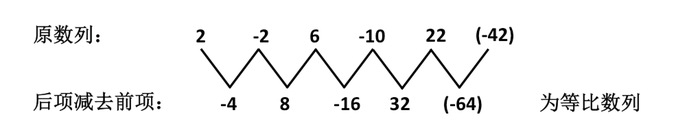

故正确答案为C。

**来源**：2014年新疆维吾尔自治区公务员录用考试《行测》题（网友回忆版）第52题

### 第 53 题

12，4，8，6，7，（    ）

A. 6

B. 6.5

C. 7

D. 8

第 53 题 · 答案与解析

**参考答案（粉笔题库参考内容）**

B

**解析**

方法一：观察数列无明显特征，优先考虑多级数列。后项-前项得到新数列：-8，4，-2，1，（    ），是公比为的等比数列，则新数列的下一项为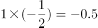，故所求项为7+（-0.5）=6.5。

方法二：观察数列发现：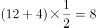，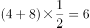，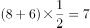，即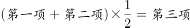，故所求项为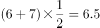。

故正确答案为B。

**来源**：2014年新疆维吾尔自治区公务员录用考试《行测》题（网友回忆版）第53题

### 第 54 题

1，6，36，216，（    ）

A. 1296

B. 1297

C. 1299

D. 1230

第 54 题 · 答案与解析

**参考答案（粉笔题库参考内容）**

A

**解析**

观察数列，此数列是公比为6的等比数列，则所求项为216×6＝1296。

故正确答案为A。

**来源**：2014年新疆维吾尔自治区公务员录用考试《行测》题（网友回忆版）第54题

### 第 55 题

\-2，3，-1，5，3，13，（    ）

A. 21

B. 28

C. 18

D. 19

第 55 题 · 答案与解析

**参考答案（粉笔题库参考内容）**

D

**解析**

方法一：观察数列无明显特征，作差后无规律，考虑作和。相邻两项相加得到新数列：1，2，4，8，16，（    ），新数列是公比为2的等比数列，下一项为16×2＝32。则所求项=32-13＝19。

方法二：观察数列无明显特征，作差后无规律，考虑递推。圈三数，找规律。发现5×2+3=13，推测该数列规律为：第一项×2＋第二项＝第三项，做验证：（-2）×2+3=-1，3×2+（-1）=5，（-1）×2+5=3，符合此规律，推测正确，则所求项=3×2+13＝19。

故正确答案为D。

**来源**：2014年新疆维吾尔自治区公务员录用考试《行测》题（网友回忆版）第55题

### 第 56 题

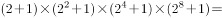（    ）

A. 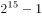

B. 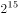

C. 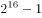

D. 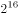

第 56 题 · 答案与解析

**参考答案（粉笔题库参考内容）**

C

**解析**

方法一：原式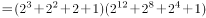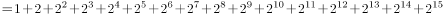。观察发现，此式为首项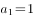，公比q＝2的等比数列，且求前16项的和。根据等比数列求和公式：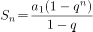，则原式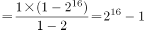。

方法二：原式＝3×5×17×257＝65535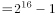。

故正确答案为C。

**考点**：数列问题

**来源**：2014年新疆维吾尔自治区公务员录用考试《行测》题（网友回忆版）第56题

### 第 57 题

在一袋螺钉螺母中，螺钉和螺母的数量比是3：10。如果1个螺钉配3个螺母，最后一个螺钉配两个螺母，螺钉用完后能余下15个螺母。问袋中原来有螺母多少个？

A. 120

B. 130

C. 140

D. 150

第 57 题 · 答案与解析

**参考答案（粉笔题库参考内容）**

C

**解析**

方法一：因为螺钉和螺母的数量比是3：10，设螺钉数量为3x个，螺母数量为10x个。根据题意则有：（3x-1）×3+2+15=10x，解得x=14，则螺母有14×10=140个。

方法二：设螺母数量为y个，根据题意可知，y-15-2应为3的倍数，依次代入选项可知，只有C项满足。

故正确答案为C。

**考点**：和差倍比问题

**来源**：2014年新疆维吾尔自治区公务员录用考试《行测》题（网友回忆版）第57题

### 第 58 题

某牧民饲养公羊和母羊共140只，一次共剪羊毛160斤。若每只公羊平均剪毛1斤2两，每只母羊平均剪毛8两，问公羊比母羊多多少只？

A. 120

B. 100

C. 80

D. 75

第 58 题 · 答案与解析

**参考答案（粉笔题库参考内容）**

B

**解析**

设公羊有x只，母羊有y只，根据题意则有：x+y=140······①、1.2x+0.8y=160······②。②-①可得：0.2x-0.2y=20，则x-y=100，即公羊比母羊多100只。

故正确答案为B。

**考点**：和差倍比问题

**来源**：2014年新疆维吾尔自治区公务员录用考试《行测》题（网友回忆版）第58题

### 第 59 题

有10元、20元、50元面值的钞票共10张，总额为250元。问10元的钞票最多有多少张？

A. 1

B. 2

C. 3

D. 4

第 59 题 · 答案与解析

**参考答案（粉笔题库参考内容）**

D

**解析**

设10元、20元、50元面值的钞票各有x、y、z张，根据题意则有：x+y+z=10······①、10x+20y+50z=250······②。

方法一：直接代入选项。因要求满足条件的最大值，故从最大的D项开始代入。代入D项：当x=4时，代入可得y=3、z=3，满足条件，此时不需要再代入其它选项。

方法二：①×50-②，消去z后可得：4x+3y=25。根据奇偶特性可知，y一定为奇数，若想让x尽可能大，则y应尽可能小。故当y=1时，代入可得x=5.5，非整数，不满足条件；当y=3时，代入可得x=4，满足条件。

故正确答案为D。

**考点**：和差倍比问题

**来源**：2014年新疆维吾尔自治区公务员录用考试《行测》题（网友回忆版）第59题

### 第 60 题

一队伍要到距驻地90公里处的地方执行任务，坐机动车速度为60公里/小时，步行速度为15公里/小时，开始全体人员坐机动车行进，但中途机动车故障，不能继续运输，全体人员改步行，到达目的地，共用时2小时15分钟，则步行的距离为多少公里？

A. 10

B. 15

C. 20

D. 25

第 60 题 · 答案与解析

**参考答案（粉笔题库参考内容）**

B

**解析**

设步行的时间为x小时，则坐机动车的时间为（2.25-x）小时。根据题意可知，坐机动车行进距离+步行距离=90公里，故可列式：60×（2.25-x）+15x=90，解得x=1，故步行的距离为15×1=15公里。

故正确答案为B。

**考点**：普通行程

**来源**：2014年新疆维吾尔自治区公务员录用考试《行测》题（网友回忆版）第60题

### 第 61 题

某大学金融班原有的男女比例为2∶5。本学期从外班转入4个男学生，则男女学生之间的比例为3∶5，请问原金融班里有多少个男生？

A. 4

B. 6

C. 8

D. 10

第 61 题 · 答案与解析

**参考答案（粉笔题库参考内容）**

C

**解析**

方法一：

设金融班原有的男女人数分别为2x人、5x人。转入4个男学生后，男生人数为（2x+4）人，由题意可列方程：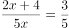，解得x=4，则原金融班的男生人数为2x=2×4=8人。

方法二：

由题意可知，本学期转入4个男学生后，男生人数为3的倍数，即原金融班的男生加4为3的倍数，只有C项符合条件。

故正确答案为C。

**考点**：和差倍比问题

**来源**：2014年新疆维吾尔自治区公务员录用考试《行测》题（网友回忆版）第61题

### 第 62 题

一对父子在操场上跑步晨练，儿子跑三步的时间父亲跑两步，父亲跑一步的距离是儿子一步的两倍，儿子跑出100步后父亲开始追，当父亲追上儿子时，儿子共跑出了多少步？

A. 200

B. 300

C. 400

D. 500

第 62 题 · 答案与解析

**参考答案（粉笔题库参考内容）**

C

**解析**

设儿子一步的距离为单位1，由题意可知，时间相同时，儿子与父亲的跑步路程之比为（3×1）:（2×2）=3：4，则儿子与父亲的速度比为3：4，赋值儿子的速度为3，父亲的速度为4，由追及公式可得：100×1=（4-3）t，解得t=100，则儿子共跑了100+3t=400步。

故正确答案为C。

**考点**：相遇追及

**来源**：2014年新疆维吾尔自治区公务员录用考试《行测》题（网友回忆版）第62题

### 第 63 题

一条船因触礁船体破了一个洞，海水均匀地进入船内。发现船漏时，船已经进了一些水。如果13个人舀水，3小时可以舀完；如果6人舀水，10小时可以舀完。如果在2小时内舀完水，最少需要多少人？

A. 15

B. 16

C. 17

D. 18

第 63 题 · 答案与解析

**参考答案（粉笔题库参考内容）**

D

**解析**

设发现船漏时船内的进水量为y，漏船每小时的进水速度为x，每人每小时的舀水速度为1。由牛吃草公式：y=（N-x）×T可得，y=（13-x）×3=（6-x）×10，解得x=3，y=30。设如果在2小时内舀完水，最少需要N人，则有30=（N-3）×2，解得N=18，即最少需要18人。

故正确答案为D。

**来源**：2014年新疆维吾尔自治区公务员录用考试《行测》题（网友回忆版）第63题

### 第 64 题

某单位的党员分属3个党支部，已知第一支部党员人数比第二支部少6人，第三支部党员人数是第一支部的1.5倍，比第二支部多4人。问该单位共有党员多少人？

A. 76

B. 78

C. 80

D. 81

第 64 题 · 答案与解析

**参考答案（粉笔题库参考内容）**

A

**解析**

设该单位第一支部党员人数为x，则第二支部党员人数为（x+6），第三支部党员人数为1.5x。根据题意可得：1.5x=（x+6）+4，解得x=20，故该单位共有党员x+（x+6）+1.5x=3.5x+6=3.5×20+6=76人。

故正确答案为A。

**考点**：和差倍比问题

**来源**：2014年新疆维吾尔自治区公务员录用考试《行测》题（网友回忆版）第64题

### 第 65 题

下面图形阴影部分的面积是多少？（单位：米）

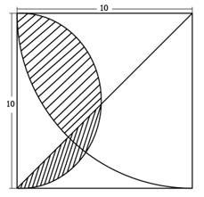

A. 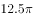平方米

B. 25平方米

C. 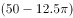平方米

D. 平方米

第 65 题 · 答案与解析

**参考答案（粉笔题库参考内容）**

D

**解析**

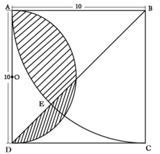

如上图所示，在正方形ABCD中，BD为其对角线，则。设AD的中点为O，则圆O的半径为米，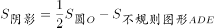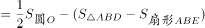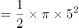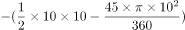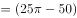平方米。

故正确答案为D。

**考点**：几何公式类-平面图形

**来源**：2014年新疆维吾尔自治区公务员录用考试《行测》题（网友回忆版）第65题

### 第 66 题

从所给的四个选项中，选择最合适的一个填入问号处，使之呈现一定的规律性：

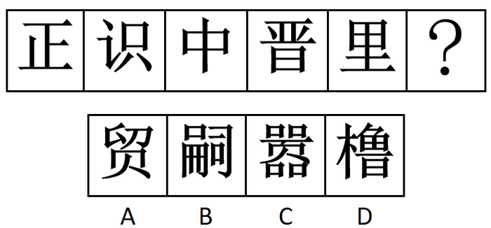

A. A

B. B

C. C

D. D

第 66 题 · 答案与解析

**参考答案（粉笔题库参考内容）**

B

**解析**

元素组成不同，没有明显的属性规律，考虑数量规律。观察发现，题干所有图形中均存在空白区域，考虑面数量，题干图形面数量依次为0、1、2、3、4、？，故？处应该填入一个面数量为5的图形，选项图形面数量依次为0、5、4、7，只有B项符合规律。

故正确答案为B。

**考点**：数量规律-面、文字/字母/数字类

**来源**：2014年新疆维吾尔自治区公务员录用考试《行测》题（网友回忆版）第66题

### 第 67 题

从所给的四个选项中，选择最合适的一个填入问号处，使之呈现一定的规律性：

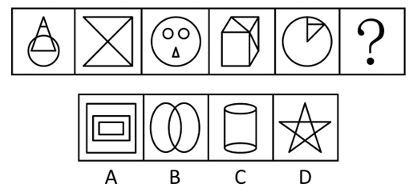

A. A

B. B

C. C

D. D

第 67 题 · 答案与解析

**参考答案（粉笔题库参考内容）**

D

**解析**

元素组成不同，而题干中已知图形均由多个面构成，优先考虑数量规律中的面数量。观察发现，题干图形面数量分别为4、3、4、5、3、？，无明显规律。再次观察发现，题干中每幅图形均含有三角形，只有D项符合规律。

故正确答案为D。

**考点**：数量规律-素、样式规律-遍历

**来源**：2014年新疆维吾尔自治区公务员录用考试《行测》题（网友回忆版）第67题

### 第 68 题

从所给的四个选项中，选择最合适的一个填入问号处，使之呈现一定的规律性：

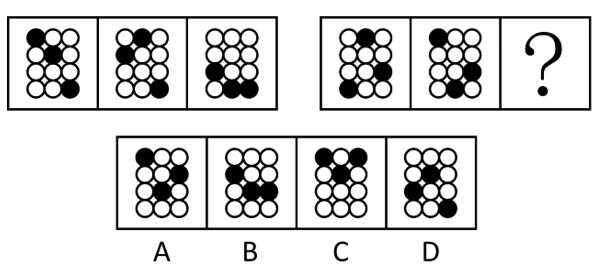

A. A

B. B

C. C

D. D

第 68 题 · 答案与解析

**参考答案（粉笔题库参考内容）**

B

**解析**

图形元素组成相同，优先考虑位置规律。第一组图形，第一列黑球依次向下平移一行，第二列黑球依次向上平移一行，第三列黑球保持位置不变；第二组图形运用此规律，只有B项符合。

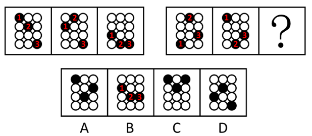

故正确答案为B。

**考点**：位置规律-平移

**来源**：2014年新疆维吾尔自治区公务员录用考试《行测》题（网友回忆版）第68题

### 第 69 题

从所给的四个选项中，选择最合适的一个填入问号处，使之呈现一定的规律性：

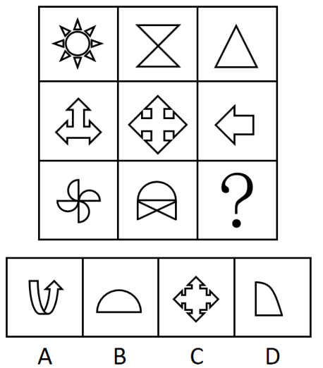

A. A

B. B

C. C

D. D

第 69 题 · 答案与解析

**参考答案（粉笔题库参考内容）**

B

**解析**

元素组成相似，优先考虑样式规律。九宫格优先看横行，观察发现，第一行图均有三角形，第二行图均有箭头，第三行前两幅图均有半圆，故？处图形应有半圆，只有B项符合。

故正确答案为B。

**考点**：数量规律-素、样式规律-遍历

**来源**：2014年新疆维吾尔自治区公务员录用考试《行测》题（网友回忆版）第69题

### 第 70 题

把下列的六个图形分为两类，使每一类图形都有各自的共同特征或规律，分类正确的一项是：

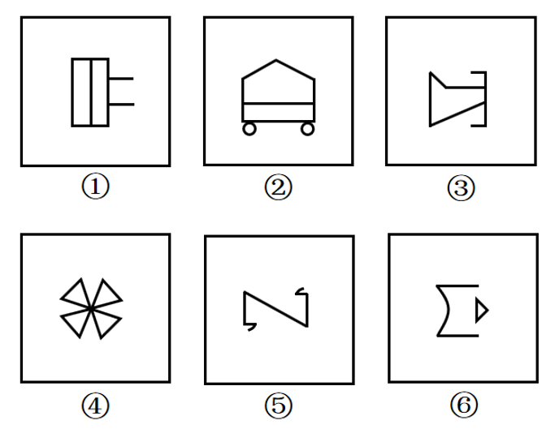

A. ①③⑤，②④⑥

B. ①④⑤，②③⑥

C. ①⑤⑥，②③④

D. ①③④，②⑤⑥

第 70 题 · 答案与解析

**参考答案（粉笔题库参考内容）**

D

**解析**

本题为分组分类题目。元素组成不同，优先考虑属性规律。观察发现，图①③④为全直线图形，图②⑤⑥为曲线+直线构成的图形。故图①③④一组，图②⑤⑥一组。

故正确答案为D。

**考点**：属性规律-曲直性

**来源**：2014年新疆维吾尔自治区公务员录用考试《行测》题（网友回忆版）第70题

### 第 71 题

充分条件指的是两个句子的一种关系。如果一个句子真，那么另一个句子必定是真，就称前一个句子是后一个句子的充分条件。

以下哪项中的两个句子，前一个句子是后一个句子的充分条件？

A. 存在一个数能被4整除，存在一个数能被2整除

B. 地球围绕太阳在旋转，月亮是地球的卫星

C. 曹操是曹植的父亲，曹丕与曹植是兄弟

D. 江苏在安徽的东面，上海是一个国际化大都市

第 71 题 · 答案与解析

**参考答案（粉笔题库参考内容）**

A

**解析**

第一步：找出定义关键词。

“如果一个句子真”、“那么另一个句子必定是真”。

第二步：逐一分析选项。

A项：如果存在一个数能被4整除为真，因为4是2的倍数，所以存在一个数能被2整除也必定为真，符合“如果一个句子真”、“那么另一个句子必定是真”，符合定义，当选；

B项：如果地球围绕太阳在旋转为真，不能得出月亮是地球的卫星，二者之间没有必然联系，不符合“如果一个句子真”、“那么另一个句子必定是真”，不符合定义，排除；

C项：如果曹操是曹植的父亲为真，不能得出曹丕与曹植的关系，二者之间没有必然联系，不符合“如果一个句子真”、“那么另一个句子必定是真”，不符合定义，排除；

D项：如果江苏在安徽的东面为真，不能得出上海是一个国际化大都市，二者之间没有必然联系，不符合“如果一个句子真”、“那么另一个句子必定是真”，不符合定义，排除。

故正确答案为A。

**考点**：单定义-其他句式

**来源**：2014年新疆维吾尔自治区公务员录用考试《行测》题（网友回忆版）第71题

### 第 72 题

投射作用指的是人们在认知过程中，常常主观地认为他人具有与自己相似的性格、偏好、看法等。

根据以上定义，以下属于投射作用的是：

A. 爱屋及乌

B. 逢人不说人间事，便是人间无事人

C. 以小人之心度君子之腹

D. 生当作人杰，死当为鬼雄

第 72 题 · 答案与解析

**参考答案（粉笔题库参考内容）**

C

**解析**

第一步：找出定义关键词。

“在认知过程中”、“主观地认为他人具有与自己相似的性格、偏好、看法等”。

第二步：逐一分析选项。

A项：“爱屋及乌”指因为爱一个人而连带爱他屋上的乌鸦，比喻爱一个人而连带地关心到与他有关的人或物，不符合“主观地认为他人具有与自己相似的性格、偏好、看法等”，不符合定义，排除；

B项：“逢人不说人间事，便是人间无事人”指不谈论别人是非，可免除一切麻烦，不符合“主观地认为他人具有与自己相似的性格、偏好、看法等”，不符合定义，排除；

C项：“以小人之心度君子之腹”指拿卑劣的想法，去推测正派人的心思，认为正派人和自己有相同的想法，符合“在认知过程中”、“主观地认为他人具有与自己相似的性格、偏好、看法等”，符合定义，当选；

D项：“生当作人杰，死当为鬼雄”指活着就要当人中的俊杰，死了也要做鬼中的英雄，不符合“主观地认为他人具有与自己相似的性格、偏好、看法等”，不符合定义，排除。

故正确答案为C。

**考点**：单定义-其他句式

**来源**：2014年新疆维吾尔自治区公务员录用考试《行测》题（网友回忆版）第72题

### 第 73 题

诈骗罪是指以非法占有为目的，用虚构事实或者隐瞒真相的方法，骗取数额较大的公私财物的行为。

根据以上定义，下列属于诈骗罪的是：

A. 张某利用伪造的名牌大学学位证书，欺骗用人单位进而当上了财务主管，负责上亿元资金交易

B. 李某为销售山寨手机，在店门口用名牌手机图片做广告，一个月内获利数万元

C. 已婚妇女王某谎称自己未婚，以结婚为名向多名单身男子索要了数万元聘礼后逃跑

D. 孙某的公司因经营不善，负债累累，孙某为躲债外逃，数百名客户损失上百万元利益

第 73 题 · 答案与解析

**参考答案（粉笔题库参考内容）**

C

**解析**

第一步：找出定义关键词。

“以非法占有为目的”、“用虚构事实或者隐瞒真相的方法”、“骗取数额较大的公私财物”。

第二步：逐一分析选项。

A项：张某用伪造的名牌大学学位证书欺骗用人单位进而当上了财务主管，符合“用虚构事实或者隐瞒真相的方法”，但当上财务主管只是负责上亿元资金交易，并没有将资金占为己有，不符合“以非法占有为目的”、“骗取数额较大的公私财物”，不符合定义，排除；

B项：李某用名牌手机图片做广告销售山寨手机，符合“用虚构事实或者隐瞒真相的方法”，但李某销售山寨手机只是做了虚假广告去赚钱，并不是非法占有，不符合“以非法占有为目的”，不符合定义，排除；

C项：已婚妇女王某谎称自己未婚，符合“用虚构事实或者隐瞒真相的方法”，以结婚为名向多名单身男子索要了数万元聘礼后逃跑，说明王某目的就是骗取并占有数万元的财物，符合“以非法占有为目的”、“骗取数额较大的公私财物”，符合定义，当选；

D项：孙某为躲债外逃，不符合“用虚构事实或者隐瞒真相的方法”，数百名客户损失上百万元利益，并不是骗取、占有这些财物，不符合“以非法占有为目的”、“骗取数额较大的公私财物”，不符合定义，排除。

故正确答案为C。

**考点**：方式目的

**来源**：2014年新疆维吾尔自治区公务员录用考试《行测》题（网友回忆版）第73题

### 第 74 题

替代效应是指商品价格上升后，消费者改用其他商品来满足其需求；而当商品价格下降时，消费者会用该商品来替代别的商品满足需求。

根据上述定义，下列说法不正确的是：

A. 商品的价格直接关系到销量

B. 消费者大多是根据价格而不是需求来选择商品

C. 多种商品可以满足消费者同一种需求

D. 商品的价格和供需关系是动态变化的

第 74 题 · 答案与解析

**参考答案（粉笔题库参考内容）**

B

**解析**

第一步：找出定义关键词。

“商品价格上升后，消费者改用其他商品来满足其需求”、“当商品价格下降时，消费者会用该商品来替代别的商品满足需求”。

第二步：逐一分析选项。

A项：根据“商品价格上升后，消费者改用其他商品来满足其需求”、“当商品价格下降时，消费者会用该商品来替代别的商品满足需求”，说明商品的价格变动确实会直接改变消费者的选择，从而影响到商品的销量，符合定义，排除；

B项：根据“商品价格上升后，消费者改用其他商品来满足其需求”、“当商品价格下降时，消费者会用该商品来替代别的商品满足需求”，最终的目的都是满足需求，说明消费者在选择商品时要根据需求，不符合定义，当选；

C项：根据“商品价格上升后，消费者改用其他商品来满足其需求”，说明同时有多种商品是可以满足消费者同一需求的，符合定义，排除；

D项：根据“商品价格上升后，消费者改用其他商品来满足其需求”、“当商品价格下降时，消费者会用该商品来替代别的商品满足需求”，说明商品的价格变动确实会影响供需关系，符合定义，排除。

本题为选非题，故正确答案为B。

**考点**：单定义-其他句式

**来源**：2014年新疆维吾尔自治区公务员录用考试《行测》题（网友回忆版）第74题

### 第 75 题

重力侵蚀指主要是在重力作用下，单个落石、碎屑流或整块土体、岩体沿坡面向下运动的一系列现象。

根据以上定义，下列说法正确的是：

A. 我国新疆的沙漠地区，主要是在重力侵蚀下形成的

B. 我国广西地区有许多著名的地下溶洞，地下溶洞主要是在重力侵蚀下形成的

C. 某县临海，海岸边有许多奇形怪状的礁石，这些礁石是在重力侵蚀下形成的

D. 某地发生山体滑坡，重力侵蚀是滑坡形成的主要原因

第 75 题 · 答案与解析

**参考答案（粉笔题库参考内容）**

D

**解析**

第一步：找出定义关键词。

“在重力作用下”、“单个落石、碎屑流或整块土体、岩体沿坡面向下运动”。

第二步：逐一分析选项。

A项：我国新疆的沙漠地区，沙漠不符合“单个落石、碎屑流或整块土体、岩体沿坡面向下运动”，不符合定义，排除；

B项：我国广西地区有许多著名的地下岩洞，地下溶洞不符合“单个落石、碎屑流或整块土体、岩体沿坡面向下运动”，不符合定义，排除；

C项：海岸边有许多奇形怪状的礁石，海岸边礁石是海水冲刷形成，不符合“单个落石、碎屑流或整块土体、岩体沿坡面向下运动”，不符合定义，排除；

D项：某地发生山体滑坡，山体滑坡符合“在重力作用下”、“单个落石、碎屑流或整块土体、岩体沿坡面向下运动”，符合定义，当选。

故正确答案为D。

**考点**：大前提

**来源**：2014年新疆维吾尔自治区公务员录用考试《行测》题（网友回忆版）第75题

### 第 76 题

生物燃料泛指由生物质组成萃取的固体、液体或气体燃料。生物质是指利用大气、水、土地等通过光合作用而产生的各种有机体，即一切有生命的可以生长的有机物质。它包括植物、动物和微生物。

根据上述定义，下列不属于生物燃料的是：

A. 玉米加工之后变成的车用乙醇

B. 由转基因大肠杆菌生成的燃料

C. 农作物厌氧发酵生成的沼气

D. 能够提炼生物柴油的大豆

第 76 题 · 答案与解析

**参考答案（粉笔题库参考内容）**

D

**解析**

第一步：找出定义关键词。

生物燃料：“由生物质组成萃取的固体、液体或气体燃料”；

生物质：“一切有生命的可以生长的有机物质”、“植物、动物和微生物”。

第二步：逐一分析选项。

A项：玉米符合“植物”，由玉米加工之后变成的车用乙醇符合“由生物质组成萃取的固体、液体或气体燃料”，符合“生物燃料”定义，排除；

B项：转基因大肠杆菌符合“微生物”，由转基因大肠杆菌生成的燃料符合“由生物质组成萃取的固体、液体或气体燃料”，符合“生物燃料”定义，排除；

C项：农作物符合“植物”，由农作物厌氧发酵生成的沼气符合“由生物质组成萃取的固体、液体或气体燃料”，符合“生物燃料”定义，排除；

D项：大豆符合“植物”，能够提炼生物柴油的大豆依旧在描述大豆，符合“生物质”定义，不符合“生物燃料”定义，当选。

本题为选非题，故正确答案为D。

**考点**：常规问法

**来源**：2014年新疆维吾尔自治区公务员录用考试《行测》题（网友回忆版）第76题

### 第 77 题

直销是指直销企业招募直销员，由直销员在固定营业场所之外直接向最终消费者推销产品的经营方式。

以下属于直销的是：

A. 某奶制品生产厂家甄选业务员后，在市内设立了一百个销售点以统一的价格销售奶制品

B. 某书店采取网上销售方式，顾客下订单后，由快递员将产品送至指定场所并收取费用

C. 某化妆品牌招聘的一些业务员在道路旁设摊点发放产品说明并以较低价格向顾客推销

D. 开学时，新生小贺到批发市场购买了五盏台灯，自用一盏，其他四盏卖给同学

第 77 题 · 答案与解析

**参考答案（粉笔题库参考内容）**

C

**解析**

第一步：找出定义关键词。

“直销员”、“在固定营业场所之外”、“直接向最终消费者推销产品”。

第二步：逐一分析选项。

A项，在市内设立的“一百个销售点”属于“固定营业场所”，不符合“在固定营业场所之外”，不符合定义，排除；

B项，书店的网上销售方式是由顾客主动下订单，快递员只起到送货和收取费用的作用，不符合“直接向最终消费者推销产品”，不符合定义，排除；

C项，该化妆品牌的业务员在道路旁设摊点，以较低价格向顾客推销，符合“在固定营业场所之外”、“直接向最终消费者推销产品”，符合定义，当选；

D项，“小贺”是学生，不是企业招募的直销员，因此他转卖台灯的行为不构成直销，不符合定义，排除。

故正确答案为C。

**考点**：大前提

**来源**：2014年新疆维吾尔自治区公务员录用考试《行测》题（网友回忆版）第77题

### 第 78 题

前苏联研制生产的米格-25喷气式战斗机所使用的许多零部件与其他战斗机相比要落后得多，但其整体作战性能却达到甚至超过了其他国家同期生产的战斗机。其原因是，米格公司在设计时从整体考虑，对各零部件进行了更为协调的组合设计，使该机在升降、速度、应激反映等方面成为当时世界一流战斗机。这一因组合协调而产生的意想不到的效果，被后人称之为“米格-25效应”。

根据上述定义，下列符合“米格-25效应”的是：

A. 科研人员的研究水平决定了科研机构的攻坚能力

B. 某青年球队在富有经验的教练的带领下，打败了全明星联队

C. 一只木桶盛多少水，取决于桶壁上最短的那块木板

D. 巨鹿之战中，项羽凭借与秦军决一死战的决心，率领2万士兵全歼秦军30万

第 78 题 · 答案与解析

**参考答案（粉笔题库参考内容）**

B

**解析**

第一步：找出定义关键词。

“因组合协调而产生的意想不到的效果”。

第二步：逐一分析选项。

A项：科研人员的研究水平决定了科研机构的攻坚能力，没有体现意想不到的结果，不符合“因组合协调而产生的意想不到的效果”，不符合定义，排除；

B项：某青年球队在富有经验的教练的带领下，符合“组合协调”，青年球队能打败全明星联队，符合“意想不到的效果”，符合定义，当选；

C项：一只木桶盛多少水，取决于桶壁上最短的那块木板，是短板效应，不符合“因组合协调而产生的意想不到的效果”，不符合定义，排除；

D项：巨鹿之战中，项羽凭借与秦军决一死战的决心，率领2万士兵全歼秦军30万，不符合“因组合协调而产生的意想不到的效果”，不符合定义，排除。

故正确答案为B。

**考点**：故事类

**来源**：2014年新疆维吾尔自治区公务员录用考试《行测》题（网友回忆版）第78题

### 第 79 题

反向形成是指个体的欲望和动机不为自己的意识或社会所接受时，将其压抑至潜意识，再以相反的行为表现在外在的行为上。

根据上述定义，下列属于反向形成的是：

A. 小美最近在减肥，她担心面对美食的诱惑控制不住自己，所以最近一段时间朋友请客吃饭她都不参加了

B. 5岁的丁丁特别爱吃糖，妈妈反复告诫他吃糖会蛀牙，后来丁丁去超市时总会指着糖说：“吃糖会蛀牙”

C. 小张从小是个内向、羞涩的孩子，上大学后，他有意识的锻炼自己，经常主动在课堂上发言，还加入了学生社团

D. 马经理不喜欢小王，但是他知道应当对员工一视同仁，所以他反复告诫自己不要表现出来，一段时间后，他已经能如常对待小王了

第 79 题 · 答案与解析

**参考答案（粉笔题库参考内容）**

D

**解析**

第一步：找出定义关键词。

“个体的欲望和动机不为自己的意识或社会所接受”、“将其压抑至潜意识”、“以相反的行为表现在外在的行为上”。

第二步：逐一分析选项。

A项：减肥是小美的目标，不符合“个体的欲望和动机不为自己的意识或社会所接受”，朋友请客吃饭她都不参加了，是实施减肥的行为，不符合“以相反的行为表现在外在的行为上”，不符合定义，排除；

B项：5岁的丁丁特别爱吃糖，是他的喜好，不符合“个体的欲望和动机不为自己的意识或社会所接受”，不符合定义，排除；

C项：小张有意识的锻炼自己，是他的目标，不符合“个体的欲望和动机不为自己的意识或社会所接受”、“将其压抑至潜意识”，不符合定义，排除；

D项：马经理不喜欢小王，但是他知道应当对员工一视同仁，符合“个体的欲望和动机不为自己的意识或社会所接受”，他反复告诫自己不要表现出来，符合“将其压抑至潜意识”，一段时间后，他已经能如常对待小王了，符合“以相反的行为表现在外在的行为上”，符合定义，当选。

故正确答案为D。

**考点**：大前提

**来源**：2014年新疆维吾尔自治区公务员录用考试《行测》题（网友回忆版）第79题

### 第 80 题

交通肇事罪是指违反交通运输管理法规，因而发生重大事故致人重伤、死亡或者使公私财产遭受重大损失的行为。本罪在主观方面表现为过失，包括疏忽大意的过失和过于自信的过失。

根据上述定义，下列符合交通肇事罪的是：

A. 机动车驾驶员甲超速行驶，遇红灯时来不及刹车撞上前面正常行驶的一辆汽车，致使该车驾驶员王某牙齿撞伤流血

B. 公交司机乙对社会怀有仇恨，一日驾驶满载乘客的公交车闯红灯，冲向路边正在过马路的人群，致使多人重伤、死亡

C. 机动车驾驶员丙驾驶车辆在高速公路上行驶时，方向盘忽然失灵，撞上旁边的轿车，致使轿车撞向公路围栏，造成轿车司机和乘客共三人死亡

D. 某校车驾驶员丁某驾驶超载校车，行驶途中遇到一辆超速行驶的卡车，在避让中校车侧翻，致使多名学生重伤

第 80 题 · 答案与解析

**参考答案（粉笔题库参考内容）**

D

**解析**

第一步：找出定义关键词。

“违反交通运输管理法规”、“发生重大事故致人重伤、死亡或者使公私财产遭受重大损失”、“主观方面表现为过失，包括疏忽大意的过失和过于自信的过失”。

第二步：逐一分析选项。

A项：致使该车驾驶员王某牙齿撞伤流血，不符合“发生重大事故致人重伤、死亡或者使公私财产遭受重大损失”，不符合定义，排除；

B项：乙对社会怀有仇恨，驾驶公交车闯红灯冲向路边人群，是故意行为而不是过失，不符合“主观方面表现为过失，包括疏忽大意的过失和过于自信的过失”，不符合定义，排除；

C项：方向盘忽然失灵，是意外，不符合“违反交通运输管理法规”，不符合定义，排除；

D项：丁某驾驶超载校车符合“违反交通运输管理法规”，在避让中校车侧翻符合“主观方面表现为过失，包括疏忽大意的过失和过于自信的过失”，致使多名学生重伤符合“发生重大事故致人重伤、死亡或者使公私财产遭受重大损失”，符合定义，当选。

故正确答案为D。

**考点**：原因结果

**来源**：2014年新疆维吾尔自治区公务员录用考试《行测》题（网友回忆版）第80题

### 第 81 题

电灯：光亮

A. 电池：电流

B. 音箱：音乐

C. 手机：短信

D. 电脑：文本

第 81 题 · 答案与解析

**参考答案（粉笔题库参考内容）**

B

**解析**

第一步：判断题干词语间逻辑关系。

电灯可以发出光亮，二者为功能的对应关系，且发出光亮是电灯的主要功能。

第二步：判断选项词语间逻辑关系。

A项：电池接通外电路时会产生电流，但产生电流不是电池的主要功能，与题干逻辑关系不一致，排除；

B项：音箱可以播放音乐，二者为功能的对应关系，且播放音乐是音箱的主要功能，与题干逻辑关系一致，当选；

C项：手机可以发送短信，但发送短信不是手机的主要功能，与题干逻辑关系不一致，排除；

D项：电脑可以编辑文本，但编辑文本不是电脑的主要功能，与题干逻辑关系不一致，排除。

故正确答案为B。

**考点**：逻辑关系-对应关系

**来源**：2014年新疆维吾尔自治区公务员录用考试《行测》题（网友回忆版）第81题

### 第 82 题

游泳：泳池

A. 搜索：网站

B. 收看：电视

C. 学习：教室

D. 书写：纸张

第 82 题 · 答案与解析

**参考答案（粉笔题库参考内容）**

C

**解析**

第一步：判断题干词语间逻辑关系。

泳池是游泳的地点，二者是地点的对应关系。

第二步：判断选项词语间逻辑关系。

A项：网站不是地点，与题干逻辑关系不一致，排除；

B项：电视不是地点，与题干逻辑关系不一致，排除；

C项：教室是学习的地点，二者是地点的对应关系，与题干逻辑关系一致，当选；

D项：纸张不是地点，与题干逻辑关系不一致，排除。

故正确答案为C。

**考点**：逻辑关系-对应关系

**来源**：2014年新疆维吾尔自治区公务员录用考试《行测》题（网友回忆版）第82题

### 第 83 题

摇头：反对

A. 愤怒：心情

B. 手语：意思

C. 困乏：休息

D. 微笑：开心

第 83 题 · 答案与解析

**参考答案（粉笔题库参考内容）**

D

**解析**

第一步：判断题干词语间逻辑关系。

摇头代表反对，二者是比喻象征义的关系。

第二步：判断选项词语间逻辑关系。

A项：愤怒是一种心情，不能代表心情，与题干逻辑关系不一致，排除；

B项：手语可以代替语言表达动作者的意思，但它是一种交际方式，而不是具体的某一个词的意思，与题干逻辑关系不一致，排除；

C项：困乏需要休息，不能代表休息，与题干逻辑关系不一致，排除；

D项：微笑代表开心，二者是比喻象征义的关系，与题干逻辑关系一致，当选。

故正确答案为D。

**考点**：语义关系-比喻象征义

**来源**：2014年新疆维吾尔自治区公务员录用考试《行测》题（网友回忆版）第83题

### 第 84 题

配乐：电影：烘托

A. 序言：著作：致谢

B. 电视：屏幕：显示

C. 道具：戏剧：提示

D. 桅杆：帆船：支撑

第 84 题 · 答案与解析

**参考答案（粉笔题库参考内容）**

D

**解析**

第一步：判断题干词语间逻辑关系。

配乐可以用来烘托电影，三者为功能的对应关系。

第二步：判断选项词语间逻辑关系。

A项：序言起到介绍、说明和评论的作用，致谢著作搭配不当，与题干逻辑关系不一致，排除；

B项：电视不能用来显示屏幕，而显示是屏幕的功能，与题干逻辑关系不一致，排除；

C项：道具可以用来提示戏剧的台词，而不是戏剧本身，与题干逻辑关系不一致，排除；

D项：桅杆可以用来支撑帆船，三者为功能的对应关系，与题干逻辑关系一致，当选。

故正确答案为D。

**考点**：逻辑关系-对应关系

**来源**：2014年新疆维吾尔自治区公务员录用考试《行测》题（网友回忆版）第84题

### 第 85 题

叮咬：蚊香：花露水

A. 攻击：雷达：鱼雷

B. 美化：绿化：装饰

C. 淋雨：雨伞：雨衣

D. 事故：红绿灯：交警

第 85 题 · 答案与解析

**参考答案（粉笔题库参考内容）**

C

**解析**

第一步：判断题干词语间逻辑关系。

蚊香和花露水是并列关系中的反对关系，它们都有防止叮咬的功能。

第二步：判断选项词语间逻辑关系。

A项：雷达和鱼雷是并列关系，但它们都有攻击的功能，而不是防止攻击，与题干逻辑关系不一致，排除；

B项：绿化和装饰的功能不是防止美化，与题干逻辑关系不一致，排除；

C项：雨衣和雨伞是并列关系中的反对关系，它们都有防止淋雨的功能，与题干逻辑关系一致，当选；

D项：红绿灯是一种交通设施，交警是一种职业，二者不是并列关系，与题干逻辑关系不一致，排除。

故正确答案为C。

**考点**：逻辑关系-对应关系、逻辑关系-并列关系

**来源**：2014年新疆维吾尔自治区公务员录用考试《行测》题（网友回忆版）第85题

### 第 86 题

申请：审查：许可

A. 报警：侦查：作案

B. 种植：生长：灌溉

C. 计划：实施：评估

D. 期末：复习：考试

第 86 题 · 答案与解析

**参考答案（粉笔题库参考内容）**

C

**解析**

第一步：判断题干词语间逻辑关系。

先申请，再审查，最后许可，三者为时间先后顺序的对应关系。

第二步：判断选项词语间逻辑关系。

A项：先作案，再报警，最后侦查，三者为时间先后顺序的对应关系，但与题干顺序不一致，与题干逻辑关系不一致，排除；

B项：先种植，但灌溉与生长之间没有必然的先后顺序，与题干逻辑关系不一致，排除；

C项：先计划，再实施，最后评估，三者为时间先后顺序的对应关系，与题干逻辑关系一致，当选；

D项：在期末期间先复习，再考试，但期末并不是动作行为，与题干逻辑关系不一致，排除。

故正确答案为C。

**考点**：逻辑关系-对应关系

**来源**：2014年新疆维吾尔自治区公务员录用考试《行测》题（网友回忆版）第86题

### 第 87 题

字母：英语：汉语

A. 胡须：女性：男性

B. 轮子：飞机：轮船

C. 房屋：桌子：椅子

D. 电脑：机房：办公室

第 87 题 · 答案与解析

**参考答案（粉笔题库参考内容）**

B

**解析**

第一步：判断题干词语间逻辑关系。

英语是由字母组成的，二者为组成关系；英语和汉语是两种不同的语言，二者为并列关系。

第二步：判断选项词语间逻辑关系。

A项：胡须是男性的一部分，二者为组成关系，与题干逻辑关系不一致，排除；

B项：轮子是飞机的一部分，二者为组成关系；飞机和轮船是两种不同的交通工具，二者为并列关系，与题干逻辑关系一致，当选；

C项：桌子和椅子都可以放在房屋里，后两个词与第一个词为场所对应关系，与题干逻辑关系不一致，排除；

D项：电脑可以放在机房里也可以放在办公室里，第一个词与后两个词为场所对应关系，与题干逻辑关系不一致，排除。

故正确答案为B。

**考点**：逻辑关系-包容关系、逻辑关系-并列关系

**来源**：2014年新疆维吾尔自治区公务员录用考试《行测》题（网友回忆版）第87题

### 第 88 题

劳动产品：商品：物美价廉

A. 兰花：植物：香气宜人

B. 金属：铜：导电

C. 天然气：甲烷：燃烧

D. 动物：哺乳动物：穴居

第 88 题 · 答案与解析

**参考答案（粉笔题库参考内容）**

D

**解析**

第一步：判断题干词语间逻辑关系。

商品是用于交换的劳动产品，二者为种属关系，物美价廉是商品的属性，且物美价廉是或然属性。

第二步：判断选项词语间逻辑关系。

A项：兰花是一种植物，二者为种属关系，但两词顺序与题干相反，与题干逻辑关系不一致，排除；

B项：铜是一种金属，二者为种属关系，但导电是铜的必然属性，与题干逻辑关系不一致，排除；

C项：甲烷是天然气的主要成分，二者为组成关系，与题干逻辑关系不一致，排除；

D项：哺乳动物是一种动物，二者为种属关系，穴居是哺乳动物的属性，且穴居是或然属性，与题干逻辑关系一致，当选。

故正确答案为D。

**考点**：逻辑关系-包容关系、逻辑关系-对应关系

**来源**：2014年新疆维吾尔自治区公务员录用考试《行测》题（网友回忆版）第88题

### 第 89 题

（    ） 对于 暗中 相当于 要挟 对于 （    ）

A. 侦查；强迫

B. 偷袭；武力

C. 帮忙；抗争

D. 公开；协助

第 89 题 · 答案与解析

**参考答案（粉笔题库参考内容）**

B

**解析**

逐一代入选项。

A项：暗中侦查，二者为偏正关系，要挟是指抓住对方弱点，强迫对方答应自己的要求，要挟和强迫是近义关系，前后逻辑关系不一致，排除；

B项：暗中偷袭，武力要挟，均为偏正关系，前后逻辑关系一致，当选；

C项：暗中帮忙，二者为偏正关系，受到要挟后可能会抗争，二者为对应关系，前后逻辑关系不一致，排除；

D项：暗中和公开是反义关系，要挟和协助无必然逻辑关系，前后逻辑关系不一致，排除。

故正确答案为B。

**考点**：语法关系

**来源**：2014年新疆维吾尔自治区公务员录用考试《行测》题（网友回忆版）第89题

### 第 90 题

（    ） 对于 银行 相当于 知识 对于 （    ）

A. 理财；智慧

B. 钞票；大脑

C. 交易；教师

D. 钱庄；信息

第 90 题 · 答案与解析

**参考答案（粉笔题库参考内容）**

B

**解析**

逐一代入选项。

A项：银行有理财的功能，二者是功能对应关系，学习知识能够增长智慧，知识不是功能，二者不是功能对应关系，前后逻辑关系不一致，排除；

B项：银行是储存钞票的场所，二者是场所对应关系，大脑是储存知识的场所，二者是场所对应关系，前后逻辑关系一致，当选；

C项：银行有交易的功能，二者是功能对应关系，教师传授知识，二者是主宾关系，前后逻辑关系不一致，排除；

D项：钱庄和银行是不同的金融组织，二者是并列关系，知识是信息的一种，二者是种属关系，前后逻辑关系不一致，排除。

故正确答案为B。

**考点**：逻辑关系-对应关系

**来源**：2014年新疆维吾尔自治区公务员录用考试《行测》题（网友回忆版）第90题

### 第 91 题

观看日全食时要佩戴专业的眼镜，永康牌和适度牌日食眼镜使用相同质量的镜片，由于永康牌日食眼镜的价格较低，所以当你购买永康牌而不是适度牌日食眼镜时，便用较低的价钱买到了观看效果相同的眼镜。

以下哪项如果为真，是推出上述结论的前提？

A. 日食眼镜的价格主要取决于镜片的价格

B. 这两款比市面上其他品牌价位更低

C. 日食眼镜的观看效果只由镜片的质量来决定

D. 永康牌日食眼镜比适度牌日食眼镜销量更高

第 91 题 · 答案与解析

**参考答案（粉笔题库参考内容）**

C

**解析**

第一步：找出论点和论据。

论点：当你购买永康牌而不是适度牌日食眼镜时，便用较低的价钱买到了观看效果相同的眼镜。

论据：永康牌和适度牌日食眼镜使用相同质量的镜片，并且永康牌日食眼镜的价格较低。

本题提问为“推出上述结论的前提”，优先考虑搭桥和必要条件。论点讨论的是相同的观看效果，论据讨论的是相同的镜片质量，二者话题不一致，优先考虑搭桥，即建立“相同的镜片质量”和“相同的观看效果”之间的联系。

第二步：逐一分析选项。

A项：该项说的是眼镜的价格，与观看效果无关，话题不一致，无法加强，排除；

B项：该项说的是其他品牌的眼镜，与永康牌和适度牌眼镜无关，主体不一致，无法加强，排除；

C项：该项将“相同的镜片质量”和“相同的观看效果”建立联系，属于搭桥项，可以加强，当选；

D项：该项说的是眼镜的销量，与观看效果无关，话题不一致，无法加强，排除。

故正确答案为C。

**考点**：搭桥

**来源**：2014年新疆维吾尔自治区公务员录用考试《行测》题（网友回忆版）第91题

### 第 92 题

美国南加州大学的科学报告说，他们在实验鼠脑部的海马区植入电极，训练它们进行一系列杠杆操作并给予相应奖励，并通过电极记录这一过程中实验鼠的脑部活动。此前的研究表明，海马区能把短期记忆转换成长期记忆。科学家随后在实验鼠的海马区注入某种物质，阻断与长期记忆有关的神经信号。观察表明，这使实验鼠忘记了所受的训练。然而，当研究人员用电极向实验鼠脑部输入信号、模拟训练过程中的脑部活动时，实验鼠又暂时记起了正确的操作顺序。但是如果输入的是打乱过的信号，就没有这种效果。

以下推论正确的是：

A. 实验鼠大脑的海马区如果受到损害，将无法记起刚刚学过的内容

B. 向大脑输入特定的序列的电信号，可以为实验鼠重建失去的记忆

C. 将某项工作编辑成特定的信号输入大脑，可以让人自动学会该项工作

D. 实验鼠学习杠杆操作的过程，就是海马区处理和传输神经信号的过程

第 92 题 · 答案与解析

**参考答案（粉笔题库参考内容）**

B

**解析**

日常结论题，根据题干信息逐一分析选项。

A项：题干说的是“在实验鼠的海马区注入某种物质，阻断与长期记忆有关的神经信号”，而该项说的是海马区受到损害，无法推出，排除；

B项：题干说的是“当研究人员用电极向实验鼠脑部输入信号、模拟训练过程中的脑部活动时，实验鼠又暂时记起了正确的操作顺序。但是如果输入的是打乱过的信号，就没有这种效果”，说明向大脑输入特定的序列的电信号，可以为实验鼠重建失去的记忆，可以推出，当选；

C项：题干说的是“实验鼠”，而该项说的是人，主体不一致，无法推出，排除；

D项：题干并未提到“海马区处理和传输神经信号的过程”，无法推出，排除。

故正确答案为B。

**考点**：日常结论

**来源**：2014年新疆维吾尔自治区公务员录用考试《行测》题（网友回忆版）第92题

### 第 93 题

欧冠已经进入半决赛阶段：西甲的“贝”队对阵英超的“齐”队，西甲的“巴”队对阵德甲的“契”队。赛前，小乔预测：冠军只能在西甲两队中产生；小周预测：“贝”“齐”两队都至多只能获得亚军。赛后证明两人的预测都是不正确的。

由此可以推出，获得冠军的队是：

A. 英超队

B. 德甲队

C. “贝”队

D. “巴”队

第 93 题 · 答案与解析

**参考答案（粉笔题库参考内容）**

A

**解析**

第一步：分析题干条件。

①西甲的“贝”队对阵英超的“齐”队，西甲的“巴”队对阵德甲的“契”队；

②小乔预测：冠军只能在西甲两队中产生；

③小周预测：“贝”“齐”两队都至多只能获得亚军；

④赛后证明两人的预测都是不正确的。

第二步：根据题干条件进行推理。

根据条件④和条件②可知，冠军只能是英超的“齐”队或者德甲的“契”队；

根据条件④和条件③可知，冠军是英超的“齐”队。

故正确答案为A。

**考点**：从确定信息开始推

**来源**：2014年新疆维吾尔自治区公务员录用考试《行测》题（网友回忆版）第93题

### 第 94 题

旅行社刚刚为三位旅客预定了飞机票。这三位旅客是荷兰人菲比、加拿大人艾托和英国人丹佛。他们三个人一个去荷兰、一个去加拿大、一个去英国。据悉菲比不打算去荷兰，丹佛不打算去英国，艾托既不去加拿大，也不去英国。

所以：

A. 艾托去荷兰，丹佛去英国，菲比去加拿大

B. 艾托去荷兰，丹佛去加拿大，菲比去英国

C. 艾托去英国，丹佛去荷兰，菲比去加拿大

D. 艾托去加拿大，丹佛去英国，菲比去荷兰

第 94 题 · 答案与解析

**参考答案（粉笔题库参考内容）**

B

**解析**

第一步：分析题干条件。

（1）菲比不打算去荷兰；

（2）丹佛不打算去英国；

（3）艾托既不去加拿大，也不去英国。

第二步：根据题干条件进行推理。

根据条件（1）可知，菲比不打算去荷兰，排除D项；根据条件（2）可知，丹佛不打算去英国，排除A项；根据条件（3）可知，艾托不去英国，排除C项。

故正确答案为B。

**考点**：排除法

**来源**：2014年新疆维吾尔自治区公务员录用考试《行测》题（网友回忆版）第94题

### 第 95 题

某市税务局最近一项调查显示，去年该市纳税最多的个体经营户中，本地人占到80%以上，这充分说明外地人在本市做生意规模普遍不如本地人。

以下哪项如果为真，最能支持上述结论？

A. 本市个体经营户中，外地人占到35%

B. 本市个体经营户中，本地人占到90%

C. 本市低收入人群中，外地人占到25%

D. 外地人占本市总人口的比例高达30%

第 95 题 · 答案与解析

**参考答案（粉笔题库参考内容）**

A

**解析**

第一步：找出论点和论据。

论点：外地人在本市做生意规模普遍不如本地人。

论据：去年该市纳税最多的个体经营户中，本地人占到80%以上。

本题论点讨论的是外地人做生意的规模普遍不如本地人，论据讨论的是去年纳税最多的个体经营户中本地人所占的比例，论点论据话题不一致，加强优先考虑搭桥，其次考虑补充论据。

第二步：逐一分析选项。

A项：该项指出个体经营户中，外地人占到35%，但外地人纳税的比例不足20%，说明外地人在本市做生意规模确实不如本地人，补充论据，可以加强，当选；

B项：该项指出个体经营户中，本地人占到90%，但本地人的纳税比例在80%以上，也就是说占比10%的外地人纳税比例接近20%，说明外地人做生意规模较大，削弱论点，无法加强，排除；

C项：该项指出低收入人群中外地人所占的比例，和论点讨论的做生意规模无关，为无关项，无法加强，排除；

D项：该项指出外地人占本市总人口的比例，和论点讨论的做生意规模无关，为无关项，无法加强，排除。

故正确答案为A。

**考点**：补充论据

**来源**：2014年新疆维吾尔自治区公务员录用考试《行测》题（网友回忆版）第95题

### 第 96 题

研究者通过分析人类祖先牙齿化石中残留的锶元素，发现那个时期男女居住模式的差异，即一半的雌性古猿都是来自很远的地方，而雄性古猿是在本地长大。原来，青春期的雌性古猿会离开出生地到别的地方交配生子，而雄性古猿则会留居在生长地。研究者认为一种可能的解释是，有亲缘关系的雄性动物能够更好地防御外敌入侵，而这也迫使雌性动物变得更为分散。

以下哪项如果为真，最能支持上述观点？

A. 人类祖先日常摄取的食物中锶元素含量往往较高

B. 牙齿构成能反映牙齿主人生活地区的地理环境

C. 大多数哺乳动物在进化繁衍过程中需要避免近亲交配

D. 早期自然环境恶劣，人类祖先只有群居才能得以延续

第 96 题 · 答案与解析

**参考答案（粉笔题库参考内容）**

B

**解析**

第一步：找出论点和论据。

论点：研究者通过分析人类祖先牙齿化石中残留的锶元素，发现那个时期男女居住模式的差异，即一半的雌性古猿都是来自很远的地方，而雄性古猿是在本地长大。

论据：有亲缘关系的雄性动物能够更好地防御外敌入侵，而这也迫使雌性动物变得更为分散。

论点和论据均在讨论人类祖先男女居住模式差异的原因，论点论据话题一致，加强优先考虑补充论据。

第二步：逐一分析选项。

A项：该项说的是人类祖先日常摄取的食物中锶元素含量较高，但是是否会让牙齿化石残留锶元素并不清楚，与论点讨论的通过分析人类祖先牙齿化石中残留的锶元素发现男女居住模式的差异无关，为无关项，无法加强，排除；

B项：该项说的是牙齿构成能反映牙齿主人生活地区的地理环境，如果牙齿构成不能反映牙齿主人生活地区的地理环境，那论点讨论的根据人类祖先牙齿化石中残留的锶元素发现男女居住模式的差异就不成立，该项是论点成立的必要条件，可以加强，当选；

C项：该项说的是大多数哺乳动物需要避免近亲交配，但是避免近亲交配无法说明雄性或雌性谁更加分散，与论点讨论的通过分析人类祖先牙齿化石中残留的锶元素发现男女居住模式的差异无关，为无关项，无法加强，排除；

D项：该项说的是人类祖先只有群居才能得以延续，与论点讨论的通过分析人类祖先牙齿化石中残留的锶元素发现男女居住模式的差异无关，为无关项，无法加强，排除。

故正确答案为B。

**考点**：必要条件

**来源**：2014年新疆维吾尔自治区公务员录用考试《行测》题（网友回忆版）第96题

### 第 97 题

近年来，为避免交通事故的发生，某市交通主管部门加强了交通安全宣传力度。统计数据表明，2008年以前，全市交通每年死亡千人以上，从2008年开始，每年交通事故死亡人数控制在1000人以下，2008年事故死亡人数为921人；2009年死亡738人；2010年死亡569人。由此我们得出结论，只要加强交通安全的宣传力度，就能有效减少交通事故的发生。

以下哪项如果为真，最能削弱上述结论？

A. 交通主管部门在全市中小学进行了为期一周的交通安全教育，通过图片展示、宣传手册发放等方式向中小学生介绍交通安全知识

B. 近年来，交通安全隐患的存在引起相关部门的重视，国家投入大量资金，对危险地段的道路交通设施进行整修或者重新规划建设

C. 近年来，由于上班高峰期交通拥堵现象严重，该市提高了市民购买轿车的门槛，限制了车辆的增加，从而减少了交通事故的发生

D. 由于酒后驾车是交通事故发生及导致死亡的主要原因，该市自2008年起，出台了《酒后驾车处罚条例》，加大了对酒后驾车的惩罚力度

第 97 题 · 答案与解析

**参考答案（粉笔题库参考内容）**

C

**解析**

第一步：找出论点和论据。

论点：只要加强交通安全的宣传力度，就能有效减少交通事故的发生。

论据：近年来，为避免交通事故的发生，某市交通主管部门加强了交通安全宣传力度。统计数据表明，2008年以前，全市交通每年死亡千人以上，从2008年开始，每年交通事故死亡人数控制在1000人以下，2008年事故死亡人数为921人；2009年死亡738人；2010年死亡569人。

论点和论据均在讨论加强交通安全的宣传力度可以减少交通事故的发生，两者话题一致，削弱优先考虑削弱论点，且论点存在因果关系，削弱还可以考虑他因削弱或因果倒置。

第二步：逐一分析选项。

A项：该项说的是在全市中小学进行交通安全教育，但没有说明其效果，属于不明确项，无法削弱，排除；

B项：该项说的是对危险地段的道路交通设施进行整修或者重新规划建设，但没有说明其效果，属于不明确项，无法削弱，排除；

C项：该项说的是近年来，该市提高了市民购买轿车的门槛，限制了车辆的增加，从而减少了交通事故的发生，说明近年来，除了加强交通安全的宣传力度，还有其他原因也可以减少交通事故的发生，削弱了题干因果关系的唯一性，他因削弱，可以削弱，当选；

D项：该项说的是酒后驾车是交通事故发生及导致死亡的主要原因，该市出台条例加大对酒后驾车的惩罚力度，但没有说明其效果，属于不明确项，无法削弱，排除。

故正确答案为C。

**考点**：他因削弱

**来源**：2014年新疆维吾尔自治区公务员录用考试《行测》题（网友回忆版）第97题

### 第 98 题

西方每一个国家的现代化都有各自的特点。中国许多东西都有自己的传统，这些传统与西方很不一样。

所以：

A. 中国不需要向外国学习

B. 中国现代化会自发地实现

C. 中国现代化特点与西方的现代化特点有着明显的区别

D. 中国的传统与现代化之间不存在矛盾

第 98 题 · 答案与解析

**参考答案（粉笔题库参考内容）**

C

**解析**

本题为日常结论题，根据题干信息逐一分析选项。

A项：题干中没有提及中国是否需要向外国学习，无中生有，排除；

B项：题干中没有提及中国的现代化是否会自发实现，无中生有，排除；

C项：题干中指出西方每一个国家的现代化都有各自的特点，中国也有自己的传统，这些传统与西方很不一样，可以推出中国现代化的特点会与西方的有明显区别，当选；

D项：题干中没有提及中国的传统与现代化之间是否存在矛盾，无中生有，排除。

故正确答案为C。

**考点**：日常结论

**来源**：2014年新疆维吾尔自治区公务员录用考试《行测》题（网友回忆版）第98题

### 第 99 题

研究人员为研究睡眠与记忆力的关系，进行了如下研究。他们分别为21岁的年轻人和75岁的老年人进行睡眠和记忆测试。在晚上入睡前，对受试者进行单词记忆测试。结果显示，老年人的单词记忆成绩比年轻人大约差25%。在睡眠过程中，研究人员借助脑电图仪对受试者的睡眠和脑电波活动进行检测，老年人的慢波睡眠时间比年轻人平均少75%。在8小时睡眠后的次日，研究人员再次检测对日前单词的记忆情况。结果显示，老年人次日的单词记忆成绩比年轻人差55%。因此，研究人员认为，慢波睡眠时间缩短是影响老年人记忆力的关键。

以下哪项如果为真，能够质疑上述观点？

A. 睡眠质量的好坏不仅取决于慢波睡眠的长短，也取决于快波睡眠的长短

B. 慢波睡眠可以帮助新获取的信息从短期储存记忆的海马区转移到长期储存记忆的前额皮质

C. 大多数老年人大脑功能减退，记忆力下降，即使延长慢波睡眠时间，也难改善记忆力

D. 实验中，一些慢波睡眠时间短的老人记住的单词比慢波睡眠时间长的老人记住的更多

第 99 题 · 答案与解析

**参考答案（粉笔题库参考内容）**

C

**解析**

第一步：找出论点和论据。

论点：慢波睡眠时间缩短是影响老年人记忆力的关键。

论据：研究人员为研究睡眠与记忆力的关系，进行了如下研究。他们分别为21岁的年轻人和75岁的老年人进行睡眠和记忆测试。在晚上入睡前，对受试者进行单词记忆测试。结果显示，老年人的单词记忆成绩比年轻人大约差25%。在睡眠过程中，研究人员借助脑电图仪对受试者的睡眠和脑电波活动进行检测，老年人的慢波睡眠时间比年轻人平均少75%。在8小时睡眠后的次日，研究人员再次检测对日前单词的记忆情况。结果显示，老年人次日的单词记忆成绩比年轻人差55%。

论点和论据均在讨论慢波睡眠时间对老年人记忆力的影响，两者话题一致，削弱优先考虑削弱论点。

第二步：逐一分析选项。

A项：该项说的是睡眠质量的影响因素，题干论点讨论的是慢波睡眠时间对老年人记忆力的影响，话题不一致，无法削弱，排除;

B项：该项说明了慢波睡眠可以影响记忆力的原因，加强项，无法削弱，排除;

C项：该项说明延长慢波睡眠时间对于大多数老年人也无法起到增强记忆力的作用，削弱论点，保留;

D项：该项说明实验中一些慢波睡眠时间短的老年人记忆力更好，削弱论点，保留。

对比C、D两项，C项是针对大多数老年人，D项是针对一些老年人，一些的范围不确定，且整体的力度大于部分，故C项当选。

故正确答案为C。

**考点**：削弱论点

**来源**：2014年新疆维吾尔自治区公务员录用考试《行测》题（网友回忆版）第99题

### 第 100 题

有甲、乙、丙、丁四个果园，其中甲园的各种果树都能在乙园找到，丙园的果树种类包含所有的乙园果树种类，而丙园中有一些果树在丁园也有种植，则：

A. 甲园中有一些果树能在丁园中找到

B. 甲园中所有的果树都能在丙园中找到

C. 丁园中所有的果树都能在乙园中找到

D. 乙园中有一些果树能在丁园中找到

第 100 题 · 答案与解析

**参考答案（粉笔题库参考内容）**

B

**解析**

第一步：翻译题干。

①甲园乙园；

②乙园丙园；

③有的丙园丁园；

由条件①②递推可得④甲园乙园丙园。

第二步，根据题干条件进行推理。

A项：翻译为：有的甲园丁园，甲园与丁园之间无法建立联系，无法推出，排除；

B项：翻译为：甲园丙园，是对条件④的肯前，肯前必肯后，可以推出，当选；

C项：翻译为：丁园乙园，丁园与乙园之间无法建立联系，无法推出，排除；

D项：翻译为：有的乙园丁园，丁园与乙园之间无法建立联系，无法推出，排除。

故正确答案为B。

**考点**：集合推理

**来源**：2014年新疆维吾尔自治区公务员录用考试《行测》题（网友回忆版）第100题

## 材料 1

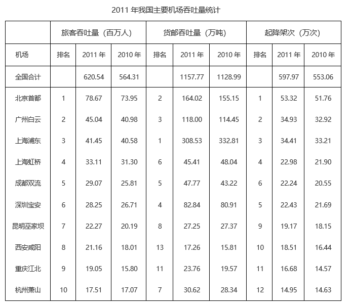

### 第 101 题

2011年货邮吞吐量和起降架次均排在前十位的机场有几个？

A. 9

B. 10

C. 7

D. 8

第 101 题 · 答案与解析

**参考答案（粉笔题库参考内容）**

C

**解析**

定位表格材料，可得2011年我国主要机场货邮吞吐量和起降架次的排名，比较可得北京首都、广州白云、上海浦东、上海虹桥、成都双流、深圳宝安以及昆明巫家坝的货邮吞吐量和起降架次均排在前十位，共7个机场。

故正确答案为C。

**考点**：直接找数、统计表

**来源**：2014年新疆维吾尔自治区公务员录用考试《行测》题（网友回忆版）第101题

### 第 102 题

表中北京、上海和广州的机场2011年旅客吞吐量占当年全国机场旅客吞吐量的比重约为多少？

A. 43.8%

B. 32.0%

C. 26.6%

D. 17.0%

第 102 题 · 答案与解析

**参考答案（粉笔题库参考内容）**

B

**解析**

根据题干“······2011年······占······比重······”，结合材料时间为2011年，可判定本题为现期比重问题。定位表格材料可得：2011年全国合计旅客吞吐量为620.54百万人，北京首都、上海浦东和虹桥、广州白云分别为78.67百万人、41.45百万人和33.11百万人、45.04百万人。根据公式：比重，可得所求比重。

故正确答案为B。

**考点**：现期比重、统计表

**来源**：2014年新疆维吾尔自治区公务员录用考试《行测》题（网友回忆版）第102题

### 第 103 题

以下哪个机场2011年旅客吞吐量比上年增长的人数最多？

A. 成都双流

B. 杭州萧山

C. 深圳宝安

D. 昆明巫家坝

第 103 题 · 答案与解析

**参考答案（粉笔题库参考内容）**

A

**解析**

根据题干“······2011年旅客吞吐量比上年增长的人数最多”，可判定本题为增长量比较问题。定位表格材料可得：2011年成都双流、杭州萧山、深圳宝安和昆明巫家坝旅客吞吐量分别为29.07百万人、17.51百万人、28.25百万人和22.27百万人；2010年这四个机场旅客吞吐量分别为25.81百万人、17.07百万人、26.71百万人和20.19百万人。根据公式：增长量=现期量-基期量，可得成都双流旅客吞吐量同比增量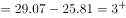百万人；杭州萧山同比增量=17.51-17.07&lt;1百万人；深圳宝安同比增量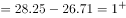百万人；昆明巫家坝同比增量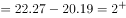百万人，比较可得成都双流2011年旅客吞吐量比上年增长的人数最多。

故正确答案为A。

**考点**：增长量比较、统计表

**来源**：2014年新疆维吾尔自治区公务员录用考试《行测》题（网友回忆版）第103题

### 第 104 题

表中有几个机场2011年货邮吞吐量同比下降？

A. 2

B. 3

C. 5

D. 7

第 104 题 · 答案与解析

**参考答案（粉笔题库参考内容）**

B

**解析**

定位表格材料可知，2011年货邮吞吐量同比下降的机场有上海浦东、上海虹桥、昆明巫家坝，一共3个机场。

故正确答案为B。

**考点**：直接找数、统计表

**来源**：2014年新疆维吾尔自治区公务员录用考试《行测》题（网友回忆版）第104题

### 第 105 题

以下关于2011年我国机场吞吐量说法正确的是：

A. 全国机场货邮吞吐量同比增速低于起降架次同比增速

B. 完成飞机起架次15万次以上的机场为12个

C. 首都机场的起降架次高于浦东和虹桥机场之和

D. 全国机场旅客吞吐量比上年增长20%以上

第 105 题 · 答案与解析

**参考答案（粉笔题库参考内容）**

A

**解析**

A项：定位表格材料可得，全国机场货邮吞吐量2011年为1157.77万吨，2010年为1128.99万吨；起降架次2011年为597.97万次，2010年为553.06万次。根据公式：增长率，则2011年全国机场货邮吞吐量同比增速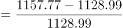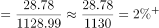，起降架次同比增速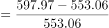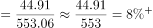，货邮吞吐量同比增速（）＜起降架次同比增速（），正确；

B项：定位表格材料可得，2011年起降架次排名第12的是杭州萧山机场（14.95万次＜15万次），排名第11的是重庆江北机场（16.68万次＞15万次），因此完成飞机起架次15万次以上的机场只有11个，错误；

C项：定位表格材料可得，2011年北京首都机场的起降架次为53.32万次，上海浦东机场的起降架次为34.41万次，上海虹桥机场的起降架次为22.98万次。34.41+22.98=57.39万次＞53.32万次，即首都机场的起降架次低于浦东和虹桥机场之和，错误；

D项：定位表格材料可得，2011年和2010年全国机场旅客吞吐量分别为620.54百万人和564.31百万人。根据公式：增长率，则2011年全国机场旅客吞吐量比上年增长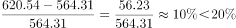，错误。

故正确答案为A。

**考点**：统计表、综合分析

**来源**：2014年新疆维吾尔自治区公务员录用考试《行测》题（网友回忆版）第105题

## 材料 2

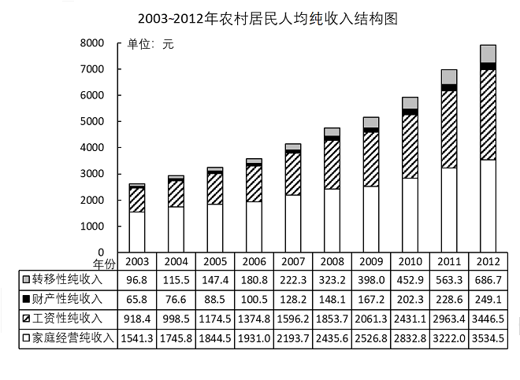

### 第 106 题

农村居民人均纯收入超过5000元在哪一年？

A. 2007年

B. 2008年

C. 2009年

D. 2010年

第 106 题 · 答案与解析

**参考答案（粉笔题库参考内容）**

C

**解析**

定位图形材料可得，2007年农村居民人均纯收入=222.3+128.2+1596.2+2193.7=4140.4元＜5000元，2008年农村居民人均纯收入=323.2+148.1+1853.7+2435.6=4760.6元＜5000元，2009年农村居民人均纯收入=398.0+167.2+2061.3+2526.8=5153.3元＞5000元。因此农村居民人均纯收入超过5000元是在2009年。

故正确答案为C。

备注：可直接比较柱状图是否超过5000元，由此得到农村居民人均纯收入在2009年超过5000元。

**考点**：简单加减计算、统计图

**来源**：2014年新疆维吾尔自治区公务员录用考试《行测》题（网友回忆版）第106题

### 第 107 题

2003年~2012年间，农村居民人均转移性纯收入平均每年约增加多少元？

A. 59

B. 66

C. 74

D. 83

第 107 题 · 答案与解析

**参考答案（粉笔题库参考内容）**

B

**解析**

根据题干“2003年~2012年间······平均每年约增加多少元”，可判定本题为年均增长量计算问题。定位统计图可得：2003年、2012年农村居民人均转移性纯收入分别为96.8元、686.7元。根据公式：年均增长量，则2003年~2012年间农村居民人均转移性纯收入平均每年增加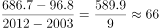元。

故正确答案为B。

**考点**：年均增长量、统计图

**来源**：2014年新疆维吾尔自治区公务员录用考试《行测》题（网友回忆版）第107题

### 第 108 题

2004~2012年间，财产性纯收入同比增长额超过20元的年份有几个？

A. 4

B. 5

C. 6

D. 7

第 108 题 · 答案与解析

**参考答案（粉笔题库参考内容）**

A

**解析**

根据题干“2004~2012年间······同比增长额超过20元的年份有几个”，可判定本题为增长量计算问题。定位统计图，可知2003~2012年各年份财产性纯收入。根据公式：增长量=现期量-基期量，则2004~2012年财产性纯收入的同比增长额分别为：

2004年，76.6-65.8＝10.8元＜20元；

2005年，88.5-76.6=11.9元＜20元；

2006年，100.5-88.5=12元＜20元；

2007年，128.2-100.5=27.7元＞20元；

2008年，148.1-128.2=19.9元＜20元；

2009年，167.2-148.1=19.1元＜20元；

2010年，202.3-167.2=35.1元＞20元；

2011年，228.6-202.3=26.3元＞20元；

2012年，249.1-228.6=20.5元＞20元。

综上，财产性纯收入同比增长额超过20元的年份有2007年、2010年、2011年、2012年，共4个年份。

故正确答案为A。

**考点**：增长量计算、统计图

**来源**：2014年新疆维吾尔自治区公务员录用考试《行测》题（网友回忆版）第108题

### 第 109 题

与2005年相比，2010年农村居民人均纯收入增长率最低的是：

A. 转移性纯收入

B. 财产性纯收入

C. 工资性纯收入

D. 家庭经营纯收入

第 109 题 · 答案与解析

**参考答案（粉笔题库参考内容）**

D

**解析**

根据题干“与2005年相比，2010年······增长率最低的是”，可判定本题为一般增长率比较问题。定位统计图可知，2005年和2010年农村居民人均转移性纯收入、财产性纯收入、工资性纯收入、家庭经营纯收入。根据公式：增长率，比较增长率大小可直接比较，各选项代入数据可得：A项，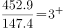；B项，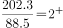；C项，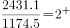；D项，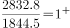。比较可知，与2005年相比，2010年农村居民人均纯收入增长率最低的是家庭经营纯收入。

故正确答案为D。

**考点**：一般增长率、统计图

**来源**：2014年新疆维吾尔自治区公务员录用考试《行测》题（网友回忆版）第109题

### 第 110 题

以下关于2007~2012年间农村居民人均纯收入结构的描述正确的是：

A. 财产性纯收入在5年内翻了一番

B. 工资性纯收入总增长额是各类收入中最高的

C. 家庭经营纯收入每年的同比增长额都超过100元

D. 转移性纯收入的同比增长额每年递增

第 110 题 · 答案与解析

**参考答案（粉笔题库参考内容）**

B

**解析**

A项：定位统计图可知，2007年和2012年的农村居民人均财产性纯收入分别为128.2元和249.1元。由于，故财产性纯收入在5年内未翻一番，错误；

B项：定位统计图可知，2007年和2012年农村居民各类人均纯收入的数据。根据公式：增长量=现期量-基期量，可得转移性纯收入的增长额元；财产性纯收入的增长额元；工资性纯收入的增长额元；家庭经营纯收入的增长额元，故2007~2012年间农村居民人均工资性纯收入总增长额是各类收入中最高的，正确。

C项：定位统计图可知，2007~2012年间每年农村居民人均家庭经营纯收入的数据。根据公式：增长量=现期量-基期量，可得2009年人均家庭经营纯收入的同比增长额=2526.8-2436.6=90.2元＜100元，即2009年农村居民人均家庭经营纯收入每年的同比增长额未超过100元，并非“都超过100元”，错误；

D项：定位统计图可知，2007~2012年间每年农村居民人均转移性纯收入的数据。根据公式：增长量=现期量-基期量，可得2008年转移性纯收入的同比增长额元，2009年转移性纯收入的同比增长额元。由于2008年增长量＞2009年增长量，故转移性纯收入的同比增长额并非每年递增，错误。

故正确答案为B。

**考点**：统计图、综合分析

**来源**：2014年新疆维吾尔自治区公务员录用考试《行测》题（网友回忆版）第110题

## 材料 3

2011年，我国十种有色金属总产量3438吨。其中，精炼铜520万吨，同比增长14.6%；原铝1806万吨，同比增长11.5%；铅465万吨，同比增长10.7%；锌522万吨，同比增长1.1%；镍18.5万吨，同比增长8.1%；锡15.6万吨，同比增长4.5%；锑19万吨，同比增长1.4%；镁66.1万吨，同比增长1%；海绵钛6万吨，同比增长11.8%；汞0.6万吨，同比下降5.8%。

        2011年，8017家规模以上有色金属工业企业（不包括独立黄金企业，下同）实现主营业务收入3.9万亿元，同比增长35%。2011年，规模以上有色金属工业企业实现利润1990亿元，同比增长53%。其中，规模以上有色金属独立矿山企业实现利润469亿元，同比增长61%；规模以上有色金属冶炼企业（含联合企业中的矿山）实现利润774亿元，同比增长60.7%；规模以上有色金属加工企业实现利润747亿元，同比增长41.8%。

        2011年，有色金属工业（不包括独立黄金企业，下同）完成固定资产投资4774亿元，同比增长34.6%。西部地区有色金属工业完成固定资产投资额为2059.4亿元，同比增长42.9%，占全国有色金属工业完成固定资产投资的比重为43.1%，所占比重比上年增加2.5个百分点。

        2011年，我国有色金属进出口贸易总额达到1607亿元，同比增长28%，增幅比“十一五”期间的年平均增幅高了7.3个百分点。

### 第 111 题

2011年十种有色金属中产量同比增长超过5%的有几种？

A. 5

B. 6

C. 7

D. 8

第 111 题 · 答案与解析

**参考答案（粉笔题库参考内容）**

A

**解析**

定位文字材料第一段可知2011年十种有色金属产量的同比增长率，其中超过5%的有精炼铜（14.6%），原铝（11.5%），铅（10.7%），镍（8.1%），海绵钛（11.8%），一共5种有色金属产量同比增长超过5%。

故正确答案为A。

**考点**：文字资料、直接找数

**来源**：2014年新疆维吾尔自治区公务员录用考试《行测》题（网友回忆版）第111题

### 第 112 题

2011年规模以上有色金属工业企业实现利润中，独立矿山企业、冶炼企业（含联合企业中的矿山）、加工企业所占的比重依次为：

A. 19.4%、41.2%、39.4%

B. 19.4%、39.9%、40.7%

C. 23.6%、40.2%、36.2%

D. 23.6%、38.9%、37.5%

第 112 题 · 答案与解析

**参考答案（粉笔题库参考内容）**

D

**解析**

根据题干“2011年······中，······所占的比重”，结合材料时间为2011年，可判定本题为现期比重问题。定位文字材料第二段可知：2011年规模以上有色金属工业企业实现利润1990亿元。其中，独立矿山企业实现利润469亿元，冶炼企业（含联合企业中的矿山）实现利润774亿元，加工企业实现利润747亿元。根据公式：现期比重，可得独立矿山企业利润占比，冶炼企业（含联合企业中的矿山）利润占比，加工企业利润占比，对应D项。

故正确答案为D。

**考点**：文字资料、现期比重

**来源**：2014年新疆维吾尔自治区公务员录用考试《行测》题（网友回忆版）第112题

### 第 113 题

2010年全国有色金属工业完成固定资产投资中，西部地区所占的比重约为：

A. 38.1%

B. 40.6%

C. 43.1%

D. 45.6%

第 113 题 · 答案与解析

**参考答案（粉笔题库参考内容）**

B

**解析**

根据题干“2010年······中，······所占的比重约为”，结合材料时间为2011年，可判定本题为基期比重问题。定位文字材料第三段可得：西部地区有色金属工业完成固定资产投资占全国有色金属工业完成固定资产投资的比重为43.1%，所占比重比上年增加2.5个百分点。则2010年全国有色金属工业完成固定资产投资中，西部地区所占的比重为43.1%-2.5%=40.6%。

故正确答案为B。

**考点**：基期比重、文字资料

**来源**：2014年新疆维吾尔自治区公务员录用考试《行测》题（网友回忆版）第113题

### 第 114 题

2011年，平均每家规模以上有色金属工业企业实现利润多少亿元？

A. 0.25

B. 0.06

C. 0.35

D. 0.30

第 114 题 · 答案与解析

**参考答案（粉笔题库参考内容）**

A

**解析**

根据题干“2011年，平均每家······实现利润多少亿元”，可判定本题为现期平均数问题。定位文字材料第二段可得：2011年，规模以上有色金属工业企业8017家，实现利润1990亿元。根据公式：平均利润亿元。

故正确答案为A。

**考点**：文字资料、现期平均数

**来源**：2014年新疆维吾尔自治区公务员录用考试《行测》题（网友回忆版）第114题

### 第 115 题

以下说法正确的是：

A. 2010年我国精炼铜的产量和原铝的产量均高于锌的产量

B. 2010年我国有色金属工业完成固定资产投资超过4500亿元

C. “十一五”期间我国有色金属进出口贸易额年均增长20.7%

D. 2010年我国规模以上有色金属工业企业实现主营业务收入超3万亿元

第 115 题 · 答案与解析

**参考答案（粉笔题库参考内容）**

C

**解析**

A项：定位文字材料第一段可得：2011年，精炼铜产量520万吨，同比增长14.6%；原铝1806万吨，同比增长11.5%；锌522万吨，同比增长1.1%。根据公式：基期量，则2010年精炼铜产量为万吨，原铝为万吨，锌为万吨。则2010年精炼铜的产量小于锌的产量，错误；

B项：定位文字材料第三段可得：2011年，有色金属工业（不包括独立黄金企业，下同）完成固定资产投资4774亿元，同比增长34.6%。根据公式：基期量，则2010年我国有色金属工业完成固定资产投资为亿元，错误；

C项：定位文字材料第四段可得：2011年，我国有色金属进出口贸易总额达到1607亿元，同比增长28%，增幅比“十一五”期间的年平均增幅高了7.3个百分点。则“十一五”期间我国有色金属进出口贸易额年均增长28%-7.3%=20.7%，正确；

D项：定位文字材料第二段可得：2011年，8017家规模以上有色金属工业企业（不包括独立黄金企业，下同）实现主营业务收入3.9万亿元，同比增长35%。根据公式：基期量，则2010年我国规模以上有色金属工业企业实现主营业务收入万亿元，错误。

故正确答案为C。

**考点**：文字资料、综合分析

**来源**：2014年新疆维吾尔自治区公务员录用考试《行测》题（网友回忆版）第115题

## 材料 4

### 第 116 题

与2007年相比，2010年意外伤害保险收入占寿险总收入的比重：

A. 增加0.53个百分点

B. 减少0.53个百分点

C. 上升0.34个百分点

D. 下降0.34个百分点

第 116 题 · 答案与解析

**参考答案（粉笔题库参考内容）**

B

**解析**

根据题干“与2007年相比，2010年······的比重”，结合选项为“增加/减少/上升/下降······个百分点”，可判定本题为两期比重问题。定位表格材料可得：2007、2010年意外伤害保险收入占寿险总收入的比重分别为2.34%、1.81%。则所求比重差=1.81%-2.34%=-0.53%，即比重减少0.53个百分点。

故正确答案为B。

**考点**：两期比重、统计表

**来源**：2014年新疆维吾尔自治区公务员录用考试《行测》题（网友回忆版）第116题

### 第 117 题

假设2010年—2012年全国保险总收入的平均增长量与2007—2010年水平相当，那么2012年全国保险总收入的预测值为多少亿元？

A. 22020.09

B. 27360.50

C. 14527.77

D. 19522.65

第 117 题 · 答案与解析

**参考答案（粉笔题库参考内容）**

D

**解析**

根据题干“假设2010年—2012年······的平均增长量······”，可判定本题为年均增长量问题。定位表格材料可得：2007年全国寿险总收入和非寿险总收入分别为4948.97、2086.48亿元，2010年全国寿险总收入和非寿险总收入分别为10200.88、4026.89亿元。根据公式：年均增长量，且保险总收入=寿险总收入+非寿险总收入，则2007—2010年全国保险总收入的年均增长量亿元。根据现期，则2012年全国保险总收入的预测值亿元，与D项最接近。

故正确答案为D。

**考点**：年均增长量、统计表

**来源**：2014年新疆维吾尔自治区公务员录用考试《行测》题（网友回忆版）第117题

### 第 118 题

表中？处的数值应为：

A. 1.90

B. 2.47

C. 2.67

D. 2.80

第 118 题 · 答案与解析

**参考答案（粉笔题库参考内容）**

B

**解析**

方法一：根据题干“表中？处的数值应为”，结合材料中？处为占比数值，可判定本题为现期比重问题。定位表格材料可得：2009年意外险收入为73.92亿元，非寿险总收入为2992.90亿元。根据公式：比重，则2009年非寿险总收入中意外险占比，与B项最接近。

方法二：定位表格材料可得2009年非寿险总收入各项构成的占比。则2009年非寿险总收入中意外险占比=100-（72.02+7.40+2.05+3.08+12.98）=2.47%。

故正确答案为B。

**考点**：现期比重、统计表

**来源**：2014年新疆维吾尔自治区公务员录用考试《行测》题（网友回忆版）第118题

### 第 119 题

2008年—2010年，非寿险中车险收入的平均增长率为：

A. 11%

B. 23%

C. 33%

D. 45%

第 119 题 · 答案与解析

**参考答案（粉笔题库参考内容）**

C

**解析**

根据题干“2008年—2010年······的平均增长率为”，可判定本题为年均增长率问题。定位统计表可得：2008年非寿险中车险收入为1702.52亿元，2010年非寿险中车险收入为3004.15亿元。根据公式：（n为相差年份），2008年—2010年相差2年，可得。使用代入排除法，代入C项，，符合条件。

故正确答案为C。

**考点**：年均增长率、统计表

**来源**：2014年新疆维吾尔自治区公务员录用考试《行测》题（网友回忆版）第119题

### 第 120 题

以下关于2007—2010年全国寿险和非寿险保费收入的说法正确的是：

A. 非寿险收入中平均增长速度最慢的是意外险

B. 寿险收入中平均增长速度最快的是健康保险收入

C. 责任险和人寿保险占保险总收入的比重呈现相同的变化趋势

D. 2009年所有的寿险收入均比去年有所上升

第 120 题 · 答案与解析

**参考答案（粉笔题库参考内容）**

A

**解析**

A项：定位统计表可得2007-2010年全国各项非寿险保费收入。根据公式：（n为相差年份），2007年-2010年相差3年，当越小，年均增长率越小，即平均增长速度越慢。全国各项非寿险收入的年均增长率分别为：

车险：；企财险：；

货运险：；意外险：；

责任险：；其他：。

故非寿险收入中平均增长速度最慢的是意外险，正确；

B项：定位统计表可得2007-2010年全国各项寿险保费收入。根据公式：（n为相差年份），2007年-2010年相差3年，当越大，年均增长率越大，即平均增长速度越块。全国各项寿险收入的年均增长率分别为：

人寿保险：；意外伤害保险：；健康保险：。故寿险收入中平均增长速度最快的是人寿保险收入，错误；

C项：定位统计表可得2007年和2008年全国寿险和非寿险各项保费收入。由于全国保险总收入分为寿险收入和非寿险收入两部分，则2007年全国保险总收入=4948.97+2086.48=7035.45亿元，2008年全国保险总收入=7337.57+2446.25=9783.82亿元。根据公式：增长率=，则2008年全国保险总收入的同比增长率，责任险保费收入的同比增长率，人寿保险保费收入的同比增长率。根据两期比重比较结论“当部分增长率>整体增长率时，比重上升；当部分增长率&lt;整体增长率时，比重下降”。2008年，责任险保费收入的同比增长率（22.6%）&lt;全国保险总收入的同比增长率（39.3%），比重下降；人寿保险保费收入的同比增长率（48.8%）>全国保险总收入的同比增长率（39.3%），比重上升。即2008年责任险和人寿保险保费收入占保险总收入的比重呈现不同的变化趋势，错误；

D项：定位统计表可得2008年和2009年各项寿险保费收入。其中，2009年健康保险保费收入（530.83亿元）低于2008年（548.63亿元），即2009年健康保险收入比去年有所下降，错误。

故正确答案为A。

**考点**：统计表、综合分析

**来源**：2014年新疆维吾尔自治区公务员录用考试《行测》题（网友回忆版）第120题

