# 2015年新疆生产建设兵团面向社会招录公务员考试《行测》题（网友回忆版）

<!-- gwy:overview:start -->
> **新疆 · 2015 · 行测 · 统考** ｜ 82 题 · 图片 33 处 · 答案随题折叠

| 题型模块 | 题量 | 题号 |
| --- | ---: | ---: |
| 常识判断 | 20 | 1–20 |
| 言语理解与表达 | 18 | 21–38 |
| 数量关系 | 15 | 39–53 |
| 判断推理 | 29 | 54–82 |
| **合计** | **82** | |

导航：[题型与作答说明](#题型与作答说明) · [题目](#题目)
<!-- gwy:overview:end -->

> 候选采集稿。参考答案及解析来自粉笔页面，不代表官方答案或真实高分答卷；来源使用许可与原卷对应关系仍需人工核实。

## 题型与作答说明

常识判断

（20题）

根据题目要求，在四个选项中选出一个最恰当的答案。

言语理解与表达

（18题）

本部分包括表达与理解两方面的内容。请根据题目要求，在四个选项中选出一个最恰当的答案。

数量关系

（15题）

在这部分试题中，每道题呈现一段表述数字关系的文字，要求你迅速、准确地计算出答案。

判断推理

（29题）

本部分包括图形推理、定义判断、类比推理与逻辑判断四种类型的试题，在四个选项中选出一个最恰当的答案。

## 题目

### 第 1 题

作为全疆首个撤地设市的地区，（    ）撤地设市工作的启动开创了新疆行政区划新纪元，其带来的社会、经济效益将进一步促进新疆打造“一带一路”战略中丝绸之路经济带核心区的建设。

A. 喀什

B. 吐鲁番

C. 阿克苏

D. 克拉玛依

第 1 题 · 答案与解析

**参考答案（粉笔题库参考内容）**

B

**解析**

本题考查政治常识。

2015年3月，文件《国务院关于同意新疆维吾尔自治区撤销吐鲁番地区设立地级吐鲁番市的批复》中指出：“同意撤销吐鲁番地区和县级吐鲁番市，设立地级吐鲁番市。”吐鲁番市是继乌鲁木齐市、克拉玛依市之后，新疆设立的第三个地级市。也是改革开放以来，新疆首个撤销地区设立的市。作为全疆首个撤地设市的地区，吐鲁番撤地设市工作的启动开创了新疆行政区划新纪元，其带来的社会、经济效益也将进一步促进新疆打造“一带一路”战略中丝绸之路经济带核心区建设。

故正确答案为B。

**来源**：2015年新疆生产建设兵团面向社会招录公务员考试《行测》题（网友回忆版）第1题

### 第 2 题

2015年5月10号11时，以（    ）为图标的“中国·新疆公路零公里”标志牌在乌鲁木齐人民广场举办揭牌仪式。该标志成为新疆干线公路起点的象征，从此以后，新疆所有公路营业距离的计算就有了一个统一的新起点，公路经营性行为和公路里程的计算都以此为新起点。

A. 和谐的雪莲花

B. 绵延的天山

C. 舞蹈的新疆姑娘

D. 湿润的和田玉

第 2 题 · 答案与解析

**参考答案（粉笔题库参考内容）**

A

**解析**

本题考查政治常识。

2015年5月10日，以“和谐的雪莲花”为图标的“中国·新疆公路零公里”标志牌在乌鲁木齐市人民广场举办揭牌仪式，该标志的设立不仅成为新疆干线公路起点的象征，还为乌鲁木齐市增添了新的人文景观。该标志图案由圆形方形构成体现天圆地方的理念，中央的雪莲花由13片花瓣组成象征着新疆世居的13个民族，圆周处的回形图案象征各族人民手拉手紧紧团结在一起。标志以坚硬、耐磨的青铜一次性整体铸造浇筑成型，重500余公斤，外廓尺寸约1.66米，象征新疆地域面积166万平方公里。

故正确答案为A。

**来源**：2015年新疆生产建设兵团面向社会招录公务员考试《行测》题（网友回忆版）第2题

### 第 3 题

中央第二次新疆工作座谈会确定新疆工作的总目标是（    ）。

A. 民族团结

B. 社会稳定和长治久安

C. 跨越式发展

D. 改善民生

第 3 题 · 答案与解析

**参考答案（粉笔题库参考内容）**

B

**解析**

本题考查政治常识。

2014年5月28日至29日，第二次中央新疆工作座谈会在北京召开，会议全面总结了2010年中央新疆工作座谈会以来的新疆工作，科学分析了新疆形势，明确了新疆工作的指导思想、基本要求、主攻方向，确定新疆工作的总目标是社会稳定和长治久安，对当前和今后一个时期的新疆工作作了全面部署。

故正确答案为B。

**来源**：2015年新疆生产建设兵团面向社会招录公务员考试《行测》题（网友回忆版）第3题

### 第 4 题

2015年10月，新疆维吾尔自治区将迎来成立（    ）周年庆典。

A. 60

B. 62

C. 63

D. 65

第 4 题 · 答案与解析

**参考答案（粉笔题库参考内容）**

A

**解析**

本题考查政治常识。

新疆维吾尔自治区成立于1955年10月1日，新疆有14个地、州、市，90个县（市），其中34个为边境县（市）。故2015年10月，新疆维吾尔自治区将迎来成立60周年庆典。

故正确答案为A。

**来源**：2015年新疆生产建设兵团面向社会招录公务员考试《行测》题（网友回忆版）第4题

### 第 5 题

国务院实行国务院全体会议和国务院常务会议制度。

下列说法中错误的是：

A. 国务院常务会议由总理、副总理、国务委员、秘书长组成

B. 国务院全体会议由总理召集和主持

C. 国务院全体会议一般每年召开一次

D. 国务院工作中的重大事项，必须经国务院全体会议或常务会议讨论决定

第 5 题 · 答案与解析

**参考答案（粉笔题库参考内容）**

C

**解析**

本题考查法律常识。

A项正确，根据《国务院工作规则》第四十条第一款规定：“国务院常务会议由总理、副总理、国务委员、秘书长组成，由总理召集和主持。国务院常务会议的主要任务是：（一）讨论决定国务院工作中的重要事项；（二）讨论法律草案、审议行政法规草案；（三）通报和讨论其他重要事项。”

B项正确，根据《国务院工作规则》第三十九第一款规定：“国务院全体会议由总理、副总理、国务委员、各部部长、各委员会主任、人民银行行长、审计长、秘书长组成，由总理召集和主持。国务院全体会议的主要任务是：（一）讨论决定国务院工作中的重大事项；（二）部署国务院的重要工作。”

C项错误，根据2004年版《国务院工作规则》第三十六条第二款规定：“国务院全体会议一般每半年召开一次，根据需要可安排有关部门、单位负责人列席会议。”

D项正确，根据《国务院工作规则》第六条规定：“总理召集和主持国务院全体会议和国务院常务会议。国务院工作中的重大事项，必须经国务院全体会议或国务院常务会议讨论决定。”

本题为选非题，故正确答案为C。

**考点**：其他法律法规

**来源**：2015年新疆生产建设兵团面向社会招录公务员考试《行测》题（网友回忆版）第5题

### 第 6 题

当前，我国农村五保供养制度的“五保”是指：

A. 保吃、保穿、保住、保医、保葬

B. 保吃、保穿、保住、保医、保教

C. 保吃、保喝、保烧、保住、保教

D. 保吃、保穿、保烧、保住、保葬

第 6 题 · 答案与解析

**参考答案（粉笔题库参考内容）**

A

**解析**

本题考查政治常识。

A项正确，B、C、D三项错误，《农村五保供养工作条例》“第二条”指出：“本条例所称农村五保供养，是指依照本条例规定，在吃、穿、住、医、葬方面给予村民的生活照顾和物质帮助。”

故正确答案为A。

**考点**：重要文件

**来源**：2015年新疆生产建设兵团面向社会招录公务员考试《行测》题（网友回忆版）第6题

### 第 7 题

某省人大通过的地方性法规与国家发改委出台的部门规章对同一事项规定不一致时：

A. 应当直接适用发改委的部门规章

B. 应当直接适用该省人大通过的地方性法规

C. 国务院认为应当适用地方性法规的，应当决定在该地方适用地方性法规

D. 国务院认为应当适用部门规章的，由国务院作出最终裁决

第 7 题 · 答案与解析

**参考答案（粉笔题库参考内容）**

C

**解析**

本题考查法律常识。

C项正确，A、B、D三项错误，根据《中华人民共和国立法法》第九十五条第一款规定：“地方性法规、规章之间不一致时，由有关机关依照下列规定的权限作出裁决：······（二）地方性法规与部门规章之间对同一事项的规定不一致，不能确定如何适用时，由国务院提出意见，国务院认为应当适用地方性法规的，应当决定在该地方适用地方性法规的规定；认为应当适用部门规章的，应当提请全国人民代表大会常务委员会裁决；······”

故正确答案为C。

**考点**：其他法律法规

**来源**：2015年新疆生产建设兵团面向社会招录公务员考试《行测》题（网友回忆版）第7题

### 第 8 题

某市为落实“节能减排”政策，鼓励全市出租车进行油改气改造，并提供改造补贴。改造后的出租车，不仅尾气排放得到了显著改善，运营成本也大幅度降低。但由于受加气站数量的限制，“加气难”又使出租车司机抱怨连连。这一情况说明了：

A. 任何公共政策都不可能解决所有的社会问题

B. 相关配套措施的完善程度是确保政策顺利实施的重要条件

C. 政府出台公共政策是为了解决那些市场机制不能解决的问题

D. 吸纳社会公众广泛参与是提升政策执行质量的重要条件

第 8 题 · 答案与解析

**参考答案（粉笔题库参考内容）**

B

**解析**

本题考查管理常识。

A项错误，公共政策是指国家通过对资源的战略性运用，以协调经济社会活动及相互关系的一系列政策的总称。社会问题在各时代反映的内容各不相同，任何公共政策都不可能解决所有的社会问题，说法无误，但是与题干无关。

B项正确，加气站设置属于落实“节能减排”政策的配套措施，由于加气站数量不足引起了出租车司机抱怨“加气难”，这属于前期配套措施的不完善导致政策落实中群众的体验差，影响了政策的实施效果，进一步会影响更多人对油改气改造的支持程度。即相关配套措施的完善程度是确保政策顺利实施的重要条件。

C项错误，政府出台公共政策的目的，是为了分配社会资源、规范社会行为、解决社会问题和促进社会发展，不仅仅是为了解决市场机制不能解决的问题。

D项错误，公共政策执行是一定的机构或人员，为了实现既定的政策目标而采取的各种行动。在诸多活动中，最重要的是组织政策执行人员，向社会解释政策方案，采取具体的行动措施实现政策目标。社会公众广泛参与在一定程度上有利于提高的是决策的民主性和科学性。

故正确答案为B。

**来源**：2015年新疆生产建设兵团面向社会招录公务员考试《行测》题（网友回忆版）第8题

### 第 9 题

在我国的全国性市场中，最接近完全竞争市场的是：

A. 小麦市场

B. 保险市场

C. 电信市场

D. 铁路客运市场

第 9 题 · 答案与解析

**参考答案（粉笔题库参考内容）**

A

**解析**

本题考查经济常识。

A项正确，B、C、D三项错误，完全竞争市场又称纯粹竞争市场或自由竞争市场，是指一个行业中有非常多的生产销售企业，它们都以同样的方式向市场提供同类的、标准化的产品的市场。卖者和买者对于商品或劳务的价格均不能控制。在这种竞争环境中，由于买卖双方对价格都无影响力，只能是价格的接受者，因此产品价格只能随供求关系而定。完全竞争市场是一种理想的市场状态，属于理论抽象。现实生活中，一般认为只有某些农产品如小麦、玉米等市场类似于完全竞争市场，基本具备完全竞争市场的相关特征。

故正确答案为A。

**考点**：微观经济

**来源**：2015年新疆生产建设兵团面向社会招录公务员考试《行测》题（网友回忆版）第9题

### 第 10 题

小壮是年满8周岁的小学生。小壮的下列行为中，他人不得主张无效的是：

A. 签订买卖校服的合同

B. 购买价值50元的游戏机

C. 将自己的钢笔赠与他人

D. 接受赠与

第 10 题 · 答案与解析

**参考答案（粉笔题库参考内容）**

ABCD

**解析**

本题考查法律常识。

根据《民法典》第十九条规定：“八周岁以上的未成年人为限制民事行为能力人，实施民事法律行为由其法定代理人代理或者经其法定代理人同意、追认；但是，可以独立实施纯获利益的民事法律行为或者与其年龄、智力相适应的民事法律行为。”第一百四十五条第一款规定：“限制民事行为能力人实施的纯获利益的民事法律行为或者与其年龄、智力、精神健康状况相适应的民事法律行为有效；实施的其他民事法律行为经法定代理人同意或者追认后有效。”因此，在只考虑民事行为能力的情况下，限制民事行为能力人独立实施的与其年龄、智力相适应的民事法律行为有效，其余的民事法律行为效力待定，不存在无效的情形。本题A、B、C、D四项均为正确选项。

故正确答案为ABCD。

注：以命题年的法律为准，则答案为D项。

**考点**：民法典

**来源**：2015年新疆生产建设兵团面向社会招录公务员考试《行测》题（网友回忆版）第10题

### 第 11 题

张某和李某因故结仇。一日，张某看到李某在路上行走，便找了一根铁棍来教训李某。李某看到张某迎面赶来，情急之下夺过一辆摩托车骑上就逃，造成摩托车主人腿部骨折。关于李某的行为，下列说法正确的是：

A. 属于紧急避险

B. 属于正当防卫

C. 构成抢夺罪

D. 构成故意伤害罪

第 11 题 · 答案与解析

**参考答案（粉笔题库参考内容）**

A

**解析**

本题考查法律常识。

A项正确，B、C、D三项错误，根据《中华人民共和国刑法》第二十一条第一款规定：“为了使国家、公共利益、本人或者他人的人身、财产和其他权利免受正在发生的危险，不得已采取的紧急避险行为，造成损害的，不负刑事责任。”题中，李某见张某手提铁棍赶来，不得已夺过摩托车骑上逃走，属于紧急避险。

故正确答案为A。

**考点**：刑法

**来源**：2015年新疆生产建设兵团面向社会招录公务员考试《行测》题（网友回忆版）第11题

### 第 12 题

甲、乙为夫妻，父母均已去世，且无子女。甲只有一姐丙，乙只有一妹丁。丙、丁均独自生活，多年不与甲、乙来往。后甲、乙外出旅游发生车祸，甲当场死亡。乙一天后去世。经查甲、乙二人遗产共价值一百万元，二人均未留遗嘱，根据我国继承法，应如何处理：

A. 由丙继承

B. 由丁继承

C. 丙、丁分别继承五十万元

D. 收归国家所有

第 12 题 · 答案与解析

**参考答案（粉笔题库参考内容）**

B

**解析**

本题考查法律常识。

B项正确，A、C、D三项错误，根据《中华人民共和国民法典》第一千一百二十七条第一款、第二款规定：“遗产按照下列顺序继承：（一）第一顺序：配偶、子女、父母；（二）第二顺序：兄弟姐妹、祖父母、外祖父母。继承开始后，由第一顺序继承人继承，第二顺序继承人不继承；没有第一顺序继承人继承的，由第二顺序继承人继承。”甲、乙外出旅游发生车祸，甲当场死亡，乙作为第一顺序继承人继承甲的遗产，丙作为第二顺序继承人不继承遗产；乙一天后去世，因其只有一妹丁，所以丁作为第二顺序继承人继承了乙的遗产。

故正确答案为B。

**考点**：民法典

**来源**：2015年新疆生产建设兵团面向社会招录公务员考试《行测》题（网友回忆版）第12题

### 第 13 题

关于著名战役与参战将领，下列对应错误的是：

A. 百团大战——彭德怀

B. 滑铁卢之战——拿破仑

C. 台儿庄战役——李宗仁

D. 美国南北战争——华盛顿

第 13 题 · 答案与解析

**参考答案（粉笔题库参考内容）**

D

**解析**

本题考查人文常识。

A项正确，百团大战是抗日战争时期，八路军在华北敌后发动的一次大规模进攻和反“扫荡”的战役，由于参战兵力达105个团，故称“百团大战”。主要指挥官是彭德怀、左权。百团大战是抗战时期中国工农红军主动出击日军的一次最大规模的战役，在战略上有力地支持了国民党正面战场。

B项正确，滑铁卢之战是1815年6月18日，由法军对反法联军在比利时小镇滑铁卢进行的决战，战役结局是反法联军获得了决定性胜利。这次战役结束了拿破仑帝国，也是拿破仑一世的最后一战。拿破仑战败后被放逐至圣赫勒拿岛，自此退出历史舞台。

C项正确，台儿庄战役，又称台儿庄大捷、鲁南会战或血战台儿庄。主要指挥官有李宗仁、白崇禧、孙连仲、汤恩伯。此次大捷是抗日战争以来取得的最大胜利，也是徐州会战中国民革命军取得的一次重大胜利。

D项错误，美国南北战争（1861年4月12日—1865年4月9日）是美国历史上一场规模最大的内战，参战双方为北方美利坚合众国和南方的美利坚联盟国，主要指挥官是尤里西斯·辛普森·格兰特、罗伯特·爱德华·李。战争以南方联盟炮击萨姆特要塞为起点，最终以北方联邦胜利告终。战争之初，北方为了维护国家统一而战，后来演变为一场消灭奴隶制的革命战争。乔治·华盛顿（1732年2月22日—1799年12月14日）是美国政治家、军事家、革命家，首任总统，美国开国元勋之一。

本题为选非题，故正确答案为D。

**来源**：2015年新疆生产建设兵团面向社会招录公务员考试《行测》题（网友回忆版）第13题

### 第 14 题

有关社区宣传教育的说法错误的是：

A. 宣传教育是社区工作者必须精通的一种工作方法

B. 社区教育的重点宜放在大力开展社区儿童教育上

C. 社区宣传教育是终身教育的重要形式之一，是创建学习型社区的基本模式

D. 社区教育是社区建设、社区发展的客观要求和智力支撑

第 14 题 · 答案与解析

**参考答案（粉笔题库参考内容）**

B

**解析**

本题考查管理常识。

社区教育是对社区内全体成员进行教育的一种综合性教育活动，是一种集适应性、补缺性和发展性于一体的教育形式，其目的是提高社区内全体成员的技能、综合素质和素养，为社区的建设和发展服务。

A项正确，宣传教育是社区工作者必须精通的一种工作方法。社区工作者通过对居民进行教育及传播有效的方法，可以提升居民的意识和能力，去争取自身环境的改善。

B项错误，社区教育在社区中，开发、利用各种教育资源，以社区全体成员为对象，旨在提高成员的素质和生活质量，促进成员的全面发展和社区可持续发展。它以社区全体成员为对象，并非重点针对儿童。

C项正确，社区教育是终身教育发展的大趋势，是教育社会化、社会教育化的一种理想模式，是学习化社会的一种有效模式。它既是社会参与教育，支持教育发展与改革的好形式，也能为教育面向社会，服务经济提供有利条件。因此，社区教育是实现终身教育的重要形式和创建学习型社区的基本模式。

D项正确，社区教育是教育改革与发展的必然趋势，是社区建设与社区发展的客观要求和智力支撑，在社区建设中起着主导的核心作用。首先，社区教育可以直接促进社区成员的成长，因为社区教育属于一种知识投资。社区教育通过指导社会生活、传递社会文化、教导先进知识技能等手段推动其对象养成文明习惯、认同社会规范、培养社会角色从而促进其个性发展、激发潜在能力、刺激其个人素质的全面提高和终身发展。其次，社区教育也可以间接提高社区成员的生活质量。

本题为选非题，故正确答案为B。

**来源**：2015年新疆生产建设兵团面向社会招录公务员考试《行测》题（网友回忆版）第14题

### 第 15 题

关于能量转换，下列说法错误的是：

A. 太阳能电池，光能转化为电能

B. 蒸汽机，内能转化为机械能

C. 发电机，电能转化为机械能

D. 植物的光合作用，光能转化为化学能

第 15 题 · 答案与解析

**参考答案（粉笔题库参考内容）**

C

**解析**

本题考查科技常识。

A项正确，太阳能电池，是一种利用太阳光直接发电的光电半导体薄片，又称为“太阳能芯片”或“光电池”，它只要被满足一定照度条件的光照到，瞬间就可输出电压及在有回路的情况下产生电流，是通过光电效应或者光化学效应直接把光能转化成电能的装置。

B项正确，蒸汽机是将蒸汽的能量（内能）转换为机械能的往复式动力机械。蒸汽机需要一个使水沸腾产生高压蒸汽的锅炉，这个锅炉可以使用木头、煤、石油或天然气甚至可燃垃圾作为热源，蒸汽膨胀推动活塞做功。

C项错误，发电机是指将其他形式的能源转换成电能的机械设备，它由水轮机、汽轮机、柴油机或其他动力机械驱动，将水流、气流、燃料燃烧或原子核裂变产生的能量转化为机械能传给发电机，再由发电机转换为电能。

D项正确，光合作用通常是指绿色植物（包括藻类）吸收光能，把二氧化碳和水合成富能有机物，同时释放氧气的过程，即光能转化为稳定的化学能储存在绿色植物中的过程。

本题为选非题，故正确答案为C。

**考点**：物理常识

**来源**：2015年新疆生产建设兵团面向社会招录公务员考试《行测》题（网友回忆版）第15题

### 第 16 题

关于北回归线，下列说法正确的是：

A. 位置为北纬25°

B. 是太阳光直射在地球上最北的界限

C. 穿过大部分的欧洲国家

D. 是北寒带和北温带的分界线

第 16 题 · 答案与解析

**参考答案（粉笔题库参考内容）**

B

**解析**

本题考查地理国情。

A项错误，B项正确，北回归线大约在北纬23°26′（一般可估算为23.5°）的地方，是太阳光线能够直射在地球上最北的界线，每年夏至时太阳光几乎直射北回归线，此时北半球各地的白昼时间达到全年最长。北回归线是一条重要纬线，其自西向东穿过我国云南、广西、广东、福建（海域）、台湾五省区。

C项错误，欧洲位于东半球的西北部，北临北冰洋，西濒大西洋，南濒大西洋的属海地中海和黑海。欧洲四个极点的位置分别是：最东为北乌拉尔（东经66°10′）；最西为伊比利亚半岛上的罗卡角（西经9°31′）；最北为斯堪的纳维亚半岛上的诺尔辰角（北纬71°8′）；最南为伊比利亚半岛上的马罗基角（北纬36°）。因此，北回归线不穿过欧洲。

D项错误，北半球北回归线（不包括北回归线）以南至南回归线（不包括南回归线）的区域每年太阳直射两次，获得的热量最多，形成热带。因此北回归线是热带和北温带的分界线。

故正确答案为B。

**考点**：自然地理

**来源**：2015年新疆生产建设兵团面向社会招录公务员考试《行测》题（网友回忆版）第16题

### 第 17 题

关于环境问题及其主要成因，下列对应错误的是：

A. 温室效应：二氧化碳等吸热性强的气体大量增加

B. 酸雨：大量燃烧含硫量高的化石燃料使得大气中酸性物质增加

C. 臭氧层空洞扩大：大量使用氟利昂作制冷剂

D. 水体富营养化：过度捕捞导致鱼类减少、藻类大量繁殖

第 17 题 · 答案与解析

**参考答案（粉笔题库参考内容）**

D

**解析**

本题考查科技常识。

A项正确，温室效应是指太阳短波辐射可以透过大气射入地面，而地面增暖后放出的长波辐射却被大气中的二氧化碳等物质所吸收，从而产生大气变暖的效应。地球大气中起温室作用的气体称为温室气体，主要有二氧化碳、甲烷、臭氧、一氧化二氮、氟利昂以及水汽等。

B项正确，雨、雪等在形成和降落过程中，吸收并溶解了空气中的二氧化硫、氮氧化合物等物质，形成了pH值低于5.6的酸性降水，即酸雨。酸雨主要是人为的向大气中排放大量酸性物质所造成的。中国的酸雨主要是因大量燃烧含硫量高的煤形成的，多为硫酸雨，少为硝酸雨。

C项正确，臭氧层是大气平流层中臭氧浓度最大处，是地球的一个保护层，可以吸收大部分来自太阳的紫外线辐射，臭氧层空洞是大气平流层中臭氧浓度最小处，是臭氧层缺失处。有臭氧层空洞的地区会对生物产生重大的影响。氟利昂是一种常见的制冷剂，排放到大气中会导致臭氧含量下降，臭氧层空洞扩大，导致地球上的生物受到严重紫外线的伤害，平流层下部和对流层温度上升。

D项错误，水体富营养化是指在人类活动的影响下，生物所需的氮、磷等营养物质大量进入湖泊、河流、海湾等缓流水体，引起藻类及其他浮游生物迅速繁殖，水体溶解氧量下降，水质恶化，鱼类及其他生物大量死亡的现象。水体中过量的氮、磷等营养物质主要来自未加处理或处理不完全的工业废水和生活污水、有机垃圾和家畜家禽粪便以及农业施用的化肥，其中最大的来源是农田上施用的大量化肥。

本题为选非题，故正确答案为D。

**考点**：化学常识

**来源**：2015年新疆生产建设兵团面向社会招录公务员考试《行测》题（网友回忆版）第17题

### 第 18 题

下列关于台风的说法，错误的是：

A. 台风是热带气旋的一个类别

B. 台风和飓风都是一种风，只是发生地点不同，叫法不同

C. 大西洋地区是世界上台风活动最频繁的地区

D. 台风经过时常伴随着暴雨或特大暴雨等强对流天气

第 18 题 · 答案与解析

**参考答案（粉笔题库参考内容）**

C

**解析**

本题考查地理国情。

A项正确，台风属于热带气旋的一种。热带气旋是发生在热带或副热带洋面上的低压涡旋，是一种强大而深厚的“热带天气系统”。我国把南海与西北太平洋的热带气旋按其底层中心附近最大平均风力（风速）大小划分为6个等级，其中中心附近风力达12级或以上的，统称为台风。

B项正确，台风与飓风二者没有本质区别，只是不同地域称呼不同。在西北太平洋和南海的生成及活动的热带气旋称作台风，在中东太平洋和北大西洋上生成及活动的热带气旋称作飓风。台风常带来狂风、暴雨和风暴潮。

C项错误，西北太平洋地区是世界上台风活动最频繁的地区。大多数台风形成于西北太平洋的一个区域，称为台风巷，在那里，地球上最强大的热带气旋最常发生。

D项正确，台风灾害主要是在台风登陆前和登陆之后引起的。台风引起的直接灾害通常由狂风、暴雨、风暴潮三方面造成，一次台风登陆，降雨中心一天中可降下100～300毫米，甚至500～800毫米的大暴雨。台风暴雨造成的洪涝灾害，来势凶猛，破坏性极大，是最具危险性的灾害。

本题为选非题，故正确答案为C。

**考点**：自然地理

**来源**：2015年新疆生产建设兵团面向社会招录公务员考试《行测》题（网友回忆版）第18题

### 第 19 题

关于生活中的化学，下列说法正确的是：

A. 煤气中加入硫醇，可以中和有毒气体，降低煤气中毒的可能

B. 在食品袋中充入氮气，可以延长食品的保存时间

C. 用酸性物质浸泡蔬菜，可以降低残余农药的药性

D. 清洗干净的鸡蛋比没有清洗的鸡蛋保存时间更长

第 19 题 · 答案与解析

**参考答案（粉笔题库参考内容）**

B

**解析**

本题考查科技常识。

A项错误，硫醇是指包含巯基官能团（-SH）的一类非芳香化合物，低级硫醇一般有难闻的气味，煤气中加入硫醇不能中和有毒气体，只是为了在煤气泄露的时候更容易被人觉察出来，以便采取补救措施或者撤离，因为极微量的硫醇就能被人嗅出来。

B项正确，氮气化学式为N_2，为无色无味气体，化学性质很不活泼，常用作保护气，在食品包装袋中充入氮气，可以防止细菌滋生和食品氧化，从而延长食品保质期。

C项错误，我国使用的农药主要是有机磷，有机磷农药在碱性环境下会迅速分解而失效，用碱水浸泡是去除农药污染的有效措施。因此在清洗蔬菜时应先将表面污物冲洗干净，浸泡到小苏打碱水中15分钟左右，然后用清水冲洗3-5遍。

D项错误，鸡蛋壳外面有一层膜，起到封闭蛋壳上气孔的作用，既能防止细菌进入鸡蛋内，又能防止蛋内水分的蒸发从而保持蛋液的鲜嫩。用水冲洗后，蛋壳外的一层膜就会脱落，细菌侵入，水分蒸发，导致鸡蛋变质。因此清洗过的鸡蛋保存时间更短。

故正确答案为B。

**考点**：化学常识

**来源**：2015年新疆生产建设兵团面向社会招录公务员考试《行测》题（网友回忆版）第19题

### 第 20 题

一条新建的高速公路从某小区附近经过，当地政府希望采取措施减少高速公路噪声对居民的影响。下列哪一措施不宜采用？

A. 在小区附近路段设立“快速通过”标识

B. 在小区和高速公路之间修建声屏障墙

C. 为小区住户朝向公路一侧的窗户加装隔声窗

D. 使用能降低行驶噪音的排水沥青铺设路面

第 20 题 · 答案与解析

**参考答案（粉笔题库参考内容）**

A

**解析**

本题考查管理常识。

A项错误，小区附近人流量较大，车辆行驶速度过快易产生交通安全隐患，不利于居民出行，并不是一项便民措施，不应采用。

B项正确，声屏障主要用于高速公路、高架复合道路和其它噪声源的隔声降噪，指的是为减轻行车噪声对附近居民的影响而设置在铁路和公路侧旁的墙式构造物。

C项正确，隔声窗使用经特别加工的隔音层，能有效地阻止声音的传递，起到降噪效果。

D项正确，排水沥青路面采用大空隙沥青混合料作表层，将降雨透入到排水功能层，并通过层内将雨水横向排出，从而消除了带来诸多行车不利作用的路表水膜，显著提高雨天行车的安全性、舒适性；同时，由于排水沥青路面的多孔特征，也可以大幅降低交通噪音。

本题为选非题，故正确答案为A。

**来源**：2015年新疆生产建设兵团面向社会招录公务员考试《行测》题（网友回忆版）第20题

### 第 21 题

撒切尔夫人生前说过，中国不会成为世界的超级大国，今天中国出口的是电视机，而不是思想观念。她从西方中心主义的立场看中国，认为中国的知识体系不能参与世界知识体系的建构。中国不能成为知识生产的大国，即使中国的经济正在迅速崛起，其充其量也只能是一个物质生产大国，在精神文化生产和创新乃至输出上，仍是个无法重视的小国。此话虽然尖锐但却提醒我们，西方并不看重物质财富的一味提升，更看重一个大国参与国际事务的能力和文化输出的力度。

作者通过这段文字意在说明：

A. 西方对中国能成为超级大国持怀疑态度

B. 中国精神文化生产输出仍处于落后地位

C. 中国亟需提高自身的文化创新能力

D. 精神文化的崛起比物质财富的提高更重要

第 21 题 · 答案与解析

**参考答案（粉笔题库参考内容）**

C

**解析**

文段首先用撒切尔夫人的话引出话题，说明中国出口的是物质而不是思想观念，不会成为超级大国。接下来说明从西方中心主义的立场看，中国只是一个物质生产大国，在精神文化生产和创新乃至输出上仍处于落后地位。然后指出，西方更看重一个大国参与国际事务的能力和文化输出的力度。由此可知，文段主要说明了我国存在精神文化方面落后的问题，影响了我国国际地位的提升。故文段的重点是针对我国精神文化方面的落后情况提出对策。C项“亟需”为对策表述，“提高自身的文化创新能力”是针对文段中的问题提出的对策，当选。

A、B两项，“持怀疑态度”“仍处于落后地位”均属于问题表述，非对策，偏离重点，排除；

D项，强调“精神文化崛起”的重要性，而非对策，偏离文段重点，排除。

故正确答案为C。

**考点**：关联词-对策

**来源**：2015年新疆生产建设兵团面向社会招录公务员考试《行测》题（网友回忆版）第21题

### 第 22 题

当冰冷的暴风雪横扫牧场时，温度会迅速降到零度以下，牛群通常会背对着风暴，缓缓移到下风处，最后被围篱阻挡时，它们只好挤在一起，最终导致牛的大量死亡。但有一种赫里福牛，却会肩并肩地一起迎着风暴，低下头来，面对暴风雪的肆虐，结果反而死亡率最低，损失最小。

这个故事说明的道理与下列哪项最为接近？

A. 团结就是力量

B. 生存之道在于防患于未然

C. 狭路相逢勇者胜

D. 坚持到底就是胜利

第 22 题 · 答案与解析

**参考答案（粉笔题库参考内容）**

C

**解析**

文段所给故事主要讲述了两群牛在面对暴风雪时处理方式不同，一群牛面对暴风雪采取“背对着风暴，缓缓移到下风处”的方式，结果大量死亡，而赫里福牛采取“迎着风暴”的方式，最终损失最小。两群牛的最大区别是，一群牛选择了躲避，一群牛选择勇敢面对，而选择勇敢面对的最终损失最小，文段所给故事体现了“勇敢面对困难才会有好的结果”的道理。C项“狭路相逢勇者胜”指窄路相遇，勇猛的人能够获胜，体现了直面困难就能获得胜利，当选。

A项，根据文段可知第一群牛“挤在一起”，赫里福牛“肩并肩地一起”，两群牛都体现出了团结，“团结就是力量”不是造成两群牛结果不同的原因，排除；

B项，“生存之道在于防患于未然”强调在祸患发生之前就加以预防，文段并未体现出“预防”，排除；

D项，导致两群牛结果不同的原因不是“坚持”，“坚持到底就是胜利”无法体现，排除。

故正确答案为C。

【文段出处】《船头对浪头》

**考点**：特殊问法

**来源**：2015年新疆生产建设兵团面向社会招录公务员考试《行测》题（网友回忆版）第22题

### 第 23 题

从外观上看，集装箱的结构太简单，甚至让人们觉得不屑一顾。但在集装箱出现之后，货运变得如此便宜，以至于某件产品产自东半球，运至纽约销售，远比在纽约近郊生产该产品来得划算。运输过程中成本的节省来自于工具和技术的改进，而这个工具和技术就来自于集装箱看似简单却发挥着神奇功效的独特构造。所以说，简单的技术能带来的世界的变革，影响到整个世界的进程。

这段文字意在说明：

A. 小设计改变大世界

B. 全球化消除了区域藩篱

C. 货运成本影响着商品价格

D. 简洁成为未来设计的主要趋势

第 23 题 · 答案与解析

**参考答案（粉笔题库参考内容）**

A

**解析**

文段开篇指出集装箱的结构让人们不屑一顾，接着通过转折词“但”强调集装箱的出现让货运变得便宜，之后论述货运过程中节省成本的原因，尾句通过结论词“所以说”引出文段重点，即简单的设计能影响整个世界的进程，对应A项。

B项“区域藩篱”、D项“未来设计的主要趋势”文段均未提及，无中生有，排除；

C项，“货运成本”对应结论之前的内容，非重点，排除。

故正确答案为A。

【文段出处】《集装箱里藏着大智慧》

**考点**：关联词-因果

**来源**：2015年新疆生产建设兵团面向社会招录公务员考试《行测》题（网友回忆版）第23题

### 第 24 题

在今天的中国文学研究中，有些人认为，全盘西化等同于现代化。事实上，中国的文学艺术传统与西方不一样，它是写意、白描、散点透视，长于感悟和感受，理性空间被进一步压缩。其实西方的优秀艺术家也不会用理性来压迫感性，它们应该是统一的。比如西方的现代绘画，往前发展的道路上首先受到了日本的影响，说明东方的写意艺术极大地启发了他们，现代主义绘画开始稍稍脱离剖析和实证，最后越走越远。这就是所谓的西方文学艺术的“现代化”，他们的方向是反的——东进。

这段文字意在说明：

A. 西方艺术的发展方向是统一的

B. 文学中的感性和理性应该是统一的

C. 中国文学研究不应把西化等同于现代化

D. 中国文学艺术与西方文学艺术存在本质不同

第 24 题 · 答案与解析

**参考答案（粉笔题库参考内容）**

C

**解析**

方法一：文段开篇引出“中国文学研究”的话题，并论述了部分人的观点，即“全盘西化等同于现代化”，接着通过转折词“事实上”指出中国的文学艺术注重感性，而非理性，之后通过“其实”指出西方文学艺术也注重感性，中西方是统一的，接着通过“比如”进行举例解释说明，指出西方艺术受到东方的影响，最后尾句通过指代词“这”总结前文，得出结论，根据“所谓”及“现代化”可知，尾句强调把西方艺术当成现代化是不正确的，首尾呼应，且文段重点围绕“中国文学研究”进行论述，故文段重点强调在中国的文学研究中，不应该把西方艺术等同于现代化，对应C项。

方法二：本题还可通过逆向思维进行解题，文段开篇引出部分人的观点，即“全盘西化等同于现代化”，接着根据后文转折词“事实上”可知，前文部分人的观点是不正确的，即中国文学研究不应把西化等同于现代化，对应C项。

A项，“发展方向”对应文段“比如西方的现代绘画，往前发展的道路上······最后越走越远”举例解释说明部分内容，非重点，排除；

B项，缺少文段主题词“中国文学研究”，排除；

D项，文段并未提及中国文学与西方文学艺术存在本质不同，故“本质不同”属于无中生有，排除。

故正确答案为C。

【文段出处】《疏离的神情》

**考点**：主题词、分述句特征-举例子

**来源**：2015年新疆生产建设兵团面向社会招录公务员考试《行测》题（网友回忆版）第24题

### 第 25 题

在娱乐化的炒作中，隐私与个人的尊严成为收视效果的牺牲品，道德底线让位于经济利益。更为严重的是过度娱乐让人们仅仅满足于娱乐需求，而对社会人群缺乏关注，漠视他们的存在，忽视他们的需求。

这段文字意在说明，电视节目的过度娱乐化：

A. 忽略了其应有的社会职责

B. 让人们不再关注深刻命题

C. 使其沦为单一的娱乐工具

D. 削弱了民众的同情和关爱意识

第 25 题 · 答案与解析

**参考答案（粉笔题库参考内容）**

A

**解析**

文段开篇指出娱乐化炒作使道德底线让位于经济利益，接着通过程度词“更”强调电视节目的过度娱乐让人们漠视社会人群的存在，忽视社会人群的需求。分析可知引导受众关注社会人群及其需求，属于电视节目应承担的社会责任，故文段重在强调电视节目的过度娱乐化使其忽视了自身应承担的社会责任，对应A项。

B项，“深刻命题”表述不如A项明确，文段强调的是“对社会人群及其需求的关注”，排除；

C项，“单一的娱乐工具”非重点，文段强调的是“对社会人群及其需求的关注”，排除；

D项，“民众的同情和关爱意识”偷换概念，文段重在强调电视节目过度娱乐化使得民众缺乏对社会人群及其需求的关注，并非民众的同情心和关爱意识发生变化，排除。

故正确答案为A。

**来源**：2015年新疆生产建设兵团面向社会招录公务员考试《行测》题（网友回忆版）第25题

### 第 26 题

淡水水螅具有超强的生存能力。它们不会衰老，随着年龄的增大，死亡率不会升高，繁殖能力也不会下降，即使身体被切成几段，它们也可以从一小段身体开始，重新长出完整的身体来。水螅能够永葆青春的奥秘在于：它身上的每一个细胞既是体细胞，也是生殖细胞。而对于大多数高等动物来说，＿＿＿＿＿＿＿＿＿＿。在长期的进化中，我们已经分化出了许多专职细胞，如神经细胞、肌细胞等，其实这种分工使我们的生存获得了巨大的优势。

填入划横线部分最恰当的一句是：

A. 细胞的生殖功能和日常的生理功能是完全分开的

B. 衰老的过程是不可避免的

C. 机体本身并不具备再生能力

D. 细胞在生命的不同阶段发挥的功能有所不同

第 26 题 · 答案与解析

**参考答案（粉笔题库参考内容）**

A

**解析**

横线在文段中间，需考虑与前后文的衔接。横线前首先介绍水螅生存能力强，不会衰老，随着年龄的增长，死亡率不会升高，繁殖能力不会下降，随后指出其永葆青春的秘诀在于“身上的每一个细胞既是体细胞，也是生殖细胞”。横线后介绍我们高等动物的细胞存在不同分工，故横线处应介绍大多数高等动物与水螅细胞不同的特点，即生殖和其他生理功能由不同细胞分工完成，对应A项。

B项，未涉及“细胞”这一话题，排除；

C项，未涉及“细胞”这一话题，排除；

D项，“生命的不同阶段”文段未提及，无中生有，排除。

故正确答案为A。

【文段出处】《科学揭示人类不能永生之谜》

**考点**：横线在中间

**来源**：2015年新疆生产建设兵团面向社会招录公务员考试《行测》题（网友回忆版）第26题

### 第 27 题

中国传统观念认为，中药就是模糊的概念，药材种植条件不同，质量、药效就存在差异。但事实上，中药的某些参数是可以人为控制的。以德国产的银杏黄为例，尽管原材料银杏也是从中国各地收取的，原材料本身存在差异，但通过德国的技术萃取之后，产品质量最终是统一的。这也意味着，后期生产加工工艺对于原材料本身存在的差异具有一定的缓冲作用。

这段文字主要说明了：

A. 中药受原材料质量差异的影响在一定程度上可以通过技术控制

B. 中国中药药材不如国外的质量好

C. 中药的质量存在很大的差异性

D. 德国技术萃取之后的药材质量更好

第 27 题 · 答案与解析

**参考答案（粉笔题库参考内容）**

A

**解析**

文段开篇引出话题，通过传统观念引出中药在质量、药效方面存在差异的现状，接着通过转折关联词“但事实上”强调中药的某些参数是可以人为控制的，后文通过德国产的银杏黄的例子来说明中药原材料的质量差异是可以通过技术来控制的。故文段为分总分结构，主要强调中药的某些参数是可以通过人为技术来控制的，对应A项。

B项，文段未提及中国中药药材与国外中药药材的质量对比，无中生有，排除；

C项，“中药的质量存在很大的差异性”对应文段首句，为转折前内容，非重点，排除；

D项，“德国技术”对应文段举例论证部分，非重点，排除。

故正确答案为A。

**考点**：关联词-转折

**来源**：2015年新疆生产建设兵团面向社会招录公务员考试《行测》题（网友回忆版）第27题

### 第 28 题

读书的设计是一个立体性、动态性的设计。围绕着某个问题、某种原有优势的拓展，即可以在纵向上涉及古今，又可以在不同层面上涉及中外以及诸种学科。＿＿＿＿＿＿＿＿＿＿，就罕能清理出事物的原理；＿＿＿＿＿＿＿＿＿＿，就罕能悟透事物的意义和它运行的曲线；＿＿＿＿＿＿＿＿＿＿，就容易使自己的知识封闭起来；＿＿＿＿＿＿＿＿＿＿，就容易使自己的知识失去根底，变得虚浮空泛。古今中外在某个问题上进行互参，是读书深入以后应该追求的通则。

依次填入划横线部分最恰当的一项是：

A. 知今不知古 知古不知今 知外不知中 知中不知外

B. 知古不知今 知今不知古 知外不知中 知中不知外

C. 知古不知今 知今不知古 知中不知外 知外不知中

D. 知今不知古 知古不知今 知中不知外 知外不知中

第 28 题 · 答案与解析

**参考答案（粉笔题库参考内容）**

D

**解析**

第一空，根据“就罕能清理出事物的原理”可知，横线处要表达出不太能清楚事情的基本道理之意，A、D两项“知今不知古”指了解现在，不了解以前，可理解为不了解以前的事情就不太能清楚事情的基本道理，符合文意，保留。B、C两项“知古不知今”指了解以前，不了解现在，与文意不符，排除。

第三空，根据“就容易使自己的知识封闭起来”可知，横线处要体现出一种自我封闭的状态，D项“知中不知外”指了解中国，不了解外国，“不知外”可理解为一种封闭状态，保留。A项“知外不知中”指了解外国，不了解中国，与文意不符，排除。

验证第二空及第四空，“知古不知今”对应“就罕能悟透事物的意义和它运行的曲线”，“知外不知中”对应“就容易使自己的知识失去根底，变得虚浮空泛”，均符合文意，当选。

故正确答案为D。

【文段出处】学习时报：赵畅《“李嘉诚‘什么书都看’”的联想》

**考点**：实词填空、对应关系-前后呼应

**来源**：2015年新疆生产建设兵团面向社会招录公务员考试《行测》题（网友回忆版）第28题

### 第 29 题

人们普遍认为，肉食最有营养。但是许多研究证明食肉过多导致的肥胖实际上也是一种营养缺乏。在欧美家庭中的肥胖症人群中，患有骨质疏松的病例比比皆是，为什么吃肉越多越缺钙呢？肉是酸性食物，当过度地摄入酸性食物之后，身体的酸碱失衡了，所以人体的自我调节功能就要把各个部位，比如骨骼中、血液中的钙都调动到消化道里来进行酸碱平衡，这样骨骼中的钙就会越来越少。现代人的生活方式，进食习惯和生理代谢使我们的身体愈发向偏酸方向发展。而偏酸的身体就会使很多疾病发生。究其原因，就是饮食结构不当导致的。

这段文字意在说明：

A. 食肉过多是肥胖的主要原因

B. 骨质疏松的防治应从饮食入手

C. 酸碱平衡是机体健康的重要指标

D. 及时补充碱性食物有助营养吸收

第 29 题 · 答案与解析

**参考答案（粉笔题库参考内容）**

C

**解析**

文段开篇指出人们普遍认为肉食最有营养，随后通过转折词“但是”指出食肉过多导致的肥胖是一种营养缺乏，接下来以设问句的形式引出作者观点，即过度摄入酸性食物会出现酸碱失衡现象，最终导致缺钙，强调人体酸碱失衡会带来疾病，后文通过论述因饮食结构不当带来偏酸的身体是很多疾病发生的原因，再次论证观点。故文段强调酸碱失衡会引发很多疾病，影响身体健康，C项强调酸碱平衡对身体健康的重要性，是对中心句的同义替换，当选。

A项，“食肉过多是肥胖的主要原因”，对应文段首句引出话题部分，且为问题表述，非重点，排除；

B项，“骨质疏松”对应文段中间举例论证部分，非重点，排除；

D项，“有助营养吸收”无中生有，且偏离文段核心话题“酸碱平衡”，排除。

故正确答案为C。

**考点**：主题词

**来源**：2015年新疆生产建设兵团面向社会招录公务员考试《行测》题（网友回忆版）第29题

### 第 30 题

用“熔炉”和“马赛克”这一对象征来描写美国和加拿大的民族文化特征，虽然新颖，却有过于简单化之嫌。“熔炉”的意象让人联想到钢铁厂的高温大熔炉，熔化投进去的一切，带有充满活力和开拓未来的意思，“马赛克”则令人联想到中世纪教堂色彩斑斓的彩色玻璃，他指向往昔传统的瑰丽缤纷，这两个象征代表了美加两国各自不同的建国道路和成长历程。

这段文字意在说明：

A. 美加文化存在巨大差异

B. 美国文化更具有包容性

C. 加拿大的文化历史更悠久

D. 应从历史角度寻求美加文化存在差异的原因

第 30 题 · 答案与解析

**参考答案（粉笔题库参考内容）**

D

**解析**

文段首先介绍用“熔炉”和“马赛克”形容美国和加拿大的民族文化，然后通过转折词“却”指出这种形容“有过于简单化之嫌”，然后具体分析“熔炉”和“马赛克”可以联想到什么内容，最后指出“熔炉”和“马赛克”象征代表了美加两国各自不同的建国道路和成长历程。故文段围绕的核心话题为美加文化，行文脉络是“提出问题—分析问题”，意在强调从建国道路和成长历程分析美加两国文化的区别，对应D项。

A项，仅强调美加文化的区别，未提及以什么角度分析两者的区别，偏离文段核心话题，排除；

B项，仅提及美国文化，未提及加拿大文化，表述片面，排除；

C项，仅提及加拿大文化，未提及美国文化，表述片面，排除。

故正确答案为D。

【文段出处】《熔炉文化与马赛克文化》

**考点**：主题词、关联词-对策

**来源**：2015年新疆生产建设兵团面向社会招录公务员考试《行测》题（网友回忆版）第30题

### 第 31 题

承认男人与女人在公共生活上拥有不同特质和技能非常重要。长久以来，女人一直被认为需要像男性一样思考、行动，才能获得成功。然而，女性有别于男性的差异渐渐被视为力量的来源，而非需要克服的弱点。历史上首位美国女性众议院议长佩洛西便呼吁女性“做自己”，认为“唯一能发挥你的独有贡献的人就是你，你的真诚便是你的强项”。但这并不代表前方的路途没有障碍。一直以来，人们都以双重标准判断女性。研究显示，女人的成就总是被看轻，而容许她们犯错的空间也比较少。

对这段文字概括最准确的是：

A. 对女性力量的新认识及女性人才发展的障碍

B. 对女性能力的评价仍然存在误区

C. 男女的思维、行动差别正是女性的优点

D. 女性应做回自己而不必按男性的模式工作

第 31 题 · 答案与解析

**参考答案（粉笔题库参考内容）**

A

**解析**

文段开篇引出男人与女人拥有不同特质和技能的话题，接着通过转折关联词“然而”指出女性有别于男性的差异渐渐被视为是女性的优势，并以佩洛西为例进行解释说明，而后通过转折关联词“但”引出重点，即女性发展仍存在障碍并进行具体阐述。故文段强调对女性力量的认识虽有所改变但女性发展仍存在障碍，对应A项。

B项，对应文段“长久以来，女人一直被认为需要像男性一样思考、行动，才能获得成功”部分的内容，为转折之前，非文段重点，排除；

C项，对应文段“女性有别于男性的差异渐渐被视为力量的来源，而非需要克服的弱点”部分的内容，为转折之前，非文段重点，排除；

D项，“不必按男性的模式”文段未提及，无中生有，排除。

故正确答案为A。

【文段出处】《英媒文章：赋予女性权力将令世界变得更好》

**考点**：关联词-转折

**来源**：2015年新疆生产建设兵团面向社会招录公务员考试《行测》题（网友回忆版）第31题

### 第 32 题

在诚实做研究的前提下，对具体实验结果的分析、理解有偏差甚至错误是很常见的，这是科学发展的正常过程。可以说，许多学术论文的分析、结论和讨论者存在不同程度的误区或偏差。这种学术问题的争论往往是科学发展的重要动力之一。越是前沿的科学研究，越容易出现错误理解和错误结论。

这段文字主要说的是：

A. 诚实研究的根本是尊重原始实验数据的真实性

B. 基于诚实所做的科学研究出现差错是可以理解的

C. 实验研究不能轻率得出结论，应反复验证

D. 研究结论的推断和不断修正是科学发展的动力

第 32 题 · 答案与解析

**参考答案（粉笔题库参考内容）**

B

**解析**

文段开篇介绍，在诚实做研究的前提下，对实验结果的分析存在偏差甚至错误是很常见的，接着解释这种差错是正常过程，并以学术论文为例进行解释说明，论证其结果和讨论者存在误区或偏差，而这种学术问题的讨论是科学发展的重要动力之一，尾句再次强调越是前沿的科学研究，越容易出现错误理解和结论。故文段为总分结构，重点强调以诚实为前提的科学研究存在差错是正常现象，对应B项。

A项，“尊重原始实验数据的真实性”文段并未提及，无中生有，排除；

C项，“不能轻率得出结论，应反复验证”文段并未提及，无中生有，排除；

D项，对应文段解释说明部分，非重点，排除。

故正确答案为B。

【文段出处】《清华教授施一公：今天我们怎样诚实地做学问》

**考点**：分述句特征-举例子

**来源**：2015年新疆生产建设兵团面向社会招录公务员考试《行测》题（网友回忆版）第32题

### 第 33 题

玻璃幕墙大量在公共建筑中采用，是由特定历史时期的审美所决定的。如今，这种墙体形式正在向着低成本、高普及的方向转变。玻璃幕墙最初的现代感、国际化色彩与神秘光环正在渐渐褪去。能源危机在一定程度上加速了这一过程。对于大多数地处亚热带和温带地区的城市而言，大面积的玻璃幕墙逐渐暴露出其光污染和高耗能的一面。

这段文字的主旨是：

A. 说明滥用玻璃幕墙会带来城市污染和能源浪费

B. 阐述建筑之美带有明显的时代特征

C. 评价能源危机对现代审美意识的影响

D. 介绍目前建筑材料发展的低能耗导向

第 33 题 · 答案与解析

**参考答案（粉笔题库参考内容）**

A

**解析**

文段开篇引出玻璃幕墙被大量使用是由特定历史时期的审美所决定的，然后介绍玻璃幕墙的发展方向，即褪去现代感转而走向低成本，最后指出使用大面积玻璃幕墙带来的问题。故文段均围绕“玻璃幕墙”来展开论述，且重点强调其带来的光污染、高耗能的危害，对应A项。

B、C、D三项，均缺少文段主题词“玻璃幕墙”，排除。

故正确答案为A。

【文段出处】《为什么越来越多的建筑采用【玻璃幕墙】？》

**考点**：主题词

**来源**：2015年新疆生产建设兵团面向社会招录公务员考试《行测》题（网友回忆版）第33题

### 第 34 题

伦敦是世界上最拥挤的城市之一，在拥挤程度最甚的街道上，车速甚至在12英里/小时之下。面对这种状况，伦敦政府开始对机动车收取拥堵费，当天或者之前交费，每辆8英镑。开始的一段时间，伦敦街道拥堵的状况有所好转，可是随着时间的推移，拥堵又出现反弹。不久，拥堵达到了最大化，伦敦行车速度只能在8英里/小时以下。原来，在收取拥堵费之前，许多私家车主觉得城市的拥堵也有自己的责任，不自觉地产生了一种“负罪感”，从而有意无意地减少驾车出行的时间。可是当他们交了8英镑的拥堵费之后，就认为自己为“错误”付出了代价，驾车出行理直气壮，没有了“负罪感”。很多时候，面对别人犯下的错误，我们总想让对方付出代价。可是，有时候，最好的方式就是宽容甚至“放任”他的错误。只有这样，他才会产生内疚感，从而能长时间地记住这个错误，永远不犯同样的错误。

这段文字主要说明了：

A. 只从制定规则考虑没有从道德去考虑易适得其反

B. 面对伦敦的交通拥堵最好的方式就是宽容

C. 伦敦的交通政策不完善

D. 人们不遵守交通规则

第 34 题 · 答案与解析

**参考答案（粉笔题库参考内容）**

B

**解析**

文段开篇引出伦敦交通拥堵严重的话题，接着介绍伦敦政府收取拥堵费的做法加重了拥堵，之后又进行原因解释，是“负罪感”的消失增加了出行时间。随后通过转折词“可是”强调，宽容甚至“放任”他的错误是“最好”的方式，并解释说明这样做带来的意义。故文段重点强调转折后的内容，即要以宽容的方式对待错误，对应B项。

A项，“道德”相比“宽容”范围扩大，且“适得其反”对应转折前的问题表述，非重点，排除；

C项“不完善”、D项“不遵守”均为问题表述，文段强调“宽容”这个对策，选项均非对策表述，排除。

故正确答案为B。

【文段出处】《放任错误》

**考点**：关联词-对策、关联词-转折

**来源**：2015年新疆生产建设兵团面向社会招录公务员考试《行测》题（网友回忆版）第34题

### 第 35 题

用“文化大散文”来命名上世纪八十年代末出现的一种散文文体和随之而来的一种散文创作现象，其实是缺少学理支撑的，因为这一命名无法解释“文化”与“散文”、“散文”与“大散文”的关系。但是，它确实多少揭示了一种散文文体的主要特征，并且显而易见地包含着适应读者市场的策划行为。因此，“文化大散文”的命名，成功地诱惑和引导了相当多的散文作者、读者和研究者。而今，当我在行文中对“文化大散文”的命名怀着理解和尊重时，也不能不指出：一次简单命名的成功，给知识生产和传播带来方便，但也纵容了思想的懒惰。

关于“文化大散文”，下列说法与原文相符的是：

A. 改变了人们对散文的看法

B. 其命名是一次成功的营销

C. 带来了散文创作的新高潮

D. 扩大了散文的表现领域

第 35 题 · 答案与解析

**参考答案（粉笔题库参考内容）**

B

**解析**

A项，文段并未提及“文化大散文”改变了人们对散文的看法，无中生有，排除；

B项，根据“用‘文化大散文’来命名······显而易见地包含着适应读者市场的策划行为。因此，‘文化大散文’的命名，成功地诱惑和引导了相当多的散文作者、读者和研究者”“一次简单命名的成功”可知，“文化大散文”的命名是一次较为成功的营销，符合文意，当选；

C项，文段并未提及“文化大散文”带来了散文创作的新高潮，无中生有，排除；

D项，文段并未提及“文化大散文”扩大了散文的表现领域，无中生有，排除。

故正确答案为B。

【文段出处】《“文化大散文”由盛而衰》

**考点**：细节判断题

**来源**：2015年新疆生产建设兵团面向社会招录公务员考试《行测》题（网友回忆版）第35题

### 第 36 题

当代中国人“提笔忘字”的现象早不罕见。互联网时代，因为我们习惯于敲打键盘，越来越多的人患上“失写症”。但更深层次的原因，是人们对汉字“敬畏之心”的淡漠。在浮躁心态之下，人们对于汉字书写已相当草率，甚至积非成是、将错就错。不坚持正确书写，谬误就会乘虚而入，这委实是汉字和汉语言文化的莫大尴尬。键盘时代的高效与用笔书写的乐趣，并非是“二选一”的关系。在速度和效率面前，我们大可以使用键盘，但在不需要过于追求速度与效率的时候，我们能否拿起久违的笔，写一封信、题几句诗，这不仅是对中华汉字文化的一种传承，或许更是一种获得温暖与真诚交流的方式。

这段文字意在：

A. 分析键盘输入给汉字文化传承带来的危机

B. 批评当代中国人对汉字缺乏敬畏之心的现象

C. 说明不坚持正确书写汉字会让谬误乘虚而入

D. 倡导通过书写汉字来传承中华汉字文化

第 36 题 · 答案与解析

**参考答案（粉笔题库参考内容）**

D

**解析**

文段开篇提出当代“提笔忘字”的现象，转折后分析“提笔忘字”的原因为人们对汉字“敬畏之心”的淡漠，接着进行详细的解释，后文指出键盘和用笔书写不是二选一的关系，最后通过转折词“但”强调“在不需要过于追求速度与效率的时候，我们可以拿起笔书写汉字，这是对中华汉字文化的传承，也是温暖与真诚交流的方式”。故文段重点为转折后内容，强调要通过书写汉字来传承汉字文化，对应D项。

A项“键盘输入给汉字文化传承带来的危机”、B项“当代中国人对汉字缺乏敬畏之心”、C项“谬误乘虚而入”均对应文段转折之前的内容，非重点，排除。

故正确答案为D。

【文段出处】《键盘时代，勿染汉字“失写症”》

**考点**：关联词-转折

**来源**：2015年新疆生产建设兵团面向社会招录公务员考试《行测》题（网友回忆版）第36题

### 第 37 题

有一个很有名的投资理念，那就是“要投资具有护城河的公司”。大意是说，一家公司只有具备足够的竞争优势，才能抵御其他竞争对手对自己盈利空间的蚕食。投资者只有投资这样的公司才有可能带来超额收益。然而“护城河”往往存有陷阱，最常见的陷阱是市场份额。较高的市场份额，通常会被投资者视为企业的“护城河”，但实践证明这并不可靠。市场份额只是说明了公司的过往业绩，并不代表将来。如果没有足够的能力抵御外来入侵，企业就不得不通过价格战来保持市场份额，结果一定是利润率大幅下降。

根据这段文字，以下说法正确的是：

A. 将竞争优势理解为市场份额是片面的

B. 市场份额的多少体现了企业竞争优势的大小

C. 投资者应同时考虑利润率和企业的市场份额

D. 企业的“护城河”并不能保证投资者的超额收益

第 37 题 · 答案与解析

**参考答案（粉笔题库参考内容）**

A

**解析**

文段首句提出一个投资理念，即“要投资具有护城河的公司”，并解释其具体意思。随后通过关联词“然而”转折，强调“护城河”存在陷阱，其中最常见的就是“市场份额”。紧接着具体解释“市场份额”只代表过去的业绩，不代表未来，如果没有足够的能力抵御外来入侵，最终一定是利润率大幅下降。

A项，根据“较高的市场份额······但实践证明这并不可靠”可知，竞争优势不能完全等于市场份额，表述正确，当选。

B项，根据“较高的市场份额······但实践证明这并不可靠”以及“如果没有足够的能力抵御······利润率大幅下降”可知，表述错误，排除。

C项，“投资者应同时考虑利润率和企业的市场份额”文段中并未提及，无中生有，排除。

D项，根据“有一个很有名的投资理念······投资者只有投资这样的公司才有可能带来超额收益”可知，与文意相悖，排除。

故正确答案为A。

【文段出处】三联生活周刊《企业的护城河》

**考点**：细节判断题

**来源**：2015年新疆生产建设兵团面向社会招录公务员考试《行测》题（网友回忆版）第37题

### 第 38 题

北京奥运会的圣火跨越了千山万水，传遍了五洲四海。无论哪个民族、哪种文化、哪种信仰的人们，都会从奥运圣火的传递中，感受到它彰显的进取精神，领悟到它承载的友谊信息，体会到它倡导的和平宗旨。“圣火”的传递，＿＿＿＿＿＿＿＿＿＿。

结合语境，填入横线处最恰当的一项是：

A. 让世界各地了解北京奥运，把世界人民汇聚到五环旗下

B. 表现了北京奥运会的特色，把世界人民汇聚到五环旗下

C. 让世界各地了解北京奥运，弘扬了和平与友谊的奥运理念

D. 表现了北京奥运会的特色，弘扬了和平与友谊的奥运理念

第 38 题 · 答案与解析

**参考答案（粉笔题库参考内容）**

A

**解析**

横线位于文段结尾，是对前文的总结。前文首先指出奥运会圣火传遍五洲四海，世界各地的人们都感受到“圣火”传递的精神和宗旨。由此可知，横线前主要是围绕“‘圣火’传递”和“世界各地”展开，故横线处也应围绕二者展开论述，体现出“‘圣火’传递”对“世界各地”的作用，对应A项。

B项，“北京奥运会的特色”无中生有，排除；

C项，“和平与友谊”表述片面，排除；

D项，“北京奥运会的特色”无中生有，且“和平与友谊”表述片面，排除。

故正确答案为A。

**考点**：横线在结尾

**来源**：2015年新疆生产建设兵团面向社会招录公务员考试《行测》题（网友回忆版）第38题

### 第 39 题

将2名教师，4名学生分成2个小组，去甲乙两座城市参加数学建模比赛，每个小组都要包含1名教师和2名学生，问不同的安排方法共有几种？

A. 6

B. 12

C. 18

D. 24

第 39 题 · 答案与解析

**参考答案（粉笔题库参考内容）**

B

**解析**

根据“每个小组都要包含1名教师和2名学生”可知，2名教师中选择1名方法有C_2^1种，4名学生中选择2名方法有C_4^2种，则共有种不同的安排方法。

故正确答案为B。

**考点**：基础排列组合

**来源**：2015年新疆生产建设兵团面向社会招录公务员考试《行测》题（网友回忆版）第39题

### 第 40 题

某单位五个科室间举办拔河比赛，每两个科室之间最多比赛一场。其中甲、乙、丙、丁科室分别参加了4、3、2和1场比赛，问已经进行了多少场比赛？

A. 8

B. 7

C. 6

D. 5

第 40 题 · 答案与解析

**参考答案（粉笔题库参考内容）**

C

**解析**

根据“每两个科室之间最多比赛一场”“甲、乙、丙、丁科室分别参加了4、3、2和1场比赛”，如下图所示：

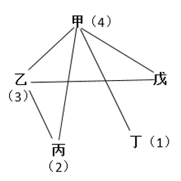

甲科室比赛了4场，对手分别为乙、丙、丁、戊科室，丁科室比赛了1场，则对手只能是甲科室，乙科室比赛了3场，对手没有丁科室，只能是甲、丙、戊科室。因此，比赛总共有甲-乙、甲-丙、甲-丁、甲-戊、乙-戊、乙-丙6场。

故正确答案为C。

**来源**：2015年新疆生产建设兵团面向社会招录公务员考试《行测》题（网友回忆版）第40题

### 第 41 题

某种产品每箱中个数相等，将1箱这种产品按照每盒47个的方式重新装盒，最后剩15个；如果将10箱这种产品按照每盒47个重新装盒，问最后剩多少个？

A. 9

B. 29

C. 36

D. 39

第 41 题 · 答案与解析

**参考答案（粉笔题库参考内容）**

A

**解析**

根据1箱产品装盒剩15个，可知10箱产品以同样方式装盒剩10×15=150个。剩余的150个产品继续每盒装47个，则有150÷47=3······9个，即最后剩9个。

故正确答案为A。

**考点**：和差倍比问题

**来源**：2015年新疆生产建设兵团面向社会招录公务员考试《行测》题（网友回忆版）第41题

### 第 42 题

有5个数，其中任何三个数的平均值分别是0、1、2、2、3、3、4、4、5、6，则这5个数的平均值为多少？

A. 2.5

B. 3

C. 3.5

D. 4

第 42 题 · 答案与解析

**参考答案（粉笔题库参考内容）**

B

**解析**

由题意得，任意3个数相加之和为（0+1+2+2+3+3+4+4+5+6）×3=90。5个数中任意3个数求平均值，则每个数参与了C_(5-1)^2=6次，相加之和为总数的6倍，故5个数的总和=90÷6=15，平均值=15÷5=3。

故正确答案为B。

**来源**：2015年新疆生产建设兵团面向社会招录公务员考试《行测》题（网友回忆版）第42题

### 第 43 题

小王参加电视台的一个智力竞赛节目。节目共有20道快速问答，答对一题得10分，答错或不答均倒扣10分，每人开始有基础分100分。小王最后成绩为220分，问他有几道题没答对？

A. 5

B. 6

C. 3

D. 4

第 43 题 · 答案与解析

**参考答案（粉笔题库参考内容）**

D

**解析**

设小王有x道题没答对，则有（20-x）道题答对。根据题意可列式：100+10（20-x）-10x=220，解得x=4。

故正确答案为D。

**考点**：和差倍比问题

**来源**：2015年新疆生产建设兵团面向社会招录公务员考试《行测》题（网友回忆版）第43题

### 第 44 题

A、B两个仓库分别存放有8台和12台挖掘机，现需要往C工地和D工地各运10台挖掘机。A仓库到C工地的运输费用为600元/台，到D工地的费用为900元/台；B仓库到C工地的运输费用为400元/台，到D工地的费用为800元/台。问要将20台挖掘机运到两个工地，至少需要花运输费多少元？

A. 14400

B. 13600

C. 12800

D. 12000

第 44 题 · 答案与解析

**参考答案（粉笔题库参考内容）**

C

**解析**

根据题意，列表如下：

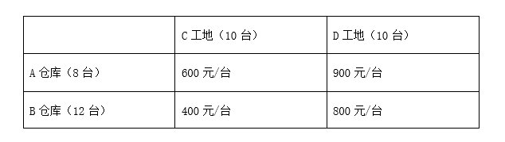

可知B仓库运输到C工地的费用最低，故应优先从B仓库运输10台挖掘机到C工地，运输费为400×10=4000元。此时B仓库剩余12-10=2台应运到D工地，运输费为800×2=1600元，故A仓库8台运到D工地，运输费为900×8=7200元。故要将20台挖掘机运到两个工地，至少需要花运输费为4000+1600+7200=12800元。

故正确答案为C。

**考点**：统筹规划问题

**来源**：2015年新疆生产建设兵团面向社会招录公务员考试《行测》题（网友回忆版）第44题

### 第 45 题

一列8节编组的动车从始发站开出，在7节80个位置的二等座车厢中，有6节上座率达到60%，另一节80%；在1节一等座车厢中，40个位置仅有8名旅客。则该列车从始发站开出时的上座率是多少？

A. 56%

B. 60%

C. 64%

D. 65%

第 45 题 · 答案与解析

**参考答案（粉笔题库参考内容）**

B

**解析**

由题意可知，一列8节编组的动车由7节80个位置的二等座车厢和1节40个位置的一等座车厢组成，可知动车共有7×80+40=600个座位。根据7节80个位置的二等座车厢中，有6节上座率达到60%，另一节80%，可知二等座的旅客人数为6×80×60%+80×80%=288+64=352人。根据1节一等座车厢中仅有8名旅客，可知动车共有352+8=360名旅客。故该列车从始发站开出时的上座率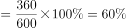。

故正确答案为B。

**考点**：和差倍比问题

**来源**：2015年新疆生产建设兵团面向社会招录公务员考试《行测》题（网友回忆版）第45题

### 第 46 题

某停车场有三排停车位，每排的停车位数量相同。管理员发现如果只使用两排停车位，能够停放的车辆数正好与使用三排停车位、但每排空出6个车位停放的车辆数相同。问：该停车场共有多少个停车位？

A. 36

B. 42

C. 48

D. 54

第 46 题 · 答案与解析

**参考答案（粉笔题库参考内容）**

D

**解析**

设停车场每排有x个停车位，根据只使用两排停车位与使用三排停车位、但每排空出6个车位停放的车辆数相同，可列方程：2x=3（x-6），解得x=18。故该停车场共有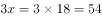个停车位。

故正确答案为D。

**考点**：和差倍比问题

**来源**：2015年新疆生产建设兵团面向社会招录公务员考试《行测》题（网友回忆版）第46题

### 第 47 题

某校计算机学院学生组成的正方形实心方阵参加学校体育节开幕式，能组成的最大方阵最外层人数为48人。问该学院的学生人数在以下哪个范围内？

A. 144到155之间

B. 156到168之间

C. 169到195之间

D. 大于195

第 47 题 · 答案与解析

**参考答案（粉笔题库参考内容）**

C

**解析**

根据题意，能组成的最大方阵最外层人数为48人，则最外层每一排有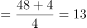人，正方形实心方阵总人数为13×13=169人，故学院学生人数在C项范围内。

故正确答案为C。

**来源**：2015年新疆生产建设兵团面向社会招录公务员考试《行测》题（网友回忆版）第47题

### 第 48 题

甲、乙两支工程队负责高校自来水管道改造工作，如果由甲队或乙队单独施工，预计分别需要20和30天完成。实际工作中一开始由甲队单独施工，10天后乙队加入。问工程从开始到结束共用时多少天？

A. 15

B. 16

C. 18

D. 25

第 48 题 · 答案与解析

**参考答案（粉笔题库参考内容）**

B

**解析**

根据题意，赋值该项工程的工作总量为20和30的最小公倍数60，则甲队的效率=60/20=3，乙队的效率=60/30=2。甲队单独施工10天完成的工作量=3×10=30，剩余工作量=60-30=30，甲、乙两队完成剩余任务还需30/(3+2)=6天，故该项工程从开始到结束共用时10+6=16天。

故正确答案为B。

**考点**：给完工时间型

**来源**：2015年新疆生产建设兵团面向社会招录公务员考试《行测》题（网友回忆版）第48题

### 第 49 题

李木在某次考试中，课程甲和课程乙得178分，课程丙和课程丁得171分，课程乙和课程丙得174分，课程丁比课程甲高1分。问李木四门课程中哪门课程得分最高？

A. 课程甲

B. 课程乙

C. 课程丙

D. 课程丁

第 49 题 · 答案与解析

**参考答案（粉笔题库参考内容）**

B

**解析**

根据题意，可列方程组：甲+乙=178······①，丙+丁=171······②，乙+丙=174······③，比较①③，可推出甲＞丙；比较②③，可推出乙＞丁。根据条件“课程丁比课程甲高1分”，可推出丁＞甲，综上得出乙＞丁＞甲＞丙，故李木课程乙得分最高。

故正确答案为B。

**考点**：和差倍比问题

**来源**：2015年新疆生产建设兵团面向社会招录公务员考试《行测》题（网友回忆版）第49题

### 第 50 题

某大学生从学校骑车至某小区，学校与该小区仅相隔一个山坡。从学校直接上坡，再下坡即到达该小区。已知下坡速度是上坡速度的2.5倍，下坡所花时间是上坡时间的一半。若返回时的上下坡速度仍保持不变，则从小区返回学校花费时间与学校到小区花费时间之比为：

A. 11：10

B. 10：11

C. 12：11

D. 11：12

第 50 题 · 答案与解析

**参考答案（粉笔题库参考内容）**

A

**解析**

设上坡速度为v，从学校到小区的上坡时间为2t，根据题意得，下坡速度为2.5v，下坡时间为t，则从学校到小区花费时间共2t+t=3t。由于返回时上下坡速度不变，原下坡路变为上坡路，故从小区到学校上坡时间为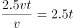；同理，下坡时间为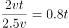，则从小区返回学校花费时间共2.5t+0.8t=3.3t。所求时间比为3.3t：3t=11：10。

故正确答案为A。

**考点**：普通行程

**来源**：2015年新疆生产建设兵团面向社会招录公务员考试《行测》题（网友回忆版）第50题

### 第 51 题

学校图书馆有三大书架，共放书若干册。从第一个书架拿出与第二个书架相同册数的书并列入第二个书架；再从第二个书架拿出与第三个书架相同册数的书并列入第三个书架。最后从第三个书架拿出与第一个书架剩下的册数相同的书并列入第一个书架。此时三个书架的书册数正好完全相同。问原来第一个书架和第三个书架的书本册数之比为：

A. 1∶1

B. 3∶2

C. 8∶5

D. 11∶6

第 51 题 · 答案与解析

**参考答案（粉笔题库参考内容）**

D

**解析**

设原来第一个书架的书册数为x，第二个书架的书册数为y，第三个书架的书册数为z。根据题意，可列方程为：2（x-y）=2y-z=2z-（x-y），问原来第一个书架和第三个书架的书本册数之比，整理解得x：z=11：6。

故正确答案为D。

**考点**：和差倍比问题

**来源**：2015年新疆生产建设兵团面向社会招录公务员考试《行测》题（网友回忆版）第51题

### 第 52 题

舞蹈队的年龄之和是2654岁，其中年龄最大的不超过79岁；最小的不低于50岁，且最多有4个人彼此年龄相同，则这些人中至少有多少人的年龄不低于60岁？

A. 5

B. 6

C. 7

D. 8

第 52 题 · 答案与解析

**参考答案（粉笔题库参考内容）**

C

**解析**

根据题意得，若要不低于60岁的人最少，则需60岁以下的人要尽可能多。因最多有4个人年龄相同，且最小的不低于50岁，即50-59岁每个年龄各4人，共计（50+51+52+53+54+55+56+57+58+59）×4=545×4=2180岁，剩余年龄数为2654-2180=474岁。已知年龄不低于60岁的人，最大年龄为79岁，最小年龄为60岁，则所求人数的范围既要大于474÷79=6人，又要小于474÷60=7.9人，且为整数，故至少有7人。

故正确答案为C。

**考点**：非典型最值问题

**来源**：2015年新疆生产建设兵团面向社会招录公务员考试《行测》题（网友回忆版）第52题

### 第 53 题

在大小相等的两个等腰直角三角形中，按不同的方式各内接一个正方形（如图a、b所示）。如果图b中的内接正方形的面积是144，那么图a中的内接正方形的面积是多少？

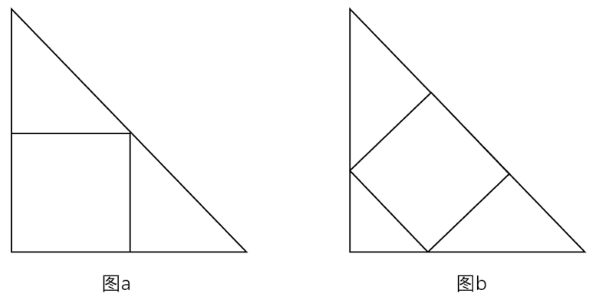

A. 225

B. 162

C. 128

D. 98

第 53 题 · 答案与解析

**参考答案（粉笔题库参考内容）**

B

**解析**

如图所示，图a与图b为两个大小相等的等腰直角三角形，则。在图b中，因内接正方形的面积是144，则内接正方形的边长为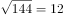，△AG_2D_2和△CE_2F_2均为等腰直角三角形，可得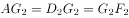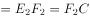，则G_2、F_2是AC的三等分点，即AC=3×12=36，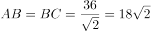；在图a中，△AF_1D_1为等腰直角三角形，可得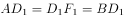，则D_1是AB的二等分点，即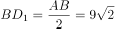，则图a中内接正方形的面积为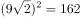。

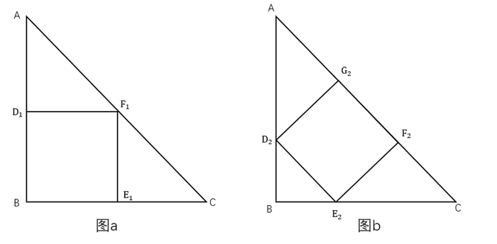

故正确答案为B。

**考点**：几何公式类-平面图形、几何结论类-三角形相关

**来源**：2015年新疆生产建设兵团面向社会招录公务员考试《行测》题（网友回忆版）第53题

### 第 54 题

从所给的四个选项中，选择最合适的一个填入问号处，使之呈现一定的规律性。

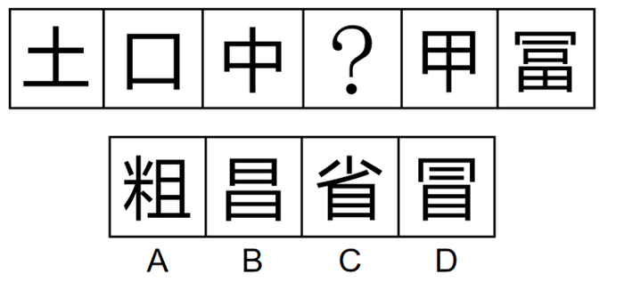

A. A

B. B

C. C

D. D

第 54 题 · 答案与解析

**参考答案（粉笔题库参考内容）**

D

**解析**

元素组成不同，优先考虑属性规律。观察发现，题干图形均为竖轴对称图形，排除A、C两项；继续观察发现，题干图形空白区域明显，考虑数面。题干图形的面数量依次为：0、1、2、？、4、5，故？处图形面数量应为3，排除B项。

故正确答案为D。

**考点**：数量规律-复合、文字/字母/数字类

**来源**：2015年新疆生产建设兵团面向社会招录公务员考试《行测》题（网友回忆版）第54题

### 第 55 题

从所给的四个选项中，选择最合适的一个填入问号处，使之呈现一定的规律性：

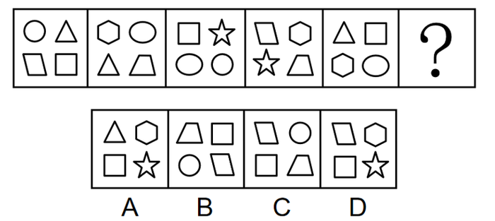

A. A

B. B

C. C

D. D

第 55 题 · 答案与解析

**参考答案（粉笔题库参考内容）**

C

**解析**

元素组成不同，且无明显属性规律，优先考虑数量规律。观察发现，题干图形均由4个不同的小图形构成，但根据种类和数量无法得出答案。继续观察发现，前一幅图形的右上角与下一幅图形的左下角小图形相同，且相邻两幅图形只有1个相同小图形，只有C项满足此规律。

故正确答案为C。

**考点**：数量规律-素

**来源**：2015年新疆生产建设兵团面向社会招录公务员考试《行测》题（网友回忆版）第55题

### 第 56 题

从所给的四个选项中，选择最合适的一个填入问号处，使之呈现一定的规律性：

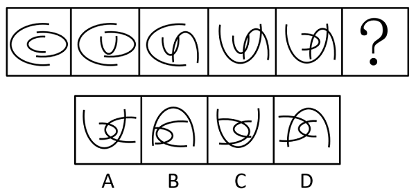

A. A

B. B

C. C

D. D

第 56 题 · 答案与解析

**参考答案（粉笔题库参考内容）**

A

**解析**

元素组成相同，优先考虑位置规律。观察发现，图1→图2，中弧形和大弧形不变，小弧形逆时针旋转90°，图2→图3，小弧形和大弧形不变，中弧形逆时针旋转90°，图3→图4，小弧形和中弧形不变，大弧形逆时针旋转90°，图4→图5，中弧形和大弧形不变，小弧形逆时针旋转90°，故图5→图6应为小弧形和大弧形不变，中弧形逆时针旋转90°，只有A项符合。

故正确答案为A。

**考点**：位置规律-旋转

**来源**：2015年新疆生产建设兵团面向社会招录公务员考试《行测》题（网友回忆版）第56题

### 第 57 题

以下哪一个图形是由左边的四个图形不经旋转、翻转直接拼接而成？

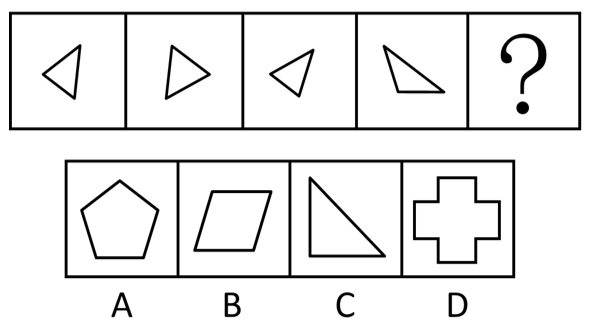

A. A

B. B

C. C

D. D

第 57 题 · 答案与解析

**参考答案（粉笔题库参考内容）**

A

**解析**

本题考查平面拼合，可采用平行且等长相消的方式解题。消去平行且等长的线段后进行组合即可得到轮廓图，即为A项。平行且等长相消的方式如下图所示：

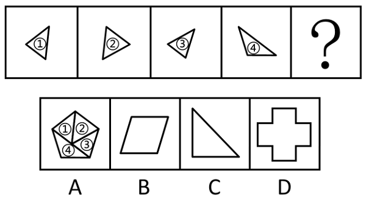

故正确答案为A。

**来源**：2015年新疆生产建设兵团面向社会招录公务员考试《行测》题（网友回忆版）第57题

### 第 58 题

左边给定的是纸盒外表的展开图，右边哪一项能由它折成？

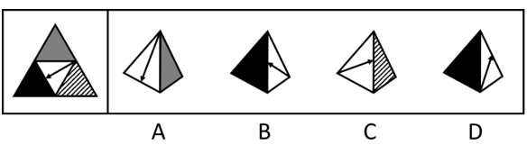

A. A

B. B

C. C

D. D

第 58 题 · 答案与解析

**参考答案（粉笔题库参考内容）**

B

**解析**

将题干展开图标上序号，如下图所示，逐一进行分析。

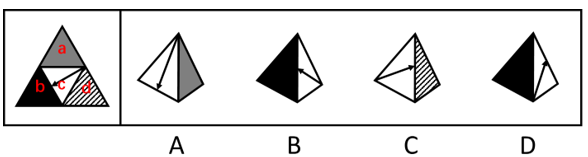

A项：选项由面a和面c构成，以面c中箭头尾端为起点沿面c顺时针画边，选项中边1对应面a，而展开图中边3对应面a，选项与题干展开图不一致，排除；

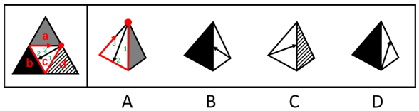

B项：选项由面b和面c构成，选项与题干展开图一致，当选；

C项：选项由面c和面d构成，选项中面c箭头指向面c和面d的公共边，而展开图中面c箭头指向面b和面c的公共边，选项与题干展开图不一致，排除；

D项：选项由面b和面c构成，选项中面c箭头没有指向面b和面c的公共边，而展开图中面c箭头指向面b和面c的公共边，选项与题干展开图不一致，排除。

故正确答案为B。

**来源**：2015年新疆生产建设兵团面向社会招录公务员考试《行测》题（网友回忆版）第58题

### 第 59 题

下面四个所给的选项中，哪一项能折成左边给定的图形？

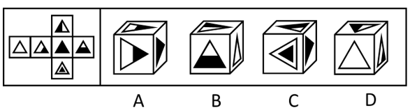

A. A

B. B

C. C

D. D

第 59 题 · 答案与解析

**参考答案（粉笔题库参考内容）**

B

**解析**

将题干展开图标上序号，如下图所示，逐一进行分析。

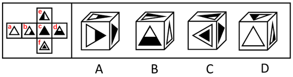

A项：选项中正面与展开图中面b三角形的指向不同，故该面在展开图中未出现，为无中生有面，选项与题干展开图不一致，排除；

B项：选项由面a、面d和面e构成，选项与题干展开图一致，当选；

C项：选项中顶面与展开图中面d三角形的指向不同，故该面在展开图中未出现，为无中生有面，选项与题干展开图不一致，排除；

D项：选项由面a、面b和面e构成，选项中面e内白色三角形更靠近三个面的公共点，而展开图中面e内黑色三角形更靠近三个面的公共点，选项与题干展开图不一致，排除。

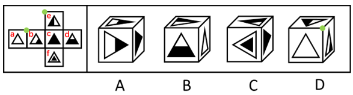

故正确答案为B。

**考点**：空间类-空间重构-六面体

**来源**：2015年新疆生产建设兵团面向社会招录公务员考试《行测》题（网友回忆版）第59题

### 第 60 题

把下面六个图形分为两类，使得每一类图形都有各自的共同特征或规律，分类正确的是：

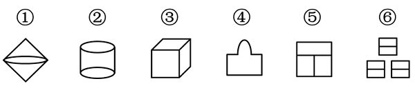

A. ①②③，④⑤⑥

B. ①④⑥，②③⑤

C. ①②④，③⑤⑥

D. ②③④，①⑤⑥

第 60 题 · 答案与解析

**参考答案（粉笔题库参考内容）**

C

**解析**

本题为分组分类题目。元素组成不同，优先考虑属性规律。观察发现，图①②④均为曲线+直线图形，图③⑤⑥均为全直线图形，即图①②④为一组，图③⑤⑥为一组。

故正确答案为C。

**考点**：属性规律-曲直性

**来源**：2015年新疆生产建设兵团面向社会招录公务员考试《行测》题（网友回忆版）第60题

### 第 61 题

把下面六个图形分为两类，使得每一类图形都有各自的共同特征或规律，分类正确的是：

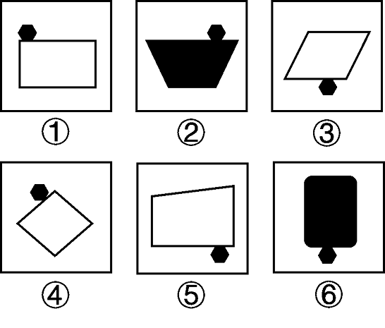

A. ①②③，④⑤⑥

B. ①③⑤，②④⑥

C. ①④⑤，②③⑥

D. ①②④，③⑤⑥

第 61 题 · 答案与解析

**参考答案（粉笔题库参考内容）**

D

**解析**

本题为分组分类题目。题干每幅图都有一个黑色的小六边形，优先考虑功能元素的标记作用。观察发现图①②④中的黑色小六边形都位于大图形的上方，图③⑤⑥中的黑色小六边形都位于大图形的下方，即图①②④为一组，图③⑤⑥为一组。

故正确答案为D。

**考点**：特殊规律-功能元素

**来源**：2015年新疆生产建设兵团面向社会招录公务员考试《行测》题（网友回忆版）第61题

### 第 62 题

把下面六个图形分为两类，使得每一类图形都有各自的共同特征或规律，分类正确的是：

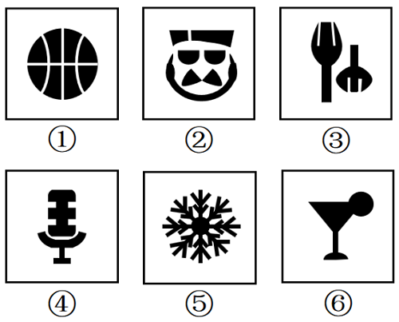

A. ①②⑤，③④⑥

B. ①③⑤，②④⑥

C. ①②④，③⑤⑥

D. ①④⑤，②③⑥

第 62 题 · 答案与解析

**参考答案（粉笔题库参考内容）**

D

**解析**

本题为分组分类题目。元素组成不同，优先考虑属性规律，观察发现，图①④⑤均存在明显的等腰元素，考虑对称性。图①④⑤是对称图形，图②③⑥不是对称图形，即图①④⑤为一组，图②③⑥为一组。

故正确答案为D。

**考点**：属性规律-对称性

**来源**：2015年新疆生产建设兵团面向社会招录公务员考试《行测》题（网友回忆版）第62题

### 第 63 题

把下面六个图形分为两类，使得每一类图形都有各自的共同特征或规律，分类正确的是：

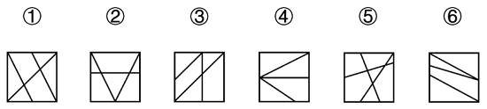

A. ①③⑥，②④⑤

B. ①②③，④⑤⑥

C. ①③④，②⑤⑥

D. ①②⑥，③④⑤

第 63 题 · 答案与解析

**参考答案（粉笔题库参考内容）**

A

**解析**

解法一：本题为分组分类题目。元素组成不同，且属性规律无法分组，考虑数量规律。题干图形均由直线构成，考虑数直线，但整体数直线无法分组，考虑线的细化考法。观察发现，题干图形均有相同的四边形外框，且框内均有三条线，但图①③⑥框内有两条线是平行的，图②④⑤框内三条线彼此相交，即图①③⑥为一组，图②④⑤为一组。

故正确答案为A。

解法二：元素组成不同，且无明显属性规律，考虑数量规律。观察发现，题干图形中封闭空间明显，考虑数面，分别为6、6、5、4、7、4，无明显规律。继续观察发现，题干图形都有外框，且内部线条均与外框相交考虑数框上交点，分别为6、5、5、4、6、5，图①③④面数量与框上交点数量相等，图②⑤⑥面数量与框上交点数量之差的绝对值为1。即图①③④一组，图②⑤⑥一组。

故正确答案为C。

注：本题不严谨，两种规律都不是特别好，故在备考阶段本题不做为备考重点。

**考点**：数量规律-线

**来源**：2015年新疆生产建设兵团面向社会招录公务员考试《行测》题（网友回忆版）第63题

### 第 64 题

注意是心理活动或意识对一定对象的指向与集中。随意注意是指事先有预定目的、需要一定意志努力的注意。

根据上述定义，下列属于随意注意的是：

A. 喧闹的步行街上五彩缤纷的霓虹灯吸引了周大爷的目光

B. 余小军有次偶然听到《蓝色多瑙河》，之后迷上了古典音乐

C. 安静的图书馆内一个小女孩突然哭喊引起黄小红的关注

D. 为探索钟摆现象的规律，伽利略观看吊灯在微风下摆动

第 64 题 · 答案与解析

**参考答案（粉笔题库参考内容）**

D

**解析**

第一步：找出定义关键词。

注意：“心理活动或意识”、“对一定对象的指向与集中”；

随意注意：“事先有预定目的”、“需要一定意志努力的注意”。

第二步：逐一分析选项。

A项：被五彩缤纷的霓虹灯吸引目光，是没有预定目的的，也不需要意志努力，不符合“事先有预定目的”、“需要一定意志努力的注意”，不符合定义，排除；

B项：偶然听到《蓝色多瑙河》，是没有预定目的的，不符合“事先有预定目的”，不符合定义，排除；

C项：小女孩突然哭喊引起的关注，是没有预定目的的，不符合“事先有预定目的”，不符合定义，排除；

D项：为探索钟摆现象的规律去观看吊灯在微风下摆动，是事先有预定目的的，也需要一定意志努力，符合“事先有预定目的”、“需要一定意志努力的注意”，符合定义，当选。

故正确答案为D。

**考点**：常规问法

**来源**：2015年新疆生产建设兵团面向社会招录公务员考试《行测》题（网友回忆版）第64题

### 第 65 题

微捐是指人们把日积月累、零散攒的钱捐助出去的一种慈善行为。

根据上述定义，下列不属于微捐的是：

A. 某店老板在柜台前放了一个零钱捐助箱，每到年底就将箱中的钱捐给红十字会

B. 小李近10年来一直坚持每年献血两次，每次300毫升，他觉得这样做很有意义

C. 大学生小张业余时间做钟点工，所得钱款一部分用来交学费，一部分捐给希望工程

D. 小毛在某电视台的一次捐助活动中，将积攒多年的5000元压岁钱捐了出去

第 65 题 · 答案与解析

**参考答案（粉笔题库参考内容）**

B

**解析**

第一步：找出定义关键词。

“把日积月累、零散攒的钱捐助出去”。

第二步：逐一分析选项。

A项：老板每到年底将零钱捐助箱中的钱捐给红十字会，捐出去的是日积月累的零散钱，符合“把日积月累、零散攒的钱捐助出去”，符合定义，排除；

B项：小李近十年来一直坚持献血，但小李捐赠的是血液而不是钱，不符合“把日积月累、零散攒的钱捐助出去”，不符合定义，当选；

C项：小张将自己做钟点工所得的一部分钱捐给希望工程，捐出去的是日积月累的钱，符合“把日积月累、零散攒的钱捐助出去”，符合定义，排除；

D项：小毛将积攒多年的压岁钱捐出去，捐出去的压岁钱是日积月累的钱，符合“把日积月累、零散攒的钱捐助出去”，符合定义，排除。

本题为选非题，故正确答案为B。

**考点**：方式目的

**来源**：2015年新疆生产建设兵团面向社会招录公务员考试《行测》题（网友回忆版）第65题

### 第 66 题

负概念是反应对象不具有某种属性的概念。

根据上述定义，下列不属于负概念的是：

A. 未成年人

B. 无形资产

C. 负债

D. 无罪

第 66 题 · 答案与解析

**参考答案（粉笔题库参考内容）**

C

**解析**

第一步：找出定义关键词。

“反应对象不具有某种属性”。

第二步：逐一分析选项。

A项：“未成年人”是指没有成年的人，不具有“成年”的属性，符合定义，排除；

B项：“无形资产”是指没有实物形态的可辨认非货币性资产，不具有“有形资产”的属性，符合定义，排除；

C项：“负债”是指企业承担的能以货币计量，需要以资产或劳务偿还的债务，此处的“负”是指背负，即具有“债务”的属性，不符合定义，当选；

D项：“无罪”是指没有犯罪，不具有“犯罪”的属性，符合定义，排除。

本题为选非题，故正确答案为C。

**考点**：单定义-其他句式

**来源**：2015年新疆生产建设兵团面向社会招录公务员考试《行测》题（网友回忆版）第66题

### 第 67 题

机会成本，又称择一成本。任何决策必须做出一定的选择，被舍弃掉的选择中的最高价值即是这次决策的机会成本。

根据上述定义，下列不属于机会成本的是：

A. 小李把自己空闲的房屋出租给了同学小孙

B. 赵某整个假期都泡在图书馆学习，没有外出游玩

C. 小王收到录取通知书后没有去大学报到，而是选择了去广州打工

D. 钱老板关闭了自己的服装加工厂，把所有的钱都购买商品房期待升值

第 67 题 · 答案与解析

**参考答案（粉笔题库参考内容）**

A

**解析**

第一步：找出定义关键词。

“被舍弃掉的选择中的最高价值”。

第二步：逐一分析选项。

A项：小李把空闲的房屋出租，其中不涉及被舍弃掉的选择，不符合“被舍弃掉的选择中的最高价值”，不符合定义，当选；

B项：赵某在图书馆学习，而没有外出游玩，其中外出游玩是被舍弃掉的选择，符合“被舍弃掉的选择中的最高价值”，符合定义，排除；

C项：小王选择了去打工，而没有去大学报到，其中去大学报到是被舍弃掉的选择，符合“被舍弃掉的选择中的最高价值”，符合定义，排除；

D项：钱老板把所有的钱都购买商品房，而关闭了服装加工厂，其中服装加工厂是被舍弃掉的选择，符合“被舍弃掉的选择中的最高价值”，符合定义，排除。

本题为选非题，故正确答案为A。

**考点**：单定义-其他句式

**来源**：2015年新疆生产建设兵团面向社会招录公务员考试《行测》题（网友回忆版）第67题

### 第 68 题

报复陷害罪，是指国家机关工作人员滥用职权，假公济私，对控告人、申诉人、批评人、举报人实行报复陷害的行为。

根据上述定义，下列属于报复陷害罪的是：

A. 市委办公室主任李某被下属举报贪污受贿，怀恨在心，雇佣打手对其进行报复

B. 校董事会主席张小川怀疑某学院院长举报自己学术造假，便利用董事会力量将该院长撤职

C. 警察王某的家人曾被黑社会成员孙某威胁过，王某成功抓捕孙某之后对其实施殴打

D. 安全局干事小李举报王主任徇私舞弊之后，王主任制造伪证，导致小李因泄密罪被捕

第 68 题 · 答案与解析

**参考答案（粉笔题库参考内容）**

D

**解析**

第一步：找出定义关键词。

“国家机关工作人员”、“滥用职权，假公济私”、“对控告人、申诉人、批评人、举报人实行报复陷害”。

第二步：逐一分析选项。

A项：市委办公室主任李某雇佣打手是私下行为，不符合“滥用职权，假公济私”，不符合定义，排除；

B项：校董事会主席不属于“国家机关工作人员”，不符合定义，排除；

C项：黑社会成员孙某的行为是威胁他人，故孙某不属于“控告人、申诉人、批评人、举报人”，警察王某的行为不符合“对控告人、申诉人、批评人、举报人实行报复陷害”，不符合定义，排除；

D项：安全局王主任符合“国家机关工作人员”，安全局干事小李举报王主任徇私舞弊，其中小李属于举报人，王主任制造伪证导致小李因泄密罪被捕，符合“滥用职权，假公济私”、“对控告人、申诉人、批评人、举报人实行报复陷害”，符合定义，当选。

故正确答案为D。

**考点**：方式目的

**来源**：2015年新疆生产建设兵团面向社会招录公务员考试《行测》题（网友回忆版）第68题

### 第 69 题

定向思维是指根据以往的知识经验形成的方向、方法或程序进行思维活动的过程，与发散思维相对。

根据上述定义，下列不属于定向思维的是：

A. 衣服破了，想到用针线包缝补衣服

B. 见到梳着辫子的人便断定这个人是女性

C. 杯子用完了，用碗代替杯子喝水

D. 北京的桃花开了，所以春天到了

第 69 题 · 答案与解析

**参考答案（粉笔题库参考内容）**

C

**解析**

第一步：找出定义关键词。

“根据以往的知识经验形成的方向、方法或程序进行思维活动”。

第二步：逐一分析选项。

A项：该项中衣服破了，想到用针线包缝补衣服，是根据过去衣服破了用针线包缝补的经验做出的选择，符合“根据以往的知识经验形成的方向、方法或程序进行思维活动”，符合定义，排除；

B项：该项中见到梳着辫子的人便断定这个人是女性，是根据过去女生才梳着辫子的经验做出的判断，符合“根据以往的知识经验形成的方向、方法或程序进行思维活动”，符合定义，排除；

C项：该项中杯子用完了，用碗代替杯子喝水，打破了只有杯子是用来喝水的惯性思维，不符合“根据以往的知识经验形成的方向、方法或程序进行思维活动”，不符合定义，当选；

D项：该项中北京的桃花开了，所以春天到了，是根据过去的经验得出的结论，符合“根据以往的知识经验形成的方向、方法或程序进行思维活动”，符合定义，排除。

本题为选非题，故正确答案为C。

**考点**：方式目的

**来源**：2015年新疆生产建设兵团面向社会招录公务员考试《行测》题（网友回忆版）第69题

### 第 70 题

环保产业是国民经济结构中以防治环境污染、改善生态环境、保护自然资源为目的所进行的技术开发、产品生产、商业流通、资源利用、信息服务、技术咨询、工程承包等活动的总称。

根据上述定义，下列不属于环保产业的是：

A. 某企业与国外知名环保公司合作，专注于含重金属废水处理设备的研发

B. 某环保职业技术学院设立信息咨询中心，为企业提供污染防治技术咨询

C. 某大型矿业公司新成立下属综合回收公司，用于尾矿的综合利用

D. 某绿色食品生产企业为提高产品质量，规范了质量标准和生产技术流程

第 70 题 · 答案与解析

**参考答案（粉笔题库参考内容）**

D

**解析**

第一步：找出定义关键词。

“以防治环境污染、改善生态环境、保护自然资源为目的”、“进行的技术开发、产品生产、商业流通、资源利用、信息服务、技术咨询、工程承包等活动”。

第二步：逐一分析选项。

A项：研发含重金属废水处理设备属于技术开发，符合“进行的技术开发、产品生产、商业流通、资源利用、信息服务、技术咨询、工程承包等活动”，目的是防治环境污染、改善生态环境、保护自然资源，符合“以防治环境污染、改善生态环境、保护自然资源为目的”，符合定义，排除；

B项：环保职业技术学院为企业提供污染防治技术咨询属于技术咨询，符合“进行的技术开发、产品生产、商业流通、资源利用、信息服务、技术咨询、工程承包等活动”，目的是防治环境污染、改善生态环境、保护自然资源，符合“以防治环境污染、改善生态环境、保护自然资源为目的”，符合定义，排除；

C项：成立综合回收公司用于尾矿属于资源综合利用，符合“进行的技术开发、产品生产、商业流通、资源利用、信息服务、技术咨询、工程承包等活动”，目的是防治环境污染、改善生态环境、保护自然资源，符合“以防治环境污染、改善生态环境、保护自然资源为目的”，符合定义，排除；

D项：企业规范质量标准和生产技术流程的目的是提高产品质量，不是为了防治环境污染、改善生态环境、保护自然资源，不符合“以防治环境污染、改善生态环境、保护自然资源为目的”，不符合定义，当选。

本题为选非题，故正确答案为D。

**考点**：方式目的

**来源**：2015年新疆生产建设兵团面向社会招录公务员考试《行测》题（网友回忆版）第70题

### 第 71 题

书证是指以记载内容或表达思想来证明案件事实的证据。

根据上述定义，下列属于书证的是：

A. 凶手用于砸伤受害者头部的厚重辞典

B. 司法机关指定的医院出具的轻伤鉴定

C. 死者临终前用鲜血在地上写下凶手的名字的缩写

D. 车祸现场死者留下的日记

第 71 题 · 答案与解析

**参考答案（粉笔题库参考内容）**

B

**解析**

第一步：找出定义关键词。

“以记载内容或表达思想”、“证明案件事实”。

第二步：逐一分析选项。

A项：砸伤受害者的辞典属于作案工具，该辞典内并未记载内容来证明案件事实，不符合“以记载内容或表达思想”、“证明案件事实”，不符合定义，排除；

B项：司法机关指定的医院出具的轻伤鉴定可以用以记载内容的方式来证明案件事实，符合“以记载内容或表达思想”、“证明案件事实”，符合定义，当选；

C项：凶手名字的缩写具有不确定性，无法直接作为证明案件事实的证据，不符合“证明案件事实”，不符合定义，排除；

D项：死者日记内记载的内容不明确是否与车祸案件有关，不符合“证明案件事实”，不符合定义，排除。

故正确答案为B。

**考点**：方式目的

**来源**：2015年新疆生产建设兵团面向社会招录公务员考试《行测》题（网友回忆版）第71题

### 第 72 题

抽象行政行为是指行政机关针对不特定的对象作出的具有普遍约束力的决定和命令的行为。

根据上述定义，下列属于抽象行政行为的是：

A. 某市政府出台了车辆按尾号限行的交管措施

B. 天然气公司规定，凡要安装天然气的用户必须购买“天飞”牌灶具

C. 某夜，交警部门集中整治醉酒驾车，对几十名司机进行了处罚

D. 某市规划局批准某房地产开发公司建造商品房

第 72 题 · 答案与解析

**参考答案（粉笔题库参考内容）**

A

**解析**

第一步：找出定义关键词。

“行政机关”、“针对不特定的对象”、“具有普遍约束力的决定和命令”。

第二步：逐一分析选项。

A项：某市政府属于行政机关，且车辆按尾号限行的交管措施没有针对特定的对象，符合“行政机关”、“针对不特定的对象”、“具有普遍约束力的决定和命令”，符合定义，当选；

B项：天然气公司不符合“行政机关”，不符合定义，排除；

C项：交警部门对几十名醉酒驾车的司机进行了处罚，这些司机属于特定的对象，不符合“针对不特定的对象”，不符合定义，排除；

D项：某市规划局批准某房地产开发公司建造商品房，该房地产开发公司属于特定的对象，不符合“针对不特定的对象”，不符合定义，排除。

故正确答案为A。

**考点**：单定义-其他句式

**来源**：2015年新疆生产建设兵团面向社会招录公务员考试《行测》题（网友回忆版）第72题

### 第 73 题

占有改定是指动产物权转让时，双方又约定由出让人继续占有该动产的，物权自该转让约定生效时发生效力。

根据上述定义，下列属于占有改定的是：

A. 甲把其出租的家具卖给乙，但由于租赁期未满，暂时无法收回家具，甲把家具的返还请求权让与乙

B. 商场工作人员在使用中不慎将电视台租借的摄像机摔坏，商场以原价购买了该台摄像机

C. 甲将自己的房子卖给租客乙，并办理了过户手续，乙因回老家处理事情，暂时没有入住，甲于是继续住在该房子里

D. 甲将自己所有的一套书卖给乙，在交付该书时，甲还想再看一段时间，遂又与乙达成协议，借阅该书15天，乙表示答应

第 73 题 · 答案与解析

**参考答案（粉笔题库参考内容）**

D

**解析**

第一步：找出定义关键词。

“动产物权转让时”、“双方又约定由出让人继续占有该动产”、“物权自该转让约定生效时发生效力”。

第二步：逐一分析选项。

A项：甲把其出租的家具卖给乙，其中甲是出让人，但家具已不被甲占有，不符合“双方又约定由出让人继续占有该动产”，不符合定义，排除；

B项：该项只提到了商场以原价购买了该台摄像机，未提及双方的约定，不符合“双方又约定由出让人继续占有该动产”，不符合定义，排除；

C项：甲将自己的房子卖给租客乙，其中房子属于不动产，不符合“动产物权转让时”，不符合定义，排除；

D项：甲将自己所有的一套书卖给乙，符合“动产物权转让时”，其中甲是出让人，甲、乙又约定甲借阅该书15天，故这套书继续被甲占有，符合“双方又约定由出让人继续占有该动产”、“物权自该转让约定生效时发生效力”，符合定义，当选。

故正确答案为D。

**考点**：大前提

**来源**：2015年新疆生产建设兵团面向社会招录公务员考试《行测》题（网友回忆版）第73题

### 第 74 题

购物：银行卡

A. 开车：方向盘

B. 烹饪：天然气

C. 奔跑：运动鞋

D. 旅游：导航仪

第 74 题 · 答案与解析

**参考答案（粉笔题库参考内容）**

B

**解析**

第一步：判断题干词语间逻辑关系。

购物一定需要支付，银行卡是支付的方式之一，二者为对应关系。

第二步：判断选项词语间逻辑关系。

A项：方向盘是用来开车的工具，二者为工具对应关系，与题干逻辑关系不一致，排除；

B项：烹饪一定需要能源，天然气是能源之一，二者为对应关系，与题干逻辑关系一致，当选；

C项：运动鞋是用来奔跑的工具，二者为工具对应关系，与题干逻辑关系不一致，排除；

D项：导航仪是用来旅游的工具，二者为工具对应关系，与题干逻辑关系不一致，排除。

故正确答案为B。

**考点**：逻辑关系-对应关系

**来源**：2015年新疆生产建设兵团面向社会招录公务员考试《行测》题（网友回忆版）第74题

### 第 75 题

快递员：送货

A. 护士：坐诊

B. 学生：考试

C. 律师：辩论

D. 歌手：唱歌

第 75 题 · 答案与解析

**参考答案（粉笔题库参考内容）**

D

**解析**

第一步：判断题干词语间逻辑关系。

“快递员”的主要工作内容是“送货”，二者为职业与工作内容的对应关系。

第二步：判断选项词语间逻辑关系。

A项：“坐诊”是“医生”的主要工作内容，而非“护士”，二者不是职业与工作内容的对应关系，与题干逻辑关系不一致，排除；

B项：“学生”的主要任务是“学习”，而非“考试”，二者不是职业与工作内容的对应关系，与题干逻辑关系不一致，排除；

C项：“律师”的主要工作内容是为委托人“辩护”，而非“辩论”，二者不是职业与工作内容的对应关系，与题干逻辑关系不一致，排除；

D项：“歌手”的主要工作内容是“唱歌”，二者为职业与工作内容的对应关系，与题干逻辑关系一致，当选。

故正确答案为D。

**考点**：逻辑关系-对应关系

**来源**：2015年新疆生产建设兵团面向社会招录公务员考试《行测》题（网友回忆版）第75题

### 第 76 题

航空母舰：军舰：海洋

A. 轰炸机：战机：天空

B. 宇宙飞船：空间站：太空

C. 坦克：导弹：陆地

D. 潜艇：鱼雷：海洋

第 76 题 · 答案与解析

**参考答案（粉笔题库参考内容）**

A

**解析**

第一步：判断题干词语间逻辑关系。

“航空母舰”是作为海军飞机海上活动基地的大型“军舰”，前两个词为种属关系，“航空母舰”和“军舰”均在“海洋”上行动，前两个词与第三个词是活动场所的对应关系。

第二步：判断选项词语间逻辑关系。

A项：“轰炸机”是从空中对地面或水上、水下目标进行轰炸的飞机，“轰炸机”是“战机”的一种，前两个词为种属关系，“轰炸机”和“战机”均在“天空”中行动，前两个词与第三个词是活动场所的对应关系，与题干逻辑关系一致，当选；

B项：“宇宙飞船”是从地球上发射出去、能在宇宙空间航行的飞行器；“空间站”是一种在近地轨道长时间运行、可供航天员巡访、长期工作和生活的载人航天器，二者为并列关系，与题干逻辑关系不一致，排除；

C项：“坦克”与“导弹”都是武器的一种，二者为并列关系，与题干逻辑关系不一致，排除；

D项：“潜艇”是主要在水面下进行作战等活动的舰艇，以“鱼雷”或导弹等袭击敌人舰船和岸上目标，并担任战役侦察，二者为对应关系，与题干逻辑关系不一致，排除。

故正确答案为A。

**考点**：逻辑关系-包容关系、逻辑关系-对应关系

**来源**：2015年新疆生产建设兵团面向社会招录公务员考试《行测》题（网友回忆版）第76题

### 第 77 题

树根 对于 （    ） 相当于 （    ） 对于 楼房

A. 树叶；房梁

B. 大树；地基

C. 树干；屋顶

D. 大树；大楼

第 77 题 · 答案与解析

**参考答案（粉笔题库参考内容）**

B

**解析**

逐一代入选项。

A项：“树根”和“树叶”均是树的组成部分，二者为反对关系；“房梁”是“楼房”的组成部分，二者为组成关系，前后逻辑关系不一致，排除；

B项：“树根”是“大树”的组成部分，二者为组成关系；“地基”是“楼房”底部用于承担楼房重量的部分，二者为组成关系，前后逻辑关系一致，当选；

C项：“树根”和“树干”均是树的组成部分，二者为反对关系；“屋顶”是“楼房”的组成部分，二者为组成关系，前后逻辑关系不一致，排除；

D项：“树根”是“大树”的组成部分，二者为组成关系；“大楼”是面积较大、楼层较多的“楼房”，二者为种属关系，前后逻辑关系不一致，排除。

故正确答案为B。

**考点**：逻辑关系-包容关系

**来源**：2015年新疆生产建设兵团面向社会招录公务员考试《行测》题（网友回忆版）第77题

### 第 78 题

规则 对于 （    ） 相当于 思想 对于 （    ）

A. 规矩；交流

B. 固定；语言

C. 制定；传播

D. 法律；梦想

第 78 题 · 答案与解析

**参考答案（粉笔题库参考内容）**

C

**解析**

逐一代入选项。

A项：“规则”指规定出来供大家共同遵守的制度或章程，也指规律、法则，“规矩”借指一定的标准、法则或习惯，二者是近义关系；交流思想，二者是动宾关系，前后逻辑关系不一致，排除；

B项：“固定”是“规则”的属性，二者是属性对应关系；“语言”是交流“思想”的载体，二者是载体对应关系，前后逻辑关系不一致，排除；

C项：制定规则，传播思想，二者均是动宾关系，前后逻辑关系一致，当选；

D项：“法律”是由立法机关或国家机关制定，国家政权保证执行的行为“规则”的总和，“法律”是一种“规则”，二者是种属关系；“思想”与“梦想”不是种属关系，前后逻辑关系不一致，排除。

故正确答案为C。

**考点**：语法关系

**来源**：2015年新疆生产建设兵团面向社会招录公务员考试《行测》题（网友回忆版）第78题

### 第 79 题

歌唱和舞蹈在各个人类氏族部落中是一种普遍共同的现象，它所造成的巨大优势效应就是使人群能够保持团结，解决各种内部纷争，能够更加有效地捍卫自己的领土。

上述结论要想成立，必须补充以下哪项作为前提？

A. 歌唱和舞蹈具有使所有参与者逐步忘却与他人间的矛盾，和平相处的功效

B. 歌唱和舞蹈具有调动所有参与者情绪，令人兴奋的功效

C. 歌唱和舞蹈具有使所有参与者忘却阶层差别和等级关系的功效

D. 歌唱和舞蹈具有心理安慰的功效，可以使所有参与者忘却现实困扰

第 79 题 · 答案与解析

**参考答案（粉笔题库参考内容）**

A

**解析**

第一步：找出论点和论据。

论点：歌唱和舞蹈在各个人类氏族部落中是一种普遍共同的现象，它所造成的巨大优势效应就是使人群能够保持团结，解决各种内部纷争，能够更加有效地捍卫自己的领土。

论据：无。

本题只有论点没有论据，且问法为“前提”，加强优先考虑必要条件。

第二步：逐一分析选项。

A项：该项指出歌唱和舞蹈能让所有参与者忘却与他人间的矛盾、和平共处，如果歌唱和舞蹈不能让人忘却与他人间的矛盾，也无法跟他人和平共处，那么就无法通过歌唱和舞蹈使所有参与者保持团结，解决各种内部纷争，有效捍卫自己的领土，否定之后论点无法成立，是论点成立的必要条件，可以加强，当选；

B项：该项指出歌唱和舞蹈能够调动情绪、令人兴奋，但情绪上的变化不一定能让所有参与者团结起来，解决内部纷争，有效捍卫自己的领土，为不明确项，无法加强，排除；

C项：该项指出歌唱和舞蹈能够让所有参与者忘却阶层差别和等级关系，如果歌唱和舞蹈不能让人忘却阶层差别和等级关系，那么即使明知存在阶层差别和等级关系，人们还是可以保持团结，也可以解决内部纷争，否定之后论点依然成立，不是论点成立的必要条件，无法加强，排除；

D项：该项指出歌唱和舞蹈可以让所有参与者忘却现实困扰，而论点讨论歌唱和舞蹈可以使人群保持团结，解决内部纷争，有效捍卫自己的领土，二者话题不一致，为无关项，无法加强，排除。

故正确答案为A。

**考点**：必要条件

**来源**：2015年新疆生产建设兵团面向社会招录公务员考试《行测》题（网友回忆版）第79题

### 第 80 题

统计部门分析指出，尽管随着农村义务教育的普及，农村家庭的教育负担大大减轻，但随着当代农民观念的改变，他们对教育的认识和消费层次也不断提高。预计未来教育支出在农村家庭总开支中的比例还将进一步提高。

以下哪项如果为真，最能支持上述观点？

A. 当代农民希望自己的子女能够在农村得到好的教育

B. 当代农民愿意支付更多费用让子女享受优质教育

C. 义务教育使得农村孩子都有机会接受教育

D. 未来农村家庭的总开支将会有所增加

第 80 题 · 答案与解析

**参考答案（粉笔题库参考内容）**

B

**解析**

第一步：找出论点和论据。

论点：预计未来教育支出在农村家庭总开支中的比例还将进一步提高。

论据：尽管随着农村义务教育的普及，农村家庭的教育负担大大减轻，但随着当代农民观念的改变，他们对教育的认识和消费层次也不断提高。

本题论点和论据都在讨论农村家庭总开支中教育支出在提高，话题一致，优先考虑补充论据进行加强。

第二步：逐一分析选项。

A项：该项说明农民希望子女在农村得到好的教育，但希望得到好的教育不代表其愿意为教育支出，不明确项，无法加强，排除；

B项：该项说明农民愿意支付更多钱让子女享受优质教育，即解释了为什么农村家庭总开支中教育支出将会更多，补充论据，可以加强，当选；

C项：该项说明义务教育让农村孩子都有机会接受教育，与论点讨论的农村家庭是否会在教育上投入更多的钱无关，话题不一致，无法加强，排除；

D项：该项说明未来农村家庭的总支出将增加，但其中教育支出的部分是否会增加并不明确，不明确项，无法加强，排除。

故正确答案为B。

**考点**：补充论据

**来源**：2015年新疆生产建设兵团面向社会招录公务员考试《行测》题（网友回忆版）第80题

### 第 81 题

有专家指出，中国人不好酒，但爱劝酒，盛产大量“居心叵测”的劝酒者。在饮酒过程中，劝酒者往往劝饮酒者遵循一种“伤害性建立社会关系”的饮酒游戏规则，即劝说饮酒者必须通过某种伤害自身的方式来显示诚意、获取信任。饮酒者无论来自社会底层还是来自社会高层，都需要显示诚意和获得信任，虽然也许这不是他们当初饮酒的本意。

由此可以推出：

A. 劝酒者自己并不饮酒但特别爱劝别人饮酒

B. 劝酒者与饮酒者饮酒的本意往往是一致的

C. 劝酒者认为只有多喝酒才能显示诚意，获得信任

D. 来自社会中层的人士往往不需要建立社会关系

第 81 题 · 答案与解析

**参考答案（粉笔题库参考内容）**

C

**解析**

日常结论题，根据题干信息逐一分析选项。

A项：根据“中国人不好酒，但爱劝酒，盛产大量‘居心叵测’的劝酒者”可知，劝酒者喜欢劝酒，但题干没有提及劝酒者是否饮酒，无中生有，排除；

B项：根据“虽然也许这不是他们（饮酒者）当初饮酒的本意”可知，饮酒者的本意可能与劝酒者的本意不一致，无法推出，排除；

C项：根据“劝说饮酒者必须通过某种伤害自身的方式来显示诚意、获取信任”可知，劝酒者认为用伤害自身的饮酒方式，即多喝酒才能显示诚意、获取信任，可以推出，当选；

D项：题干中并未出现“社会中层的人士”，无中生有，排除。

故正确答案为C。

**考点**：日常结论

**来源**：2015年新疆生产建设兵团面向社会招录公务员考试《行测》题（网友回忆版）第81题

### 第 82 题

最新研究发现，脑内一种名为SIRT1的基因，会在人的丘脑部位指导合成相应的蛋白质。SIRT1基因会随年龄增长而弱化，它指导合成的蛋白质也逐渐减少。因此研究人员推测该基因会导致中年发福。

上述论述的成立，必须基于以下哪项前提？

A. 丘脑与控制体重有关，丘脑中相应的蛋白质合成得越多，越能有效遏制体重的上升

B. 年龄越大的人，SIRT1基因突变的概率越高，突变会使该基因逐渐失去指导蛋白质合成的功能

C. 已有动物实验显示，人为增强SIRT1基因的功能可以减少实验对象的食欲，同时增加热量消耗

D. SIRT1基因存在于许多组织器官中，只有存在于丘脑中的基因才能影响机体蛋白质的合成

第 82 题 · 答案与解析

**参考答案（粉笔题库参考内容）**

A

**解析**

第一步：找出论点和论据。

论点：SIRT1基因会导致中年发福。

论据：最新研究发现，脑内一种名为SIRT1的基因，会在人的丘脑部位指导合成相应的蛋白质。SIRT1基因会随年龄增长而弱化，它指导合成的蛋白质也逐渐减少。

本题论点讨论的是SIRT1基因会导致中年发福，论据讨论的是SIRT1基因指导合成的蛋白质会随着年龄增长而减少，论点和论据的话题不一致，加强优先考虑搭桥，在“蛋白质合成减少”与“发福”之间建立联系。

第二步：逐一分析选项。

A项：该项说明丘脑中相应的蛋白质合成得越多，越能有效遏制体重上升，即蛋白质合成得越少，越容易发福，在“蛋白质合成减少”与“发福”之间建立了联系，为搭桥项，可以加强，当选；

B项：该项说明年龄越大，SIRT1基因突变的概率越高，使该基因逐渐失去指导蛋白质合成的功能，但失去指导蛋白质合成功能与论点讨论的SIRT1基因是否影响中年发福无关，无法加强，排除；

C项：该项说明动物实验显示了SIRT1基因有减少食欲和增加热量消耗的功能，但论点讨论的主体是人类，主体不一致，无法加强，排除；

D项：该项说明SIRT1基因存在于许多组织器官中，但该基因存在的位置与论点讨论的SIRT1基因是否影响中年发福无关，无法加强，排除。

故正确答案为A。

**考点**：搭桥

**来源**：2015年新疆生产建设兵团面向社会招录公务员考试《行测》题（网友回忆版）第82题

