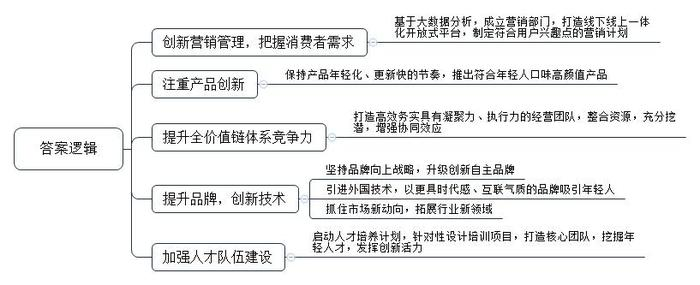
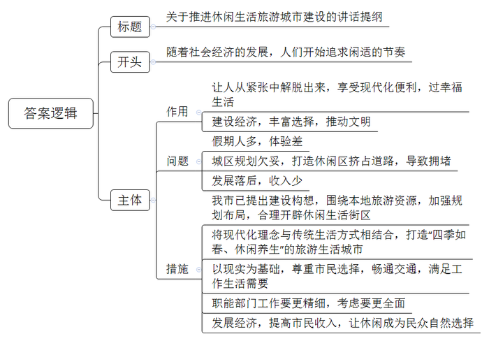
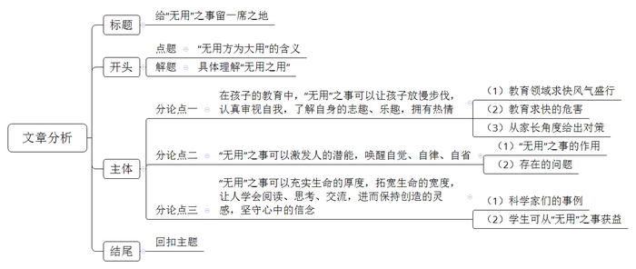

# 2017年公务员多省联考《申论》题（新疆卷）

<!-- gwy:overview:start -->
> **新疆 · 2017 · 申论 · 统考** ｜ 4 题 · 图片 4 处 · 答案随题折叠

导航：[题目](#题目)
<!-- gwy:overview:end -->

> 候选采集稿。参考答案及解析来自粉笔页面，不代表官方答案或真实高分答卷；来源使用许可与原卷对应关系仍需人工核实。

## 给定材料

### 材料 material-e891344058f475a2

当下社会，一切都和速度直接挂钩：飞机当天往返，火车夕发朝至，教育要趁早，就业要抢先，毕业就买房，爱情变速配。新世纪以来社会变革加快，利益结构调整，人们的经济地位被重新洗牌，对未来前景的不确定，使很多人心浮气躁，这与转型期带来的阵痛密切相关。

以往，只要是名牌大学毕业，就不愁找不到称心的工作；现在，城市化进程的不平衡性导致大城市人口拥挤，选择“好”职业的难度加大，即便是名校硕士、博士，找到的工作也不一定合意。为了在竞争激烈的就业市场占得先机，大学生纷纷成为“考证族”。王某是一名法律系在读研究生，刚刚通过国家司法考试，拿到了法律职业资格证。研究生还没毕业，为什么现在就急着参加司法考试？王某说，有了证，马上就能在律师事务所实习，就业时就能抢先一步。

在互联网时代，每天遇到海量信息，面对各种诱惑，身处不断的比较中，很多人担心被时代落下，害怕被别人超越。赵某是某IT公司软件工程师，最近刚跳槽到一家规模更大的公司。大学毕业不到5年，他已经换了3份工作。“房价涨，收入低，晋级慢，在网上看到别的公司待遇更好，就想通过不断跳槽寻找新机会。”赵某说。

大城市居住不易，单是房价就已经透支了很多人大半辈子的财富，再加上高昂的教育费、医疗费等，一个人不拼命工作还真不行。某微博用户晒出一张图片：“山东某知名IT公司要求员工申请自愿放弃年休假，实行6×12小时工作制：每天工作12个小时、每周工作6天，春节、国庆等长假期间也要随叫随到。”面对如此苛刻的要求，却有不少人积极响应。一位响应者说，“对我们年轻人而言，大学毕业后能前行多远，不仅仅是个人能力的问题，如果没有父辈的外部支援，自己又不使劲上位，很难在大城市站稳脚跟。”

美国发明家富兰克林说过： “时间就是生命，时间就是金钱”。这句话作为大工业时代的座右铭，影响了整个世界。快速、高效的观念深入人心，成为人们自觉不自觉的选择。现代社会物质条件的进步也加剧了人们的这种心理。电话不普及的时候，人们已经习惯了几天才收到一封信，但在手机随处可见的今天，几分钟内对方没有回短信，人们就会嫌慢；在自行车与有轨电车还是主要出行工具的时候，等半个小时的公交车不足为奇，但现在，出行越来越便捷，却连打的都还忍不住叮嘱司机开快点。互联网的出现更大大改变了人们的生活方式，速度更快，变化更多，时间的价值更宝贵。很多人习惯了24小时开机，习惯了半夜被人从梦中叫醒谈工作，习惯了长期频繁加班。这种生活给现代人带来物质回报的同时，也导致了精神的疲惫和身体的损害。某网站的调查显示，我国已成为全球工作时间最长的国家之一，人均劳动时间超过日本和韩国。一些白领虽然报酬较高，但白天夜里都要紧张工作，生活很不规律。

某互联网公司的一位员工说：“连夜加班，刚开始你也许无法适应，但是时间久了你会觉得，如果周围人都在加班，你早走了就显得很特别。虽然没有强制加班的规定，但公司里许多人都在‘抛妻弃子’、挑灯奋斗。因为你不加班，就比不过加班的人。”有人估算，我国每年因过劳去世的人多达60万，其中媒体人、科技工作者、互联网企业员工中死于过度疲劳的比例最高。

不停加班，带来了一系列健康问题，频繁跳槽、朝三暮四对心理的影响也不容小觑。比如，盲目跳槽的人在辞职过程中的无奈，重新选择时的焦虑，以及应聘新企业来回的奔波，都会极大地影响个人情绪。尤其是跨地区跳槽，从一个熟悉的环境到一个陌生的环境，前景的不确定性会给人带来更大的心理压力。

我们还是发展中国家，很多方面不能跟发达国家比，确实需要加快发展、早日富强，而且在我国推进市场化的进程中，人民群众有改善生活的强烈需求，这是我国社会保持较快发展的内在动力，处于这样的历史阶段，想要控制发展速度并不容易。因此，根本的解决之道不在于刻意放缓发展节奏，而在于防范快速发展过程中容易出现的失衡。政府要建立健全社会保障体系，创造更畅通更多元的发展通道，减轻人们的工作和生活压力。同时，个人也要积极调整心态，特别是年轻人初涉职场，要学会找到适合自己的节奏和平衡点，留出空间去调整身心状态，审视事业的计划和目标，体会人生的意义。

### 材料 material-d6ea94ae14a54e88

中国车市在经历了迅猛扩张，成为世界最大单体市场的同时，也渐渐放慢了自己向前的步伐，如同中国经济一样，步入新常态阶段。从十二年前的白手起家，到如今已经赫然位居行业第一集团，D公司创造的速度奇迹在业界声名显赫。从最初的单一车型开始，到如今已经成功完成了主流市场区间的全产品布局；从最早只有一个工厂，到现在的四地八厂；从初始的单一合资品牌，到现在坐拥主流合资两大品牌；从零起步到600万保有客户，这一切只用了12年的时间，D公司就快速地完成了从“小字辈”到“大体系”的转变。

然而，在中国车市进入“新常态”已然不可逆转的今天，D公司过去单纯的快速发展模式已经不适用了，对此，该公司周总表示：“车市的新常态只是意味着车市进入到一个新的发展阶段，速度下了一个台阶，并不意味着车市发展的黄金时代已经结束。在新常态下，快是一种质量，慢是一种智慧。未来我们要从‘要素驱动’转化为‘创新驱动’，对企业体系进行全面的优化升级，努力实现‘快’与‘慢’的平衡，以更稳健、更具核心竞争力的姿态，去应对车市新常态。”

随着互联网、信息技术的发展，消费观念的成熟，中国车市进入了以用户为中心的精细化、个性化时代，D公司顺应时代变化，通过基于大数据分析的营销管理和创新，继续保持迅捷的市场反应速度、高效的体系反应能力、迅速的消费响应能力。公司专门成立了数据营销部门，打造国内首个汽车品牌自建的线下线上一体化开放平台，通过互联网手段持续跟踪、收集、分析消费者的需求变化趋势，根据所得结论及时制定和推进符合用户兴趣点的营销计划；同时，产品年轻化的节奏也依然保持着“快”的本色，不断推出符合年轻人口味的高颜值产品。

与此同时，为了实现企业高效的执行力，D公司在其内部进一步提升企业的全价值链体系竞争力，着力打造高效务实具有凝聚力的经营团队，整合企业及合作伙伴资源，充分挖潜，增强每个工作环节的协同效应，让所有部门为同一目标共同发力，实现体系竞争力的最大化。

如果说D公司过去的发展模式是“要素驱动”，那么如今全新体系竞争力的打造，就是以“创新驱动”为核心，推动品牌建设、产品营销、人才体系等每一个层面的发展。D公司坚持品牌向上战略，升级创新自主品牌，不断引进最新技术的国外品牌，以更具时代感、互联气质的品牌印象去赢取更多年轻用户的心。公司旗下的某品牌早已启动了以纯电动汽车为方向的新能源汽车发展战略，未来将以“用户体验”为核心，通过一系列的创新营销手段，逐步将先机转化为市场优势，全面推进该品牌的市场普及，形成新的市场增长点。人才体系的全面升级是确保体系竞争力向卓越跨越的最基础保障。对此，D公司启动了被称为“企业大学”的人才培养计划，针对不同发展阶段、不同类型的员工精心设计培训项目，努力打造核心关键人才团队，通过一揽子人才提升战略去挖掘年轻人才，充分发挥优秀年轻员工的创新活力，让新思想、新创意成为D公司下一阶段发展的核心驱动力。

### 材料 material-5a509da299562261

随着经济社会发展，越来越多的人在度假方式上，开始追求一种闲适的节奏：或是在家陪陪家人、或在田园放松心灵、或做点无用的事……而这种观念也正是社会更加成熟自信、文明进步的一种表现。

A市位于我国西部地区，具有丰富的旅游文化资源，是一座以旅游立市的小型城市。近年来，该市以休闲生活为旅游新卖点，提出“在这里正大光明地浪费光阴”“没有任何一件事情是必须做的，只需随心住下，随性闲游！”等旅游消费主张来吸引游客，受到游客们的青睐。

在黄金周假期前两天，传来了“高速免费”“景点降价”的消息。A市市民汪先生因担心人满为患，临时取消了长途出游的安排。当换种度假方式时，他很快便开始享受这种新的节奏了。汪先生携妻儿开车来到郊区一个水库，在青山绿水间垂钓，中午就地野餐，傍晚则将一天的收获带回家做成美味鱼汤。汪先生告诉记者说：“尽管只钓到七八条小鱼，但一家人在一起的亲近感让我觉得幸福不过如此，这种生活正是我向往的。”28岁的胡女士则在黄金周期间选择宅在家里做卫生、看书、喝茶……她说：“刚工作时遇到假期不是在各家亲戚间奔波，就是在人山人海的景点抢镜头，不然就觉得虚度了。现在我宁愿做什么事都无需紧赶慢赶，享受悠闲的生活。最好的景致就在自己心里。”

2016年，A市新市长上任后，经过调查研究，系统提出了“打造休闲生活旅游城市，提高居民生活幸福感”的构想，重点围绕本地旅游资源，加强规划建设，将现代化理念与传统生活方式相结合，进一步打造“四季如春、休闲养生”的旅游生活城市，使游客和本地市民在这里不仅可以享受现代化带来的各种便利，更可以过上一种健康闲适的幸福生活。这一构想的提出得到了市民的支持。

## 题目

### 第 1 题

**根据材料**3**，概括当前社会上求快风气产生的原因。（10分）**

关联材料：材料 material-e891344058f475a2

作答要求：

要求：全面、准确、简明，有条理，不超过150字。

第 1 题 · 答案与解析

**参考答案（粉笔题库参考内容）**

转型期阵痛，社会变革加快，利益结构调整，前景不定，人们心浮气躁。

1.城市化进程失衡。大城市人口多，就业竞争激烈。

2.环境变化。网络时代信息量大、诱惑多，身处比较中。

3.生活成本高。收入少，房价、教育、医疗等费用高。

4.观念变化。物质条件和互联网进步，需快速高效。

5.国情难变。发展中国家，群众改善生活的需求。

**解析**

**参考答案说明：**本参考答案宏观上先从“总体原因”和“具体原因”两个方面进行分段。在具体原因方面，又从“城市化进程失衡”“环境变化”“生活成本高”“观念变化”“国情难变”等五个方面进行了分条撰写。各条要点之间在内容上相互并列，没有交叉。

**考点**：考点原因类

**来源**：来源2017年公务员多省联考《申论》题（新疆卷）

### 第 2 题

**根据材料**4**，总结D公司的成功对于企业适应新常态有哪些值得借鉴的经验。（20分）**

关联材料：材料 material-d6ea94ae14a54e88

作答要求：

要求：

（1）紧扣材料，内容具体；

（2）分析透彻，条理清楚；

（3）不超过300字。

第 2 题 · 答案与解析

**参考答案（粉笔题库参考内容）**

1.创新营销管理，把握消费者需求。基于大数据分析，成立营销部门，打造线下线上一体化开放式平台，制定符合用户兴趣点的营销计划。

2.注重产品创新。保持产品年轻化、更新快的节奏，推出符合年轻人口味高颜值产品。

3.提升全价值链体系竞争力。打造高效务实具有凝聚力、执行力的经营团队，整合资源，充分挖潜，增强协同效应。

4.提升品牌，创新技术。坚持品牌向上战略，升级创新自主品牌；引进外国技术，以更具时代感、互联气质的品牌吸引年轻人；抓住市场新动向，拓展行业新领域。

5.加强人才队伍建设。启动人才培养计划，针对性设计培训项目，打造核心团队，挖掘年轻人才，发挥创新活力。

**解析**

**参考答案说明：**本参考答案从“创新营销管理，把握消费者需求”“注重产品创新”“提升全价值链体系竞争力”“提升品牌，创新技术”“加强人才队伍建设”五个方面进行了分条撰写。各条要点之间在内容上相互并列，没有交叉。并且撰写每条要点时，都提炼出了概括性强的总括词并前置，满足了题目中规定的“总结”这一要求。

**考点**：考点经验启示类

**来源**：来源2017年公务员多省联考《申论》题（新疆卷）

粉笔申论页面对本题只提供「解析视频」入口，该入口是会员推广位，页面无视频地址与文字解析。

### 第 3 题

**为推进休闲生活旅游城市建设，A市政府将召开由市民代表、专家学者参加的座谈会，市长将在会上作开篇讲话，请你结合材料**1**\-**2**，为市长草拟一份会议讲话提纲。（30分）**

关联材料：材料 material-5a509da299562261

作答要求：

要求：切合主题，内容具体；条理清楚，层次分明；不超过300字。

第 3 题 · 答案与解析

**参考答案（粉笔题库参考内容）**

关于推进休闲生活旅游城市建设的讲话提纲

随着社会经济的发展，人们开始追求闲适的节奏。

建休闲生活旅游城市利于：让人从紧张中解脱出来，享受现代化便利，过幸福生活；建设经济，丰富选择，推动文明。但面临问题：假期人多，体验差；城区规划欠妥，打造休闲区挤占道路，导致拥堵；发展落后，收入少。

为此，我市已提出建设构想，围绕本地旅游资源，加强规划布局，合理开辟休闲生活街区；将现代化理念与传统生活方式相结合，打造“四季如春、休闲养生”的旅游生活城市；以现实为基础，尊重市民选择，畅通交通，满足工作生活需要；职能部门工作要更精细，考虑要更全面；发展经济，提高市民收入，让休闲成为民众自然选择。

**解析**

**参考答案说明：**（1）本题不需要考虑格式，只写正文即可，但为了保险起见，建议加上标题。（2）正文部分，一方面凑够内容上来看，围绕“休闲旅游城市建设”这一主题，本参考答案的开头写到了旅游城市建设的背景；主体部分从“作用”“问题”“措施”三个方面进行了阐述。另一方面，形式上，本参考答案做到了分段、分条撰写，整体上条理较为清晰。本参考答案，在语言表达上做到了简洁、流畅。

**考点**：考点总结类

**来源**：来源2017年公务员多省联考《申论》题（新疆卷）

### 第 4 题

**材料**6**中多次出现“无用”一词，参考给定资料，结合你对“无用”一词的理解，自拟题目，写一篇文章。（40分）**

关联材料：材料 material-5a509da299562261

作答要求：

要求：自选角度，立意明确；联系实际，不拘泥于“给定资料”；思路清晰，语言流畅；总字数1000-1200字。

第 4 题 · 答案与解析

**参考答案（粉笔题库参考内容）**

**参考文章一**

**给“无用”之事留一席之地**

人生要干有用之事，做有用的人。这是毋庸置疑的。我要谈论的是一些被狭隘的“功用”思想排挤、曲解，现在看似无用、将来却有大用，此处无用、但别处可用的大事情。我从三个方面来理解这种“无用之用”。一是学会**适度放开、不妄作，让事情顺其自然、自由、自在生长**。二是学会**闲暇、休闲、体会生命的充盈和幸福**。三是**放慢发展步伐、停下来做****“无用”的思考，给未知和创新留有余地**。

在当下社会生活中，认清这些“无用”之事，对自我审视、对孩子教育、对企业创新发展都非常重要。

**所以要容忍****“无用”之事。**这首先要在自我审视、孩子教育上形成清醒的认知、文明的尊重。懂得适度和节奏，让事情顺其自然，自在生长。这是认识论上的自信谦卑、成熟智慧。人生而自由，却无所不在枷锁之中。这些枷锁都是狭隘界定“有用性”造成的。承认自己认为有用的未必真有用，而自己认为无用的可能恰恰最有用，这需要一种自省、自觉、自律。以教育孩子为例，大人们普遍认为考试科目成绩，以及钢琴、绘画等素质课考证拿奖是最有用，而父母的陪伴玩耍、小伙伴间的互动游戏是无用的，所谓“勤有功，戏无益”。这是有失偏颇的。孩子的教育，功课之外，我们要注重激发他们潜藏的能力、志趣、爱好，拓展他们生命的宽度，尊重他们创造的灵感，心中的信念。

**还要包容****“无用”。**这要在本体论上看到“有用”和“无用”相辅相成。庄子和惠子辩论时说，若把世界上无用的部分去掉，有用的部分也无以立足。我们做有用之事、有用之人其实都是为了无所事事，功成身退。我们发明科技是为了偷懒，奋不顾身工作是为了闲暇、休闲；我们漂泊“北上广深”艰苦奋斗是为了将来更好的陪伴父母，尽享天伦。亚里士多德说，闲暇、休闲是搞哲学的先决条件。看似无用的休闲、放松、闲暇和无所事事，其实是非常重要的。唯有在闲暇中去思考、在休闲中去体会大自然，才会发现人生中最可贵的生命充盈、幸福喜乐。

**最后要学会在方法论上区分****“无用之大用”和“有用”。**一是学习洞悉本末、主次、轻重的智慧。散步不能带来金钱，但可以健康长寿；有些自由无用的阅读不能带来技能提升、收入翻番，但可以培育人格、拓展视野。二是面向未来保持思考，给未知和创新留有余地。思考会暂时放慢工作进程，却能辨明方向、发现重点。今天，一些企业在经营管理上过分强调时间管理、加班文化，这可能会使企业短期内快速规模化成长。但若不给员工留一些“无用”的思考时间，长期而言，就会透支员工们的身心健康、创新创造力，导致企业日益平庸、低效重复。

我们的国家在奋力追求富强，为了大国崛起；我们每个人都渴望成功，为了自立、自尊。实干兴邦，实业兴国。人生苦短，我们要时刻抓住那些最有用、最高效的事情埋头苦干，干出成绩、干出辉煌。但我们也要给“无用”留一席之地。无论是个人奋斗、企业发展，还是教育子女，我们都要多思考、多审视目标和计划，把握好发展节奏、找准“有用”和“无用”的平衡点，确保始终紧扣事业的关键、命运的咽喉在奋斗。

**参考文章二**

**给“无用”之事留一席之地**

庄子说：“无用方为大用。”在功利化、实用主义哲学大行其道的今天，这句话似乎为无稽之谈。其实则不然，有些事情现在看似无用、将来却有大用，此处无用、但别处可用。我们通常从三个方面来理解这种“无用之用”。首先是**可以放慢步伐，认真审视自我，了解自身的志趣、乐趣，拥有热情**；其次是**激发潜能，唤醒自觉、自律、自省**；最后是能**充实生命的厚度，拓宽生命的宽度，学会阅读、思考、交流，保持创造的灵感，坚守心中的信念**。不言而喻，给“无用”之事留一席之地，无用方为大用。

**在孩子的教育中，****“无用”之事可以让孩子放慢步伐，认真审视自我，了解自身的志趣、乐趣，拥有热情。**当前，社会上求快风气盛行，教育也自然受其影响。众多父母纷纷给孩子报各种课外辅导班，力图让孩子赢在起跑线上。这种做法，不仅导致子女学习压力大，对学习产生抗拒心理，更会减少孩子们做“无用”之事的时间。长此以往，学生会迷失自我，无法体会生活的乐趣，丧失美好年华应有的热情。就如卢梭所说：“早熟的果实，既不丰满也不甜美，而且很快就会腐烂。”毋庸讳言，在孩子的教育中，要容忍“无用”之事，让孩子放慢步伐，耐心地等待孩子成长，认真审视自我，了解自身的志趣、乐趣，拥有热情。

另外，“**无用****”之事可以激发人的潜能，唤醒自觉、自律、自省。**捡拾我们身边的小事，不难发现，有时无意间读到的一句话，能让我们审视自身的不足；有时无意间的哼唱，能让我们发现歌唱的天赋；有时没有过多的“枷锁”，反而能让我们形成自觉、自律的生活态度。正是这些貌似“无用”的小事，却能激发出人的潜能，唤醒自觉、自律、自省。但细细观察身边的孩子们，他们通常三岁学舞蹈，四岁学钢琴，五岁学绘画，六岁背唐诗，学习成为他们生活的唯一，每一个行为都会被严格规范，无暇做“无用”之事，抑制了自身潜能的爆发。

从更广义的角度而言，**“无用”之事可以充实生命的厚度，拓宽生命的宽度，让人学会阅读、思考、交流，进而保持创造的灵感，坚守心中的信念。**爱因斯坦在工作之余喜欢拉小提琴，华罗庚平常喜欢作对、写诗……伟大的科学家们，他们经常会做一些“无用”之事，恰恰是这些“无用”之事，帮助他们排解工作的忧愁，舒缓紧张的情绪，提供不同的思考途径。科学家如此，学生亦然。读一本好书，爱上一项运动，善于与他人交流，这些貌似“无用”的事，有可能成为他们人生中一座座不灭的“灯塔”。

父母教育孩子，不正是在等待、守护一朵花的盛开吗？这种守护，是要基于成熟的思考，以自省之心审视孩子的教育，在思索中看到“无用”的价值；这种守护，需要父母激发孩子的天性，保护他们的个性。我相信，最终，我们会闻到满园的芬芳……

**解析**

**文章分析**

**给“无用”之事留一席之地**

【**标题的优点：**首先，范文的标题“给‘无用’之事留一席之地”紧扣“无用”这一主题。其次，“留一席之地”表明对“无用”的态度，观点鲜明。】

（1）庄子说：“无用方为大用。”在功利化、实用主义哲学大行其道的今天，这句话似乎为无稽之谈。其实则不然，有些事情现在看似无用、将来却有大用，此处无用、但别处可用。（2）我们通常从三个方面来理解这种“无用之用”。首先是**可以放慢步伐，认真审视自我，了解自身的志趣、乐趣，拥有热情**；其次是**激发潜能，唤醒自觉、自律、自省**；最后是能**充实生命的厚度，拓宽生命的宽度，学会阅读、思考、交流，保持创造的灵感，坚守心中的信念**。不言而喻，给“无用”之事留一席之地，无用方为大用。

【**开头的优点**：★内容方面。范文的开头是紧扣题目给定的“无用”这一主题展开的。首先，开头第一句话点出了“无用”这一主题，做到了主题明确。其次，对“无用”这一主题进行了分析阐述，指出了：（1）“无用方为大用”的含义，（2）具体理解“无用之用”。★文字表达方面。使用了“首先”“其次”“再次”等关联词，使语言表达有逻辑性。】

**在孩子的教育中，****“无用”之事可以让孩子放慢步伐，认真审视自我，了解自身的志趣、乐趣，拥有热情。**（1）当前，社会上求快风气盛行，教育也自然受其影响。众多父母纷纷给孩子报各种课外辅导班，力图让孩子赢在起跑线上。（2）这种做法，不仅导致子女学习压力大，对学习产生抗拒心理，更会减少孩子们做“无用”之事的时间。长此以往，学生会迷失自我，无法体会生活的乐趣，丧失美好年华应有的热情。就如卢梭所说：“早熟的果实，既不丰满也不甜美，而且很快就会腐烂。”（3）毋庸讳言，在孩子的教育中，要容忍“无用”之事，让孩子放慢步伐，耐心地等待孩子成长，认真审视自我，了解自身的志趣、乐趣，拥有热情。

【**论述段****1的优点：**★观点句：范文的观点句是紧扣“无用”这一文章主题提出的。形式上，它在段首处直接写出，位置突出，容易被发现；内容上，关键词突出，内容要点明确，可以明显看出它是从“了解自身”的角度入手，指出“无用”之事可以让孩子认真审视自我，了解自身。★论述内容：本段主要围绕“无用”这一主题进行分析阐述，指出了：（1）教育领域求快风气盛行，（2）教育求快的危害，（3）从家长角度给出对策。注意：以上三个方面的内容都是紧扣观点句“在孩子的教育中，‘无用’之事可以让孩子放慢步伐，认真审视自我，了解自身的志趣、乐趣，拥有热情”进行分析论述的，针对性强、内容层次丰富。并且，这三个方面的论述有内在逻辑顺序：先写“问题”，再写“危害”，最后写“对策”。最后，在论证方法和论据选取方面，讲道理和举例子相结合，做到了丰富多样。】

另外，“**无用****”之事可以激发人的潜能，唤醒自觉、自律、自省。**捡拾我们身边的小事，不难发现，有时无意间读到的一句话，（1）能让我们审视自身的不足；有时无意间的哼唱，能让我们发现歌唱的天赋；有时没有过多的“枷锁”，反而能让我们形成自觉、自律的生活态度。正是这些貌似“无用”的小事，却能激发出人的潜能，唤醒自觉、自律、自省。（2）但细细观察身边的孩子们，他们通常三岁学舞蹈，四岁学钢琴，五岁学绘画，六岁背唐诗，学习成为他们生活的唯一，每一个行为都会被严格规范，无暇做“无用”之事，抑制了自身潜能的爆发。

【论述段2的优点：★观点句：范文的观点句是紧扣“无用”这一文章主题提出的。形式上，它在段首处直接写出，位置突出，容易被发现；内容上，关键词突出，内容要点明确，可以明显看出它是从“激发潜能、唤醒自觉”的角度入手，指出“无用”之事可以激发潜能、唤醒自觉。★论述内容：本段主要围绕“无用”这一主题进行分析阐述，指出了：（1）“无用”之事的作用，（2）存在的问题。注意：以上三个方面的内容都是紧扣观点句“‘无用’之事可以激发人的潜能，唤醒自觉、自律、自省”进行分析论述的，针对性强、内容层次丰富。最后，在论证方法和论据选取方面，运用了排比的修辞手法，增强说服力。】

从更广义的角度而言，**“无用”之事可以充实生命的厚度，拓宽生命的宽度，让人学会阅读、思考、交流，进而保持创造的灵感，坚守心中的信念。**（1）爱因斯坦在工作之余喜欢拉小提琴，华罗庚平常喜欢作对、写诗……伟大的科学家们，他们经常会做一些“无用”之事，恰恰是这些“无用”之事，帮助他们排解工作的忧愁，舒缓紧张的情绪，提供不同的思考途径。（2）科学家如此，学生亦然。读一本好书，爱上一项运动，善于与他人交流，这些貌似“无用”的事，有可能成为他们人生中一座座不灭的“灯塔”。

【论述段3的优点：★观点句：范文的观点句是紧扣“无用”这一文章主题提出的。形式上，它在段首处直接写出，位置突出，容易被发现；内容上，关键词突出，内容要点明确，可以明显看出它是从“充实人生、坚守信念”的角度入手，指出“无用”之事可以充实人生、坚守信念。★论述内容：本段主要围绕“无用”这一主题进行分析阐述，介绍了：（1）科学家们的事例，（2）学生可从“无用”之事获益。注意：以上两个方面的内容都是紧扣观点句“‘无用’之事可以充实生命的厚度，拓宽生命的宽度，让人学会阅读、思考、交流，进而保持创造的灵感，坚守心中的信念”进行分析论述的，针对性强、内容层次丰富。最后，在论证方法和论据选取方面，运用了多个事例，增强说服力。】

【**论述段之间的关系**：★内容的内在逻辑：论述段之间是层层递进的关系，围绕“无用”之事的重要性，论述段1表明“无用”之事可以让孩子认真审视自我，了解自身；论述段2表明“无用”之事可以激发潜能、唤醒自觉；论述段3表明“无用”之事可以充实人生、坚守信念。从“了解自身”到“激发潜能”再到“充实人生”，层层递进，逐步深入。★段与段的外在衔接：论述段2首句中的“另外……”，以及段3首句中的“从更广义的角度而言……”，都起到了过渡衔接的作用。】

父母教育孩子，不正是在等待、守护一朵花的盛开吗？（1）这种守护，是要基于成熟的思考，以自省之心审视孩子的教育，在思索中看到“无用”的价值；这种守护，需要父母激发孩子的天性，保护他们的个性。（2）我相信，最终，我们会闻到满园的芬芳……

【**结尾的优点**：（1）再次提到了“无用”；（2）展望未来。】

**考点**：考点文章写作题

**来源**：来源2017年公务员多省联考《申论》题（新疆卷）

粉笔申论页面对本题只提供「解析视频」入口，该入口是会员推广位，页面无视频地址与文字解析。

