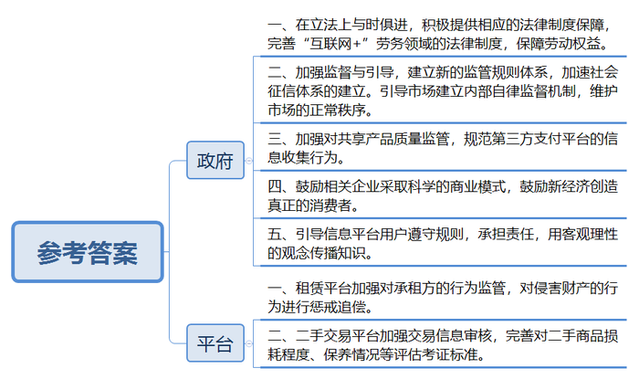
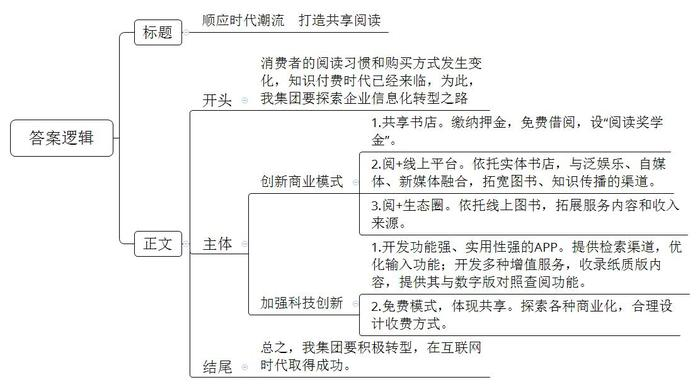

# 2018年公务员多省联考《申论》题（新疆卷）

<!-- gwy:overview:start -->
> **新疆 · 2018 · 申论 · 统考** ｜ 4 题 · 图片 4 处 · 答案随题折叠

导航：[题目](#题目)
<!-- gwy:overview:end -->

> 候选采集稿。参考答案及解析来自粉笔页面，不代表官方答案或真实高分答卷；来源使用许可与原卷对应关系仍需人工核实。

## 给定材料

### 材料 material-7b154a12be4cbb1c

近日，某国产知名品牌校园洗衣房正式入驻R市大学城，18台物联网自助洗衣设备开始投入使用，为大学生提供自助洗衣服务。与过去的自助投币式洗衣机不同，大学生只要扫描下载该品牌洗衣APP，就可以随时随地实现在线预约排队、在线支付及在线状态查看等智慧功能。

基于对中国当代大学生的长期观察和了解，该品牌依托物联网打造出这一创新模式。这种自助洗衣设备一入驻R市大学城，就受到了大学生们的喜爱。课间查看空余机位，一键下单，手机支付，该品牌洗衣逐渐成为大学生校园生活的一部分。“自从学校有了这种自助洗衣设备，之前排队洗衣的时间可以用在逛书店和学习上了。现在我们宿舍的六个室友，每人都装了洗衣APP，给我们带来了很多便利。”一名收到洗衣APP取衣提醒后前来取衣的学生告诉记者。

其实，这样的场景每天都在全国二百多个城市六百多所高校上演。有数据统计，该品牌洗衣APP注册用户数达541万，且日增新用户7000余人。事实上，从上世纪90年代起，该品牌洗衣机就以更好服务用户为导向，主动适应市场，在学校中设立投币式自助洗衣设备，让学校成为其洗衣服务的“重要阵地”。如今，在行业还停留在探索如何刷卡投币解决大学生洗衣排队难题时，该品牌又开始以物联网的理念运作自助洗衣。在校学生足不出户便可享受到智能预约洗衣、手机下单在线支付、完成提醒功能等一站式贴心服务，彻底解决了大学生的“洗衣难”问题。此外，通过与全国六百多所高校合作，借助第三方资源入驻，该品牌洗衣APP还为大学生提供O2O模式下的校园社交、学生生活、投资机构和商家对接等全方位服务，在资源扩大的同时实现自我升级。

无独有偶，S机床厂通过创新商业模式，实现了在国内外机床行业市场规模整体萎靡之时的逆势上扬。“我本人在机床行业工作近30年，这些年，我冷静下来思考，总结了四句话——第一，我们的员工不满意。任何员工都希望工资越来越高，我们拿什么来给他们发工资？第二，我们的用户不满意。虽然设备都是进口的，但是一些顶尖的机床，国外根本就不卖给我们。第三，我们的领导不满意，说你们什么时候才能赶超日、美、德呢？第四，我自己也不满意。回顾过去，基本啥也没干。”该公司董事长不无幽默地说道。2007年，S机床厂彻底摒弃模仿和跟随的道路，公司科技部的一帮年轻人从源代码开始写起，用了6年时间，原创了多项数控核心技术，诞生了拥有自己知识产权的“智能5代系统”。该系统具有一个很重要的特性：在运行的过程中可以及时采集和传输数据。有了这些数据，客户在手机上就能通过S机床厂的大数据系统随时查看自己工厂的运转情况、机台的生产情况，从而替代了传统的管理。由于掌握了这些最真实的数据，S机床厂又能通过互联网，为客户在线提供技术解决方案，实现人才共享。数据的共享，还为S机床厂开启了一条与众不同的商业模式——不再是传统的机床买卖、加价销售、赚取利润，而是以“零首付”租赁给客户，按小时或者按加工量收费，结算的依据就是机床运转所传输回来的数据。通过赢取用户对企业和产品的信任，让机床的销售从单纯买卖，走向了即时分享，S机床厂已经从过去单纯的产品制造商，转身成为系统解决方案提供商和工业制造服务商。

### 材料 material-a7232fed15e167cf

互联网的风起云涌，不仅从根本上颠覆了许多传统行业，同时也创造了新的行业和机遇。21世纪初，有学者提出了互联网时代协同消费的理念和发展模式，并将其分为若干阶段。最初，是代码共享，即通过互联网向用户提供信息，但信息流是单向的，用户不能参与其中进行评论与交流。当互联网进入Web2.0时代，用户开始通过网络平台与陌生人分享信息、表达观点。但其分享局限于内容或信息，不涉及实物交易，一般也不存在金钱报酬，仅仅是生活共享或是内容共享。

随着物物相联时代到来，网络平台公司通过互联网重新整合社会闲散资源和富余劳动力，然后再按需精准配置，实现物尽其用，社会分配从专业化向社会化转变，真正实现了离线资源的共享，即线上的分享协作渗透和延伸至线下，并由此改变了我们的文化和经济世界。如今，需求方不仅可以享受到低价与个性化服务，也得到了社交机会。对企业而言，随着加入网络的节点及节点间的连接增加，网络的价值会随着用户数量的平方数增加而增加。作为一种新的商业模式，其势必会对现行制度和秩序造成冲击，政府应积极提供相应的法律制度保障，实现其可持续发展。同时，任何商业行为都是以盈利为目标，任何市场的开发也都需要资金的支持，而过度的资本运作可能导致市场滥用其优势地位，甚至违背市场规律进行不正当竞争。政府理应鼓励相关企业采取科学的商业模式；鼓励新经济创造真正的消费者，而不仅是通过补贴来吸引消费者。

在新经济模式中，个体成为自由劳动者，劳动力价值能得到充分实现并完全由自己支配。供求双方通过互联网发布自己可供分享或需求的物品，不仅能为特定的供给者或需求者提供可选择的交易对象，还有助于掌握交易对象更多的信息，避免不公平交易，降低了交易成本。对闲置物资的再利用使得前期投入的成本要么已得到回收，要么当做沉没或折旧成本而收费较低廉，从而令闲置物资的边际成本更低，显现出更大的成本和资源利用效率优势。由于这一系列商业活动完全有别于过往经济行为，加强政府的监督与引导，显得尤为重要，建立新的监管规则体系迫在眉睫。在新的规则出台之前，可以运用相关的法理，借鉴现行的法律法规，引导市场建立内部自律监督机制，维护市场的正常秩序。

### 材料 material-c6ca635b13e99977

只需缴纳99元押金，即可免费把书从书店带回家；10天内归还可享受免费借阅，押金随时退还；3个月内读完12本书可享返还押金的8%作为“阅读奖学金”。日前，W省新华发行集团旗下的某书店以首创“共享书店”的身份正式亮相。这家书店一度走红网络，有着“全国最美书店”“全国首家O2O智慧书城”等称号。“共享书店”实现了由买书到借书，把书店变成自家书房，由个人阅读到共享阅读的重大转变。

基于对用户需求的分析和把握，“共享书店”依托实体书店的原有资源，通过运营模式的颠覆式变革，实现阅读服务的转型升级。该集团总经理说：“近年来消费者阅读习惯和购买方式发生巨大变化，我们相信未来所有的书店都会实现共享。如今，我们的‘阅+线上平台’已经进驻100多家全国知名泛娱乐、自媒体、新媒体，未来还将推出更多理财产品、研学游产品等等，打造‘阅+生态圈’。”

与W省新华发行集团异曲同工，商务印书馆的《新华字典》APP日前正式上线。据了解，这款APP提供了单字、词语、汉语拼音、部首、笔画数、四角号码等检索渠道，并且支持手写、摄像头取字和语音输入等功能，全面满足了用户查字、输字需求。它还具有两大特色功能：一是提供了动态和静态两种标准笔顺，并支持屏幕跟写，用户可识别、掌握3500个基础汉字的笔画；二是由专业播音员对1万余个汉字进行播读，用户也可以点击“朗读”键测试自己普通话的准确性。此外，该APP还开发了生字本、知识问答、汉字游戏等增值服务，并完整收录《新华字典》最新纸质版全部内容，提供数字版与纸质版对照查阅功能。但同时，该APP每天仅有2个字免费体验、完整版需付费40元的情况也引发了争议。有媒体认为《新华字典》的收费行为是“思维落后”“缺乏诚意”，单靠权威不足以赢得市场；也有媒体称，“《新华字典》作为一本工具书，具有较强的社会服务功能，但它本身也是一种文化产品，是商品。通过有偿服务来维护版权以及促进软件研发是行业通行惯例，有其合理性。”从现有的手机应用市场来看，国际流行的语言字典价格均在百余元甚至数百元人民币，远超《新华字典》的40元定价。

知识付费近年来已被社会逐渐接受，这是对知识的一种尊重，也是保持产品持续发展、服务用户的必要方式。《新华字典》作为有价值的知识产权，出品方推出APP时考虑营利因素，无可厚非。但是，直接向用户收费的方式是否与现阶段新媒体产业的发展有些脱节？开放和共享是互联网经济的主要特征，一款收费的APP既相对封闭，也无法体现共享精神。《新华字典》要在互联网时代取得成功，前提是满足互联网产品的逻辑、适应互联网发展生态。

## 题目

### 第 1 题

**给定资料**1**描述了典型国产品牌在新经济环境下发展的事例，请总结其中的成功经验。（20分）**

关联材料：材料 material-7b154a12be4cbb1c

作答要求：

要求：全面、准确、简明、有条理，不超过300字。

第 1 题 · 答案与解析

**参考答案（粉笔题库参考内容）**

1.提升技术服务。利用最新物联网科技，提供在线服务智慧功能；原创核心技术，制造拥有自主知识产权的智能系统。

2.重视市场调研。对市场长期观察、充分了解，以更好服务用户为导向，主动适应市场。

3.不断优化服务。具有合作意识，借助第三方资源，为用户提供全方位、一站式贴心服务。

4.创新商业模式。重视数据的采集和传输，通过共享数据，实现从单一销售到即时分享，从单一产品制造商转变为方案提供和制造服务商。

5.具有上进精神。不满足于已有成绩，不断挑战自我、实现自我升级。

**解析**

**参考答案说明**：本题分别从“提升技术服务”“重视市场调研”“不断优化服务”“创新商业模式”“具有上进精神”五个方面介绍经验做法，并且将总结词前置，分条罗列，每条要点间内容上无交叉。

**考点**：考点经验启示类

**来源**：来源2018年公务员多省联考《申论》题（新疆卷）

### 第 2 题

**根据给定资料**2**\-**3**，针对当前互联网协同消费经济存在的问题，提出相应的对策。（20分）**

关联材料：材料 material-a7232fed15e167cf

作答要求：

要求：紧扣资料，对策可行，不超过300字。

第 2 题 · 答案与解析

**参考答案（粉笔题库参考内容）**

一、完善制度法律，加强监督监管。1.借鉴现行法律法规，引导市场建立自律监督机制，完善监管规则，维护市场秩序，避免不正当竞争。2.完善“互联网+”劳务等领域的法律制度，界定劳动关系，保障劳动权益。

二、保障财产信息安全。1.鼓励企业采取科学商业管理模式，创造消费者。2.督促租赁平台监管租赁方，及时追责违法行为。3.把控产品质量，监管第三方支付平台信息收集，加强信息安全保护。

三、加强信用道德建设。1.引导用户遵守规则，承担责任，用客观理性观念传播知识。2.完善社会征信体系，提升信任感，提升二手交易平台信誉，完善二手商品评估考证标准。

政府：一、在立法上与时俱进，积极提供相应的法律制度保障，完善“互联网+”劳务领域的法律制度，保障劳动权益。二、加强监督与引导，建立新的监管规则体系，加速社会征信体系的建立。引导市场建立内部自律监督机制，维护市场的正常秩序。三、加强对共享产品质量监管，规范第三方支付平台的信息收集行为。四、鼓励相关企业采取科学的商业模式，鼓励新经济创造真正的消费者。五、引导信息平台用户遵守规则，承担责任，用客观理性的观念传播知识。

平台：一、租赁平台加强对承租方的行为监管，对侵害财产的行为进行惩戒追偿。二、二手交易平台加强交易信息审核，完善对二手商品损耗程度、保养情况等评估考证标准。

**解析**

**参考答案说明：**答案根据政府和平台这两个不同的主体进行了分条撰写，且每条要点之间内容上没有交叉。

**考点**：考点提出对策类

**来源**：来源2018年公务员多省联考《申论》题（新疆卷）

### 第 3 题

**给定资料**4**对推进企业在信息化时代下转型升级提供了有益启示。某省出版发行集团将召开部分下属企业的负责人参加的座谈会，集团总经理将在会上作动员讲话，请结合这些启示，为总经理草拟一份讲话提纲。（20分）**

关联材料：材料 material-c6ca635b13e99977

作答要求：

要求：

（1）列出一级提纲及要点；

（2）切合主题，内容具体；

（3）条理清楚，层次分明；

（4）不超过300字。

第 3 题 · 答案与解析

**参考答案（粉笔题库参考内容）**

顺应时代潮流 打造共享阅读

消费者的阅读习惯和购买方式发生变化，知识付费时代已经来临，为此，我集团要探索企业信息化转型之路。

一、创新商业模式：1.共享书店。缴纳押金，免费借阅，设“阅读奖学金”。2.阅+线上平台。依托实体书店，与泛娱乐、自媒体、新媒体融合，拓宽图书、知识传播的渠道。3.阅+生态圈。依托线上图书，拓展服务内容和收入来源。二、加强科技创新：1.开发功能强、实用性强的APP。提供检索渠道，优化输入功能；开发多种增值服务，收录纸质版内容，提供其与数字版对照查阅功能。2.免费模式，体现共享。探索各种商业化，合理设计收费方式。

总之，我集团要积极转型，在互联网时代取得成功。

**解析**

**参考答案说明：**（1）本题主要写到了正文这一部分。按照“开头+主体”的结构展开。（2）为了体现逻辑性，还加上了连接语承接上下文。

**考点**：考点宣传类

**来源**：来源2018年公务员多省联考《申论》题（新疆卷）

### 第 4 题

**根据你对给定资料**5**中划线部分的理解，“何时做加法，何时做减法，是一门公共管理的艺术，需要智慧，需要眼光****，****需要技巧****，****更需要视野。加法或是减法，不一样的切入角度，体现不一样的心态和思维逻辑，直接决定了最终的成败”，自选角度，自拟题目，写一篇议论文。（40分）**

关联材料：材料 material-7b154a12be4cbb1c

作答要求：

要求：

（1）自选角度，立意明确；

（2）联系实际，不拘泥于给定资料；

（3）思路清晰，语言流畅；

（4）总字数1000～1200字左右。

第 4 题 · 答案与解析

**参考答案（粉笔题库参考内容）**

**做好公共管理加减法**

公共管理是一门艺术，体现行政部门的眼光与智慧，责任与担当。提升公共管理能力，对于转变政府职能、创新管理方式、促进经济发展等都意义重大。因此，党的十八大以来，面对复杂多变的社会事物，我国政府怀抱开放的心态和辩证的思维逻辑，致力于平衡公共管理中的“加法”与“减法”，全面推进“简政放权、放管结合、优化服务”改革，翻开了社会公共管理的新篇章。

**政府要做好公共管理的“减法”，就要落实简政放权，缩减行政审批事项，减少对经营行为的不合理约束。**过去，政府审批事项过多，种种限制也多有不合理之处，影响了市场主体的积极性。比如农民销售自家的农产品，可能会因没有经营执照而被没收工具，甚至缴纳高额罚款。这就需要落实中央“简政放权”的方针，把政府不该管的事交给市场。但是，简政放权的目标还没有完全实现，今后还要继续推进“负面清单”的制定和公开工作，并将其写入法律制度，尤其要注意进一步减少对于微观事务的管理，从而减少对市场主体一些不必要、不合理的约束。这也是清权、减权的过程。清单越合理、越清晰，改革效果就越大。

当然，“简政放权”并不意味着政府责任的减少。政府还要做好公共管理的“加法”，应对新时代、新事物。

**政府要做好公共管理的“加法”，就要对新型经济模式加强监管，鼓励企业创新。**当前，如互联网产业等新事物、新模式、新产业等层出不穷，它们不但是我国经济的希望所在，也为群众的生活带来了诸多便利。但这些新经济在发展模式、机制和特点等方面与传统经济有很大不同，政府过去的经验不一定能适用。套用老办法，可能将很多新事物扼杀，既制约创新活力，也对创新创业者不公平，甚至可能会引发新风险。所以，政府必须要通过审慎全面的监管，去芜存菁，推动新经济健康发展。同时，政府还应本着鼓励创新、包容审慎的原则，鼓励企业利用新技术、创造新模式。共享单车、共享汽车等企业，就正是在政府的监管和鼓励下一步一步发展壮大，有了今天的规模。

**政府要做好公共管理的“加法”，还要优化公共服务，创新服务方式，实现公共服务普惠化。**无论是政府推动简政放权，还是完善监管体系，其最终的落脚点都是为了优化公共服务，最终实现服务群众。但随着社会发展，人民群众对公共服务也提出了更多样化、更高质量的要求，这就需要政府充分利用现代技术，让服务方式更加现代化、多元化。比如现在几乎所有社会企业，都开通了移动支付功能，便利消费者，但很多国营企业或景点仍未能开通，这就是政府应该努力的方向。另外，像文化、医疗、养老等公共服务，关系到千家万户，政府还应该进一步普及公共服务，让更多群众能享受到政府福利，提升生活幸福感。

在新时代，只要掌握好公共管理的艺术，做好公共管理的加减法，我们的社会就必然会在这种平衡中稳步发展，群众的生活质量也必然会节节攀升。

**解析**

**文章分析**

**做好公共管理加减法**

【**标题的优点：**首先，范文的标题“做好公共管理加减法”突出了“公共管理的加减法”这一主题。其次，形式上，文字简洁明快。】

（1）公共管理是一门艺术，体现行政部门的眼光与智慧，责任与担当。（2）提升公共管理能力，对于转变政府职能、创新管理方式、促进经济发展等都意义重大。因此，（3）党的十八大以来，面对复杂多变的社会事物，我国政府怀抱开放的心态和辩证的思维逻辑，致力于平衡公共管理中的“加法”与“减法”，全面推进“简政放权、放管结合、优化服务”改革，翻开了社会公共管理的新篇章。

【**开头的优点：**★内容方面。范文的开头是紧扣题目给定的“何时做加法，何时做减法，是一门公共管理的艺术，需要智慧，需要眼光，需要技巧，更需要视野……”这句话展开的。首先，**开头点出主题，做到了主题明确**。其次，**对“**公共管理的加减法**”这一主题进行了分析阐述：（****1****）先指出了“**公共管理**”的含义。（****2****）接着指出了“提高公共管理能力”的意义。（****3****）最后指出了“做好公共管理加减法”的对策。**★文字表达方面：使用了“因此”“从而”等关联词，使语言表达有逻辑性；长短句配合使用，使语言表达有节奏感。】

**政府要做好公共管理的“减法”，就要落实简政放权，缩减行政审批事项，减少对经营行为的不合理约束。**（1）过去，政府审批事项过多，种种限制也多有不合理之处，影响了市场主体的积极性。比如农民销售自家的农产品，可能会因没有经营执照而被没收工具，甚至缴纳高额罚款。这就需要落实中央“简政放权”的方针，把政府不该管的事交给市场。但是，（2）简政放权的目标还没有完全实现，今后还要继续推进“负面清单”的制定和公开工作，并将其写入法律制度，尤其要注意进一步减少对于微观事务的管理，从而减少对市场主体一些不必要、不合理的约束。这也是清权、减权的过程。（3）清单越合理、越清晰，改革效果就越大。

【**论述段****1****的优点：**★观点句：范文的观点句是紧扣“公共管理的加减法”这一文章主题提出的。形式上，它在段首处直接写出，位置突出，容易发现。内容上，关键词突出，内容要点明确，可以明显看出它是从“简政放权”入手，指出了“政府公共管理中的‘减法’”。★论述内容：（1）先介绍了“过去政府行政管理存在的问题”；（2）接着介绍了“贯彻落实简政放权的具体措施”；（3）最后介绍了“简政放权的意义”。注意：以上三个方面的内容都是紧扣“政府要做好公共管理的‘减法’，就要落实简政放权，缩减行政审批事项，减少对经营行为的不合理约束”这个观点句进行分析论述的，论述的针对性强，内容层次丰富。在论述方法和论据的选取上做到了讲道理、举例子相结合，做到了丰富多样。】

当然，“简政放权”并不意味着政府责任的减少。政府还要做好公共管理的“加法”，应对新时代、新事物。

【**过渡段的优点：**范文过渡段分析了“公共管理的加减法”不仅要“减”，还要“加”。此外，还要注意过渡段末尾的“政府还要做好公共管理的‘加法’，应对新时代、新事物”是用来引起下文的过渡句。】

**政府要做好公共管理的“加法”，就要对新型经济模式加强监管，鼓励企业创新。**（1）当前，如互联网产业等新事物、新模式、新产业等层出不穷，它们不但是我国经济的希望所在，也为群众的生活带来了诸多便利。（2）但这些新经济在发展模式、机制和特点等方面与传统经济有很大不同，政府过去的经验不一定能适用。套用老办法，可能将很多新事物扼杀，既制约创新活力，也对创新创业者不公平，甚至可能会引发新风险。所以，（3）政府必须要通过审慎全面的监管，去芜存菁，推动新经济健康发展。同时，政府还应本着鼓励创新、包容审慎的原则，鼓励企业利用新技术、创造新模式。共享单车、共享汽车等企业，就正是在政府的监管和鼓励下一步一步发展壮大，有了今天的规模。

【**论述段****2****的优点：**★观点句：范文的观点句是紧扣“公共管理的加减法”这一文章主题提出的。形式上，它在段首处直接写出，位置突出，容易发现。内容上，关键词突出，内容要点明确，可以明显看出它是从“政府加强监管，鼓励企业创新”入手，指出了“政府公共管理中的‘加法’”。★论述内容：（1）先介绍了“我国新经济取得的成绩”；（2）接着介绍了“老方法不适用于新经济”；（3）最后从“加强监管、鼓励创新”两个方面介绍了政府应采取的措施。注意：以上三个方面的内容都是紧扣“政府要做好公共管理的‘加法’，就要对新型经济模式加强监管，鼓励企业创新”这个观点句进行分析论述的，论述的针对性强，内容层次丰富。在论述方法和论据的选取上做到了讲道理、举例子相结合，做到了丰富多样。】

**政府要做好公共管理的“加法”，还要优化公共服务，创新服务方式，实现公共服务普惠化。**（1）无论是政府推动简政放权，还是完善监管体系，其最终的落脚点都是为了优化公共服务，最终实现服务群众。（2）但随着社会发展，人民群众对公共服务也提出了更多样化、更高质量的要求，这就需要政府充分利用现代技术，让服务方式更加现代化、多元化。比如现在几乎所有社会企业，都开通了移动支付功能，便利消费者，但很多国营企业或景点仍未能开通，这就是政府应该努力的方向。另外，（3）像文化、医疗、养老等公共服务，关系到千家万户，政府还应该进一步普及公共服务，让更多群众能享受到政府福利，提升生活幸福感。

【**论述段****3****的优点：**★观点句：范文的观点句是紧扣“公共管理的加减法”这一文章主题提出的。形式上，它在段首处直接写出，位置突出，容易发现。内容上，关键词突出，内容要点明确，可以明显看出它是从“优化公共服务”入手，指出了“政府公共管理中的‘加法’”。★论述内容：（1）先介绍了“政府工作的落脚点是服务群众”；（2）接着介绍了“让公共服务现代化、多元化”；（3）最后介绍了“让公共服务普惠化”。注意：以上三个方面的内容都是紧扣“政府要做好公共管理的‘加法’，还要优化公共服务，创新服务方式，实现公共服务普惠化”这个观点句进行分析论述的，论述的针对性强，内容层次丰富。在论述方法和论据的选取上做到了讲道理、举例子相结合，做到了丰富多样。】

【**论述段之间的关系**：★内容的内在逻辑：范文的论述段之间有两层逻辑。第一层，整体上是从“减法”到“加法”的逻辑展开的。第二层，其中观点2和观点3又是从“加法”出发，论述段2先写了“政府要做好加法，加强监管职能”，论述段3再写了“政府也应当做好服务的加法，让公共服务实现普惠化”。★段与段的外在衔接：论述段1、论述段2之间的过渡段“当然，‘简政放权’并不意味着政府责任的减少。政府还要做好公共管理的‘加法’，应对新时代、新事物”起到了承接论述段1、引出了论述段2、3的作用。】

在新时代，只要掌握好公共管理的艺术，（1）做好公共管理的加减法，我们的（2）社会就必然会在这种平衡中稳步发展，群众的生活质量也必然会节节攀升。

【**结尾的优点**：范文的结尾回扣了“公共管理的加减法”这一主题。（1）再次提到了“公共管理的加减法”；（2）发出了展望，阐述了深远意义。】

**考点**：考点文章写作题

**来源**：来源2018年公务员多省联考《申论》题（新疆卷）

