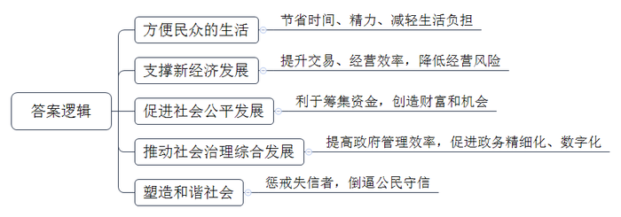
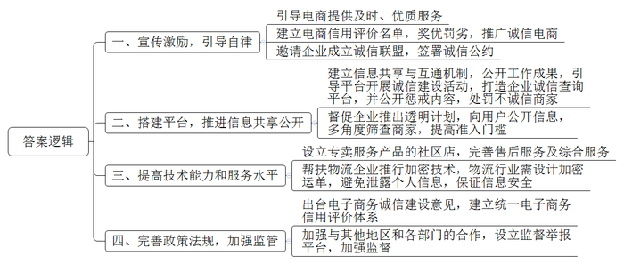

# 2019年公务员多省联考《申论》题（新疆县级卷）

<!-- gwy:overview:start -->
> **新疆 · 2019 · 申论 · 县级卷** ｜ 4 题 · 图片 4 处 · 答案随题折叠

导航：[题目](#题目)
<!-- gwy:overview:end -->

> 候选采集稿。参考答案及解析来自粉笔页面，不代表官方答案或真实高分答卷；来源使用许可与原卷对应关系仍需人工核实。

## 给定材料

### 材料 material-ee99797f89db73fa

2018年，小张到A市工作，在租房时，她惊喜地被中介告知，由于她的信用记录良好，所以不用缴纳两倍于月租的租房押金。小李到A市妇女儿童医疗中心就诊时发现，因为自己的信用度足够好，在医疗中心就可以“先诊疗后付费”，而无需一次次在诊室、检查室和交费处之间奔波，大大节省了自己的时间和精力。而同在A市的胡先生，却遇上了一件让他颜面尽失的事——原本在假期准备租辆越野车和朋友外出自驾游玩，没想到却被租车公司拒绝。原来，胡先生由于欠款许久未还，已经被列入了“老赖”的名单，导致自己的信用数据不佳，被禁止租车。

信用骑车、信用住店、公交车扫码乘车……这一幕一幕，都是真真切切正在我们身边发生的场景，告诉我们中国正在迈进信用社会。为加大信用教育的力度，拓宽常识教育的广度，团中央等多部门联合发起“金融安全专家校园行”活动。互联网金融服务公司L集团的运营官王先生受Z大学之邀，作为活动嘉宾来到学校，为现场近300名学生介绍信用安全的重要性及如何管理和保护个人信用。

在演讲中，王先生通过具体的事例为大家上了生动的一课：小吴在上大学期间使用信用卡买了一款高档手机，因为种种原因，在逾期数月后才还上欠款，当时她并没有在意。几年后，在她贷款买房时发现，因为自己的信用记录有过“污点”，不仅缩减了贷款数额，利率也相对高了很多。为此，小吴懊悔不已。王先生说，小吴绝不是个案，在很多学生眼中，对个人的信用记录毫不在意。兼职刷单、用信用卡违规套现的现象屡见不鲜，包括发生在校园的大部分金融欺诈行为也与之有关。

信用是一个人的终身档案和隐形简历，年轻人要学会保护个人信用，小心各类信用诈骗；同时也要学会管理个人信用，越早建立个人信用，随着时间推移，其信用分值会越来越高。对于废旧手机回收利用创业者周先生而言，信用就为他解决了“先收手机还是先付款”的难题。“先收手机，用户不放心。先付款，我们也怕损失。”周先生说，“引入信用评分后，对高分用户优先付款，不仅订单量上浮一倍，也没有出现违约情况。”与周先生一样，目前，多家共享单车企业已实现信用免押金，大大方便了新用户开通使用。一些共享汽车、共享租衣企业也在研究信用梯度收费模式，最大限度吸引用户。用户对信用的珍视也令人惊喜。以租车为例，引入信用评分后，行业租金欠款率下降了52%，违章罚款欠款率下降了27%。

在S市，26万老人领取养老金不用亲自跑腿去现场，只需要在手机上进行一次信用认证。购房者提取公积金时也不需要准备大量证明材料，柜台的人脸识别系统扫描后，他的相关信用信息迅速呈现。……在促进政务精细化管理方面，“信用”正在发挥越来越重要的作用，有着高信用值的市民在通过实名认证之后，越来越多的政务服务都可以通过互联网进行办理，“刷脸”即可，而无需到窗口排队，方便了自己的同时，也减轻了政府的“负担”。

某研究员说，信用既是商业社会的内在原则，也创造价值和财富。特别是在网络高度发达的今天，资源的分布不再局限于有形市场，而是分布在网络上。资金资源也不再集中在类似于银行这种金融机构身上，而是通过互联网分散分布。一个人只要拥有足够的信用水平，在网络上就能够筹集到资金。所以对于很多人来说，信用就意味着机会，意味着资本。

### 材料 material-f82f0a451f7e1139

老潘是G县龙台村农民，前些年一直在沿海某省的服装厂打工，收入也很稳定。但由于离家远，无法照顾子女，于是萌生了在家乡开服装加工厂的念头。可是租厂房、找工人、买机器设备几乎花光了他所有的积蓄，周转资金的事让老潘一筹莫展。万般无奈之下，妻子提出了找银行贷款的主意。令他们没想到的是，仅仅两天，老潘就如愿获得了5万元的贷款，服装厂顺利开工。老潘说，不用担保人，也无需资产抵押，简简单单就贷到款了。这样的便捷，就是因为“信用村”这个称号。

龙台村以农业为主，几年前，村民因既无合法抵押物和担保人，又无任何社会信用记录，无法获得银行贷款，基本生产资金靠民间借贷，更谈不上高投入、高产出。近年来，当地政府和银行成立“创建信用村”领导小组，结合该村实际情况，制定了《龙台村创建信用村实施方案》。政府建立“党群服务中心”并派专人常驻办公，相关银行全力参与。政府、银行和村民三方共同签订守信合约。合约约定村民用身份证在银行代办网点登记建立个人基本信息，银行核实后为村民建立永久信用基础信息档案，对农户进行信用评级。此外还对贫困户分别制定帮扶计划和脱贫致富奔小康规划，做到“一户一策，精准扶贫”。

在创建信用村过程中，针对部分农户不愿参与的情况，领导小组利用各种载体，广泛宣传信用村建设工作的重要意义和目标要求，采取“以先进带后进，正向激励形成面”的思路，发展一批“信用户”，根据信用等级对其授信2至5万元，及时为其提供低利率的创业及经营资金，让农户看到当上“信用户”的实惠。同时，“信用户”积极帮扶一般农户争创“信用户”，带领其维护和提升个人信用，发展养殖、种植发家致富。“这样做不仅有利于工作开展，还能促进村民之间信任互助的关系，形成良好的民风。”龙台村党支部书记说。

为强化“信贷+扶贫”的引领作用，针对农户不同的情况，领导小组量身定制不同扶贫信贷模式。像老潘这样有能力、有特长、缺资金的农户，银行发放信用贷款支持其自主创业。针对当地药材种植这一优势特色产业，专门出台信贷产品“药农贷”，支持药材种植户。此外，领导小组还在自愿的基础上，根据当地村民普遍种植红薯的情况，发放专门的项目扶贫贷款。该村红薯种植合作社成立后，吸收了48户贫困户入社，银行发放扶贫项目贷款70万元，支持他们种植红薯，这些农户因种植红薯户均收入大幅增加。

### 材料 material-b92cd39af830a4fa

“我做网店这么多年，深知经营者一旦失信，市场就会被扰乱，当你的客户不再相信你时，网店也到了尽头。所以我们必须诚信经营，这样市场才会越做越火，路越走越远。”凭借多年的努力，为满足客户需求上下求索，诚信经营，40多岁的农民张某走出了自己的电商致富路。

张某夫妇2014年创办了网店，主要销售地区特色农产品。在张某的心中，做电商想要销路好，最关键的是“诚信”。对于客户提出的问题和要求，他做到有问必答，对于电商上做得不好的细节，他有错必改，直到客户满意。有一次，张某发送给广东的“菜煎饼”专用饼，客户在收到货后，发现饼已经变质。客户把这一问题反映回来之后，张某立即查阅物流信息，发现货物在途中多耽误了几天，但是不管责任在谁，绝不能让客户受到损失，张某毫不犹豫地给客户补发了货物。客户知道原因后，要求和他共同承担责任，被他坚决地拒绝了。从此客户对他的产品更加青睐了。从一穷二白做起，凭着诚信经营，张某的网店经营范围逐步扩大，卖出的产品越来越多，收到的好评也越来越多，新客户、回头客络绎不绝。

近年来，随着大数据、云计算等互联网技术的大规模应用，电子商务迅猛发展，已成为我国国民经济的组成部分和重要增长点，对电子商务而言，诚信是其健康发展的重要基础，这已成为众多电商的行业共识。多家电商平台联合成立诚信联盟，签署《电子商务诚信公约》。该联盟旨在通过互联网手段促进行业自律。根据约定，联盟将建立信息共享机制，设立专属网站，实现联盟成员之间的信息互通，并向公众公开联盟工作成果。

多家电子商务平台也以自己的方式开展诚信建设活动。某平台推出企业诚信查询平台。用户登录后，只需要在网站输入企业名称或法定代表人信息，就能查询其信用等级以及企业相关情况。该平台还发布处罚公告，宣布永久关闭平台上36家以不正当手段牟取利益的商家店铺。

为了使用户享有便捷、可信、有保障的二手车服务，某二手车平台推出三大透明计划：检测报告、委托/交易合同、服务内容收费标准100%全公开，并做出三大必赔保障承诺：车况不符、车价赚差价、服务费不实必赔。另外，平台会分别通过管理、技术、监管等多个角度对车商进行识别筛除，要求平台的加盟商家签署《诚信商家承诺书》。

“电商诚信问题，有时候不是道德问题，而是技术能力和服务水平的问题。”一家电子商务平台的负责人说。电子商务让消费者头疼的一个问题就是售后服务跟不上。为此该平台专门设立只卖服务产品的社区店，围绕平台经营做好售后服务工作；同时，也为周边居民提供家装、推销、维修和保洁等综合服务。在个人隐私保护方面，某快递公司也设计了加密运单，让个人信息不再随包裹“裸奔”。据介绍，作为加密运单的快件，在派件时只有当班次出仓快件的收派员，才能通过手持智能终端扫描看到收件人的电话信息，而在快件运输环节中，没有人能看到隐藏的信息，保证了收寄件人的信息安全。

为促进电商市场的健康发展，国家接连出台法规和政策，推动电子商务领域诚信体系建设。2017年1月，国家发改委等九部门发布《关于全面加强电子商务领域诚信建设的指导意见》。2018年7月，商务部印发《2018年商务信用建设工作要点》。部署了包括电子商务在内的四个重点领域的信用工作。2018年8月31日，十三届全国人民代表大会常委会第五次会议表决通过《电子商务法》，明确提出“要推进电子商务诚信体系建设”。

地方政府也在积极响应。2018年8月，Y市正式出台了《全面加强电子商务领域诚信建设的实施意见》，逐步建立了统一的电子商务信用评价体系。该市的茶叶电商协会负责人说：“电商具有非常明显的跨地域性，不像传统线下商务那么直接、容易受到属地政府部门或行业组织的监管。电商平台模式对平台方信用程度的要求更高，政府部门、行业组织或信用机构依法进行信用监管是维护电子商务良好秩序的关键。”

### 材料 material-c5b8c502b2f1f37d

人无信不立，业无信不兴。诚信不仅是个人安身立命的根本，也是社会良序发展的基石。

党的十八大以来，党和国家高度重视诚信建设。习近平总书记在多个不同场合围绕诚信主题发表了一系列重要论述，从战略高度为新时代中国的诚信建设提供了基本遵循。他从历史维度、价值维度、实践维度对诚信问题进行了深刻阐述，进一步指出中华文化关于诚信的思想和理念，不论过去还是现在，都有其鲜明的民族特色，都有其永不褪色的时代价值。他强调，要运用法治手段解决道德领域突出问题。对突出的诚信缺失问题，既要抓紧建立覆盖全社会的征信系统，又要完善守法诚信褒奖机制和违法失信惩戒机制，使人不敢失信、不能失信。对见利忘义、制假售假的违法行为，要加大执法力度，让败德违法者受到惩治、付出代价。

为全面推进诚信建设，党和国家作出了一系列重要部署。中共中央办公厅印发的《关于培育和践行社会主义核心价值观的意见》强调：“以诚信建设为重点，加强社会公德、职业道德、家庭美德、个人品德教育，形成修身律己、崇德向善、礼让宽容的道德风尚。”中央文明委发布《关于推进诚信建设制度化的意见》，明确规定通过曝光失信当事人、限制严重失信者高消费行为等手段打击失信行为，这是我国第一份强调从制度层面推进国家诚信建设的中央文件。国务院先后发布《关于建立完善守信联合激励和失信联合惩戒制度加快推进社会诚信建设的指导意见》《关于加快推进失信被执行人信用监督、警示和惩戒机制建设的意见》，建立起社会诚信奖惩制度，并进一步完善了失信惩戒制度。诚信建设从注重教育走向教育与制度建设并重。

## 题目

### 第 1 题

**根据****“给定资料**2**”，请谈谈信用体系建设对当前社会有哪些积极影响？（15分）**

关联材料：材料 material-ee99797f89db73fa

作答要求：

要求：全面、准确、简明，不超过150字。

第 1 题 · 答案与解析

**参考答案（粉笔题库参考内容）**

一、方便民众的生活。节省时间、精力、减轻生活负担。

二、支撑新经济发展。提升交易、经营效率，降低经营风险。

三、促进社会公平发展。利于筹集资金，创造财富和机会。

四、推动社会治理综合发展。提高政府管理效率，促进政务精细化、数字化。

五、塑造和谐社会。惩戒失信者，倒逼公民守信。

**解析**

**参考答案说明：**本参考答案从“方便民众的生活”“支撑新经济发展”“促进社会公平发展”“推动社会治理综合发展”“塑造和谐社会”五个方面展开。各条答案要点之间在内容上相互并列，没有交叉。

**考点**：考点影响类

**来源**：来源2019年公务员多省联考《申论》题（新疆县级卷）

粉笔申论页面对本题只提供「解析视频」入口，该入口是会员推广位，页面无视频地址与文字解析。

### 第 2 题

**G县拟在全县范围内开展信用村创建工作，请根据“给定资料**3**”，谈谈龙台村的经验对这项工作有何启示。（20分）**

关联材料：材料 material-f82f0a451f7e1139

作答要求：

要求：

（1）紧扣资料，内容全面；

（2）层次分明，有逻辑性；

（3）不超过300字。

第 2 题 · 答案与解析

**参考答案（粉笔题库参考内容）**

一、建立完善信用记录。1.成立领导小组，结合当地实际，制定实施方案。2.建立党群服务中心，派专人常驻办公。3.鼓励银行、民众参与，签订三方合约。4.采集个人信息，核实后建立永久信用基础档案，进行信用评级。

二、正面激励农户使用信贷。1.宣传信用村建设工作的意义和目标。2.开展试点，发展“信用户”，根据信用等级确定授信资金额度，低利率支持创业。3.先进带动后进，“信用户”帮扶一般农户，带领其维护提升个人信用，发家致富。

三、建立信贷+精准扶贫模式。1.为有能力、有特长、缺资金的农户提供自主创业信贷支持。2.为发展优势特色产业，出台专门信贷产品。3.根据农民意愿和种植情况，发放扶贫贷款，建立合作社，规模化生产。

**解析**

**参考答案说明：**本参考答案从“建立完善信用记录”“正面激励农户使用信贷”“建立信贷+精准扶贫模式”这三个方面进行了分条撰写。各条要点之间在内容上相互并列，没有交叉。

**考点**：考点经验启示类

**来源**：来源2019年公务员多省联考《申论》题（新疆县级卷）

粉笔申论页面对本题只提供「解析视频」入口，该入口是会员推广位，页面无视频地址与文字解析。

### 第 3 题

**根据****“给定资料**4**”，假定你是某市市场监督管理局的工作人员，请就加强本市电商诚信体系建设提出政策建议。（25分）**

关联材料：材料 material-b92cd39af830a4fa

作答要求：

要求：

（1）紧扣资料，内容具体；

（2）层次分明，建议可行；

（3）不超过400字。

第 3 题 · 答案与解析

**参考答案（粉笔题库参考内容）**

一、宣传激励，引导自律。引导电商提供及时、优质服务；建立电商信用评价名单，奖优罚劣，推广诚信电商；邀请企业成立诚信联盟，签署诚信公约。

二、搭建平台，推进信息共享公开。建立信息共享与互通机制，公开工作成果，引导平台开展诚信建设活动，打造企业诚信查询平台，并公开惩戒内容，处罚不诚信商家；督促企业推出透明计划，向用户公开信息，多角度筛查商家，提高准入门槛。

三、提高技术能力和服务水平。设立专卖服务产品的社区店，完善售后服务及综合服务；帮扶物流企业推行加密技术，物流行业需设计加密运单，避免泄露个人信息，保证信息安全。

四、完善政策法规，加强监管。出台电子商务诚信建设意见，建立统一电子商务信用评价体系；加强与其他地区和各部门的合作，设立监督举报平台，加强监督。

**解析**

**参考答案说明**：本参考答案分别从“宣传激励，引导自律”“搭建平台，推进信息共享公开”“提高技术能力和服务水平”“完善政策法规，加强监管”这四个方面展开，各条答案要点分条罗列，在内容上无交叉。

**考点**：考点提出对策类

**来源**：来源2019年公务员多省联考《申论》题（新疆县级卷）

粉笔申论页面对本题只提供「解析视频」入口，该入口是会员推广位，页面无视频地址与文字解析。

### 第 4 题

**参考给定资料并联系实际，自拟题目，写一篇议论文。（****40分）**

关联材料：材料 material-c5b8c502b2f1f37d

作答要求：

要求：

（1）自选角度，立意明确；

（2）联系实际，不拘泥于资料；

（3）思路清晰，语言流畅；

（4）总字数1000-1200字。

第 4 题 · 答案与解析

**参考答案（粉笔题库参考内容）**

**信与用**

信用，一般指“诚信”。但若对“信用”做更深入的解读，则有“信”与“用”两层意思。“信”即诚信，是一种道德品质，也是一种制度和规则；“用”是一种方法，也是一种证明信的凭证。“信”与“用”相互促进、辩证统一，二者能形成良性循环，实现道德价值与实用价值的高度统一。因此，我们要建立社会诚信体系，并利用其推动社会进步、优化政府管理。

**建立社会诚信体系，要依靠法治手段，完善奖惩机制。**以往，教育是诚信建设的主要手段，但却已无法适应社会发展，而现代社会的奖惩机制就是最好补充。褒奖机制，奖励的是守信行为，形成正向激励。如给守信者提供医疗、教育、消费等领域的“免押金”支持，让群众看到诚信福利。惩戒机制，则要惩罚失信行为。被网友称为“教科书式老赖”的黄淑芬，就因其对法院判决有执行能力而拒不执行，所以被列入了全国法院失信被执行人名单。所以，法治是诚信体系建设的重要保障。

**完善社会诚信体系，要利用技术手段，广泛采集信息，丰富征信主体。**依靠法治建设诚信体系，需用大量信用数据。但诸如交通违章、社区违建、非法经营等行为却并未纳入信用体系，加之信息人口覆盖度不高，这使我们的诚信体系建设始终处于“初级阶段”。因此，拓宽信息角度、扩大覆盖人口便显得尤为重要。同时，我们还要推进征信主体多元化，引进民营机构，共同征信。只有各方运用现代技术，丰富信息内容，推进信息共享，才能让征信系统日趋完善。

征信系统的建立，能让社会更有“诚信”，我们也要充分“利用”这些信，因为只有“用”，才能更好地促进信、保护信，让信的基础更坚实、更可持续。

**要利用信用体系，便利群众生活，改善企业经营，推动社会进步。**支付宝中的“芝麻信用”，能让信用良好者享受到信用购、信用租、信用住等便利服务，这正是利用了信用积分来改变消费模式，让群众享受到便利。另外，企业也可以引入信用评分，与客户建立互信关系，降低交易风险，提高交易效率；甚至还可以结合信用梯度，创新收费方式，形成新兴商业模式。这些都会大大降低社会运行成本，促进社会发展，让人们更坚信“信”的作用。

**要用好信用体系，优化政务服务，改善社会治理，促进社会公平，提升政府管理水平。**战国时期，商鞅立木建信，从而推动商鞅变法，便已向我们展现了何为用“信”治国。而今，信用在政务服务中应用更加广泛。多地均已利用信用信息，实现了联网办理养老金、公积金领取服务。此外，一些贫困山村也用“信贷+扶贫”的模式帮助群众顺利贷款、成功脱贫。这正是用信用体系在缩小贫富差距、改善社会治理、促进社会公平。未来，我们更要充分利用征信系统，全面提升政府管理水平，让人们更深刻地体会“信”的价值。

孔子曰：“人而无信，不知其可也。”诚信的重要性早已不需赘述。而当代社会的“信”与“用”，更是不可分割的整体。我们只有让“信”为我所“用”，才能让我们朝着更规矩、更便利、更公平的社会不断前进。

**解析**

**文章分析**

**信与用**

【**标题的优点：**首先，范文的标题“信与用”突出文章主题，符合题目命题要求。】

信用，一般指“诚信”。但若对“信用”做更深入的解读，则有“信”与“用”两层意思。（1）“信”即诚信，是一种道德品质，也是一种制度和规则；“用”是一种方法，也是一种证明信的凭证。（2）“信”与“用”相互促进、辩证统一，二者能形成良性循环，实现道德价值与实用价值的高度统一。因此，我们要建立社会诚信体系，并利用其推动社会进步、优化政府管理。

【**开头的优点：**★内容方面。范文的开头是紧扣题目给定的“信与用”这一主题展开的。首先，开头即点出主题，做到了主题明确。其次，对“信与用”这一主题进行了分析阐述，指出了（1）“信与用”的含义，（2）“信与用”的关系。注意以上两个方面的阐述在逻辑上有先后顺序：先写“含义”，再写“关系”。★文字表达方面：长短句配合使用，使语言表达有节奏感。】

**建立社会诚信体系，要依靠法治手段，完善奖惩机制。**以往，教育是诚信建设的主要手段，但却已无法适应社会发展，（1）而现代社会的奖惩机制就是最好补充。褒奖机制，奖励的是守信行为，形成正向激励。如给守信者提供医疗、教育、消费等领域的“免押金”支持，让群众看到诚信福利。（2）惩戒机制，则要惩罚失信行为。被网友称为“教科书式老赖”的黄淑芬，就因其对法院判决有执行能力而拒不执行，所以被列入了全国法院失信被执行人名单。所以，法治是诚信体系建设的重要保障。

【**论述段****1的优点**：★观点句：范文的观点句是紧扣“信与用”这一文章主题提出的。形式上，它在段首处直接写出，位置突出，容易发现。内容上，内容要点明确，可以明显看出它是从“法治”入手，指出了如何“建立社会诚信体系”。★论述内容：（1）介绍了“奖励守信行为，形成正向激励”；（2）总结了“惩罚失信行为，起到警示作用”。注意：以上两个方面的内容都是紧扣“建立社会诚信体系，要依靠法治手段，完善奖惩机制”这个观点句进行分析论述的，论述的针对性强，内容层次丰富。论述方法上采用了讲道理、举例子相结合，做到了丰富多样。】

**完善社会诚信体系，要利用技术手段，广泛采集信息，丰富征信主体。**依靠法治建设诚信体系，需用大量信用数据。但诸如交通违章、社区违建、非法经营等行为却并未纳入信用体系，加之信息人口覆盖度不高，这使我们的诚信体系建设始终处于“初级阶段”。（1）因此，拓宽信息角度、扩大覆盖人口便显得尤为重要。同时，（2）我们还要推进征信主体多元化，引进民营机构，共同征信。只有各方运用现代技术，丰富信息内容，推进信息共享，才能让征信系统日趋完善。

【**论述段****2****的优点**：★观点句：范文的观点句是紧扣“信与用”这一文章主题提出的。形式上，它在段首处直接写出，位置突出，容易发现。内容上，内容要点明确，可以明显看出它是从“技术”入手，指出了如何“完善社会诚信体系”。★论述内容：（1）介绍了“拓宽信息角度、扩大覆盖人口”；（2）介绍了“推进征信主体多元化，引进民营机构”。注意：以上两个方面的内容都是紧扣“完善社会诚信体系，要利用技术手段，广泛采集信息，丰富征信主体”这个观点句进行分析论述的，论述的针对性强，内容层次丰富。论述方法上采用了讲道理、举例子相结合，做到了丰富多样。】

征信系统的建立，能让社会更有“诚信”，我们也要充分“利用”这些信，因为只有“用”，才能更好地促进信、保护信，让信的基础更坚实、更可持续。

【**过渡段：**阐述“只有‘用’才能更好地促进信、保护信，让‘信’的基础更坚实、更可持续”，同时起到引出下文中“用”的作用。】

**要利用信用体系，便利群众生活，改善企业经营，推动社会进步。**（1）支付宝中的“芝麻信用”，能让信用良好者享受到信用购、信用租、信用住等便利服务，这正是利用了信用积分来改变消费模式，让群众享受到便利。（2）另外，企业也可以引入信用评分，与客户建立互信关系，降低交易风险，提高交易效率；甚至还可以结合信用梯度，创新收费方式，形成新兴商业模式。这些都会大大降低社会运行成本，促进社会发展，让人们更坚信“信”的作用。

【**论述段****3****的优点**：★观点句：范文的观点句是紧扣“信与用”这一文章主题提出的。形式上，它在段首处直接写出，位置突出，容易发现。内容上，内容要点明确，可以明显看出它是从“群众、企业”入手，指出了如何“利用信用体系”。★论述内容：（1）介绍了“让信用良好者享受生活便利”；（2）介绍了“引导企业利用信用信息，创新发展模式”。注意：以上两个方面的内容都是紧扣“要利用信用体系，便利群众生活，改善企业经营，推动社会进步”这个观点句进行分析论述的，论述的针对性强，内容层次丰富。在论述方法上采用了讲道理、举例子相结合，做到了丰富多样。】

**要用好信用体系，优化政务服务，改善社会治理，促进社会公平，提升政府管理水平。**战国时期，商鞅立木建信，从而推动商鞅变法，便已向我们展现了何为用“信”治国。而今，（1）信用在政务服务中应用更加广泛。多地均已利用信用信息，实现了联网办理养老金、公积金领取服务。此外，一些贫困山村也用“信贷+扶贫”的模式帮助群众顺利贷款、成功脱贫。（2）这正是用信用体系在缩小贫富差距、改善社会治理、促进社会公平。未来，我们更要充分利用征信系统，全面提升政府管理水平，让人们更深刻地体会“信”的价值。

【**论述段****4****的优点**：★观点句：范文的观点句是紧扣“信与用”这一文章主题提出的。形式上，它在段首处直接写出，位置突出，容易发现。内容上，内容要点明确，可以明显看出它是从“政府”入手，指出了如何“用好信用体系”。★论述内容：（1）介绍“完善政务服务，改善群众体验”；（2）介绍“信用扶贫，促进社会公平”。注意：以上两个方面的内容都是紧扣“要用好信用体系，优化政务服务，改善社会治理，促进社会公平，提升政府管理水平”这个观点句进行分析论述的，论述的针对性强，内容层次丰富。在论述方法上采用了讲道理、举例子相结合，做到了丰富多样。】

【**论述段之间的关系**：★内容的内在逻辑：范文的论述段之间是依照并列逻辑展开的。论述段1、2先写了“信”，论述段3、4再写了“用”。★段与段的外在衔接：过渡段起到了承接论述段1、2，引出论述段3、4的作用。】

孔子曰：“人而无信，不知其可也。”诚信的重要性早已不需赘述。而当代社会的“信”与“用”，更是不可分割的整体。我们只有让“信”为我所“用”，才能让我们朝着更规矩、更便利、更公平的社会不断前进。

【**结尾的优点：**范文的结尾回扣了“信与用”这一主题。（1）再次总结了“信与用”；（2）发出了号召希望。】

**考点**：考点文章写作题

**来源**：来源2019年公务员多省联考《申论》题（新疆县级卷）

粉笔申论页面对本题只提供「解析视频」入口，该入口是会员推广位，页面无视频地址与文字解析。

