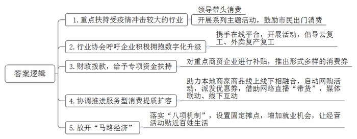
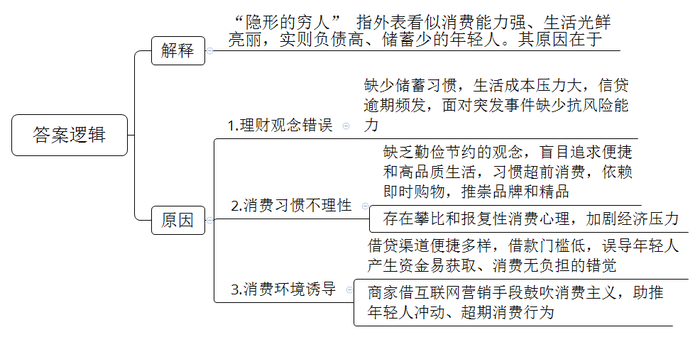
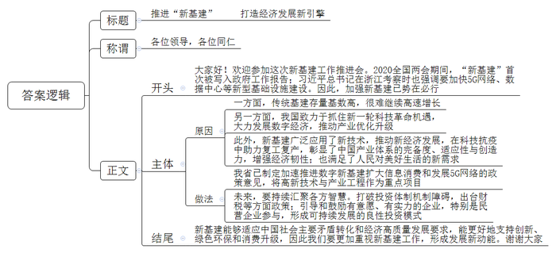
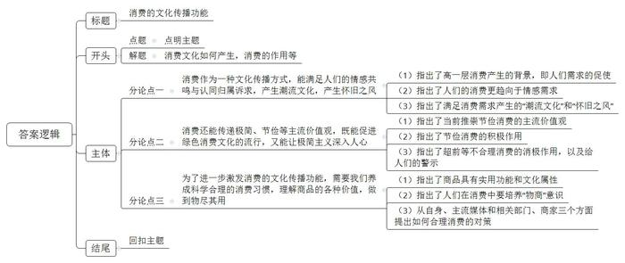

# 2020年新疆下半年公考《申论》题（县级卷）

> 候选采集稿。参考答案及解析来自粉笔页面，不代表官方答案或真实高分答卷；来源使用许可与原卷对应关系仍需人工核实。

## 给定材料

### 材料 material-1161ad9a664e554b

“我已经两个多月没吃火锅了，今天真的非常解馋。”2020年3月17日中午，C市李市长和市商务委主任一道“下馆子”，来到C市某火锅店，用微信点单吃了一顿火锅。“我们上周日重新开业，目前营业额已经恢复到往常的70%左右了。”市长的这次“站台”，让火锅店总经理Y对接下来的复工复产充满信心。

来自商务部的数据显示，截至3月16日，全国住宿餐饮等生活服务企业复工率超60%，滞后于制造业。服务业复苏，前提是复市，而复市的动力源于消费。目前，各地疫情得到缓解，但消费者“出门”意愿仍不高，商务部市场建设司司长L表示，消费者信心恢复还需要时间。

地方政府现在要做的就是让市民“走出来”，让消费“旺起来”。L坦言，餐饮、零售、住宿等行业涉及很多中小微企业，解决了商贸领域的复工复产问题，就解决了C市近半务工人员的就业问题。

除了领导干部带头“下馆子”，近期，各地各部门相继出台了一些扩大消费的重大举措，重点扶持餐饮、旅游等受疫情冲击较大的行业。在C市，为吸引广大市民走出家门，拥抱春暖花开，享受美好生活，C市商务委集中开展“十个一”系列主题活动，包括号召市民吃一碗小面、涮一次火锅、做一回美容美发等等，共同唤醒消费活力。

政府大力扶持，行业协会也不断为企业鼓劲出力。2月底，C市小面协会和E平台共同呼吁C市小面“云复工”，不少堂食受影响的小店纷纷通过外卖复工复产。3月初，C市商务委携手E平台，启动“一碗面叫醒一座城”活动，呼吁C市小面积极拥抱数字化升级。

为让消费端活起来，逐渐唤醒整个城市经济生态闭环，C市各级政府从提振消费信心入手，拿出“真金白银”，扶持商贸企业复工复产。在C市渝北区，商贸企业得到了2000万元专项资金帮助。据渝北区商务委主任介绍，经过加快审批、加紧拨付，全区目前已兑付864万元资金，112个受疫情影响严重的住宿餐饮、批发零售企业拿到了补贴。餐饮券、超市券、乡村旅游券……3月以来，C市推出了形式多样的消费券，取得了积极成效。

4月26日，由C市商务部门主办的2020年“双品网购节”正式启动，助力C市本地商家、商品的线上线下融合，协调推动餐饮、娱乐、百货、本地生活等服务型消费提质扩容。C市近百家企业参与其中，通过线上优惠券派发，线上线下融合等方式，提升品牌消费、促进品质消费、积极培育消费热点、促进消费回补升级。活动当天，商家还借助网络直播“带货”、媒体联动及线下互动等形式，让消费者多渠道直观了解商品信息。据悉，活动期间，X电器、J家居、W百货分别投入2000万元补贴让利消费者。W百货餐饮区商家全部进行7折优惠活动。一些C市景区、酒店等品牌商家也以不同方式参与到活动中。据不完全统计，“双品网购节”活动前三日，仅X电器、J家居、W百货三家企业，累计销售额达到2651.7万元。

“520我爱农”C市首届电商直播网购节活动于5月20日正式启动。10个县（市、区）的“一把手”纷纷走进直播间尝试带货，为当地特产代言。市长、县长当代言人，自带信任度，而且直播间价格实惠，当晚收获了不错的销售额。13个地方的直播间观看人数超过2000万，销售总金额达2048万元。有位网友评论：“直播间里的领导没有领导架子，但这就是为人民服务的样子。”

“听说社区设置了固定摊点以后，我立马就去申请入驻。现在天气渐热，我的水果摊生意越来越好。”家住C市东河社区的邹大姐说。邹大姐和丈夫在春节前辞去了原来工厂的工作，没想到一场疫情，让他们的谋生之路变得艰难起来。现在C市在“八项机制”规范下放开“马路经济”，街头巷尾的小摊小贩，在增加大量就业机会的同时，也把这种“接地气”的经营活动与老百姓的“柴米油盐酱醋茶”无缝对接。尤其是夏日夜间经济消费活力的持续释放，让C市的“烟火气”成色十足。

### 材料 material-d94cd42c1d031664

央行发布的《2019年第一季度支付体系运行总体情况》数据显示，信用卡逾期半年未偿信贷总额高达797.43亿元。据相关数据显示2010年的此项数据还不过是76.89亿元，然而到了2019年这个数字整整翻了10倍以上。而比这个数据更令人震惊的是90后的负债数据调查：90后的平均负债已经是他们月收入的18.5倍。根据机构的调研数据显示：10-34岁年轻人平均月储蓄为1339元。这意味着现今社会的大部分年轻人已经不存钱了。隐形的穷人，已然成为这一代年轻人最显著的标签。巨大的生活压力和成本，加上错误的理财观念，致使很多的年轻人一贫如洗，成为月光族。维持所谓理想的生活，疯狂的信贷逾期，深陷冰火两重天的年轻人，已然成为一大社会问题。

“花明天的钱，圆今天的梦”，90后已经习惯了超前消费。“对于现在的年轻人，能用钱解决的问题都不是问题，方便最重要、时间最重要。习惯了方便，哪里还习惯得了节俭。”90后小吴说，“结婚前很少做饭，结婚后去市场买了一个月菜，觉得特别麻烦。后来发现了有直接送菜到家的即时购物方式，偶尔还有优惠，那么方便，我宁可多付些运费，省时省力，多好！”“现在的年轻人太不懂勤俭的美德，也没有理性消费的概念。”小吴的妈妈宁女士刚刚退休，60后的她经常说女儿“只花钱，不攒钱，不会过日子。”小吴对此有自己的看法：“社会大环境的变化，都在表明一样东西：消费能让国家经济发展，让人们的生活越来越便利。90后存不下钱不是任性，是我们都想在这个时代有更好的生活质量，这是符合时代发展趋势的。”

“现在真是跟不上年轻人的生活节奏了。”宁女士对女儿家使用的黑科技感到眼花缭乱，扫地机器人、厨房的标配手势功能、冰箱搭载售卖食品终端等，被女儿称之为品牌、精品的个性化、定制化、智能化电器功能令她一筹莫展。

一场疫情，炸出了多少隐形穷人。他们过着光鲜亮丽的生活，原本以为，工资够花就行，存款为零才是年轻人的常态。可是，人生充满不确定性，突发的黑天鹅事件令人猝不及防。小吴在疫情期间失业了，这让她措手不及，她愁得整宿睡不着觉：房贷、车贷以及空空如也的存款，让原本花钱大手大脚的她，现在开始算起了肉价……疫情的肆虐，让那些没有存款的人倍感冲击。社交平台上有人问：“疫情复工的第一天，你有怎样的感触？”小吴说最戳心的一个回答是：“从来没有哪个时刻，像现在一样，让我感觉此前过得太敷衍。以后我要努力赚钱，认真工作和生活。”

现在打开手机应用市场，随便输入一个“借贷”字眼，都能轻松找到500个以上的APP，在填写个人基本资料后即可获得贷款，如此方便的借贷消费环境，只会给年轻人一个致命的假象：钱，来得真容易；钱，花得真爽快。在这个互联网营销的时代，不少商家都在鼓吹年轻人应该“及时行乐，该买就买”，这也一定程度上助长了年轻人的冲动消费、超期消费。

如今，大家从抖音上看到别的小姐姐生活得这么精致，非得自己也要这么精致，但是收入跟不上啊，只能超前消费。广告用钻戒代表婚姻，让结婚就得用钻戒的观念深入人心。除了婚戒外，还有很多东西，比如：女性追求的奢侈品包包，男性追求的名表，这些东西就是商家告诉你，买了，你就是一个高档的人了。很多人为了外在的面子买、买、买，最终把自己包装成成功的负债者。

外卖平台数据显示，疫情后复工第四周，仅S市就售出7.2万杯珍珠奶茶。这些“珍珠”可以填满一个国际标准游泳池。与此同时，要求大杯和超大杯的奶茶订单也比去年12月正常一周增加了3.4倍，被疫情压抑的消费需求可见一斑。虽然网友们纷纷叫嚣着“钱包不允许我报复性消费”，但复工之后还是没忍住用“报复性喝奶茶”安慰一下自己。

“当前社会一个重要矛盾，是人民群众疫情后日益增长的报复性消费的需求，和口袋里没钱之间的矛盾。”经济学家R近日说的这番话，引起来很多人的共鸣。中国财富管理50人论坛4月8日组织的《新冠疫情对恩格尔系数和家庭消费行为的冲击》课题讨论会透露，“疫情造成居民对就业形式和收入增长预期悲观，可能导致整体预防性储蓄上升，家庭资产资金流动性不足，尤其是低收入阶层受到的冲击较大，受上述因素影响，2020年家庭预期总消费支出将减少11%。”X大学和M研究院4月21日联合发布的《疫情下中国家庭财富变动趋势》显示，一季度，有50.2％的家庭增加储蓄并减少消费，有40.4％的家庭维持当前状况基本不变，仅9.4％的家庭减少储蓄增加消费。面对充满不确定性的未来，能带来最大安全感的就是存款，如此，大多数普通人的消费行为必然趋于保守，更多人放弃报复性消费，转向报复性存钱。

### 材料 material-0704c35ecd956133

2020全国两会期间，国务院领导在《政府工作报告》中提出了“加强新型基础设施建设”，这是“新基建”首次被写入政府工作报告，并列入“既促消费惠民生又调结构增后劲”的范畴。国家发改委明确新基建范围，提出“以新发展理念为引领、以技术创新为驱动、以信息网络为基础，面向高质量发展的需要，打造产业的升级、融合、创新的基础设施体系”的目标。

2020年4月1日，习近平总书记在浙江考察时强调：“要抓住产业数字化、数字产业化赋予的机遇，加快5G网络、数据中心等新型基础设施建设，抓紧布局数字经济、生命健康、新材料等战略性新兴产业、未来产业，大力推进科技创新，着力壮大新增长点、形成发展新动能。”

经过连续多年大规模投资，传统基建领域的存量基数已经很高，再维持高速增长并不现实。近年来，我国一直致力于抓住新一轮科技革命机遇，大力发展数字经济，推动产业优化升级。科技部发布的全国技术市场交易快报显示，2019年我国技术合同成交额首次超过2万亿元。随着国家对“新基建”支持力度不断加大，各地也在加速“新基建”项目的投资和落地。据不完全统计，截至4月中旬已有13个省区市发布了2020年新基建相关重点项目投资计划，其中8个省份公布了计划总投资额共计33.83万亿元。S省政府制定了加速推进数字新基建扩大信息消费和支持发展5G网络的政策意见，公布了2020年度数字经济重点投资项目与新基建行动方案，首批重大项目3年投资2700亿元，其中高新技术与产业工程项目占比六成。据预测，单是5G网络，到2025年国家的建设投资便将累计达到1.2万亿元，而同时5G商用直接带动的经济总产出将达10.6万亿元。

新冠肺炎疫情对我国经济社会发展带来前所未有的冲击，然而，疫情也为新经济的成长提供了机遇。“云端”会议，远程办公，智能施工，直播卖货，机器人配送……这不是科幻电影里的片段，而是当下中国新经济的剪影，是网友口中“辛勤耕‘云’”“努力种‘数’”的智慧春天。新经济在科技抗疫中彰显威力。人工智能诊断技术在20秒内对疑似病例的CT影像进行判读，准确率高达96%；算法将新冠病毒全基因组二级结构预测时间从55分钟缩短至27秒，提速120倍；健康码集纳各类数据，直观显示亿万人的旅行轨迹和人员接触情况……云计算、大数据、人工智能等新技术让疫情防控“耳聪目明”，而疫情防控客观上创造了新技术更多元、更丰富的应用场景。新经济为复工复产保驾护航。居家办公、“云端”会议，移动产品助力“停班不停工”；智能工厂、云监工，智能制造支撑“人休机不休”；无人配送、非接触采购，互联网平台满足“宅生活”；订单共享、非接触定制，工业互联网平台承接企业需求，赋能全国多地企业复产复工……以高效、便捷、共享为特点的新经济，不仅“四两拨千斤”助力复工复产，更为柔性转产和产能共享“添薪加柴”，彰显了中国产业体系的完备度、适应性与创造力，使中国经济韧性十足。

这些在疫情防控中涌现的新业态、新模式，看似“应急之举”，实则是经济增长的强大引擎。3月，高技术制造业增加值同比增长8.9%。“新基建和传统基建一个最大的区别肯定是广泛应用了新技术，满足了经济发展及人民对美好生活的新需求。”工业和信息化部城市经济研究中心王主任认为：“比起传统基建，‘新基建’的技术性、专业性以及市场不确定性相对较强，需要更加有效地发挥各方合力、集聚创新智慧。这就要求我们打破过去基建设施投资中的‘玻璃门’‘弹簧门’等体制机制障碍，出台财税、金融、产业等方面政策，引导和鼓励有意愿有实力的企业，特别是民营企业参与进来，让新型基础设施领域投资形成可持续发展的良性模式。”

《2020中国新基建产业报告》指出，新基建能够适应中国社会主要矛盾转化和中国经济迈向高质量发展要求，能更好地支持创新、绿色环保和消费升级，在补短板的同时为新引擎助力，这是新时代对新基建的本质要求。

## 题目

### 第 1 题

**结合“给定资料**1**”概述疫情缓解之后C市提振消费信心，释放消费活力的主要举措。（10分）**

关联材料：material-1161ad9a664e554b

作答要求：

要求：

（1）准确、全面；

（2）恰当提炼，条理清晰；

（3）不超过250字。

### 第 2 题

**请结合****“****给定资料**2**”****，谈谈为什么说****“****隐形的穷人，已****然****成为这一代年轻人最显著的标签****”****。（****25****分）**

关联材料：material-d94cd42c1d031664

作答要求：

要求：准确、全面、有条理。不超过300字。

### 第 3 题

**为了响应国家号召，深入推进新基建工作的开展，****S****省政府计划召开全****省****新基建工作推进会，假如你是省政府工作人员，请结合****“****给定资料**3**”****，为本次推进会写一份讲话稿。（****25****分）**

关联材料：material-0704c35ecd956133

作答要求：

要求：

（1）目的明确，切合主题；

（2）内容具体，层次清楚；

（3）语言得体，表达简洁流畅；

（4）不超过500字。

### 第 4 题

**“给定资料**4**”中划线句子提到“消费的作用不仅仅只在经济方面，还有文化，消费也是一种文化传播方式。”请根据你对这句话的理解，结合给定资料，自拟题目，自选角度，写一篇文章。（40分）**

关联材料：material-1161ad9a664e554b

作答要求：

要求：

（1）立意明确，见解深刻；

（2）思路明晰，语言流畅；

（3）参考给定资料，但不拘泥于给定资料；

（4）总字数900-1100字。

## 答案与解析

第 1 题

**参考答案（粉笔题库参考内容）**

1.重点扶持受疫情冲击较大的行业。领导带头消费；开展系列主题活动，鼓励市民出门消费。

2.行业协会呼吁企业积极拥抱数字化升级。携手在线平台，开展活动，倡导云复工、外卖复产复工。

3.财政拨款，给予专项资金扶持。对重点商贸企业进行补贴，推出形式多样的消费券。

4.协调推进服务型消费提质扩容。助力本地商家商品线上线下相融合，启动网购活动，派发优惠券，借助网络直播“带货”，媒体联动、线下互动。

5.放开“马路经济”。落实“八项机制”，设置固定摊点，增加就业机会，让经营活动贴近百姓生活。

**解析**

**参考答案说明：**本参考答案从“重点扶持受影响行业”“发挥行业协会作用”“政府财政拨款支持”“服务型消费提质扩容”“放开‘马路经济’”这五个方面进行了分条撰写。各条要点之间在内容上相互并列，没有交叉。

**考点**：考点概括措施类

**来源**：来源2020年新疆下半年公考《申论》题（县级卷）

粉笔申论页面对本题只提供「解析视频」入口，该入口是会员推广位，页面无视频地址与文字解析。

第 2 题

**参考答案（粉笔题库参考内容）**

“隐形的穷人”指外表看似消费能力强、生活光鲜亮丽，实则负债高、储蓄少的年轻人。其原因在于：

1.理财观念错误。缺少储蓄习惯，生活成本压力大，信贷逾期频发，面对突发事件缺少抗风险能力。

2.消费习惯不理性。缺乏勤俭节约的观念，盲目追求便捷和高品质生活，习惯超前消费，依赖即时购物，推崇品牌和精品；存在攀比和报复性消费心理，加剧经济压力。

3.消费环境诱导。借贷渠道便捷多样，借款门槛低，误导年轻人产生资金易获取、消费无负担的错觉；商家借互联网营销手段鼓吹消费主义，助推年轻人冲动、超期消费行为。

**解析**

**参考答案说明：**本参考答案先对“隐形的穷人”进行了解释，然后从“理财观念错误”“消费习惯不理性”“消费环境诱导”三个方面分析了“隐形的穷人”产生的原因。各条要点之间在内容上相互并列，没有交叉。

**考点**：考点原因类

**来源**：来源2020年新疆下半年公考《申论》题（县级卷）

粉笔申论页面对本题只提供「解析视频」入口，该入口是会员推广位，页面无视频地址与文字解析。

第 3 题

**参考答案（粉笔题库参考内容）**

推进“新基建” 打造经济发展新引擎

各位领导，各位同仁：

大家好！欢迎参加这次新基建工作推进会。2020全国两会期间，“新基建”首次被写入政府工作报告；习近平总书记在浙江考察时也强调要加快5G网络、数据中心等新型基础设施建设。因此，加强新基建已势在必行。

一方面，传统基建存量基数高，很难继续高速增长，另一方面，我国致力于抓住新一轮科技革命机遇，大力发展数字经济，推动产业优化升级。此外，新基建广泛应用了新技术，推动新经济发展，在科技抗疫中助力复工复产，彰显了中国产业体系的完备度、适应性与创造力，增强经济韧性；也满足了人民对美好生活的新需求。

我省已制定加速推进数字新基建扩大信息消费和发展5G网络的政策意见，将高新技术与产业工程作为重点项目。未来，要持续汇聚各方智慧。打破投资体制机制障碍，出台财税等方面政策；引导和鼓励有意愿、有实力的企业，特别是民营企业参与，形成可持续发展的良性投资模式。

新基建能够适应中国社会主要矛盾转化和经济高质量发展要求，能更好地支持创新、绿色环保和消费升级，因此我们要更加重视新基建工作，形成发展新动能。谢谢大家！

**解析**

**参考答案说明：**（1）格式方面，本参考答案写到了“标题”“称谓”“正文”。（2）正文部分，一方面从内容来看，围绕着“新基建”这一主题，本参考答案的开头写到了发展新基建的政策背景；主体部分主要介绍了国家支持新基建发展的原因，推进新基建建设的具体做法、规划；结尾部分主要介绍了发展新基建的重要性。另一方面，形式上，本参考答案做到了分段、分条撰写，整体上条理较为清晰。

**考点**：考点总结类

**来源**：来源2020年新疆下半年公考《申论》题（县级卷）

粉笔申论页面对本题只提供「解析视频」入口，该入口是会员推广位，页面无视频地址与文字解析。

第 4 题

**参考答案（粉笔题库参考内容）**

**消费的文化传播功能**

谈及消费，很多人的第一反应是拉动经济增长的“三驾马车”之一，诚然，它能形成新的需求，促进生产发展，增加就业岗位，进而促进经济发展。但除了经济方面的功用之外，消费还是一种文化传播方式，能在消费物品实用性的基础上，挖掘其中的深层次精神价值，并将其转化为意识形态的美学消费，进而衍生出一种消费文化，让人们摆脱物质消费的虚无感，获得更高的精神体验。

**消费****作为一种文化传播方式，****能满足人们的情感共鸣与认同归属诉求，产生潮流文化，产生怀旧之风。**马斯诺需求层次理论指出人类需求从低到高可分为生理需求、安全需求、社交需求、尊重需求和自我实现需求。随着物质生活水平的不断提高，人们在消费过程中越来越不满足于低层次的生理、安全需要，更趋向于情感需求，尤其是情感共鸣与认同归属的诉求。为了满足这种需求，人们追赶消费潮流，会消费网红爆款产品，衍生出热门语言、热门创作等，形成潮流文化；同时，人们也会关注记忆深刻的产品，如消费“我的18岁”“80后”等食品饮料，带来一系列“情怀杀”，掀起怀旧之风。

**消费还能传递极简、节俭等主流价值观，既能促进绿色消费文化的流行，又能让极简主义深入人心。**当前，主流媒体倡导“如无必要、勿买实体”“不用完不新买”等节俭消费行为，这是对我国传统美德的弘扬，也是对主流价值观的推崇。节俭消费既能避免资源浪费，促进生态环保，让人们更全面地理解绿色消费主义，又能培养人们的极简生活习惯，避免被纷繁复杂的物质所累，达到更高层次的精神享受。而超前消费、报复性消费等不合理消费会导致高负债，难以维持正常生活，这会起到警醒作用，驱使人们合理适度消费，助推绿色消费文化和极简主义盛行。

**为了进一步激发消费的文化传播功能，需要我们养成科学合理的消费习惯，理解商品的各种价值，做到物尽其用。**商品具有实用功能，也具有文化属性，人们在消费商品时不能因喜新厌旧而抛弃一件具有实用价值的商品，也不能因功能单一而丢弃一件具有文化附加值的商品。我们需要在消费的过程中培养“物商”意识，充分挖掘商品的多重价值，最大程度地享受物质，养成节俭消费的好习惯。这既是对传统文化的弘扬，也是对主流文化的助推。为此，我们要加强自律，避免盲目支出与过度浪费；主流媒体和相关部门要肩负社会责任，宣传不攀比、务实的消费理念；商家也要避免“哄抢”营销，倡导适度购买。

消费不仅能拉动经济发展，又能满足人们的情感诉求，产生潮流文化、怀旧之风，还能传递主流价值观，助推绿色消费文化、极简主义发展。我们要注重消费的文化传播价值，培养科学合理的消费习惯，让其助推文化发展！

**解析**

**文章分析**

**消费的文化传播功能**

【**标题的优点：**标题体现了“消费文化”这一主题，文章主题突出、清晰。】

（1）谈及消费，很多人的第一反应是拉动经济增长的“三驾马车”之一，诚然，它能形成新的需求，促进生产发展，增加就业岗位，进而促进经济发展。但除了经济方面的功用之外，（2）消费还是一种文化传播方式，能在消费物品实用性的基础上，挖掘其中的深层次精神价值，并将其转化为意识形态的美学消费，进而衍生出一种消费文化，让人们摆脱物质消费的虚无感，获得更高的精神体验。

【**开头的优点：**★内容方面。范文的开头是紧扣题目给定的“消费”这一主题展开的。首先，开头第一句话点出主题，做到了主题明确。其次对“消费”这一主题进行了分析阐述，指出了：（1）“消费”的经济功能；（2）“消费”的文化传播功能。★文字表达方面。使用了“并……进而……”等关联词，语言表达清晰有逻辑。】

**消费作为一种文化传播方式，能满足人们的情感共鸣与认同归属诉求，产生潮流文化，产生怀旧之风**。（1）马斯诺需求层次理论指出人类需求从低到高可分为生理需求、安全需求、社交需求、尊重需求和自我实现需求。（2）随着物质生活水平的不断提高，人们在消费过程中越来越不满足于低层次的生理、安全需要，更趋向于情感需求，尤其是情感共鸣与认同归属的诉求。（3）为了满足这种需求，人们追赶消费潮流，会消费网红爆款产品，衍生出热门语言、热门创作等，形成潮流文化；同时，人们也会关注记忆深刻的产品，如消费“我的18岁”“80后”等食品饮料，带来一系列“情怀杀”，掀起怀旧之风。

【**论述段****1的优点：**★观点句：范文的观点句是紧扣“消费”这一文章主题提出的。形式上，它在段首处直接写出，位置突出，容易发现。内容上，关键词突出，内容要点明确。★论述内容：（1）指出了高一层消费产生的背景，即人们需求的促使；（2）指出了人们的消费更趋向于情感需求；（3）指出了满足消费需求产生的“潮流文化”和“怀旧之风”。注意：以上三个方面的内容都是紧扣观点句“消费作为一种文化传播方式，能满足人们的情感共鸣与认同归属诉求，产生潮流文化，产生怀旧之风”进行分析论述的，层次清晰，论述的针对性强。在论述方法上主要采用了举例子讲道理相结合。】

**消费还能传递极简、节俭等主流价值观，既能促进绿色消费文化的流行，又能让极简主义深入人心**。（1）当前，主流媒体倡导“如无必要、勿买实体”“不用完不新买”等节俭消费行为，这是对我国传统美德的弘扬，也是对主流价值观的推崇。（2）节俭消费既能避免资源浪费，促进生态环保，让人们更全面地理解绿色消费主义，又能培养人们的极简生活习惯，避免被纷繁复杂的物质所累，达到更高层次的精神享受。（3）而超前消费、报复性消费等不合理消费会导致高负债，难以维持正常生活，这会起到警醒作用，驱使人们合理适度消费，助推绿色消费文化和极简主义盛行。

【**论述段****2****的优点：**★观点句：范文的观点句是紧扣“消费”这一文章主题提出的。形式上，它在段首处直接写出，位置突出，容易发现。内容上，关键词突出，内容要点明确。★论述内容：（1）指出了当前推崇节俭消费的主流价值观；（2）指出了节俭消费的积极作用；（3）指出了超前等不合理消费的消极作用，以及给人们的警示。注意：以上三个方面的内容都是紧扣观点句“消费还能传递极简、节俭等主流价值观，既能促进绿色消费文化的流行，又能让极简主义深入人心”进行分析论述的，层次清晰，论述的针对性强。在论述方法上主要采用了举例子讲道理相结合。】

**为了进一步激发消费的文化传播功能，需要我们养成科学合理的消费习惯，理解商品的各种价值，做到物尽其用**。（1）商品具有实用功能，也具有文化属性，人们在消费商品时不能因喜新厌旧而抛弃一件具有实用价值的商品，也不能因功能单一而丢弃一件具有文化附加值的商品。（2）我们需要在消费的过程中培养“物商”意识，充分挖掘商品的多重价值，最大程度地享受物质，养成节俭消费的好习惯。这既是对传统文化的弘扬，也是对主流文化的助推。为此，（3）我们要加强自律，避免盲目支出与过度浪费；主流媒体和相关部门要肩负社会责任，宣传不攀比、务实的消费理念；商家也要避免“哄抢”营销，倡导适度购买。

【**论述段****3****的优点：**★观点句：范文的观点句是紧扣“消费”这一文章主题提出的。形式上，它在段首处直接写出，位置突出，容易发现。内容上，关键词突出，内容要点明确。★论述内容：（1）指出了商品具有实用功能和文化属性；（2）指出了人们在消费中要培养“物商”意识；（3）从自身、主流媒体和相关部门、商家三个方面提出如何合理消费的对策。注意：以上三个方面的内容都是紧扣观点句“为了进一步激发消费的文化传播功能，需要我们养成科学合理的消费习惯，理解商品的各种价值，做到物尽其用”进行分析论述的，层次清晰，论述的针对性强。在论述方法上主要采用了举例子讲道理相结合。】

【**论述段之间的关系：**★内容的内在逻辑：范文的论述段之间有两层逻辑展开的。整体上是从“消费的意义”到“合理消费的对策”的逻辑展开。论述段1先写了“消费能满足人们的情感共鸣与认同归属诉求”，论述段2又写了“消费能传递极简、节俭等主流价值观”，最后论述段3从对策角度写了“如何养成科学合理的消费习惯”。】

消费不仅能拉动经济发展，又能满足人们的情感诉求，产生潮流文化、怀旧之风，还能传递主流价值观，助推绿色消费文化、极简主义发展。我们要注重消费的文化传播价值，培养科学合理的消费习惯，让其助推文化发展！

【**结尾的优点**：范文的结尾回扣了“消费”这个主题，并发出了呼吁和号召。】

**考点**：考点文章写作题

**来源**：来源2020年新疆下半年公考《申论》题（县级卷）

粉笔申论页面对本题只提供「解析视频」入口，该入口是会员推广位，页面无视频地址与文字解析。

